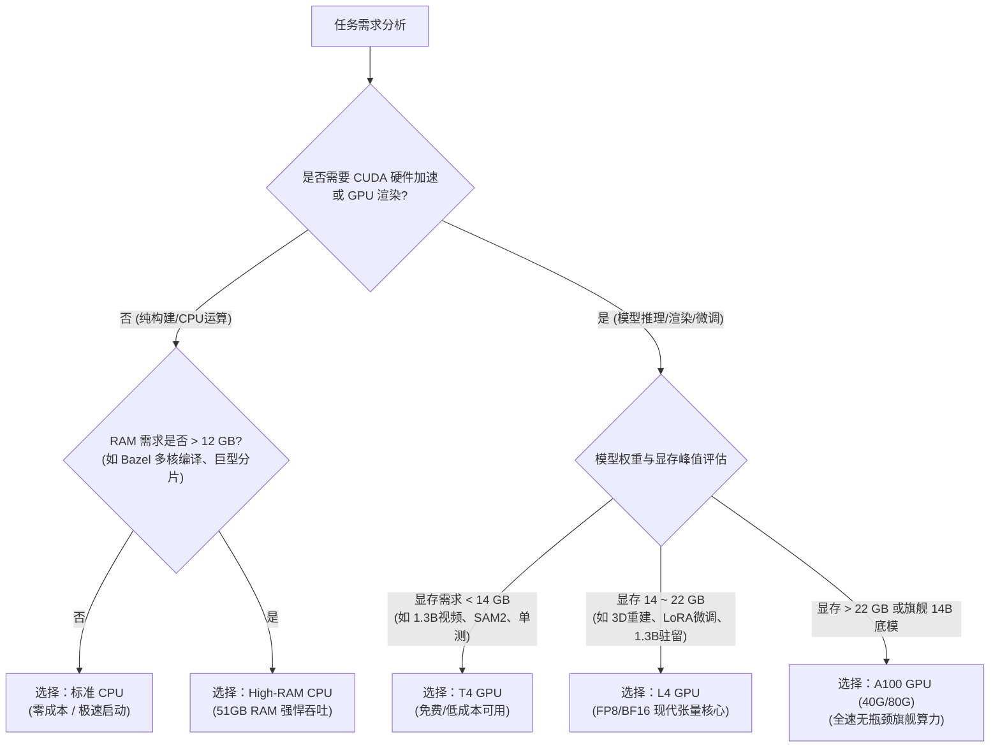

# Google Colab 通用开发、测试与算力生命周期规范 (SSOT V2.0)

> 本技能为 DervGen 全生态（含 `all-overview`, `synapse`, `caelum-core`, `fulgur`, `anima` 等全量仓库）在 **Google Colab 云端算力实例** 上的最高优先级通用使用规范。涵盖环境登录、Runtime 智能选型、超时看门狗、主动释放机器资源、Google Drive SSOT V2.0 存储铁律与各仓库端到端测试范式。

---

## 🌟 一、核心定位与四大核心铁律 (Always-On Rules)

在以 Google Colab（提供 CPU、T4 / L4 / A100 GPU 算力）与 Google Drive（持久化云存储）为基础设施的工作流中，全生态开发者与 AI Agent 必须严格恪守以下**四大核心铁律**：

> [!IMPORTANT]
> **四大核心铁律 (Always-On Rules)**：
> 1. **恰当选型，精准用量 (Right Runtime, Right Job)**：根据任务负载（纯编译、轻量推理、大模型微调、全量渲染）选择最匹配的 Runtime（CPU/T4/L4/A100）。严禁为轻量单测占用昂贵的 A100/L4 资源，也严禁在无 GPU 实例上尝试拉起 14B 神经视频底模。
> 2. **主动释放，杜绝浪费 (Always Release Resources)**：Colab 算力单元（Compute Units）按挂载时长实时扣费。**任务结束或异常终止后，必须立即主动释放机器资源**（调用 `runtime.unassign()` 或界面断开运行时）。绝不允许机器在任务跑完后闲置空耗算力配额！
> 3. **根目录零污染 (Zero Clutter in MyDrive)**：Google Drive 挂载根目录只能出现唯一的 `/dervgen/` 命名空间。**严禁任何脚本或 Notebook 向 `MyDrive` 根目录散落任何独立文件夹或压缩包**（如禁止 `/content/drive/MyDrive/synapse_experiments` 或 `/content/drive/MyDrive/bundles`）。
> 4. **计算与存储严格分离 (Compute vs Storage)**：代码拉取、Python 虚拟环境、Bazel 编译中间件、临时数据分片必须留在 Colab 本地 NVMe 高速磁盘（`/content/` 或 `/tmp/`）；Google Drive FUSE 挂载点（`/content/drive/MyDrive/dervgen/`）**严禁直接作为 Bazel 输出路径或代码工作区**，仅充当只读资源加载与最终产物落盘介质。

---

## 🖥️ 二、登录与 Runtime 硬件智能选型决策树

### 2.1 登录与前置准备
1. **访问方式**：
   - 从 GitHub 徽章一键启动：[](https://colab.research.google.com/github/dervgen/all-overview/blob/main/workenv/google-colab/colab_bootstrap.ipynb)
   - 访问 [Google Colab 官网](https://colab.research.google.com/) 并使用 Google 账号登录。
2. **凭据安全挂载 (Secrets)**：
   - 点击 Colab 左侧侧边栏 🔑 **Secrets（密钥）** 图标；
   - 添加以下通用密钥并开启“笔记本访问权限 (Notebook access)”：
     - `GITHUB_TOKEN`：具备私有仓库访问与代码 Push 权限的 GitHub PAT；
     - `HF_TOKEN`（可选）：用于拉取 HuggingFace 受限模型（如 FLUX, Llama 3, Wan2.1）；
     - `WANDB_API_KEY`（可选）：实验指标远端同步。
   - 读取标准代码：
     ```python
     from google.colab import userdata
     github_token = userdata.get('GITHUB_TOKEN') or ''
     hf_token = userdata.get('HF_TOKEN') or ''
     ```

### 2.2 Runtime 硬件规格对照表
在 Colab 顶部菜单选择 **代码执行程序 (Runtime) $\to$ 更改运行时类型 (Change runtime type)** 进行配置：

| Runtime 类型 | 硬件规格 | 计费成本 | 优势与限制 | 推荐适用任务 |
| :--- | :--- | :--- | :--- | :--- |
| **标准 CPU** | 2 vCPU, ~12 GB RAM | 免费 / 极低 | 无 GPU 加速，启动最快 | 纯文本与文档扫描、轻量脚本、Git 协同同步、单单测语法冒烟 |
| **High-RAM CPU** | 8 vCPU, ~51 GB RAM | 低 | 超大内存，无 GPU | 大规模 C++ Bazel 全仓编译（`fulgur`, `caelum`）、WebDataset 巨型分片打包、大型 3D 点云处理 |
| **T4 GPU** | NVIDIA T4, 16 GB GDDR6 VRAM | 免费版 / 低 CU | Turing 架构，显存较小，支持 FP16 | 轻量级神经推理、`Wan2.1-1.3B` (+ CPU Offload)、`SAM 2.1`、CUDA 单测覆盖（如 `synapse/tests/`） |
| **L4 GPU** | NVIDIA L4, 24 GB GDDR6 VRAM | 中等 CU | Ada Lovelace 架构，支持原生 FP8/BF16，性价比极高 | 中等规模生成式视频、`Wan2.1-1.3B` 全显存驻留、`TRELLIS`/`Hunyuan3D` 几何逆向、LoRA 微调 (Rank 32) |
| **A100 GPU** | NVIDIA A100, 40GB / 80GB VRAM | 较高 CU | Ampere 架构，HBM2e 超高显存带宽，算力天花板 | 旗舰底模全显存常驻 (`Wan2.1-14B`)、多角色 Multi-LoRA 联合微调、复杂场景多反弹离线光追渲染 |
| **TPU v2/v3** | 8 核心 TPU Pod 切片 | 中等 CU | 仅限 TensorFlow/JAX 高度优化矩阵运算 | 专有 JAX/TF 算力任务（DervGen 全生态以 PyTorch/CUDA 为主，优先推荐 GPU） |

### 2.3 选型决策树与自检代码 (Decision Matrix)



#### 自动化硬件自检与防呆拦截脚本
在任何重型脚本或 Notebook 开头运行以下自检逻辑，避免选错硬件导致无端报错或昂贵算力浪费：

```python
import sys
import torch

def verify_runtime_target(required_gpu: bool = True, min_vram_gb: float = 0.0):
    """自动验证当前 Colab Runtime 是否满足任务门限"""
    has_cuda = torch.cuda.is_available()
    if required_gpu and not has_cuda:
        print("❌ 错误：当前运行在 CPU Runtime，但本任务需要 GPU 加速！")
        print("👉 请在 Colab 菜单选择：代码执行程序 -> 更改运行时类型 -> 选择 T4 / L4 / A100 GPU。")
        raise RuntimeError("Missing required GPU runtime.")
    
    if has_cuda:
        props = torch.cuda.get_device_properties(0)
        vram_gb = round(props.total_memory / (1024**3), 2)
        print(f"✅ GPU 侦测就绪: {props.name} | 显存: {vram_gb} GB | BF16支持: {torch.cuda.is_bf16_supported()}")
        if vram_gb < min_vram_gb:
            print(f"⚠️ 警告：当前显存 ({vram_gb} GB) 低于任务推荐门限 ({min_vram_gb} GB)，可能需要开启 CPU Offload 或调小 Batch/Rank！")
    else:
        print("ℹ️ 当前运行在 CPU 环境，无 GPU 加速。")

# 示例：执行 Wan 2.1 14B 推理前必须检查显存
# verify_runtime_target(required_gpu=True, min_vram_gb=15.0)
```

---

## ⏰ 三、设定超时时间，记得释放机器资源 (Timeouts & Auto-Release)

### 3.1 为什么必须释放机器资源？
Google Colab 的计费机制核心如下：
1. **持续扣点**：付费算力（Compute Units）是**按实例开机持续时间计费**，而不是按代码是否在计算计费！如果一个 A100 作业跑了 10 分钟结束，但 Notebook 闲置放置了 8 小时，Colab 会持续扣除整整 8 小时的 A100 点数，直接导致算力配额耗尽。
2. **实例占用限额**：每个人同时能挂载的 GPU 实例数有限。不释放已完成的实例会导致无法开启新任务。
3. **空闲超时与强制中断**：
   - **空闲超时 (Idle Timeout)**：连续 90 分钟未在界面操作或未运行 Cell，实例将被强制断开；
   - **最长生命周期 (Maximum Execution Limit)**：单次 Session 上限为 12 小时（免费版）或 24 小时（Pro 版），到期强制销毁。

---

### 3.2 任务结束主动释放资源标准方法 (`runtime.unassign()`)

所有在 Colab 上运行的自动化脚本或 Notebook，**最后一个单元格必须显式执行实例断开与释放**：

```python
# ==============================================================================
# 🌟 核心规程：任务结束，主动释放 Colab 实例，停止算力点数扣除！
# ==============================================================================
import time
from google.colab import runtime

print("🎉 任务全部完成，产物已安全持久化至 Google Drive。")
print("⏳ 将在 10 秒后自动释放 Colab 实例以节省算力点数...")
time.sleep(10)

# 主动释放并销毁当前运行环境
runtime.unassign()
```

> [!TIP]
> **手动释放方法**：若在交互式调试中完成工作，请随手点击顶部菜单：
> **代码执行程序 (Runtime)** $\to$ **断开连接并删除运行时 (Disconnect and delete runtime)**。

---

### 3.3 超时看门狗机制与上下文管理器 (Timeout Watchdog)

为了防止代码死锁、外部网络挂起或未知死循环导致 GPU 彻夜扣费，推荐使用**超时看门狗 (Timeout Watchdog)**。一旦超出预设的最大容忍时长，自动强制将中间状态写入 Drive 并销毁实例：

```python
import contextlib
import datetime
import json
import threading
import time
from pathlib import Path
from google.colab import runtime

class ColabResourceGuard:
    """Colab 资源看门狗与安全退出守卫"""
    def __init__(self, max_hours: float = 2.0, state_file: Path = None, auto_release: bool = True):
        self.max_seconds = max_hours * 3600
        self.state_file = state_file
        self.auto_release = auto_release
        self._timer = None
        self._is_terminated = False

    def _timeout_handler(self):
        print(f"\n🚨 [WATCHDOG TIMEOUT] 作业运行已超过设定上限 ({self.max_seconds / 3600:.1f} 小时)！")
        print("💾 正在紧急刷新状态至 Google Drive...")
        if self.state_file:
            try:
                state_data = {"status": "TIMEOUT_KILLED", "killed_at": datetime.datetime.now().isoformat()}
                self.state_file.write_text(json.dumps(state_data, indent=2), encoding="utf-8")
            except Exception as e:
                print(f"写入状态失败: {e}")
        print("🛑 正在主动销毁 Colab 实例，避免算力扣费泄漏...")
        runtime.unassign()

    def __enter__(self):
        # 启动定时守护线程
        self._timer = threading.Timer(self.max_seconds, self._timeout_handler)
        self._timer.daemon = True
        self._timer.start()
        print(f"🛡️ [ResourceGuard] 超时看门狗已激活：最大运行时长设定为 {self.max_seconds / 3600:.2f} 小时。")
        return self

    def __exit__(self, exc_type, exc_val, exc_tb):
        if self._timer:
            self._timer.cancel()
        if exc_type is not None:
            print(f"❌ 运行过程中捕获异常: {exc_val}")
        else:
            print("✅ 作业正常执行完成。")
        
        if self.auto_release:
            print("⏳ 触发自动释放机制，10秒后销毁运行时...")
            time.sleep(10)
            runtime.unassign()
        return False

# 使用范式：
# with ColabResourceGuard(max_hours=1.5, state_file=job_dir/"state.json", auto_release=True):
#     run_heavy_experiments()
```

---

### 3.4 释放前的“优雅落盘三步法” (Graceful Shutdown Checklist)

在调用 `runtime.unassign()` 销毁实例前，务必执行以下三步检查：
1. **显存清空与解除文件句柄**：调用 `torch.cuda.empty_cache()` 并关闭所有已打开的 OpenEXR 或权重写入句柄；
2. **元数据状态落盘**：确保 `output/experiment_summary.json`、`job.json`（标记 `COMPLETED` 或 `FAILED`）以及 `README.md` 已写入 Google Drive；
3. **释放确认**：调用 `runtime.unassign()` 终止机器。

---

## 🧭 四、Google Drive 统一存储体系全景 (SSOT V2.0)

- **云端物理路径**：`Google Drive: /dervgen/`
- **Colab POSIX 挂载点**：`/content/drive/MyDrive/dervgen/`
- **标准环境变量**：`export DERVGEN_DRIVE_ROOT=/content/drive/MyDrive/dervgen`

生态存储整体收敛为 **4 大基柱**：

```text
/content/drive/MyDrive/dervgen/
│
├── 📦 data/                              # 【只读公共资产中枢】模型权重、渲染标杆、评测真值、原始采集
│   ├── models/                           # 🤖 1. AI 基础模型权重库 (按生产用途分流)
│   │   ├── 3d_recon/                     # 空间几何与 3D 生成 (TRELLIS, DUSt3R, MASt3R, MeshAnything V2)
│   │   ├── texture_gen/                  # 材质解耦与纹理生成 (Depth Anything V2, FLUX Fill, IC-Light, Marigold)
│   │   ├── video_gen/                    # 物理运动视频生成 (Wan 2.1 14B/1.3B, HunyuanVideo, LTX-Video)
│   │   ├── actor_dynamics/               # 角色动捕与动力学 (DWPose, GVHMR, WHAM, MotionBricks, EMOCA v2)
│   │   ├── audio_foley/                  # 空间音频与物理碰撞拟音生成
│   │   ├── foundation/                   # 通用底座与多模态 (SAM 2 Large, DINOv2, CLIP)
│   │   └── denoise_upscale/              # 神经降噪与超分 (Intel OIDN 2.3 rt.tza, Real-ESRGAN, RIFE)
│   ├── benchmarks/                       # 🏛️ 2. 渲染与图形基准场景 (Primitives, 14套工业场景, HDRI, MERL BRDF)
│   ├── evaluations/                      # 🎯 3. 闭环评测与真实真值集 (SWE-bench for 3D)
│   ├── captures/                         # 📷 4. 算法输入原始多模态采集样本 (单图, 环拍, 视频, 轨迹)
│   ├── INDEX.json                        # 全量资产机器可读清单
│   └── INDEX.md                          # 全量资产人类可读索引
│
├── 🛠️ tools/                             # 【只读公共工具箱】完全固化、不变的外部依赖与工具链
│   ├── wheels/                           # 分类预下载的 Python 离线 Wheels (A~F 类)
│   ├── bin/                              # 固化的官方静态二进制 (bazelisk, cmake, oidn-cli)
│   ├── INDEX.json                        # 工具清单机器索引
│   └── INDEX.md                          # 工具清单人类索引
│
├── ⚡ cache/                             # 【公共持久化缓存】跨 Colab Session 复用的加速缓存
│   ├── bazel/                            # Bazel C++ Disk Cache (CAS 内容哈希，秒级二次构建)
│   ├── huggingface/                      # HF Hub 权重持久化缓存 (HF_HOME)
│   └── pip/                              # Pip 本地包缓存
│
└── 🚀 work/                              # 【全动态作业空间】一切构建、实验、渲染的唯一发生地
    └── {user}/                           # 发起人/Agent 隔离层 (如 yanglei, gemini3.8, opus4.6)
        └── {repo}/                       # 仓库隔离层 (如 caelum-core, fulgur, synapse, anima)
            └── {date}/                   # 日期隔离层 (YYYY-MM-DD)
                └── {job_id}/             # 任务实例层
                    ├── README.md         # 🌟【必须】人类可读元数据 (目标、配置、复现命令、结论)
                    ├── job.json          # 🤖【必须】机器可读状态 (状态、耗时、GPU配置、关键Metrics)
                    ├── input/            # 📥 任务输入参数、启动配置
                    ├── output/           # 📤 交付产物 (渲染图、网格、视频，或新构建的引擎包)
                    ├── checkpoints/      # 💾 中断续跑状态与中间权重 (.safetensors, state.json)
                    └── logs/             # 📜 完整运行日志 (stdout.log, stderr.log, build.log)
```

---

## 🚀 五、全生态仓库在 Colab 上的测试与运行范式

### 5.1 通用环境初始化命令
```bash
# 1. 运行 Synapse Colab 一键环境装配脚本（含系统库、Python 依赖与基准数据 staging）
bash /content/dervgen/synapse/workenv/google-colab/setup_colab.sh

# 2. 按需建立 Tailscale SSH 远程直连（密钥通过环境变量安全传递，默认主机名 synapse-colab-gpu）
TAILSCALE_AUTHKEY="${TAILSCALE_AUTHKEY}" bash /content/dervgen/synapse/workenv/google-colab/tailscale.sh
```

### 5.2 各核心仓库测试速查

#### 1. Synapse (神经视频生成与 3D 互操作)
* 专用指南：[synapse-colab-testing](../synapse-colab-testing/SKILL.md)
* 运行全量单测与闭环实验：
  ```bash
  # 部署系统依赖并执行全量单测（1,510+ 项）
  bash /content/dervgen/synapse/workenv/google-colab/setup_colab.sh
  pytest /content/dervgen/synapse/tests/ -q

  # 运行 E1–E4 闭环实验 (含显存分档与断点续跑)
  python /content/dervgen/synapse/scripts/colab_runner.py \
    --job-dir=/content/drive/MyDrive/dervgen/work/yanglei/synapse/$(date +%F)/exp01 \
    --exp=all
  ```

#### 2. Caelum-Core (离线路径追踪与光追物理渲染)
* 在无头 Xvfb 虚拟帧缓冲区中构建并测试：
  ```bash
  bash workenv/google-colab/run_cpp.sh /content/dervgen/caelum-core test //csrc:cpu_tests
  ```

#### 3. Fulgur (实时光栅与 Vulkan 渲染引擎)
* 利用 Google Drive CAS 磁盘缓存加速二次编译：
  ```bash
  bash workenv/google-colab/run_cpp.sh /content/dervgen/fulgur build //engine/...
  bash workenv/google-colab/run_cpp.sh /content/dervgen/fulgur test //tests:test_core
  ```

---

## 💻 六、连接本地 VS Code / Antigravity via Tunnel

1. 在 `colab_bootstrap.ipynb` 中勾选 `START_VSCODE_TUNNEL = True` 或在终端运行：
   ```bash
   bash /content/dervgen/all-overview/workenv/google-colab/vscode_tunnel.sh
   ```
2. 打开终端打印的授权链接（`https://github.com/login/device`）并输入 8 位授权码。
3. 在本地桌面 VS Code 或 Antigravity 中安装 **Remote - Tunnels** 扩展，连接 `dervgen-colab-gpu` 即可在本地桌面环境中使用云端 GPU 算力。

---

## 🚫 七、Agent 避坑与行为红线

1. **绝对禁止作业完成后不释放 Runtime**：任务完成或捕获不可恢复错误后，必须调用 `runtime.unassign()` 释放资源，严禁闲置空耗算力配额！
2. **绝对禁止污染 `MyDrive` 根目录**：除了 `/dervgen/`，任何直接创建在 `/content/drive/MyDrive/` 下的新文件夹或文件都是严重违规！
3. **严禁在 Drive FUSE 上跑 Bazel 编译输出**：Bazel 的 `bazel-out` 与 `bazel-bin` 必须留在本地 NVMe（`/content/` 或 `/tmp/`），仅可通过 `--disk_cache=/content/drive/MyDrive/dervgen/cache/bazel` 使用 CAS 内容寻址磁盘缓存。
4. **禁止不设超时保护跑重型训练**：长时间任务必须包装在 `ColabResourceGuard` 或带看门狗定时器的保护逻辑中，防止死锁或无限卡死。
