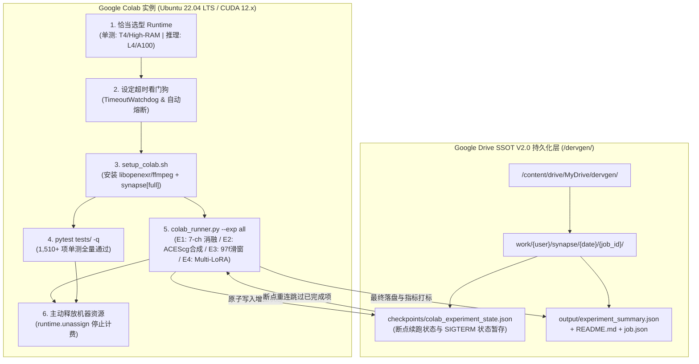

# Synapse Google Colab 云端全量测试与实验运行指南 (SSOT V2.0)

> 本技能为 DervGen 生态 **Layer 2 算法中枢 `synapse`** 在 **Google Colab 云端算力节点**（T4 / L4 / A100 GPU 及 High-RAM CPU）上进行代码全量测试、跨模态往返评测（`Synapse-Bench`）以及神经物理实验（E1–E4）的标准操作规程。遵循全生态统一的通用 Colab 规范（[google-colab-environment](../google-colab-environment/SKILL.md)）。

---

## 🌟 一、可行性结论与架构全景

### 1.1 可行性结论
**完全可行且生态已具备成熟套件**。`synapse` 仓库内建了原生针对 Google Colab 的无状态单步执行核与自动化部署套件（位于 `synapse/workenv/google-colab/` 与 `synapse/scripts/colab_runner.py`）。通过云端 GPU 算力：
1. **单元测试与架构验证 (`pytest tests/`)**：全仓 61 个测试文件、1,510+ 项用例可无缝运行，真实调用 CUDA 硬件加速接口（如 `WanAdapter` CUDA 显存探测与 FP16/BF16 推理），突破本地 macOS 缺乏 NVIDIA GPU 只能 Mock 的限制。
2. **E1–E4 神经视频生成闭环实验 (`colab_runner.py`)**：在真实 GPU 上验证 7 通道 FGPP 条件消融、ACEScg 风格提取、16px 手术刀拉普拉斯合成、97 帧时序滑窗与 Multi-LoRA 空间正交注意力隔离。
3. **C++ Tier 0 原生扩展构建与校验 (`@aether//python:aether_geo`)**：通过 `python scripts/build_native.py --backend=bazel` 调用 Bazel 9.3.1 编译同级 `../aether` 的几何与度量扩展并运行流形与水密性门禁。



---

## 🖥️ 二、Synapse 任务专属 Runtime 选型决策表

根据任务负载精准选择 Colab Runtime，兼顾效率与算力点数（CUs）成本：

| 任务类型 | 推荐 Runtime | 硬件规格 | 选型理由与注意事项 |
| :--- | :--- | :--- | :--- |
| **全量单测回归 (`pytest tests/`)** | **T4 GPU** | 16GB GDDR6 | 免费/低成本，足以跑通全部 1,510+ 项单测，且能激活 PyTorch CUDA 与显存检测分支。 |
| **C++ 原生扩展编译 (`@aether//python:aether_geo`)** | **High-RAM CPU** | 8 vCPU, 51GB RAM | 纯 Bazel C++ 编译无需显卡，大内存可防止多核并行编译出现 OOM。 |
| **轻量推理与 3D 逆向反演** | **L4 GPU** | 24GB GDDR6, BF16 | 运行 `Wan2.1-1.3B` 全显存驻留、`SAM 2.1` 细粒度分割与 `TRELLIS`/`Hunyuan3D` 几何逆向。 |
| **旗舰视频生成与全量闭环 (E1–E4)** | **A100 GPU** | 40GB / 80GB VRAM | 完整运行 `Wan2.1-14B` 全显存驻留、Multi-LoRA 正交微调与 97 帧长时序滑窗渲染。 |

---

## ⏰ 三、设定超时时间与主动释放机器资源铁律

> [!IMPORTANT]
> **资源使用与主动释放分级策略 (Stop The Meter vs Persistent CPU Runner)**：
> 1. **GPU 实例 (T4 / L4 / A100)**：算力点数按秒扣费且成本较高。**任务完成或异常退出后，必须立即主动销毁实例以停止计费 (`runtime.unassign()`)**！绝不允许 GPU 机器闲置空挂。
> 2. **标准 CPU 实例 (`synapse-colab-gpu`)**：由于 Colab 标准 CPU 算力几乎免费，**允许并推荐长期保持一台 CPU 实例在线并接入 Tailscale**。作为开发者本地 Mac 的算力卸载节点，随时承载全量 `pytest` 回归与编译检查，彻底消除本地 Mac 发热与电池损耗。

### 3.1 核心命令：`runtime.unassign()`
在所有 Notebook 单元格或脚本的末尾，强制调用实例解挂命令：
```python
from google.colab import runtime

print("✅ 任务完成，正在主动释放 Colab 实例以节省算力点数...")
runtime.unassign()
```

### 3.2 守护机制：设定最大超时看门狗 (Timeout Watchdog)
为防止脚本发生死锁、网络阻塞或无端挂起导致彻夜扣费，在启动前必须包装超时看门狗：
```python
import threading
import time
from google.colab import runtime

def start_timeout_watchdog(max_hours: float = 1.5):
    """超过指定时间未完成，强制落盘并销毁实例"""
    def _watchdog():
        time.sleep(max_hours * 3600)
        print(f"\n🚨 [WATCHDOG] 超过预定最大运行时长 ({max_hours}h)！强制释放实例...")
        runtime.unassign()

    t = threading.Thread(target=_watchdog, daemon=True)
    t.start()
    print(f"🛡️ 超时看门狗已启动，最大容忍时长: {max_hours} 小时。")

# 启动看门狗：限制最长运行 1.5 小时
start_timeout_watchdog(max_hours=1.5)
```

---

## 🧭 四、Google Drive SSOT V2.0 存储铁律

在 Colab 上运行 `synapse` 测试与实验必须严格遵守 DervGen 生态存储三大铁律：
1. **根目录零污染 (Zero Clutter in MyDrive)**：Google Drive 挂载根目录只能出现唯一的 `/dervgen/` 命名空间。**严禁在 `MyDrive` 根目录直接创建任何散落文件夹**（如禁止 `/content/drive/MyDrive/synapse_experiments`）。
2. **计算与存储严格分离**：代码拉取（`/content/dervgen/synapse`）、虚拟环境、中间临时缓存必须位于 Colab 本地 NVMe 高速磁盘（`/content/`）；Google Drive（`/content/drive/MyDrive/dervgen/`）仅充当只读资源加载与最终产物/检查点持久化落盘介质。
3. **标准化作业路径**：
   $$\text{/content/drive/MyDrive/dervgen/work/}\mathbf{\{user\}}\text{/synapse/\{date\}/\{job\_id\}/}$$
   目录下必须包含：`README.md`、`job.json`、`input/`、`output/`、`checkpoints/`、`logs/`。

---

## 🛠️ 五、Colab 全量测试与实验标准操作规程 (SOP)

### 5.1 步骤一：创建与连接 GPU 运行环境（按需手动启动）

> [!TIP]
> **双轨运行原则**：
> - **日常单测与代码回归**：保持一台 Standard CPU 实例常驻在线（接入 Tailscale），零/极低成本承担全量 pytest，无需启动昂贵的 GPU；
> - **GPU 实验与神经视频生成**：需要验证真实 CUDA、Wan 2.1 推理或 E1–E4 时，由开发者在 Web 端**按需手动启动 GPU 实例**，测试完毕立即释放。

#### 手动启动步骤：
1. 在浏览器中打开 [Google Colab 工作流 Notebook](https://colab.research.google.com/github/sautille-stroke/synapse/blob/main/workenv/google-colab/synapse_colab_workflow.ipynb)；
2. 菜单栏选择 **代码执行程序 (Runtime) $\to$ 更改运行时类型 (Change runtime type)**：
   - 显存评估 $< 14\text{ GB}$（如轻量级冒烟）：选择 **T4 GPU**；
   - 显存评估 $14 \sim 24\text{ GB}$（如 `Wan2.1-1.3B`、SAM 2.1、3D 逆向）：选择 **L4 GPU**；
   - 显存需求 $> 24\text{ GB}$（如 `Wan2.1-14B` 旗舰底模、全量微调）：选择 **A100 GPU**；
3. 配置凭据密钥（Colab 左侧 🔑 **Secrets** 菜单）：
   - `TAILSCALE_AUTHKEY`：带有 `Reusable` 与 `Ephemeral` 属性的 Tailscale Auth Key（用于本地终端/Agent 极速直连）；
   - `GITHUB_TOKEN`：具备仓库读取权限的 Personal Access Token；
   - `HF_TOKEN`（可选）：用于拉取 HuggingFace 受限模型权重。
4. 运行 Tailscale 单元格接入 Tailnet，主机名命名为 `synapse-colab-gpu`（或由开发者在控制台查看分配的 IP）。

### 5.2 步骤二：环境一键初始化与依赖装配
```bash
# 1. 挂载 Google Drive 持久化目录
from google.colab import drive
drive.mount('/content/drive')

# 2. 创建本地工作区并拉取代码
!mkdir -p /content/dervgen
%cd /content/dervgen

from google.colab import userdata
import base64
import subprocess

gh_token = userdata.get('GITHUB_TOKEN') or ''
git_auth = []
if gh_token:
    b64 = base64.b64encode(f'x-access-token:{gh_token}'.encode()).decode()
    git_auth = ['-c', f'http.extraheader=Authorization: Basic {b64}']

subprocess.run(['git', *git_auth, 'clone', '--depth', '1', 'https://github.com/sautille-stroke/synapse.git'], check=True)
subprocess.run(['git', *git_auth, 'clone', '--depth', '1', 'https://github.com/dervgen/aether.git'], check=True)

# 3. 运行 Synapse 官方 Colab 一键初始化脚本
%cd /content/dervgen/synapse
!chmod +x workenv/google-colab/setup_colab.sh
!./workenv/google-colab/setup_colab.sh
```

---

### 5.3 步骤三：执行代码级全量自动化测试 (`pytest`)
```bash
%cd /content/dervgen/synapse

# 1. 全量单元测试套件 (覆盖 61 个测试文件，1,510+ 项用例)
!pytest tests/ -v --durations=10

# 2. 验证 GPU 专用适配器测试
!pytest tests/test_wan_adapter.py tests/test_wan_anchor_and_gates.py tests/test_wan_lora_wiring.py -v
```

---

### 5.4 步骤四：执行 E1–E4 闭环实验套件 (`colab_runner.py`)
```python
import os
from datetime import datetime
from pathlib import Path

user_id = "yanglei"
today_str = datetime.now().strftime("%Y-%m-%d")
job_id = "exp01-colab-verification"
job_dir = Path(f"/content/drive/MyDrive/dervgen/work/{user_id}/synapse/{today_str}/{job_id}")

# 执行实验主控脚本（自动侦测显存分档与断点续跑）
!python scripts/colab_runner.py \
    --dataset-dir /content/datasets/synapse \
    --job-dir {job_dir} \
    --user {user_id} \
    --job-id {job_id} \
    --mode auto \
    --exp all
```

#### 各实验阶段内容与合格判定准则：
| 阶段 | 核心任务 | 输入数据 | 成功判定准则 (Pass Criteria) |
| :--- | :--- | :--- | :--- |
| **E1** | FGPP 7 通道条件消融 | 15 通道 OpenEXR + 相机外参 | 张量形状 `[7, T, 480, 832]`，数值全有限，4 档消融 L2 Norm 单调递增 |
| **E2** | ACEScg 风格提取与手术刀合成 | 视频帧 + Cryptomatte.ID | 导出 `StyleProfile v2.0.0`，16px 边界环色差显著降低，拉普拉斯金字塔无接缝 |
| **E3** | 97 帧长时序滑窗与切镜重锚定 | 97 帧时序序列 | 窗口划分正确，第 64 帧切镜突变被检出，潜空间 Sigmoid 融合且方差稳定 |
| **E4** | WebDataset 分片与 Multi-LoRA | 16 通道潜变量 + Caption | 打包 `shard_000000.tar`，跨实体注意力掩码非正交泄露率 $< 3.0\%$ |

---

### 5.5 步骤五：完成任务并主动释放机器资源
```python
# 必须作为 Notebook 最后一个单元格执行！
import time
from google.colab import runtime

print("🎉 Synapse 测试与实验全部完成，指标已写入 job.json。")
print("⏳ 正在主动释放 Colab 实例，停止算力点数扣除...")
time.sleep(5)
runtime.unassign()
```

---

## ⚡ 六、容错、抢占中断与显存自适应机制

1. **显存自动分档 (`detect_gpu_profile`)**：
   - 显存 $< 35\text{ GB}$ (T4/L4)：自动选用 `Wan2.1-1.3B` + CPU Offload，LoRA Rank 设为 16/32；
   - 显存 $\ge 35\text{ GB}$ (A100)：自动选用 `Wan2.1-14B`，全显存常驻，LoRA Rank 设为 32。
2. **抢占容错与断点续跑 (SIGTERM Trap)**：
   - 发生中断前，自动拦截 `SIGTERM` 信号并将进度原子写入 `checkpoints/colab_experiment_state.json`；
   - 重新连接后再次启动会自动读取该状态，已完成阶段自动 `[SKIP]`，绝不浪费重复算力。

---

## ⚠️ 七、常见踩坑点与排障清单 (Troubleshooting)

| 异常现象 | 根本原因 | 官方标准化解决方案 |
| :--- | :--- | :--- |
| **算力点数暴扣 / 额度耗尽** | 任务跑完后未主动释放实例，机器闲置空挂数小时 | 在 Notebook 末尾强制加入 `runtime.unassign()`，并配置看门狗定时器 |
| `ModuleNotFoundError: No module named 'synapse'` | 运行脚本时未执行 editable 安装，且 `python/` 目录不在搜索路径中 | 执行 `pip install -e .` 或在命令前添加 `PYTHONPATH=/content/dervgen/synapse/python` |
| `ContractValidationError: E3 requires ... sequence with at least 97 frames` | E3 长时序滑窗切镜实验必须使用 97 帧以上的长序列，而加载到了 17 帧样本 | 确保运行前数据集解压目录中包含 `track_b_fulgur/course_102_pbr_97f` |
| `OpenEXR.InputFile: Cannot open file` | Colab 容器未安装底层 C++ OpenEXR 开发库 | 运行 `sudo apt-get install -y libopenexr-dev openexr` |
| `CUDA out of memory` (OOM) | 在 T4 / L4 实例上错误启用了 `Wan 2.1 14B` 或关闭了 CPU Offload | 启动时使用 `--mode auto`，允许运行器根据显存自动配置 1.3B 模型与 CPU Offload |
| Google Drive 出现散乱文件夹 | 违背了 SSOT V2.0 根目录零污染铁律 | 严格将输出路径指定在 `/content/drive/MyDrive/dervgen/work/{user}/synapse/{date}/{job_id}/` 下 |
