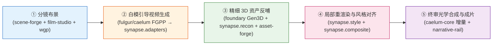

# Synapse (神经突触)

> **3D CG 渲染与神经视频生成互操作算法 SDK、无状态推理容器 Worker 与跨模态评测基准 (`Synapse-Bench`)**  
> Interoperability SDK, Stateless GPU Worker Runtime & Benchmark Suite between 3D CG Rendering and Generative Video Models.

---

## 1. 核心定位与生态边界

当前 3D 物理渲染（确定性时空几何与辐射度量）与生成式视频扩散模型（潜空间时序分布）存在根本性的表示鸿沟。  
**`synapse`** 位于 DervGen 生态 **Layer 2**，扮演连接两者的“神经突触”算法与评测层（落实 **RFC 0044** 神经-物理混合工业流水线）：

- **向上承接编排**：作为无状态单步 GPU Worker（消费 **RFC 0039 `JobBundle`**），由 Go 分布式农场 `render-farm` 与影视管线 `narrative-rail` 在 `foundary` 推理容器中按需拉起执行，**绝不自建常驻 Python 服务端**；
- **向下严守契约**：Python 端 `synapse.fgpp` 严格镜像 Layer 0 **`@aether//fgpp`** C++20 线格式 SSOT，与 `fulgur`（Track B 毫秒级光栅）和 `caelum-core`（Track A 物理光追）实现多通道 OpenEXR 2.0 零歧义互通；
- **横向原生闭环**：风格描述符对齐 **`@aether//style` (`RFC 0043`)** 与 **ACEScg (`RFC 0058`)**；4D 点追踪、6-DoF 运镜解算、流形闭合校验与 Quad 重拓扑、Humanoid-53 足底防滑锁定 IK（$<0.3\text{ cm/s}$）以及球谐/Retinex 混合去光照全面由原生算法模块 **`synapse.recon`** 提供，实现零外部 C++ 强依赖开箱即用，并向下兼容 `synapse.bridge.vg_bridge` 抽象。

---

## 2. 混合渲染管线协同全景（5 阶段）



1. **分镜布景**：在 `grand-studio` 宿主内通过 `scene-forge`、`film-studio` 与 `wgp` 完成 3D 代理白模（角色满足 $\ge 1500$ 顶点粗糙度下限）与运镜轨迹规划。
2. **白模引导生成**：`fulgur` / `caelum-core` 导出 15 标量通道 **FGPP** OpenEXR 序列，`synapse.adapters` 驱动白盒主力（`Wan 2.1 14B` + ControlNeXt + 3D Causal VAE 软光流偏置）或黑盒商业 API（`Seedance 2.5` / `Kling 1.5` / `Veo`）生成时空受控视频。
3. **精细 3D 资产反哺**：经 `foundary` 正交关键帧 3D 重建（`TRELLIS`/`Hunyuan3D`）破解白模反投悖论，由自包含逆向重建模块 `synapse.recon` 与 `@aether//geo` 原生几何加速桥（`synapse.bridge.aether_bridge`）完成流形门禁、去光照、Quad 重拓扑与足底防滑 IK，并由 L2 美术在 `asset-forge` 限时精修（15 分钟硬熔断）。
4. **局部手术刀重渲染与风格对齐**：`synapse.style` 提取视频色温、曝光与球谐主光映射为 `StyleProfile` 驱动 3D 局部重渲；`synapse.composite` 构建 `3D ∪ SAM2` 运动膨胀掩膜，在 CIE LAB 与线性 ACEScg 空间完成无缝融合。
5. **终审合成与评测闭环**：叠加高阶物理接触阴影/焦散，全流程由 `Synapse-Bench` 四维 16 项指标量化守门。

---

## 3. 模块架构与当前就绪状态

> 全系统权威架构设计见 [docs/ARCHITECTURE.md](docs/ARCHITECTURE.md)，跨语言线格式与协议规约见 [docs/WIRE_CONTRACTS.md](docs/WIRE_CONTRACTS.md)，历史阶段审计见 [docs/archive/](docs/archive/README.md)，全景实施总计划见 [docs/IMPLEMENTATION_PLAN.md](docs/IMPLEMENTATION_PLAN.md)。在 **`Release v4.2.0`** 基线上，云端主力机 `ubuntu24` 独立实测 **`1,560+` 项 pytest 用例全通过**、**`mypy --strict` 零错误**、`ruff` 零报错、`wire_guard --require-aether` 与 `import_dag_guard` 全绿、全仓 Markdown 相对路径 **`0 broken links`**。

| 模块路径 | 核心职责 | 当前状态 (`Release v4.2.0`) | 交付与收口里程碑 |
| :--- | :--- | :---: | :---: |
| `python/synapse/bridge/aether_bridge.py` | Layer 0 `@aether//geo`、`@aether//metrics`、`@aether//color` C++20 原生扩展统一桥接（支持 `scripts/build_native.py` 自动编译与纯 Python Oracle 零依赖回退） | ✅ 全面就绪 | `RFC-0071`, `PR-153`, `PR-174`, `PR-192` |
| `python/synapse/render_core/` | 无状态底层纯 CPU 软光栅化、相机投影模型与基础几何生成原语 | ✅ 全面就绪 | `PR-48..114`, `PR-138`, `PR-150` |
| `python/synapse/recon/` | Video-to-3D 几何逆向重建与可微闭环（RFC 0060/0062）：4D 追踪、6-DoF 运镜、流形拓扑、Quad 重拓扑、足底防滑 IK、去光照 | ✅ 全面就绪 | `SYN-RFC-0060/0062`, `PR-142`, `PR-148` |
| `python/synapse/refine/` | 局部解剖智能修正与多模型融合（RFC 0061）：MANO/Face、多模型融合、512×512 瓦片与手术刀缝合 | ✅ 全面就绪 | `SYN-RFC-0061`, `PR-143`, `PR-148` |
| `python/synapse/bench/` | `Synapse-Bench` 30 场景、11×4 条件因子、软光栅与 InspectionBundle 导出器 | ✅ 全面就绪 | `PR-01..124`, `PR-144`, `PR-150` |
| `python/synapse/fgpp/` | 对齐 `@aether//fgpp` 的 15 标量通道 (`34B/px`) OpenEXR 读写、消毒器与张量桥接 | ✅ 全面就绪 | `PR-02..113`, `PR-134`, `PR-148` |
| `python/synapse/cli/` | 双入口统一 CLI（`synapse` / `synapse-bench`、确定性退出码 `0/10/20/30/40/50`） | ✅ 全面就绪 | `PR-04..115`, `PR-135`, `PR-140` |
| `python/synapse/adapters/` | 双轨视频适配器（`Mock` / 白盒 `Wan 2.1` / 黑盒 API）、97f 因果滑窗与 Multi-LoRA 空间隔离 | ✅ 全面就绪 | `PR-05..116`, `PR-139`, `PR-148` |
| `python/synapse/style/` | 有界 $C^1$ 有理软肩 ACEScg 逆色调映射、球谐主光提取与 `StyleProfile v2.0` 映射 | ✅ 全面就绪 | `PR-09..114`, `PR-137`, `PR-148` |
| `python/synapse/composite/` | 穿模/闪烁检测、`3D ∪ SAM2` 膨胀掩膜、16px 环带 LAB 与光学增量拉普拉斯金字塔融合 | ✅ 全面就绪 | `PR-10..114`, `PR-137`, `PR-148` |
| `python/synapse/bridge/` | `foundary` 客户端、HITL 15m 熔断账本与 `vg_bridge` | ✅ 全面就绪 | `PR-12..116`, `PR-139`, `PR-143` |
| `python/synapse/metrics/` | 四维 16+ 项指标与三级质量门禁档位（`track_b` / `track_a` / `rsi_promotion`） | ✅ 全面就绪 | `PR-13..120`, `PR-144`, `PR-148` |
| `python/synapse/pipeline/` | 无状态 `JobBundleWorker` 容器执行核、`BenchPipelineRunner` 与解耦 Stage 适配器 | ✅ 全面就绪 | `PR-14a..124`, `PR-135`, `PR-144` |
| `python/synapse/training/` | 3D VAE / FGPP 离线潜空间 `WebDataset` 缓存与正交 LoRA 训练器（参考锚定 Diffusion-DPO） | ✅ 全面就绪 | `PR-17..117`, `PR-140`, `PR-148` |
| `python/synapse/inspect/` | Tier 0 几何硬门禁、配准、微距反投、Visual Jev 与 3D 模型评估报告 | ✅ 全面就绪 | `PR-20..124`, `PR-145`, `PR-150` |
| `python/synapse/rsi/` | 课程域随机化、物理+PRM 双重验算、20% L0 锚点回放与单调递增晋级门禁 | ✅ 全面就绪 | `PR-24..124`, `PR-135`, `PR-145` |
| `python/synapse/viewer/` | 静态 HTML 比较报告导出器（移除常驻 Daemon 遵守 Zero-Python 红线 #1） | ✅ 全面就绪 | `PR-01..97`, `PR-137` |
| `tools/data-inspector/` | Electron 33 + `@aether//pal:shm` Native C++ 检查器 | ✅ 全面就绪 | `PR-27..123`, `PR-136`, `PR-146`, `PR-149` |

---

## 4. 文档导航

- **[AGENTS.md](AGENTS.md)**：AI Agent 与开发者行为铁律、测试机器分工与编码规范
- **[docs/ARCHITECTURE.md](docs/ARCHITECTURE.md)**：**全系统权威架构设计总纲（SSOT）**（模块目录树、统一 CLI 语法树、三级门禁阈值表）
- **[docs/WIRE_CONTRACTS.md](docs/WIRE_CONTRACTS.md)**：**跨语言线格式与协议规约（SSOT）**（FGPP 15ch EXR 34B/px、JobBundle 退出码、ACEScg 有理软肩、SHM Seqlock）
- **[docs/IMPLEMENTATION_PLAN.md](docs/IMPLEMENTATION_PLAN.md)**：**全景实施总计划 (`Release v4.0.0`)** 及最新执行蓝图 [PLAN-M33-M36](docs/plans/PLAN-M33-M36-HOLISTIC-REMEDIATION-AND-EVOLUTION.md)
- **[SYN-RFC-0060](docs/SYN-RFC-0060-REAL-VIDEO-TO-3D-DIGITAL-TWIN.md)** · [详细设计](docs/DESIGN_REAL_VIDEO_TO_3D_INVERSE_RENDERING.md)：真实视频逆向 3D 动态数字孪生与联合反演规范
- **[SYN-RFC-0061](docs/SYN-RFC-0061-LOCAL-REFINEMENT-AND-MULTI-MODEL-FUSION.md)** · [详细设计](docs/DESIGN_LOCAL_REFINEMENT_AND_MULTI_MODEL_FUSION.md) · [ForgeKit 工具链](docs/DESIGN_FORGEKIT_ANATOMICAL_REFINE_TOOLING.md)：局部解剖智能修正、多模型融合与手术刀缝合
- **[SYN-RFC-0062](docs/SYN-RFC-0062-INVERSE-RENDERING-AND-3D-NEURAL-CLOSED-LOOP.md)** · [详细设计](docs/DESIGN_INVERSE_RENDERING_CLOSED_LOOP.md)：3D 引导生成、可微逆向渲染与局部修补双向闭环
- **[SYN-RFC-0063](docs/SYN-RFC-0063-TESTING-CORRECTNESS-AND-BENCHMARKS.md)** · [行业对比设计](docs/DESIGN_INDUSTRY_GAP_AND_COMPENSATION.md)：质量保障、5 层测试金字塔与 4 轨道横向评测基准
- **[docs/archive/](docs/archive/README.md)**：**历史计划与审计归档总索引**（包含 `PLAN-M1-M2` 至 `PLAN-M29-M32` 历史子计划与历次基线审计）

---

## 5. 快速上手

```bash
# 1. 安装开发环境 (含图像、指标与网格扩展)
pip install -e ".[dev,image,metrics,mesh]"

# 2. 编译原生几何核 (委托 @aether//geo)
python scripts/build_native.py

# 3. 运行极速单测套件
pytest tests/ -m "not slow" -q

# 4. 执行跨引擎基线校验
python scripts/run_cpu_verification.py
```
