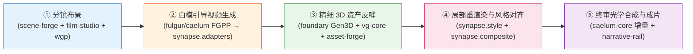

# Synapse (神经突触)

> **3D CG 渲染与神经视频生成互操作算法 SDK、无状态推理容器 Worker 与跨模态评测基准 (`Synapse-Bench`)**  
> Interoperability SDK, Stateless GPU Worker Runtime & Benchmark Suite between 3D CG Rendering and Generative Video Models.

---

## 1. 核心定位与生态边界

当前 3D 物理渲染（确定性时空几何与辐射度量）与生成式视频扩散模型（潜空间时序分布）存在根本性的表示鸿沟。  
**`synapse`** 位于 DervGen 生态 **Layer 2**，扮演连接两者的“神经突触”算法与评测层（落实 **RFC 0044** 神经-物理混合工业流水线）：

- **向上承接编排**：作为无状态单步 GPU Worker（消费 **RFC 0039 `JobBundle`**），由 Go 分布式农场 `render-farm` 与影视管线 `narrative-rail` 在 `foundary` 推理容器中按需拉起执行，**绝不自建常驻 Python 服务端**；
- **向下严守契约**：Python 端 `synapse.fgpp` 严格镜像 Layer 0 **`@aether//fgpp`** C++20 线格式 SSOT，与 `fulgur`（Track B 毫秒级光栅）和 `caelum-core`（Track A 物理光追）实现多通道 OpenEXR 2.0 零歧义互通；
- **横向零拷贝协同**：风格描述符对齐 **`@aether//style` (`RFC 0043`)** 与 **ACEScg (`RFC 0058`)**；重型几何重拓扑、物理去光照与 Humanoid-53 足底锁定 IK 通过零拷贝接口委托 **`vg-core`** C++20/CUDA 原生算子执行，拒绝在 Python 中重复造轮子。

---

## 2. 混合渲染管线协同全景（5 阶段）



1. **分镜布景**：在 `grand-studio` 宿主内通过 `scene-forge`、`film-studio` 与 `wgp` 完成 3D 代理白模（角色满足 $\ge 1500$ 顶点粗糙度下限）与运镜轨迹规划。
2. **白模引导生成**：`fulgur` / `caelum-core` 导出 15 标量通道 **FGPP** OpenEXR 序列，`synapse.adapters` 驱动白盒主力（`Wan 2.1 14B` + ControlNeXt + 3D Causal VAE 软光流偏置）或黑盒商业 API（`Seedance 2.5` / `Kling 1.5` / `Veo`）生成时空受控视频。
3. **精细 3D 资产反哺**：经 `foundary` 正交关键帧 3D 重建（`TRELLIS`/`Hunyuan3D`）破解白模反投悖论，由 `vg-core` 完成混合去光照与 Graph-Cut 缝合，并由 L2 美术在 `asset-forge` 限时精修（15 分钟硬熔断）。
4. **局部手术刀重渲染与风格对齐**：`synapse.style` 提取视频色温、曝光与球谐主光映射为 `StyleProfile` 驱动 3D 局部重渲；`synapse.composite` 构建 `3D ∪ SAM2` 运动膨胀掩膜，在 CIE LAB 与线性 ACEScg 空间完成无缝融合。
5. **终审合成与评测闭环**：叠加高阶物理接触阴影/焦散，全流程由 `Synapse-Bench` 四维 16 项指标量化守门。

---

## 3. 模块架构与当前就绪状态

> 详细架构审查见 [docs/AUDIT_AND_ARCHITECTURE.md](docs/AUDIT_AND_ARCHITECTURE.md)，分阶段 15-PR 实施计划见 [docs/IMPLEMENTATION_PLAN.md](docs/IMPLEMENTATION_PLAN.md)。

| 模块路径 | 核心职责 | 当前状态 | 对应实施里程碑 |
| :--- | :--- | :---: | :---: |
| `python/synapse/bench/` | `Synapse-Bench` 场景模型、11×4 渲染条件因子、6 类轨迹与程序化几何 | 🟡 M0 原型可用 | `PR-01`, `PR-15` |
| `python/synapse/fgpp/` | 对齐 `@aether//fgpp` 的 15 通道 OpenEXR 2.0 读写与 DLPack 张量桥接 | 🟡 内存骨架就绪 | `PR-02`, `PR-03` |
| `python/synapse/cli/` | Agent-Native CLI（`--json`、确定性退出码 `0/10/20/30/40`、`agent_fix_hint`） | 📋 待实施 | `PR-04` |
| `python/synapse/adapters/` | 双轨视频模型适配器（`Mock` / 白盒 `Wan 2.1` / 黑盒 `Seedance`/`Kling`/`Veo`）与 48f 锚点调度 | 📋 待实施 | `PR-05` ~ `PR-08` |
| `python/synapse/style/` | ACEScg 逆色调映射、视频风格提取与 `@aether//style` `StyleProfile` 映射 | 📋 待实施 | `PR-09` |
| `python/synapse/composite/` | 穿模/闪烁异常检测、`3D ∪ SAM2` 运动膨胀掩膜、16px 环带 LAB 与泊松融合 | 📋 待实施 | `PR-10`, `PR-11` |
| `python/synapse/bridge/` | `vg-core` 零拷贝算子桥接、Track-B 白模反投防呆门禁与 HITL 15 分钟熔断器 | 📋 待实施 | `PR-12` |
| `python/synapse/metrics/` | 时序一致性、FGPP 保真度、3D 往返保真度与风格一致性 16 项指标 | 📋 待实施 | `PR-13` |
| `python/synapse/pipeline/` | 无状态 `JobBundleWorker` 容器单步执行核与离线基准串联器 | 📋 待实施 | `PR-14` |

---

## 4. 文档导航

- **[AGENTS.md](AGENTS.md)**：AI Agent 与开发者行为铁律、测试机器分工与编码规范
- **[docs/AUDIT_AND_ARCHITECTURE.md](docs/AUDIT_AND_ARCHITECTURE.md)**：整体目标审查、跨仓职责定界与 10 大现状问题诊断报告
- **[docs/IMPLEMENTATION_PLAN.md](docs/IMPLEMENTATION_PLAN.md)**：M1–M4 四阶段 15 个原子 PR 可落地工程实施计划
- **[docs/DESIGN_LORA_PIPELINE.md](docs/DESIGN_LORA_PIPELINE.md)**：LoRA & PEFT 微调流水线设计规范（合成数据、离线潜空间缓存、Multi-LoRA 调度与准出门禁）
- **[docs/DESIGN_DATA_INSPECTOR.md](docs/DESIGN_DATA_INSPECTOR.md)**：训练数据可视化检查器方案（Data Inspector）
- **[docs/DESIGN_3D_INSPECTION_AND_REFINEMENT.md](docs/DESIGN_3D_INSPECTION_AND_REFINEMENT.md)**：3D 建模智能质检、多尺度对齐与精修数据飞轮设计规范

---

## 5. 快速上手

```bash
# 安装开发环境
pip install -e ".[dev]"

# 运行单元测试（日常全量回归优先在云端主力机 ubuntu24 执行）
ssh ubuntu24 "cd ~/work/dervgen/synapse && pytest tests/ -v"
```
