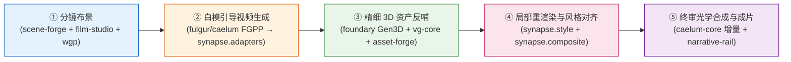

# Synapse (神经突触)

> **3D CG 渲染与神经视频生成互操作算法 SDK、无状态推理容器 Worker 与跨模态评测基准 (`Synapse-Bench`)**  
> Interoperability SDK, Stateless GPU Worker Runtime & Benchmark Suite between 3D CG Rendering and Generative Video Models.

---

## 1. 核心定位与生态边界

当前 3D 物理渲染（确定性时空几何与辐射度量）与生成式视频扩散模型（潜空间时序分布）存在根本性的表示鸿沟。  
**`synapse`** 位于 DervGen 生态 **Layer 2**，扮演连接两者的“神经突触”算法与评测层（落实 **RFC 0044** 神经-物理混合工业流水线）：

- **向上承接编排**：作为无状态单步 GPU Worker（消费 **RFC 0039 `JobBundle`**），由 Go 分布式农场 `render-farm` 与影视管线 `narrative-rail` 在 `foundary` 推理容器中按需拉起执行，**绝不自建常驻 Python 服务端**；
- **向下严守契约**：Python 端 `synapse.fgpp` 严格镜像 Layer 0 **`@aether//fgpp`** C++20 线格式 SSOT，与 `fulgur`（Track B 毫秒级光栅）和 `caelum-core`（Track A 物理光追）实现多通道 OpenEXR 2.0 零歧义互通；
- **横向原生闭环**：风格描述符对齐 **`@aether//style` (`RFC 0043`)** 与 **ACEScg (`RFC 0058`)**；4D 点追踪、6-DoF 运镜解算、流形闭合校验与 Quad 重拓扑、Humanoid-53 足底防滑锁定 IK（$<0.3\text{ cm/s}$）以及球谐/Retinex 混合去光照全面由原生算法模块 **`synapse.recon`** 提供，实现零外部 C++ 强依赖开箱即用，并向下兼容 `synapse.bridge.vg_bridge` 抽象。

---

## 2. 混合渲染管线协同全景（5 阶段）



1. **分镜布景**：在 `grand-studio` 宿主内通过 `scene-forge`、`film-studio` 与 `wgp` 完成 3D 代理白模（角色满足 $\ge 1500$ 顶点粗糙度下限）与运镜轨迹规划。
2. **白模引导生成**：`fulgur` / `caelum-core` 导出 15 标量通道 **FGPP** OpenEXR 序列，`synapse.adapters` 驱动白盒主力（`Wan 2.1 14B` + ControlNeXt + 3D Causal VAE 软光流偏置）或黑盒商业 API（`Seedance 2.5` / `Kling 1.5` / `Veo`）生成时空受控视频。
3. **精细 3D 资产反哺**：经 `foundary` 正交关键帧 3D 重建（`TRELLIS`/`Hunyuan3D`）破解白模反投悖论，由 `vg-core` 完成混合去光照与 Graph-Cut 缝合，并由 L2 美术在 `asset-forge` 限时精修（15 分钟硬熔断）。
4. **局部手术刀重渲染与风格对齐**：`synapse.style` 提取视频色温、曝光与球谐主光映射为 `StyleProfile` 驱动 3D 局部重渲；`synapse.composite` 构建 `3D ∪ SAM2` 运动膨胀掩膜，在 CIE LAB 与线性 ACEScg 空间完成无缝融合。
5. **终审合成与评测闭环**：叠加高阶物理接触阴影/焦散，全流程由 `Synapse-Bench` 四维 16 项指标量化守门。

---

## 3. 模块架构与当前就绪状态

> 整体设计与跨文档对齐决议见 [docs/DESIGN_REVIEW_AND_ALIGNMENT.md](docs/DESIGN_REVIEW_AND_ALIGNMENT.md)，架构审查见 [docs/AUDIT_AND_ARCHITECTURE.md](docs/AUDIT_AND_ARCHITECTURE.md)，重构后全库深度审计见 [docs/audits/AUDIT-POST-REFACTOR-2026-11.md](docs/audits/AUDIT-POST-REFACTOR-2026-11.md)，M1–M16 全量 58-PR 实施总计划见 [docs/IMPLEMENTATION_PLAN.md](docs/IMPLEMENTATION_PLAN.md)。当前全仓自动化测试套件 **951 passed, 10 skipped（共 961 项测试）** 全绿。

| 模块路径 | 核心职责 | 当前状态 | 对应实施里程碑 / 交付 |
| :--- | :--- | :---: | :---: |
| `csrc/geometry/` | Tier 0 现代 C++20 原生几何核（Bazel 构建，`@aether//math` DVec3），流形/水密/简并/自交校验 | 🟢 已就绪并测试覆盖 | Tier 0 核心算子 |
| `python/synapse/recon/` | Video-to-3D 几何逆向重建与资产蒸馏（RFC 0060/0062）：4D 点追踪、6-DoF 运镜解算、流形闭合 Python Oracle、Quad 重拓扑、足底防滑零位移 IK (<0.2 cm)、球谐与 Retinex 本征去光照、双轨可微逆渲染 | 🟢 原生全面就绪 | RFC 0060/0062 逆向闭环 |
| `python/synapse/refine/` | 局部解剖智能修正与多模型融合（RFC 0061）：MANO 手部先验、Canonical 面部身份保持、五维多模型融合核、512×512 瓦片与光流 Warp 手术刀缝合 | 🟢 已合入 | M10 (`PR-33` ~ `PR-37`) |
| `python/synapse/bench/` | `Synapse-Bench` 30 场景、11×4 条件因子、纯 NumPy 软光栅与 InspectionBundle 导出器 | 🟢 已就绪并测试覆盖 | `PR-01`, `PR-15`, `PR-26` |
| `python/synapse/fgpp/` | 对齐 `@aether//fgpp` 的 15 标量通道 (`34B/px`) OpenEXR 读写、消毒器与 DLPack 桥接 | 🟢 已就绪并测试覆盖 | `PR-02`, `PR-03` |
| `python/synapse/cli/` | 双入口统一 CLI（`synapse` / `synapse-bench`、确定性退出码 `0/10/20/30/40/50`、显存预检） | 🟢 已就绪并测试覆盖 | `PR-04`, PR #22 |
| `python/synapse/adapters/` | 双轨视频适配器（`Mock` / 白盒 `Wan 2.1` / 黑盒 API）、97f 因果滑窗与 Multi-LoRA 空间隔离 | 🟢 已就绪并测试覆盖 | `PR-05` ~ `PR-08`, `PR-16` |
| `python/synapse/style/` | 双曲正切软肩 ACEScg 逆色调映射、球谐主光提取与 `StyleProfile v2.0` 映射 | 🟢 已就绪并测试覆盖 | `PR-09` |
| `python/synapse/composite/` | 穿模/闪烁检测、`3D ∪ SAM2` 膨胀掩膜、16px 环带 LAB 与光学增量拉普拉斯金字塔融合 | 🟢 已就绪并测试覆盖 | `PR-10`, `PR-11` |
| `python/synapse/bridge/` | `foundary` 客户端、HITL 15m 熔断状态机与 `vg_bridge`（内建 `MockVgBackend` 回退） | 🟢 已就绪并测试覆盖 | `PR-12` |
| `python/synapse/metrics/` | 四维 16 项指标与三级质量门禁档位（`track_b` / `track_a` / `rsi_promotion`，SSOT 对齐） | 🟢 已就绪并测试覆盖 | `PR-13`, PR #23 |
| `python/synapse/pipeline/` | 无状态 `JobBundleWorker` 容器执行核、离线 `BenchPipelineRunner` 与解耦的 Stage 适配器 | 🟢 已就绪并测试覆盖 | `PR-14a`, `PR-14b`, PR #24 |
| `python/synapse/training/` | 3D VAE / FGPP 离线潜空间 `WebDataset` 缓存与正交 LoRA 训练器（参考锚定 Diffusion-DPO） | 🟢 已就绪并测试覆盖 | `PR-17` ~ `PR-19`, PR #27 |
| `python/synapse/inspect/` | Tier 0 几何硬门禁、Fibonacci 粗到精配准、微距 3D 反投、Visual Jev 判别与 3D 模型评估报告（SVG 雷达图） | 🟢 已就绪并测试覆盖 | `PR-20` ~ `PR-23`, PR #31 |
| `python/synapse/rsi/` | 课程域随机化、物理+PRM 双重验算、20% L0 黄金锚点经验回放与单调递增发布门禁 | 🟢 已就绪并测试覆盖 | `PR-24`, `PR-25` |
| `python/synapse/viewer/` | 本地 `127.0.0.1` 轻量调试预览器（NG-1 豁免，离线开发辅助） | 🟢 已就绪并测试覆盖 | PR-01, PR-51 |
| `tools/data-inspector/` | Electron 33 + `@fulgur` / `@aether//pal:shm` Native C++ 五视图可视化检查器 | 🟡 脚手架已合入 (真视口待 M16 PR-55) | `PR-27` ~ `PR-29`, PR-55 |

---

## 4. 文档导航

- **[AGENTS.md](AGENTS.md)**：AI Agent 与开发者行为铁律、测试机器分工与编码规范
- **[docs/DESIGN_REVIEW_AND_ALIGNMENT.md](docs/DESIGN_REVIEW_AND_ALIGNMENT.md)**：**整体设计深度评审与跨文档对齐决议**（`RV-01~RV-17` 纠偏、权威目录树、统一 CLI 语法树与三级门禁阈值表）
- **[docs/IMPLEMENTATION_PLAN.md](docs/IMPLEMENTATION_PLAN.md)**：**M1–M16 十六阶段 58 个原子 PR 可落地实施总计划 (`v3.1`)** 及 `docs/plans/` 七份精细化执行子计划：
  - [PLAN-M1-M2](docs/plans/PLAN-M1-M2-FOUNDATION-AND-ADAPTERS.md) · [PLAN-M3-M4](docs/plans/PLAN-M3-M4-STYLE-COMPOSITE-AND-BENCH.md) · [PLAN-M5](docs/plans/PLAN-M5-LORA-TRAINING-PIPELINE.md) · [PLAN-M6-M7](docs/plans/PLAN-M6-M7-INSPECTION-AND-RSI-FLYWHEEL.md) · [PLAN-M8](docs/plans/PLAN-M8-DATA-INSPECTOR-DESKTOP.md) · [PLAN-M9-M12](docs/plans/PLAN-M9-M12-HORIZON3-LANDING.md) · [PLAN-M13-M16](docs/plans/PLAN-M13-M16-POST-REFACTOR-REMEDIATION.md)
- **[docs/AUDIT_AND_ARCHITECTURE.md](docs/AUDIT_AND_ARCHITECTURE.md)**：整体目标审查、跨仓职责定界与 10 大现状问题诊断报告
- **[docs/audits/AUDIT-POST-REFACTOR-2026-11.md](docs/audits/AUDIT-POST-REFACTOR-2026-11.md)**：**重构后全库架构、工程实现与技术债务深度审计报告（2026-11）**
- **[RFC 0060](docs/RFC-0060-REAL-VIDEO-TO-3D-DIGITAL-TWIN.md)** · **[详细设计](docs/DESIGN_REAL_VIDEO_TO_3D_INVERSE_RENDERING.md)**：**真实视频逆向 3D 动态数字孪生与联合反演规范**
- **[RFC 0061](docs/RFC-0061-LOCAL-REFINEMENT-AND-MULTI-MODEL-FUSION.md)** · **[详细设计](docs/DESIGN_LOCAL_REFINEMENT_AND_MULTI_MODEL_FUSION.md)** · **[ForgeKit 工具链](docs/DESIGN_FORGEKIT_ANATOMICAL_REFINE_TOOLING.md)**：**局部解剖智能修正、多模型融合与手术刀缝合**
- **[RFC 0062](docs/RFC-0062-INVERSE-RENDERING-AND-3D-NEURAL-CLOSED-LOOP.md)** · **[详细设计](docs/DESIGN_INVERSE_RENDERING_CLOSED_LOOP.md)**：**3D 引导生成、可微逆向渲染与局部修补双向闭环**
- **[docs/PLAN-ALGO-TRAINING-DATA-PIPELINE.md](docs/PLAN-ALGO-TRAINING-DATA-PIPELINE.md)**：算法、训练与数据流水线攻坚执行计划 (`v2.0`)
- **[docs/DESIGN_3D_MODEL_ENHANCEMENT_AND_DATA_SPEC.md](docs/DESIGN_3D_MODEL_ENHANCEMENT_AND_DATA_SPEC.md)**：3D 生成模型质量提升方法论、评估体系全景矩阵与训练数据工程规范
- **[docs/DESIGN_INDUSTRY_GAP_AND_COMPENSATION.md](docs/DESIGN_INDUSTRY_GAP_AND_COMPENSATION.md)**：行业成熟流水线对比差距与代偿性架构设计规范
- **[docs/DESIGN_SYSTEM_ENHANCEMENT.md](docs/DESIGN_SYSTEM_ENHANCEMENT.md)**：Synapse 2.0 系统设计增强规范（流式潜空间切片、拓扑突变保护、Wire Guard、软肩 ACEScg）
- **[docs/DESIGN_LORA_PIPELINE.md](docs/DESIGN_LORA_PIPELINE.md)**：LoRA & PEFT 微调流水线设计规范
- **[docs/DESIGN_3D_INSPECTION_AND_REFINEMENT.md](docs/DESIGN_3D_INSPECTION_AND_REFINEMENT.md)**：3D 建模智能质检、多尺度对齐与精修数据飞轮设计规范
- **[docs/DESIGN_RSI_FLYWHEEL.md](docs/DESIGN_RSI_FLYWHEEL.md)**：递归自我提升 (RSI) 与物理驱动自演进飞轮设计规范
- **[docs/DESIGN_DATA_INSPECTOR.md](docs/DESIGN_DATA_INSPECTOR.md)**：训练数据可视化检查器方案（Data Inspector）
- **[docs/plans/PLAN-3D-ROUNDTRIP-RECONSTRUCTION-VERIFICATION.md](docs/plans/PLAN-3D-ROUNDTRIP-RECONSTRUCTION-VERIFICATION.md)**：3D 多视角生成与逆向重建闭环验证计划
- **[docs/archive/](docs/archive/README.md)**：**历史评审与交付归档**（含 [PR #17/#18 联合整改报告](docs/archive/PLAN-REVIEW-PR17-PR18.md)、[3D 模型评估交付 Review](docs/archive/REVIEW_3D_EVAL_DELIVERY.md)）

---

## 5. 快速上手

```bash
# 安装开发环境
pip install -e ".[dev]"

# 运行单元测试（日常全量回归优先在云端主力机 ubuntu24 执行）
ssh ubuntu24 "cd ~/work/dervgen/synapse && pytest tests/ -v"
```
