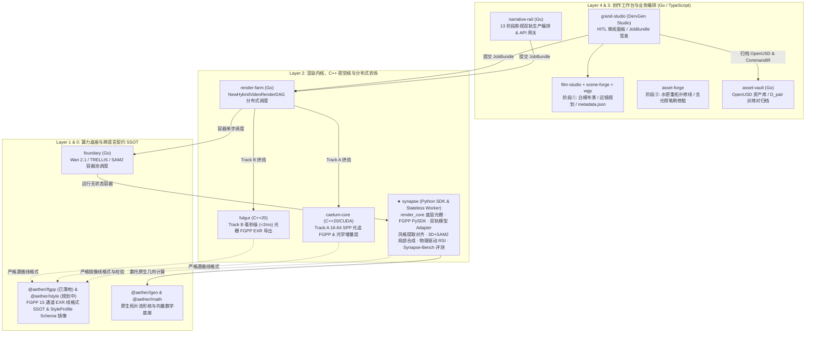
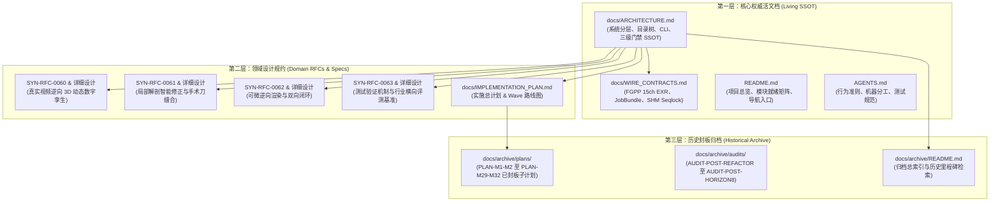

# Synapse 整体目标审查、系统架构与跨文档对齐总纲 (Architecture & System Design SSOT)

- **文档状态**: `Approved Architecture Baseline (v4.0.0 — Horizon-9 Sealed)`
- **操作模型标识**: `[opus4.6]`
- **权威范围**:
  - `synapse` 仓库整体目标、系统分层架构、代码基线命名与跨仓定界；
  - 整合并替代原 `docs/AUDIT_AND_ARCHITECTURE.md` 与 `docs/DESIGN_REVIEW_AND_ALIGNMENT.md`，作为 Layer 2 唯一的架构与设计权威事实源（SSOT）；
  - 关联线格式与跨仓协议详见 [docs/WIRE_CONTRACTS.md](WIRE_CONTRACTS.md)；
  - 关联主实施计划详见 [docs/IMPLEMENTATION_PLAN.md](IMPLEMENTATION_PLAN.md) 与 [docs/plans/PLAN-M33-M36-HOLISTIC-REMEDIATION-AND-EVOLUTION.md](plans/PLAN-M33-M36-HOLISTIC-REMEDIATION-AND-EVOLUTION.md)；
  - 历史阶段计划与审计详见 [docs/archive/](archive/README.md)。

---

## 1. 核心定位与生态边界

### 1.1 仓库定位（Layer 2 Python GPU Worker & Interop SDK）
> **`synapse` 是 DervGen 生态 Layer 2 的“3D CG 渲染与神经视频生成互操作算法 SDK、无状态推理容器执行核（Worker Runtime）与跨模态往返评测基准（`Synapse-Bench`）”。**

它致力于解决 **“确定性 3D 物理渲染（时空几何与辐射度量）”** 与 **“潜空间神经视频扩散模型（时序潜变量分布）”** 之间的表示鸿沟，在生态中以三种严格形态被调用：
1. **Python 算法库 (`import synapse`)**：供 `foundary` 上的 GPU 推理容器（`Wan 2.1`、`SAM2`、风格提取、局部修复合成）与逆向重建反演管线直接调用；
2. **无状态作业执行 CLI (`synapse worker run --bundle ...`)**：由 `render-farm`（Go）下发自洽 `JobBundle` 闭包启动单次容器进程，读取输入 EXR/视频、执行张量计算、写出结果并退出；遵循确定性退出状态码（`0 / 10 / 20 / 30 / 40 / 50`）；
3. **离线评测 CLI (`synapse-bench ...`)**：在 `ubuntu24` 或 GPU 节点上执行 T1–T5 场景正向生成与逆向重建往返评测，输出纯 JSON 与自包含 HTML 诊断报告。

### 1.2 跨仓协同拓扑与职责切分



---

## 2. 五条绝对负向边界（Non-Goals & Hard Redlines）

| 编号 | 严禁越界行为 | 正确归属仓库 | 违反的生态铁律 |
| :---: | :--- | :--- | :--- |
| **NG-1** | ❌ **严禁将 `synapse` 写成常驻 HTTP/gRPC 业务微服务或分布式任务队列** | `narrative-rail` (Go) / `render-farm` (Go) / `foundary` (Go) | **Rule 11: Server-side Zero-Python**（服务端全面禁 Python） |
| **NG-2** | ❌ **严禁在 `synapse` 中另起炉灶重新定义 FGPP 线格式字段或脱离 `@aether//fgpp` 演进** | `@aether//fgpp` (`fgpp_types.h`) 为唯一跨语言 Wire SSOT | **`rfc-design-governance` §5.1**（跨语言契约收敛至 Layer 0 `aether`） |
| **NG-3** | ❌ **严禁在生产管线手写低效几何循环**；核心拓扑与流形闭合校验已自包含在 `synapse` 原生 C++20 核（`csrc/geometry/`，基于 `@aether//geo` 与 `@aether//math`）与 Python Oracle（`synapse.recon.geometry`）中，确保零外部依赖即可完成全套 CI 门禁；重型四边面重拓扑由 `synapse.recon` 或 `synapse.bridge` 委托处理 | `csrc/geometry/` (自包含 Tier 0) + `synapse.recon` + 可选桥接 | **零外部强依赖与性能铁律** |
| **NG-4** | ❌ **严禁在 `synapse` 内直连 `asset-vault` 数据库/API 或硬编码存储凭证** | 通过 `JobBundle` 传入本地挂载路径或 Presigned URLs | **RFC 0039**（资产/算力解耦与自洽作业闭包） |
| **NG-5** | ❌ **严禁在桌面客户端（`grand-studio` / `scene-forge` / `asset-forge`）内直接 `import synapse` 拉起 PyTorch** | 客户端仅组装 JSON `JobBundle` 发往远端 `render-farm` | **RFC 0044 §3.1**（桌面端零重型 Python 依赖） |

> [!NOTE]
> **NG-1 落地执行**：`synapse.viewer` 模块为纯静态自包含 HTML 报告导出器（`export_static_html`），零常驻服务进程，100% 恪守 NG-1 的“Server-side Zero-Python”红线。

---

## 3. 全仓唯一事实源（Canonical SSOT Contracts）

### 3.1 权威模块目录树（Canonical Module Tree）

```text
synapse/
├── AGENTS.md / CLAUDE.md                # Agent 行为铁律与云端测试规范
├── README.md                            # 仓库总览与导航
├── pyproject.toml                       # 依赖分层: core / image / mesh / metrics / gpu / train / invrender / dev
├── tools/
│   ├── wire_guard.py                    # 从 @aether//fgpp (fgpp_types.h) 生成并校验 schema.py
│   ├── import_dag_guard.py              # 5-Tier 架构导入分层守护器
│   └── data-inspector/                  # Electron + fulgur Native SHM 可视化检查器
│       ├── package.json                 # Electron 33 + @dervgen/electronkit + @dervgen/forgekit
│       ├── electron/                    # 主进程 (SHM 读取、Bundle 管理、synapse-bench CLI 桥接)
│       ├── renderer/                    # 5 大视图 (Source / Anim / Video+FGPP / Recon / Compare)
│       └── native/                      # 独立 MODULE.bazel C++20 渲染进程 (依赖 @fulgur/@aether::pal::shm)
├── csrc/geometry/                       # [Tier 0] 现代 C++20 原生几何核 (Bazel, @aether//geo, MSVC 兼容)
│   ├── BUILD.bazel                      # 目标 :geometry_lib, :geometry_bindings (pybind11)
│   ├── include/synapse/geometry/        # mesh_checks.h, types.h, aabb.h
│   └── src/                             # bindings.cc (委托 @aether//geo 算法核)
├── python/synapse/
│   ├── py.typed                         # PEP 561 强类型标记
│   ├── errors.py                        # SynapseError 异常族、退出码 (0/10/20/30/40/50)、agent_fix_hint
│   ├── telemetry.py                     # W3C traceparent/tracestate 解析与 MemoryForecaster 显存预检
│   ├── render_core/                     # [Tier 0] 无状态底层纯 CPU 软光栅化、相机投影、网格与基础几何原语
│   │   ├── rasterizer.py                # 纯 NumPy 向量化光栅化主路径 (entity_hash, 深度/法线/光流)
│   │   ├── camera.py                    # CameraParams、轨迹生成 (6 类轨迹，无奇异点)
│   │   ├── mesh.py                      # 统一 MeshData 数据结构与 load_obj 解析器
│   │   ├── procedural.py                # 基础几何体 + Humanoid-53 (>=1500 顶点) 铰接代理白模
│   │   ├── conditions.py                # 11 维正交渲染条件因子
│   │   ├── morphology.py                # 欧氏距离变换 (EDT)、膨胀/腐蚀
│   │   ├── pyramid.py                   # 拉普拉斯/高斯金字塔无损分解与重构
│   │   └── backend.py                   # VgBackend 与 MockVgBackend 抽象
│   ├── fgpp/                            # [Tier 0] @aether//fgpp Python 官方镜像 SDK
│   │   ├── schema.py                    # 15 标量通道规格、34B/px、Log-Depth、Coarseness Floor、Anchor
│   │   ├── frame.py                     # CameraParams (行列主序无损互转)、FGPPFrame、FGPPSequence
│   │   ├── io.py                        # OpenEXR 2.0 异构通道读写、消毒器、Cryptomatte Nearest 缩放
│   │   └── torch_bridge.py              # NumPy <-> PyTorch DLPack 零拷贝桥接
│   ├── bridge/                          # [Tier 0] 跨库/跨容器薄桥接层 (可插拔 Mock 回退)
│   │   ├── vg_bridge.py                 # 桥接委托接口 + Track-B 白模反投门禁
│   │   ├── foundary_client.py           # 调用 foundary (TRELLIS/Hunyuan3D/SAM2/GVHMR/Visual-Jev) 客户端
│   │   └── hitl.py                      # RFC 0020 CommandIRRecord 与 15 分钟 (900s) 熔断状态机
│   ├── style/                           # [Tier 1] 风格提取、有理软肩 ACEScg 与 RFC 0043 映射
│   │   ├── aces_color.py                # sRGB <-> ACEScg 变换、有理软肩逆色调映射 T(y)、CIEDE2000
│   │   ├── descriptor.py                # StyleDescriptor 强类型数据模型
│   │   ├── extractor.py                 # histogram_optical & fgpp_intrinsic 球谐主光提取
│   │   └── profile_mapper.py            # 导出 @aether//style StyleProfile v2.0.0 (YAML/JSON)
│   ├── metrics/                         # [Tier 1] 四维 16+ 项评测指标与三级门禁档位
│   │   ├── profiles.py                  # 三级门禁阈值定义 (track_b_video / track_a_asset / rsi_promotion)
│   │   ├── temporal.py                  # temporal_warp_error, flicker_score, fvd
│   │   ├── fgpp_fidelity.py             # depth_rmse, normal_angular_error_deg, flow_endpoint_error_px, silhouette_iou
│   │   ├── roundtrip.py                 # chamfer_mm, f_score_1mm, volume_breathing_pct, foot_sliding_cm, bone_drift
│   │   └── style_consistency.py         # ciede2000, light_dir_error_deg, tone_curve_rmse, histogram_intersection
│   ├── models/                          # [Tier 1] 资产加载与网格解析兼容层 (委托 render_core.mesh)
│   ├── adapters/                        # [Tier 2] 双轨视频生成适配与运行时 Multi-LoRA
│   │   ├── base.py                      # VideoModelAdapter 抽象基类、VideoResult、注册表
│   │   ├── mock.py                      # 零 GPU 确定性合成器 + 可控缺陷注入器 (DefectInjectionConfig)
│   │   ├── scheduler.py                 # W=97/S=64/Δ=33 因果滑窗(含3帧暖启动)、Sigmoid 退火、突变重锚定
│   │   ├── wan.py                       # Tier-1 白盒: Wan 2.1 + ControlNeXt + 软光流偏置 + MultiLoRA 挂载
│   │   ├── cloud.py                     # Tier-2 黑盒: Seedance 2.5 / Kling 1.5 / Veo 锚定帧降级适配
│   │   └── lora/                        # 运行时 LoRA 加载与隔离 (Manifest, Manager, Patcher)
│   ├── composite/                       # [Tier 2] 3D+SAM2 局部手术刀合成
│   │   ├── detector.py                  # 闪烁、轮廓漂移、浮空穿地自动异常区域检测
│   │   ├── mask.py                      # M_3D ∪ M_SAM2 联合掩膜 + 光流自适应膨胀算子
│   │   └── blend.py                     # 16px 环带 CIE LAB 直方图匹配、时域泊松融合、Cryptomatte 引导光学合成
│   ├── recon/                           # [Tier 2] [RFC 0060/0062] Video-to-3D 几何逆向重建与可微闭环
│   │   ├── geometry.py                  # 2-流形/水密闭合/简并面/自相交 Python Oracle (双轨真值基准)
│   │   ├── multiview.py                 # MultiViewInitializer (轮廓刻蚀/TSDF 初始化)
│   │   ├── delight.py                   # Retinex & 球谐本征去光照
│   │   ├── kinematics.py                # TwoBoneIK & 足底零位移防滑 IK (<0.2cm)
│   │   ├── tracking.py                  # 4D 稠密点追踪与 6-DoF 相机位姿轨迹求解
│   │   ├── pipeline.py                  # ReconPipeline 端到端逆向反演串联器
│   │   └── loop/                        # 可微逆向与主动协同闭环 (Mitsuba 3 + AnalyticUV)
│   ├── refine/                          # [Tier 2] [RFC 0061] 局部解剖修正与多模型手术刀融合
│   │   ├── types.py                     # RefinementROI (crop_acescg), FusionMethod, RefinementResult
│   │   ├── roi_tracker.py               # Kalman 平滑 BBox + 2x3 仿射矩阵 M / M⁻¹
│   │   ├── tiled_executor.py            # 512x512 Tile Bypass 调度器
│   │   ├── hand.py / face.py            # FGPP 手部先验/MANO + CanonicalAnchorGallery 面部身份保持
│   │   ├── fusion.py                    # MultiModelRefineFusion (频域金字塔/级联/潜切换/置信度/泊松)
│   │   ├── stitcher.py                  # ACEScg 手术刀缝合 (M⁻¹ + LAB 环匹配 + 光流 Warp EMA)
│   │   └── pipeline.py                  # LocalRefinementPipeline 总控编排器
│   ├── inspect/                         # [Tier 2] 3D 智能质检、Visual Jev 判别与 RL 飞轮样本导出
│   │   ├── geometry_gate.py             # Tier 0 确定性几何硬防线门禁 (双轨 C++/Python validate_mesh_geometry)
│   │   ├── schemas.py                   # CameraPose, DefectAnnotation3D, InspectionReport, GeometricValidationResult
│   │   ├── align.py                     # Fibonacci 球面 DINOv2 粗检索 + 6DoF 精配准
│   │   ├── macro.py                     # 多通道残差热力图定位 + 虚拟微距相机 3D 反投解算
│   │   ├── jev_critic.py                # Visual Jev 共享视觉上下文批量质检与校准 Logits 置信度提取
│   │   └── flywheel_exporter.py         # 对接 RFC 0020/0021 导出 IntentGroup / PRM / Undo-DPO JSONL
│   ├── bench/                           # [Tier 3] Synapse-Bench 30 场景、测试运行与报告
│   │   ├── scenarios/*.json             # T1–T5 共 30 个标准场景 JSON
│   │   ├── scenario.py                  # Scenario 模型 (含 temporal_mode 与资源寻址)
│   │   ├── registry.py                  # 外部测试资产 SHA256 缓存拉取器
│   │   ├── domain_randomizer.py         # 11 因子课程域随机化场景生成器
│   │   ├── bundle_exporter.py           # 导出标准化 InspectionBundle
│   │   └── report.py                    # 零外部依赖自包含离线 HTML 报告生成器
│   ├── rsi/                             # [Tier 3] 物理驱动递归自我提升 (RSI) 无状态阶段算子
│   │   ├── curriculum.py                # 自博弈课程域随机化参数采样器
│   │   ├── dual_verifier.py             # 融合物理硬判决与 Visual Jev 的双重验算器
│   │   ├── pair_builder.py              # D_self / D_human 偏好对提纯与 >=20% L0 黄金锚点回放
│   │   └── promotion_gate.py            # Synapse-Bench T1-T5 全量单调递增防退化准出守门器
│   ├── training/                        # [Tier 3] 无状态 LoRA 离线特征预编码与 PEFT 训练核
│   │   ├── feature_store.py             # 3D Causal VAE + T5 + FGPP Min-Depth 离线预编码与 WebDataset 打包
│   │   ├── losses.py                    # Flow-Matching + Sobel 深度边缘对齐 + 参考锚定 DPO 损失
│   │   ├── trainer.py                   # 5 类正交 LoRA 训练器
│   │   └── packager.py                  # Safetensors 导出、Manifest 封装与准出门禁评估
│   ├── generators/                      # [Tier 3] 数据集生成兼容层 (委托 render_core.rasterizer)
│   ├── pipeline/                        # [Tier 4] 无状态单步 Worker 与离线评测串联器
│   │   ├── bench_runner.py              # BenchPipelineRunner (本地/CI 场景串联与 Bundle 导出)
│   │   ├── bundle_worker.py             # JobBundleWorker (消费 RFC 0039 bundle_manifest.json)
│   │   └── stages/                      # 解耦的 Stage 适配器 (inspect.py, rsi.py, training.py)
│   ├── viewer/                          # [Tier 4] 纯静态自包含 HTML 报告导出器 (零常驻服务)
│   └── cli/                             # [Tier 4] 统一 CLI 路由层
│       ├── _app.py                      # `synapse` 与 `synapse-bench` 双入口分发与参数树构建
│       └── ...                          # 领域子命令处理器 (_fgpp, _worker, _lora, _inspect, _rsi, _recon, _refine)
├── tests/                               # 单元、跨语言黄金契约与端到端 Mock 回归套件 (1,480+ 测试全绿)
└── scripts/
    ├── prepare_datasets.py               # FGPP 黄金数据集准备
    ├── run_cpu_verification.py            # E1–E5 无卡 CPU 基线验证
    └── colab_runner.py                    # Google Colab 实验执行器
```

### 3.2 统一 CLI 双入口语法树（Unified CLI Grammar）

所有子命令统一参数命名规范（统一输入视频为 `--video`，输出路径为 `--output`），强制支持 `--json`（纯 JSON `stdout`，零杂散日志）与统一退出状态码（`0 / 10 / 20 / 30 / 40 / 50`）：

| 顶层入口 | 子命令族 | 具体命令签名 | 核心语义说明 |
| :--- | :--- | :--- | :--- |
| **`synapse`** | `fgpp` | `synapse fgpp validate <dir> [--json]`<br/>`synapse fgpp inspect <dir> [--export-vis <out>] [--json]` | 校验 FGPP 15 通道 OpenEXR 与 metadata.json 规格 |
| **`synapse`** | `worker` | `synapse worker run --bundle <manifest_or_dir> [--json]` | 消费 RFC 0039 JobBundle 执行单步计算并退出 |
| **`synapse`** | `lora` | `synapse lora prepare-data --video <path> --fgpp-dir <dir> --output <wds> [--json]`<br/>`synapse lora train --config <yaml> --dataset <wds> --output <dir> [--json]`<br/>`synapse lora eval --lora-bundle <dir> --scenario <id> [--json]`<br/>`synapse lora merge --base <ckpt> --lora <dir:scale>... --output <ckpt> [--json]` | LoRA 潜空间分片打包、正交训练、评测与权重合并 |
| **`synapse`** | `inspect` | `synapse inspect align --ref-image  --mesh <glb> --output <pose.json> [--json]`<br/>`synapse inspect eval --ref-image  --mesh <glb> --camera <pose.json> [--json]`<br/>`synapse inspect refine --mesh <glb> --report <rep.json> --output <glb> [--json]`<br/>`synapse inspect export-rl-data --journal-dir <dir> --format dpo\|prm --output <jsonl> [--json]`<br/>`synapse inspect evaluate --input-dir <dir> --output-dir <dir> --gate-profile <p> [--json]` | 3D 资产多视角智能质检、精配准与自愈修线 |
| **`synapse`** | `rsi` | `synapse rsi sample-curriculum --round <t> --count <n> --output <dir> [--json]`<br/>`synapse rsi verify --candidate-dir <dir> --fgpp-dir <dir> [--json]`<br/>`synapse rsi build-pairs --verified-dir <dir> --l0-golden <dir> --output <dir> [--json]`<br/>`synapse rsi gate-promote --baseline <json> --candidate <json> [--json]` | 课程域随机化采样、物理+PRM 双验算与单调晋级门禁 |
| **`synapse`** | `recon` | `synapse recon invert-video --video <npy> [--output <dir>] [--target-faces N] [--fgpp-dir <dir>] [--json]`<br/>`synapse recon closed-loop --mesh <obj> --cameras <json> --video <npy> [--output <dir>] [--variant analytic_cpu\|cuda_ad_rgb] [--json]` | 视频逆向 3D 动态数字孪生与可微闭环反演 |
| **`synapse`** | `refine` | `synapse refine anatomical --video <mp4\|dir> --region <face\|left_hand\|right_hand\|all> [--output <dir>] [--fgpp-dir <dir>] [--json]` | 手部/面部局部解剖高保真瓦片修正与手术刀缝合 |
| **`synapse`** | `generate` / `view` | `synapse generate ...`（离线生成合成数据集）<br/>`synapse view [dataset] [--output <html_file>]`（导出纯静态自包含 HTML 报告） | 本地离线合成与静态报告导出 |
| **`synapse-bench`** | 评测基准套件 | `synapse-bench list [--tier T1..T5] [--json]`<br/>`synapse-bench export-fgpp --scenario <id> --output <dir> [--json]`<br/>`synapse-bench run [--scenario <id> \| --tier <T> \| --all] --adapter <id> [--profile <p>] [--report <html_path>] [--output-bundle <dir>] [--json]`<br/>`synapse-bench evaluate --bundle <inspection_bundle_dir> [--profile <p>] [--json]` | 跨引擎/跨模态正向生成与逆向重建全链路评测 |

### 3.3 `JobBundleWorker` 统一无状态容器阶段契约（RFC 0039）

`render-farm`（Go）通过 `synapse worker run --bundle <dir> --json` 统一调度全部单次容器计算阶段：

| `stage` 枚举值 | 核心输入载荷 (`inputs`) | 核心输出产物 (`outputs`) | 落地模块 |
| :--- | :--- | :--- | :---: |
| `fgpp_validate` | `fgpp_dir` | 校验摘要与通道统计 (`result_manifest.json`) | `synapse.fgpp` |
| `neural_video_generate` | `fgpp_dir`, `prompt`, `adapter_config`, `lora_bundles[]` | `generated_video.mp4`, 逐帧 PNG, `reanchor_requests[]` | `synapse.adapters` |
| `style_extract_and_map` | `video_or_frames`, `fgpp_dir` (可选) | `style_profile.yaml` (RFC 0043 v2.0.0), `usd_light_overrides.json` | `synapse.style` |
| `surgical_composite` | `base_video`, `patch_video`, `fgpp_new`, `sam2_mask`, `caelum_aov` | `composited_video.mp4`, 环带色差诊断 | `synapse.composite` |
| `lora_preencode` | `fgpp_dir`, `target_video`, `caption` | `WebDataset` 潜空间分片 (`shard-*.tar`) | `synapse.training` |
| `lora_train` | `wds_shards[]`, `lora_train_config.yaml`, `base_checkpoint` | `lora_bundle/` (`adapter_model.safetensors` + `lora_manifest.json`) | `synapse.training` |
| `lora_package` | `lora_train_dir`, `manifest_meta` | 签名与准出评估封装的 `lora_bundle/` | `synapse.training` |
| `asset_inspect_3d` | `mesh_glb`, `ref_image`, `rendered_gbuffer_dir` | `inspection_report.json` (`DefectAnnotation3D[]`) | `synapse.inspect` |
| `inspect_refine` | `mesh_glb`, `inspection_report` | `refined_mesh.glb` (L1 算法自愈修线) | `synapse.inspect` |
| `inspect_export_rl` | `journal_dir`, `format` (`dpo`\|`prm`) | `rl_dataset.jsonl` (RFC 0020/0021 训练对) | `synapse.inspect` |
| `rsi_dual_verify` | `candidate_dir`, `gt_fgpp_dir`, `l0_anchor_manifest` | `verification_verdict.json` + 提纯偏好对记录 | `synapse.rsi` |
| `video_to_3d_invert` | `video_path`, `sam2_mask_dir`, `rig_type` | `character_asset.usda`, `canonical_mesh.obj`, PBR maps | `synapse.recon` |
| `anatomical_refine` | `video_frames`, `fgpp_dir`, `anchor_gallery`, `command_ir[]` | `refined_video.mp4`, `refine_session.json`, `hard_negatives.jsonl` | `synapse.refine` |
| `inverse_render_loop` | `mesh_obj`, `camera_traj`, `target_video`, `preroll_spec` | `optimized_pbr_maps/`, `patched_video.mp4`, `closed_loop_report.json` | `synapse.recon.loop` |

### 3.4 三级质量门禁统一阈值矩阵（Reconciled Quality Gate Profiles）

> [!NOTE]
> **SSOT 落地确认**：`python/synapse/metrics/profiles.py` 与下表三级门禁值 100% 字节级对齐，并通过 `tests/test_profiles_doc_sync.py` 自动化测试进行代码-文档双向程序化锁死。原先更严苛的实验性远期指标独立保存在 `RSI_PROMOTION_TARGET` 档位中。

| 指标名称 | 物理意义 | `track_b_video`<br/>(快速白模视频预演) | `track_a_asset`<br/>(高保真 3D 资产准出) | `rsi_promotion`<br/>(LoRA/RSI 演进硬门禁) |
| :--- | :--- | :---: | :---: | :---: |
| `temporal_warp_error` | 光流对齐帧间扭曲残差 | $\le 0.020$ | $\le 0.015$ | $\le 0.015$ (且不劣于上代) |
| `flicker_score` | 高频时域拉普拉斯闪烁 | $\le 0.025$ | $\le 0.020$ | $\le 0.018$ |
| `depth_rmse_m` | 米制线性深度均方根误差 | $\le 0.05\text{ m}$ | $\le 0.04\text{ m}$ | $\le 0.03\text{ m}$ |
| `normal_angular_error_deg` | 表面法线平均余弦夹角 | $\le 15.0^\circ$ | $\le 12.0^\circ$ | $\le 12.0^\circ$ |
| `silhouette_iou` | 前景剪影交并比 | $\ge 0.85$ | $\ge 0.88$ | $\ge 0.90$ |
| `chamfer_mm` | 双边采样点云倒角距离 | $\le 8.0\text{ mm}$ | $\le 5.0\text{ mm}$ | $\le 4.0\text{ mm}$ |
| `volume_breathing_pct` | 跨帧/精修前后体积变化率 | $\le 5.0\%$ | $\le 3.0\%$ | $\le 2.5\%$ |
| `foot_sliding_cm` | 触地相足底水平位移 | $\le 0.5\text{ cm}$ | $\le 0.3\text{ cm}$ | $\le 0.2\text{ cm}$ |
| `albedo_delta_e00` | 去光照固有色 CIEDE2000 | $\le 5.0$ | $\le 2.5$ | $\le 2.5$ |
| `border_ring_ciede2000` | 16px 合成环带边界色差 | $\le 3.0$ | $\le 2.5$ | $\le 2.0$ |
| `non_manifold_edges` | 非流形边数量（3D 网格） | N/A | $\equiv 0$ | $\equiv 0$ |

---

## 4. 核心算法创新与物理防漂移机制

### 4.1 3D Causal VAE $T=4k+1$ 相位锁定与 3 帧前导暖启动
针对 `Wan 2.1` 等 $4\times 8\times 8$ 3D 因果 VAE 在非首窗口由于缺少前序因果卷积上下文导致的接缝闪烁问题，`ConditionScheduler` 锁死 $W=97, S=64, \Delta=33$ 滑窗规范：
- 首窗口（帧 `0..96`）：包含第 0 帧独立单帧编码与 24 个 4 帧潜步；
- 后续窗口 $k \ge 1$（名义区间 $[64k, 64k+96]$）：强制喂入前序 3 帧 `[64k-3, 64k-2, 64k-1]` 激活因果缓存，并对首潜步施加 $\alpha(0)=0$ 掩膜，确保潜变量在同相时间网格上执行 Sigmoid 融合。

### 4.2 拓扑突变重锚定（Topological Discontinuity Protection）
通过几何-光学梯度突变指数 $\kappa(t)$ 实时监控网格大形变与遮挡。当 $\kappa(t) > 0.65$ 时触发两级响应：
1. **Level-A 容器自愈**：将当前帧提升为动态物理强锚点，清空潜空间光流积分缓冲；
2. **Level-B 调度重算**：若超出单帧自愈容限，上报 `reanchor_requests` 请求 Go 调度层重算子帧 FGPP。

### 4.3 线性 ACEScg 色彩主链与有理软肩逆色调映射
全链路严格在 ACEScg (AP1 Linear) 色彩空间中运算。针对高光溢出，摒弃造成色偏的 `tanh` 算子，采用物理保真的有理软肩算子：
$$T(y) = \begin{cases}
y, & y \le y_{\text{knee}} \\
y_{\text{knee}} + \frac{y - y_{\text{knee}}}{1.0 + \frac{y - y_{\text{knee}}}{1.0 - y_{\text{knee}}}}, & y > y_{\text{knee}}
\end{cases} \quad (y_{\text{knee}} = 0.85)$$
保证 $T(y) \in [0, 1)$ 且在 $y_{\text{knee}}$ 处 $C^1$ 连续。

### 4.4 自包含双轨几何核与闭环反演
为彻底摆脱外部 C++ 库强依赖：
- **Tier 0 原生几何核 (`csrc/geometry/`)**：纯现代 C++20 实现，委托 `@aether//geo` 与 `@aether//math`，毫秒级完成水密、流形与自相交门禁；
- **Python Oracle (`synapse.recon.geometry`)**：纯 Python/NumPy 零依赖基准，与原生算子互为对照镜像；
- **自包含逆向反演 (`synapse.recon`)**：内置 4D 稠密点追踪、6-DoF 运镜求解、TSDF 初始化与 TwoBoneIK。

---

## 5. 文档三层体系与生态规约导航

全仓文档划分为清晰的三层治理拓扑，严禁同类内容多头维护：



- **第一层：核心权威活文档 (Living SSOT)**
  - [docs/ARCHITECTURE.md](ARCHITECTURE.md)：全系统架构与设计总纲（本文档）；
  - [docs/WIRE_CONTRACTS.md](WIRE_CONTRACTS.md)：底层跨语言线格式与协议规范；
  - [README.md](../README.md)：仓库介绍与最新就绪矩阵；
  - [AGENTS.md](../AGENTS.md)：开发者与 Agent 最高准则。
- **第二层：领域设计规约 (Domain Specs)**
  - [SYN-RFC-0060](SYN-RFC-0060-REAL-VIDEO-TO-3D-DIGITAL-TWIN.md) · [详细设计](DESIGN_REAL_VIDEO_TO_3D_INVERSE_RENDERING.md)
  - [SYN-RFC-0061](SYN-RFC-0061-LOCAL-REFINEMENT-AND-MULTI-MODEL-FUSION.md) · [详细设计](DESIGN_LOCAL_REFINEMENT_AND_MULTI_MODEL_FUSION.md) · [ForgeKit 工具链](DESIGN_FORGEKIT_ANATOMICAL_REFINE_TOOLING.md)
  - [SYN-RFC-0062](SYN-RFC-0062-INVERSE-RENDERING-AND-3D-NEURAL-CLOSED-LOOP.md) · [详细设计](DESIGN_INVERSE_RENDERING_CLOSED_LOOP.md)
  - [SYN-RFC-0063](SYN-RFC-0063-TESTING-CORRECTNESS-AND-BENCHMARKS.md) · [行业对比设计](DESIGN_INDUSTRY_GAP_AND_COMPENSATION.md)
  - [docs/IMPLEMENTATION_PLAN.md](IMPLEMENTATION_PLAN.md)
- **第三层：历史封板归档 (Historical Archive)**
  - [docs/archive/README.md](archive/README.md)：归档总索引。
