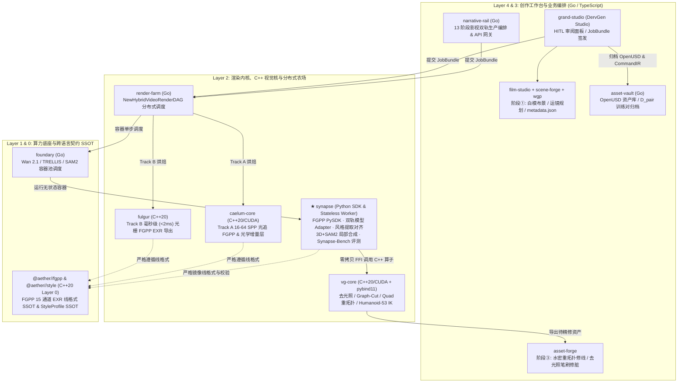

# Synapse 整体目标审查与生态架构定界报告 (Architecture & Goal Audit)

- **文档状态**: Accepted Baseline (`v1.0`)
- **审查范围**: `synapse` 仓库整体目标、当前 `v0.1.0` 基线代码、继承自 `RFC 0044` 与 `RFC 0059` 的演进计划
- **关联落地计划**: [docs/IMPLEMENTATION_PLAN.md](IMPLEMENTATION_PLAN.md)
- **关联生态规约**:
  - **RFC 0039**: 资产解耦、自洽作业闭包 (`JobBundle`) 与 DCC 连接器架构
  - **RFC 0043**: 全生态同场景多风格渲染架构与 `aether//style` `StyleProfile` SSOT
  - **RFC 0044**: 神经-物理混合工业流水线、特征引导协议 (`FGPP`) 与人机协同 (`HITL`) 跨仓编排规约
  - **RFC 0048**: `aether` 基础底座归一（原 `nexus` 全量合入 Layer 0 `aether`）
  - **RFC 0052**: Forge 工具链矩阵收敛（`grand-studio` / `scene-forge` / `asset-forge`）
  - **RFC 0057**: 全生态统一世界图谱协议 (`wgp`)
  - **RFC 0058**: OpenUSD Hydra、MaterialX / OpenPBR 1.0 与 ACEScg 跨平台架构

---

## 1. 整体目标审查结论 (Executive Summary)

### 1.1 核心价值评估：方向正确，切中痛点
`synapse` 从 `vg-core` 独立拆出（对应原 `vg.interop` / `RFC 0059`），致力于解决 **“确定性 3D 物理渲染”** 与 **“潜空间神经视频扩散模型”** 之间的表示鸿沟。这一独立建仓决策完全符合生态架构原则：
1. **守护 `vg-core` 纯 C++20/CUDA 算子纯洁性**：`vg-core` 要求 100% 几何/材质/运动学核心算法在 C++20/CUDA 层实现，Python 薄绑定代码量严格 `< 5%`。将面向 PyTorch / Diffusers / `Wan 2.1` / `SAM2` / 商业视频 API 的重型张量适配、潜空间光流偏置与跨模态评测拆入 `synapse`，避免了污染 `vg-core`。
2. **填补 RFC 0044 的算法与评测执行层空白**：RFC 0044 定义了跨仓编排拓扑，而 `synapse` 提供了实际在 GPU 推理容器内运行的 Python SDK、风格提取对齐模块以及可量化回归的 `Synapse-Bench` 往返评测集。

### 1.2 核心风险诊断：存在 4 项 P0 级架构越界与契约漂移
在审查当前仓库（`README.md`、`python/synapse/*`、`data/scenarios/*`）及原 `RFC 0059` 草案时，发现若直接按原计划推进实现，将触发 **跨语言契约断裂、与 Go 调度层职责冲突、与 C++ 核心库重复造轮子、以及色彩/风格体系脱节** 四大系统性风险。

本报告在 §2 确立 `synapse` 的严格生态边界，并在 §3 逐项列出 **10 项审计发现（4×P0 + 4×P1 + 2×P2）** 及其纠偏决议，作为 [IMPLEMENTATION_PLAN.md](IMPLEMENTATION_PLAN.md) 的架构前提。

---

## 2. 生态精准定界：Synapse 做什么 vs 不做什么

### 2.1 核心定位（Layer 2 Python GPU Worker & Interop SDK）
> **`synapse` 是 DervGen 生态 Layer 2 的“3D↔神经视频互操作算法 SDK、无状态推理容器执行核（Worker Runtime）与跨模态往返基准套件（`Synapse-Bench`）”。**

它只以三种形态被调用：
1. **Python 算法库 (`import synapse`)**：供 `foundary` 上的 GPU 推理容器（`Wan 2.1`、`SAM2`、风格提取、局部修复合成）直接调用；
2. **无状态作业执行 CLI (`synapse worker run --bundle ...`)**：由 `render-farm`（Go）下发自洽 `JobBundle` 闭包启动单次容器进程，读取输入 EXR/视频、执行张量计算、写出结果并退出；
3. **离线评测 CLI (`synapse-bench ...`)**：在 `ubuntu24` 或 GPU 节点上执行 T1–T5 场景正向生成与逆向重建往返评测，输出 JSON 与 HTML 诊断报告。

### 2.2 跨仓协同拓扑与职责切分



### 2.3 五条绝对负向边界（Non-Goals & Hard Redlines）

| 编号 | 严禁越界行为 | 正确归属仓库 | 违反的生态铁律 |
| :---: | :--- | :--- | :--- |
| **NG-1** | ❌ **严禁将 `synapse` 写成常驻 HTTP/gRPC 业务微服务或分布式任务队列** | `narrative-rail` (Go) / `render-farm` (Go) / `foundary` (Go) | **Rule 11: Server-side Zero-Python**（服务端全面禁 Python） |
| **NG-2** | ❌ **严禁在 `synapse` 中另起炉灶重新定义 FGPP 线格式字段或脱离 `@aether//fgpp` 演进** | `@aether//fgpp` (`fgpp_types.h`) 为唯一跨语言 Wire SSOT | **`rfc-design-governance` §5.1**（跨语言契约收敛至 Layer 0 `aether`） |
| **NG-3** | ❌ **严禁在 Python 中手写密集几何/材质/骨骼循环**（如四边面重拓扑、Graph-Cut $\alpha$-Expansion、物理去光照核、足底零速度 IK） | `vg-core` (`vg::geometry`, `vg::material`, `vg::actor`) & `caelum-core` | **`vg-core` 铁律 1** & 跨仓去重规范 |
| **NG-4** | ❌ **严禁在 `synapse` 内直连 `asset-vault` 数据库/API 或硬编码存储凭证** | 通过 `JobBundle` 传入本地挂载路径或 Presigned URLs | **RFC 0039**（资产/算力解耦与自洽作业闭包） |
| **NG-5** | ❌ **严禁在桌面客户端（`grand-studio` / `scene-forge` / `asset-forge`）内直接 `import synapse` 拉起 PyTorch** | 客户端仅组装 JSON `JobBundle` 发往远端 `render-farm` | **RFC 0044 §3.1**（桌面端零重型 Python 依赖） |

> [!NOTE]
> **NG-1 豁免声明**：`synapse.viewer` 中的本地 HTTP 预览服务器（`server.py`）属于**离线开发调试辅助工具**，仅在开发者本机通过 `synapse view` 命令手动启动、用于临时预览数据集，不参与任何生产流水线或容器部署，因此不违反 NG-1 的“严禁常驻微服务”约束。

---

## 3. 现状深度审计与 10 大问题纠偏清单 (Detailed Audit Findings)

### 🔴 P0 级（架构契约冲突与阻塞性缺陷）

#### [P0-1] FGPP SSOT 双头分裂与现存代码静默契约漂移
- **现状问题**：
  1. 在清理历史 `nexus` 引用时（提交 `194987c`），`synapse` 注释被改为 *"synapse is now the authoritative SSOT for the FGPP specification"*。但实际上根据 **RFC 0048**，原 `nexus//fgpp` 已正式迁入 Layer 0 **`aether/fgpp/include/aether/fgpp/fgpp_types.h`**，且已被 `caelum-core`（`fgpp_batch_session.cc`）、`fulgur` 与 `render-farm`（Go EXR 合成器）直接引用。Layer 0 C++ 绝不可能反向依赖 Layer 2 Python。
  2. **代码已发生严重静默漂移**：对比 `aether/fgpp/fgpp_types.h`（及 `DESIGN-0044-01`）与当前 [`python/synapse/fgpp/frame.py`](../python/synapse/fgpp/frame.py)：
     - **EXR 通道命名不一致**：`aether::fgpp` 规定了严格的 7 个逻辑组（如 `CameraLinearDepth.Z`、`WorldNormal.XYZ`、`DirectRadiance.RGB`）及按 ASCII 字典序排列的 **15 个 OpenEXR 标量通道**（`BaseColor.B/G/R`, `CameraLinearDepth.Z`, `Cryptomatte.ID`, ... 共 `34 Bytes/pixel`）；而 `frame.py` 使用 Python 属性名（`depth`, `direct_radiance`）写入 `metadata.json` 的 `channels` 字段，且完全缺失 OpenEXR 读写实现。
     - **`metadata.json` Schema 与矩阵主序冲突**：`DESIGN-0044-01` 与 `aether::fgpp::CameraFrameMetadata` 规定顶层字段为 `schema_version: "fgpp.v1.0"`、`total_frames`、`resolution`、`z_near_meters`、`z_far_meters`、`anchor_interval_frames: 48` 及逐帧 `is_physical_anchor`、**列主序（Column-Major）** `view_matrix_col_major` / `proj_matrix_col_major`；而 `frame.py` 输出 `version: "1.0"`、`num_frames`，存的是 **行主序（Row-Major）** `view_matrix` / `world_matrix`，且无锚点帧标记——直接对接 `caelum-core` 或 `fulgur` 会导致相机旋转转置、平移丢失！
     - **缺失核心物理守卫函数**：未实现 `linear_to_log_normalized_depth`、白模粗糙度下限校验（角色顶点数 $\ge 1500$ 且含独立四肢）以及 `Cryptomatte.ID` 禁止线性滤波（`allow_spatial_filtering = False`）契约。
- **纠偏决议**：
  - 明确分工：**`@aether//fgpp` 为全生态跨语言线格式（Wire Format）唯一 SSOT**；**`synapse.fgpp` 为 Python 端官方参考 SDK 实现**，通过自动化跨语言黄金契约测试（直接解析对比 `aether/fgpp/include/aether/fgpp/fgpp_types.h` 常量与 `caelum-core` 导出的真实 EXR 样本）保证 100% 字节级一致。

#### [P0-2] `synapse.pipeline` 职责定义越界，存在与 `narrative-rail` / `render-farm` 撞车风险
- **现状问题**：
  - `README.md` 与 `python/synapse/pipeline/__init__.py` 将 `pipeline` 描述为“5 阶段混合渲染生产管线编排调度”。但在生产架构中，阶段①（`scene-forge`/`film-studio`）、阶段③人工精修（`asset-forge`）、跨阶段异步持久化与 GPU 分配已由 **`narrative-rail`（Go）** 与 **`render-farm`（Go `NewHybridVideoRenderDAG`）** 承载。
- **纠偏决议**：
  - 将 `synapse.pipeline` 严格重定义为 **单机无状态阶段执行器 (`StageWorker`) + 离线评测串联器 (`BenchPipelineRunner`)**：
    1. 在生产环境：仅解析单阶段 `JobBundle`（如 `stage="fgpp_to_video"`、`stage="surgical_composite"`、`stage="style_extract"`），无数据库、无队列、无长连接；
    2. 在评测环境：在本地或 `ubuntu24` 串联跑通 `Synapse-Bench` 的“正向条件生成 → 逆向重建/合成 → 指标打分”闭环。

#### [P0-3] 逆向重建与去光照模块存在与 `vg-core` / `caelum-core` 重复造轮子风险
- **现状问题**：
  - 原 `RFC 0059` §5 规划在 Python 中实现几何重建、物理比值+残差去光照、多视角材质提取与运动蒸馏，而在拆出 `synapse` 时甚至遗漏了 `inverse` 与 `hitl` 目录。与此同时，`vg-core` 已落地 C++20 `vg::material`（去光照与 OpenPBR 升阶）、`vg::geometry`（四边面重拓扑与细分）、`vg::actor`（Humanoid-53 刚体骨长与足底接触 IK）、`vg::recon`（相机反求与 `TRELLIS` 服务契约），`caelum-core` 也已落地 `computeDelightPrior` 与 `SubFrustumMaskBaker`。
- **纠偏决议**：
  - 新增薄桥接层 `synapse.bridge`（而非重写底层算法）：通过 `vg-core` 的零拷贝 `pybind11` 接口（DLPack / Buffer Protocol）及 `foundary` 标准 HTTP/gRPC 推理契约调用 `TRELLIS` / `GVHMR` / `SAM2`。
  - 强制内置 **RFC 0044 §4.4 白模反投防呆门禁**：在 Track B（粗白模流）下，严禁直接将生成视频反投回粗糙白模 UV，必须先经过 `Gen3D` 高模生成 + 重拓扑步骤后才允许进入贴图烘焙。

#### [P0-4] `synapse.style` 与生态 `StyleProfile`（RFC 0043）及 ACEScg 色彩空间（RFC 0058）脱节
- **现状问题**：
  - 原 `RFC 0059` §6 设计了孤立的扁平 `StyleDescriptor` 与私有 `RenderOverrides`，未对齐 `@aether//style`（`DESIGN-0043-01` 四层 `StyleProfile`：L1 Shading / L2 MaterialRemap / L3 PostProcess / L4 Step），也未遵循 `DESIGN-0044-02` §3.3 的 **LDR → 逆色调映射（Inverse Tonemapping）→ ACEScg 线性 HDR** 物理合成规范。
- **纠偏决议**：
  - `StyleDescriptor` 必须内建色彩空间元数据（默认工作空间 `ACEScg`，显示空间 `sRGB`），并提供无损双向映射器 `to_aether_style_profile()` / `to_usd_overrides()`，使提取出的色温、曝光、主光方向、粗糙度偏置、3D LUT、胶片颗粒能直接被 `fulgur` 与 `caelum-core` 原生加载。

---

### 🟠 P1 级（工程实现缺陷与协议细节失配）

#### [P1-5] 防静默失败三问核对：6/8 子模块当前为空桩
按 `rfc-design-governance` **防静默失败三问（存在问、接线问、执行问）** 核对当前代码库（共 2,277 行）：

| 子模块 | 存在状态 | 接线状态 | 执行状态 | 真实就绪评估 |
| :--- | :---: | :---: | :---: | :--- |
| `synapse.bench` | ✅ 4 个文件 (1,346 行) | ⚠️ `conditions` 未接入 `camera` | ✅ 33 个单测通过（含 4 处边界 Bug） | 🟡 **M0 原型可用（需修 Bug）** |
| `synapse.fgpp` | ⚠️ 仅内存类 `frame.py` (192 行) | ❌ 无 EXR 读写，Schema 漂移 | ⚠️ 仅测了内存构造与私有 JSON | 🔴 **仅骨架（未与 C++ 互通）** |
| `synapse.adapters` | ❌ 仅 1 行空文档字符串 | ❌ 未接线 | ❌ 无可执行逻辑 | ⚪ **空桩 (`Stub`)** |
| `synapse.pipeline` | ❌ 仅 1 行空文档字符串 | ❌ 未接线 | ❌ 无可执行逻辑 | ⚪ **空桩 (`Stub`)** |
| `synapse.style` | ❌ 仅 1 行空文档字符串 | ❌ 未接线 | ❌ 无可执行逻辑 | ⚪ **空桩 (`Stub`)** |
| `synapse.composite` | ❌ 仅 1 行空文档字符串 | ❌ 未接线 | ❌ 无可执行逻辑 | ⚪ **空桩 (`Stub`)** |
| `synapse.metrics` | ❌ 仅 1 行空文档字符串 | ❌ 未接线 | ❌ 无可执行逻辑 | ⚪ **空桩 (`Stub`)** |
| `synapse.cli` | ❌ 仅 4 行 `print("synapse CLI")` | ⚠️ `pyproject.toml` 已注册入口 | ❌ 无子命令与退出码实现 | ⚪ **空桩 (`Stub`)** |

#### [P1-6] `Wan 2.1` 3D Causal VAE 帧数法则 (`T = 4k + 1`) 与 48 帧物理锚点失配
- **现状问题**：
  - Tier-1 主力基座 `Wan 2.1` 采用 $4 \times 8 \times 8$ 3D 因果 VAE，要求输入总帧数满足 $T = 4k + 1$（如 `17, 33, 49, 81, 97, 121`），从而精确映射为潜空间时间步 $\tau = 1 + (T - 1)/4$；同时 RFC 0044 §4.2 要求每 **48 帧** 注入物理锚定帧（即帧索引 `0, 48, 96` 恰好对应 $T = 97$ 帧！）。
  - 当前 `data/scenarios/*.json` 与 `camera.py` 默认帧数全部设为 `120`、`90` 或 `8`（均不满足 $4k+1$），进入 `Wan 2.1` 时会触发尾部截断或重复填充，导致潜空间光流积分 $\mathcal{W}_{\tau \to \tau'}^{\text{latent}}$ 与帧级锚点错位。
- **纠偏决议**：
  - 标准连续镜头基准帧数统一调整为 **`97` 帧**（24fps 下约 4.04 秒，$\tau = 25$，完美对齐 `0 / 48 / 96` 三个物理锚点帧）或短镜头 **`49` 帧**（`0 / 48` 双端物理锚点）；离散多视角重建（如 `sparse_8view`）在 `Scenario` 中显式标记 `temporal_mode: "discrete_views"` 与 `temporal_mode: "continuous_clip"` 区分处理。

#### [P1-7] 现存 `synapse.bench` 代码中的 4 处具体实现缺陷（已定位，列入 Phase M1 首要修复）
1. **环绕轨迹首尾帧重合 Bug**（[`camera.py:114`](../python/synapse/bench/camera.py#L114)）：
   `_generate_orbit` 使用 `t = i / max(num_frames - 1, 1)` 计算方位角。当 `azimuth_range_deg = 360.0` 时，第 `0` 帧（`0°`）与最后一帧（`360°`）相机位姿 **100% 重合**！这不仅导致 `t1_rigid_sphere_sparse.json`（`num_frames=8`）实际只有 **7 个独立视角**（间隔 `51.4°` 而非 `conditions.py` 定义的 8 视角间隔 `45°`），还导致循环视频在接缝处停顿 1 帧。满圈 `360°` 应默认 `endpoint=False`（`t = i / num_frames`），部分圆弧（`< 360°`）才使用 `endpoint=True`。
2. **天顶/天底奇异矩阵崩溃 Bug**（[`camera.py:50`](../python/synapse/bench/camera.py#L50)）：
   `_look_at` 中固定 `up = [0, 1, 0]`，当 `_generate_arc` 仰角达到 `±90°` 时，`forward` 与 `up` 共线，`np.cross(forward, up)` 退化为零向量，随后 [`camera.py:73`](../python/synapse/bench/camera.py#L73) 的 `np.linalg.inv(view)` 直接抛出 `LinAlgError: Singular matrix`。需引入共线检测与备用正交 `up` 轴（如 `[0, 0, 1]` 或局部切向连续标架）。
3. **渲染条件因子与轨迹生成器断联 Bug**（[`camera.py:308-314`](../python/synapse/bench/camera.py#L308-L314)）：
   `generate_cameras(scenario)` 完全忽略了 `scenario.conditions`！在场景 JSON 中配置 `{"F01_viewpoint": "L3", "F08_scale": "L2", "F09_dof": "L3"}` 不会改变生成的相机帧数、距离倍率（`camera_distance_multiplier`）或景深光圈（`aperture`），且 `Scenario.from_dict` 未校验非法因子键名。
4. **非 Editable 安装时场景目录寻址失效 Bug**（[`scenario.py:168-171`](../python/synapse/bench/scenario.py#L168-L171)）：
   `_scenarios_dir()` 通过 `Path(__file__).resolve().parent.parent.parent.parent / "data" / "scenarios"` 硬编码回溯源码仓库根目录。一旦在 `foundary` 容器中通过 `pip install .`（wheel 包）安装，`data/scenarios` 既未被打包进 wheel，路径也会指飞到 `/usr/local/lib/data/scenarios`，导致 `list_scenarios()` 静默返回空列表 `[]`！必须迁移至包内资源 + `importlib.resources` 并开启严格存在性断言。

#### [P1-8] 角色白模粗糙度下限（Coarseness Floor）数据集与门禁缺失
- **现状问题**：
  - 当前仅有简单几何基元（立方体、球、圆柱、圆环、平面）。根据 RFC 0044 §4.1，T2/T3 动态角色场景严禁用球/柱体拼凑角色，必须满足顶点数 $\ge 1500$ 且具备独立躯干四肢铰接结构（Humanoid-53 代理网格），否则扩散模型会产生“贴皮假人”伪影。

---

### 🟡 P2 级（Agent 友好度、治理文档与工程规范）

#### [P2-9] Agent-Friendly 仓库基础设施缺失
- 缺少根级 `AGENTS.md`（及 `CLAUDE.md` 软链），未声明测试优先调度至云端主力机 `ubuntu24` 的铁律；
- 缺少 PEP 561 `py.typed` 标记文件与 `mypy --strict` / `ruff` 门禁配置；
- CLI 缺少 `--json` 机器可读输出模式、确定性退出码（`0` 成功 / `10` 参数与契约校验错误 / `20` 资产或 EXR 缺失 / `30` GPU 或推理后端不可达 / `40` HITL 15 分钟熔断触发）以及结构化 `agent_fix_hint`；
- 缺少无需 40GB 模型权重的 CPU 确定性 `MockVideoAdapter`，若不补齐则无法在常规 CI 上做端到端管线回归。

#### [P2-10] 文档中残留已收敛/重命名的历史仓库术语
- `README.md` 仍引用已升级收敛的 `StageForge`（按 RFC 0052 现已统一升级为 `scene-forge`，原 `moldforge`/`glazeforge`/`castforge` 已收敛为 `asset-forge`，原 `grandforge` 已正名为 `grand-studio`，原 `transmute`/`actor-core`/`cg-recon`/`reverse-render` 已合并为 `vg-core`）。

---

## 4. 重构后的 Synapse 目标模块全景

修正上述 10 项问题后，`synapse` 的最终模块职责与上下游契约锁定如下：

```text
synapse/
├── AGENTS.md                        # Agent 与开发者最高行为准则 (含 CLAUDE.md 软链)
├── README.md                        # 项目总览、边界声明与快速导航
├── pyproject.toml                   # 包构建、严格类型检查与可选依赖分层 (core/image/metrics/gpu/dev)
├── docs/
│   ├── AUDIT_AND_ARCHITECTURE.md    # 整体目标审查与跨仓边界定界报告 (本文档)
│   └── IMPLEMENTATION_PLAN.md       # 分阶段可落地工程实施计划 (M1-M4, 15 个原子 PR)
├── python/synapse/
│   ├── py.typed                     # PEP 561 强类型包标记
│   ├── errors.py                    # 结构化错误码、退出码 (0/10/20/30/40) 与 agent_fix_hint
│   ├── fgpp/                        # 镜像 @aether//fgpp Wire SSOT 的 Python SDK
│   │   ├── schema.py                # 15 标量 EXR 通道常量、34B/px 校验、Log-Depth、Coarseness Floor
│   │   ├── frame.py                 # CameraParams (支持行列主序无损互转)、FGPPFrame、FGPPSequence
│   │   ├── io.py                    # OpenEXR 2.0 多通道读写 (Cryptomatte Nearest 保护 + memmap)
│   │   └── torch_bridge.py          # NumPy <-> PyTorch DLPack 零拷贝张量桥接
│   ├── adapters/                    # 视频生成模型双轨统一适配器 (RFC 0044 §4.2)
│   │   ├── base.py                  # VideoModelAdapter 抽象基类、VideoResult 与注册表
│   │   ├── mock.py                  # 零 GPU 确定性合成视频与可控伪影注入器 (供 CI 回归)
│   │   ├── scheduler.py             # 48 帧锚点调度、96f/16f 滑窗、3D Causal VAE 光流积分池化
│   │   ├── wan.py                   # Tier-1 白盒: Wan 2.1 14B + ControlNeXt/VACE + 软光流偏置
│   │   └── cloud.py                 # Tier-2 黑盒: Seedance 2.5 / Kling 1.5 / Veo 锚定帧降级适配
│   ├── style/                       # 风格提取、ACEScg 色彩对齐与 RFC 0043 StyleProfile 映射
│   │   ├── descriptor.py            # StyleDescriptor 数据结构与序列化
│   │   ├── aces_color.py            # LDR <-> Linear sRGB <-> ACEScg 逆色调映射与色度学转换
│   │   ├── extractor.py             # histogram_optical & fgpp_intrinsic 光照/色调提取器
│   │   └── profile_mapper.py        # 1:1 导出 @aether//style StyleProfile (YAML/JSON) & USD 覆盖
│   ├── composite/                   # 3D+SAM2 局部手术刀合成 (RFC 0044 §4.3)
│   │   ├── detector.py              # 穿模、闪烁、浮空穿地异常区域自动检测
│   │   ├── mask.py                  # 3D 掩膜 ∪ SAM2 掩膜 + 光流运动膨胀算子
│   │   └── blend.py                 # 16px 环带 CIE LAB 直方图匹配、时域泊松融合、Cryptomatte 引导滤波
│   ├── bridge/                      # 跨库/跨容器薄桥接层 (严禁在此重写 C++ 核心算法)
│   │   ├── vg_bridge.py             # 零拷贝调用 vg-core (去光照/Graph-Cut/重拓扑/Humanoid-53 IK)
│   │   ├── foundary_client.py       # 调用 foundary 托管的 TRELLIS / Hunyuan3D / SAM2 / GVHMR 契约
│   │   └── hitl.py                  # CommandIR 五元组序列化与 15 分钟人工精修熔断器状态机
│   ├── metrics/                     # 四维跨模态评测指标体系
│   │   ├── temporal.py              # temporal_warp_error, flicker_score, fvd
│   │   ├── fgpp_fidelity.py         # depth_rmse, normal_angular_error, flow_endpoint_error
│   │   ├── roundtrip.py             # chamfer_mm, volume_breathing, foot_sliding_cm, bone_drift
│   │   └── style_consistency.py     # ciede2000, light_dir_error_deg, tone_curve_rmse, hist_inter
│   ├── pipeline/                    # 无状态单步 Worker 与离线基准串联器 (非服务端编排器)
│   │   ├── bundle_worker.py         # 消费 RFC 0039 JobBundle 执行容器内单阶段计算任务
│   │   └── bench_runner.py          # Synapse-Bench 本地/CI 全链路往返评测驱动器
│   ├── bench/                       # Synapse-Bench 评测数据集、条件因子与 HTML 报告
│   │   ├── scenario.py              # T1-T5 Scenario 模型 (内置包资源寻址 + temporal_mode)
│   │   ├── conditions.py            # 11 维 × L1-L4 正交渲染条件因子及相机/场景参数绑定
│   │   ├── camera.py                # 6 类轨迹生成 (修复 360° endpoint 与 ±90° 奇异点)
│   │   ├── procedural.py            # 基础几何基元 + Humanoid-53 (>=1500 顶点) 铰接代理白模
│   │   ├── registry.py              # 按需拉取重型测试资产 (SHA256 强校验 + 本地缓存)
│   │   └── report.py                # 自包含 HTML 评估仪表盘与差分热力图生成
│   └── cli/                         # CLI-First 工具链 (--json, 确定性退出码, agent_fix_hint)
│       └── __init__.py              # `synapse` (fgpp/worker) 与 `synapse-bench` (list/run/report)
│   ├── generators/                  # [v1.1 整合规划] 已有软光栅数据集生成器 → PR-01 整合至 bench/
│   │   ├── rasterizer.py            # 多通道 FGPP 软光栅核心 → bench/rasterizer.py
│   │   ├── dataset.py               # 多角度数据集生成 → 有价值部分迁入 bench/
│   │   └── visualizer.py            # 接触表可视化 → 迁入 viewer/ 或 bench/
│   ├── models/                      # [v1.1 整合规划] 已有 3D 模型加载器 → PR-01 整合至 bench/
│   │   ├── asset.py                 # 资产数据模型 → bench/model_loader.py
│   │   └── loader.py                # glTF/OBJ 加载 → bench/model_loader.py
│   ├── viewer/                      # [保留] 离线开发调试工具 (本地 HTTP 预览器，NG-1 豁免)
│   │   ├── server.py                # 本地数据集预览 HTTP 服务（仅开发调试用途）
│   │   └── static_html.py           # 自包含 HTML 单页预览模板
├── data/scenarios/                  # T1-T5 标准化场景定义 JSON (同步挂载进 wheel package-data)
└── tests/                           # 单元测试、@aether//fgpp 跨语言黄金契约测试与 Mock E2E 测试
```
