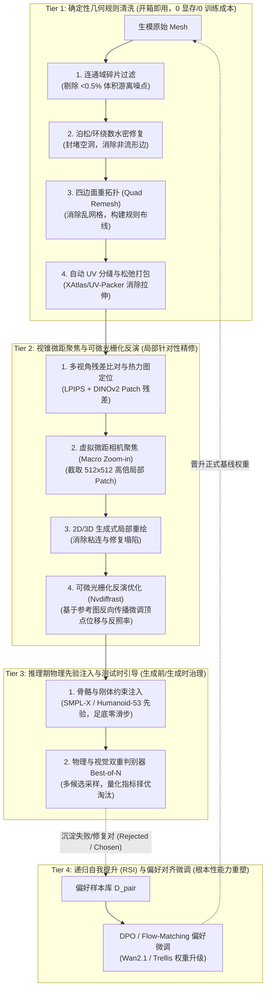
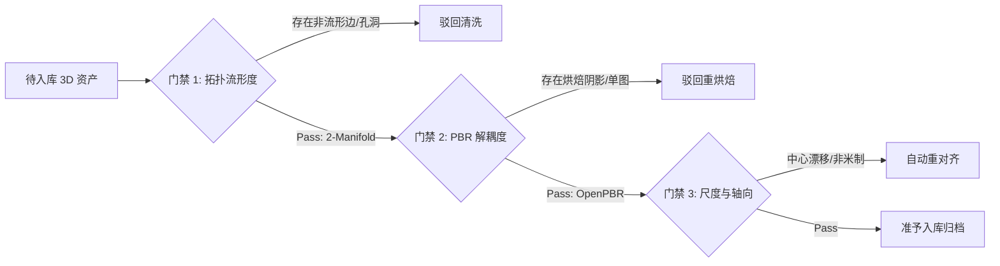

# 3D 生成模型质量提升方法论与高质量训练数据工程规范
## 3D Model Quality Enhancement & Training Data Specification Guide

- **文档状态**: `Approved Technical Guide v1.0`
- **发布日期**: 2026-11-12
- **所属生态**: `sautille-stroke` / `DervGen`
- **关联子系统**:
  - `synapse`（3D CG 渲染与神经生成互操作 SDK、无状态推理 Worker、`Synapse-Bench`）
  - `fulgur`（现代 C++20 AAA 实时渲染引擎、15 通道 FGPP 离屏真值提取器）
  - `synapse-native`（C++20/CUDA 核心几何算子、四边面重拓扑、物理去光照与刚体 IK）
  - `aether`（底层数学库、几何类型与 `FGPP` 跨语言线格式 SSOT）
  - `grand-studio` / `scene-forge` / `asset-forge`（人机协同质检、白模编辑与 `CommandIR` 采集）
- **关联生态规约**:
  - **RFC 0019**: `CommandIR` 序列化操作协议与离线同步机制
  - **RFC 0020**: 人机协同操作时间轴与模型训练数据闭环 (`IntentGroup`, `OperatorIdentity`)
  - **RFC 0021**: 模型训练数据采集完整性与跨系统对齐 (`MultiAxisRating`, `StepAnnotation`)
  - **RFC 0039**: 资产解耦与自洽作业闭包 (`JobBundle`)
  - **RFC 0044**: 神经-物理混合工业流水线、FGPP 与人机协同 (HITL 15 分钟熔断与白模粗糙度下限)
  - **RFC 0058**: OpenUSD Hydra、MaterialX / OpenPBR 1.0 与 ACEScg 跨平台架构

---

## 1. 概述与核心痛点

随着生成式 3D 模型（如 Trellis、Hunyuan3D、TripoSR、LGM、Rodin 以及各类 Diffusion/Flow-Matching 3D 架构）的快速发展，**“单图/文本一键生成 3D 资产”** 在宏观粗模形态上已经达到极高的初稿可用性。然而，在真正导入下游游戏引擎（Unreal/Unity/Fulgur）、电影视效或具身仿真等生产级渲染管线时，直接生成的模型普遍存在严重的**质量断层（Quality Gap）**。

本文档系统性梳理：
1. **生成 3D 模型效果不佳的病理归因**（它到底坏在哪里？）；
2. **多层递进的质量提升方法论**（从零成本的确定性规则清洗，到局部可微反演精修，再到推理先验约束与参数微调）；
3. **高品质 3D 训练与微调数据工程规范**（模型进化到底需要怎样的数据？格式、通道、分布与标注契约是什么？）；
4. **工业落地路线图与验收自查清单**。

---

## 2. 3D 模型生成缺陷全景病理诊断

解决模型质量问题的前提是对缺陷进行**解耦与量化诊断**。生成式 3D 资产的常见缺陷可以划分为四个物理层级：

```
Level 4: 材质与外观层 (PBR Material & Textures)
  └── 烘焙假高光/阴影、贴图严重模糊、UV 撕裂拉伸、UV 接缝露白 (Seam Discontinuity)
        ▲
Level 3: 宏观语义与解剖学层 (Macro Semantics & Anatomy)
  └── 肢体多指粘连、无铰接结构、背面信息缺失引发的幻觉 (Hallucination)、比例失调
        ▲
Level 2: 表面微观与微分几何层 (Differential Surface Geometry)
  └── 面部/关键凹陷坍塌、法线反转/混杂、高频过平滑 (Over-smoothing)、Marching Cubes 阶梯波纹
        ▲
Level 1: 几何流形与拓扑层 (Geometric Manifold & Topology)
  └── 非流形边/顶点 (Non-manifold)、网格破洞开裂、自穿模、浮动游离碎片 (Floating Bits)、内部隐藏废面
```

### 2.1 缺陷分类与判定指标

| 缺陷层级 | 典型症状 | 根本成因 | 量化检测手段与指标 |
|:---|:---|:---|:---|
| **1. 几何流形层** | 浮动游离碎片、非流形边、三角面未缝合（非闭合水密）、网格内部残留体素废面 | 体素隐式场提取算法（如 Marching Cubes/Dual Contouring）在低密度或截断边界处的插值伪影 | 欧拉示性数 $\chi = V - E + F \neq 2(1-g)$、`non_manifold_edges > 0`、连通分支计数 $>1$ |
| **2. 表面微观层** | 面部五官塌陷、局部表面法线反转（凹凸反向）、过度平滑丢失机械边缘、表面凹坑噪波 | 隐式场梯度估算不准、SDF 零等值面正则化权重过低，或高频几何惩罚不足 | 法线角偏差均值 $\theta_{\text{normal}} > 15^\circ$、离散平均曲率方差 $\text{Var}(\kappa_{\text{mean}}) > 0.08$ |
| **3. 宏观语义层** | 手指粘连成掌、双腿粘连成裙、后脑勺或背部瞎猜结构、缺乏关节铰接拓扑 | 单目输入导致的背部严重遮挡（Ambiguity）、模型缺乏人体/通用刚体解剖学骨骼先验 | 剪影交并比 $\text{Silhouette IoU} < 0.88$、重投影漂移 $\text{RMSE} > 4.0\text{ px}$ |
| **4. 材质与外观层** | BaseColor 贴图带有环境阴影与高光反射、UV 展开畸变拉伸严重、贴图拼缝处有白边/黑缝 | 缺少物理去光照（Delighting）、未导出标准 PBR 材质贴图（只有单张有光照扩散图）、UV 投影重叠 | CIEDE2000 色差 $\Delta E_{00} > 2.5$、UV 面积形变比率 $\sigma_{\text{uv}} > 1.5$、接缝法线跳跃角 $>5^\circ$ |

---

## 3. 四阶递进式质量提升方法论

针对上述病灶，质量提升应遵循**“低成本开箱即用后处理 $\to$ 局部针对性可微精修 $\to$ 推理期先验引导 $\to$ 终极自演进模型对齐”**的四阶体系。



---

### 3.1 Tier 1：确定性几何规则自动化清洗流水线

此阶段不依赖大模型，运行速度极快（毫秒至数秒级），能够直接干掉 80% 的基础工业级几何报错：

1. **连通域体积过滤（Connected Component Cleaning）**：
   - 遍历网格三角面图，切分所有独立连通子集（Components）；
   - 计算各子集的外接球半径与封闭体积，**强制剔除体积小于主物体 $0.5\%$ 的孤立浮动碎块**。
2. **水密化与流形性修复（Watertight & Manifold Healing）**：
   - 基于**快速环绕数（Fast Winding Numbers）**或隐式泊松表面重构（Screened Poisson Reconstruction），重新提取具有严格 2-流形特性的闭合外壳；
   - 消除共面重叠面、零面积退化三角面（Degenerate Faces）与 T-Junction。
3. **四边面结构化重拓扑（Adaptive Quad Remeshing）**：
   - 原生 AI 生成模型（如 Marching Cubes）产物通常是杂乱无序的三角形态，无法直接用于骨骼蒙皮；
   - 调用如 `Instant Meshes` 或 `QuadriFlow` 算法，沿主曲率场方向对齐几何流向（Edge Flow），生成等距、规整、无尖锐夹角的轻量四边面网格。
4. **参数化 UV 自动切缝与松弛（UV Parameterization & Packing）**：
   - 利用 `XAtlas` 自动按曲率拐角切分 UV 孤岛（Islands）；
   - 执行能量最小化拉伸松弛（Least Squares Conformal Maps, LSCM），保证 UV 纹素密度（Texel Density）均匀，杜绝贴图拉伸变形。

---

### 3.2 Tier 2：视锥微距聚焦与可微光栅化反演精修

针对高频细节缺失、局部结构塌陷或局部贴图模糊，采用“局部放大镜”机制：

1. **多视角残差热力图解耦（Residual Decoupling）**：
   - 利用渲染核（如 `fulgur`）将当前 3D 模型在 $K$ 个标准视角（正、背、左、右、俯、仰）下渲染出 RGB、米制线性深度与法线图；
   - 与原始输入多视角/参考图进行特征比对（DINOv2 ViT-L/14 Patch 级余弦距离 + 轮廓 XOR 残差），生成 2D 异常残差热力图 $\mathcal{H}(u, v)$。
2. **虚拟微距相机自动巡航（Macro Zoom-in & 3D Grounding）**：
   - 在残差热力图峰值区域（如手部、面部、装饰纹理），计算其局部包围球；
   - 调度虚拟微距相机推近聚焦，抓取 $512\times512$ 高倍局部切片（Patch Crop）；
   - 结合深度图反投影（Unproject），将 2D 缺陷边界精确映射为 3D 网格顶点掩码（Vertex Mask）。
3. **可微光栅化几何反向反演（Differentiable Inverse Rendering）**：
   - 在局部遮罩区域内，基于 `Nvdiffrast` 构建端到端可微渲染管线；
   - 保持网格拓扑不变，以原始参考图的高分辨率特征为优化目标，以法线平滑度（Laplacian Regularizer）为物理先验，反向传播微调顶点位移偏移量（Displacement Offset）$\Delta \mathbf{V}$：
     $$\mathcal{L} = \mathcal{L}_{\text{rgb}}(\mathbf{I}_{\text{render}}, \mathbf{I}_{\text{ref}}) + \lambda_1 \mathcal{L}_{\text{lpips}} + \lambda_2 \|\Delta \mathbf{L} \mathbf{V}\|_2^2$$
4. **物理去光照与材质解耦（Delighting & Material Splitting）**：
   - 利用双向反射分布函数（BRDF）逆渲染网络，将单一贴图解耦为真正的 **漫反射反照率（BaseColor/Albedo）、法线贴图（Normal Map）与粗糙度（Roughness）**，彻底剥离烘焙在纹理上的环境假光。

---

### 3.3 Tier 3：推理期物理先验注入与测试时引导

防止模型在推理生成阶段“自由发挥”过度而产生严重畸变：

1. **骨骼刚体先验注入（Kinematic & Body Rigid Priors）**：
   - 针对人形/四足资产生成，引入参数化人体模型先验（如 SMPL-X / Humanoid-53）；
   - 强制约束关节长度对称性、脊柱曲率合理性，并在动态生成阶段施加**足底零滑动刚性约束（Zero-Slip Velocity Constraint: $\mathbf{v}_{\text{foot}} = \mathbf{0}$）**，杜绝滑步与浮空。
2. **物理验算器与 Best-of-N 拒绝采样（Dual Verifier Rejection Sampling）**：
   - 推理阶段同时并行生成 $N$ 组候选网格（如 $N=4$ 或 $8$）；
   - 由轻量离屏验算器进行无偏差快速物理排查：
     - 剪影交并比 $\text{Silhouette IoU} \ge 0.88$；
     - 水密性闭合测试（不存在开孔）；
     - 体积呼吸率（Volume Breathing）与参考粗模相比偏差 $\le 5\%$；
     - 法线一致性得分；
   - 直接剔除不及格候选，仅放行综合物理与视觉指标最高的样本。

---

### 3.4 Tier 4：递归自演进飞轮与参数微调（RSI & PEFT）

要从根本上让生成大模型“越来越聪明、不再犯同样的错误”，必须将质检与修复过程转化为**强化学习与微调数据飞轮**：

1. **构建三元组偏好对（Preference Triplet Construction）**：
   - 将模型生成的有缺陷初始网格记为负样本 $\mathbf{y}_{\text{rejected}}$；
   - 经过 Tier 1 自动算子清洗或美术轻量人工精修后的合格网格记为正样本 $\mathbf{y}_{\text{chosen}}$；
   - 组成偏好对：$\mathcal{D}_{\text{pair}} = \{(\mathbf{x}_{\text{prompt/cond}}, \mathbf{y}_{\text{rejected}}, \mathbf{y}_{\text{chosen}})\}$。
2. **DPO / Flow-Matching 偏好对齐训练**：
   - 在生成模型（如 Wan 2.1 DiT、Trellis 隐式骨干网络）上挂载 LoRA 参数模块；
   - 使用直接偏好优化（Direct Preference Optimization, DPO）对齐损失函数，拉大正负样本在隐空间中的概率密度差，使模型在单步采样时主动避开致错模式。
3. **单调演进安全门禁（Monotonic Evolution Gate）**：
   - 微调后模型必须通过全套基准套件（如 `Synapse-Bench`）测试；
   - 确保核心质量分值（如 F-Score@1mm、Silhouette IoU、LPIPS）单调提升，且在非微调类别上出现性能退化（Regression）时自动熔断回滚。

---

## 4. 高品质 3D 训练与微调数据工程规范

提升 3D 模型质量，**决定模型上限的是数据质量，而非算法网络结构的微小微调**。优质的 3D 生成训练数据必须满足以下四大核心维度契约。

---

### 4.1 多通道物理几何解耦数据标准（超越纯 RGB）

纯 RGB 图像存在严重的光照-几何单义歧义性（Illumination Ambiguity）。用于现代 3D 生成、条件对齐与精修模型训练的数据集，**必须具备像素级绝对对齐的多通道物理缓冲层**。

系统统一遵循 **FGPP v1.0**（Fulgur GBuffer Post-Processing）15 通道规范：

```
FGPP 15 通道 OpenEXR 标准布局 (34 B/px, IEEE 754):
┌───────────────────────────┬──────────────┬───────────────┬───────────────────────────────────────┐
│ 通道名称 (ASCII 排序)      │ 数据类型     │ 字节数        │ 物理含义与技术约束                    │
├───────────────────────────┼──────────────┼───────────────┼───────────────────────────────────────┤
│ BaseColor.R / G / B       │ HALF (fp16)  │ 6 B           │ 物理去光照的真实漫反射反照率 (Albedo) │
│ CameraLinearDepth.Z       │ FLOAT (fp32) │ 4 B           │ 绝对米制相机空间线性深度 (严禁插值)   │
│ CameraNormal.X / Y / Z    │ HALF (fp16)  │ 6 B           │ 相机空间归一化法线向量 [-1, 1]        │
│ Cryptomatte.ID            │ UINT32       │ 4 B           │ 实体/材质独立整型索引 (最近邻采样)    │
│ MetallicRoughness.R / G   │ HALF (fp16)  │ 4 B           │ 金属度 (Metallic) 与 感知粗糙度       │
│ MotionVector.X / Y        │ HALF (fp16)  │ 4 B           │ 像素级屏幕空间前向运动矢量            │
│ OcclusionWireframe.R / G  │ HALF (fp16)  │ 4 B           │ 环境光遮蔽 (AO) 与 拓扑边框密度       │
│ WorldNormal.X / Y / Z     │ HALF (fp16)  │ 6 B           │ 世界空间归一化表面曲率与朝向向量      │
└───────────────────────────┴──────────────┴───────────────┴───────────────────────────────────────┘
```

#### 各通道的核心作用与训练价值：
1. **米制线性深度 (`CameraLinearDepth.Z`)**：
   - 必须为绝对米制单位（float32），而非归一化非线性屏幕空间深度；
   - 价值：消除多视角尺度不一致，给模型提供不可动摇的绝对距离基准，彻底消除透视塌陷。
2. **表面法线 (`WorldNormal` / `CameraNormal`)**：
   - 归一化向量，表征微表面朝向与微分几何特征；
   - 价值：让模型直接感知高频凹凸细节，约束几何法线不可反转、五官凹凸结构不可坍塌。
3. **物理去光照漫反射反照率 (`BaseColor`)**：
   - 必须剥离方向光、点光源高光与投射阴影；
   - 价值：防止模型把阴影误学生长成黑斑，把高光误学成浮雕突起。
4. **实体掩码 (`Cryptomatte.ID`)**：
   - 无滤波的无符号整型 ID，区分不同材质与独立骨骼部件（如头发、衣服、皮肤、手部）；
   - 价值：作为注意力掩码（Spatial Attention Mask），防止跨资产语义粘连（如衣服与肢体融合）。

---

### 4.2 物理流形真值 3D 资产入库准入门禁

作为 Ground Truth（真值）训练集进入数据湖的 3D 资产，必须通过以下自动化前置门禁扫描：



1. **流形与水密性门禁（Manifold & Watertight Gate）**：
   - 严格满足 2-流形网格标准：每条边被且仅被 2 个面共享，无共享顶点的非流形扇区；
   - 封闭水密（Watertight）：无外部漏光孔洞，可通过射线法稳定计算闭合符号距离场（SDF）；
   - 零退化面：无面积小于 $10^{-6}$ 的简并三角形，无零长度边。
2. **材质规范门禁（PBR Specification Gate）**：
   - 必须严格遵循 `MaterialX` / `OpenPBR 1.0` 或 Disney 原则；
   - 贴图分辨率满足幂次规格（$1024\times1024$ 或 $2048\times2048$）；
   - 纹理贴图必须完备：必须具备独立 Albedo、Normal（DirectX/OpenGL 标注明确）、Roughness、Metallic 贴图。
3. **几何尺度与坐标系标准化门禁（Scale & Alignment Gate）**：
   - **坐标轴对齐**：全库统一坐标系（如右手系 Y-up，Z-forward）；
   - **中心锚定**：资产包围盒底面中心点归零至原点 $(0, 0, 0)$；
   - **绝对物理尺寸标注**：包含元数据标明真实世界尺寸（如人物高度标注为 $1.75\text{m}$，汽车长度标注为 $4.8\text{m}$），严禁无尺度乱缩放。

---

### 4.3 稠密多视角球面与多尺度特写机位方案

仅靠单张图或正交 4 视角不足以训练出高鲁棒性模型。标准数据集采集必须包含**宏观球面机位 + 局部微距机位**：

```
                             [北极 俯角 85°]
                                   ▲
                                   │
              [中纬度仰角 30°] ─── 球面螺旋环绕 (32~64 机位)
                                   │
                                   ▼
                             [赤道视角 0°]
                                   │
                                   ▼
                             [南极 仰角 -60°]
                                   
      同时采集: 针对关键部件 (手部/面部/徽标) 的 4~8 个微距局部 Patch
```

1. **宏观球面多视角覆盖（Spherical Fibonacci Trajectory）**：
   - 采用斐波那契球面采样算法，在围绕资产包围球外围均匀分布 32～64 个渲染机位；
   - 俯仰角覆盖范围 $-60^\circ \sim +85^\circ$，保证头顶与脚底死角无遗漏；
   - 相机参数显式记录：内参矩阵 $\mathbf{K}$（FOV、焦距、主点）与外参矩阵 $[\mathbf{R} | \mathbf{t}]$ 严格锁死为 64-bit 浮点数。
2. **多尺度微距局部特写切片（Multi-Scale Macro Patches）**：
   - 在高曲率与高语义密度区域（如人脸五官、手指指节、服装接缝处），以 $2\times \sim 4\times$ 虚拟长焦微距相机拍摄高分辨率特写切片；
   - 训练模型具备感知毫米级高频拓扑接缝与法线细节的能力。

---

### 4.4 人机协同与精修偏好对构建标准（DPO/PRM）

用于奖励模型（PRM）和直接偏好微调（DPO）的数据不仅需要“最终正确答案”，更需要**“错误 $\to$ 修正”的动态演进轨迹**：

$$\text{DataPoint} = \left\langle \mathbf{x}, \mathbf{y}_{\text{rejected}}, \mathbf{y}_{\text{chosen}}, \mathcal{T}_{\text{repair}} \right\rangle$$

1. **输入条件 $\mathbf{x}$**：多视角参考图、提示词或粗白模网格；
2. **劣质模型产物 $\mathbf{y}_{\text{rejected}}$**：
   - 未经过滤的原始生成网格，保留真实存在的瑕疵（如面部微塌、破面、接缝开裂）；
3. **精修合格产物 $\mathbf{y}_{\text{chosen}}$**：
   - 经过算法修复或美术精修后的高质量网格；
   - **严格约束**：$\mathbf{y}_{\text{chosen}}$ 与 $\mathbf{y}_{\text{rejected}}$ 的体积呼吸率变化必须 $\le 3.0\%$，确保修复仅发生在局部缺陷区，未改变整体造型基底；
4. **精修操作序列轨迹 $\mathcal{T}_{\text{repair}}$（遵循 RFC 0019 `CommandIR`）**：
   - 记录精修动作的每一步操作算子与参数：
     ```json
     [
       {"op": "select_vertices_by_mask", "params": {"center": [0.12, 1.45, 0.05], "radius": 0.08}},
       {"op": "laplacian_smooth", "params": {"iterations": 5, "lambda": 0.4}},
       {"op": "bridge_edge_loops", "params": {"tolerance": 0.002}},
       {"op": "quad_remesh_local", "params": {"target_edge_length_mm": 2.5}}
     ]
     ```
   - 价值：使精修 Agent 不仅能做出好坏判别，还能直接预测出针对具体缺陷的精修动作参数。

---

### 4.5 极限挑战工况难例设计（Hard Negatives & Curriculum）

模型在简单凸多面体（如杯子、苹果、规整建筑）上表现良好，但在真实工业资产中极易崩塌。数据集必须包含**主动构造的挑战性难例（Hard Cases）**：

1. **极薄壁结构（Thin-Shell Structures）**：
   - 植物树叶、纸张、金属薄刃、伞面、衣物褶皱边；
   - 挑战点：体素截断容易产生双面破损、法线正反错乱；
2. **深度镂空与复杂亏格拓扑（High-Genus & Porous Meshes）**：
   - 镂空铁艺栏杆、机械齿轮箱、链条、网筛；
   - 挑战点：Marching Cubes 易将镂空区域误封堵为实心泥团；
3. **极高反光与半透明物理属性（Specular & Transmission）**：
   - 汽车烤漆金属反光、水体、玻璃杯、玉石散射；
   - 挑战点：高光移动在不同视角下破坏一致性假设；
4. **高动态交叉与自遮挡姿态（Severe Occlusion & Entangled Poses）**：
   - 双手合十、瑜伽扭曲姿态、复杂机械折叠连杆；
   - 挑战点：自穿模与多部件粘连高发。

---

## 5. 工业落地演进路径与最佳实践 Checklist

针对不同研发阶段的团队，推荐以下递进落地演进路线：

### 5.1 三阶段实施计划

| 演进阶段 | 实施周期 | 核心动作 | 预期收益 |
|:---|:---|:---|:---|
| **Phase 1: 几何硬门禁与后处理接入** | 1～2 天 | 引入连通域过滤、泊松水密修复、四边面重拓扑（`QuadriFlow`/`XAtlas`）自动化脚本 | 消除全量浮动噪点碎块、消灭非流形破面，模型达到可导入引擎的基础及格线 |
| **Phase 2: 局部可微反演与质检门禁** | 1～2 周 | 搭建多视角离屏渲染、计算残差热图、基于 `Nvdiffrast` 的顶点位移微调与 PBR 去光照解耦 | 攻克面部塌陷、消除贴图假高光/假阴影，极大提升高频细节保真度 |
| **Phase 3: 偏好数据闭环与自演进微调** | 1～2 月 | 沉淀人机协同操作对（$\mathbf{y}_{\text{rejected}}, \mathbf{y}_{\text{chosen}}$），在底模上执行 DPO / LoRA 偏好对齐训练 | 模型自身生成能力质变，从源头减少 70% 以上的常见粘连与畸变 |

---

### 5.2 3D 资产生成与数据准入自查 Checklist

在模型交付或数据入库前，逐项核对以下指标：

- [ ] **流形度检查**：`non_manifold_edges == 0`，欧拉公式满足闭合流形；
- [ ] **连通域检查**：无体积 $<0.5\%$ 的游离浮动几何残渣；
- [ ] **水密性检查**：网格闭合无破孔，射线碰撞法正反面判定完全闭合；
- [ ] **多通道解耦**：训练数据具备米制线性深度、相机/世界法线与物理去光照反照率贴图；
- [ ] **法线一致性**：多视角渲染图与几何法线夹角偏差均值 $\le 15^\circ$，无翻转法线；
- [ ] **拓扑布线规范**：四边面占比合理，主要关节弯曲处具备环形布线（Edge Loops）；
- [ ] **PBR 规范性**：材质贴图满足 BaseColor、Normal、Roughness、Metallic 独立解耦，无烘焙假阴影；
- [ ] **空间归一化**：模型底面原点对齐 $(0,0,0)$，尺度单位为真实米制；
- [ ] **微距质量**：局部特征区域在 $2\times$ 微距特写下 LPIPS $\le 0.12$，无过度模糊；
- [ ] **偏好闭环**：所有人工精修修复步骤均已被序列化记录为 `CommandIR` 沉淀入数据湖。
