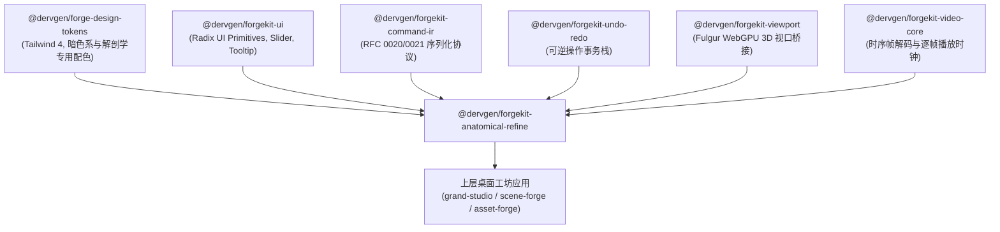

# Synapse × ForgeKit 局部解剖智能修正工具链设计规范
# (Anatomical Refinement Tooling Specification: Unreal Engine & Blender Benchmarks in ForgeKit)

- **文档状态**: `Approved Design Specification (v1.0)`
- **关联 RFC**: [RFC 0061: 局部解剖智能修正、多模型协同融合与工业级手术刀缝合规范与规划](RFC-0061-LOCAL-REFINEMENT-AND-MULTI-MODEL-FUSION.md)
- **关联仓库**: `forgekit`（DCC 3D UI/UX 组件库）、`synapse`（Layer 2 算法 SDK 与无状态执行核）、`fulgur`（Track B 物理渲染视口）、`grand-studio` / `scene-forge` / `asset-forge`（上层桌面工坊）
- **对标基准**: Unreal Engine 5.4+ (Control Rig, MetaHuman Animator, MRQ) & Blender 4.2+ (Pose Library, Sculpt Pose Brush, Cryptomatte Compositor)
- **目标受众**: 3D 交互前端工程师、技术美术 (TA/TD)、角色与绑定专家、自动化流水线 Agent

---

## 1. 行业头部工具对标与交互哲学 (Industry Benchmarks & UX Philosophy)

在角色解剖学精修与局部视觉修复领域，**Unreal Engine 5** 与 **Blender 4.x** 代表了当前实时引擎与离线 DCC 工具链的最高水平。我们深度提炼两者在手部、面部、局部遮罩与多通道合成上的核心交互精髓，作为 `forgekit` 独立组件的设计基石：

```
                    ┌── Unreal Engine 5 (UE5) ────── Control Rig 局部姿态插值 + MetaHuman DNA 视角锚定 + MRQ 瓦片遮罩
行业头部工具优秀实践 ┼
                    └── Blender 4.x ──────────────── Pose Library 悬停实时滑动融合 + Sculpt Pose Brush + Cryptomatte 节点
```

### 1.1 Unreal Engine 5 核心经验与对标设计

| UE5 模块与功能 | 核心交互与工程机制 | ForgeKit 对标落地组件 |
|---|---|---|
| **Control Rig & Pose Asset** | 节点化 FK/IK 骨骼驱动；姿态资源（Pose Asset）支持多关节权重叠加与加性混合（Additive Blending） | **`PoseLibraryShelf`**：21 关节手部与 52 维面部姿态加性权重混合器 |
| **MetaHuman Animator / DNA** | 多相机视差立体反求；Canonical 规范肖像与相机视锥角度对齐；参数化表情驱动 | **`CanonicalGalleryManager`**：4 机位正交肖像特征捕获与视锥球面角热力图 |
| **Movie Render Queue (MRQ)** | 瓦片化渲染（High-Res Tiled Rendering）+ 边界填充（Edge Padding）；Cryptomatte Object/Material ID 隔离 | **`ScalpelViewportOverlay`**：$16\text{px}$ 边界填充手绘与智能 Cryptomatte 拾取 |
| **Deformer Graph Inspector** | 多层网格变形器权重逐顶点实时热力图审查与对比 | **`MultiModelBlendInspector`**：频带权重与不确定度置信度热力图滑块 |

### 1.2 Blender 4.x 核心经验与对标设计

| Blender 模块与功能 | 核心交互与工程机制 | ForgeKit 对标落地组件 |
|---|---|---|
| **Pose Library Asset Shelf** | **悬停动态拖拽融合 (Hover-Scrub Blending)**：光标在姿态缩略图上左右拖动，视口骨骼在当前姿态与目标预设间以 $0\% \sim 100\%$ 实时无极插值 | **`PoseSliderControl`**：支持滚轮/水平拖拽的无极姿态插值器，提供即时视口反馈 |
| **Sculpt Mode: Pose Brush** | 在雕刻网格状态下直接拉伸骨骼关节链，利用反向动力学（IK）避免网格拓扑被拉裂 | **`AnatomicalIKGizmo`**：视口内快速微调手指关节与嘴唇控制点 |
| **Compositor & Mask Editor** | 贝塞尔样条曲线遮罩；带曲率自适应羽化（Curvature Feathering）；多层节点图 | **`ScalpelSplineMask`**：支持贝塞尔锚点与余弦羽化曲线的 2D/3D 混合手术刀 |

---

## 2. ForgeKit 独立组件包定位：`@dervgen/forgekit-anatomical-refine`

在 `forgekit/packages/` 中建立全新专有子包：**`packages/anatomical-refine`**。

### 2.1 依赖关系与架构拓扑 (Clean DAG)



### 2.2 核心设计公理 (Core Axioms)

1. **`STRICT_ZERO_HEAVY_PYTHON`**：该前端包为纯 TypeScript + React 19 实现，绝不直接内嵌任何 PyTorch 或重型推理后端；所有算法调用通过 RFC 0039 `JobBundle` 或 MCP Server 异步通讯；
2. **`NON_DESTRUCTIVE_TRANSACTION`**：所有笔刷绘制、姿态滑动微调、阈值变动均包装为 `RefineCommand`，原生接入 `@dervgen/forgekit-undo-redo`，支持无限 Undo/Redo 与 TimeWarp 历史回溯；
3. **`60_FPS_VIEWPORT_ISOLATION`**：微距画中画（PIP）与主视口渲染走 WebWorker 或独立 Canvas 离屏缓冲，主视口交互帧率恒定保持 $60\text{ fps}$。

---

## 3. 五大核心 UI/UX 组件详细设计

### 3.1 `PoseLibraryShelf`（姿态资产架与悬停即时融合器）

对标 Blender Asset Shelf 与 UE5 Pose Asset，专为手部与面部高频解剖矫正设计：

```
┌────────────────────────────────────────────────────────────────────────┐
│  🖐️ HAND PRESETS (21-Joint)    [+] Save Pose    [Auto-IK: ON]          │
│ ┌──────────┐ ┌──────────┐ ┌──────────┐ ┌──────────┐ ┌──────────┐      │
│ │  RELAX   │ │   FIST   │ │  PINCH   │ │  POINT   │ │  GRASP   │ ...  │
│ │ [Thumb]  │ │ [Thumb]  │ │ [Thumb]  │ │ [Thumb]  │ │ [Thumb]  │      │
│ └──────────┘ └──────────┘ └──────────┘ └──────────┘ └──────────┘      │
│  Selected: PINCH (Pinch Index & Thumb)                                 │
│  Blend Weight: [━━━━━━━●━━━━━━━━━━━━━━] 35%                            │
│  [ Apply Hand Mask to Synapse ]  [ Send to 3D Clay ]  [ Reset Pose ]   │
└────────────────────────────────────────────────────────────────────────┘
```

*   **交互规范**：
    1. **悬停拖拽融合（Hover-Scrub）**：鼠标光标停留在任何姿态卡片上，按住鼠标中键或右键水平拖拽，实时在当前模型姿态与目标预设姿态之间插值（$0\% \sim 100\%$）；
    2. **加性部分融合（Additive Layering）**：允许仅对手指局部应用姿态（例如“仅将大拇指与食指捏合”，其余三指保持现状）；
    3. **一键生成 3D 几何约束**：点击 Apply，将当前骨骼姿态直接通过 `CommandIR` 打包发送给 `synapse`，生成 FGPP 深度与法线硬掩膜。

---

### 3.2 `ScalpelViewportOverlay`（2D/3D 手术刀画布与微距画中画视口）

对标 UE5 MRQ 遮罩工具与 Nuke 绘景笔刷，直接覆盖在 3D Viewport 与视频画面之上：

```
┌──────────────────────────────────────────────────────────────┬────────┐
│  3D / 视频主视口 (Main Viewport)                             │ 🔍 PIP │
│                                                              │ 512x512│
│                     [ 角色主体 ]                             │ [微距] │
│                          │                                   │ 手部特写│
│                    (选区: 手部)                              │ 实时超清│
│                   ┌──────────────┐                           │        │
│                   │ 16px 余弦羽化│                           ├────────┤
│                   │ 边界环 CIE-LAB ◄── 绿色高亮引导环        │ 置信度: │
│                   └──────────────┘                           │  94.2% │
│                                                              │ 模式:  │
│  工具栏: [ 🖌️ Scalpel Brush ] [ 🎯 Cryptomatte Pick ] [ ✂️ Lasso ]   │ 频带融合│
└──────────────────────────────────────────────────────────────┴────────┘
```

*   **交互规范**：
    1. **智能拾取（Cryptomatte Click Picker）**：单击角色手部，直接根据 FGPP ID 生成像素级精确闭合轮廓，无需漫长手工勾边；
    2. **$16\text{px}$ 边界环动态指示（Border Ring Indicator）**：笔刷边缘自动渲染外圈 $16\text{px}$ 半透明同心圆，绿色指示当前色彩补偿采样环，直观呈现 CIE LAB 色彩对齐区域；
    3. **微距画中画（Macro PIP Viewport）**：视口右上角浮动 $512 \times 512$ 像素切片，将倾斜旋转的局部手/脸自动通过正交矩阵变换为水平视图，支持滚轮无极放大至毛孔级。

---

### 3.3 `MultiModelBlendInspector`（多模型融合监视器与频带滑块）

对标 Nuke AOV 节点监视器与 UE5 Deformer Inspector，将原本黑盒的多模型输出变成白盒可视化：

```
┌────────────────────────────────────────────────────────────────────────┐
│  MULTI-MODEL FUSION INSPECTOR                                          │
│ ┌──────────────────────┬──────────────────────┬──────────────────────┐ │
│ │ Model 1: Structure   │ Model 2: Diffusion   │ Model 3: CodeFormer  │ │
│ │ (FGPP 3D Depth/Norm) │ (Wan Inpainting)     │ (Micro Pores/Gaze)   │ │
│ │      [ View A ]      │      [ View B ]      │      [ View C ]      │ │
│ └──────────────────────┴──────────────────────┴──────────────────────┘ │
│  Display Mode: [ A/B Wipe Split ▼ ]   Wipe Position: [━━━━━━━●━━━━━] 50%│
│  Frequency Bands:                                                      │
│    Low-Freq Lighting (Base):     [━━━━━━━━━━━━●━━━━━━] 65%             │
│    High-Freq Micro-Detail (Ref): [━━━━━━━━━━━━━━━━━━●] 95%             │
│  Overlays: [x] Confidence Heatmap  [ ] Poisson Residual  [ ] Seam Psnr │
└────────────────────────────────────────────────────────────────────────┘
```

*   **交互规范**：
    1. **A/B/C 多视口卷帘对比（Wipe Split-Screen）**：支持竖向/横向交互式卷帘分割条，左右拖拽无缝对比原图与修正后细节；
    2. **金字塔频带权重滑块**：分别提供低频漫反射基底（Base Lighting）与高频微观结构（Micro Detail）两组独立滑块，实时看到高低频重组结果；
    3. **置信度热力图（Confidence Heatmap）**：以 Jet 彩虹色谱显示各像素的模型置信度，红高蓝低，直观指导人工微调。

---

### 3.4 `CanonicalGalleryManager`（角色正交锚定画廊资产柜）

对标 MetaHuman DNA Identity 资产面板，确保长视频中任何运镜角度下角色身份恒定：

```
┌────────────────────────────────────────────────────────────────────────┐
│  👤 CANONICAL IDENTITY ANCHOR GALLERY (Actor: CyberGirl_01)            │
│ ┌──────────────┐ ┌──────────────┐ ┌──────────────┐ ┌──────────────┐    │
│ │  Front (0°)  │ │ Left 45°     │ │ Right 45°    │ │ Pitch Up 15° │    │
│ │   [Portrait] │ │  [Portrait]  │ │  [Portrait]  │ │  [Portrait]  │    │
│ │  Weight: 72% │ │ Weight: 18%  │ │ Weight: 0%   │ │ Weight: 10%  │    │
│ └──────────────┘ └──────────────┘ └──────────────┘ └──────────────┘    │
│  Camera Frustum Angle: Yaw = -18.5°, Pitch = +4.2°                     │
│  [📸 Capture Current Viewport as Anchor]  [🧬 Re-Extract ArcFace 512D] │
└────────────────────────────────────────────────────────────────────────┘
```

*   **交互规范**：
    1. **动态球面权重追踪**：随着时间轴运镜旋转，4 张参考肖像下方的 `Weight` 进度条与绿色光环随相机视锥角度动态高亮呼吸，实时展示当前帧的 Cross-Attention 注入配比；
    2. **一键捕获机位**：在 3D 视口旋转到满意角度时，点击“Capture Viewport as Anchor”，自动计算视锥外参并提取 ArcFace 嵌入，即刻补充画廊。

---

### 3.5 `RefineTimelineTrack`（局部精修时间轴轨与时序阻尼监视器）

深度挂接在 `@dervgen/forgekit-timeline` 之上，提供针对时空切片的专用次级轨道：

```
┌────────────────────────────────────────────────────────────────────────┐
│  TIMELINE: Shot_04_02 (Frames: 0..96, 24fps)                           │
│  Main Track:   [====================================================]  │
│  Refine Track: [---🔴🔴🔴---🟡🟡🟡🟡-----------------🟢🟢🟢🟢-------]  │
│    Legend: 🔴 Topological Collapse (Hand)  🟡 Flicker  🟢 Gate Passed   │
│  Temporal Damper: [━━━━━━━━━━━━━━━━●] EMA α = 0.85 (Anti-Flicker: ON)  │
│  HITL Budget: ⏱️ 03:45 / 15:00 (Safe)    [ Save Checkpoint ] [ Commit ]│
└────────────────────────────────────────────────────────────────────────┘
```

*   **交互规范**：
    1. **缺陷波形条（Defect Heatstrip）**：在时间轴上用红（解剖错误）、黄（闪烁抖动）、绿（门禁通过）精准标记出需要关注的帧区间，支持快速跳转（`Shift + [` / `Shift + ]`）；
    2. **时序阻尼滑块（Temporal EMA Slider）**：即时调整 $\alpha \in [0.1, 0.95]$，视口实时回放平滑后的动态效果；
    3. **15 分钟倒计时与熔断保护**：右上角常驻计时器，达到 13 分钟时变为橙色预警，达到 15 分钟触发 RFC 0044 熔断，强制锁定并保存现场 Checkpoint。

---

## 4. 数据协议与状态流转契约 (Data Contracts & CommandIR)

### 4.1 TypeScript 强类型接口定义 (`src/types.ts`)

```typescript
export type AnatomicalPart = 'hand_left' | 'hand_right' | 'face' | 'custom_roi';

export interface PosePreset {
  id: string;
  name: string;
  part: AnatomicalPart;
  thumbnailUrl: string;
  boneRotations: Record<string, [number, number, number, number]>; // Quaternion [x,y,z,w]
  blendWeights?: Record<string, number>;
}

export interface ScalpelBrushSettings {
  mode: 'brush' | 'cryptomatte' | 'lasso';
  radius: number;           // 笔刷半径 (px)
  featherRadius: number;    // 余弦羽化半径 (默认 16px)
  borderRingWidth: number;  // CIE LAB 采样环宽度 (默认 8px)
  enableColorMatching: boolean;
  enableOpticalIncrements: boolean;
}

export interface ModelBlendWeights {
  lowFreqLightingWeight: number; // 0.0 ~ 1.0 (取自底模光照)
  highFreqDetailWeight: number;  // 0.0 ~ 1.0 (取自 CodeFormer/专用手部)
  confidenceThreshold: number;   // 0.0 ~ 1.0
  poissonGradientMode: boolean;
}

export interface CanonicalAnchor {
  id: string;
  label: string;
  azimuthDeg: number;       // 方位角 (-180 ~ 180)
  elevationDeg: number;     // 俯仰角 (-90 ~ 90)
  imageUrl: string;
  arcfaceFeatureUrl?: string;
  activeWeight: number;     // 0.0 ~ 1.0 (实时计算)
}

export interface RefinementTrackFrame {
  frameIndex: number;
  status: 'passed' | 'warning' | 'defect';
  defectType?: 'six_fingers' | 'strabismus' | 'flicker' | 'identity_drift';
  bboxXYWH?: [number, number, number, number];
  metrics?: {
    fingerCount?: number;
    arcfaceSimilarity?: number;
    temporalFlickerScore?: number;
  };
}
```

### 4.2 CommandIR 动作协议集成

所有组件操作统一派发符合 RFC 0020/0021 的强类型命令：
- `refine.pose.blend`：姿态插值与权重变更
- `refine.scalpel.stroke`：手术刀遮罩笔触提交
- `refine.fusion.update_weights`：频带权重更新
- `refine.temporal.set_damper`：时序阻尼系数调节
- `refine.meltdown.checkpoint`：保存 15 分钟熔断快照

### 4.3 跨端 Wire 契约 (`synapse.refine_session.v1.0`)

`forgekit` 前端通过 RFC 0039 `JobBundle` 与后端 `synapse refine anatomical --json` 交换 JSON 会话契约（由 [PR-37](plans/PLAN-M9-M12-HORIZON3-LANDING.md) 落地对齐）：

| 字段 / 阶段 | 生产端 / 消费端 | 语义与格式约束 |
|---|---|---|
| `schema_version` | 双向契约 | 固定 `"synapse.refine_session.v1.0"` |
| `stage` | `BundleManifest` | 固定 `"anatomical_refine"`（无状态单步退出） |
| `shot_id` / `entity_id` | `forgekit` → `synapse` | 关联目标镜头与 `Cryptomatte.ID`（`UINT32`） |
| `frames[]` | `synapse` → `forgekit` | 逐帧映射 `RefinementTrackFrame`（含可选 `metrics?:`） |
| `command_ir[]` | `forgekit` → `synapse` | 携带 §4.2 中 5 类 `CommandIR` 动作载荷与时间戳 |
| `hitl_elapsed_sec` | `synapse.bridge.hitl` | 超过 `900.0s` 触发 `CircuitBreakerError` (exit `40`) |

---

## 5. 落地规划与工程里程碑

| 阶段 | 交付物 | 实际状态 | 核心工作内容 | 验收标准 |
|:---:|---|:---:|---|---|
| **Phase A** | 基础骨架与核心类型 | `UI 脚手架已合入 (forgekit v0.1.0)` | 创建 `packages/anatomical-refine` 子包骨架，接入 Tailwind 4 Tokens，定义全套 TypeScript 类型契约 | `pnpm build` 与 `pnpm test` 零报错通过 |
| **Phase B** | 视口手术刀与微距 PIP | `UI 组件已合入 (待接真实 FGPP)` | 实现 `ScalpelViewportOverlay`，接入 Cryptomatte 拾取与 $16\text{px}$ 边界环 Canvas 渲染，完成 $512 \times 512$ 画中画视口 | 鼠标绘制遮罩流畅度稳定在 $60\text{ fps}$ |
| **Phase C** | 姿态库与多模型监视器 | `UI 组件已合入 (待接真实模型)` | 实现 `PoseLibraryShelf`（悬停拖动插值）与 `MultiModelBlendInspector`（A/B 卷帘对比与频带滑块） | 姿态插值视口响应延迟 $< 16\text{ms}$ |
| **Phase D** | 时间轴轨与熔断器 | `UI 组件已合入 (待接熔断协议)` | 实现 `RefineTimelineTrack`，接入缺陷标记染色条、EMA 阻尼调节与 15 分钟熔断状态机 | 模拟 900 秒超时正确触发 `refine.meltdown.checkpoint` |
| **Phase E (`PR-37`)** | 跨端 Wire 联调与回灌 | `Planned (M10 PR-37)` | 打通 `synapse.refine_session.v1.0`、`anatomical_refine` Worker Stage 与 `hard_negatives.jsonl` 导出闭环 | 端到端 Mock/真值联合测试通过，协议零字段漂移 |
