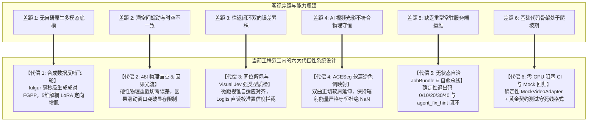
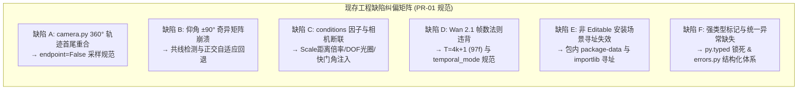

# Synapse 行业成熟流水线对比差距与当前范围代偿性系统设计规范 (Industry Pipeline Gap Analysis & Architectural Compensation Specification)

- **文档状态**: `Approved Specification (v1.0)`
- **修订日期**: 2026-11-11
- **责任体系**: sautille-stroke / DervGen 核心架构组
- **关联基线**:
  - [docs/AUDIT_AND_ARCHITECTURE.md](AUDIT_AND_ARCHITECTURE.md) (整体目标审查与生态架构定界)
  - [docs/IMPLEMENTATION_PLAN.md](IMPLEMENTATION_PLAN.md) (M1–M4 16-PR 工程实施计划)
  - [docs/DESIGN_SYSTEM_ENHANCEMENT.md](DESIGN_SYSTEM_ENHANCEMENT.md) (系统设计增强与工业级鲁棒性演进)
  - [docs/DESIGN_LORA_PIPELINE.md](DESIGN_LORA_PIPELINE.md) (合成数据 LoRA 微调流水线设计)
  - [docs/DESIGN_3D_INSPECTION_AND_REFINEMENT.md](DESIGN_3D_INSPECTION_AND_REFINEMENT.md) (3D 质检、多尺度对齐与精修飞轮)

---

## 1. 概述与行业全景坐标标定 (Executive Overview & Industry Landscape)

在数字内容创作（DCC）与影视制作工业中，**“确定性 3D CG 渲染”** 与 **“潜空间神经视频生成”** 正在经历前所未有的范式融合。行业成熟玩家分布在四个核心赛道：

1. **商业级神经视频控制管线**：Runway（Gen-3 Alpha / Act-One）、可灵（Kling 1.5/2.0）、OpenAI Sora、ByteDance Seaweed/即梦、Wan 2.1 / ControlNeXt；
2. **影视级混合动作与数字替身管线**：Wonder Dynamics（Wonder Studio，Autodesk 旗下）、Move.ai、DeepMotion；
3. **工业级游戏与虚拟制片管线**：Epic Games Unreal Engine 5（MetaHuman、Movie Render Queue、Substrate、Lumen、Chaos Physics）；
4. **生成式 3D 资产与反投重构管线**：Kaedim、Meshy、Rodin、Tencent Hunyuan3D、Microsoft TRELLIS、Adobe Substance 3D。

`synapse` 依托 sautille-stroke / DervGen 生态（`fulgur` 现代 C++20 AAA 渲染引擎、`caelum-core` 高精度光追内核、`vg-core` 纯 C++ 几何算法核），其定位不是单一的 2D 文本生成视频，也不是孤立的 3D 网格生成器，而是**“Layer 2 3D↔神经视频互操作算法 SDK、无状态推理容器执行核与双向往返跨模态基准”**。

本规范客观剖析我们与行业成熟体系的六大核心差距，并确立**在当前团队资源与工程范围内切实可行的六大代偿性系统设计（Compensatory Architectural Designs）**，同时固化近期现存具体代码缺陷的修补设计规范。

---

## 2. 行业对标全景雷达与六大维度深度差距解剖 (Detailed Gap Analysis across 6 Dimensions)

### 2.1 行业全景对标矩阵 (Industry Benchmark Matrix)

| 评价维度 | 商业视频模型 (Runway / Kling / Sora) | 数字替身替换管线 (Wonder Studio) | 游戏引擎与虚拟制片 (Unreal Engine 5) | 生成式 3D 资产 (TRELLIS / Meshy) | **Synapse 当前现状 (Baseline v0.1.0)** |
| :--- | :---: | :---: | :---: | :---: | :---: |
| **基础模型先验** | 极其强大 (万卡自研 DiT) | 中等 (动作跟踪 + 现成渲染) | 无 (纯物理着色器) | 较强 (3D 先验大模型) | **较弱 (依赖开源底模 + 外挂适配器)** |
| **几何度量控制** | 较弱 (提示词/弱光流偏置) | 极高 (真实 Mocap 骨骼对齐) | 100% 确定性 (毫米级) | 中等 (网格可能非流形) | **中等 (FGPP 引导，但存在潜空间蠕动)** |
| **时空时序连续性** | 良好 (但极端运镜变形) | 极高 (基于时间轴逐帧追踪) | 100% 确定性 | 不适用 (单帧/单资产) | **较弱 (长镜头缺乏流式滑动与重锚点)** |
| **全链路往返闭环** | ❌ 无 (仅文本/图→视频) | ❌ 单向 (视频→3D 动捕替换) | ❌ 单向 (3D 场景→渲染帧) | ❌ 单向 (图/文→3D 模型) | **★ 探索最难双向闭环 (3D→Video→3D)** |
| **交互与 DCC 工具** | WebUI / 简单笔刷 | Web 批处理工程 | 极其成熟 (实时 Viewport/Hydra) | Web 视口 / Blender 插件 | **初级 (无状态 CLI / JobBundle，无实时视口)** |
| **色彩与物理守恒** | 弱 (多数 sRGB 8-bit LDR) | 中等 (影视线性 EXR 导出) | 工业级 (ACEScg / OCIO) | 弱 (多烘焙贴图无微表面) | **强设计 / 弱实现 (已定界 ACEScg 与 34B/px)** |
| **代码成熟与容错** | 百万行生产级分布式服务 | 工业级容错与断点续算 | 工业级源码基底 (百万级测试) | 商业云端稳定 API | **骨架期 (约 2.3k 行，多数适配器为 Stub)** |

---

### 2.2 六大核心差距深度剖析

#### 差距 1：基础模型自研能力与算力护城河（“开源底模外挂适配 vs 原生多模态预训练”）
- **行业成熟现状**：头部大厂（Runway、Kuaishou、OpenAI）拥有上万张卡的大规模 GPU 集群，从零预训练专有多模态 DiT。其模型底层将相机外参矩阵、深度图和光流张量作为底层 Token 共同参与自注意力训练，隐空间内生具备三维透视先验；
- **我们的差距**：我们依赖开源底模（如 `Wan 2.1 14B`）或调用云端商业 API。开源模型训练集多为互联网自然视频，对 3D 引擎导出的无纹理白模（Whitebox Clay）、米制线性深度与世界法线图缺乏先验理解，外挂 ControlNeXt 容易在“几何绝对服从”与“画面质感自然”之间出现拉锯。

#### 差距 2：几何度量控制精度（“潜空间蠕动 vs 物理确定性”）
- **行业成熟现状**：UE5 或 Wonder Studio 能确保角色行走时足底与地面零相对位移（Zero Foot-sliding），关节转动严格受骨骼物理约束（Physics Constraints / IK）；
- **我们的差距**：DiT 依靠 3D 因果 VAE 压缩（如 $4\times 8\times 8$）和迭代去噪。在极端运镜（环绕 $>120^\circ$）、四肢严重重叠遮挡时，潜空间微小的方差扰动会导致视频中出现“足底滑步”、“骨骼长度缩放”以及微观高频法线闪烁（Flicker）。

#### 差距 3：全链路双向闭环的误差级联累积（“单向任务回避 vs 双向往返链条过长”）
- **行业成熟现状**：商业产品普遍采取“避重就轻”策略，只做单向链路（Wonder Studio 仅做真人视频反求姿态并叠加 3D 角色；TRELLIS 仅做图到网格）；
- **我们的差距**：`synapse` 试图攻克行业最复杂的全流程闭环：
  $$\text{3D 白模} \xrightarrow{\text{FGPP}} \text{视频生成} \xrightarrow{\text{异常检测}} \text{3D 重建} \xrightarrow{\text{去光照/重拓扑}} \text{反投回 3D USD}$$
  全链路包含 5 个关键跳步。若前序视频生成存在 2% 的透视变形，3D 重建就会生成畸形网格；若去光照留存 5% 的环境光，反投出的 OpenPBR 材质就会“带脏”，导致误差级联放大。

#### 差距 4：DCC 生态集成与交互体验（“离线批处理 vs 所见即所得”）
- **行业成熟现状**：Maya、Houdini、Substance 和 UE5 具备十几年积累的毫秒级交互视口、非破坏性节点图（USD Hydra / MaterialX）与分层调色合成环境；
- **我们的差距**：目前主要依托无状态命令行工具和 `JobBundle` 离线批处理容器，生成 97 帧视频需要数分钟，缺乏类似 Viewport 的低延迟交互微调反馈。

#### 差距 5：工业级抗压与边角案例覆盖（“成千上万商业项目沉淀 vs 实验室原型”）
- **行业成熟现状**：商业管线已遭遇并解决了发丝半透明排序紊乱、非流形破损网格穿模、反光镜面递归光线爆炸、CUDA OOM 动态换入换出等极其琐碎的深水区 Bug；
- **我们的差距**：目前测试用例以基础几何体（立方体、球、圆柱、圆环）及小规模场景为主，尚未经受成千上万个重度工业镜头的大规模高压锤炼。

#### 差距 6：工程实现度与代码成熟度（“顶层架构已达 AAA 级，底层算子仍在爬坡”）
- **行业成熟现状**：核心模块代码量通常在数十万行级别，具备完备的异常重试、监控大盘与全自动 CI；
- **我们的差距**：顶层规范和数学推导虽然极其严密，但如审计报告所示，代码库除 `synapse.bench`（约 1,300 行）外，`adapters`、`pipeline`、`style`、`composite` 等子系统大多仍处于空桩或骨架状态，亟待通过 M1–M4 原子 PR 逐步填充。

---

## 3. 当前范围内的六大代偿性系统设计 (Compensatory Architectural Designs within Current Scope)

针对上述客观差距，在当前硬件算力与团队工程范围内，我们严禁盲目复制大厂“烧上万张卡训千亿通用底模”的不可行路径，而是**依托 sautille-stroke 的 C++ AAA 物理底座，实施差异化的“六大代偿性架构设计”**：



---

### 3.1 代偿设计 1：以“合成数据反哺飞轮”代偿通用底模先验不足（Synthetic Data Flywheel）
- **核心思想**：通用 2D AI 团队缺乏物理资产，面临“标注数据枯竭”困境；而我们拥有 `fulgur`（AAA 实时渲染引擎）与 `caelum-core`（高精度光追内核），可在毫秒级程序化渲染出带绝对真值（米制深度、世界法线、刚体光流、Cryptomatte）的 15 通道成对数据。
- **落地方案（对齐 DESIGN_LORA_PIPELINE）**：
  1. 规避全参数预训练，采用 **5 大专用微调 LoRA 矩阵**（`style`, `identity`, `control`, `whitebox`, `motion`）；
  2. 空间注意力层（$r=32\sim 64, \alpha=32$）锁定特定角色与道具资产一致性；
  3. 浅层条件注入（`blocks.0..10`）训练专用 ControlNeXt，强制模型无条件服从 FGPP 相机法线与线性深度；
  4. 利用离线 3D 因果 VAE 预缓存，在潜空间内完成低成本高效微调，使开源 14B 模型在专属场景上达到媲美千亿通用底模的几何严谨度。

---

### 3.2 代偿设计 2：以“48 帧物理锚点与潜空间因果光流积分”代偿时空蠕动（Physical Anchoring & Flow Warping）
- **核心思想**：既然神经网络在长时序上必然产生方差累积，就不应奢求纯神经模型实现上千帧连续保真，而是通过**物理硬重置（Hard Physical Reset）**将误差截断在可控范围内。
- **落地方案（对齐 RFC 0044 §4.2 与 DESIGN_SYSTEM_ENHANCEMENT §2/§3）**：
  1. **48 帧物理强锚点节奏**：标准连续镜头统一规范为 **`97` 帧**（$T = 4k + 1$，对应 3D 因果 VAE 时间步 $\tau = 25$），第 `0, 48, 96` 帧强制注入物理渲染帧作为硬性约束边界；
  2. **潜空间因果光流积分池化**：
     $$\mathcal{W}_{\tau \to \tau'}^{\text{latent}}(\mathbf{z}) = \text{BilinearPool}\left(\mathbf{z}, \int_{t(\tau)}^{t(\tau')} \mathbf{V}_{\text{flow}}(t) \, dt\right)$$
     利用 FGPP `MotionVector.XY` 通道将物理相机的刚体位移直接编码为注意力偏置；
  3. **拓扑突变重锚定（$\kappa_{\text{frame}} > 0.65$）**：通过几何-光学梯度突变指数实时监测遮挡与剧烈碰撞，动态插入临时物理强锚点，瞬间清空光流累积缓冲区，彻底根绝“橡皮泥溶化”伪影。

---

### 3.3 代偿设计 3：以“同位多通道解耦与 Visual Jev 强类型决策”代偿人工质检瓶颈（Decoupled Jev QA Flywheel）
- **核心思想**：避免将带有几何畸变的 AI 视频盲目送入 3D 逆向重构，通过自动化视觉判别门禁在 2D 阶段实施拦截。
- **落地方案（对齐 DESIGN_3D_INSPECTION_AND_REFINEMENT）**：
  1. **同位多通道解耦（Isotopic GBuffer）**：利用 `fulgur` 同时输出 RGB、世界法线、米制线性深度与线框拓扑，将几何缺陷与光影材质缺陷彻底解耦；
  2. **视锥动态微距放大（Macro Zoom-in）**：针对全局残差热力图定位的潜在异常区域，自适应调度虚拟微距相机推近聚焦（抓取 512×512 局部 Patch Crop），消除全景下高频瑕疵的遮蔽；
  3. **Visual Jev 强类型裁决**：百毫秒内从模型输出 Logits 直接提取校准置信度（Calibrated Confidence），输出带结构化概率的通过/驳回判定，彻底杜绝漫谈式 Chat VLM 的格式易碎与幻觉；
  4. **工程防呆与 15 分钟熔断**：严格执行 **RFC 0044 §4.1/§4.4 铁律**：
     - 白模粗糙度下限：角色白模顶点数 $<1500$ 或缺失四肢时，流水线直接拒收；
     - 严禁粗白模直接反投 UV，必须经 `TRELLIS`/重拓扑管线；
     - 人工介入超过 15 分钟强制触发工程熔断降级。

---

### 3.4 代偿设计 4：以“双曲正切软肩逆色调映射”代偿 AI 视频的非物理光照（Soft-Knee ACEScg Guard）
- **核心思想**：开源视频模型生成的画面均经过 sRGB 8-bit 显示压缩（LDR），逆色调映射在高光处极易因分母趋零而发散，产生数值溢出。
- **落地方案（对齐 DESIGN_SYSTEM_ENHANCEMENT §6）**：
  1. 引入双曲正切软肩延伸约束：
     $$L_{\text{stable}} = \begin{cases} 
     L_{\text{linear}}, & L_{\text{linear}} \le 4.0 \\
     4.0 + 8.0 \cdot \tanh\left(\frac{L_{\text{linear}} - 4.0}{8.0}\right), & L_{\text{linear}} > 4.0
     \end{cases}$$
  2. 将最大物理辐射度平滑限制在 $12.0$ 范围，既保留了激发 Bloom 与高光的高动态能量，又在 $\mathcal{C}^1$ 连续性下杜绝了 NaN/Inf 浮点污染；
  3. 严格对齐 RFC 0043 四层 `StyleProfile`，无损将提取的色温、主光方向与 3D LUT 回传给 `fulgur` 与 `caelum-core`。

---

### 3.5 代偿设计 5：以“无状态自洽作业闭包与自愈总线”代偿重型服务端运维复杂度（Stateless JobBundle & Remediation Bus）
- **核心思想**：坚决遵守 **Rule 11（Server-side Zero-Python）**，严禁在 `synapse` 中维护常驻 HTTP/gRPC 服务或分布式任务调度系统，将调度与编排完全交给 Go 语言成熟组件（`narrative-rail` / `render-farm`）。
- **落地方案（对齐 AUDIT_AND_ARCHITECTURE §2.1 与 AGENTS.md）**：
  1. **自洽闭包执行（RFC 0039 JobBundle）**：单次任务仅需一个自包含的 `JobBundle`（含输入 EXR 路径、参数 JSON、输出目标），容器启动、计算、落盘后立即退出；
  2. **确定性状态码契约**：
     - `0`：成功退出；
     - `10`：参数契约或 FGPP Wire Format 校验失败；
     - `20`：资产或场景文件缺失 / SHA256 校验失败；
     - `30`：GPU 显存超限或推理后端不可达；
     - `40`：HITL 超时 15 分钟熔断或质量门禁不达标；
  3. **机器可读 `agent_fix_hint`**：所有非零退出 JSON 必须附带明确、确定、可执行的修复动作建议，供上层调度系统或开发 Agent 自动化重试自愈。

---

### 3.6 代偿设计 6：以“零 GPU 阻塞 CI 与 Mock 驱动回归”代偿重型模型测试开销（Deterministic Mock Pipeline）
- **核心思想**：避免因需要 40GB 显存模型而使日常测试停摆，利用确定性算法在 CPU 毫秒级闭环全套协议。
- **落地方案（对齐 IMPLEMENTATION_PLAN §1 / PR-05）**：
  1. 实现 `MockVideoAdapter`：在零 GPU 依赖的 CPU 环境下，根据输入 FGPP 的世界法线与线性深度，程序化合成带确定性高斯噪声、可控时序漂移与色调偏置的连续帧；
  2. 保证 100% 的相机轨迹、15 通道 OpenEXR 读写、色彩空间转换、局部合成算子与四维评测指标可在云端主力机 `ubuntu24` 或本地快速回归；
  3. 跨语言黄金测试直接解析 `aether/fgpp/include/aether/fgpp/fgpp_types.h` 常量，以 100% 字节对齐锁死跨语言线格式。

---

## 4. 当前范围内的具体实现缺陷修补设计规范 (Concrete Code-Level Defect Remediation Specification)

针对审计报告 `[P1-6]`、`[P1-7]`、`[P2-9]` 中确认的现存代码缺陷，确立以下设计修补契约，指导 `PR-01` 及后续 PR 落地：



### 4.1 缺陷 A：环绕轨迹 360° 首尾帧重合纠偏设计 (`camera.py`)
- **根因**：`_generate_orbit` 使用 `t = i / max(num_frames - 1, 1)`。当 `azimuth_range_deg = 360.0` 时，第 0 帧（$0^\circ$）与最后一帧（$360^\circ$）相机空间位姿完全重合，导致 $N$ 帧轨道实际只有 $N-1$ 个独立视角，并在循环播放时停顿 1 帧。
- **规范设计**：
  ```python
  def _generate_orbit(
      num_frames: int = 97,
      azimuth_range_deg: float = 360.0,
      endpoint: Optional[bool] = None,
      ...
  ) -> list[CameraParams]:
      if endpoint is None:
          # 满圈 360° 默认排除 endpoint，避免首尾帧重复；部分圆弧保留 endpoint
          endpoint = abs(azimuth_range_deg) < 360.0
      for i in range(num_frames):
          t = i / max(num_frames - 1, 1) if endpoint else i / max(num_frames, 1)
          az_deg = azimuth_start_deg + t * azimuth_range_deg
  ```

### 4.2 缺陷 B：天顶/天底俯仰奇异矩阵崩溃纠偏设计 (`camera.py`)
- **根因**：`_look_at` 采用固定 `up = [0, 1, 0]`。当仰角达到 $\pm 90^\circ$ 时，视线向量 $\mathbf{F} = \text{target} - \text{eye}$ 与 $\mathbf{U}$ 共线，外积 $\mathbf{R} = \mathbf{F} \times \mathbf{U}$ 退化为零向量，导致后续 `np.linalg.inv(view)` 抛出奇异矩阵崩溃。
- **规范设计**：
  - 引入共线判别 $|\langle \mathbf{F}_{\text{norm}}, \mathbf{U}_{\text{norm}} \rangle| > 0.9999$；
  - 当视线沿 Y 轴竖直向下（天顶）或向上（天底）时，自适应切换正交参考轴为 $\mathbf{U}_{\text{fallback}} = [0, 0, -1]$ 或 $[0, 0, 1]$；
  - 保证计算出的旋转矩阵正交归一且式值严格为 $\det(\mathbf{R}) = +1.0$。

### 4.3 缺陷 C：渲染条件因子与轨迹生成器接线规范 (`camera.py` & `conditions.py`)
- **根因**：`generate_cameras(scenario)` 完全忽略了 `scenario.conditions`，导致 `F08_scale`、`F09_dof`、`F10_motion_blur` 在相机生成时静默丢失。
- **规范设计**：
  1. `F08_scale`（L1~L4）：解析 `camera_distance_multiplier`，自动缩放相机距离参数（`radius`、`start_distance`、`end_distance` 或 `position`）；
  2. `F09_dof`（L1~L4）：解析 `aperture`（0.0, 8.0, 2.8, 1.4），注入 `CameraParams.aperture_fstop`；
  3. `F10_motion_blur`（L1~L4）：解析 `shutter_angle_deg`（0, 90, 180, 360），注入 `CameraParams.shutter_angle_deg`；
  4. `Conditions.from_dict` 开启强校验：若传入未定义的因子键名或非法枚举值，立即抛出强类型 `ValueError`。

### 4.4 缺陷 D：对齐 `Wan 2.1` 3D Causal VAE $T = 4k + 1$ 帧数法则
- **根因**：3D 因果 VAE 在时间维度以 $4\times$ 压缩，要求 $T = 4k + 1$。原场景硬编码的 120 帧或 90 帧会触发尾部被动截断或重复插帧。
- **规范设计**：
  1. `Scenario` 数据模型新增强类型枚举字段：
     ```python
     temporal_mode: Literal["continuous_clip", "discrete_views"] = "continuous_clip"
     ```
  2. 连续视频场景基准帧数全部更新为 **`97` 帧**（$k=24, \tau=25$），完美对齐每 48 帧一个的物理强锚点（帧索引 `0, 48, 96`）；
  3. 离散多视角稀疏场景（如 `t1_rigid_sphere_sparse.json`）显式标记为 `temporal_mode: "discrete_views"`（`num_frames: 8`）。

### 4.5 缺陷 E：非 Editable 安装场景资源多级寻址规范 (`scenario.py`)
- **根因**：原 `_scenarios_dir()` 硬编码回溯 `parent.parent.parent.parent / "data" / "scenarios"`。在通过 wheel 安装或容器中以 `pip install .` 运行时，由于 `data/` 在包体外部，导致场景列表静默返回空数组。
- **规范设计**：
  1. 在 `pyproject.toml` 中配置 `[tool.setuptools.package-data] synapse = ["py.typed", "bench/scenarios/*.json"]`；
  2. `_scenarios_dir()` 实施三级自适应探测：
     - 一级检查：包内资源目录 `synapse/bench/scenarios/*.json`；
     - 二级检查：源码仓库根目录 `../../../../data/scenarios/*.json`；
     - 三级检查：`importlib.resources.files("synapse.bench") / "scenarios"`；
  3. 杜绝在任何部署形态下发生场景丢失。

### 4.6 缺陷 F：强类型基础设施与统一异常体系规范 (`errors.py` & `py.typed`)
- **规范设计**：
  1. 在 `python/synapse/py.typed` 放置 PEP 561 标记，启用 `mypy --strict` 零告警检查；
  2. 新增 `python/synapse/errors.py` 统领全局异常与退出状态码：
     - `ContractValidationError`（退出码 `10`，携带 FGPP 契约修复提示）；
     - `AssetNotFoundError`（退出码 `20`，携带资产拉取与哈希检查提示）；
     - `BackendUnavailableError`（退出码 `30`，携带显存与后端健康检查提示）；
     - `QualityGateFailedError`（退出码 `40`，携带指标热力图定位提示）；
     - `CircuitBreakerTriggeredError`（退出码 `40`，携带 15 分钟超时与降级路径提示）。

---

## 5. 结论与架构基线锁死 (Summary & Architectural Baseline)

| 核心问题 | 传统行业成熟方案 | Synapse 当前代偿方案 | 收益与长远壁垒 |
| :--- | :--- | :--- | :--- |
| **基础模型先验不足** | 烧千张卡预训练专有底模 | `fulgur` 成对 FGPP + 5 维解耦 LoRA | **物理真值无限反哺，用特化数据击破通用底模** |
| **时空不一致与潜空间蠕动** | 复杂 Mocap 关键帧打磨 | 48 帧物理锚点 + 潜空间因果光流积分 | **把误差通过硬锚点截断，防止无限累积** |
| **全链路双向往返误差** | 回避闭环，仅做单向生成 | 同位解耦 + Visual Jev 强类型微距质检 | **在 2D 阶段前置拦截缺陷，守死反投防呆门禁** |
| **极端光学色彩溢出** | 手动调色与线性钳位 | 双曲正切软肩逆色调映射 + ACEScg 规范 | **从色彩科学与数学连续性上杜绝 NaN/Inf** |
| **工程实现存在缺陷** | 堆砌人力测试修补 | 零 GPU Mock 回归 + Wire Guard 黄金断言 | **以最小计算成本实现协议 100% 字节级锁死** |

全体开发者与协作 Agent 在推进后续代码实施（M1–M4）时，应以本规范作为对标基线与代偿设计指导，严守物理边界，稳步缩小与行业标杆的实质差距。
