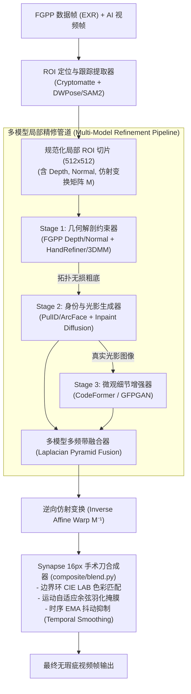

# Synapse 局部解剖智能修正与多模型融合设计规范 (Local Anatomical Refinement & Multi-Model Fusion Specification)

- **文档状态**: `Approved Technical Spec v1.0`
- **关联 RFC**: [RFC 0061: 局部解剖智能修正、多模型协同融合与工业级手术刀缝合规范与规划](RFC-0061-LOCAL-REFINEMENT-AND-MULTI-MODEL-FUSION.md)
- **关联仓库**: `synapse`（执行核心与算法 SDK）、`fulgur`（Track B 物理渲染与 FGPP 生成端）、`caelum-core`（Track A 离线光追真值对）、`aether`（FGPP 15 通道协议 SSOT）、`foundary`（GPU 推理容器与算力集群）
- **关联生态规约**:
  - **RFC 0044**: 神经-物理混合工业流水线、FGPP 与人机协同 (HITL 15 分钟熔断与白模粗糙度下限)
  - **RFC 0039**: 资产解耦与自洽作业闭包 (`JobBundle`)
  - **FGPP v1.0**: 15 标量通道 OpenEXR 线格式 (`34 B/px`，含 `CameraLinearDepth.Z`, `WorldNormal.XYZ`, `Cryptomatte.ID`)
- **目标受众**: 神经渲染算法工程师、角色与绑定技术总监 (TD)、视觉特效 (VFX) 合成专家、自动化流水线 Agent

---

## 1. 动机与核心定位

### 1.1 背景与解剖学失真机理

在基于生成式扩散模型（Diffusion Models）与流匹配（Flow Matching）的现代视频生成管线中，全身或中景镜头下的**手部（Hands）**与**脸部（Faces）**是感知失真率最高、恐怖谷效应最强烈的两个区域：

1. **手部的拓扑与运动学崩塌（Topological & Kinematic Collapse）**：
   - **高自由度与自遮挡**：人手包含 21 个活动关节、20 多个自由度（DoF）。在透视投影下，手指间的自遮挡（Self-occlusion）极其严重；
   - **分辨率稀释与多指/融指**：在全局视频潜空间（如 $1280 \times 720$ 分辨率下的 $8 \times$ 或 $16 \times$ 潜特征），手部通常仅占据几十个像素点。卷积/注意力下采样导致微观拓扑信息丢失，极易诱发多指（Polydactyly，如 6 指）、融指（Syndactyly）、骨折式非自然屈曲（Anatomical Infeasibility）等严重解剖学错误。
2. **脸部的视线偏斜与身份漂移（Gaze Strabismus & Identity Drift）**：
   - **恐怖谷敏感度**：人类视觉对人脸具备极高灵敏度，微小的双眼视线不对称（斜视）、瞳孔边缘畸变、牙齿排列失真或表情微抽搐都会立刻被识破；
   - **时空时序漂移**：长视频跨镜头或大幅度头部转动时，全画面注意力机制容易遗忘角色底层面部骨骼特征，导致身份（Identity/ID）在帧间悄然漂移。

### 1.2 为什么必须引入专用局部修正模型？

全局大模型（如 Wan 2.1、Sora、LTX-Video）追求全局动力学（流体、布料、运镜）与语义布局的平衡，无法在全局推理时对局部数十像素的细小区域分配无限算力。

工业级解法是**分治策略（Divide and Conquer）**：
* 全局模型专注处理场景运镜、身体躯干主运动与全局物理光影；
* 专用的**解剖学局部修正模型（Specialized Anatomical Refinement Models）**在时空 ROI（Region of Interest）裁剪切片后，于独立的局部高分辨率坐标系（如 $512 \times 512$）中执行基于强几何先验的解剖级精修。

### 1.3 为什么局部修正必须采用多模型融合？

在局部修复实践中，没有任何一个单一模型能够兼顾：
- **宏观光照与色彩一致性**（避免贴膏药感）；
- **严谨的 3D 解剖几何拓扑**（杜绝 6 指、塌陷）；
- **生理级微观质感与毛孔高光**（真实的皮肤散射与指纹）。

因此，局部修正不仅完全可以是多模型的融合，而且在工业级高质量管线中**必须采用多模型协同融合架构**。

---

## 2. 专用局部修正模型体系与解剖先验

针对面部与手部不同的致错机理，构建两套专精的先验注入与修正模型库：

```
                             ┌── 面部修正 (FaceRefiner) ──── CodeFormer + PulID/ArcFace + FLAME 3DMM
                             │
专用局部修正模型体系 ────────┤
                             └── 手部修正 (HandRefiner) ──── FGPP 3D Depth/Normal + MANO 3D Mesh + DWPose
```

### 2.1 脸部专修模型矩阵 (FaceRefiner Suite)

| 模型类别 | 代表模型 / 技术方案 | 输入先验 / 驱动机制 | 职责与解决的痛点 |
|---|---|---|---|
| **离散先验盲人脸修复** | **CodeFormer** (NeurIPS/TPAMI) | 破损人脸切片 + 保真度控制权重 $w \in [0, 1]$ | 利用量化 Codebook 面部字典恢复眼睛高光、唇纹与睫毛，可控平滑真实度与保真度 |
| **面部语义先验 GAN** | **GFPGAN / RestoreFormer++** | 面部组件字典 (Eyes, Mouth, Skin) | 极高频毛孔级皮肤与发丝纹理重建，修复模糊五官 |
| **身份保持与特征投影** | **PulID / InstantID / FaceID-LoRA** | InsightFace / ArcFace 512 维特征向量 | 强行将目标角色人脸身份潜特征注入 Cross-Attention，杜绝修复过程中的 ID 漂移 |
| **3D 几何与表情驱动** | **LivePortrait / AniPortrait (FLAME)** | 3D 隐式关键点 / FLAME 3DMM 参数 | 保持面部转头视角透视正确，消除眼球斜视（Strabismus）与微表情塌陷 |

### 2.2 手部专修模型矩阵 (HandRefiner Suite)

| 模型类别 | 代表模型 / 技术方案 | 输入先验 / 驱动机制 | 职责与解决的痛点 |
|---|---|---|---|
| **3D 参数化手部网格** | **HandRefiner (MeshGraphormer)** | 缺陷手部图像 $\to$ 拟合 MANO 3D Mesh | 从画面预测或由 CG 提取严谨的 21 关节 3D 网格，重建标准无歧义手部法线与深度 |
| **2D 稠密拓扑引导** | **DWPose (WholeBody) + ControlNet** | 21 个手部关键点连线骨架 | 约束手部朝向与握持动作开合范围，限制错误拓扑生成 |
| **Synapse FGPP 物理直通** | **`fulgur` Track-B 原生 GBuffer** | `WorldNormal.XYZ` + `CameraLinearDepth.Z` | **Synapse 独家核心优势**：直接利用 CG 原生手部 3D 深度与法线作为硬几何门禁，免除反向猜测手部网格的不确定性 |

> [!IMPORTANT]
> **Synapse 的先验压制优势**：
> 纯 2D AI 视频管线（如标准 ComfyUI 流）只能靠 `MeshGraphormer` 从已经画崩的手部去“逆向猜测”正确手势，在严重遮挡时极易猜错；
> 而在 Synapse 神经-物理渲染管线中，**3D 引擎端（`fulgur` / `caelum-core`）在白模阶段就已经拥有骨骼绑定的精确 3D 变换矩阵**。通过 FGPP 15 通道 OpenEXR，我们可以直接将完美的 3D 手部深度和法线投影为 Inpaint Condition，实现对纯 2D 方案的降维打击。

---

## 3. 多模型输出融合的五大经典方法体系

在局部修正中，多模型融合并非简单的线性半透明叠加强加（Alpha Blending），而是根据信号物理特征分布在不同维度展开：

```
                    ┌── 1. 频域分解融合 (Laplacian Pyramid) ────── 低频光照 (Model A) + 高频微结构 (Model B)
                    ├── 2. 串行级联融合 (Hierarchical Cascade) ─── 几何拓扑解纠缠 (Stage 1) ➔ 超分写实 (Stage 2)
多模型输出融合体系 ─┼── 3. 潜在轨迹解耦 (Latent Timestep Switch) ── 高噪声大结构 (Step T) ➔ 低噪声微细节 (Step 0)
                    ├── 4. 空间置信加权 (Uncertainty & Spatial) ─── 五官/手心核心区信任专修，边缘信任原底
                    └── 5. 梯度域泊松克隆 (Poisson Gradient Domain) ── 求解泊松 PDE，融合纹理梯度消除光照色差
```

### 3.1 频域分解融合 (Laplacian Pyramid Multi-Band Blending)

*   **原理依据**：人类视觉系统（HVS）对不同空间频率的对比度敏感度完全不同。大面积的光照、肤色、环境反射属于**低频信号**；睫毛、瞳孔反光、皮肤纹理、指甲盖属于**高频细节**。
*   **经典流程**：
    1. 给定全局扩散模型输出 $I_{\text{diff}}$（拥有完美的环境光照与阴影，但手/脸结构有轻微失真）；
    2. 给定专用修复模型输出 $I_{\text{refine}}$（拥有完美的五官/指纹，但色调与全局光影可能微有偏差）；
    3. 构建 $K$ 层拉普拉斯金字塔分解：
       $$L_k(I) = G_k(I) - \text{Upsample}(G_{k+1}(I))$$
    4. 融合策略：
       $$L_k^{\text{fused}} = \alpha_k \cdot L_k(I_{\text{refine}}) + (1 - \alpha_k) \cdot L_k(I_{\text{diff}})$$
       其中 $\alpha_k$ 随层级递减：在高频层（$k=0, 1$），$\alpha_k \to 1.0$（最大程度采用修复模型的清晰毛孔与线条）；在底座低频层（$k=K$），$\alpha_K \to 0.0$（完全保留原场景真实环境光照与肤色基调）。

### 3.2 串行几何-纹理分阶级联 (Hierarchical Coarse-to-Fine Cascade)

*   **原理依据**：解纠缠“拓扑正确性”与“表观逼真度”。
*   **三阶段级联范式**：
    $$\text{破损输入} \xrightarrow{\text{Stage 1: 几何硬矫正}} \text{标准骨架与深度} \xrightarrow{\text{Stage 2: 语义生成}} \text{正确形态草稿} \xrightarrow{\text{Stage 3: 感知超分与ID锁定}} \text{最终逼真图像}$$
    - **Stage 1 (Geometry Anchor)**：利用 FGPP Depth / MANO 3D 骨架生成严谨的几何轮廓，锁定 5 根手指绝对位置；
    - **Stage 2 (Identity & Lighting Inpaint)**：调用具备 PulID / ArcFace 约束的局部 Inpainting Diffusion 模型，在 Denoise Strength = $0.5 \sim 0.6$ 下填充皮肤光影，使几何体与身体浑然一体；
    - **Stage 3 (Micro-Detail Enhancement)**：通过 CodeFormer / GFPGAN 针对五官微结构进行百毫秒级的最后精修。

### 3.3 采样轨迹潜在空间动态调度 (Latent Denoising Trajectory Fusion)

*   **原理依据**：扩散反向去噪过程（$t = T \to 0$）中，早期的步数（$t \in [0.6T, T]$）决定大尺度语义、骨骼构图与透视；后期的步数（$t \in [0, 0.4T]$）只决定高频像素纹理。
*   **多模型动态接力机制**：
    ```
    去噪时间步 t:     T (纯噪声) ─────────────── 0.5 T ──────────────────── 0 (最终图像)
    主导模型 A:       [==== 模型 A (强 ControlNet/FGPP 几何绑定) ====]
    主导模型 B:                                                      [==== 模型 B (超写实皮肤材质 LoRA) ====]
    ```
    在去噪轨迹行进到 $t = 0.5T$ 时，系统直接将 Latent 张量 $z_t$ 交接给模型 B。因为交接发生在连续潜空间内部，**彻底免去了像素空间的任何物理拼接接缝**。

### 3.4 空间置信度与不确定度驱动的空域加权 (Uncertainty-Aware Spatial Blending)

*   **原理依据**：专用模型在不同解剖部位的置信度并不均等。例如面部修复模型对眼睛、鼻翼、牙齿识别最准，而对耳朵边缘、下颌与颈部连接处容易产生模糊或断裂。
*   **空间权重图构建公式**：
    $$M_{\text{blend}}(x, y) = \text{Feather}\Big(\text{Seg}_{\text{features}}(x, y) \odot \left(1 - \text{DistField}_{\text{boundary}}(x, y)\right)\Big)$$
    - 在五官中心区与手掌心，$M_{\text{blend}} = 1.0$；
    - 在手腕过渡区、发际线连接处，$M_{\text{blend}} \in [0.0, 1.0]$ 平滑过渡回底模；
    - 结合 Synapse 现有的 $16\text{px}$ 手术刀掩膜余弦衰减羽化（Cosine Feathering）。

### 3.5 泊松梯度域融合与色彩传递 (Poisson Gradient Domain & LAB Match)

*   **原理依据**：当专用模型修复后的局部图块与原始大画幅存在微小色差、曝光差异或色温漂移时，直接贴合会产生肉眼可辨的“方块切边”。
*   **融合算法**：
    1. **边界环 CIE LAB 色彩对齐**（复用 `synapse.composite.blend.match_border_ring_lab`）：计算接缝外圈环形区域内原图与修正图的均值与方差，通过仿射色彩变换使修正图的底色无缝对齐宿主图像；
    2. **梯度域泊松重构**：保持修整图内部的细节梯度 $\mathbf{v} = \nabla I_{\text{refine}}$，将边界像素强制约束为外部图像像素，求解泊松方程 $\nabla^2 I = \nabla \cdot \mathbf{v}$。

---

## 4. Synapse 端到端工程架构与数据流

### 4.1 整体数据流全景



### 4.2 模块拆解与核心接口定义

在 `python/synapse/refine/` 下新增完整强类型实现模块：

```
python/synapse/refine/
├── __init__.py
├── types.py            # 数据契约：RefinementROI, AnatomicalRegion, FusionStrategy
├── pipeline.py         # 门面执行器：LocalRefinementPipeline
├── face.py             # 面部专修引擎：FaceRefiner (CodeFormer + ArcFace + 3DMM)
├── hand.py             # 手部专修引擎：HandRefiner (FGPP 3D Depth + MANO)
└── fusion.py           # 多模型融合核：LaplacianFusion, PoissonFusion, UncertaintyFusion
```

#### 核心数据契约 (`python/synapse/refine/types.py`)

```python
from __future__ import annotations
from dataclasses import dataclass, field
from enum import Enum
from typing import Literal
import numpy as np

class AnatomicalRegion(str, Enum):
    FACE = "face"
    LEFT_HAND = "left_hand"
    RIGHT_HAND = "right_hand"

class FusionMethod(str, Enum):
    LAPLACIAN_PYRAMID = "laplacian_pyramid"
    HIERARCHICAL_CASCADE = "hierarchical_cascade"
    UNCERTAINTY_WEIGHTED = "uncertainty_weighted"
    POISSON_GRADIENT = "poisson_gradient"

@dataclass
class RefinementROI:
    """提取的局部解剖学 ROI 描述符。"""
    region: AnatomicalRegion
    frame_index: int
    bbox_xyxy: tuple[int, int, int, int]           # 原始大画幅中的像素坐标
    crop_rgb: np.ndarray                           # 规范化归一化图像 [H, W, 3], uint8
    crop_depth: np.ndarray | None                  # 对应的 FGPP 线性深度切片 [H, W], float32
    crop_normal: np.ndarray | None                 # 对应的 FGPP 世界法线切片 [H, W, 3], float32
    affine_matrix: np.ndarray                      # 原始画幅到标准 ROI 的 2x3 仿射变换矩阵
    entity_id: int = 0                             # 关联的 Cryptomatte 实体 ID

@dataclass
class RefinementResult:
    """局部修正与融合后的输出。"""
    refined_rgb: np.ndarray                        # 修正后的标准切片 [H, W, 3]
    blend_mask: np.ndarray                         # 空间羽化融合掩膜 [H, W], float32 in [0, 1]
    confidence_map: np.ndarray                     # 像素级置信度热力图 [H, W], float32
    metrics: dict[str, float] = field(default_factory=dict)
```

#### 多模型融合核心类 (`python/synapse/refine/fusion.py`)

```python
from __future__ import annotations
import numpy as np
from synapse.refine.types import FusionMethod

class MultiModelRefineFusion:
    """负责将多个局部修正模型的输出在频域、空间域或梯度域进行融合。"""

    def __init__(self, method: FusionMethod = FusionMethod.LAPLACIAN_PYRAMID, pyramid_levels: int = 4):
        self.method = method
        self.pyramid_levels = pyramid_levels

    def fuse(
        self,
        base_rgb: np.ndarray,
        refined_geometry_rgb: np.ndarray,
        refined_detail_rgb: np.ndarray,
        spatial_mask: np.ndarray,
    ) -> np.ndarray:
        """执行多模型融合。

        Args:
            base_rgb: 底模/背景切片 (保留全局光照基准)
            refined_geometry_rgb: 几何纠偏模型产物 (正确的五官/手部轮廓)
            refined_detail_rgb: 微观细节模型产物 (CodeFormer/纹理模型)
            spatial_mask: 核心区域羽化掩膜 [0, 1]
        """
        if self.method == FusionMethod.LAPLACIAN_PYRAMID:
            return self._fuse_laplacian(base_rgb, refined_detail_rgb, spatial_mask)
        elif self.method == FusionMethod.HIERARCHICAL_CASCADE:
            return self._fuse_cascade(base_rgb, refined_geometry_rgb, refined_detail_rgb, spatial_mask)
        # 默认安全回退
        return self._fuse_laplacian(base_rgb, refined_detail_rgb, spatial_mask)

    def _fuse_laplacian(
        self,
        low_freq_source: np.ndarray,
        high_freq_source: np.ndarray,
        mask: np.ndarray,
    ) -> np.ndarray:
        """拉普拉斯金字塔多频带融合实现。"""
        from synapse.composite.blend import laplacian_blend
        # 复用已有的 laplacian_blend 算子进行高低频重组
        return laplacian_blend(low_freq_source, high_freq_source, mask, levels=self.pyramid_levels)
```

### 4.3 与现有组件的复用关系

新设计绝不重复造轮子，全面无缝接入 `synapse` 现存的核心资产库：

1. **复用 `synapse.composite.mask` (`mask.py`)**：
   - 提取修正前后的局部差异掩膜，调用 `_directional_structuring_element` 与 `_circular_structuring_element`，生成带运动向量引导的 $16\text{px}$ 膨胀手术刀掩膜。
2. **复用 `synapse.composite.blend` (`blend.py`)**：
   - 逆变换回原全景分辨率后，调用 `match_border_ring_lab()` 解决图块拼合色差；
   - 调用 `surgical_sequence_composite()` 引入帧间 EMA（指数移动平均衰减），抑制逐帧修正带来的时序高频闪烁（Boundary Flicker）。
3. **复用 `synapse.fgpp` (`frame.py`)**：
   - 优先通过 `Cryptomatte.ID` 精确锁定角色对应的手与头部位姿，免去纯视觉检测网络在快速运动中丢失跟踪的风险。

---

## 5. 时序稳定性与跨帧平滑机制

局部图块逐帧修正极易引发**画面闪烁（Temporal Flicker）**与**高频跳变（Jitter）**，必须在时序域实施三级阻尼：

```
                              ┌── 1. 仿射变换平滑 ── 头部/手部 Tracking 矩阵做卡尔曼滤波，禁止 Box 像素抖动
时序平滑三大防护盾 ───────────┼── 2. 潜在特征一致 ── 跨帧 Cross-Frame Attention 共享 Key/Value 缓存
                              └── 3. 时序 EMA 阻尼 ── 边界与像素值引入 α = 0.85 历史帧指数加权
```

1. **时序平滑 Bounding Box（Kalman / EMA Affine Filter）**：
   - 视频裁剪切片时，Bounding Box 的中心点坐标 $(c_x, c_y)$ 与尺度 $s$ 严禁逐帧硬突变，必须经过卡尔曼滤波器或双向高斯滤波平滑，防止由于检测框跳动导致的重投影闪烁；
2. **时序 EMA 手术刀混合（Temporal EMA Scalpel Blending）**：
   - 缝合阶段，修正图层的权重与色彩统计采用历史帧平滑：
     $$I_{\text{comp}}(t) = \alpha \cdot I_{\text{fused}}(t) + (1 - \alpha) \cdot \text{Warp}_{t-1 \to t}(I_{\text{comp}}(t-1))$$
     其中 $\text{Warp}_{t-1 \to t}$ 由前向光流（Forward Optical Flow）或 FGPP 原生运动矢量驱动；
3. **跨滑窗协同（Sliding Window Harmony）**：
   - 与 Synapse 现有的因果滑窗调度器（$W=97, S=64, \text{overlap}=33$）保持严格对齐，重叠帧区域强制执行跨窗口加权混合，禁止在切窗边缘发生面容跳变。

---

## 6. 评测门禁与三级验收标准

为确保修正不会带来“负优化”，设计严格的客观与主观自动化门禁：

```
                    ┌── Level 1: 解剖几何硬指标 (手部骨骼自由度、脸部关键点误差)
三级质量把关门禁 ───┼── Level 2: 身份与感知保真度 (ArcFace Cosine Similarity ≥ 0.78, LPIPS ≤ 0.18)
                    └── Level 3: 拼缝与时序平稳度 (Border PSNR ≥ 38 dB, Temporal Warping Error ≤ 0.05)
```

| 评测维度 | 判定指标 | 目标阈值 | 失败降级策略 |
|---|---|---|---|
| **脸部身份一致性** | ArcFace Cosine 相似度 | $\ge 0.78$（对比基准参考肖像） | 增大 PulID 特征权重，降低 Inpaint Denoise 强度 |
| **手部解剖合法性** | 手指骨骼计数 & MPJPE 关节误差 | 有效手指数量 $\equiv 5$，MPJPE $\le 8.5\text{mm}$ | 回退至 FGPP 3D 白模深度硬遮罩重投影 |
| **接缝不可见度** | 缝合边界 $16\text{px}$ 环内 PSNR | $\ge 38.0\text{dB}$（无硬切边、无明显光晕） | 启动更高阶泊松梯度域融合与多频带金字塔 |
| **时序闪烁率** | 修正区域 Temporal Warping 误差 | $E_{\text{temp}} \le 0.045$ | 调高时序 EMA 衰减系数 $\alpha$，增强光流约束 |
| **单镜头算力熔断** | RFC 0044 耗时约束 | 单镜头修整推理时间 $\le 15$ 分钟 | 触发工程降级，回退至轻量级单模型或提示人工介入 |

---

## 7. 实施计划与 PR 演进路线

按照生态敏捷开发规范，规划为 3 个独立 PR，严格遵循 Worktree 隔离与多机验证流程：

```
[PR-22] 基础数据结构与 ROI 提取
  ├── 建立 synapse.refine.types (ROI, BBox, Matrix)
  └── 接入 FGPP Cryptomatte 与 DWPose 几何锚定
        │
        ▼
[PR-23] 专修模型接入与多模型融合核 (Fusion Core)
  ├── 实现 FaceRefiner (CodeFormer / ArcFace 接口)
  ├── 实现 HandRefiner (MANO 3D / FGPP Depth 条件输入)
  └── 实现 LaplacianPyramidFusion 与 PoissonFusion 算子
        │
        ▼
[PR-24] 手术刀逆向缝合、时序 EMA 平滑与 Synapse-Bench 评测
  ├── 串联 blend.py 16px 缝合与色彩校正
  ├── 建立跨帧卡尔曼平滑与光流一致性保障
  └── tests/ 写入单测套件，通过 ubuntu24 验证全绿
```

- **验证机器调度**：
  - 代码编写与单测：Mac 本地或 Worktree；
  - CI、全量 `pytest tests/test_refine_*.py` 与算子数值断言：**Ubuntu 主力机 (`ubuntu24`)**；
  - GPU 推理与真实模型加载：**Windows GPU 节点 (`win-dev`) / `foundary` 容器**。
