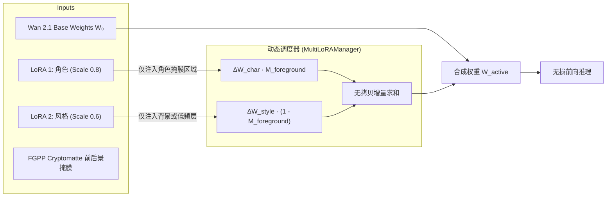
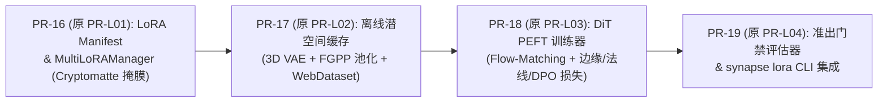

# Synapse LoRA & PEFT 微调流水线设计规范 (LoRA & PEFT Pipeline Specification)

- **文档状态**: `Approved Technical Spec (v1.1)`
- **关联实施计划**: [docs/IMPLEMENTATION_PLAN.md](IMPLEMENTATION_PLAN.md) (`M5: PR-16 ~ PR-19`)
- **关联对齐决议**: [docs/DESIGN_REVIEW_AND_ALIGNMENT.md](DESIGN_REVIEW_AND_ALIGNMENT.md) (`RV-02`, `RV-03`)
- **关联仓库**: `synapse`（执行核心与评测 SDK）、`fulgur`（3D 合成数据与渲染引擎）、`aether`（FGPP 与 StyleProfile SSOT）、`foundary`（GPU 训练容器调度）
- **关联生态规约**:
  - **RFC 0039**: 资产解耦、自洽作业闭包 (`JobBundle`) 与 DCC 连接器架构
  - **RFC 0043**: 全生态同场景多风格渲染架构与 `aether//style` `StyleProfile` SSOT
  - **RFC 0044**: 神经-物理混合工业流水线、特征引导协议 (`FGPP`) 与人机协同 (`HITL`) 跨仓编排规约
  - **RFC 0058**: OpenUSD Hydra、MaterialX / OpenPBR 1.0 与 ACEScg 跨平台架构
- **目标受众**: 神经渲染算法工程师、3D 引擎技术美术 (TA/TD)、自动化训练 Agent

---

## 1. 动机与核心定位

### 1.1 问题背景：通用视频底模在 3D CG 工业管线中的断层
在基于扩散变换器（Diffusion Transformer, DiT，如 Wan 2.1、HunyuanVideo、CogVideoX）构建电影级 3D+AI 混合制作管线时，通用基础模型存在三大致命瓶颈：
1. **几何与材质的域鸿沟（Domain Gap）**：
   - 通用底模的训练数据源为自然互联网视频，对 3D 渲染引擎输出的无纹理白模（Whitebox Clay）、相机空间法线图（Camera-space Normal）与米制线性深度图缺乏先验理解；
   - 直接输入 CG 引导条件容易导致画面产生“塑料质感”、“几何轮廓被平滑抹除”或“暗部细节坍塌”。
2. **资产与角色身份漂移（Identity Drift）**：
   - 传统 Prompt 无法精准锁定专属资产（如特定 IP 角色、定制机甲、幻想生物、专有道具）；
   - 在多分镜、复杂光影变化或大角度运镜下，角色面部与服装结构不可避免地发生突变。
3. **艺术风格的不确定性（Style Non-Determinism）**：
   - 电影工业要求严格遵循艺术总监指定的色彩空间（ACEScg）、光影配比、胶片颗粒及特定着色风格（如赛璐珞、暗黑奇幻、定格粘土）；
   - 依赖文本提示词无法实现像素级、色彩科学级别的确定性受控。

### 1.2 DervGen 的核心壁垒：合成数据反哺（Synthetic Data Loop）
相比纯 2D 视频生成团队，`synapse` 依托 `fulgur`（现代 C++20 AAA 实时/离线渲染引擎），拥有取之不尽的**高精度成对标注合成数据源**：
- **无损几何度量**：真值 15 通道 OpenEXR FGPP（米制线性深度 `CameraLinearDepth.Z`、世界/相机法线 `WorldNormal.XYZ`、刚体光流 `MotionVector.XY`、图元精确遮罩 `Cryptomatte.ID`）；
- **可编程变体生成**：程序化随机改变摄像机外参轨迹、HDR 环境光照色温、材质粗糙度与几何扰动，低成本生产海量高质量训练数据对；
- **闭环反哺**：通过 LoRA（Low-Rank Adaptation）及 PEFT（参数高效微调）技术，将 3D 物理世界的硬约束与美术风格精准注入 DiT 潜空间，实现“白模高保真增肌”与“同资产万镜一致”。

### 1.3 核心设计原则
1. **无状态与容器原生（Stateless & Container-Native）**：遵循 `synapse` 的无服务端铁律，训练与预处理流水线作为单次执行即退出的 CLI / JobBundle Worker 运行在 `foundary` GPU 节点中，不保留长驻网络服务或状态数据库。
2. **契约零漂移（Contract Zero-Drift）**：数据格式严格遵循 `@aether//fgpp`（15 通道 `34 B/px`）与 `@aether//style`（RFC 0043 `StyleProfile` v2.0.0），严禁私自修改张量线格式。
3. **计算-训练严格解耦（Offline Caching）**：重型 3D Causal VAE 与 T5 文本编码全量离线预计算，训练迭代完全运行在潜空间（Latent Space），杜绝 GPU 空转。
4. **指标诚实与退化门禁（Synapse-Bench Gatekeeping）**：训练产出的 LoRA 必须通过自动化基准测试（几何保真度、跨帧时序方差、身份相似度），未达标自动熔断，禁止流入资产库。

---

## 2. LoRA 分类矩阵与 DiT 注入机制

在 `synapse` 架构中，LoRA 按控制维度与数据源解耦为 5 大专用类型，禁止将不同目标的数据粗暴混炼。

| LoRA 类型 | 核心数据源 | 推荐微调网络层 (Wan 2.1 DiT) | Rank / Alpha | 解决的关键痛点 |
| :--- | :--- | :--- | :--- | :--- |
| **`style` (风格 LoRA)** | 高清参考视频切片、ACEScg 色彩分级帧、RFC 0043 StyleProfile | Text Cross-Attention (`to_k, to_v`)、FFN (`ff.net.0, ff.net.2`) | $r=16, \alpha=16$ | 统一视觉基调、色彩分级映射、色温锁定、胶片颗粒质感 |
| **`identity` (资产/角色 LoRA)** | `fulgur` 导出的单体多角度转台、多光照、多姿态渲染帧序列 | Spatial Self-Attention (`to_q, to_k, to_v, to_out.0`) | $r=32 \sim 64, \alpha=32$ | 角色跨分镜五官一致、特定机械/道具细节保真，抑制穿模走形 |
| **`control` (条件引导 LoRA)** | 成对数据：15 通道 FGPP (Depth/Normal/Flow) $\to$ 目标真实 RGB | ControlNeXt 旁路或 DiT 浅层注入模块 (`blocks.0..10`) | $r=32, \alpha=32$ | 强迫模型精确服从相机空间法线与线性深度，提升几何依从度 |
| **`whitebox` (白模增肌 LoRA)** | 成对数据：Track B 粗白模 CG 渲染帧 $\to$ Track A 高模精修渲染帧 | 全身 Attention 层 (Spatial + Temporal) | $r=32, \alpha=64$ | 解决白模到照片级真实感的质感跃迁，为粗糙网格自动补充微表面细节 |
| **`motion` (动力学/运镜 LoRA)** | 高帧率纯净动力学模拟（布料、流体、刚体破碎、Mocap 走跑跳） | Temporal Attention Blocks (`temporal_attn.*`) | $r=16 \sim 32, \alpha=16$ | 抑制视频生成中的时序蠕动、橡皮泥肢体拉伸，注入真实物理加速度先验 |

### 2.1 DiT 网络参数注入原理
现代视频 DiT（以 Wan 2.1 为例）由堆叠的双向变换器块（Transformer Blocks）组成。对于权重矩阵 $W_0 \in \mathbb{R}^{d \times k}$，低秩适配将其更新表示为：
$$W = W_0 + \Delta W = W_0 + \frac{\alpha}{r} (B \cdot A)$$
其中 $A \in \mathbb{R}^{r \times k}$ 采用高斯分布初始化，$B \in \mathbb{R}^{d \times r}$ 初始化为零，确保训练初始状态 $\Delta W = 0$。

```
                    ┌─────────────────────────┐
                    │    Input Token x        │
                    └────────────┬────────────┘
                                 │
                   ┌─────────────┴─────────────┐
                   │                           │
                   ▼                           ▼
        ┌──────────────────────┐    ┌──────────────────────┐
        │  Frozen Base Weight  │    │     LoRA Down A      │
        │         W₀           │    │    (d_in -> r)       │
        └──────────┬───────────┘    └──────────┬───────────┘
                   │                           ▼
                   │                ┌──────────────────────┐
                   │                │      LoRA Up B       │
                   │                │    (r -> d_out)      │
                   │                └──────────┬───────────┘
                   │                           ▼
                   │                ┌──────────────────────┐
                   │                │    Scale (alpha / r) │
                   │                └──────────┬───────────┘
                   │                           │
                   ▼                           ▼
                 [ + ] <───────────────────────┘
                   │
                   ▼
        ┌──────────────────────┐
        │    Output Token y    │
        └──────────────────────┘
```

- **空间层适配（Spatial Adapters）**：冻结时序模块，专门捕捉静态特征（如角色服装花纹、微表面反射、全局色彩分布）。
- **时序层适配（Temporal Adapters）**：冻结空间权重，专门学习帧间运动连续性与相机外参位移规律。

---

## 3. 六阶段全生命周期流水线架构

```mermaid
flowchart TD
    subgraph S1 ["阶段 1: 数据工坊 (Data Engine)"]
        F1["fulgur Headless Farm<br/>自动化程序化渲染"] -->|OpenEXR 15通道 FGPP| D_Syn["成对合成数据 (Synthetic)"]
        F2["实拍/高质量参考片库"] -->|SAM2 分割 + 镜头切分| D_Real["真实视频切片 (Curated)"]
        D_Syn & D_Real --> Tag["自动化多模态标注<br/>(Qwen2-VL / Florence-2 + 结构化标签)"]
    end

    subgraph S2 ["阶段 2: 特征预编码与潜空间缓存 (Feature Store)"]
        Tag --> PreVAE["3D Causal VAE 离线预编码<br/>帧序列 -> 潜空间张量 [B, C, τ, H/8, W/8]"]
        Tag --> PreText["文本编码器离线提取<br/>Prompt -> T5 词嵌入"]
        Tag --> PreFGPP["FGPP 8x8 最小深度池化<br/>& 潜空间光流算子积分"]
        PreVAE & PreText & PreFGPP --> WDS["WebDataset 格式分块打包<br/>(*.tar + parquet)"]
    end

    subgraph S3 ["阶段 3: 分布式 LoRA 训练引擎 (Training Engine)"]
        WDS --> Trainer["Wan 2.1 DiT PEFT Trainer<br/>- Flow Matching 目标损失<br/>- 辅助边界与法线重构损失<br/>- 动态梯度检查点与混合精度 (bf16)"]
        Trainer --> SafeTensors["导出 LoRA 权重文件<br/>(adapter_model.safetensors)"]
    end

    subgraph S4 ["阶段 4: 资产打包与元数据契约 (Packaging)"]
        SafeTensors --> Bundle["构建自洽 LoRA 资产包<br/>- lora_manifest.json (SSOT)<br/>- adapter_config.json<br/>- trigger_presets.yaml"]
    end

    subgraph S5 ["阶段 5: 运行时 Multi-LoRA 动态调度 (Serving)"]
        Bundle --> MultiLoRA["Synapse Worker 运行时加载<br/>- 动态低秩权重融合<br/>- Cryptomatte 局部遮罩空间隔离<br/>- 避免风格/角色相互污染"]
        MultiLoRA --> Generator["Wan 2.1 推理管道执行"]
    end

    subgraph S6 ["阶段 6: 自动化评测与退化门禁 (Synapse-Bench)"]
        Generator --> Bench["Synapse-Bench 往返测试套件<br/>- DINOv2 / ArcFace 身份余弦相似度<br/>- 几何 Chamfer 距离与法线角误差<br/>- CIEDE2000 跨帧时序色彩漂移"]
        Bench --> Check{"通过准出门禁？"}
        Check -->|Yes (0)| Pub["发布至生产资产中心 (asset-vault)"]
        Check -->|No (40)| Fail["熔断阻断：输出结构化诊断报告"]
    end
```

---

## 4. 详细技术实现方案

### 4.1 阶段 1：数据工坊（合成数据生成与筛选规约）

#### 4.1.1 `fulgur` 合成数据批量生产规约
利用 `fulgur` 的无头离线批处理能力（`bazel run //tools:asset-cooker` + 无头渲染管道），生成具备绝对几何真值的训练对：
- **运镜多样性覆盖**：自动围绕目标资产生成轨道运镜（Orbit）、推拉（Dolly）、摇移（Pan/Tilt）及螺旋俯冲轨迹。
- **环境光照泛化**：以采样球随机加载室内、室外、逆光、阴天、霓虹灯等 50+ 种标准 HDRI 天空盒，色温范围覆盖 $2500\text{K} \sim 9500\text{K}$。
- **几何退化注入（供 Whitebox-to-Real 训练）**：
  - 输入：将同一资产的白模网格（减面至顶点数 $\ge 1500$ 且材质为纯灰度 Lambertian）作为条件帧；
  - 目标：将该资产经过完整 PBR 烘焙、高模置换与微表面着色后的渲染序列作为 Ground Truth。

#### 4.1.2 自动化结构化打标（Synthetic Captioning）
每个样本的描述文本由三部分拼接而成，杜绝含糊文本：
```
[Trigger_Token], [Subject_Description], [Lighting_Environment], [Camera_Motion], [Art_Style_Tag]
```
示例：
> `[id_valkyrie_01], a cybernetic female warrior in matte-black carbon armor, dramatic key light from upper right with cold blue rim light, steady forward dolly tracking shot, cinematic photorealistic 8k.`

---

### 4.2 阶段 2：特征预编码与潜空间缓存（Feature Store）

在视频 DiT 训练中，实时运行 3D Causal VAE 与 T5 Text Encoder 会占用超过 75% 的端到端显存和计算时间。本流水线强制执行**全离线预编码（Offline Pre-encoding）**。

#### 4.2.1 3D Causal VAE 潜空间预编码
对于长为 $T$ 帧、分辨率为 $H \times W$ 的视频序列（必须满足 $T = 4k + 1$）：
1. 经由 Wan 2.1 3D Causal VAE 压缩，生成潜空间特征张量：
   $$\mathbf{z}_0 \in \mathbb{R}^{C_{\text{latent}} \times \tau \times \frac{H}{8} \times \frac{W}{8}}, \quad \tau = \frac{T - 1}{4} + 1$$
2. 保持数据类型为 `torch.bfloat16`，均值方差归一化后写入缓存。

#### 4.2.2 FGPP 引导特征池化对齐
与潜空间分辨率严格对齐：
- **深度张量**：对 `CameraLinearDepth.Z` 执行对数归一化，采用 $8 \times 8$ **最小深度池化（Min-Depth Pooling）**，防止背景静止像素稀释前景角色的运动边缘：
  $$Z_{\text{latent}}(x, y) = \min_{u, v \in [0, 7]} Z(8x + u, 8y + v)$$
- **法线张量**：结合 `CameraParams.view_matrix` 将 `WorldNormal` 转换为相机空间法线 `CamNormal`，双线性下采样至 $(H/8, W/8)$；
- **潜空间时序光流算子**：计算跨 4 帧的前向轨迹欧拉积分，生成潜空间位移场网格 $\mathcal{W}_{\tau \to \tau'}^{\text{latent}}$。

#### 4.2.3 存储规约（WebDataset 切片）
所有预计算特征打包为分片 TAR 文件（`shard-00000.tar`，每片约 `2.0 GB`），结构如下：
```
shard-00000.tar
├── sample_000000.latent.pt       # torch.Tensor [16, τ, H/8, W/8] (bfloat16)
├── sample_000000.prompt.pt       # torch.Tensor [L, 4096] (bfloat16)
├── sample_000000.fgpp_cond.pt    # torch.Tensor [C_cond, τ, H/8, W/8]
└── sample_000000.meta.json       # 原始时长、FPS、分辨率、校验哈希
```

---

### 4.3 阶段 3：分布式 LoRA 训练引擎（Training Engine）

#### 4.3.1 训练目标与损失函数
基于 Flow Matching 目标，并在几何引导微调中引入显式辅助边缘损失：
$$\mathcal{L}_{\text{total}} = \mathcal{L}_{\text{flow}} + \lambda_{\text{edge}} \mathcal{L}_{\text{edge}} + \lambda_{\text{normal}} \mathcal{L}_{\text{normal}}$$
1. **Flow Matching 基础损失**：
   $$\mathcal{L}_{\text{flow}} = \mathbb{E}_{t, \mathbf{x}_1, \mathbf{x}_0} \left[ \left\| \mathbf{v}_\theta(\mathbf{x}_t, t, \mathbf{c}) - (\mathbf{x}_1 - \mathbf{x}_0) \right\|_2^2 \right]$$
2. **边缘几何对齐损失（针对 Control 与 Whitebox LoRA）**：
   通过 Sobel 差分算子约束去噪潜空间特征梯度与 FGPP 深度边缘的一致性：
   $$\mathcal{L}_{\text{edge}} = \left\| \nabla \hat{\mathbf{z}}_0 - \nabla Z_{\text{latent}} \right\|_1$$

#### 4.3.2 训练超参数推荐配置表

| 配置项 | 风格 LoRA (`style`) | 资产/角色 LoRA (`identity`) | 白模增肌 LoRA (`whitebox`) |
| :--- | :--- | :--- | :--- |
| **基础模型** | Wan 2.1 DiT (14B / 1.3B) | Wan 2.1 DiT (14B) | Wan 2.1 DiT (14B) |
| **优化器** | AdamW (`fused=True`) | AdamW (`fused=True`) | AdamW (`fused=True`) |
| **学习率 (Spatial)** | $1 \times 10^{-4}$ | $2 \times 10^{-4}$ | $1.5 \times 10^{-4}$ |
| **学习率 (Temporal)**| 冻结 ($0.0$) | $5 \times 10^{-5}$ | $1 \times 10^{-4}$ |
| **学习率调度** | 余弦退火 (Cosine with Warmup) | 余弦退火 | 线性预热 + 多步衰减 |
| **LoRA Rank ($r$)** | 16 | 32 或 64 | 32 |
| **LoRA Alpha ($\alpha$)**| 16 | 32 | 64 |
| **批量大小 (Total Batch)**| 16 (Gradient Accumulation) | 8 | 16 |
| **训练步数 (Steps)** | $1,500 \sim 3,000$ | $3,000 \sim 6,000$ | $5,000 \sim 10,000$ |
| **混合精度** | `bf16` | `bf16` | `bf16` |
| **显存优化** | Activation Checkpointing (梯度检查点) | 梯度检查点 | 梯度检查点 |

---

### 4.4 阶段 4：资产打包与元数据契约（Asset Manifest）

训练产出必须遵循严格的自洽目录规约，形成完整的 LoRA 资产包：

```
lora_bundles/
└── lora_valkyrie_pbr_v1/
    ├── lora_manifest.json          # 核心 SSOT 契约清单
    ├── adapter_model.safetensors   # 浮点低秩参数权重 (禁止使用 pickle .bin)
    ├── adapter_config.json         # PEFT 标准拓扑配置
    ├── preview.mp4                 # 4 秒标准演示视频 (H.264, 720p)
    └── evaluation_report.json      # Synapse-Bench 准出评测成绩单
```

#### `lora_manifest.json` Schema 规范
```json
{
  "$schema": "https://synapse.dervgen.internal/schemas/lora_manifest.v1.0.json",
  "schema_version": "synapse.lora.v1.0",
  "bundle_id": "lora_valkyrie_pbr_v1",
  "category": "identity",
  "base_model": {
    "family": "wan",
    "version": "2.1",
    "variant": "14b_i2v",
    "expected_hash": "sha256:7f9a88..."
  },
  "peft_config": {
    "method": "lora",
    "rank": 32,
    "alpha": 32,
    "target_modules": [
      "blocks.*.self_attn.to_q",
      "blocks.*.self_attn.to_k",
      "blocks.*.self_attn.to_v",
      "blocks.*.self_attn.to_out.0"
    ]
  },
  "runtime_controls": {
    "trigger_words": ["valkyrie_unit_01", "carbon_fiber_exoskeleton"],
    "recommended_scale": 0.8,
    "min_scale": 0.2,
    "max_scale": 1.2,
    "compatible_fgpp_version": "fgpp.v1.0",
    "supported_resolutions": [[720, 1280], [1080, 1920]]
  },
  "provenance": {
    "trained_dataset_sha256": "sha256:a1b2c3...",
    "training_steps": 4500,
    "loss_final": 0.0421,
    "created_at": "2026-11-11T18:55:00Z",
    "operator_or_model": "gemini-3.8-flash"
  },
  "bench_scores": {
    "identity_dino_sim": 0.914,
    "face_arcface_sim": 0.892,
    "chamfer_distance_mm": 3.82,
    "ciede2000_flicker": 1.15
  }
}
```

---

### 4.5 阶段 5：运行时 Multi-LoRA 动态调度与隔离

在 `synapse` Worker 进行视频生成时，单个镜头常常需要组合多个 LoRA。为避免“风格 LoRA 冲淡角色面部特征”或“控制 LoRA 抑制画面质感”，设计三级空间与网络隔离机制：



1. **线性加权融合（Fast Weight Merging）**：
   在单批次生成前，直接将低秩乘积融合至模型主干：
   $$W_{\text{active}} = W_0 + \sum_{k=1}^N s_k \cdot \frac{\alpha_k}{r_k} (B_k A_k)$$
   推理完毕即刻回退减除，不引入额外的 Attention 算子开销。
2. **前后景空间隔离（Cryptomatte-Aware LoRA Masking）**：
   利用 FGPP 15 通道中的 `Cryptomatte.ID`：
   - 角色 LoRA 仅在主角 Entity ID 对应的潜空间坐标内生效；
   - 风格与环境 LoRA 仅作用于背景或全局低频分量，杜绝角色皮肤被风格化滤镜严重偏色。
3. **正交投影（ZipLoRA / B-LoRA 冲突抑制）**：
   当角色 LoRA 与风格 LoRA 在同一注意力层的梯度方向夹角较小时，在加载时执行矩阵正交化投影，消除参数冲突导致的画面扭曲和噪点放大。

---

### 4.6 阶段 6：自动化评测与退化门禁（Synapse-Bench Gatekeeping）

所有新训练的 LoRA 资产在推入生产库前，必须通过 `Synapse-Bench` 的自动化门禁验收，遵循**防静默失败三问**（模块存在、真实接线、产出非空有效张量并通过数值断言）：

```
+-------------------------------------------------------------------------------+
|                       Synapse-Bench LoRA 自动化准出门禁                       |
+--------------------------+--------------------+----------------+--------------+
| 评测维度                 | 测试指标           | 达标门槛 (SLA) | 失败动作     |
+--------------------------+--------------------+----------------+--------------+
| 1. 资产/角色一致性       | DINOv2 余弦相似度  | >= 0.880       | 阻断发布 (40)|
|                          | 人脸 ArcFace 距离  | >= 0.850       | 阻断发布 (40)|
+--------------------------+--------------------+----------------+--------------+
| 2. 3D 几何服从度         | 逆向 Chamfer 距离  | <= 5.0 mm      | 阻断发布 (40)|
|                          | 表面法线角误差     | <= 12.0 deg    | 阻断发布 (40)|
+--------------------------+--------------------+----------------+--------------+
| 3. 时序稳定性            | 光流扭曲残差       | <= 0.045       | 阻断发布 (40)|
|                          | 跨帧 CIEDE2000     | <= 2.50 delta  | 阻断发布 (40)|
+--------------------------+--------------------+----------------+--------------+
| 4. 泛化与灾难性遗忘     | 负向场景生成 FVD   | 相对增幅 < 8%  | 告警人工介入 |
+--------------------------+--------------------+----------------+--------------+
```

---

## 5. 模块代码结构与 CLI 规范

在 `synapse` 仓库内，LoRA 流水线模块严格遵循分层与无状态规范：

### 5.1 目录组织结构（对齐 `DESIGN_REVIEW_AND_ALIGNMENT.md` §3.1）
```
python/synapse/
├── adapters/
│   ├── lora/                          # 运行时 LoRA 调度与加载 (Serving)
│   │   ├── __init__.py
│   │   ├── manifest.py                # LoRA Manifest Schema 校验器 (Pydantic v2)
│   │   ├── manager.py                 # MultiLoRAManager: 动态融合、掩膜隔离与正交化
│   │   └── patcher.py                 # DiT Attention 层的 PyTorch 挂钩与权重注入
│   └── wan.py                         # WanAdapter: 挂接 MultiLoRAManager
└── training/                          # 无状态训练与预处理 (Worker Runtime)
    ├── feature_store.py               # 3D Causal VAE + T5 + FGPP 最小深度池化与 WebDataset 打包
    ├── losses.py                      # Flow-Matching + Sobel 深度边缘 + 法线一致性 + DPO 损失
    ├── trainer.py                     # DiT 分布式 LoRA 训练器 (5 类正交 LoRA)
    └── packager.py                    # Safetensors 打包器与 Synapse-Bench 准出评估器
```

### 5.2 统一 CLI 接口与确定性退出码
所有 CLI 工具统一收敛至顶层 `synapse lora ...` 子命令族（不额外新建顶层二进制入口），支持 `--json` 输出结构化诊断数据，并遵循确定的退出状态码：
- `0`: 成功完成；
- `10`: 参数格式或 `lora_manifest.json` 契约校验失败；
- `20`: 依赖的 FGPP EXR 序列或预编码张量文件缺失；
- `30`: GPU 显存不足（OOM）或底模权重损坏；
- `40`: Synapse-Bench 质量门禁不达标（触发工程熔断）。

#### 常用命令集

```bash
# 1. 离线潜空间预计算 (在 GPU 容器中批量运行)
synapse lora prepare-data \
  --input data/scenarios/t2_humanoid_walk/ \
  --out-wds data/cache/t2_humanoid_wds.tar \
  --vae-type wan2.1_3d_causal \
  --json

# 2. 启动分布式 LoRA 微调
synapse lora train \
  --config configs/lora/char_valkyrie.yaml \
  --dataset data/cache/t2_humanoid_wds.tar \
  --out checkpoints/lora_valkyrie_v1 \
  --json

# 3. 运行 Synapse-Bench 自动化准出验收
synapse lora eval \
  --lora-bundle checkpoints/lora_valkyrie_v1 \
  --scenario t2_humanoid_walk_orbit \
  --json

# 4. 多 LoRA 无损离线融合为新权重 (可选发布形态)
synapse lora merge \
  --base weights/wan2.1_14b.safetensors \
  --lora checkpoints/lora_valkyrie_v1:scale=0.8 \
  --lora checkpoints/lora_anime_style:scale=0.5 \
  --out weights/wan2.1_valkyrie_custom.safetensors \
  --json
```

---

## 6. 分阶段实施路线图 (映射至主计划 Phase M5: `PR-16` ~ `PR-19`)

> 完整类/函数级实施蓝图详见 [docs/plans/PLAN-M5-LORA-TRAINING-PIPELINE.md](plans/PLAN-M5-LORA-TRAINING-PIPELINE.md)。



### PR-L01：`feat(lora): add LoRA manifest schema and runtime MultiLoRAManager in adapters`
- **内容**：实现 `lora_manifest.json` Pydantic v2 模型校验，在 `synapse.adapters.wan` 中加入 `MultiLoRAManager`，支持单/多 LoRA 的加载、卸载、权重混合比例缩放（`scale`）。
- **验收**：通过 `MockVideoAdapter` 与 CPU 单元测试，验证 LoRA 权重加载的数值加和正确性，不依赖真实 GPU。

### PR-L02：`feat(lora): implement offline 3D VAE and FGPP condition pre-encoding pipeline`
- **内容**：实现 `pre_encode_vae.py` 与 `pool_fgpp.py`，将 15 通道 FGPP EXR 序列高效切片并转为离线 `WebDataset` 格式。
- **验收**：在合成数据帧上验证潜空间张量尺寸与最小深度池化的数值一致性。

### PR-L03：`feat(lora): implement Wan DiT PEFT training worker with auxiliary geometric losses`
- **内容**：实现无状态训练脚本 `trainer.py`，基于 PyTorch + HuggingFace PEFT，支持对 Wan 2.1 DiT 的指定注意力层施加 LoRA，并集成 Flow Matching 与边缘梯度辅助损失。
- **验收**：在单卡环境运行 100 步 Mock 数据训练，验证 loss 正常下降且权重可导出为合法 `.safetensors`。

### PR-L04：`feat(lora): integrate automated Synapse-Bench gatekeeping and CLI tooling`
- **内容**：实现 `synapse lora` CLI 命令集与 `lora_evaluator.py`，串联身份相似度、几何法线误差及退化检查，实现退出码 `40` 的自动化工程熔断。
- **验收**：构造一组注入人为退化（如严重偏色、多肢形变）的权重，验证评测器精确触发熔断拦截并输出修复建议 `agent_fix_hint`。
