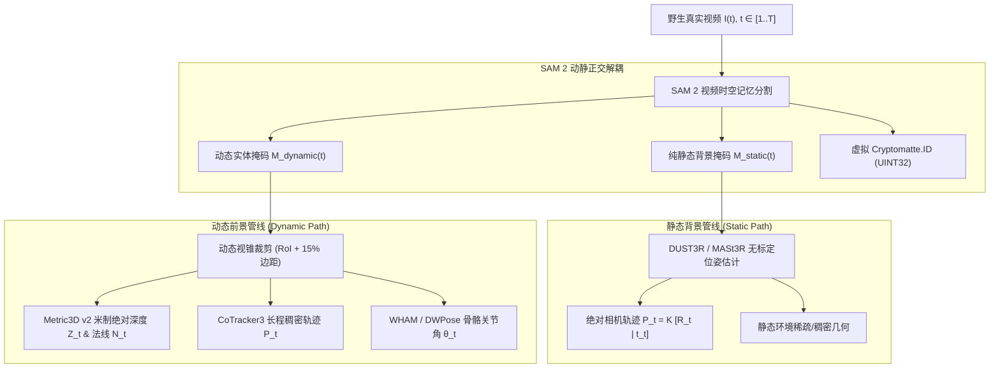
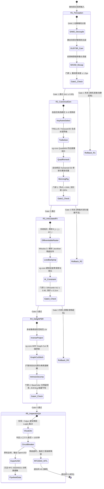

# Synapse 真实视频逆向 3D 动态数字孪生与联合反演设计规范 (Real-World Video-to-3D Dynamic Digital Twin & Joint Inverse Rendering Specification)

- **文档状态**: `Approved Design Spec (v1.1)`
- **关联 RFC**: [RFC 0060: 真实视频逆向 3D 动态数字孪生与联合反演架构规范](RFC-0060-REAL-VIDEO-TO-3D-DIGITAL-TWIN.md)
- **关联实施计划**: [PLAN-M9-M12-HORIZON3-LANDING.md](plans/PLAN-M9-M12-HORIZON3-LANDING.md) (`M9: PR-30 ~ PR-32`)
- **修订日期**: 2026-11-13
- **责任体系**: sautille-stroke / DervGen 核心架构组 (`synapse`, `fulgur`, `caelum-core`, `aether`)
- **关联基线**:
  - [docs/AUDIT_AND_ARCHITECTURE.md](AUDIT_AND_ARCHITECTURE.md) (整体目标审查与生态架构定界)
  - [docs/DESIGN_INDUSTRY_GAP_AND_COMPENSATION.md](DESIGN_INDUSTRY_GAP_AND_COMPENSATION.md) (行业差距分析与代偿设计)
  - [docs/DESIGN_3D_INSPECTION_AND_REFINEMENT.md](DESIGN_3D_INSPECTION_AND_REFINEMENT.md) (3D 质检与多尺度对齐)
  - [docs/DESIGN_RSI_FLYWHEEL.md](DESIGN_RSI_FLYWHEEL.md) (物理驱动自演进飞轮)
  - [docs/INDUSTRY_TRACKING_AND_TRENDS.md](INDUSTRY_TRACKING_AND_TRENDS.md) (行业前沿追踪)

---

## 1. 架构动机与范式升维 (Architectural Motivation & Paradigm Shift)

### 1.1 从正向神经渲染预演到逆向物理孪生

在数字内容生产（DCC）工业中，**“3D 资产 $\to$ 物理渲染 $\to$ 视频生成模型 (Wan 2.1 / DiT)”** 构成正向生成闭环，其核心价值在于利用确定性 3D 几何给生成模型注入物理与时空约束。

然而，影视工业、游戏制作、数字人与具身智能对 AI 的最高诉求，是**逆向问题（Inverse Problem）**：
$$\text{野生真实视频 (In-the-Wild Video)} \xrightarrow{\text{Synapse Inversion}} \text{AAA 级 3D 动态资产 (Mesh + Rig + PBR Materials)}$$

真实视频的反演面临严重的欠定性（Ill-posed nature）：
1. **尺度与深度歧义**：单目 RGB 缺乏绝对深度，传统 SfM 仅能给出未标定（Up-to-scale）的点云；
2. **动静混淆与相机退化**：行人和物体的运动会严重破坏对极几何（Epipolar Geometry），导致相机轨迹发散；
3. **几何与材质耦合**：视频像素是“几何法线、材质反射、环境光照、投射阴影”的非线性混合物，直接反投会产生死光纹理；
4. **运动变形非刚体性**：人体运动兼具骨骼刚体旋转（Skeleton Kinematics）与布料/肌肉非刚体波动（Non-rigid Deformation）。

### 1.2 核心解法：分层解耦 + 规范空间联合反演 + 物理硬约束

为击穿这一难题，本设计确立**“感知大模型先验过滤 + C++ 物理几何核硬锁 + 可微渲染联合优化”**的三位一体技术路线：
- **SAM 2** 提供时空记忆注意力分割，实现动静绝对分离与虚拟 Cryptomatte 生成；
- **六位一体辅助模型**（DUST3R, Metric3D v2, CoTracker3, WHAM, TRELLIS, IntrinsicImage）提供多模态连续物理初解；
- **规范空间（Canonical Space）与时序变形场（Deformation Field）** 联合参数化表达；
- **`vg-core` 纯 C++ 算法核** 硬锁足底零滑移（$\le 0.2\text{cm}$）、刚体骨长恒定与四边面流形拓扑；
- **五轮递进状态机** 实施闭环质检、HITL 15 分钟熔断与数据飞轮沉淀。

---

## 2. 动静时空解耦与辅助模型协同协议 (Spatiotemporal Decoupling & Model Arsenal)



### 2.1 SAM 2 时空分割与虚拟 Cryptomatte 契约

1. **掩码定义**：对视频每一帧 $t \in [1..T]$，SAM 2 输出各前景实体的概率图并二值化为 $M_k(u,v,t) \in \{0, 1\}$；
2. **FGPP Cryptomatte 对齐**：
   $$C(u,v,t) = \begin{cases} 0 & \text{if } (u,v) \text{ is static background} \\ k & \text{if } (u,v) \in M_k(t) \text{ and } \text{depth}(k) < \text{depth}(j) \end{cases}$$
   严格以 `UINT32` 格式注入 FGPP 缓冲，杜绝抗锯齿插值导致的边缘 ID 混淆。

### 2.2 辅助模型协同矩阵与输入输出规约

| 模型 | 角色与定位 | 输入数据 | 输出契约 | 失败容错策略 |
| :--- | :--- | :--- | :--- | :--- |
| **SAM 2** | 动静分离、实体跨帧追踪 | RGB 视频帧流 + 首帧点/框提示 | $M_{\text{dyn}}(t), M_{\text{stat}}(t)$ | 若置信度 $<0.7$，回退至 Grounding DINO 自动重新检测打点 |
| **DUST3R / MASt3R** | 静态场景三维点云与相机解算 | 静态背景像素流 $I_t \odot M_{\text{stat}}(t)$ | 相机位姿 $[R_t \mid \mathbf{t}_t]$、点云 $P_{\text{world}}$ | 若重投影误差 $>2.0\text{px}$，切换为 COLMAP 增量光束法平差 |
| **Metric3D v2** | 单目绝对米制深度与单位法线 | 前景裁剪帧 $I_{\text{crop}}(t)$ | 米制深度 $Z(u,v,t)$、法线 $\mathbf{n}(u,v,t)$ | 结合 DUST3R 稀疏深度通过 RANSAC 拟合尺度因子 $s^*$ 与平移 $t^*$ |
| **CoTracker3** | 跨帧表面微小特征点追踪 | 前景序列 + 规则网格点采样 | 亚像素轨迹 $\mathbf{p}_i(t) \in \mathbb{R}^2$、可见性 $V_i(t)$ | 过滤可见性低于 $0.8$ 的漂移点 |
| **WHAM / HMR 2.0** | 3D 人体运动学姿态与根节点解算 | 前景人体 Bounding Box 序列 | SMPL-X / Humanoid-53 关节角 $\theta_t$、根位姿 $T_t$ | 通过时间维 Savitzky-Golay 滤波器平滑高频抖动 |
| **TRELLIS / Hunyuan3D** | 规范空间结构化流形水密网格生成 | 3~6 个精选关键视角的去光照图 | 初始水密三角网格 $\mathcal{M}_{\text{init}} = (\mathbf{V}, \mathbf{F})$ | 若网格非流形，调用 `vg-core` 自动体素修补 |
| **IntrinsicImage** | 单/多帧物理去光照与微表面解耦 | 多帧 RGB 观测与估计法线 | 漫反射 BaseColor、粗糙度、金属度 | 引入 ACEScg 能量守恒软肩延伸，防止颜色溢出截断 |

---

## 3. “动作/骨骼 + 几何网格 + 材质”联合优化数学规约

### 3.1 双空间解耦数学模型

资产表达由**规范空间（Canonical Space $\mathcal{C}$）**与**时序观测空间（Observation Space $\mathcal{O}_t$）**组成：

1. **规范空间参数**：
   - 四边面水密网格：顶点集合 $\mathbf{V}_{\text{can}} = \{\mathbf{v}_i\}_{i=1}^N \subset \mathbb{R}^3$，面集合 $\mathbf{F} \subset \mathbb{N}^4$；
   - 骨骼层级与蒙皮权重：骨骼数 $B$，蒙皮权重矩阵 $\mathbf{W} \in \mathbb{R}^{N \times B}$，满足 $\sum_{b=1}^B w_{ib} = 1, w_{ib} \ge 0$；
   - 规范 PBR 纹理集：$\mathcal{A}_{\text{PBR}} = \{ \mathbf{T}_{\text{albedo}}, \mathbf{T}_{\text{roughness}}, \mathbf{T}_{\text{metallic}}, \mathbf{T}_{\text{normal}} \}$。

2. **时变运动学翘曲映射（Kinematic Warp Field）**：
   任意时刻 $t$ 的顶点空间坐标为：
   $$\mathbf{v}_i^{(t)} = \sum_{b=1}^{B} w_{ib} \cdot \mathbf{T}_b(\theta_t, \mathbf{t}_t) \cdot \mathbf{v}_{i,\text{can}} + \Delta \mathbf{v}_i^{(t)}$$
   其中 $\mathbf{T}_b(\theta_t, \mathbf{t}_t) \in SE(3)$ 是第 $b$ 个关节基于骨骼姿态的刚体局部坐标变换，$\Delta \mathbf{v}_i^{(t)} \in \mathbb{R}^3$ 为非刚体残差（吸收呼吸、衣物摆动与肌肉膨胀）。

### 3.2 联合优化目标函数与能量泛函

整体反演被构建为一个约束优化问题：
$$\min_{\Theta} \mathcal{E}_{\text{total}}(\Theta)$$
参数集合：$\Theta = \{ \mathbf{V}_{\text{can}}, \mathbf{W}, \{\theta_t, \mathbf{t}_t, \Delta \mathbf{V}_t\}_{t=1}^T, \mathcal{A}_{\text{PBR}} \}$

$$\mathcal{E}_{\text{total}} = \lambda_{\text{rgb}} \mathcal{L}_{\text{rgb}} + \lambda_{\text{mask}} \mathcal{L}_{\text{mask}} + \lambda_{\text{depth}} \mathcal{L}_{\text{depth}} + \lambda_{\text{track}} \mathcal{L}_{\text{track}} + \lambda_{\text{phys}} \mathcal{L}_{\text{phys}} + \lambda_{\text{reg}} \mathcal{L}_{\text{reg}}$$

#### 1. 多帧辐射与感知一致性项 ($\mathcal{L}_{\text{rgb}}$)
利用 `Mitsuba 3` 可微路径追踪/光栅核（`[invrender]` 轨道）或纯 NumPy 解析 UV Jacobian（CPU 代理轨道）计算可微渲染投影；`fulgur` 作为非可微前向实时管线仅用于最终 FGPP 真值导出与视觉校验：
$$\mathcal{L}_{\text{rgb}} = \frac{1}{T} \sum_{t=1}^{T} \left( \frac{1}{|\Omega_t|} \sum_{\mathbf{p} \in \Omega_t} |\hat{I}_{t,\text{lin}}(\mathbf{p}) - \mathcal{T}_{\text{inv}}(I_t)(\mathbf{p})| + \alpha_{\text{lpips}} \text{LPIPS}(\mathcal{T}_{\text{disp}}(\hat{I}_{t,\text{lin}}), I_t) \right)$$
其中 $\hat{I}_{t,\text{lin}} = \mathcal{R}_{\text{diff}}(\mathbf{V}^{(t)}, \mathbf{F}, \mathcal{A}_{\text{PBR}}, P_t)$ 为场景线性（ACEScg）渲染输出，$\mathcal{T}_{\text{inv}}$ 为逆色调映射/去伽马算子，$\mathcal{T}_{\text{disp}}$ 为 ACEScg $\to$ Display sRGB 映射。

> [!WARNING]
> **工程防坑契约（`ReconPipeline` 空盒陷阱）**：`ReconPipeline.run()` 在 `initial_mesh=None` 时**严禁**回退到硬编码 `8` 顶点默认立方体。Stage 2 必须通过 `synapse.recon.multiview.MultiViewInitializer`（`PR-30`）由多视角轮廓与深度图构造真实初始网格，否则往返差分门禁会产生“恒定 `1.0x` 伪 PASS”假象。

#### 2. SAM 2 轮廓剪影交并比项 ($\mathcal{L}_{\text{mask}}$)
$$\mathcal{L}_{\text{mask}} = 1 - \frac{1}{T} \sum_{t=1}^T \frac{\sum_{\mathbf{p}} \hat{M}_t(\mathbf{p}) \cdot M_t^{\text{SAM2}}(\mathbf{p})}{\sum_{\mathbf{p}} \hat{M}_t(\mathbf{p}) + M_t^{\text{SAM2}}(\mathbf{p}) - \hat{M}_t(\mathbf{p}) \cdot M_t^{\text{SAM2}}(\mathbf{p})}$$

#### 3. 米制深度对齐项 ($\mathcal{L}_{\text{depth}}$)
$$\mathcal{L}_{\text{depth}} = \frac{1}{T} \sum_{t=1}^{T} \frac{1}{|\Omega_t|} \sum_{\mathbf{p} \in \Omega_t} \left\| \hat{Z}_t(\mathbf{p}) - Z_t^{\text{metric}}(\mathbf{p}) \right\|_2^2$$

#### 4. CoTracker3 亚像素轨迹锚定项 ($\mathcal{L}_{\text{track}}$)
设 $i$ 为规范表面点，其在时间 $t$ 的投影坐标为 $\pi(P_t \cdot \mathbf{v}_i^{(t)})$：
$$\mathcal{L}_{\text{track}} = \frac{1}{K} \sum_{k=1}^K \sum_{t=1}^T V_k(t) \cdot \left\| \pi(P_t \cdot \mathbf{v}_{\text{idx}(k)}^{(t)}) - \mathbf{p}_k(t) \right\|_2$$

#### 5. 物理动力学硬规则项 ($\mathcal{L}_{\text{phys}}$) — 由 `vg-core` 验证
$$\mathcal{L}_{\text{phys}} = \lambda_{\text{foot}} \mathcal{L}_{\text{foot}} + \lambda_{\text{bone}} \mathcal{L}_{\text{bone}} + \lambda_{\text{joint}} \mathcal{L}_{\text{joint}}$$
- **足底接触零相对位移**：
  $$\mathcal{L}_{\text{foot}} = \sum_{t \in \text{Contact}} \left\| \mathbf{v}_{\text{heel/toe}}^{(t)} - \mathbf{v}_{\text{heel/toe}}^{(t-1)} \right\|_2^2 \quad (\text{硬门禁: } \le 0.2\text{cm})$$
- **骨长刚性守恒**：
  $$\mathcal{L}_{\text{bone}} = \sum_{b=1}^{B} \left| \|\mathbf{J}_{\text{child}(b)}^{(t)} - \mathbf{J}_{\text{parent}(b)}^{(t)}\|_2 - L_{b,\text{rest}} \right|^2 \quad (\text{硬门禁: } \le 0.05\text{cm})$$
- **关节角解剖学极限（Biomechanical Limits）**：
  $$\mathcal{L}_{\text{joint}} = \sum_{j=1}^J \left( \max(0, \theta_j(t) - \theta_{j,\max})^2 + \max(0, \theta_{j,\min} - \theta_j(t))^2 \right)$$

#### 6. 网格正则化与非刚体能量限制 ($\mathcal{L}_{\text{reg}}$)
$$\mathcal{L}_{\text{reg}} = \lambda_{\text{lap}} \|\mathbf{L} \mathbf{V}_{\text{can}}\|_2^2 + \lambda_{\Delta} \sum_{t=1}^T \|\Delta \mathbf{V}_t\|_2^2 + \lambda_{\text{arap}} \mathcal{E}_{\text{ARAP}}(\mathbf{V}_{\text{can}}, \mathbf{V}^{(t)})$$

---

## 4. 五轮递进式反演状态机 (Five-Round Progressive Loop Execution)

为了防止数十万维度的参数直接联合梯度下降陷入局部鞍点，反演流程被严格划分为 5 个串行推进轮次：



### 4.1 各轮次量化门禁标准 (Quantitative Gating Matrix)

| 轮次 | 门禁关键指标 | 阈值标准 (REVIEW SSOT) | 失败处置与自愈逻辑 |
| :---: | :--- | :---: | :--- |
| **Round 1** | 相机静态重投影误差 (`reproj_error_px`)<br/>SAM 2 视频跟踪一致性 (`mask_stability`) | $\le 1.5\text{px}$<br/>$\ge 0.95$ | 扩大静态区域范围，重采样背景特征点；若仍发散触发门禁熔断返回退出码 `40`（输入视频缺失或损坏才返回退出码 `20`） |
| **Round 2** | 网格流形度 (`is_watertight_manifold`)<br/>四边面顶点规模 (`vertex_count`)<br/>简并面比例 (`degenerate_faces_pct`) | `True` (100% 流形)<br/>$\ge 1500$ 且 $\le 8000$<br/>$= 0.0\%$ | 先经本仓自包含 `csrc/geometry/` Tier 0 拓扑核校验，未通过则调用重拓扑算子执行 QuadWild 四边面重拓扑 |
| **Round 3** | 轮廓重叠度 (`silhouette_iou`)<br/>足底着地水平位移 (`foot_sliding_cm`)<br/>深度均方根误差 (`depth_rmse_m`) | $\ge 0.90$<br/>$\le 0.2\text{cm}$<br/>$\le 0.03\text{m}$ | 增大 $\lambda_{\text{foot}}$ 权重并启动 `vg-core` 两级互补 IK 调整关节根位姿 |
| **Round 4** | 贴图接缝色差 (`seam_delta_e`)<br/>去光照阴影残留度 (`residual_shadow_pct`) | $\Delta E_{00} \le 2.0$<br/>$\le 3.0\%$ | 重新分配 Graph-Cut 视向独占权重，重跑局部内生分解扩散 Pass |
| **Round 5** | Visual Jev 置信度 (`confidence_score`)<br/>单镜头人工精修耗时 (`hitl_elapsed_sec`) | $\ge 0.85$<br/>$\le 900\text{s}$ (15 分钟) | 若耗时超过 15 分钟，触发 RFC 0044 熔断，返回退出码 `40` 并生成降级白模 |

---

## 5. C++ 与 Python 跨语言算子协同契约 (`csrc/geometry/`, `vg-core` & `fulgur`)

按照架构铁律，**严禁在 Python 中进行生产级密集顶点变形、网格重拓扑与大矩阵 IK 迭代**：
- **Tier 0 几何拓扑与穿插校验**：由 `synapse` 自包含的 `csrc/geometry/` C++20 原生扩展（`synapse._c_geometry`）承载，与 `synapse.recon.geometry` Python Oracle 双轨互验；
- **重型重拓扑 / 关节刚体 IK / 多视角贴图缝合**：在生产容器中通过 `synapse.bridge.vg_bridge` 调用 C++20/CUDA 重型算子。

```
                    Python (synapse.recon)
                         │ (PyCapsule / NumPy Buffer 零拷贝)
                         ▼
┌────────────────────────────────────────────────────────────────────────┐
│                        vg-core (C++20 Shared Library)                  │
├────────────────────────────────────────────────────────────────────────┤
│ 1. QuadWildRemesher::Process(const MeshBuffer& in, MeshBuffer& out)    │
│    - 拓扑保真四边面重拓扑，确保顶点数 ≥ 1500，严格消除简并三角面      │
│ 2. ArticulatedIK::SolveZeroFootSliding(SkeletonState& state, float dt) │
│    - 刚体骨长恒定，接触相地面零速度约束求解 (误差 ≤ 0.2cm)            │
│ 3. GraphCutStitcher::BlendTextures(const std::vector<ViewProjection>&) │
│    - 马尔可夫随机场 (MRF) 最优视向缝合，消除跨帧曝光与视差裂纹        │
└────────────────────────────────────────────────────────────────────────┘
```

### 5.1 C++ 核心接口签名规范 (`vg-core`)

```cpp
namespace vg::inversion {

struct RemeshConfig {
  uint32_t targetVertexCount = 2500;
  float featureAngleThreshold = 45.0f;
  bool enforceManifold = true;
};

// 自动四边面重拓扑 (零拷贝返回 C++ 托管顶点/面缓存)
VG_API Result<QuadMeshBuffer> RemeshToQuadManifold(
    std::span<const float> inVertices,
    std::span<const uint32_t> inIndices,
    const RemeshConfig& config) noexcept;

// 足底零滑移与骨骼物理刚体约束求解
VG_API Result<KinematicSolveResult> SolveArticulatedConstraints(
    std::span<float> inoutJointAngles,
    std::span<const float> restBoneLengths,
    std::span<const uint8_t> footContactFlags,
    float maxSlidingDistanceCm) noexcept;

// Graph-Cut 多视点贴图最优缝合
VG_API Result<TextureAtlasBuffer> StitchTextureAtlasGraphCut(
    std::span<const CameraViewProjection> views,
    std::span<const ImageBufferView> sourceFrames,
    const QuadMeshBuffer& mesh,
    uint32_t atlasResolution) noexcept;

}  // namespace vg::inversion
```

---

## 6. CLI Worker 规范与机器可读契约

`synapse` 严格作为无状态 CLI 工具运行在 `foundary` 容器中。

### 6.1 子命令定义

```bash
synapse recon invert-video \
  --input /workspace/inputs/wild_footage.mp4 \
  --output-usd /workspace/outputs/character_asset.usda \
  --canonical-mesh /workspace/outputs/canonical_mesh.obj \
  --rig-type humanoid-53 \
  --max-rounds 5 \
  --json
```

### 6.2 确定性机器可读 JSON 输出契约 (`--json`)

```json
{
  "status": "ok",
  "exit_code": 0,
  "trace_id": "tr_98741a2b",
  "execution_metrics": {
    "total_elapsed_sec": 142.5,
    "round_breakdown": {
      "r1_perception_sec": 24.2,
      "r2_canonical_gen_sec": 38.1,
      "r3_articulated_fit_sec": 51.4,
      "r4_delight_pbr_sec": 22.0,
      "r5_inspection_sec": 6.8
    }
  },
  "asset_manifest": {
    "usd_path": "/workspace/outputs/character_asset.usda",
    "canonical_mesh": {
      "vertex_count": 2842,
      "quad_faces": 2840,
      "is_watertight": true
    },
    "skeleton": {
      "type": "humanoid-53",
      "joint_count": 53,
      "bone_length_drift_cm": 0.012
    },
    "pbr_textures": {
      "color_space": "ACEScg",
      "resolution": "2048x2048",
      "maps": ["BaseColor", "Roughness", "Metallic", "Normal"]
    }
  },
  "quality_gate_audit": {
    "silhouette_iou": 0.924,
    "foot_sliding_cm": 0.14,
    "depth_rmse_m": 0.021,
    "visual_jev_confidence": 0.892,
    "passed_all_gates": true
  },
  "training_data_bundle": {
    "intent_group_id": "ig_inv_20261112_98741",
    "step_annotation_path": "/workspace/outputs/ig_inv_20261112_98741_annotations.json",
    "status": "prm_dpo_ready"
  }
}
```

### 6.3 异常失败与自愈提示规范 (`agent_fix_hint`)

当任务因质量门禁异常中断时，严格遵循 `AGENTS.md` §3 与 `synapse/errors.py`（`SynapseError.to_json_dict`）契约：退出码为 `40`（`QualityGateError`，区别于 `20` 资产缺失），`"agent_fix_hint"` 为可直接执行的修复指引字符串，结构化调参元数据置于 `"details"` 字段中：
```json
{
  "status": "error",
  "exit_code": 40,
  "error_type": "QualityGateError",
  "message": "DUST3R camera pose solver failed to converge: static reprojection error 3.42px exceeds gate (1.5px)",
  "agent_fix_hint": "Expand SAM2 static background mask dilation and re-run: synapse recon invert-video --input wild_footage.mp4 --sam2-dilation 15 --camera-fallback colab_bundle",
  "details": {
    "error_category": "CameraDriftError",
    "recommended_action": "expand_sam2_static_mask",
    "parameters": {
      "mask_dilation_kernel": 15,
      "confidence_threshold": 0.85
    },
    "cli_override_command": "synapse recon invert-video --input wild_footage.mp4 --sam2-dilation 15 --camera-fallback colab_bundle"
  }
}
```

---

## 7. 强化学习数据闭环与自演进反哺 (RL Flywheel Integration)

全面对接 RFC 0020 / RFC 0021 / RFC 0044 规约：
1. **五元组轨迹采集**：反演过程中产生的初始预测、残差热力图、C++ 几何修正量与人工介入操作，实时封装为 `IntentGroup` 五元组；
2. **PRM 过程奖励模型样本**：记录每一步优化（如关节姿态微调 $\to$ IoU 变化量 $\Delta \text{IoU}$），作为多模态过程奖励模型的监督信号；
3. **DPO 偏好对构建**：
   - 负样本（Rejected）：存在足底滑移（$>0.2\text{cm}$）或网格非流形的直接反投模型；
   - 正样本（Chosen）：经 IK 约束、四边面重拓扑并去光照的规范化资产；
   - 持续反哺 `synapse.training` 与 `synapse.adapters.lora` 微调管线，实现物理逆向建模能力的自动进化。
