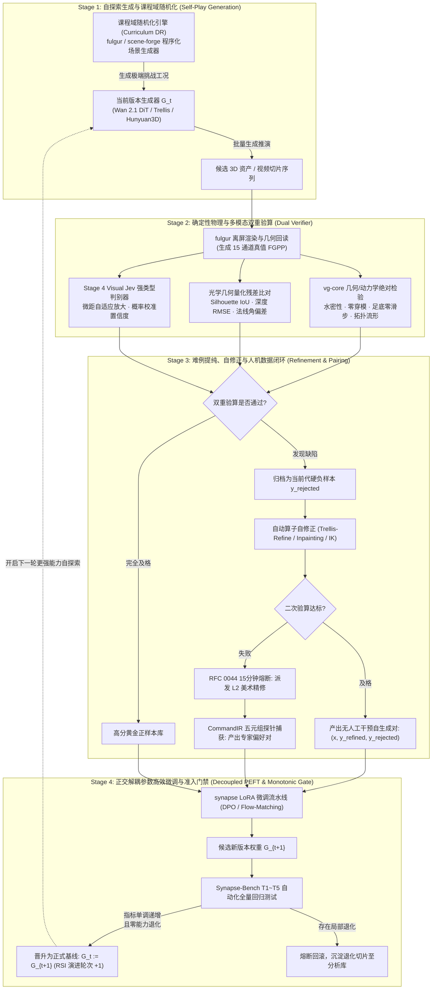

# Synapse 递归自我提升 (RSI) 与物理驱动自演进飞轮设计规范 (Recursive Self-Improvement & Physics-Driven Evolution Specification)

- **文档状态**: `Approved Specification v1.0`
- **修订日期**: 2026-11-11
- **关联仓库**: 
  - `synapse`（执行核心、CLI、无状态 Worker 与 Synapse-Bench 评测套件）
  - `fulgur`（现代 C++20 AAA 渲染引擎、15 通道 FGPP 提取器与离屏物理世界模拟器）
  - `caelum-core`（高保真光追渲染核与光学增量层）
  - `vg-core`（C++20/CUDA 核心几何算子、物理去光照、四边面重拓扑、Humanoid-53 刚体与足底零滑动 IK）
  - `foundary`（GPU 训练集群与无状态推理容器池）
  - `render-farm`（Go 生产级 DAG 调度引擎）
  - `asset-vault`（OpenUSD 资产中枢与偏好对 $\mathcal{D}_{\text{pair}}$ 归档库）
  - `grand-studio` / `scene-forge` / `asset-forge`（L1/L2 人机协同质检、白模编辑与 CommandIR 捕获）
- **关联生态规约**:
  - **RFC 0019**: `CommandIR` 序列化操作协议与离线同步机制
  - **RFC 0020**: 人机协同操作时间轴与模型训练数据闭环 (`IntentGroup`, `OperatorIdentity`)
  - **RFC 0021**: 模型训练数据采集完整性与跨系统对齐 (`MultiAxisRating`, `StepAnnotation`, `ReasoningTrace`)
  - **RFC 0039**: 资产解耦与自洽作业闭包 (`JobBundle`)
  - **RFC 0043**: 全生态同场景多风格渲染架构与 `StyleProfile` SSOT
  - **RFC 0044**: 神经-物理混合工业流水线、FGPP 与人机协同 (HITL 15 分钟熔断与白模粗糙度下限)
  - **RFC 0058**: OpenUSD Hydra、MaterialX / OpenPBR 1.0 与 ACEScg 跨平台架构
- **前置设计规范**:
  - [docs/AUDIT_AND_ARCHITECTURE.md](AUDIT_AND_ARCHITECTURE.md) (整体目标审查与生态架构定界)
  - [docs/DESIGN_SYSTEM_ENHANCEMENT.md](DESIGN_SYSTEM_ENHANCEMENT.md) (全系统工程设计增强规范)
  - [docs/DESIGN_LORA_PIPELINE.md](DESIGN_LORA_PIPELINE.md) (LoRA & PEFT 微调流水线设计)
  - [docs/DESIGN_3D_INSPECTION_AND_REFINEMENT.md](DESIGN_3D_INSPECTION_AND_REFINEMENT.md) (3D 质检与精修飞轮)
  - [docs/DESIGN_DATA_INSPECTOR.md](DESIGN_DATA_INSPECTOR.md) (训练数据检查器方案)
  - [docs/IMPLEMENTATION_PLAN.md](IMPLEMENTATION_PLAN.md) (M1–M16 58-PR 实施总计划)
  - [docs/DESIGN_REVIEW_AND_ALIGNMENT.md](DESIGN_REVIEW_AND_ALIGNMENT.md) (整体设计评审与跨文档对齐决议)

---

## 1. 理论背景与范式转变 (Paradigm Shift & Theoretical Foundation)

### 1.1 纯文本 LLM 的 RSI 困境与模型崩溃 (Model Collapse)
在通用大语言模型（LLM）与多模态扩散模型领域，**递归自我提升 (Recursive Self-Improvement, RSI)** 一直被视为通往超级智能的核心路径。然而，纯文本领域的 RSI 普遍受困于两大结构性死结：
1. **缺乏不可动摇的客观世界真理验算器（Lack of an Infallible Ground-Truth Verifier）**：
   除了有限的形式化代码单元测试（Unit Tests）或数学符号证明，绝大多数通用文本/图像生成任务缺乏闭式判决器。依赖“大模型自评自打分”极易产生回音室效应（Echo Chamber），随着自生成数据占比攀升，不可逆地陷入**自食性退化与模型崩溃（Model Collapse）**。
2. **误差单向累积（Error Compounding）**：
   在无物理约束的潜空间中，生成模型产生的微小幻觉与解剖学/透视畸变会在多轮迭代自训中被放大，最终彻底摧毁生成的保真度。

### 1.2 为什么 3D CG 渲染与物理模拟是 RSI 的天然物理锚
与通用文本/图像生成完全不同，**`synapse` 所处的问题域（3D CG 渲染 $\leftrightarrow$ 神经视频/3D 生成互操作）拥有实现绝对真实 RSI 的天赐工程条件**：

```
                ┌──────────────────────────────────────────────┐
                │          3D 物理可执行世界模拟器              │
                │ (fulgur / caelum-core / vg-core / PhysX)     │
                └──────────────────────┬───────────────────────┘
                                       │ 确定性真理 (15通道 FGPP / 几何流形)
                                       ▼
┌──────────────────┐            ┌──────────────┐            ┌──────────────────┐
│  神经生成模型    │  生成推演  │  物理/几何   │  量化残差  │  针对性精修器与  │
│  Generator G_t   ├───────────►│  硬判决验算器├───────────►│  HITL 闭环探针  │
└────────▲─────────┘            └──────────────┘            └────────┬─────────┘
         │                                                           │
         │                DPO 偏好对齐 / PRM 蒸馏 / PEFT             │
         └───────────────────────────────────────────────────────────┘
```

1. **客观物理硬约束不可欺骗（Infallible Physical Verifiers）**：
   - 几何拓扑：流形度判定、三角面水密性、四边面角度偏差与雅可比行列式均可解析验算；
   - 运动学与物理学：碰撞穿模深度、角动量守恒、刚体动力学约束以及人类运动学中的**足底零滑动速度（Zero-Slip Velocity: $\mathbf{v}_{\text{foot}} = \mathbf{0}$）**是不可违背的刚性物理定律；
   - 光学几何对齐：`fulgur` 导出的真值 15 通道 FGPP（米制线性深度 `CameraLinearDepth.Z`、相机空间法线 `CameraNormal.XYZ`、刚体光流 `MotionVector.XY`）构成了绝对坐标基准，任何神经模型产生的几何漂移均可直接转化为数值残差向量。
2. **闭环具备可观测的连续优化梯度**：
   生成缺陷不再是主观抽象的美学分歧，而是可以精确分解为：剪影 IoU、重投影误差 RMSE、法线角度差、CIEDE2000 色差与 3D 穿模体积。

### 1.3 核心数学建模与演进递推公式
在每一代演进周期 $t$ 中，系统状态由生成器权重参数 $W_t$（或 LoRA 组合 $\Delta W_t$）表征。RSI 目标是寻找单调递增的参数更新方向：

$$W_{t+1} = W_t + \arg\max_{\Delta W} \mathbb{E}_{x \sim \Omega_{\text{task}}} \left[ \mathcal{R}_{\text{phys}}(G(x; W_t + \Delta W)) + \beta \mathcal{R}_{\text{prm}}(G(x; W_t + \Delta W)) \right]$$

受限于安全硬门禁：

$$\text{BenchScore}(W_{t+1}) > \text{BenchScore}(W_t) \quad \land \quad \max_{k \in \text{T1..T5}} \Delta \text{Degradation}_k(W_{t+1}) \le 0$$

其中：
- $\Omega_{\text{task}}$ 为自博弈任务扰动空间；
- $\mathcal{R}_{\text{phys}}$ 为基于物理引擎与几何算子的确定性奖励函数（无幻觉）；
- $\mathcal{R}_{\text{prm}}$ 为基于 Visual Jev 强类型多尺度检验的过程奖励函数；
- $\text{BenchScore}$ 为 `Synapse-Bench` 跨模态往返基准套件评测分值。

---

## 2. 四阶自迭代飞轮架构 (Four-Stage Closed-Loop Architecture)

整个 RSI 飞轮划分为 4 个高度解耦、完全无状态的自演进阶段，依托 Go 调度层（`render-farm`）以批处理 DAG 驱动执行。



---

## 3. 分阶段实施规范与数学约束

### 3.1 Stage 1：自博弈难度爬坡与合成挑战引擎 (Curriculum Generation)

自演进系统的初始动力在于**主动发现当前模型的缺陷边界**，绝不喂食重复的简单样本。
系统构建**自适应难度课程空间 $\Omega_{\text{task}}(\theta)$**，由 `fulgur` 与 `scene-forge` 程序化生成测试场景：

$$\theta = \langle \mathbf{C}_{\text{traj}}, \mathbf{L}_{\text{env}}, \mathbf{M}_{\text{geo}}, \mathbf{P}_{\text{dynamics}} \rangle$$

1. **运镜极端化 $\mathbf{C}_{\text{traj}}$**：
   - 包含高速大曲率环绕、剧烈俯仰（$\pm 85^\circ$）、极端微距推拉（Macro Zoom-in）及剧烈光轴旋转；
2. **光影严苛化 $\mathbf{L}_{\text{env}}$**：
   - 极端高动态 HDR 环境光照、强自阴影遮挡、高频点光源动态扫射与次表面散射场景；
3. **白模几何与动力学挑战 $\mathbf{M}_{\text{geo}}, \mathbf{P}_{\text{dynamics}}$**：
   - 具备铰接四肢的高难度姿态（Articulated Humanoid-53）、多体相互交错遮挡、布料撕裂/高速碰撞形变。

生成器 $G_t$ 基于输入 FGPP 条件执行正向推演，生成预测视频切片或逆向重建网格。

---

### 3.2 Stage 2：确定性物理与多模态双重验算器 (Dual Verifier Engine)

这是阻断模型崩溃（Model Collapse）的核心防火墙。任何候选生成物必须依次经受**确定性物理判决器**与**多模态过程奖励模型（PRM）**的双重审查。

#### 1. 物理几何绝对判决器（Deterministic Physical Verifier, $V_{\text{phys}}$）
由 `vg-core` 与 `fulgur` 原生算子执行零容忍硬验算：

| 检验维度 | 量化算子与判定公式 | 物理合格门禁阈值 | 失败归因标记 |
| :--- | :--- | :---: | :--- |
| **拓扑流形度** | $\text{NonManifoldEdges}(M) == 0 \land \text{BoundaryEdges}(M) == 0$ | $100\%$ 水密流形 | `TOPOLOGY_DEFECT` |
| **碰撞与穿模** | $\text{PenetrationVolume}(M_{\text{limb1}}, M_{\text{limb2}}) / \text{Vol}(M)$ | $\le 0.001$ | `SELF_INTERSECTION` |
| **运动学合理性** | 足底触地阶段水平位移速度 $\|\mathbf{v}_{\text{foot}}\| = \left\|\frac{\Delta \mathbf{x}_{\text{contact}}}{\Delta t}\right\|$ | $\le 0.02\text{ m/s}$ (零滑步) | `FOOT_SLIPPING` |
| **几何外形依从** | $\text{SilhouetteIoU}(S_{\text{rendered}}, S_{\text{fgpp}}) = \frac{|S_r \cap S_f|}{|S_r \cup S_f|}$ | $\ge 0.88$ | `SILHOUETTE_DRIFT` |
| **深度几何残差** | $\text{RMSE}_{\text{depth}} = \sqrt{\frac{1}{N} \sum (D_{\text{pred}} - D_{\text{gt}})^2}$ | $\le 0.03\text{ m}$ | `DEPTH_INCONSISTENCY` |
| **法线角度偏差** | $\theta_{\text{normal}} = \arccos(\mathbf{n}_{\text{pred}} \cdot \mathbf{n}_{\text{gt}})$ | $\le 12.0^\circ$ | `NORMAL_DISTORTION` |

#### 2. Visual Jev 强类型过程奖励模型（PRM Verifier, $V_{\text{prm}}$）
依托 [`docs/DESIGN_3D_INSPECTION_AND_REFINEMENT.md`](DESIGN_3D_INSPECTION_AND_REFINEMENT.md) 的 Stage 4 架构：
- **微距自适应聚焦**：根据光学残差热力图定位异常高频区域，调度虚拟微距相机（Macro Camera）抓取 $512\times 512$ 局部切片；
- **Logits 校准概率决策**：对“面部塌陷”、“纹理接缝撕裂”、“材质塑料感”等高阶语义缺陷进行二分类判决，输出严格校准的置信度 $P(\text{defect} \mid \text{patch})$。

---

### 3.3 Stage 3：难例提纯、自修正与人机数据闭环 (Refinement & Flywheel)

当样本被验算器拦截时，系统绝不简单粗暴地丢弃，而是启动两级修复闭环，将失败转化为高质量训练资产。

```
                          [被 Verifier 拦截的失败样本 y_rejected]
                                            │
                                            ▼
                           ┌─────────────────────────────────┐
                           │ Level 1: 算法自修正流水线       │
                           │ - Trellis-Refine 局部重建       │
                           │ - Inpainting 纹理补全           │
                           │ - vg-core 足底零速度 IK 光顺    │
                           └────────────────┬────────────────┘
                                            │
                             ┌──────────────┴──────────────┐
                             │ 二次物理检验是否达标?       │
                             └──┬───────────────────────┬──┘
                       [合格]   │                       │ [不合格]
                                ▼                       ▼
               ┌────────────────────────┐      ┌────────────────────────────────┐
               │ 自动沉淀自学习偏好对   │      │ Level 2: 触发 RFC 0044 熔断    │
               │ D_self = (x, y_ref, y_rej)│      │ 派发至 L2 美术执行靶向精修     │
               └────────────────────────┘      └───────────────┬────────────────┘
                                                               │
                                                               ▼
                                               ┌────────────────────────────────┐
                                               │ CommandIR 探针无损记录五元组   │
                                               │ D_human = (x, y_art, y_rej)    │
                                               └────────────────────────────────┘
```

#### 1. 算法级自修正 (Autonomous Self-Refinement)
- 对于局部法线扭曲或小面积深度残差，调用生成式局部补全模型与 `vg-core` 几何光顺算子进行靶向修复；
- 修复后的资产再次送入 Stage 2 物理验算。若各项指标成功转绿（通过全部门禁），系统在**零人工成本**下自动构建高质量 DPO 偏好对：
  $$\mathcal{D}_{\text{self}} = \left\{ \left( x_{\text{FGPP}}, y_{\text{refined}}, y_{\text{rejected}} \right) \right\}$$

#### 2. 人机协同专家兜底闭环 (HITL Fallback Flywheel)
- 若算法自修正仍未达标，任务自动挂起并派发给 L2 专业美术（通过 `grand-studio` / `asset-forge`）；
- 严格遵循 RFC 0044 的 **15 分钟工程熔断**：单资产精修严格限制在 15 分钟内；
- 依托 RFC 0020 与 RFC 0021，编辑器底层的 `CommandIR` 探针自动捕获操作时间轴五元组：
  $$\mathcal{T}_{\text{human}} = \langle \text{Intent}, \text{Snapshot}_{\text{before}}, \text{Actions}_{\text{CommandIR}}, \text{Snapshot}_{\text{after}}, \text{Feedback}_{\text{rating}} \rangle$$
- 自动提纯为专家级最高权重偏好对 $\mathcal{D}_{\text{human}}$。

---

### 3.4 Stage 4：正交解耦参数高效微调与单调递增发布门禁 (PEFT & Promotion)

在模型迭代更新阶段，最大的工程风险是**微调导致的泛化能力坍塌与灾难性遗忘**。系统确立两大硬性防线：

#### 1. 正交解耦的 5 大专用 LoRA 分类矩阵
严格遵循 [`docs/DESIGN_LORA_PIPELINE.md`](DESIGN_LORA_PIPELINE.md)，严禁将不同维度的缺陷混炼入单个大权重中：

```
DiT Backbone (Frozen Weights W_0)
  ├── [control LoRA]   <-- 仅吸收来自几何残差 (Silhouette/Depth/Normal) 的偏好数据
  ├── [motion LoRA]    <-- 仅吸收来自足底零滑动与刚体加速度违背的时序数据
  ├── [whitebox LoRA]  <-- 仅吸收白模到高模质感跃迁的配对数据
  ├── [identity LoRA]  <-- 仅吸收角色多视角一致性偏好数据
  └── [style LoRA]     <-- 仅吸收 ACEScg 色彩分级与胶片质感数据
```

每次自迭代训练时，针对性根据本轮捕获的缺陷分类，仅激活并更新对应的 LoRA 模块（例如：仅几何失真严重时，锁定其余 4 类，仅微调 `control` LoRA）。

微调损失采用直接偏好优化（Direct Preference Optimization, DPO）与流匹配（Flow-Matching）结合：

$$\mathcal{L}_{\text{DPO}}(\theta) = -\mathbb{E}_{(x, y_w, y_l) \sim \mathcal{D}_{\text{pair}}} \left[ \log \sigma \left( \beta \log \frac{\pi_\theta(y_w \mid x)}{\pi_{\text{ref}}(y_w \mid x)} - \beta \log \frac{\pi_\theta(y_l \mid x)}{\pi_{\text{ref}}(y_l \mid x)} \right) \right]$$

#### 2. 自动化基准测试发布硬门禁 (Monotonic Gatekeeping via Synapse-Bench)
微调产出的候选权重 $G_{t+1}$ 绝不能直接部署上线。必须进入隔离测试沙箱，全量运行包含 30 个生产级严苛场景的 `Synapse-Bench`（T1–T5 全套往返评测）：

$$\text{PromoteCondition} \iff \begin{cases} 
\text{OverallScore}(G_{t+1}) > \text{OverallScore}(G_t) \\
\text{Metric}_{\text{geom}}(G_{t+1}) \ge \text{Metric}_{\text{geom}}(G_t) \\
\text{Metric}_{\text{temporal}}(G_{t+1}) \ge \text{Metric}_{\text{temporal}}(G_t) \\
\Delta \text{Regression}_{\text{any\_scene}} \le 0.0
\end{cases}$$

- 只要有任意一个既有测试场景出现显著回归（如 T1 刚性球体深度误差上升），**发布流程立即自动阻断回滚**，生成的检查点移入隔离诊断库（Quarantine Manifest），确保生产模型的能力沿时间轴**严格单调递增**。

---

## 4. 跨仓调度与系统协同拓扑 (Cross-Repo Architecture)

RSI 是跨越 Layer 0 至 Layer 4 的全生态协同工程，各系统职责分工与交互规约如下：

| 协同环节 | 负责仓库 | 运行形态与通信规约 | 核心交付物与契约边界 |
| :--- | :--- | :--- | :--- |
| **自博弈场景编排** | `scene-forge` + `fulgur` | C++20 / Headless 渲染进程 | 输出程序化 FGPP 15 通道 OpenEXR 序列与 `metadata.json` (`fgpp.v1.0`) |
| **候选样本生成** | `synapse` (Worker) | 无状态 GPU 容器 (`foundary`) | 读取 FGPP，执行 DiT 推演生成视频帧，写入无状态挂载区 |
| **物理几何验算** | `vg-core` + `fulgur` | C++20 共享库 / pybind11 零拷贝 | 执行拓扑流形度、穿模量、足底滑动量计算，输出结构化验算 JSON |
| **多尺度过程奖励** | `synapse.bench` | Python 算法核 + Visual Jev | 调度虚拟微距相机，输出置信度评分与 2D/3D 残差热力图 |
| **人机精修数据捕获** | `grand-studio` / `asset-forge` | Web / Electron 桌面端 (TypeScript) | 捕获不可变 `CommandIR` 时间轴与五元组，存入 `asset-vault` |
| **解耦 LoRA 训练** | `synapse` + `foundary` | PyTorch 单次 CLI Worker 任务 | 读取潜空间离线缓存与 $\mathcal{D}_{\text{pair}}$，输出 LoRA 权重文件 |
| **全流程 DAG 编排** | `render-farm` (Go) | Go 微服务编排器 | 通过 RFC 0039 自洽 `JobBundle` 调度整个 RSI 四阶段状态转移 |

---

## 5. 防御性工程红线与崩溃防范 (Anti-Collapse Hard Redlines)

为了防止系统在长期自迭代过程中产生不可逆的漂移或隐性崩溃，系统强制执行以下五大防御性铁律：

1. **绝对禁绝纯神经自评自训回音室（No Pure-Neural Echo Chamber）**：
   严禁使用未经物理校准的纯神经模型为生成结果做唯一裁判。任何进入训练集的正样本，**必须至少通过一项来自 `fulgur` 渲染回读或 `vg-core` 物理算子的闭式验算**。
2. **严守非服务端与无状态铁律（Server-side Zero-Python）**：
   RSI 飞轮中的所有 Python 逻辑只能以“单次执行即退出的 CLI / 容器 Worker”形态存在。长驻状态维护、分布式重试与任务 DAG 调度统一由 Go（`render-farm`）承载。
3. **经验回放与锚点回放正则化（Retention Experience Replay）**：
   在微调训练集中，来自历史人类专家基线（L0 黄金集）的真实数据比例不得低于 **$20\%$**，防止模型在针对特定自探索工况优化时遗忘基础通用表现。
4. **LoRA 权重正交隔离与可逆追溯（Orthogonal Checkpoint Rollback）**：
   底模权重永久冻结（Frozen Base），所有自提升成果均沉淀为增量 LoRA 权重，并携带语义版本号与母本 Git SHA 归档于 `asset-vault`。任何异常均可在毫秒级卸载对应 LoRA 完成回滚。
5. **诚实度量与拒绝静默失败（Honest Metrics Gatekeeping）**：
   在自动化基准测试中，严禁调高容差阈值或屏蔽失败场景。所有指标必须在 `ubuntu24` 或官方 GPU 容器中复现，通过“存在、接线、执行”三问后方可标记为演进成功。

---

## 6. 与工程实施总计划 (`IMPLEMENTATION_PLAN.md` v2.0) 的落地映射

> 详细类/函数级实施规范见 [docs/plans/PLAN-M6-M7-INSPECTION-AND-RSI-FLYWHEEL.md](plans/PLAN-M6-M7-INSPECTION-AND-RSI-FLYWHEEL.md)。

| RSI 飞轮能力 | 支撑 PR 矩阵 | 权威代码承载路径 | 验收里程碑 |
| :--- | :--- | :--- | :---: |
| **FGPP 物理真值提取与比对** | `PR-02`, `PR-03` | `python/synapse/fgpp/` | 15 通道 OpenEXR 零拷贝读写，几何对齐无漂移 |
| **自探索视频生成推理** | `PR-05` ~ `PR-07` | `python/synapse/adapters/` | 结合 ControlNeXt 与光流先验稳定推演 |
| **残差定位与局部自修正** | `PR-10`, `PR-11` | `python/synapse/composite/` | `3D ∪ SAM2` 掩膜生成与 16px 环带泊松融合 |
| **物理验算与 C++ 算子桥接** | `PR-12` | `python/synapse/bridge/vg_bridge.py` | 零拷贝调用 `vg-core` 流形度与足底零滑动 IK 检验 |
| **四维跨模态指标与三级门禁** | `PR-13` | `python/synapse/metrics/` | `rsi_promotion` 严苛档位阈值统一 |
| **解耦 LoRA 增量进化微调** | `PR-16` ~ `PR-19` | `python/synapse/training/` & `adapters/lora/` | 潜空间离线缓存，5 大专用 LoRA 矩阵靶向更新（含 DPO 损失） |
| **课程生成 + 双重验算 + 偏好配对** | **`PR-24`** | `python/synapse/rsi/curriculum.py`, `dual_verifier.py`, `pair_builder.py` | 自动构建 $\mathcal{D}_{\text{self}}$ 并强制混入 $\ge 20\%$ L0 黄金锚点 |
| **单调递增准出门禁与隔离回滚**| **`PR-25`** | `python/synapse/rsi/promotion_gate.py` & `synapse rsi ...` CLI | 30 场景零退化硬门禁通过后晋升，否则自动 Quarantine 回滚 |

---

> **结语**：通过将“物理渲染与几何模拟的绝对可验证性”与“潜空间神经生成模型强大的表征能力”相结合，Synapse 首次在工业界实现了**有物理常识背书、具备自愈能力且免疫模型崩溃的递归自我提升 (RSI) 架构**。该规范为整个 DervGen 生态提供了从数据生产、模型进化到资产入库的自动化自演进引擎。
