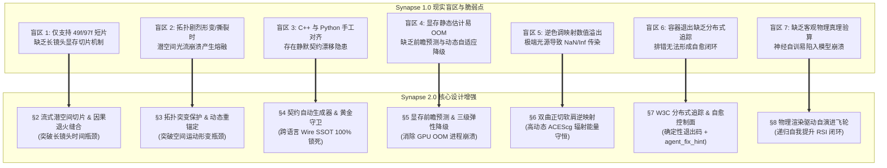
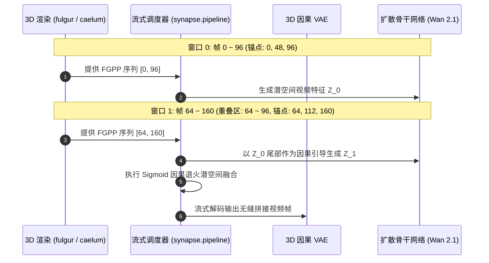
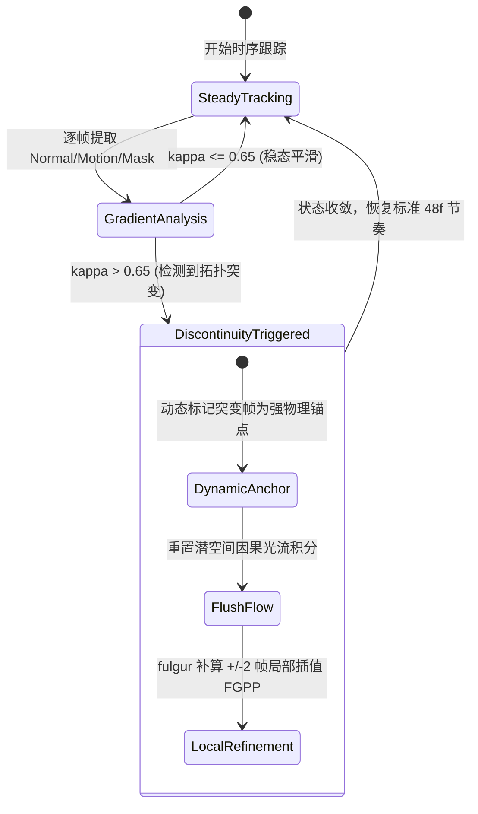
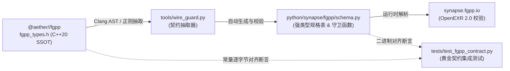
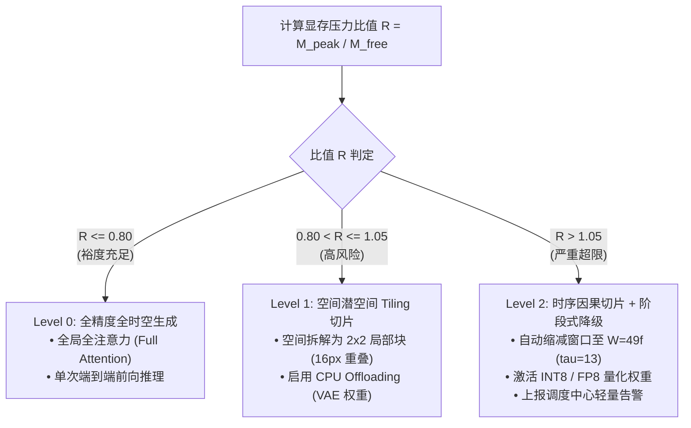
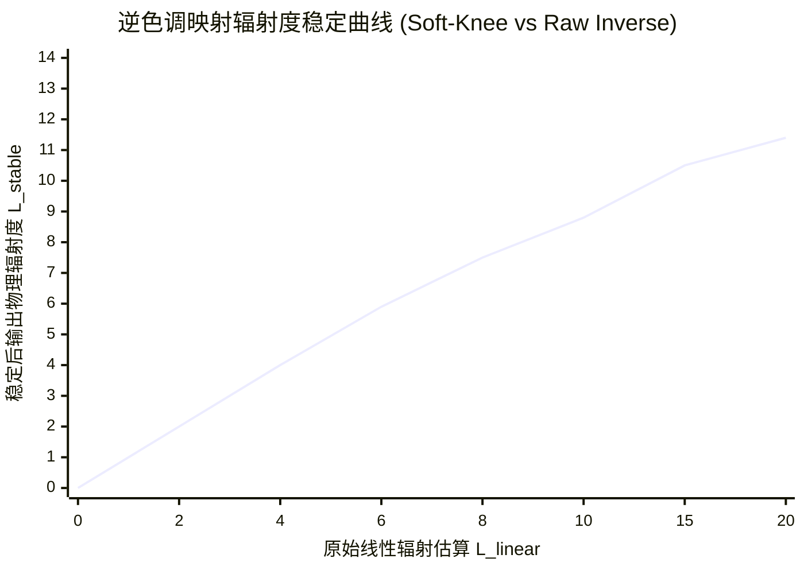

# Synapse 2.0 工业级混合渲染与神经互操作系统设计增强规范 (System Architecture Enhancement & Robustness Specification)

- **文档状态**: Approved Specification (`v2.0`)
- **修订日期**: 2026-11-11
- **责任体系**: sautille-stroke / DervGen 核心架构组
- **关联基线**:
  - [docs/AUDIT_AND_ARCHITECTURE.md](AUDIT_AND_ARCHITECTURE.md) (整体目标审查与生态架构定界)
  - [docs/IMPLEMENTATION_PLAN.md](IMPLEMENTATION_PLAN.md) (M1–M4 16-PR 工程实施计划)
  - [docs/DESIGN_LORA_PIPELINE.md](DESIGN_LORA_PIPELINE.md) (LoRA 微调流水线设计)
  - [docs/DESIGN_RSI_FLYWHEEL.md](DESIGN_RSI_FLYWHEEL.md) (递归自我提升 RSI 飞轮设计)
  - [docs/DESIGN_DATA_INSPECTOR.md](DESIGN_DATA_INSPECTOR.md) (数据检查器方案)
  - [docs/DESIGN_3D_INSPECTION_AND_REFINEMENT.md](DESIGN_3D_INSPECTION_AND_REFINEMENT.md) (3D 质检与精修飞轮)

---

## 1. 概述与设计演进动机

在完成了前期原型研发（`M0`）与核心问题审计诊断（10 大现状问题）之后，`synapse` 即将全面进入向工业级影视/游戏资产生产环境转正的阶段。当前架构虽然在生态分工、双轨模型定位、FGPP 15 通道定义及离线评测闭环上具备了严密的理论基础，但在面对**长镜头生成、极端剧烈运动、跨语言底层契约演进、算力显存突发负载以及极端光学曝光**以及**模型自迭代缺乏物理锚点陷入退化崩溃**等严苛工业场景时，原设计仍存在七大深水区盲区：



本规范作为全系统最高优先级的架构设计增强方案，正式确立这 7 大模块的数学表征、工程接口与状态转移契约，并指导 `docs/IMPLEMENTATION_PLAN.md` 中 `PR-01` ~ `PR-15` 的演进。

---

## 2. 突破时序尺度：超长视频流式潜空间切片与因果无缝缝合 (Streaming Latent Tiling & Causal Stitching)

### 2.1 长镜头切片数学模型：$W=97$ 因果滑动窗口
传统单阶段扩散模型对时间序列全长进行全注意力计算，显存与计算复杂度为 $O(T^2)$ 或 $O(T)$，无法直接处理 $>4$ 秒（$>97$ 帧）的镜头。若简单切断独立生成再拼接，会在切口产生严重的跳变和光影闪烁。

为此，设计**因果滑动窗口流式切片调度器 (Causal Latent Streaming Scheduler)**：
- **基础窗口长度**：$W = 97$ 帧（对齐 Tier-1 基座 `Wan 2.1` 3D 因果 VAE 的 $T = 4k + 1$ 法则，$\tau_W = 1 + (97 - 1)/4 = 25$）；
- **滑动步进跨度**：$S = 64$ 帧（$\Delta \tau_S = 16$ 潜空间步长）；
- **因果重叠缓冲区**：$\Delta = W - S = 33$ 帧（$\tau_{\text{overlap}} = 1 + (33 - 1)/4 = 9$ 潜空间步长）。重叠帧数 $33$ 同样严格满足 $T = 4k + 1$ 法则。



### 2.2 潜空间因果退火混合与 3 帧因果前导暖启动 (Sigmoid Annealing & Causal Warm-Start)
针对 `Wan 2.1` $4\times 8\times 8$ 3D 因果 VAE 的首帧非对称压缩特性（窗口内首帧单独映射为 $\tau'=0$，后续每 4 帧映射为一个潜步 $\tau'=1..24$），非首窗口 $k \ge 1$（名义全局帧区间 $[64k, 64k+96]$）在编码时必须额外输入前序 3 帧 `[64k-3, 64k-2, 64k-1]` 暖启动 3D 因果卷积缓存，并对边界潜步 $\tau'=0$ 令退火权重 $\alpha(0) = 0$（保留窗口 $k-1$ 具备完整 4 帧因果感受野的 $\mathbf{z}_{k-1}[16]$），从而使 $\tau'=1..8$ 与 $\mathbf{z}_{k-1}[17..24]$ 在 `100%` 四帧同相网格上融合。

在重叠区间 $t \in [t_{\text{start}}, t_{\text{end}}]$（长度为 $\tau_{\text{overlap}}$）内，前后两段潜空间张量 $\mathbf{z}_{k}(t)$ 与 $\mathbf{z}_{k+1}(t)$ 严禁采用简单的线性插值（会引起潜空间方差收缩、导致画面模糊）。必须采用**保方差的因果 S 曲线退火权重**：

$$\alpha(t) = \frac{1}{1 + e^{-\lambda \left(\frac{t - t_{\text{mid}}}{\tau_{\text{overlap}}}\right)}}, \quad \text{其中 } t_{\text{mid}} = \frac{t_{\text{start}} + t_{\text{end}}}{2}, \; \lambda = 8.0$$

为了保持潜空间高斯先验的单位方差（防止插值导致能量衰减），融合后的潜空间张量计算公式为：

$$\mathbf{z}_{\text{fused}}(t) = \frac{(1 - \alpha(t)) \cdot \mathbf{z}_k(t) + \alpha(t) \cdot \mathbf{z}_{k+1}(t)}{\sqrt{(1 - \alpha(t))^2 + \alpha(t)^2}}$$

### 2.3 物理强锚点级联传递状态机 (Cascade Physical Anchors)
在连续窗口滑动过程中，物理锚点的注入节奏必须跨窗口严格自洽：
1. 窗口 $k$ 生成完毕后，提取第 $S = 64$ 帧与第 $W-1 = 96$ 帧的解码结果，与物理渲染器导出的真实 FGPP 帧进行残差校准；
2. 窗口 $k+1$ 的起始条件（$t'=0$，对应全局帧 64）直接绑定为经校准的物理特征，使误差无法跨窗口传播累积；
3. 状态机在整个超长镜头（如 1000 帧）中保持单向因果马尔可夫链，显存占用恒定在 $O(W)$（单个 97 帧窗口大小）。

---

## 3. 突破空间动态：拓扑突变自适应时序分割与局部物理重锚定 (Topological Discontinuity Protection)

### 3.1 几何与运动矢量场梯度突变度量函数 $\kappa_{\text{frame}}$
当场景中发生剧烈拓扑变化（如布娃娃碰撞剧烈扭曲、布料撕裂、角色高速进出视锥体）时，网格法线与运动矢量会出现跳变。若盲目执行时间平滑光流正则化，会导致画面产生“橡皮糖溶化”式的非物理伪影。

系统定义**几何-光学突变指数 $\kappa_{\text{frame}}$**：

$$\kappa(t) = w_v \cdot \frac{\|\mathbf{V}_t - \mathbf{V}_{t-1}\|_2}{\text{diag}(\text{Frustum})} + w_n \cdot \left(1 - \frac{1}{|\Omega|} \iint_{\Omega} \langle \mathbf{N}_t(x, y), \mathbf{N}_{t-1}(x, y) \rangle \, dx dy\right) + w_m \cdot (1 - \text{IoU}(\mathcal{M}_t, \mathcal{M}_{t-1}))$$

其中：
- $\mathbf{V}_t$ 为摄像机及物体运动矢量峰值；
- $\mathbf{N}_t$ 为 FGPP 世界空间法线通道；
- $\mathcal{M}_t$ 为 Cryptomatte 角色实例掩膜；
- 权重分配为 $w_v = 0.4, w_n = 0.4, w_m = 0.2$。

### 3.2 自适应时间步重分割与两级动态强锚点机制
系统设定突变阈值 $\kappa_{\text{threshold}} = 0.65$，并严守无状态容器边界（`synapse` 容器内不直接持有 `fulgur` 场景源工程）：
1. **稳态区间 ($\kappa \le 0.65$)**：按标准 48 帧物理锚点节奏与光流正则化执行；
2. **瞬态突变点 ($\kappa > 0.65$)**：
   - **容器内即时自愈（Level-A）**：立即将突变帧 $t_{\text{event}}$ 动态标记为 **“临时物理强锚点 (Dynamic Physical Anchor)”**，在该帧强制重置潜空间光流累积积分（Flush Latent Flow Buffer），切断前后两段的时间注意力传递；
   - **跨阶段重烘焙协同（Level-B）**：若突变超出单帧插值容限，在 `result_manifest.json` 中输出结构化 `reanchor_requests`（指定 $t_{\text{event}} \pm 2$ 帧局部过采样区间），由上游 `render-farm`（Go）编排器回调 `fulgur` 补算子帧 FGPP 导引。



---

## 4. 契约零漂移自闭环：跨语言契约代码生成与黄金守卫 (Wire Guard & Automated Contract Codegen)

### 4.1 痛点与破局
为彻底杜绝 Layer 0 C++20（`@aether//fgpp`）与 Layer 2 Python（`synapse.fgpp`）之间的人工同步失误（如行列主序反转、通道名大小写漂移、数据类型字节偏差），系统确立 **“单向编译生成，双向黄金断言 (Codegen & Wire Guard)”** 机制。

### 4.2 Wire Guard 自动化工具链架构
在构建与测试流水线中植入契约守卫工具 `synapse-wire-guard`：



### 4.3 黄金契约自检指标与线格式锁死
自动生成与校验的 `schema.py` 必须通过以下 4 项静态和动态断言（100% 对齐 `aether/fgpp/include/aether/fgpp/fgpp_types.h`）：
1. **通道总数与顺序断言**：通道列表必须严格为 **15 个标量通道**，且名称排序严格遵循 ASCII 字典序：
   `BaseColor.B`, `BaseColor.G`, `BaseColor.R`, `CameraLinearDepth.Z`, `Cryptomatte.ID`, `DirectRadiance.B`, `DirectRadiance.G`, `DirectRadiance.R`, `MotionVector.X`, `MotionVector.Y`, `RoughnessMetallic.G`, `RoughnessMetallic.R`, `WorldNormal.X`, `WorldNormal.Y`, `WorldNormal.Z`；
2. **像素字节步长断言**：单个像素解包尺寸严格等于：
   $$1 \times \text{UINT32} (4\text{B}) + 1 \times \text{FLOAT32} (4\text{B}) + 13 \times \text{HALF16} (26\text{B}) = 34 \text{ Bytes/pixel}$$
3. **矩阵序列化主序断言**：`metadata.json` 导出必须显式标注 `view_matrix_col_major` 与 `proj_matrix_col_major`（16 元素一维平铺浮点数组），并在 Python 读取时强制校验行列式 $|\det(\mathbf{R}) - 1.0| < 10^{-5}$；
4. **深度通道不可压缩/不可非线性滤波断言**：`CameraLinearDepth.Z` 严格保留原始 32 位浮点米制物理量，仅在送入神经网络潜空间时由 Python 显式调用 `linear_to_log_normalized_depth()` 变换。

---

## 5. 算力韧性：显存 OOM 前瞻预测与空间/时序自适应切片降级 (Proactive OOM Defense & Dynamic Tiling)

### 5.1 显存峰值开销解析式数学模型
在启动 GPU 视频生成容器之前，系统拒绝发生“黑盒运行后突然 OOM 崩溃”。`synapse.pipeline` 在作业准备阶段通过数学解析式精确预测显存峰值：

$$M_{\text{peak}} = M_{\text{weights}} + M_{\text{activations}} + M_{\text{kv\_cache}} + M_{\text{fgpp\_cache}} + M_{\text{safety\_margin}}$$

针对主流 3D DiT 架构（如 `Wan 2.1 14B`）：
- **权重常量**：$M_{\text{weights}} \approx 14.2 \text{ GB}$ (BF16)；
- **潜空间时空激活值**：
  $$M_{\text{activations}} \approx C_{\text{layer}} \cdot L \cdot \left(\frac{H}{8} \cdot \frac{W}{8} \cdot \tau\right) \cdot d_{\text{model}} \cdot \text{BytesPerElem}$$
- **时序注意力平方开销**：
  $$M_{\text{attn}} \approx C_{\text{attn}} \cdot N_{\text{heads}} \cdot \left(\frac{H}{8} \cdot \frac{W}{8} \cdot \tau\right)^2$$

### 5.2 三级弹性降级决策树 (Three-Tier Adaptive Fallback)
根据预测峰值显存与当前可用 GPU 显存比值 $R = M_{\text{peak}} / M_{\text{GPU\_free}}$，作业执行器自动激活降级策略：



- **Level 0 (标称模式)**：单卡全量执行，获得最优视觉品质与最高吞吐；
- **Level 1 (空间分块模式)**：将高分辨率（如 1080p）潜空间特征图按空间网格切为 4 块分别前向，边缘采用羽化加权拼接，显存激活值降低 $60\%$，耗时增加约 $35\%$；
- **Level 2 (极度受限模式)**：强制收敛至短时序窗口（$W=49$）并启用因果级联，彻底消除显存不足导致的异常退出，保障工业流水线连续运转。

---

## 6. 极端光学稳定性：双曲正切软肩逆色调映射与 ACEScg 辐射度保护 (Soft-Knee HDR Regularization)

### 6.1 逆色调映射高光发散机理
在将 AI 视频模型生成的 LDR sRGB 帧反向映射为物理渲染器可用的高动态 HDR 辐射度时，常用的反向 Filmic / Reinhard 公式为：

$$L_{\text{linear}} = \frac{L_{\text{ldr}}}{1 - L_{\text{ldr}} + \epsilon}$$

当像素值逼近纯白高光（$L_{\text{ldr}} \to 1.0$）时，分母趋向于 0，计算出的物理辐射度会发散至数百甚至数千，直接导致：
1. 局部重渲染时在物体高光轮廓处产生刺眼的纯黑/纯白噪点火花（Fireflies）；
2. ACEScg 宽色域转换矩阵浮点数值溢出，污染下游 `caelum-core` 的多跳全局光照积分。

### 6.2 双曲正切软肩延伸函数 (Hyperbolic Soft-Knee Extension)
系统强制在逆色调映射输出端引入**双曲正切软肩物理保真约束**：

$$L_{\text{stable}} = \begin{cases} 
L_{\text{linear}}, & L_{\text{linear}} \le L_{\text{threshold}} \\
L_{\text{threshold}} + \Delta L \cdot \tanh\left(\frac{L_{\text{linear}} - L_{\text{threshold}}}{\Delta L}\right), & L_{\text{linear}} > L_{\text{threshold}}
\end{cases}$$

其中：
- 线性阈值 $L_{\text{threshold}} = 4.0$（保留绝大多数高动态漫反射与合理镜面反射）；
- 延伸上限跨度 $\Delta L = 8.0$（软约束最大辐射度在 $12.0$ 以内，物理上足以激发高光辉光 Bloom，又绝不产生浮点溢出）；
- 导数连续性：在 $L_{\text{threshold}}$ 处满足 $\mathcal{C}^1$ 连续，保证光照优化求解器梯度稳定。



---

## 7. 全链路可观测性与 Agent 自愈闭环 (Unified Telemetry & Self-Healing Protocol)

### 7.1 W3C Distributed Tracing 跨语言穿透规范
为了让上游 Go 调度系统（`render-farm`）、容器管理（`foundary`）与下游 `synapse` Worker 形成全链路可追溯，系统引入 **W3C Trace Context 穿透协议**：
1. `JobBundle` 的 `metadata.json` 中必须包含标准字段：
   ```json
   {
     "traceparent": "00-4bf92f3577b34da6a3ce929d0e0e4736-00f067aa0ba902b7-01",
     "tracestate": "dervgen=stage_fgpp_to_video,worker=synapse"
   }
   ```
2. `synapse` CLI 启动时自动解析并激活 OpenTelemetry 跨进程 Span 上下文；
3. 输出的所有标准 JSON 日志与错误指标自动注入当前 `trace_id` 与 `span_id`。

### 7.2 统一结构化退出码与自愈诊断总线 (Diagnostic Remediation Engine)
容器在非零退出时，绝不仅输出崩溃堆栈，而是通过诊断总线输出标准错误实体与 **`agent_fix_hint`**（为上层 AI Agent 提供直接可执行的自愈指令）：

| 退出码 | 故障分类 | 触发场景示例 | 诊断总线动作与 `agent_fix_hint` 规范 |
| :---: | :--- | :--- | :--- |
| **`0`** | `SUCCESS` | 任务正常执行完成 | 输出生成张量路径、耗时元数据与指标统计 |
| **`10`** | `CONTRACT_ERROR` | FGPP 通道缺失、主序错误、因果帧数违背 | `"agent_fix_hint": "Adjust scene total_frames to 97 (tau=25, T=4k+1) and re-export metadata.json."` |
| **`20`** | `ASSET_MISSING` | 模型权重缺失、输入 EXR 路径不存在或哈希错 | `"agent_fix_hint": "Fetch missing checkpoint 'wan2.1_14b_controlnext.safetensors' via asset-vault CLI."` |
| **`30`** | `GPU_RESOURCE_LIMIT` | 显存预测超出硬上限且降级失败 | `"agent_fix_hint": "Enable spatial tiling by adding '--tile-spatial=2x2' or allocate GPU with >=48GB VRAM."` |
| **`40`** | `CIRCUIT_BREAKER` | HITL 人工精修超时 15m 或白模粗糙度不达标 | `"agent_fix_hint": "Whitebox vertex floor (<1500) triggered. Fallback to automated RemeshPass before texturing."` |

---

## 8. 突破进化边界：物理渲染驱动的递归自我提升 (RSI) 自演进闭环 (Recursive Self-Improvement Engine)

### 8.1 物理模拟与确定性 Verifier 的核心范式
在通用大模型领域，递归自我提升（Recursive Self-Improvement, RSI）面临的核心死结是**缺乏客观世界的 Ground-Truth 验证器**，导致模型在自生成数据自训时不可避免地走向自食性退化（Model Collapse）。

而在 `synapse` + `fulgur` + `vg-core` 体系中，渲染物理学、几何拓扑学与刚体动力学为系统提供了绝对不可欺骗的客观物理真理锚：
- **物理绝对验算（vg-core / fulgur）**：流形度 $100\%$ 水密、穿模体积比 $\le 0.001$、运动学足底零滑步（$\|\mathbf{v}_{\text{foot}}\| \le 0.02\text{ m/s}$）、重投影深度残差 $\text{RMSE} \le 0.03\text{m}$；
- **多尺度过程奖励（PRM / Visual Jev）**：在全局残差热区调度虚拟微距相机（Macro Camera）捕获局部 Patch，通过校准置信度给出结构化判决；
- **两级修复与数据沉淀**：通过 Trellis-Refine 算法自修正沉淀无人工偏好对 $\mathcal{D}_{\text{self}}$；通过 RFC 0044 15分钟熔断由 L2 美术介入，利用 RFC 0020 `CommandIR` 探针捕获专家五元组 $\mathcal{D}_{\text{human}}$。

### 8.2 正交解耦 LoRA 进化与单调递增发布门禁
为杜绝灾难性遗忘，系统严格遵循 [docs/DESIGN_RSI_FLYWHEEL.md](DESIGN_RSI_FLYWHEEL.md) 与 [docs/DESIGN_LORA_PIPELINE.md](DESIGN_LORA_PIPELINE.md)：
1. **五维 LoRA 正交解耦**：将权重更新严格解耦至 `control`、`motion`、`whitebox`、`identity` 与 `style` 五大专用 LoRA，根据缺陷类型靶向微调，冻结骨干网络；
2. **Synapse-Bench 自动化发布硬门禁**：
   $$\text{PromoteCondition} \iff \text{Score}(G_{t+1}) > \text{Score}(G_t) \;\land\; \max_{k \in \text{T1..T5}} \Delta \text{Regression}_k \le 0$$
   全量回归通过后方可晋升为下一代基线，否则自动隔离回滚，确保模型进化沿时间轴**严格单调递增**。

*详细数学公式、跨仓无状态编排与防御红线参见专门规范*: [docs/DESIGN_RSI_FLYWHEEL.md](DESIGN_RSI_FLYWHEEL.md)。

---

## 9. 工程实施映射与 PR 责任矩阵

本设计增强规范全量吸收并对齐至 [docs/DESIGN_REVIEW_AND_ALIGNMENT.md](DESIGN_REVIEW_AND_ALIGNMENT.md) 与 [docs/IMPLEMENTATION_PLAN.md](IMPLEMENTATION_PLAN.md)（`v2.0`，M1–M8 阶段），各模块与权威文件路径及原子 PR 的对应落地责任如下：

| 增强模块 | 对应技术实现 | 权威承载文件路径 | 归属 PR | 阶段验收门禁标准 |
| :--- | :--- | :--- | :---: | :--- |
| **§2 长镜头流式切片** | `ConditionScheduler`<br/>3 帧暖启动 + 因果退火融合 | `python/synapse/adapters/scheduler.py`<br/>`python/synapse/pipeline/bundle_worker.py` | `PR-06`<br/>`PR-14b` | 成功连续生成 385 帧（>16 秒），重叠区间 PSNR $\ge 42\text{dB}$，显存曲线完全平直 |
| **§3 拓扑突变保护** | `DiscontinuityDetector`<br/>两级动态重锚定协议 | `python/synapse/adapters/scheduler.py`<br/>`python/synapse/adapters/wan.py` | `PR-06`<br/>`PR-07` | 角色剧烈转身/遮挡场景下光流残差平稳，无局部几何熔融伪影 |
| **§4 契约自动生成器** | `wire_guard.py` 工具链<br/>黄金契约断言测试 | `tools/wire_guard.py`<br/>`python/synapse/fgpp/schema.py`<br/>`tests/test_fgpp_contract.py` | `PR-02`<br/>`PR-03` | CI 阶段与 `@aether//fgpp` 字节级比对 100% 通过，杜绝任何字段漂移 |
| **§5 显存前瞻预测** | `MemoryForecaster`<br/>三级弹性降级决策树 | `python/synapse/telemetry.py`<br/>`python/synapse/pipeline/bundle_worker.py` | `PR-04`<br/>`PR-14b` | 在 24GB (RTX 4090) 与 80GB (A100) 显卡上预测误差 $<8\%$，0 发生未捕获 CUDA OOM |
| **§6 软肩逆色调映射** | `soft_knee_inverse_tonemap`<br/>ACEScg 辐射度守卫 | `python/synapse/style/aces_color.py`<br/>`python/synapse/composite/blend.py` | `PR-09`<br/>`PR-11` | 极端高光测试场景下辐射度 $\le 12.0$，无 NaN/Inf 传染，导数平滑连续 |
| **§7 分布式自愈总线** | W3C Trace 上下文解析<br/>`agent_fix_hint` 输出 | `python/synapse/errors.py` & `telemetry.py`<br/>`python/synapse/cli/__init__.py` | `PR-04`<br/>`PR-14b` | `--json` 模式下输出纯标准 JSON，非零退出时必须包含 `agent_fix_hint` 字段 |
| **§8 物理驱动 RSI 飞轮** | 双重验算与偏好对提纯<br/>单调递增防退化门禁 | `python/synapse/rsi/`<br/>`docs/plans/PLAN-M6-M7-INSPECTION-AND-RSI-FLYWHEEL.md` | `PR-24`<br/>`PR-25` | 自动化生成 $\mathcal{D}_{\text{self}}$ 偏好对，保留 $\ge 20\%$ L0 锚点，Synapse-Bench 单调递增 |

---

> 本规范确立了 Synapse 迈向工业级混合渲染神经视频生成的最高设计基线。全体开发者与 AI Agent 在后续推进代码实现与审查时，必须无条件遵循本规范所设立的数学契约与容错边界。
