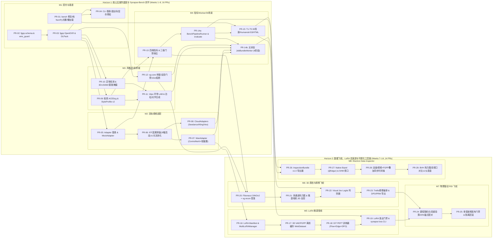

# Synapse 全景可落地工程实施总计划 (Master Actionable Implementation Plan)

- **计划版本**: `v2.0`（全量统合 M1–M8 共 8 大阶段、30 个原子 PR，并拆分为 5 份精细化执行子计划）
- **修订日期**: 2026-11-11
- **操作模型标识**: `[gemini4]`
- **前置架构审查与跨文档对齐决议**:
  - **[docs/DESIGN_REVIEW_AND_ALIGNMENT.md](DESIGN_REVIEW_AND_ALIGNMENT.md)**（十大跨文档冲突纠偏 `RV-01~RV-10`、权威目录树、统一 CLI 语法树、三级门禁阈值表）
  - **[docs/AUDIT_AND_ARCHITECTURE.md](AUDIT_AND_ARCHITECTURE.md)**（五条绝对负向红线 `NG-1~NG-5` 与跨仓边界定界）
- **细分可执行子计划导航（Subdivided Actionable Sub-Plans）**:
  1. ↳ **[PLAN-M1-M2](plans/PLAN-M1-M2-FOUNDATION-AND-ADAPTERS.md)**：地基清零、`@aether//fgpp` 线格式闭环、CLI 基座与双轨视频生成适配器（`PR-01` ~ `PR-08`）
  2. ↳ **[PLAN-M3-M4](plans/PLAN-M3-M4-STYLE-COMPOSITE-AND-BENCH.md)**：软肩 ACEScg 风格对齐、`3D ∪ SAM2` 手术刀合成、`vg-core` 桥接、`JobBundleWorker` 与 30 场景基准（`PR-09` ~ `PR-15`）
  3. ↳ **[PLAN-M5](plans/PLAN-M5-LORA-TRAINING-PIPELINE.md)**：合成数据离线潜空间缓存、5 维正交解耦 LoRA 训练与 Cryptomatte 空间隔离调度（`PR-16` ~ `PR-19`）
  4. ↳ **[PLAN-M6-M7](plans/PLAN-M6-M7-INSPECTION-AND-RSI-FLYWHEEL.md)**：3D 微距质检、Visual Jev 强类型裁决、RL 样本导出与物理驱动递归自我提升 RSI 飞轮（`PR-20` ~ `PR-25`）
  5. ↳ **[PLAN-M8](plans/PLAN-M8-DATA-INSPECTOR-DESKTOP.md)**：`InspectionBundle` 导出器与 Electron + `fulgur` Native SHM 五视图可视化检查器（`PR-26` ~ `PR-29`）
- **专项聚焦执行计划（Focused Assault Plans）**:
  - ↳ **[PLAN-ALGO-TRAINING-DATA-PIPELINE](PLAN-ALGO-TRAINING-DATA-PIPELINE.md)**：算法核心、LoRA 训练与数据流水线三战役攻坚计划（横跨 M2/M3/M5/M6-M7，含 5 项参数纠偏、3 项跨文档阈值收敛决议与 4 项超参数锁定）

---

## 1. 核心工程执行铁律 (Core Execution Principles)

1. **双地平线递进、单 PR 严格控量**：
   - **Horizon 1（核心互操作 SDK 与基准闭环，`M1–M4`，16 个 PR）**：优先打通 FGPP 15 通道无损互通、双轨适配器、ACEScg 风格合成、`vg-core` 薄桥接、`JobBundleWorker` 与 30 场景 `Synapse-Bench`；
   - **Horizon 2（工业飞轮、PEFT 进化与桌面检查器，`M5–M8`，14 个 PR）**：在核心底座稳固后，并行铺开 LoRA 训练管线、3D 智能质检、物理驱动 RSI 自演进闭环与原生 3D 检查器；
   - 每个原子 PR 净增代码严格控制在 **`300 ~ 750` 行**，必须使用 `/tmp/synapse-wt-<branch>` 独立 Git Worktree 走 PR Squash Merge 流程。
2. **零 GPU 阻塞日常回归（`ubuntu24` P0 主力机优先）**：
   - 依托纯 NumPy 向量化软光栅（`PR-01`）与确定性 `MockVideoAdapter`（`PR-05`）及 Mock Transport/推理桩，**100% 的协议、调度、融合、质检编排、RSI 门禁单测均可在云端 CPU 主力机 `ubuntu24` 上秒级全量回归**；真实大模型权重与 CUDA 算子仅在 `win-dev` 或 `foundary` 容器做专项集成验收。
3. **防静默失败三问硬门禁**：
   - 任何 PR 在更新本表状态为 `✅` 前，必须同时通过 **存在问**（类型签名与单测落盘）、**接线问**（挂入统一 CLI `synapse` / `synapse-bench` 或 `JobBundleWorker` 主干，无孤立死代码）、**执行问**（`ubuntu24` 实跑 `pytest` + `mypy --strict` + `ruff check` 全绿，且数值误差满足阈值断言）。

---

## 2. 全局 8 阶段 30-PR 依赖拓扑图 (Global Dependency DAG)

---

## 3. 多 Agent 并行开发批次排程 (Multi-Agent Worktree Execution Waves)

借助清晰的模块边界，最多可同时开启 **3 ~ 4 个隔离 Git Worktree** 并行推进而零文件冲突：

| 波次 (Wave) | 可完全并行的原子 PR 组合（各自修改独立包目录） | 解锁的关键里程碑能力 |
| :---: | :--- | :--- |
| **Wave 1** | `PR-01` (`bench/`) ∥ `PR-02` (`fgpp/schema.py` + `tools/wire_guard.py`) | 修复全部现存缺陷，锁死 `@aether//fgpp` 15 通道契约 |
| **Wave 2** | `PR-03` (`fgpp/io.py`) → `PR-04` (`cli/` + `errors.py` + `telemetry.py`) | M1 收官：OpenEXR 2.0 无损读写与 Agent-Native CLI 就绪 |
| **Wave 3** | `PR-05→06` (`adapters/`) ∥ `PR-09` (`style/`) ∥ `PR-10` (`composite/mask`) ∥ `PR-12` (`bridge/`) | 4 路完全正交并行：适配器、ACEScg 风格、手术刀掩膜、C++ 桥接同步推进 |
| **Wave 4** | `PR-07` (`wan.py`) ∥ `PR-08` (`cloud.py`) ∥ `PR-11` (`composite/blend.py`) ∥ `PR-13` (`metrics/`) | M2 & M3 收官，16 项四维指标与三级门禁档位就绪 |
| **Wave 5** | `PR-14a` (`bench_runner.py`) → [`PR-14b` (`bundle_worker.py`) ∥ `PR-15` (`bench/` 30 场景) ∥ `PR-26` (`bundle_exporter.py`)] | **Horizon 1 全线收官**：容器单步 Worker 与 30 场景基准跑通 |
| **Wave 6** | **Track L** `PR-16→19` (`adapters/lora` + `training/`) ∥ **Track I** `PR-20→23` (`inspect/`) ∥ **Track D** `PR-27→29` (`tools/data-inspector/`) | 3 条独立业务线并行交付 LoRA 微调、3D Visual Jev 质检与桌面检查器 |
| **Wave 7** | `PR-24` → `PR-25` (`rsi/`) | **Horizon 2 终局闭环**：物理驱动 RSI 自演进与单调递增门禁合龙 |

---

## 4. 全量 30-PR 落地追踪与“防静默失败三问”验收总表

### 4.1 Horizon 1：核心互操作 SDK、无状态 Worker 与 `Synapse-Bench`（M1–M4，共 16 PRs，约 21.5 人天）

| PR 编号 | 阶段 | 核心交付摘要（点击跳转对应子计划查看完整签名） | 前置依赖 | 净增规模 | 工时 | `ubuntu24` 验收门禁测试 | 状态 |
| :---: | :---: | :--- | :---: | :---: | :---: | :--- | :---: |
| **[PR-01](plans/PLAN-M1-M2-FOUNDATION-AND-ADAPTERS.md#pr-01)** | M1 | `bench` 4 处缺陷修复 + $T=4k+1$ + 纯 NumPy 软光栅整合 + 懒加载 + `127.0.0.1` 绑定 | — | ~550 行 | 1.5d | `tests/test_bench.py` + 隔离 Wheel 无 `numba`/`trimesh` 冒烟 | 🔲 待实施 |
| **[PR-02](plans/PLAN-M1-M2-FOUNDATION-AND-ADAPTERS.md#pr-02)** | M1 | `tools/wire_guard.py` + `fgpp/schema.py` 15 标量通道 `34B/px` + `fgpp.v1.0` 列主序矩阵 | — | ~480 行 | 1.0d | `tests/test_fgpp_contract.py` (往返误差 $<10^{-12}$) | 🔲 待实施 |
| **[PR-03](plans/PLAN-M1-M2-FOUNDATION-AND-ADAPTERS.md#pr-03)** | M1 | `fgpp/io.py` 异构 OpenEXR 2.0 读写、消毒器、Nearest 缩放 + `torch_bridge.py` DLPack | PR-02 | ~520 行 | 2.0d | `tests/test_fgpp_io.py` (`UINT32` 逐 bit 零误差) | 🔲 待实施 |
| **[PR-04](plans/PLAN-M1-M2-FOUNDATION-AND-ADAPTERS.md#pr-04)** | M1 | `errors.py` + `telemetry.py` (`MemoryForecaster`/W3C Trace) + 双入口 CLI 收敛 | PR-01, 03 | ~460 行 | 1.0d | `tests/test_cli.py` (`0/10/20/30/40` 退出码 & 纯 JSON) | 🔲 待实施 |
| **[PR-05](plans/PLAN-M1-M2-FOUNDATION-AND-ADAPTERS.md#pr-05)** | M2 | `adapters/base.py` 插件注册表 + `mock.py` 零 GPU 确定性合成与可控缺陷注入器 | PR-03 | ~420 行 | 1.0d | `tests/test_adapters_base.py` (同 seed 逐像素一致) | 🔲 待实施 |
| **[PR-06](plans/PLAN-M1-M2-FOUNDATION-AND-ADAPTERS.md#pr-06)** | M2 | `adapters/scheduler.py` ($W=97/S=64/\Delta=33$ + 3帧暖启动退火 + $\kappa$ 突变检测 + 最小深度光流池化) | PR-05 | ~580 行 | 1.5d | `tests/test_condition_scheduler.py` (位移 `4.0±0.5` 潜步) | 🔲 待实施 |
| **[PR-07](plans/PLAN-M1-M2-FOUNDATION-AND-ADAPTERS.md#pr-07)** | M2 | `adapters/wan.py` Tier-1 白盒（相机空间法线 + ControlNeXt 张量 + $\gamma_\theta$ 软光流偏置） | PR-06 | ~490 行 | 1.5d | `tests/test_wan_adapter.py` (正交性 + 断连抛 `30`) | 🔲 待实施 |
| **[PR-08](plans/PLAN-M1-M2-FOUNDATION-AND-ADAPTERS.md#pr-08)** | M2 | `adapters/cloud.py` Tier-2 黑盒（`Seedance 2.5`/`Kling 1.5`/`Veo` 锚点帧降级切分） | PR-06 | ~450 行 | 1.0d | `tests/test_cloud_adapters.py` (Mock Transport 零公网请求) | 🔲 待实施 |
| **[PR-09](plans/PLAN-M3-M4-STYLE-COMPOSITE-AND-BENCH.md#pr-09)** | M3 | `style/` 双曲正切软肩 ACEScg 逆色调映射 + 球谐主光提取 + `StyleProfile v2.0` 映射 | PR-03 | ~620 行 | 2.0d | `tests/test_style.py` (主光误差 $<8^\circ$, 辐射度 $\le 12.0$) | 🔲 待实施 |
| **[PR-10](plans/PLAN-M3-M4-STYLE-COMPOSITE-AND-BENCH.md#pr-10)** | M3 | `composite/detector.py` 三类异常检测 + `mask.py` (`M_3D ∪ M_SAM2` 光流椭圆膨胀) | PR-03 | ~430 行 | 1.0d | `tests/test_composite_mask.py` (10px 残影 100% 覆盖) | 🔲 待实施 |
| **[PR-11](plans/PLAN-M3-M4-STYLE-COMPOSITE-AND-BENCH.md#pr-11)** | M3 | `composite/blend.py` 16px 环带 CIE LAB 匹配 + 时域泊松融合 + Cryptomatte 引导焦散叠加 | PR-09, 10 | ~510 行 | 1.5d | `tests/test_composite_blend.py` (环带 $\Delta E_{00} < 2.5$) | 🔲 待实施 |
| **[PR-12](plans/PLAN-M3-M4-STYLE-COMPOSITE-AND-BENCH.md#pr-12)** | M3 | `bridge/` (`vg_bridge` + `foundary_client` + Track-B 白模反投硬拦截 + HITL 900s 熔断) | PR-03 | ~480 行 | 1.0d | `tests/test_bridge_and_hitl.py` (拦截抛 `10`, 超时抛 `40`) | 🔲 待实施 |
| **[PR-13](plans/PLAN-M3-M4-STYLE-COMPOSITE-AND-BENCH.md#pr-13)** | M4 | `metrics/` 四维 16 项指标实现 + `profiles.py` 三级统一质量门禁档位 | PR-05, 09 | ~640 行 | 1.5d | `tests/test_metrics.py` (解析扰动误差 $<10^{-4}$) | 🔲 待实施 |
| **[PR-14a](plans/PLAN-M3-M4-STYLE-COMPOSITE-AND-BENCH.md#pr-14a)** | M4 | `pipeline/bench_runner.py` 离线评测串联器 + `synapse-bench evaluate --bundle` | PR-05, 13 | ~390 行 | 1.0d | `tests/test_bench_runner.py` (Mock 端到端退出码 `0`) | 🔲 待实施 |
| **[PR-14b](plans/PLAN-M3-M4-STYLE-COMPOSITE-AND-BENCH.md#pr-14b)** | M4 | `pipeline/bundle_worker.py` 无状态容器执行核（首批 4 阶段 + 三级显存自适应降级） | PR-07~12, 14a | ~480 行 | 1.0d | `tests/test_bundle_worker.py` (4 类 `JobBundle` 全绿) | 🔲 待实施 |
| **[PR-15](plans/PLAN-M3-M4-STYLE-COMPOSITE-AND-BENCH.md#pr-15)** | M4 | `bench/` T1–T5 30 场景 + Humanoid-53 ($\ge 1500$ 顶点水密白模) + `registry` + 离线 HTML 报告 | PR-01, 14a | ~720 行 | 2.0d | `tests/test_bench_full_suite.py` (30 场景 CPU `<30s`) | 🔲 待实施 |

### 4.2 Horizon 2：工业飞轮、LoRA 自演进与桌面可视化检查器（M5–M8，共 14 PRs，约 20.5 人天）

| PR 编号 | 阶段 | 核心交付摘要（点击跳转对应子计划查看完整签名） | 前置依赖 | 净增规模 | 工时 | 验证环境与门禁测试 | 状态 |
| :---: | :---: | :--- | :---: | :---: | :---: | :--- | :---: |
| **[PR-16](plans/PLAN-M5-LORA-TRAINING-PIPELINE.md#pr-16)** | M5 | `adapters/lora/` (`lora_manifest.json` Schema + `MultiLoRAManager` Cryptomatte 空间隔离与正交化) | PR-07 | ~520 行 | 1.5d | `tests/test_lora_manager.py` (掩膜隔离零串色 + 卸载零残留) | 🔲 待实施 |
| **[PR-17](plans/PLAN-M5-LORA-TRAINING-PIPELINE.md#pr-17)** | M5 | `training/feature_store.py` (3D VAE + T5 + FGPP Min-Depth 离线预编码与 WebDataset 分片打包) | PR-16 | ~490 行 | 1.5d | `tests/test_lora_feature_store.py` (分片往返尺寸/哈希校验) | 🔲 待实施 |
| **[PR-18](plans/PLAN-M5-LORA-TRAINING-PIPELINE.md#pr-18)** | M5 | `training/losses.py` & `trainer.py` (5 类正交 LoRA 训练器：Flow-Matching + Sobel 边缘 + DPO) | PR-17 | ~580 行 | 1.5d | `tests/test_lora_trainer.py` (Tiny Mock DiT 50 步 Loss 单调下降) | 🔲 待实施 |
| **[PR-19](plans/PLAN-M5-LORA-TRAINING-PIPELINE.md#pr-19)** | M5 | `training/packager.py` + Safetensors 封装 + `synapse lora` 4 子命令与退化熔断 (`40`) | PR-15, 18 | ~440 行 | 1.0d | `tests/test_lora_cli_gate.py` (退化权重精确拦截抛 `40`) | 🔲 待实施 |
| **[PR-20](plans/PLAN-M6-M7-INSPECTION-AND-RSI-FLYWHEEL.md#pr-20)** | M6 | `inspect/schemas.py` & `align.py` (`InspectionReport` v2.0 + Fibonacci 球面检索 + `vg.recon` 6DoF 配准) | PR-12, 13 | ~480 行 | 1.5d | `tests/test_inspect_align.py` (合成视角 `silhouette_iou >= 0.88`) | 🔲 待实施 |
| **[PR-21](plans/PLAN-M6-M7-INSPECTION-AND-RSI-FLYWHEEL.md#pr-21)** | M6 | `inspect/macro.py` 同位多通道残差热力图 + 虚拟微距相机视锥规划与深度反投 3D 包围球 | PR-20 | ~460 行 | 1.5d | `tests/test_inspect_macro.py` (3D 缺陷中心定位误差 `< 5mm`) | 🔲 待实施 |
| **[PR-22](plans/PLAN-M6-M7-INSPECTION-AND-RSI-FLYWHEEL.md#pr-22)** | M6 | `inspect/jev_critic.py` Visual Jev 共享上下文校准 Logits 客户端 + `asset_inspect_3d` Worker 模式 | PR-14b, 21 | ~450 行 | 1.5d | `tests/test_inspect_jev.py` (Mock vLLM Logits 概率校准与熔断) | 🔲 待实施 |
| **[PR-23](plans/PLAN-M6-M7-INSPECTION-AND-RSI-FLYWHEEL.md#pr-23)** | M6 | `inspect/flywheel_exporter.py` (`Trellis-Refine` 往返编排 + RFC 0020/0021 DPO/PRM JSONL 导出) | PR-12, 22 | ~500 行 | 1.5d | `tests/test_inspect_flywheel.py` (Undo 信号自动生成 DPO 样本对) | 🔲 待实施 |
| **[PR-24](plans/PLAN-M6-M7-INSPECTION-AND-RSI-FLYWHEEL.md#pr-24)** | M7 | `rsi/curriculum.py`, `dual_verifier.py`, `pair_builder.py` (课程采样 + 双重验算 + $\ge 20\%$ L0 锚点混洗) | PR-19, 23 | ~560 行 | 1.5d | `tests/test_rsi_verifier_and_pairs.py` (拒绝纯神经无物理验算样本) | 🔲 待实施 |
| **[PR-25](plans/PLAN-M6-M7-INSPECTION-AND-RSI-FLYWHEEL.md#pr-25)** | M7 | `rsi/promotion_gate.py` + `synapse rsi` CLI 子命令族（30 场景零退化单调门禁与 Quarantine 归档） | PR-24 | ~430 行 | 1.0d | `tests/test_rsi_promotion_gate.py` (单场景退化 `0.1%` 立即阻断回滚) | 🔲 待实施 |
| **[PR-26](plans/PLAN-M8-DATA-INSPECTOR-DESKTOP.md#pr-26)** | M8 | `bench/bundle_exporter.py` (`InspectionBundle` `inspection.v1.0` 标准目录打包与校验器) | PR-14a, 15 | ~360 行 | 1.0d | `tests/test_inspection_bundle.py` (最小与全量 Bundle Schema 校验) | 🔲 待实施 |
| **[PR-27](plans/PLAN-M8-DATA-INSPECTOR-DESKTOP.md#pr-27)** | M8 | `tools/data-inspector/` 脚手架：独立 `native/MODULE.bazel` (`@fulgur`) + SHM 环形缓冲 + 单模型视口 | PR-26 | ~680 行 | 2.0d | `ubuntu24` Bazel 编译 `--rhi=null` 无头帧导出与命令往返测试 | 🔲 待实施 |
| **[PR-28](plans/PLAN-M8-DATA-INSPECTOR-DESKTOP.md#pr-28)** | M8 | 骨骼动画播放器（八面体 Gizmo + 48f 锚点帧标记）+ 视频与 FGPP 通道叠加统一时间轴 | PR-27 | ~620 行 | 2.0d | 帧同步误差 `0 frame` 单元测试 + EXR 通道悬停数值解析测试 | 🔲 待实施 |
| **[PR-29](plans/PLAN-M8-DATA-INSPECTOR-DESKTOP.md#pr-29)** | M8 | C++ `ComparisonEngine`（BVH 距离热力图/双视口同步/Ghost/Wipe）+ `MetricsBridge` 仪表盘集成 | PR-28 | ~650 行 | 2.0d | 双球偏移 `5mm` 热力图色值断言 + `synapse-bench evaluate` 联动测试 | 🔲 待实施 |

---

## 5. 全局关键风险与防御机制矩阵 (Master Risk Register)

| 风险编号 | 风险描述 | 触发阶段 | 已锁死的工程防御机制 |
| :---: | :--- | :---: | :--- |
| **RK-01** | FGPP 通道数量/后缀或相机矩阵行列主序与 C++ 侧失配 | M1 (`PR-02`) | 修正幻觉第 16 通道（`RV-01`），`tools/wire_guard.py` 直接解析 `aether/fgpp/include/aether/fgpp/fgpp_types.h` 做 15 通道 `34B/px` 与 `_col_major` 旋转矩阵 $\det(R)=+1$ 硬断言 |
| **RK-02** | 干净虚拟环境缺失 `numba`/`trimesh`/`openexr` 导致导入即崩 | M1 (`PR-01`) | 软光栅提供纯 NumPy 向量化默认路径（`RV-08`），所有重型库一律函数内懒加载，缺失时抛出带安装指令 `agent_fix_hint` 的结构化错误 |
| **RK-03** | `Wan 2.1` 3D 因果 VAE 滑窗首帧单帧压缩引发重叠区 3 帧错相模糊 | M2 (`PR-06`) | 引入 3 帧因果前导暖启动 `[64k-3..64k-1]` 与首潜步 $\alpha(0)=0$ 边界锚定（`RV-05`），确保重叠潜步 `100%` 四帧同相 |
| **RK-04** | 多 LoRA 叠加导致角色面部被风格滤镜偏色或参数冲突崩坏 | M5 (`PR-16`) | `MultiLoRAManager` 利用 `Cryptomatte.ID` 在潜空间做前景角色与背景风格掩膜隔离，并实施正交投影去冲突 |
| **RK-05** | 自生成数据自训引发回音室效应与灾难性遗忘（Model Collapse） | M7 (`PR-24/25`) | 强制要求通过 `vg-core`/`fulgur` 闭式物理验算方可入池，强制混入 $\ge 20\%$ 人类专家 L0 黄金样本，且 30 场景单调递增零退化才允许晋升 |
| **RK-06** | `tools/data-inspector` 跨仓引用 `fulgur` 私有目标导致构建断裂 | M8 (`PR-27`) | 独立 `native/MODULE.bazel` 仅依赖 `@fulgur//engine/{rhi,renderer,asset,animation,physics}` 公开 Umbrella 目标（`RV-03`） |

---

## 6. 计划外已交付增量 (Out-of-Band Delivered Increments)

> 以下交付在正式 30-PR 计划之外独立完成并已合入 `main`，对应计划中 M6（`PR-20~23`）的评估子系统提前落地。

| PR | 合入日期 | 核心交付摘要 | 净增规模 | 验收状态 |
| :--- | :---: | :--- | :---: | :---: |
| **[PR #31](https://github.com/sautille-stroke/synapse/pull/31)** | 2026-11-12 | 3D 模型评估系统：`scripts/evaluate_3d_models.py` CLI（625 行）+ `python/synapse/inspect/eval_report.py` HTML 报告生成器（533 行）+ `tests/test_eval_report.py`（24 项测试，396 行）+ `docs/REVIEW_3D_EVAL_DELIVERY.md` 交付清单 + `docs/DESIGN_3D_MODEL_ENHANCEMENT_AND_DATA_SPEC.md` v2.0 更新 | +2,148 行 | ✅ 739 tests passed |

**影响的计划条目**：
- `PR-20~23`（M6：3D 质检与精修飞轮）中的模型评估核心功能已提前交付，后续仅需补充 DINOv2 配准、Visual Jev 判别与 RL 飞轮导出。
- `PR-13`（M4：四维指标与三级门禁档位）中的 3D 网格维度指标部分已在 `eval_report.py` 中独立实现，后续合入时需对齐复用。
