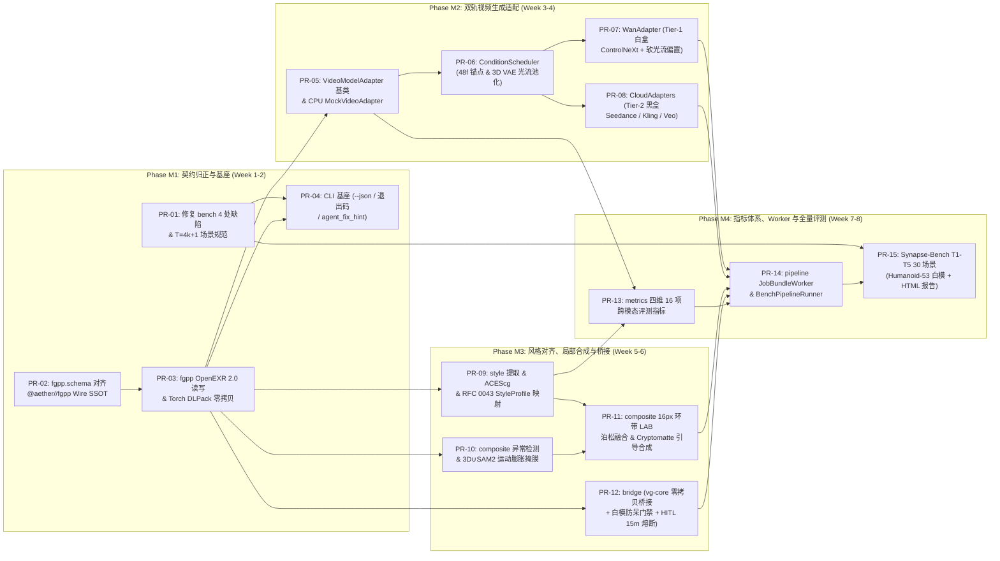

# Synapse 可落地工程实施计划 (Actionable Implementation Plan)

- **计划版本**: `v1.0`
- **前置架构决议**: [docs/AUDIT_AND_ARCHITECTURE.md](AUDIT_AND_ARCHITECTURE.md)
- **执行原则**:
  1. **原子 PR 推进**：全计划拆解为 **4 个阶段（M1–M4）、15 个独立可合并、可测试的原子 PR（`PR-01` ~ `PR-15`）**，单 PR 代码净增控制在 `300 ~ 800` 行以内，严禁巨型单体提交。
  2. **零 GPU 阻塞 CI**：依托 `PR-05` 的确定性 `MockVideoAdapter` 与程序化合成 FGPP 数据，100% 的核心协议、掩膜算子、色彩空间、调度逻辑与指标计算均可在云端主力机 `ubuntu24`（CPU 环境）全自动验证；真实大模型推理在 `foundary` GPU 容器专项验收。
  3. **实证数据诚实门禁（RFC 0044 §7.2）**：本计划列出的全部精度/耗时指标均为 **阶段验收门禁目标值（Target SLA）**。在对应 PR 合并且通过自动化测试（防静默失败三问：**存在、接线、执行**）前，追踪表一律保持 `🔲 待实施`。

---

## 1. 全局任务依赖拓扑与并行度规划 (PR Dependency DAG)

> **并行加速路径**：`PR-03` 落地后，**M2（模型适配线：`PR-05~08`）**、**M3-A（风格与合成线：`PR-09~11`）** 与 **M3-B（`vg-core` 桥接与 HITL 线：`PR-12`）** 三条研发支线完全解耦，可由 3 个 Agent Worktree 并行推进！

---

## 2. Phase M1：现存缺陷清零、FGPP 跨语言契约闭环与 CLI 基座（Week 1–2）

### PR-01：`fix(bench): resolve camera/scenario/packaging bugs and align T=4k+1 frame contract`
- **解决痛点**：清零审计报告 `[P1-6]`、`[P1-7]`、`[P2-9]` 中的现存代码缺陷与打包隐患。
- **涉及文件**：
  - 修改：`pyproject.toml`, `python/synapse/bench/camera.py`, `python/synapse/bench/scenario.py`, `python/synapse/bench/conditions.py`, `data/scenarios/*.json`, `tests/test_bench.py`
  - 新增：`python/synapse/py.typed`
- **具体落地设计**：
  1. **修复环绕轨迹首尾重合 (`camera.py`)**：`_generate_orbit` 增加 `endpoint: Optional[bool] = None` 参数；当 `abs(azimuth_range_deg) >= 360.0` 时默认 `endpoint=False`（步长 `i / num_frames`），确保 `sparse_8view` 精确生成 `0°, 45°, ..., 315°` 共 8 个正交均匀视角，120/97 帧环绕无接缝停顿。
  2. **修复天顶/天底奇异矩阵 (`camera.py`)**：`_look_at` 检测 `abs(np.dot(forward, up_norm)) > 0.9999`，共线时自动平滑切换备用参考轴 `[0.0, 0.0, 1.0]`（或 `[-1.0, 0.0, 0.0]`），保证 `elevation_deg = ±90°` 时 `view_matrix` 正交可逆（$\det(R) = +1$）。
  3. **打通 `Conditions` 与相机生成接线 (`conditions.py` & `camera.py`)**：
     - `Scenario.from_dict` 使用 `Conditions.from_dict` 严格校验因子名称与 `L1~L4` 枚举，拒绝拼写错误；
     - `generate_cameras(scenario)` 解析 `scenario.conditions`：`F08_scale` 自动乘算 `camera_distance_multiplier`，`F09_dof` 将 `aperture` 注入 `CameraParams`（新增 `aperture_fstop: float = 0.0` 与 `shutter_angle_deg: float = 0.0` 字段）。
  4. **修复 Wheel/容器安装场景加载失效 (`pyproject.toml` & `scenario.py`)**：将场景 JSON 迁入或映射至包内资源（`python/synapse/bench/scenarios/` 或 `setuptools.package-data`），使用 `importlib.resources.files` 替代脆弱的 `parent.parent.parent.parent`。
  5. **对齐 `Wan 2.1` $T = 4k + 1$ 帧数法则 (`data/scenarios/*.json`)**：
     - `Scenario` 新增 `temporal_mode: Literal["continuous_clip", "discrete_views"] = "continuous_clip"`；
     - 将连续视频基准场景帧数统一更新为 **`97` 帧**（对齐 `0, 48, 96` 物理锚点与 3D Causal VAE $\tau=25$），将 `t1_rigid_sphere_sparse.json` 标记为 `temporal_mode: "discrete_views"`（`num_frames: 8`）。
- **验证门禁**：`ubuntu24` 执行 `pip wheel .` 安装到隔离虚拟环境后（脱离源码目录）运行 `pytest`、`mypy --strict`、`ruff check` 100% 通过；测试覆盖 `±90°` 仰角、`sparse_8view` 45° 精确间隔、`F08_scale` 距离缩放。

---

### PR-02：`feat(fgpp): implement canonical @aether//fgpp wire schema and matrix interop`
- **解决痛点**：彻底修复审计报告 `[P0-1]` 中的跨语言通道名漂移、`metadata.json` 字段分裂与行列主序转置隐患。
- **涉及文件**：
  - 新增：`python/synapse/fgpp/schema.py`, `tests/test_fgpp_contract.py`
  - 修改：`python/synapse/fgpp/frame.py`, `python/synapse/fgpp/__init__.py`
- **具体落地设计**：
  1. **`schema.py` 精确镜像 `aether/fgpp/include/aether/fgpp/fgpp_types.h`**：
     - 定义 `PixelType(IntEnum)`（`UINT32=0, HALF=1, FLOAT=2`）；
     - 定义 7 个逻辑通道组常量（`DirectRadiance.RGB`, `CameraLinearDepth.Z`, `WorldNormal.XYZ`, `MotionVector.XY`, `BaseColor.RGB`, `RoughnessMetallic.RG`, `Cryptomatte.ID`）与严格按 ASCII 排序的 **15 个标量 EXR 子通道规格表 `ALPHABETICAL_EXR_CHANNEL_SPECS`**（含 `allow_spatial_filtering` 标志，总像素步幅锁死 `34 Bytes/px`）；
     - 实现向量化 `linear_to_log_normalized_depth(z_m, z_near, z_far)` 与逆函数 `log_normalized_to_linear_depth`（对 `z_near <= 0` 或 `NaN/Inf` 零异常安全钳位）；
     - 实现 `validate_whitebox_coarseness_floor(vertex_count, has_articulated_limbs, is_character)`（`MIN_CHARACTER_WHITEBOX_VERTICES = 1500`）与 `is_physical_anchor_frame(frame_idx, interval=48)`。
  2. **升级 `CameraParams` 与 `FGPPSequence` 的 `fgpp.v1.0` 元数据序列化 (`frame.py`)**：
     - 内部计算保持 NumPy 自然习惯（`float64` `(4, 4)` 行主序矩阵），但在序列化 `metadata.json` 时严格输出符合 `DESIGN-0044-01` / `aether::fgpp::CameraFrameMetadata` 的权威字段：
       `schema_version: "fgpp.v1.0"`, `fps`, `total_frames`, `resolution: [W, H]`, `z_near_meters`, `z_far_meters`, `anchor_interval_frames: 48`；
     - 逐帧输出 `frame_index`, `timestamp_sec`, `is_physical_anchor`, `fov_y_deg`, `focal_length_mm`, `sensor_width_mm`, `sensor_height_mm`, `view_matrix_col_major`（显式 `.T.flatten().tolist()` 转换！）与 `proj_matrix_col_major`，并在 `load_metadata()` 中同时兼容读取 `caelum-core`/`stageforge` 导出的列主序矩阵。
- **验证门禁**：编写跨语言契约测试 `test_fgpp_contract.py`（若同级存在 `/Volumes/work/dervgen/aether/fgpp/include/aether/fgpp/fgpp_types.h` 则直接正则解析 C++ 头文件做逐字节比对；在独立 CI 环境用内嵌快照校验），确保相机矩阵往返误差 $< 10^{-12}$。

---

### PR-03：`feat(fgpp): add multi-channel OpenEXR 2.0 I/O, sanitizer, and zero-copy Torch bridge`
- **解决痛点**：补齐 `synapse.fgpp` 的真实磁盘 EXR 序列读写、非法像素消毒与 GPU 张量零拷贝能力。
- **涉及文件**：
  - 新增：`python/synapse/fgpp/io.py`, `python/synapse/fgpp/torch_bridge.py`, `tests/test_fgpp_io.py`
- **具体落地设计**：
  1. **多通道异构精度 OpenEXR 2.0 导出与导入 (`io.py`)**：
     - `export_fgpp(seq, output_dir, compression="ZIP")`：按 `frame_{index:06d}.exr` + `metadata.json` 写出；严格按 `HALF` / `FLOAT` / `UINT32` 各自的原生二进制缓冲区写入 OpenEXR 通道（严禁把 `Cryptomatte.ID` 先转 `float32` 导致大整数尾数截断！）；
     - **防御性边界消毒器 (`sanitize_fgpp_frame`)**：导出与导入时自动将未命中背景像素的 `Inf/NaN/<=0` 深度钳制到 `z_far_meters`，`Cryptomatte.ID` 置 `0`，法线重归一化（零向量置 `[0, 0, 1]`）；提供下采样辅助函数 `resize_fgpp_frame`，对浮点通道用边缘保持双边重采样，**对 `Cryptomatte.ID` 强制执行 `Nearest` 最近邻采样**；
     - `import_fgpp(input_dir, lazy=True, channels=None)`：支持按需通道读取与 `>4K` 序列惰性按帧迭代加载（避免一次性撑爆内存）。
  2. **零拷贝张量桥接 (`torch_bridge.py`)**：
     - 提供 `frame_to_tensors(frame, device="cpu")` 与 `tensors_to_frame(...)`，基于 `torch.from_numpy` / DLPack 实现零内存拷贝转换（处理 `uint32` 在 PyTorch 中的无损视图包装）。
- **验证门禁**：在 `ubuntu24` 测试 7 逻辑组（15 标量通道）混合类型 EXR 读写往返：`FLOAT32` 深度与 `UINT32` 满位宽随机 MurmurHash3 ID（如 `0xDEADBEEF`）**逐 bit 零误差**，`HALF` 通道误差 $\le 5 \times 10^{-4}$。

---

### PR-04：`feat(cli): establish Agent-Native CLI foundation with --json and deterministic exit codes`
- **解决痛点**：落实 `agent-friendly-repo-design` CLI-First 规范（`[P2-9]`）。
- **涉及文件**：
  - 新增：`python/synapse/errors.py`, `tests/test_cli.py`
  - 修改：`python/synapse/cli/__init__.py`, `pyproject.toml`（注册 `synapse` 与 `synapse-bench` 双入口）
- **具体落地设计**：
  1. **`errors.py`**：定义 `SynapseError(code: str, message: str, exit_code: IntEnum, agent_fix_hint: str, details: dict)`，锁定标准退出码：`EXIT_OK = 0`、`EXIT_VALIDATION_ERROR = 10`、`EXIT_RESOURCE_MISSING = 20`、`EXIT_BACKEND_UNAVAILABLE = 30`、`EXIT_CIRCUIT_BREAKER = 40`。
  2. **首批可用子命令**：
     - `synapse fgpp validate <dir> [--json]`：校验 EXR 通道完整性、类型、`NaN/Inf` 污染、`metadata.json` 矩阵正交性与 `4k+1` 帧数合规性，违规时返回 `exit_code=10` 及精确 `agent_fix_hint`；
     - `synapse fgpp inspect <dir> [--json]`：输出序列摘要（分辨率、FPS、锚点帧索引、深度分位数分布）；
     - `synapse-bench list [--tier T1] [--json]` 与 `synapse-bench export-fgpp --scenario <id> --out <dir> [--json]`（用程序化软光栅为内置几何体生成黄金测试 FGPP 序列！）。
- **验证门禁**：子进程测试所有 CLI 命令在成功/参数非法/路径缺失三种路径下的退出码（`0 / 10 / 20`）及 `json.loads(stdout)` 100% 合法。

---

## 3. Phase M2：双轨视频生成适配器与潜空间时序调度（Week 3–4）

### PR-05：`feat(adapters): add VideoModelAdapter base registry and deterministic CPU MockVideoAdapter`
- **涉及文件**：
  - 新增：`python/synapse/adapters/base.py`, `python/synapse/adapters/mock.py`, `tests/test_adapters_base.py`
  - 修改：`python/synapse/adapters/__init__.py`
- **具体落地设计**：
  1. **`base.py`**：定义 `AdapterTier = Literal["whitebox", "blackbox", "mock"]`、`VideoGenerationConfig`、`VideoResult(frames_rgb_srgb, fps, seed, adapter_id, metadata)` 与抽象基类 `VideoModelAdapter`（`prepare_conditions(fgpp, schedule)`、`generate(prompt, conditions, config)`），并提供插件注册表 `register_adapter` / `create_adapter`。
  2. **`mock.py` (`MockVideoAdapter`)**：无需任何 GPU 或外部网络，直接基于输入 `FGPPSequence` 的 `BaseColor` + `WorldNormal`（受控球谐着色）+ `DirectRadiance` 确定性合成纹理化 RGB 视频帧，并支持配置 **可控缺陷注入器 (`DefectInjectionConfig`)**：
     - 可按指定帧区间与 `Cryptomatte.ID` 注入：局部轮廓偏移（模拟多指/穿模）、高频亮度闪烁、色温漂移（如 `+1500K` 偏暖），专门用于后续自动化测试 `style`、`composite` 与 `metrics` 模块！
- **验证门禁**：给定相同 `seed`，`MockVideoAdapter` 两次生成的视频帧逐像素完全一致；开启缺陷注入后在目标区域精确产生预期统计偏移。

---

### PR-06：`feat(adapters): implement ConditionScheduler, 48f anchor windowing, and 3D Causal VAE flow operator`
- **解决痛点**：实现 `DESIGN-0044-02` §3.1 的潜空间时序光流偏置与长镜头防漂移滑窗算子。
- **涉及文件**：
  - 新增：`python/synapse/adapters/scheduler.py`, `tests/test_condition_scheduler.py`
- **具体落地设计**：
  1. **长镜头分窗与 48 帧物理重锚定**：实现 `ConditionScheduler`（默认 `anchor_interval=48`，滑窗长度 `97` 帧，重叠区 `17` 帧余弦混合权重），支持为每个条件通道配置去噪步衰减曲线（`cosine` / `linear` / `step`）。
  2. **3D Causal VAE 潜空间光流积分与最小深度池化 (`compute_latent_flow_operator`)**：
     - 输入逐帧屏幕光流 $\mathbf{f}_{t \to t+1}$ `[T, H, W, 2]` 与线性深度 `depth` `[T, H, W]`（要求 $T = 4k + 1$）；
     - 执行跨 4 帧前向欧拉轨迹积分，结合前后向光流一致性校验生成遮挡掩膜 $O_{\tau \to \tau'} \in \{0, 1\}$；
     - 使用 $8 \times 8$ **最小深度池化（Min-Depth Pooling）** 优先保留前景刚体/角色运动向量，输出潜空间扭曲网格 $\mathcal{W}_{\tau \to \tau'}^{\text{latent}}$ `[τ, H/8, W/8, 2]` 与截断软偏置权重掩膜（杜绝背景静止像素稀释前景边缘运动）。
- **验证门禁**：构造已知刚体平移（如前景球每帧右移 `8px`，背景静止）的合成 17 帧 FGPP 序列，验证池化后潜空间位移精确等于 `(8px * 4) / 8 = 4.0` 个潜空间网格单位，且被遮挡边缘 $O_{\tau \to \tau'} = 0$。

---

### PR-07：`feat(adapters): implement Tier-1 whitebox WanAdapter with ControlNeXt and soft flow-bias payload`
- **涉及文件**：
  - 新增：`python/synapse/adapters/wan.py`, `tests/test_wan_adapter.py`
- **具体落地设计**：
  1. **`WanAdapter` (`tier="whitebox"`)**：
     - `prepare_conditions(fgpp)`：将 `CameraLinearDepth.Z` 转换为 `[0, 1]` `LogNormalizedDepth`，利用 `CameraParams.view_matrix` 将 `WorldNormal.XYZ` 无损变换至相机空间法线 `CamNormal.XYZ`（适配 `ControlNeXt`/`VACE` 训练分布），拼接归一化 `DirectRadiance` 构造多通道空间控制张量；同时调用 `ConditionScheduler` 打包潜空间软光流偏置载荷（含可配置门控标量 $\gamma_\theta \in [0.0, 2.5]$ 与截断阈值 $\tau_{\text{clip}}$，默认未微调权重时安全回退 $\gamma_\theta = 0.0$ 防崩塌！）；
     - 支持两种执行后端：`FoundaryWanRuntimeBackend`（对接 `foundary` 本地挂载 IPC / HTTP 推理端点）与本地管线 Hook 接口（供单卡推理容器直接注入 DiT Attention Processor）。
- **验证门禁**：单测完整校验法线世界→相机坐标系变换正交性、张量形状 `[B, C, τ, H/8, W/8]`、锚点帧掩膜以及推理端点不可达时准确抛出 `EXIT_BACKEND_UNAVAILABLE (30)`。

---

### PR-08：`feat(adapters): implement Tier-2 blackbox adapters (Seedance, Kling, Veo) with FGPP degradation`
- **涉及文件**：
  - 新增：`python/synapse/adapters/cloud.py`, `tests/test_cloud_adapters.py`
- **具体落地设计**：
  1. 实现 `SeedanceAdapter`（对齐 `Seedance 2.5`）、`KlingAdapter`（对齐 `Kling 1.5`）与 `VeoAdapter`：
     - **受控降级转换器 (`degrade_fgpp_for_blackbox`)**：自动提取 `is_physical_anchor=True`（第 `0, 48, 96...` 帧）的 `DirectRadiance`（色调映射为 PNG 首尾/关键锚定图），将 `CameraParams` 序列拟合并编码为各家商业 API 支持的相机运动描述符（轨迹外参矩阵数组或标准运镜指令枚举 + 速度标量），可选导出 Canny/法线边缘与对数深度 MP4 供 V2V 接口使用；
     - 内置幂等 `client_request_token`、超时重试与 Mock Transport 注入接口（严禁单测发起真实公网扣费请求）。
- **验证门禁**：使用 Mock HTTP Transport 测试 97 帧序列自动切分为 `[0..48]`、`[48..96]` 两段首尾帧锚定请求并平滑拼接重叠区。

---

## 4. Phase M3：风格提取对齐、局部手术刀合成与 `vg-core` 桥接（Week 5–6）

### PR-09：`feat(style): add ACEScg inverse-tonemapping, style extractor, and RFC 0043 StyleProfile mapper`
- **解决痛点**：落实审计报告 `[P0-4]`，打通 AI 生成视频 → 风格描述符 → `@aether//style` `StyleProfile` / OpenUSD 参数的闭环。
- **涉及文件**：
  - 新增：`python/synapse/style/aces_color.py`, `python/synapse/style/descriptor.py`, `python/synapse/style/extractor.py`, `python/synapse/style/profile_mapper.py`, `tests/test_style.py`
  - 修改：`python/synapse/style/__init__.py`
- **具体落地设计**：
  1. **`aces_color.py`**：实现严格符合色彩科学的 sRGB EOTF 线性化、`Linear sRGB (Rec.709) <-> ACEScg (AP1)` $3 \times 3$ Bradford 色适应矩阵变换、CIE LAB / CIEDE2000 色差底数、以及可逆色调映射（Inverse ACES Filmic / Reinhard，高光平滑肩部防溢出）。
  2. **`StyleDescriptor` & `extractor.py`**：
     - 实现 `histogram_optical`（基于跨帧中位数聚合估算白平衡色温 $T_c \in [2000\text{K}, 12000\text{K}]$、Tint、曝光 EV、1D Tone Curve、33³ 3D LUT、高频残差胶片颗粒强度与径向暗角）；
     - 实现 `fgpp_intrinsic`（结合 FGPP `WorldNormal.XYZ` 与 `BaseColor.RGB` 求解最小二乘低阶球谐光照/主光源方向 `key_light_direction`、主光颜色与环境光比 `ambient_ratio`）。
  3. **`profile_mapper.py`**：将 `StyleDescriptor` 无损导出为符合 `DESIGN-0043-01`（`@aether//style` v2.0.0）的 `StyleProfile` 字典/YAML/JSON（填充 `ShadingConfig`、`MaterialRemapConfig`、`PostProcessConfig`），以及供 `fulgur` / `caelum-core` 使用的灯光覆盖字典。
- **验证门禁**：在已知色温（`4500K`）与主光方向（方位角 `45°`、仰角 `30°`）渲染出的测试帧上运行提取器，主光方向恢复误差 $< 8^\circ$，导出的 `StyleProfile` 100% 通过 Schema 校验。

---

### PR-10：`feat(composite): implement artifact detector and 3D+SAM2 motion-dilated surgical mask`
- **涉及文件**：
  - 新增：`python/synapse/composite/detector.py`, `python/synapse/composite/mask.py`, `tests/test_composite_mask.py`
- **具体落地设计**：
  1. **`detector.py` (`detect_artifacts`)**：基于 FGPP 先验与视频序列自动筛查可疑异常区域（输出 `list[DefectRegion]` 供 L1 操作员确认或自动化基准评估）：
     - `temporal_flicker`：沿 `MotionVector` 对齐相邻帧，检测高频亮度突变残差；
     - `silhouette_drift`：对比 AI 视频物体显著边缘梯度与 FGPP `Cryptomatte.ID` / 深度不连续边缘的贴合度偏差；
     - `physics_violation`：结合地面高度与实体包围盒检测浮空或穿地帧区间。
  2. **`mask.py` (`generate_surgical_mask`)**：严格实现 RFC 0044 §4.3 联合掩膜算子：
     $$M_{\text{surgical}}(t) = \text{Dilate}_{\mathbf{v}(t)}\left( M_{\text{3D}}^{\text{new}}(t) \cup M_{\text{SAM2}}^{\text{old}}(t) \right)$$
     支持各向同性形态学膨胀（默认 `8~16px`）叠加沿前后帧 `MotionVector.XY` 方向的速度自适应椭圆/轨迹膨胀，并生成平滑羽化边缘权重图。
- **验证门禁**：验证当原视频残影超出新 3D 白模轮廓外 `10px` 时，`M_3D ∪ M_SAM2` 100% 完整覆盖残影且运动方向膨胀无断裂。

---

### PR-11：`feat(composite): add 16px border-ring LAB matching, temporal Poisson blend, and ACEScg optical pass`
- **涉及文件**：
  - 新增：`python/synapse/composite/blend.py`, `tests/test_composite_blend.py`
  - 修改：`python/synapse/composite/__init__.py`
- **具体落地设计**：
  1. **16px 边缘环带 CIE LAB 直方图匹配 (`border_ring_histogram_match`)**：按 `DESIGN-0044-02` §3.2 公式提取外围环形参考带 $\Omega_{\text{ring}} = \text{Dilate}_{16}(M_{\text{surgical}}) \setminus M_{\text{surgical}}$，在 CIE LAB 空间对齐均值与标准差（带 $\epsilon$ 除零保护），消除局部重绘色温切边。
  2. **时域一致性融合 (`composite_with_style`)**：提供多频段拉普拉斯金字塔融合 / 泊松梯度融合算子，结合相邻帧光流平滑抑制修补区边界闪烁。
  3. **Pipeline 6 离线高阶光学增量合成 (`composite_optical_increments`)**：按 `DESIGN-0044-02` §3.3 将 LDR 视频逆色调映射至 `ACEScg` 线性空间，以 `Cryptomatte.ID` 与原图梯度执行半径 $r=4\text{px}$ 的引导滤波（Guided Filter），叠加 `caelum-core` 导出的接触阴影 $S_{\text{contact}}$ 与焦散 $L_{\text{caustics}}^{\text{HDR}}$ 后重新色调映射输出。
- **验证门禁**：在人为注入 `+15%` 亮度偏差与 `+1200K` 色偏的前景补丁上执行合成，合成后边界环带 CIEDE2000 $\Delta E_{00} < 2.5$，无肉眼可见硬接缝。

---

### PR-12：`feat(bridge): add thin vg-core/foundary bridges, Track-B anti-paradox gate, and HITL circuit breaker`
- **解决痛点**：落实审计报告 `[P0-3]`，以薄桥接复用 `vg-core` C++ 算法，锁死 Track B 白模反投防呆门禁与 15 分钟熔断红线。
- **涉及文件**：
  - 新增：`python/synapse/bridge/__init__.py`, `python/synapse/bridge/vg_bridge.py`, `python/synapse/bridge/foundary_client.py`, `python/synapse/bridge/hitl.py`, `tests/test_bridge_and_hitl.py`
- **具体落地设计**：
  1. **`vg_bridge.py`**：封装对 `vg-core` Python 绑定（`vg.material`, `vg.geometry`, `vg.actor`, `vg.recon`）的薄调用适配器（在未安装编译态 `vg` 扩展的纯轻量环境中自动降级或给出明确 `EXIT_BACKEND_UNAVAILABLE` 提示，绝不在 `synapse` 内重复实现 C++ 算法）；
     - **强制内置 Track B 白模反投门禁 (`enforce_distillation_geometry_gate`)**：当输入资产标记为 `track="track_b_whitebox"` 且尚未经过生成式高模重建（`has_gen3d_highpoly=False`）时，调用 UV 贴图反投直接拦截并抛出 `SynapseError(code="TRACK_B_RAW_WHITEBOX_PROJECTION_FORBIDDEN", exit_code=10, agent_fix_hint="Run foundary TRELLIS/Hunyuan3D stage and retopology before texture back-projection.")`！
  2. **`foundary_client.py`**：定义调用 `foundary` 推理容器（`TRELLIS`、`Hunyuan3D-2`、`SAM2`、`GVHMR`）的标准化请求/响应 Pydantic 模型（对齐 `vg-core` 服务契约）与本地 Mock 桩。
  3. **`hitl.py`**：
     - 定义对齐 RFC 0020/0021/0044 的 `CommandIRRecord` 五元组 `(intent, state_before_uri, actions, state_after_uri, feedback)` + `OperatorIdentity(tier="L1"|"L2", operator_id)`；
     - 实现 **15 分钟工程熔断评估器 (`evaluate_hitl_circuit_breaker`)**：当单镜头或单资产累计人工介入时长 `elapsed_seconds > 900`（15 分钟）时，自动返回熔断决议（视频流：`FALLBACK_REBAKE_3D_FGPP`；资产流：`FALLBACK_DECAL_OR_PROCEDURAL`）。
- **验证门禁**：单测验证 Track B 未重建高模直接反投 100% 被拦截（退出码 `10`），人工耗时 `901s` 精确触发熔断降级状态转移。

---

## 5. Phase M4：四维指标体系、`JobBundle` 无状态 Worker 与 `Synapse-Bench` 全景扩充（Week 7–8）

### PR-13：`feat(metrics): implement 4-pillar cross-modal evaluation metrics suite`
- **涉及文件**：
  - 新增：`python/synapse/metrics/temporal.py`, `python/synapse/metrics/fgpp_fidelity.py`, `python/synapse/metrics/roundtrip.py`, `python/synapse/metrics/style_consistency.py`, `tests/test_metrics.py`
  - 修改：`python/synapse/metrics/__init__.py`
- **具体落地设计**：
  实现全部 4 大类 16 项量化指标及门禁比对函数 `evaluate_against_expected(metrics, scenario.expected)`：
  1. **时序一致性 (`temporal.py`)**：带遮挡掩膜加权的 `temporal_warp_error`（Target `< 0.015`）、高频时域拉普拉斯 `flicker_score`（Target `< 0.02`）、以及可选特征空间 `fvd` 接口；
  2. **FGPP 先验保真度 (`fgpp_fidelity.py`)**：尺度不变/绝对米制 `depth_rmse`（Target `< 0.05m`）、法线余弦夹角 `normal_angular_error_deg`（Target `< 15°`）、光流端点误差 `flow_endpoint_error_px`（Target `< 2.0px`）；
  3. **3D 往返与运动学保真度 (`roundtrip.py`)**：双边点云采样 `chamfer_mm` & `f_score_1mm`、跨帧网格体积呼吸率 `volume_breathing_pct`（Target `< 5%`）、触地相足底水平位移 `foot_sliding_cm`（Target `< 0.3cm`）、骨骼长度漂移率 `bone_length_drift_pct`（Target `< 1%`）、去光照固有色差 `albedo_roundtrip_de`（Target `< 5.0`）；
  4. **风格与合成一致性 (`style_consistency.py`)**：环带区域 `ciede2000`（Target `< 3.0`）、主光方向夹角误差 `light_dir_error_deg`（Target `< 10°`）、色调曲线 `tone_curve_rmse`（Target `< 0.02`）、色彩直方图交集 `histogram_intersection`（Target `> 0.85`）。
- **验证门禁**：在黄金恒等输入（GT vs GT）与已知解析扰动输入（如平移 `3.0mm`、旋转法线 `10.0°`、足底滑移 `0.5cm`）上验证所有指标输出与理论解析解误差 $< 10^{-4}$。

---

### PR-14：`feat(pipeline): implement stateless RFC 0039 JobBundleWorker and local BenchPipelineRunner`
- **解决痛点**：落实审计报告 `[P0-2]`，以无状态容器执行核对接 `render-farm`（Go），彻底规避服务端 Python 反模式。
- **涉及文件**：
  - 新增：`python/synapse/pipeline/bundle_worker.py`, `python/synapse/pipeline/bench_runner.py`, `tests/test_bundle_worker.py`
  - 修改：`python/synapse/pipeline/__init__.py`, `python/synapse/cli/__init__.py`
- **具体落地设计**：
  1. **`bundle_worker.py` (`JobBundleWorker`)**：
     - 解析符合 RFC 0039 的 `bundle_manifest.json`（仅消费本地工作目录或只读/只写 Presigned URLs，**零数据库连接、零 `asset-vault` SDK 耦合**）；
     - 支持 4 种原子容器执行模式：`fgpp_validate`、`neural_video_generate`、`style_extract_and_map`、`surgical_composite`；
     - 执行完毕写出 `result_manifest.json`（含输出文件 SHA256、耗时遥测、指标摘要）并立即退出进程；挂载至 CLI `synapse worker run --bundle <path> [--json]`。
  2. **`bench_runner.py` (`BenchPipelineRunner`)**：
     - 面向离线评测串联“场景加载 → FGPP 生成/加载 → 适配器生成 → 局部修复/逆向评测 → 指标门禁判定”，支持 `--adapter mock|wan|seedance` 一键运行。
- **验证门禁**：构造完整模拟 `JobBundle` 目录，通过 `synapse worker run --bundle ... --json` 跑通全部 4 种原子阶段，校验输出产物完整性与退出码 `0`。

---

### PR-15：`feat(bench): expand Synapse-Bench to 30 T1-T5 scenarios, Humanoid-53 whitebox proxy, and HTML report`
- **解决痛点**：补齐 `[P1-8]` 角色白模粗糙度下限代理网格与 T2–T5 全阶段场景覆盖。
- **涉及文件**：
  - 新增：`python/synapse/bench/registry.py`, `python/synapse/bench/report.py`, `data/scenarios/t2_*.json`, `data/scenarios/t3_*.json`, `data/scenarios/t4_*.json`, `data/scenarios/t5_*.json`, `tests/test_bench_full_suite.py`
  - 修改：`python/synapse/bench/procedural.py`, `python/synapse/cli/__init__.py`
- **具体落地设计**：
  1. **铰接式人形代理白模 (`procedural.py::generate_humanoid_proxy`)**：程序化生成符合 Humanoid-53 躯干、头颈、双臂、双腿与手掌独立拓扑剪影的水密三角网格（顶点数默认 `~1,800 >= 1500`，100% 通过 `validate_whitebox_coarseness_floor` 门禁），支持给定关节角姿态驱动（如步行迈步、伸手握杯），使 T2/T3 测试无需外部百兆资产即可开箱即跑！
  2. **`registry.py` 按需重型资产拉取器**：支持从标准公开库（Khronos glTF Sample Assets）或内部只读镜像按需拉取高精模型，强制校验 `sha256` 并缓存至 `~/.cache/synapse/assets`（可通过环境变量 `SYNAPSE_ASSET_CACHE` 重定向）。
  3. **扩充至 30 个标准场景（覆盖 T1~T5 全层级）**：
     - **T1 静态刚体（8 个）**：几何基元 + 复杂拓扑刚体，覆盖环绕/推拉/俯仰弧线/稀疏视角；
     - **T2 动态与骨骼（7 个）**：Humanoid-53 行走、转身、布料风场代理，重点门禁 `temporal_warp_error` 与 `foot_sliding_cm`；
     - **T3 多体交互（5 个）**：手部持握道具、双角色交错遮挡、足底踏步接触；
     - **T4 局部重渲与风格对齐（6 个）**：面部特写重打光、道具替换、冷暖大光比边缘融合，重点门禁 `ciede2000` 与 `light_dir_error_deg`；
     - **T5 端到端短片（4 个）**：97 帧多锚点完整镜头全链路闭环。
  4. **`report.py` 自包含离线 HTML 报告**：零外部 CDN 依赖（内联 SVG 雷达图、各阶段耗时瀑布条、Pass/Fail 矩阵表与误差热力图 Base64 预览），挂载至 `synapse-bench run --tier all --adapter mock --report report.html`。
- **验证门禁**：在 `ubuntu24` 上执行 `synapse-bench run --all --adapter mock --report /tmp/bench.html --json`，30 个场景 100% 跑通（总耗时 `< 30s` CPU），生成的 HTML 报告自包含无死链。

---

## 6. 落地执行追踪与“防静默失败三问”验收矩阵

> [!IMPORTANT]
> 后续实施每个 PR 时，合入后必须同步更新下表状态，且必须逐项通过：
> 1. **存在问**：目标模块、类型签名与单测文件是否真实落地？
> 2. **接线问**：是否已挂入 `cli` / `BenchPipelineRunner` / `JobBundleWorker` 主调用链（无孤立死代码）？
> 3. **执行问**：在 `ubuntu24` 上实跑 `pytest` + `mypy` + `ruff` 是否产出有效非零数据并通过数值断言？

| PR 编号 | 阶段 | 核心交付模块 | 依赖前置 | 预估工作量 | 目标测试门禁 (`ubuntu24`) | 当前状态 |
| :---: | :---: | :--- | :---: | :---: | :--- | :---: |
| **PR-01** | M1 | `bench` 4 处缺陷修复 + `T=4k+1` 规范 + Wheel 资源打包 | — | 0.5 天 | `tests/test_bench.py` + 隔离 Wheel 安装测试 | 🔲 待实施 |
| **PR-02** | M1 | `fgpp.schema` 对齐 `@aether//fgpp` 15 通道 & 行列主序契约 | — | 1.0 天 | `tests/test_fgpp_contract.py` (误差 $<10^{-12}$) | 🔲 待实施 |
| **PR-03** | M1 | `fgpp.io` 多通道 OpenEXR 读写、消毒器与 Torch DLPack 桥接 | PR-02 | 1.5 天 | `tests/test_fgpp_io.py` (`UINT32` 逐 bit 无损) | 🔲 待实施 |
| **PR-04** | M1 | `errors.py` + Agent-Native CLI (`--json`, 退出码 `0/10/20/30/40`) | PR-01, PR-03 | 1.0 天 | `tests/test_cli.py` | 🔲 待实施 |
| **PR-05** | M2 | `adapters.base` 抽象注册表 + 零 GPU 确定性 `MockVideoAdapter` | PR-03 | 1.0 天 | `tests/test_adapters_base.py` | 🔲 待实施 |
| **PR-06** | M2 | `adapters.scheduler` 48f 锚点滑窗 + 3D Causal VAE 光流积分池化 | PR-05 | 1.5 天 | `tests/test_condition_scheduler.py` | 🔲 待实施 |
| **PR-07** | M2 | `adapters.wan` Tier-1 白盒 ControlNeXt + 软光流偏置载荷 | PR-06 | 1.5 天 | `tests/test_wan_adapter.py` | 🔲 待实施 |
| **PR-08** | M2 | `adapters.cloud` Tier-2 黑盒 (`Seedance`/`Kling`/`Veo`) 降级适配 | PR-06 | 1.0 天 | `tests/test_cloud_adapters.py` | 🔲 待实施 |
| **PR-09** | M3 | `style` ACEScg 逆色调映射 + 风格提取 + RFC 0043 `StyleProfile` 导出 | PR-03 | 1.5 天 | `tests/test_style.py` (光源误差 $<8^\circ$) | 🔲 待实施 |
| **PR-10** | M3 | `composite.detector` 异常检测 + `3D ∪ SAM2` 运动膨胀掩膜 | PR-03 | 1.0 天 | `tests/test_composite_mask.py` | 🔲 待实施 |
| **PR-11** | M3 | `composite.blend` 16px 环带 LAB 匹配 + 泊松融合 + 光学增量合成 | PR-09, PR-10 | 1.5 天 | `tests/test_composite_blend.py` ($\Delta E_{00} < 2.5$) | 🔲 待实施 |
| **PR-12** | M3 | `bridge` (`vg-core`/`foundary` 薄桥接 + Track-B 防呆门禁 + 15m 熔断) | PR-03 | 1.0 天 | `tests/test_bridge_and_hitl.py` | 🔲 待实施 |
| **PR-13** | M4 | `metrics` 四维 16 项跨模态时序/保真度/往返/风格指标 | PR-05, PR-09 | 1.5 天 | `tests/test_metrics.py` | 🔲 待实施 |
| **PR-14** | M4 | `pipeline` 无状态 `JobBundleWorker` + `BenchPipelineRunner` | PR-07~13 | 1.5 天 | `tests/test_bundle_worker.py` | 🔲 待实施 |
| **PR-15** | M4 | `Synapse-Bench` 30 场景 (T1–T5) + Humanoid-53 白模 + HTML 报告 | PR-01, PR-14 | 1.5 天 | `tests/test_bench_full_suite.py` (CPU `<30s`) | 🔲 待实施 |

---

## 7. 关键工程风险与防御预案 (Risk Register & Mitigations)

| 风险项 | 触发条件 | 防御机制（已编入对应 PR） |
| :--- | :--- | :--- |
| **C++ 与 Python 相机外参转置导致生成画面天旋地转** | `fulgur`/`caelum-core` 输出列主序矩阵，Python `numpy` 默认行主序读取 | `PR-02` 在 `metadata.json` 中显式以 `_col_major` 命名字段并在读写边界强制转置 + 旋转矩阵行列式 $\det(R)=+1$ 断言 |
| **`Cryptomatte.ID` 在缩放或 EXR 半精度转换中被插值破坏** | 误将 `UINT32` 转为 `float16/32` 或开启双线性抗锯齿 | `PR-03` 严格隔离 `UINT32` 原生字节通道并在 `resize_fgpp_frame` 中硬编码 `Nearest` 采样 |
| **未微调 DiT 模型强行注入大权重光流偏置导致画质崩塌** | 在原始 `Wan 2.1` 基座权重上设置过大 $\gamma_\theta$ | `PR-07` 默认将未加载微调 LoRA 时的软偏置门控初始化为 $\gamma_\theta = 0.0$，并附带遮挡自动释放门控 $O_{\tau \to \tau'}$ |
| **LDR 视频与 HDR 物理阴影直接相乘导致暗部死黑与色偏** | 在非线性 sRGB 空间直接混合 `caelum-core` AOV | `PR-09` & `PR-11` 强制经 `aces_color.py` 逆色调映射至线性 `ACEScg` 空间完成合成后再重映射输出 |
| **长尾坏样本引发人工无底洞返工** | 复杂多手交互或玻璃折射导致局部修复与去光照反复失败 | `PR-12` 实装 15 分钟硬熔断器 (`EXIT_CIRCUIT_BREAKER = 40`)，超时自动回退重调 3D 白模或降级为单向视角贴花 |
