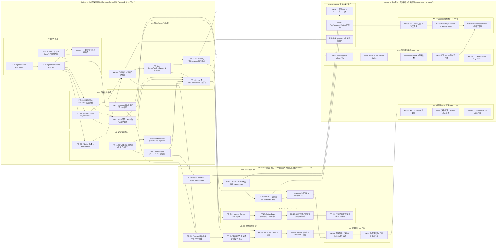

# Synapse 全景可落地工程实施总计划 (Master Actionable Implementation Plan)

- **计划版本**: `v3.1`（全量统合 **M1–M16** 共 16 大里程碑、**58 个原子 PR**（`PR-01` ~ `PR-57`, 含 `PR-14a/b`），涵盖 Horizon 1–4 与 7 份精细化执行子计划）
- **修订日期**: 2026-11-14
- **操作模型标识**: `[gemini4]`
- **前置架构审查与跨文档对齐决议**:
  - **[docs/DESIGN_REVIEW_AND_ALIGNMENT.md](DESIGN_REVIEW_AND_ALIGNMENT.md)**（跨文档冲突纠偏 `RV-01~RV-17`、权威目录树、统一 CLI 语法树、三级门禁阈值表）
  - **[docs/AUDIT_AND_ARCHITECTURE.md](AUDIT_AND_ARCHITECTURE.md)**（五条绝对负向红线 `NG-1~NG-5` 与跨仓边界定界）
  - **[docs/audits/AUDIT-POST-REFACTOR-2026-11.md](audits/AUDIT-POST-REFACTOR-2026-11.md)**（Horizon 1–3 大规模重构后全库架构、工程实现与技术债务深度审计报告）
- **细分可执行子计划导航（Subdivided Actionable Sub-Plans）**:
  1. ↳ **[PLAN-M1-M2](plans/PLAN-M1-M2-FOUNDATION-AND-ADAPTERS.md)**：地基清零、`@aether//fgpp` 线格式闭环、CLI 基座与双轨视频生成适配器（`PR-01` ~ `PR-08` ✅）
  2. ↳ **[PLAN-M3-M4](plans/PLAN-M3-M4-STYLE-COMPOSITE-AND-BENCH.md)**：软肩 ACEScg 风格对齐、`3D ∪ SAM2` 手术刀合成、`vg-core` 桥接、`JobBundleWorker` 与 30 场景基准（`PR-09` ~ `PR-15` ✅）
  3. ↳ **[PLAN-M5](plans/PLAN-M5-LORA-TRAINING-PIPELINE.md)**：合成数据离线潜空间缓存、5 维正交解耦 LoRA 训练与 Cryptomatte 空间隔离调度（`PR-16` ~ `PR-19` ✅）
  4. ↳ **[PLAN-M6-M7](plans/PLAN-M6-M7-INSPECTION-AND-RSI-FLYWHEEL.md)**：3D 微距质检、Visual Jev 强类型裁决、RL 样本导出与物理驱动递归自我提升 RSI 飞轮（`PR-20` ~ `PR-25` ✅）
  5. ↳ **[PLAN-M8](plans/PLAN-M8-DATA-INSPECTOR-DESKTOP.md)**：`InspectionBundle` 导出器与 Electron + SHM 可视化检查器（`PR-26` ✅ · `PR-27~29` 脚手架已合入，真实 3D/EXR 视口见 `M16 PR-55`）
  6. ↳ **[PLAN-M9-M12 (Horizon 3)](plans/PLAN-M9-M12-HORIZON3-LANDING.md)**：RFC 0060 多视角真差往返、RFC 0061 解剖局部精修、RFC 0062 可微逆向闭环与 M12 全域收口（`PR-30` ~ `PR-43` ⚠️ 骨架与单测已合入，生产硬化见 `PLAN-M13-M16`）
  7. ↳ **[PLAN-M13-M16 (Horizon 4 重构后硬化)](plans/PLAN-M13-M16-POST-REFACTOR-REMEDIATION.md)**：防静默失败清零、包级循环依赖斩断、原生 C++ 多边形与打包修复、CLI 模块化及严苛 CI 门禁（`PR-44` ~ `PR-57` 📋）
- **专项聚焦与规范索引（Focused Plans & Horizon-3 RFCs）**:
  - ↳ **[PLAN-ALGO-TRAINING-DATA-PIPELINE](PLAN-ALGO-TRAINING-DATA-PIPELINE.md)** (`v2.0`)：算法核心、LoRA 训练与数据流水线三战役攻坚计划（`D1/D4/A1/T1` 收编入 `M12 PR-41~43`）
  - ↳ **[PLAN-REVIEW-PR17-PR18](plans/PLAN-REVIEW-PR17-PR18.md)**：PR #17 与 PR #18 联合评审与改进计划（✅）
  - ↳ **[PLAN-3D-ROUNDTRIP-VERIFICATION](plans/PLAN-3D-ROUNDTRIP-RECONSTRUCTION-VERIFICATION.md)** (`v1.1`)：3D 多视角生成与逆向重建 `>= 3.0x` 差分验证计划（绑定 `M9 PR-30~31`）
  - ↳ **[RFC 0060](RFC-0060-REAL-VIDEO-TO-3D-DIGITAL-TWIN.md)** · **[DESIGN (RFC 0060)](DESIGN_REAL_VIDEO_TO_3D_INVERSE_RENDERING.md)**：真实视频逆向 3D 动态数字孪生 (`M9`)
  - ↳ **[RFC 0061](RFC-0061-LOCAL-REFINEMENT-AND-MULTI-MODEL-FUSION.md)** · **[DESIGN (RFC 0061)](DESIGN_LOCAL_REFINEMENT_AND_MULTI_MODEL_FUSION.md)** · **[ForgeKit Tooling](DESIGN_FORGEKIT_ANATOMICAL_REFINE_TOOLING.md)**：局部解剖修正与手术刀缝合 (`M10`)
  - ↳ **[RFC 0062](RFC-0062-INVERSE-RENDERING-AND-3D-NEURAL-CLOSED-LOOP.md)** · **[DESIGN (RFC 0062)](DESIGN_INVERSE_RENDERING_CLOSED_LOOP.md)**：3D 引导生成与可微逆向双向闭环 (`M11`)

---

## 1. 核心工程执行铁律 (Core Execution Principles)

1. **双地平线递进、单 PR 严格控量**：
   - **Horizon 1（核心互操作 SDK 与基准闭环，`M1–M4`，16 个 PR）**：优先打通 FGPP 15 通道无损互通、双轨适配器、ACEScg 风格合成、`vg-core` 薄桥接、`JobBundleWorker` 与 30 场景 `Synapse-Bench`；
   - **Horizon 2（工业飞轮、PEFT 进化与桌面检查器，`M5–M8`，14 个 PR）**：在核心底座稳固后，并行铺开 LoRA 训练管线、3D 智能质检、物理驱动 RSI 自演进闭环与原生 3D 检查器；
   - **Horizon 3（视频逆向孪生、解剖精修、可微闭环与全域收口，`M9–M12`，14 个 PR）**：落实 `RFC 0060/0061/0062` 双向闭环与 Horizon-2 遗留算法接线，闭合多视角反演、512×512 手术刀局部精修、Mitsuba 3/解析 Jacobian 可微逆渲染及 `profiles` 量纲收口；
   - 每个原子 PR 净增代码严格控制在 **`300 ~ 750` 行**，必须使用 `/tmp/synapse-wt-<branch>` 独立 Git Worktree 走 PR Squash Merge 流程。
2. **零 GPU 阻塞日常回归（`ubuntu24` P0 主力机优先）**：
   - 依托纯 NumPy 向量化软光栅（`PR-01`）与确定性 `MockVideoAdapter`（`PR-05`）及 Mock Transport/推理桩，**100% 的协议、调度、融合、质检编排、RSI 门禁单测均可在云端 CPU 主力机 `ubuntu24` 上秒级全量回归**；真实大模型权重与 CUDA 算子仅在 `win-dev` 或 `foundary` 容器做专项集成验收。
3. **防静默失败三问硬门禁**：
   - 任何 PR 在更新本表状态为 `✅` 前，必须同时通过 **存在问**（类型签名与单测落盘）、**接线问**（挂入统一 CLI `synapse` / `synapse-bench` 或 `JobBundleWorker` 主干，无孤立死代码）、**执行问**（`ubuntu24` 实跑 `pytest` + `mypy --strict` + `ruff check` 全绿，且数值误差满足阈值断言）。

---

## 2. 全局 12 阶段 44-PR 依赖拓扑图 (Global Dependency DAG)

---

## 3. 多 Agent 并行开发批次排程 (Multi-Agent Worktree Execution Waves)

借助清晰的模块边界，最多可同时开启 **3 ~ 4 个隔离 Git Worktree** 并行推进而零文件冲突：

| 波次 (Wave) | 可完全并行的原子 PR 组合（各自修改独立包目录） | 解锁的关键里程碑能力 |
| :---: | :--- | :--- |
| **Wave 1** | `PR-01` (`bench/`) ∥ `PR-02` (`fgpp/schema.py` + `tools/wire_guard.py`) | 修复全部现存缺陷，锁死 `@aether//fgpp` 15 通道契约 |
| **Wave 2** | `PR-03` (`fgpp/io.py`) → `PR-04` (`cli/` + `errors.py` + `telemetry.py`) | M1 收官：OpenEXR 2.0 无损读写与 Agent-Native CLI 就绪 |
| **Wave 3** | `PR-05→06` (`adapters/`) ∥ `PR-09` (`style/`) ∥ `PR-10` (`composite/mask`) ∥ `PR-12` (`bridge/`) | 4 路完全正交并行：适配器、ACEScg 风格、手术刀掩膜、C++ 桥接同步推进 |
| **Wave 4** | `PR-07` (`wan.py`) ∥ `PR-08` (`cloud.py`) ∥ `PR-11` (`composite/blend.py`) ∥ `PR-13` (`metrics/`) | M2 & M3 收官，16 项四维指标与三级门禁档位就绪 |
| **Wave 5** | `PR-14a` (`bench_runner.py`) → [`PR-14b` (`bundle_worker.py`) ∥ `PR-15` (`bench/` 30 场景) ∥ `PR-26` (`bundle_exporter.py`)] | **Horizon 1 全线收官**：容器单步 Worker 与 30 场景基准跑通 |
| **Wave 6** | **Track L** `PR-16→19` (`adapters/lora` + `training/`) ∥ **Track I** `PR-20→23` (`inspect/`) ∥ **Track D** `PR-27→29` (`tools/data-inspector/`) | 3 条独立业务线并行交付 LoRA 微调、3D Visual Jev 质检与桌面检查器 |
| **Wave 7** | `PR-24` → `PR-25` (`rsi/`) | **Horizon 2 终局闭环**：物理驱动 RSI 自演进与单调递增门禁合龙 ✅ |
| **Wave 8** | `PR-30` (`recon/multiview`) ∥ `PR-33` (`refine/types+roi`) ∥ `PR-41` (`bench/DR`) ∥ `PR-42` (`wan+lora`) | **Horizon 3 启动**：解除空盒陷阱、建立 `refine/` 与 DR 底座、消除 M5 Stub |
| **Wave 9** | `PR-31` (`roundtrip`) ∥ `PR-34→35` (`hand/face+fusion`) ∥ `PR-38` (`loop/guide`) ∥ `PR-43` (`losses+profiles`) | 核心算子、`>= 3.0x` 真差门禁、VAE 相位锁定及 `temporal_warp_error` 量纲收口 |
| **Wave 10** | `PR-32` (`invert-video CLI`) ∥ `PR-36` (`blend` 光流 Warp + 手术刀/门禁) ∥ `PR-39` (双轨可微反演) | `M9` 收官、光流 Warp 激活及 CPU/GPU 双轨反演求解就绪 |
| **Wave 11** | `PR-37` (`synapse refine` + `forgekit` Wire) ∥ `PR-40` (`ClosedLoopRunner` + 手术刀回接) | **Horizon 3 全线收官**：三大 RFC 闭环与 ForgeKit 会话联调落地 |

---

## 4. 全量 44-PR 落地追踪与“防静默失败三问”验收总表

### 4.1 Horizon 1：核心互操作 SDK、无状态 Worker 与 `Synapse-Bench`（M1–M4，共 16 PRs，约 21.5 人天）

| PR 编号 | 阶段 | 核心交付摘要（点击跳转对应子计划查看完整签名） | 前置依赖 | 净增规模 | 工时 | `ubuntu24` 验收门禁测试 | 状态 |
| :---: | :---: | :--- | :---: | :---: | :---: | :--- | :---: |
| **[PR-01](plans/PLAN-M1-M2-FOUNDATION-AND-ADAPTERS.md#pr-01)** | M1 | `bench` 4 处缺陷修复 + $T=4k+1$ + 纯 NumPy 软光栅整合 + 懒加载 + `127.0.0.1` 绑定 | — | ~550 行 | 1.5d | `tests/test_bench.py` + 隔离 Wheel 无 `numba`/`trimesh` 冒烟 | ✅ 已实施 |
| **[PR-02](plans/PLAN-M1-M2-FOUNDATION-AND-ADAPTERS.md#pr-02)** | M1 | `tools/wire_guard.py` + `fgpp/schema.py` 15 标量通道 `34B/px` + `fgpp.v1.0` 列主序矩阵 | — | ~480 行 | 1.0d | `tests/test_fgpp_contract.py` (往返误差 $<10^{-12}$) | ✅ 已实施 |
| **[PR-03](plans/PLAN-M1-M2-FOUNDATION-AND-ADAPTERS.md#pr-03)** | M1 | `fgpp/io.py` 异构 OpenEXR 2.0 读写、消毒器、Nearest 缩放 + `torch_bridge.py` DLPack | PR-02 | ~520 行 | 2.0d | `tests/test_fgpp_io.py` (`UINT32` 逐 bit 零误差) | ✅ 已实施 |
| **[PR-04](plans/PLAN-M1-M2-FOUNDATION-AND-ADAPTERS.md#pr-04)** | M1 | `errors.py` + `telemetry.py` (`MemoryForecaster`/W3C Trace) + 双入口 CLI 收敛 (退出码 0-50) | PR-01, 03 | ~460 行 | 1.0d | `tests/test_cli.py` (`0/10/20/30/40/50` 退出码 & 纯 JSON) | ✅ 已实施 |
| **[PR-05](plans/PLAN-M1-M2-FOUNDATION-AND-ADAPTERS.md#pr-05)** | M2 | `adapters/base.py` 插件注册表 + `mock.py` 零 GPU 确定性合成与可控缺陷注入器 | PR-03 | ~420 行 | 1.0d | `tests/test_adapters_base.py` (同 seed 逐像素一致) | ✅ 已实施 |
| **[PR-06](plans/PLAN-M1-M2-FOUNDATION-AND-ADAPTERS.md#pr-06)** | M2 | `adapters/scheduler.py` ($W=97/S=64/\Delta=33$ + 3帧暖启动退火 + $\kappa$ 突变检测 + 最小深度光流池化) | PR-05 | ~580 行 | 1.5d | `tests/test_condition_scheduler.py` (位移 `4.0±0.5` 潜步) | ✅ 已实施 |
| **[PR-07](plans/PLAN-M1-M2-FOUNDATION-AND-ADAPTERS.md#pr-07)** | M2 | `adapters/wan.py` Tier-1 白盒（相机空间法线 + ControlNeXt 张量 + $\gamma_\theta$ 软光流偏置） | PR-06 | ~490 行 | 1.5d | `tests/test_wan_adapter.py` (正交性 + 断连抛 `30`) | ✅ 已实施 |
| **[PR-08](plans/PLAN-M1-M2-FOUNDATION-AND-ADAPTERS.md#pr-08)** | M2 | `adapters/cloud.py` Tier-2 黑盒（`Seedance 2.5`/`Kling 1.5`/`Veo` 锚点帧降级切分） | PR-06 | ~450 行 | 1.0d | `tests/test_cloud_adapters.py` (Mock Transport 零公网请求) | ✅ 已实施 |
| **[PR-09](plans/PLAN-M3-M4-STYLE-COMPOSITE-AND-BENCH.md#pr-09)** | M3 | `style/` 双曲正切软肩 ACEScg 逆色调映射 + 球谐主光提取 + `StyleProfile v2.0` 映射 | PR-03 | ~620 行 | 2.0d | `tests/test_style.py` (主光误差 $<8^\circ$, 辐射度 $\le 12.0$) | ✅ 已实施 |
| **[PR-10](plans/PLAN-M3-M4-STYLE-COMPOSITE-AND-BENCH.md#pr-10)** | M3 | `composite/detector.py` 三类异常检测 + `mask.py` (`M_3D ∪ M_SAM2` 光流椭圆膨胀) | PR-03 | ~430 行 | 1.0d | `tests/test_composite_mask.py` (10px 残影 100% 覆盖) | ✅ 已实施 |
| **[PR-11](plans/PLAN-M3-M4-STYLE-COMPOSITE-AND-BENCH.md#pr-11)** | M3 | `composite/blend.py` 16px 环带 CIE LAB 匹配 + 时域泊松融合 + Cryptomatte 引导焦散叠加 | PR-09, 10 | ~510 行 | 1.5d | `tests/test_composite_blend.py` (环带 $\Delta E_{00} < 2.5$) | ✅ 已实施 |
| **[PR-12](plans/PLAN-M3-M4-STYLE-COMPOSITE-AND-BENCH.md#pr-12)** | M3 | `bridge/` (`vg_bridge` + `foundary_client` + Track-B 白模反投硬拦截 + HITL 900s 熔断) | PR-03 | ~480 行 | 1.0d | `tests/test_bridge_and_hitl.py` (拦截抛 `10`, 超时抛 `40`) | ✅ 已实施 |
| **[PR-13](plans/PLAN-M3-M4-STYLE-COMPOSITE-AND-BENCH.md#pr-13)** | M4 | `metrics/` 四维 16 项指标实现 + `profiles.py` 三级统一质量门禁档位 (SSOT 对齐) | PR-05, 09 | ~640 行 | 1.5d | `tests/test_metrics.py` + `test_profiles_doc_sync.py` 全绿 | ✅ 已实施 |
| **[PR-14a](plans/PLAN-M3-M4-STYLE-COMPOSITE-AND-BENCH.md#pr-14a)** | M4 | `pipeline/bench_runner.py` 离线评测串联器 + `synapse-bench evaluate --bundle` | PR-05, 13 | ~390 行 | 1.0d | `tests/test_bench_runner.py` (Mock 端到端退出码 `0`) | ✅ 已实施 |
| **[PR-14b](plans/PLAN-M3-M4-STYLE-COMPOSITE-AND-BENCH.md#pr-14b)** | M4 | `pipeline/bundle_worker.py` 无状态容器执行核（首批 4 阶段 + 三级显存自适应降级） | PR-07~12, 14a | ~480 行 | 1.0d | `tests/test_bundle_worker.py` (4 类 `JobBundle` 全绿) | ✅ 已实施 |
| **[PR-15](plans/PLAN-M3-M4-STYLE-COMPOSITE-AND-BENCH.md#pr-15)** | M4 | `bench/` T1–T5 30 场景 + Humanoid-53 ($\ge 1500$ 顶点水密白模) + `registry` + 离线 HTML 报告 | PR-01, 14a | ~720 行 | 2.0d | `tests/test_bench_full_suite.py` (30 场景 CPU `<30s`) | ✅ 已实施 |

### 4.2 Horizon 2：工业飞轮、LoRA 自演进与桌面可视化检查器（M5–M8，共 14 PRs，约 20.5 人天）

| PR 编号 | 阶段 | 核心交付摘要（点击跳转对应子计划查看完整签名） | 前置依赖 | 净增规模 | 工时 | 验证环境与门禁测试 | 状态 |
| :---: | :---: | :--- | :---: | :---: | :---: | :--- | :---: |
| **[PR-16](plans/PLAN-M5-LORA-TRAINING-PIPELINE.md#pr-16)** | M5 | `adapters/lora/` (`lora_manifest.json` Schema + `MultiLoRAManager` Cryptomatte 空间隔离与正交化) | PR-07 | ~520 行 | 1.5d | `tests/test_lora_manager.py` (掩膜隔离零串色 + 卸载零残留) | ✅ 已实施 |
| **[PR-17](plans/PLAN-M5-LORA-TRAINING-PIPELINE.md#pr-17)** | M5 | `training/feature_store.py` (3D VAE + T5 + FGPP Min-Depth 离线预编码与 WebDataset 分片打包) | PR-16 | ~490 行 | 1.5d | `tests/test_lora_feature_store.py` (分片往返尺寸/哈希校验) | ✅ 已实施 |
| **[PR-18](plans/PLAN-M5-LORA-TRAINING-PIPELINE.md#pr-18)** | M5 | `training/losses.py` & `trainer.py` (5 类正交 LoRA 训练器：Flow-Matching + Sobel 边缘 + 参考锚定 DPO) | PR-17 | ~580 行 | 1.5d | `tests/test_lora_trainer.py` (PR #27 DPO 参考锚定加固) | ✅ 已实施 |
| **[PR-19](plans/PLAN-M5-LORA-TRAINING-PIPELINE.md#pr-19)** | M5 | `training/packager.py` + Safetensors 封装 + `synapse lora` 4 子命令与退化熔断 (`40`) | PR-15, 18 | ~440 行 | 1.0d | `tests/test_lora_cli_gate.py` (退化权重精确拦截抛 `40`) | ✅ 已实施 |
| **[PR-20](plans/PLAN-M6-M7-INSPECTION-AND-RSI-FLYWHEEL.md#pr-20)** | M6 | `inspect/schemas.py` & `align.py` (`InspectionReport` v2.0 + Fibonacci 球面检索 + 6DoF 配准) | PR-12, 13 | ~480 行 | 1.5d | `tests/test_inspect_align.py` (合成视角 `silhouette_iou >= 0.88`) | ✅ 已实施 |
| **[PR-21](plans/PLAN-M6-M7-INSPECTION-AND-RSI-FLYWHEEL.md#pr-21)** | M6 | `inspect/macro.py` 同位多通道残差热力图 + 虚拟微距相机视锥规划与深度反投 3D 包围球 | PR-20 | ~460 行 | 1.5d | `tests/test_inspect_macro.py` (3D 缺陷中心定位误差 `< 5mm`) | ✅ 已实施 |
| **[PR-22](plans/PLAN-M6-M7-INSPECTION-AND-RSI-FLYWHEEL.md#pr-22)** | M6 | `inspect/jev_critic.py` Visual Jev 共享上下文校准 Logits 客户端 + `asset_inspect_3d` Worker 模式 | PR-14b, 21 | ~450 行 | 1.5d | `tests/test_inspect_jev.py` (Mock vLLM Logits 概率校准与熔断) | ✅ 已实施 |
| **[PR-23](plans/PLAN-M6-M7-INSPECTION-AND-RSI-FLYWHEEL.md#pr-23)** | M6 | `inspect/flywheel_exporter.py` (`Trellis-Refine` 编排 + RFC 0020/0021 DPO/PRM JSONL 导出) | PR-12, 22 | ~500 行 | 1.5d | `tests/test_inspect_flywheel.py` (Undo 信号自动生成 DPO 样本对) | ✅ 已实施 |
| **[PR-24](plans/PLAN-M6-M7-INSPECTION-AND-RSI-FLYWHEEL.md#pr-24)** | M7 | `rsi/curriculum.py`, `dual_verifier.py`, `pair_builder.py` (课程采样 + 双重验算 + $\ge 20\%$ L0 锚点混洗) | PR-19, 23 | ~560 行 | 1.5d | `tests/test_rsi_verifier_and_pairs.py` (拒绝纯神经无物理验算样本) | ✅ 已实施 |
| **[PR-25](plans/PLAN-M6-M7-INSPECTION-AND-RSI-FLYWHEEL.md#pr-25)** | M7 | `rsi/promotion_gate.py` + `synapse rsi` CLI 子命令族（30 场景零退化单调门禁与 Quarantine 归档） | PR-24 | ~430 行 | 1.0d | `tests/test_rsi_promotion_gate.py` (单场景退化 `0.1%` 立即阻断回滚) | ✅ 已实施 |
| **[PR-26](plans/PLAN-M8-DATA-INSPECTOR-DESKTOP.md#pr-26)** | M8 | `bench/bundle_exporter.py` (`InspectionBundle` `inspection.v1.0` 标准目录打包与校验器) | PR-14a, 15 | ~360 行 | 1.0d | `tests/test_inspection_bundle.py` (最小与全量 Bundle Schema 校验) | ✅ 已实施 |
| **[PR-27](plans/PLAN-M8-DATA-INSPECTOR-DESKTOP.md#pr-27)** | M8 | `tools/data-inspector/` 脚手架：独立 `native/MODULE.bazel` (`@aether//pal:shm`) + 离屏画布 | PR-26 | ~680 行 | 2.0d | Bazel 编译与 SHM 环形缓冲区测试 | ⚠️ 脚手架已合入 (待 PR-55 补齐真视口/IPC) |
| **[PR-28](plans/PLAN-M8-DATA-INSPECTOR-DESKTOP.md#pr-28)** | M8 | 骨骼动画时间轴控件与视频/FGPP UI 框架 | PR-27 | ~620 行 | 2.0d | Bundle 加载测试 `test-bundle-loading.js` 全绿 | ⚠️ 脚手架已合入 (待 PR-55 补齐真视口/IPC) |
| **[PR-29](plans/PLAN-M8-DATA-INSPECTOR-DESKTOP.md#pr-29)** | M8 | Electron 前后端 IPC 桥接与 DOM 安全沙箱 | PR-28 | ~650 行 | 2.0d | Electron 前后端桥接与 IPC 安全沙箱 | ⚠️ 脚手架已合入 (待 PR-55 补齐真视口/IPC) |

### 4.3 Horizon 3：视频逆向孪生、解剖精修、可微闭环与全域收口（M9–M12，共 14 PRs，详见 [PLAN-M9-M12](plans/PLAN-M9-M12-HORIZON3-LANDING.md)）

| PR 编号 | 阶段 | 核心交付摘要（点击跳转 [PLAN-M9-M12](plans/PLAN-M9-M12-HORIZON3-LANDING.md) 查看详情） | 前置依赖 | 净增规模 | 工时 | `ubuntu24` 验收门禁测试 | 状态 |
| :---: | :---: | :--- | :---: | :---: | :---: | :--- | :---: |
| **[PR-30](plans/PLAN-M9-M12-HORIZON3-LANDING.md#pr-30)** | M9 | `recon/multiview.py` (`MultiViewInitializer`) 解除 `initial_mesh=None` 时 8 顶点盒陷阱 | PR-25 | ~420 行 | 1.5d | `tests/test_recon_multiview.py` (非盒真网格重构) | ⚠️ 已合入·待硬化 (见 PR-44~47) |
| **[PR-31](plans/PLAN-M9-M12-HORIZON3-LANDING.md#pr-31)** | M9 | 双轨去光照反演 + `PLAN-3D-ROUNDTRIP` 阶段 2–3 自动化与 Clean/Corrupted 真差验证 | PR-30 | ~460 行 | 1.5d | `tests/test_roundtrip_reconstruction.py` (`>= 3.0x`) | ⚠️ 已合入·待硬化 (见 PR-44~47) |
| **[PR-32](plans/PLAN-M9-M12-HORIZON3-LANDING.md#pr-32)** | M9 | CLI `synapse recon invert-video --json` + `video_to_3d_invert` Stage + `.usda` 回灌 | PR-31 | ~380 行 | 1.0d | `tests/test_recon_invert_cli.py` + `test_cli.py` | ⚠️ 已合入·待硬化 (见 PR-44~47) |
| **[PR-33](plans/PLAN-M9-M12-HORIZON3-LANDING.md#pr-33)** | M10 | `refine/{types, roi_tracker, tiled_executor}.py` (`crop_acescg`, `FusionMethod` 5 枚举) | PR-11, 12 | ~520 行 | 1.5d | `tests/test_refine_roi.py` (逆矩阵误差 $<10^{-4}\text{px}$) | ✅ 已合入 |
| **[PR-34](plans/PLAN-M9-M12-HORIZON3-LANDING.md#pr-34)** | M10 | `refine/{hand, face}.py` (复用 FGPP 对数深度/相机法线 + `CanonicalAnchorGallery`) | PR-33 | ~560 行 | 1.5d | `tests/test_refine_hand_face.py` (ArcFace $\ge 0.82/0.78$) | ⚠️ 已合入·待硬化 (见 PR-44~47) |
| **[PR-35](plans/PLAN-M9-M12-HORIZON3-LANDING.md#pr-35)** | M10 | `refine/fusion.py` (`_fuse_laplacian_frequency` 频域金字塔 + 泊松梯度等 5 策略) | PR-34 | ~540 行 | 1.5d | `tests/test_refine_fusion.py` (频域/泊松边界 $\Delta E \le 1.5$) | ✅ 已合入 |
| **[PR-36](plans/PLAN-M9-M12-HORIZON3-LANDING.md#pr-36)** | M10 | 激活 `blend.py` `motion_vectors` Warp + `stitcher.py` + `gates.py` (复用 `bridge/hitl.py` 900s) | PR-35 | ~620 行 | 2.0d | `tests/test_refine_stitcher_gates.py` (`temporal_warp <= 0.015`) | ⚠️ 已合入·待硬化 (见 PR-44~47) |
| **[PR-37](plans/PLAN-M9-M12-HORIZON3-LANDING.md#pr-37)** | M10 | `refine/pipeline.py` + CLI `synapse refine anatomical` + `anatomical_refine` Stage + Wire 联调 | PR-36 | ~440 行 | 1.0d | `tests/test_refine_cli_wire.py` (`refine_session.v1.0`) | ⚠️ 已合入·待硬化 (见 PR-44~47) |
| **[PR-38](plans/PLAN-M9-M12-HORIZON3-LANDING.md#pr-38)** | M11 | `recon/loop/{types, radiometric, forward_guide}.py` (`n_preroll∈{0,4,8}`, $4k+1$, $\kappa=1.0$) | PR-42 | ~460 行 | 1.5d | `tests/test_recon_loop_guide.py` (防漏光与相位锁死) | ✅ 已合入 |
| **[PR-39](plans/PLAN-M9-M12-HORIZON3-LANDING.md#pr-39)** | M11 | `recon/loop/{mitsuba_optimizer, texture_extractor}.py` + `[invrender]` extra (GPU+CPU 双轨) | PR-38 | ~640 行 | 2.0d | `tests/test_recon_loop_optimizer.py` ($\Delta\text{PSNR} \ge 10\text{dB}$) | ⚠️ 已合入·待硬化 (见 PR-44~47) |
| **[PR-40](plans/PLAN-M9-M12-HORIZON3-LANDING.md#pr-40)** | M11 | `closed_loop_runner.py` + CLI `synapse recon closed-loop` + 联动 RFC 0061 手术刀缝合 | PR-36, 39 | ~420 行 | 1.0d | `tests/test_recon_closed_loop_e2e.py` (边界 $\Delta E_{00} \le 2.0$) | ⚠️ 已合入·待硬化 (见 PR-44~47) |
| **[PR-41](plans/PLAN-M9-M12-HORIZON3-LANDING.md#pr-41)** | M12 | `bench/domain_randomizer.py` (`F01..F11` $\ge 300$ 场景) + `feature_store.py` 5 项清洗门禁 | PR-15, 17 | ~480 行 | 1.5d | `tests/test_domain_randomizer_and_gate.py` | ✅ 已合入 |
| **[PR-42](plans/PLAN-M9-M12-HORIZON3-LANDING.md#pr-42)** | M12 | `adapters/wan.py` 闭合 `_lora_manager` stub，挂载 `MultiLoRAManager` 与 `Cryptomatte` 隔离 | PR-16 | ~360 行 | 1.0d | `tests/test_wan_lora_wiring.py` + `test_wan_adapter.py` | ✅ 已合入 |
| **[PR-43](plans/PLAN-M9-M12-HORIZON3-LANDING.md#pr-43)** | M12 | `losses.py` `mask` 扩展 + `profiles.py` `temporal_warp_error` 量纲收口 (`0.020/0.015/0.015`) | PR-13, 18 | ~340 行 | 1.0d | `tests/test_profiles_doc_sync.py` + 全量回归 | ✅ 已合入 |

### 4.4 Horizon 4：重构后架构解耦、防静默失败清零与生产级工程硬化（M13–M16，共 14 PRs，详见 [PLAN-M13-M16](plans/PLAN-M13-M16-POST-REFACTOR-REMEDIATION.md)）

| PR 编号 | 阶段 | 核心交付摘要（点击跳转 [PLAN-M13-M16](plans/PLAN-M13-M16-POST-REFACTOR-REMEDIATION.md) 查看详情） | 前置依赖 | 净增规模 | 工时 | `ubuntu24` 验收门禁测试 | 状态 |
| :---: | :---: | :--- | :---: | :---: | :---: | :--- | :---: |
| **[PR-44](plans/PLAN-M13-M16-POST-REFACTOR-REMEDIATION.md#pr-44)** | M13 | 清除 `bundle_worker` / `stages/*` / `cli` 共 9 处假成功回退与 `_MIN_ANGULAR_SPAN_DEG` 全局篡改 | main | ~520 行 | 1.5d | `tests/test_bundle_worker.py` + `test_pipeline_stage_adapters.py` + `test_cli.py` | 📋 已规划 |
| **[PR-45](plans/PLAN-M13-M16-POST-REFACTOR-REMEDIATION.md#pr-45)** | M13 | `LocalRefinementPipeline` 实接 Refiner/Tracker/LPIPS 门禁，禁止吞没 `CircuitBreakerError (40)` | main | ~480 行 | 1.5d | `tests/test_refine_cli_wire.py` + `test_refine_hand_face.py` | 📋 已规划 |
| **[PR-46](plans/PLAN-M13-M16-POST-REFACTOR-REMEDIATION.md#pr-46)** | M13 | `ScalpelStitcher` 激活 `M⁻¹` 逆仿射、`motion_vectors` EMA、`composite` LAB 融合与真实 $\Delta E_{00}$ | main | ~420 行 | 1.5d | `tests/test_refine_stitcher_gates.py` (`temporal_warp <= 0.015`) | 📋 已规划 |
| **[PR-47](plans/PLAN-M13-M16-POST-REFACTOR-REMEDIATION.md#pr-47)** | M13 | `ReconPipeline` 视觉深度估计替代 1m 常数薄壳与假正弦步态；`AnalyticUV` 向量化加光度梯度 | main | ~460 行 | 1.5d | `tests/test_recon.py` + `test_recon_multiview.py` + `test_recon_loop_optimizer.py` | 📋 已规划 |
| **[PR-48](plans/PLAN-M13-M16-POST-REFACTOR-REMEDIATION.md#pr-48)** | M14 | 抽离 `synapse.render_core`，斩断 `bridge ↔ recon ↔ refine` 三角循环并落地 `import_dag_guard` | PR-44~47 | ~600 行 | 2.0d | `tools/import_dag_guard.py --check` + `tests/test_architecture_dag.py` | 📋 已规划 |
| **[PR-49](plans/PLAN-M13-M16-POST-REFACTOR-REMEDIATION.md#pr-49)** | M14 | 下线 `vg_bridge` `import vg` 遗留、优先路由 `_c_geometry`、`__init__` 导出 `refine`、`[full]` 补 `invrender` | PR-48 | ~340 行 | 1.0d | `tests/test_bridge_and_hitl.py` + `test_geometry_tier0.py` | 📋 已规划 |
| **[PR-50](plans/PLAN-M13-M16-POST-REFACTOR-REMEDIATION.md#pr-50)** | M14 | 补齐 `.bazelignore` 与 `.bazelrc` 修复；`scripts/build_native.py` 接入 Colab 实现 `_c_geometry` 开箱可用 | PR-48 | ~320 行 | 1.0d | `cd csrc/geometry && bazel test //... --config=linux` + `test_geometry_oracle_parity.py` | 📋 已规划 |
| **[PR-51](plans/PLAN-M13-M16-POST-REFACTOR-REMEDIATION.md#pr-51)** | M14 | `synapse.viewer` 默认导出静态 HTML、移除 `TCPServer` 全局态篡改、强制回环与 `--json` 互斥 | PR-48 | ~340 行 | 1.0d | `tests/test_dataset_and_viewer.py` + `test_cli.py` | 📋 已规划 |
| **[PR-52](plans/PLAN-M13-M16-POST-REFACTOR-REMEDIATION.md#pr-52)** | M15 | `csrc/geometry` Quad/N-gon 扇形剖分修复、单次 `validate_mesh_geometry` FFI 与 GIL 释放 | PR-49, 50 | ~460 行 | 1.5d | `bazel test //... --config=linux` + `test_geometry_oracle_parity.py` | 📋 已规划 |
| **[PR-53](plans/PLAN-M13-M16-POST-REFACTOR-REMEDIATION.md#pr-53)** | M15 | `2,211` 行单体 `cli/__init__.py` 拆分为 11 个 `< 350` 行领域子模块与共享 `--json` 信封 | PR-44, 48 | ~550 行 | 1.5d | `tests/test_cli.py` + `test_recon_invert_cli.py` + `test_refine_cli_wire.py` | 📋 已规划 |
| **[PR-54](plans/PLAN-M13-M16-POST-REFACTOR-REMEDIATION.md#pr-54)** | M15 | `wire_guard.py` 扩围逐通道 `PixelType`/`StyleProfile`/4 项 JSON Schema，`RFC 0060–0062` 治理归位 | PR-49 | ~480 行 | 1.5d | `tools/wire_guard.py --check` + `tests/test_wire_schemas.py` | 📋 已规划 |
| **[PR-55](plans/PLAN-M13-M16-POST-REFACTOR-REMEDIATION.md#pr-55)** | M16 | `data-inspector` 标准 JSON 解析、安全线程 `join`、真实 3D/EXR 视口与低拷 IPC | PR-52 | ~620 行 | 2.0d | `tools/data-inspector/native` Bazel 测试 + `test-bundle-loading.js` | 📋 已规划 |
| **[PR-56](plans/PLAN-M13-M16-POST-REFACTOR-REMEDIATION.md#pr-56)** | M16 | 消除 `composite`/`refine` 金字塔与指标重复轮子，修正虚构 `fulgur-metrics` 弃用告警 | PR-46, 47 | ~350 行 | 1.0d | `pytest -W error::DeprecationWarning` 合成/融合/生成测试全绿 | 📋 已规划 |
| **[PR-57](plans/PLAN-M13-M16-POST-REFACTOR-REMEDIATION.md#pr-57)** | M16 | `pytest` 快慢分层 (`< 30s`)、开启严格 `mypy`/`ruff` 门禁及 `.agents/skills/` 全景同步 | PR-52~56 | ~360 行 | 1.0d | `pytest -m 'not slow'` + 全量 `pytest`/`ruff`/`mypy`/`wire_guard`/`import_dag_guard` | 📋 已规划 |

---

## 5. 全局关键风险与防御机制矩阵 (Master Risk Register)

| 风险编号 | 风险描述 | 触发阶段 | 已锁死的工程防御机制 |
| :---: | :--- | :---: | :--- |
| **RK-01** | FGPP 通道数量/后缀或相机矩阵行列主序与 C++ 侧失配 | M1 (`PR-02`) | 修正幻觉第 16 通道（`RV-01`），`tools/wire_guard.py` 直接解析 `aether/fgpp/include/aether/fgpp/fgpp_types.h` 做 15 通道 `34B/px` 与 `_col_major` 旋转矩阵 $\det(R)=+1$ 硬断言 |
| **RK-02** | 干净虚拟环境缺失 `numba`/`trimesh`/`openexr` 导致导入即崩 | M1 (`PR-01`) | 软光栅提供纯 NumPy 向量化默认路径（`RV-08`），所有重型库一律函数内懒加载，缺失时抛出带安装指令 `agent_fix_hint` 的结构化错误 |
| **RK-03** | `Wan 2.1` 3D 因果 VAE 滑窗首帧单帧压缩引发重叠区 3 帧错相模糊 | M2 (`PR-06`) | 引入 3 帧因果前导暖启动 `[64k-3..64k-1]` 与首潜步 $\alpha(0)=0$ 边界锚定（`RV-05`），确保重叠潜步 `100%` 四帧同相 |
| **RK-04** | 多 LoRA 叠加导致角色面部被风格滤镜偏色或参数冲突崩坏 | M5 (`PR-16`) | `MultiLoRAManager` 利用 `Cryptomatte.ID` 在潜空间做前景角色与背景风格掩膜隔离，并实施正交投影去冲突 |
| **RK-05** | 自生成数据自训引发回音室效应与灾难性遗忘（Model Collapse） | M7 (`PR-24/25`) | 强制要求通过物理闭式验算方可入池，强制混入 $\ge 20\%$ 人类专家 L0 黄金样本，且 30 场景单调递增零退化才允许晋升 |
| **RK-06** | `tools/data-inspector` 跨仓引用 `fulgur` 私有目标导致构建断裂 | M8 (`PR-27`) | 独立 `native/MODULE.bazel` 仅依赖 `@fulgur` 和 `@aether//pal:shm` 公开目标（`RV-03`） |
| **RK-07** | `ReconPipeline` 缺少 `initial_mesh` 时退回硬编码 8 顶点盒，导致往返差分呈 `1.0x` 伪 PASS | M9 (`PR-30/31`) | 落地 `MultiViewInitializer` 并通过 `>= 3.0x` 缺陷注入差分比强断言（`RV-13`） |
| **RK-08** | RFC 0062 LookDev 预卷破坏 3D Causal VAE $T=4k+1$ 且 5500K 棚光污染正片 | M11 (`PR-38`) | 强制 `n_preroll in {0, 4, 8}`，并在正片首帧注入 $\kappa=1.0$ 硬切镜重锚定彻底隔断跨窗棚光渗漏（`RV-15`） |
| **RK-09** | `refine` 使用 `uint8` 截断或线性渲染直接与 sRGB 视频算 $\mathcal{L}_1$ 造成色偏失配 | M10/M11 (`PR-33,38`) | 全程保留线性 ACEScg 主链，仅在 2D 模型/LPIPS/LAB 边界按需显式转换色彩空间（`RV-14/15`） |
| **RK-10** | `composite_surgical_sequence` 忽略 `motion_vectors` 且 `profiles.py` 滞留 `8.0` 历史量纲 | M10/M12 (`PR-36,43`) | `PR-36` 激活真实光流双线性 Warp，`PR-43` 将 `temporal_warp_error` 原子对齐至 `[0,1]` 归一化量纲 |

---

## 6. 计划外已交付增量与架构演进 (Out-of-Band Delivered Increments & Architectural Enhancements)

> 以下交付在原 30-PR 规划之后进一步演进并已全量合入 `main`（全仓 765+ 测试全绿）：

| 交付项目 | 合入时间 / Commit | 核心交付摘要 | 涉及模块与文件 | 验收状态 |
| :--- | :---: | :--- | :--- | :---: |
| **Tier 0 确定性几何拓扑门禁与双轨一致性加固** | 2026-11-13 (`3abf20a`, `819d38c`, `01440f8`, `PR #35`) | 自包含现代 C++20 几何算子核（Bazel 构建，使用 `@aether//math` DVec3，兼容 MSVC）与 Python Oracle 双轨架构，毫秒级流形/闭合/简并/共面 2D SAT+Möller–Trumbore 自交校验及 UV 接缝分裂顶点兼容 | `csrc/geometry/`, `synapse.recon.geometry`, `synapse.inspect.geometry_gate`, `tests/test_geometry_tier0.py`, `tests/test_geometry_oracle_parity.py` | ✅ 已合入 (100% 双轨互验) |
| **3D 模型评估系统与 P0 渲染画质指标补齐** | 2026-11-12/13 (`PR #31`, `PR #35`) | 零外部依赖确定性 3D 模型评估与 CLI 统一挂载（`synapse inspect evaluate`）：扫描→拓扑检查→多视角截图→几何/画质多维指标（含 `psnr_db`, `ssim`, `ciede2000`, `lpips`）→三级门禁→自包含 HTML 正向归一化 SVG 雷达图报告 | `synapse.inspect.model_evaluator`, `synapse.inspect.eval_report`, `synapse.metrics.image_quality`, `scripts/evaluate_3d_models.py`, `tests/test_eval_report.py`, `tests/test_metrics_image_quality.py` | ✅ 已合入 (全绿) |
| **真实视频逆向 3D 联合反演 (RFC 0060)** | 2026-11-12 (`PR #25`, `6c744a4`) | Video-to-3D 动态数字孪生与反演 SDK：4D 点追踪、6-DoF 运镜解算、流形闭合、Quad 重拓扑、足底防滑零位移 IK 与本征去光照 | `python/synapse/recon/`, `tests/test_recon.py`, `docs/DESIGN_REAL_VIDEO_TO_3D_INVERSE_RENDERING.md` | ✅ 已合入 |
| **退出码 50 与 Fail-Closed 门禁加固** | 2026-11-12 (`PR #21`~`PR #24`) | 补齐 `ExitCode.NOT_IMPLEMENTED = 50` 彻底消除桩代码假成功隐患；门禁指标缺失时严格 fail-closed；解耦 `pipeline.stages` 适配器 | `synapse.errors`, `synapse.pipeline.stages`, `synapse.cli`, `tests/test_cli.py`, `tests/test_pipeline_stage_adapters.py` | ✅ 已合入 |
| **门禁阈值 SSOT 完全对齐** | 2026-11-12 (`PR #23`, `dfd04f2`) | `profiles.py` 完全对齐 `DESIGN_REVIEW_AND_ALIGNMENT.md §3.4`（含场景别名 `METRIC_ALIASES`），远期指标保存在 `RSI_PROMOTION_TARGET` | `synapse.metrics.profiles`, `tests/test_profiles_doc_sync.py` | ✅ 已合入 (双向断言全绿) |
| **参考锚定 Diffusion-DPO** | 2026-11-12 (`PR #27`, `5dcb8c1`) | 修复 DPO 符号与参考模型项，实现严格 Diffusion-DPO 闭式公式 | `synapse.training.losses`, `synapse.training.trainer`, `tests/test_lora_trainer.py` | ✅ 已合入 |
| **Data Inspector SHM 加固** | 2026-11-12 (`PR #30`, `1202fae`) | 迁移至 `@aether//pal:shm`，修复 Bazel 跨仓依赖，强化 IPC/DOM 安全沙箱 | `tools/data-inspector/native/`, `electron/` | ✅ 已合入 |

**影响的计划条目**：
- `PR-20~23`（M6：3D 质检与精修飞轮）中的模型评估核心功能与自包含双轨 Tier 0 几何门禁（`csrc/geometry/` C++20 + `synapse.inspect.geometry_gate` + `synapse.inspect.model_evaluator`）已提前交付并统一挂载至 `synapse inspect evaluate`。
- `PR-13`（M4：四维指标与三级门禁档位）中的 3D 网格评估、P0 渲染画质指标（`metrics/image_quality.py`: `psnr_db`, `ssim`, `ciede2000`, `lpips`）及场景别名映射（`METRIC_ALIASES`）已与 `synapse.metrics` 全面打通复用。
