# Synapse 全景可落地工程实施总计划 (Master Actionable Implementation Plan)

- **计划版本**: `v3.6`（全量统合 **M1–M32** 共 32 大里程碑、**129 个原子 PR**（`PR-01` ~ `PR-129`, 含 `PR-14a/b`、`PR-92` 与 Post-H7 审计 PR `#111`），涵盖 Horizon 1–8 与 11 份精细化执行子计划，Horizon 8 📋 已规划）
- **修订日期**: 2026-11-16
- **操作模型标识**: `[gemini4]`
- **前置架构审查与跨文档对齐决议**:
  - **[docs/DESIGN_REVIEW_AND_ALIGNMENT.md](DESIGN_REVIEW_AND_ALIGNMENT.md)**（跨文档冲突纠偏 `RV-01~RV-17`、权威目录树、统一 CLI 语法树、三级门禁阈值表）
  - **[docs/AUDIT_AND_ARCHITECTURE.md](AUDIT_AND_ARCHITECTURE.md)**（五条绝对负向红线 `NG-1~NG-5` 与跨仓边界定界）
  - **[docs/audits/AUDIT-POST-REFACTOR-2026-11.md](audits/AUDIT-POST-REFACTOR-2026-11.md)**（Horizon 1–3 大规模重构后全库架构、工程实现与技术债务深度审计报告）
  - **[docs/audits/AUDIT-RFC0063-AND-CODEBASE-2026-11.md](audits/AUDIT-RFC0063-AND-CODEBASE-2026-11.md)**（`RFC-0063` 深度评审、Colab/L-Asset 断裂定位与 `PR-44~57` 实态审计报告）
  - **[docs/audits/AUDIT-POST-HORIZON5-2026-11.md](audits/AUDIT-POST-HORIZON5-2026-11.md)**（`e37bfa6` Horizon-5 收官后全库深度复审、宣称 vs 实态核验与 `10×P0 + 10×P1 + 5×P2 + 2×P3` 缺陷台账）
  - **[docs/audits/AUDIT-POST-HORIZON6-2026-11.md](audits/AUDIT-POST-HORIZON6-2026-11.md)**（`46b3bda` Horizon-6 合入后全库五切片审计与 `ubuntu24` 十项实测、`12×P0 + 16×P1 + 10×P2 + 4×P3 = 42` 项缺陷台账，综合评分 `60/100`）
  - **[docs/audits/AUDIT-POST-HORIZON7-2026-11.md](audits/AUDIT-POST-HORIZON7-2026-11.md)**（`cf2a49f` Horizon-7 合入后全库五切片逐行审计、跨仓 `JobBundle`/`aether` 核验与 `ubuntu24` 十项门禁真值复核，`14×P0 + 18×P1 + 12×P2 + 5×P3 = 49` 项缺陷台账，综合评分 `68/100`）
- **细分可执行子计划导航（Subdivided Actionable Sub-Plans）**:
  1. ↳ **[PLAN-M1-M2](plans/PLAN-M1-M2-FOUNDATION-AND-ADAPTERS.md)**：地基清零、`@aether//fgpp` 线格式闭环、CLI 基座与双轨视频生成适配器（`PR-01` ~ `PR-08` ✅）
  2. ↳ **[PLAN-M3-M4](plans/PLAN-M3-M4-STYLE-COMPOSITE-AND-BENCH.md)**：软肩 ACEScg 风格对齐、`3D ∪ SAM2` 手术刀合成、`vg-core` 桥接、`JobBundleWorker` 与 30 场景基准（`PR-09` ~ `PR-15` ✅）
  3. ↳ **[PLAN-M5](plans/PLAN-M5-LORA-TRAINING-PIPELINE.md)**：合成数据离线潜空间缓存、5 维正交解耦 LoRA 训练与 Cryptomatte 空间隔离调度（`PR-16` ~ `PR-19` ✅）
  4. ↳ **[PLAN-M6-M7](plans/PLAN-M6-M7-INSPECTION-AND-RSI-FLYWHEEL.md)**：3D 微距质检、Visual Jev 强类型裁决、RL 样本导出与物理驱动递归自我提升 RSI 飞轮（`PR-20` ~ `PR-25` ✅）
  5. ↳ **[PLAN-M8](plans/PLAN-M8-DATA-INSPECTOR-DESKTOP.md)**：`InspectionBundle` 导出器与 Electron + SHM 可视化检查器（`PR-26` ✅ · `PR-27~29` 脚手架已合入，真实 3D/EXR 视口移交 `M18/M23/M27/M31`）
  6. ↳ **[PLAN-M9-M12 (Horizon 3)](plans/PLAN-M9-M12-HORIZON3-LANDING.md)**：RFC 0060 多视角真差往返、RFC 0061 解剖局部精修、RFC 0062 可微逆向闭环与 M12 全域收口（`PR-30` ~ `PR-43` ⚠️ 骨架与单测已合入，生产硬化见 `PLAN-M13-M16`）
  7. ↳ **[PLAN-M13-M16 (Horizon 4 重构后硬化)](plans/PLAN-M13-M16-POST-REFACTOR-REMEDIATION.md)**：防静默失败清零、包级循环依赖斩断、原生 C++ 多边形与打包修复、CLI 模块化及严苛 CI 门禁（`PR-44` ~ `PR-57` ⚠️ `PR-51` ✅，`PR-55` ❌，余项收口于 Horizon 5–8）
  8. ↳ **[PLAN-M17-M20 (Horizon 5 质量治理与基准落地)](plans/PLAN-M17-M20-QUALITY-GOVERNANCE-AND-BENCHMARK-LANDING.md)**：生态 RFC 碰撞消解、遗留 `data-inspector`/`build_native` 收口、`RFC-0063` 基准真实落地与严苛 `mypy`/快测试门禁（`PR-58` ~ `PR-73` ⚠️ `PR #51~#69` 已合入，残余静默缺陷移交 Horizon 6–8）
  9. ↳ **[PLAN-M21-M24 (Horizon 6 生产硬化与真值收口)](plans/PLAN-M21-M24-POST-H5-PRODUCTION-HARDENING.md)**：OpenEXR `UINT32` / 真 LoRA 权重 / 真 EXR Worker 止血、逆向/精修/FVD 算子真值化、跨平台 Data Inspector、5-Tier 锁死与 CI（`PR-74` ~ `PR-92` ⚠️ 代码批次已合入于 `#71~#89` 及 `#92`，经 `AUDIT-POST-HORIZON6-2026-11` 实测尚存 42 项残余假绿/门禁缺口且 `PR-91` CI 未激活，转入 Horizon 7）
  10. ↳ **[PLAN-M25-M28 (Horizon 7 真实闭环与全仓治理)](plans/PLAN-M25-M28-POST-H6-TRUE-CLOSURE.md)**：移除常驻 `ViewerServer`、256-entry MC 表、EXR `UINT32` / 4D 近裁剪、`conftest` hookwrapper、Bazel `[opt]` 告警清零与 `SYN-RFC` 去撞（`PR-93` ~ `PR-110` ⚠️ 代码批次 `#93~#110` 已合入，经 `AUDIT-POST-HORIZON7-2026-11` 独立实测复核尚存 49 项残余工程/门禁/跨仓缺口，移交 Horizon 8）
  11. ↳ **[PLAN-M29-M32 (Horizon 8 生产级真闭环与跨仓契约合龙)](plans/PLAN-M29-M32-POST-H7-PRODUCTION-CLOSURE.md)**：全仓 207 文件 `mypy --strict` 清零与 Ruff 解禁、激活 `.github/workflows/ci.yml`、`p02` 主点/默认深度/有理软肩、跨仓 RFC 0039 `JobBundle` 对齐、`WanAdapter` 滑窗与空域 LoRA 真接线、MC 外向法线/TSDF/Quad 水密与 `delight` 重构、`temporal` HDR 禁除 255、macOS/Win SHM 与 `.glb` 防越界、`Bench` 去假常数、`prepare_datasets` 免 `SIGSEGV`、单进程快测 `<= 20s` 与 12 项反作弊硬门禁全绿封板（`PR-112` ~ `PR-129` 📋 已规划）
- **专项聚焦与规范索引（Focused Plans & Horizon-3 RFCs）**:
  - ↳ **[PLAN-ALGO-TRAINING-DATA-PIPELINE](PLAN-ALGO-TRAINING-DATA-PIPELINE.md)** (`v2.0`)：算法核心、LoRA 训练与数据流水线三战役攻坚计划（`D1/D4/A1/T1` 收编入 `M12 PR-41~43`）
  - ↳ **[PLAN-REVIEW-PR17-PR18 (归档)](archive/PLAN-REVIEW-PR17-PR18.md)**：PR #17 与 PR #18 联合评审与改进计划（✅ 已归档）
  - ↳ **[PLAN-3D-ROUNDTRIP-VERIFICATION](plans/PLAN-3D-ROUNDTRIP-RECONSTRUCTION-VERIFICATION.md)** (`v1.1`)：3D 多视角生成与逆向重建 `>= 3.0x` 差分验证计划（绑定 `M9 PR-30~31`）
  - ↳ **[SYN-RFC-0060](SYN-RFC-0060-REAL-VIDEO-TO-3D-DIGITAL-TWIN.md)** · **[DESIGN (SYN-RFC-0060)](DESIGN_REAL_VIDEO_TO_3D_INVERSE_RENDERING.md)**：真实视频逆向 3D 动态数字孪生 (`M9`)
  - ↳ **[SYN-RFC-0061](SYN-RFC-0061-LOCAL-REFINEMENT-AND-MULTI-MODEL-FUSION.md)** · **[DESIGN (SYN-RFC-0061)](DESIGN_LOCAL_REFINEMENT_AND_MULTI_MODEL_FUSION.md)** · **[ForgeKit Tooling](DESIGN_FORGEKIT_ANATOMICAL_REFINE_TOOLING.md)**：局部解剖修正与手术刀缝合 (`M10`)
  - ↳ **[SYN-RFC-0062](SYN-RFC-0062-INVERSE-RENDERING-AND-3D-NEURAL-CLOSED-LOOP.md)** · **[DESIGN (SYN-RFC-0062)](DESIGN_INVERSE_RENDERING_CLOSED_LOOP.md)**：3D 引导生成与可微逆向双向闭环 (`M11`)
  - ↳ **[SYN-RFC-0063](SYN-RFC-0063-TESTING-CORRECTNESS-AND-BENCHMARKS.md)** · **[DESIGN (Gap & Benchmarks)](DESIGN_INDUSTRY_GAP_AND_COMPENSATION.md)** · **[PLAN-M17-M20](plans/PLAN-M17-M20-QUALITY-GOVERNANCE-AND-BENCHMARK-LANDING.md)**：质量保障、5 层测试金字塔与 4 轨道横向评测基准 (`M17–M20`)

---

## 1. 核心工程执行铁律 (Core Execution Principles)

1. **多地平线递进、单 PR 严格控量**：
   - **Horizon 1（核心互操作 SDK 与基准闭环，`M1–M4`，16 个 PR）**：优先打通 FGPP 15 通道无损互通、双轨适配器、ACEScg 风格合成、`vg-core` 薄桥接、`JobBundleWorker` 与 30 场景 `Synapse-Bench`；
   - **Horizon 2（工业飞轮、PEFT 进化与桌面检查器，`M5–M8`，14 个 PR）**：在核心底座稳固后，并行铺开 LoRA 训练管线、3D 智能质检、物理驱动 RSI 自演进闭环与原生 3D 检查器；
   - **Horizon 3（视频逆向孪生、解剖精修、可微闭环与全域收口，`M9–M12`，14 个 PR）**：落实 `RFC 0060/0061/0062` 双向闭环与 Horizon-2 遗留算法接线，闭合多视角反演、512×512 手术刀局部精修、Mitsuba 3/解析 Jacobian 可微逆渲染及 `profiles` 量纲收口；
   - **Horizon 4 & 5（重构后架构解耦、质量治理与基准落地，`M13–M20`，30 个 PR）**：抽离 `render_core`、CLI 模块化、C++ N-gon 与 `@aether//geo` 委托及 `RFC-0063` 四轨道落地（`PR #51~#69` 已合入，部分残余假绿缺陷已核查登记）；
   - **Horizon 6（Post-Horizon-5 生产级真值收口，`M21–M24`，18 个 PR）**：合入 `#71~#89` 实现 `mypy --strict` 零错与 `UINT32` EXR 等局部止血，但经 `AUDIT-POST-HORIZON6-2026-11` 实测仍存 `.ci/` 误置、假 `conftest`、4 项 `-m slow` 失败与核心算子假绿，余项转入 Horizon 7；
   - **Horizon 7（Post-Horizon-6 基础设施与局部收口，`M25–M28`，18 个 PR）**：合入 `#93~#110` 完成移除常驻 `ViewerServer`、256-entry Marching Cubes、EXR `UINT32`、4D 齐次裁剪、Bazel `[opt]` 去重与 `SYN-RFC` 去撞，但经 `AUDIT-POST-HORIZON7-2026-11` 实测复核仍存单进程 `73.97s`、29 条 Ruff 未解禁、全仓 207 文件 `mypy` 20 错、`.github/workflows/` 缺失、RFC 0039 `JobBundle` 不兼容、`p02` 主点反转、`WanAdapter` 未接线与 `prepare_datasets` `SIGSEGV` 等 49 项缺陷，转入 Horizon 8；
   - **Horizon 8（Post-Horizon-7 生产级真闭环与跨仓契约合龙，`M29–M32`，18 个 PR）**：落实 `AUDIT-POST-HORIZON7-2026-11` 全部 `14×P0 + 18×P1 + 12×P2 + 5×P3` 修复（`PR-112 ~ PR-129`），达成全仓 207 文件 `mypy --strict` 清零、Ruff 规则真解禁、`.github/workflows/ci.yml` 绿灯、跨仓 `render-farm`/`grand-studio` RFC 0039 `JobBundle` 兼容、`p02` 主点与渐近有理软肩、`WanAdapter` 滑窗与空域 LoRA 真实接线、MC 外向法线/TSDF/Quad 水密/真实 Delight/HDR 禁除 255、macOS/Win SHM 与 GLB 防越界、`Bench` 去假常数、`prepare_datasets` 免 `SIGSEGV`、单进程快测 `<= 20s` 与 12 项反作弊硬门禁全绿封板（📋 已规划）；
   - 每个原子 PR 净增代码严格控制在 **`300 ~ 750` 行**，必须使用 `/tmp/synapse-wt-<branch>` 独立 Git Worktree 走 PR Squash Merge 流程。
2. **零 GPU 阻塞日常回归（`ubuntu24` P0 主力机优先）**：
   - 依托纯 NumPy 向量化软光栅（`PR-01`）与确定性 `MockVideoAdapter`（`PR-05`）及 Mock Transport/推理桩，**100% 的协议、调度、融合、质检编排、RSI 门禁单测均可在云端 CPU 主力机 `ubuntu24` 上秒级全量回归**；真实大模型权重与 CUDA 算子仅在 `win-dev` 或 `foundary` 容器做专项集成验收。
3. **防静默失败三问硬门禁**：
   - 任何 PR 在更新本表状态为 `✅` 前，必须同时通过 **存在问**（类型签名与单测落盘）、**接线问**（挂入统一 CLI `synapse` / `synapse-bench` 或 `JobBundleWorker` 主干，无孤立死代码）、**执行问**（`ubuntu24` 实跑 `pytest` + `mypy --strict` + `ruff check` 全绿，且数值误差满足阈值断言）。

---

## 2. 全局 32 阶段 129-PR 依赖拓扑图 (Global Dependency DAG)

```mermaid
flowchart LR
    subgraph H1 ["Horizon 1: 核心互操作底座与 Synapse-Bench 闭环 (Weeks 1–8, 16 PRs ✅)"]
        subgraph M1 ["M1: 契约与基座"]
            PR01["PR-01: bench 修复/纯NumPy光栅/懒加载"]
            PR02["PR-02: fgpp.schema & wire_guard"]
            PR03["PR-03: fgpp OpenEXR & DLPack"]
            PR04["PR-04: CLI 基座/退出码/显存预检"]
        end
        subgraph M2 ["M2: 双轨视频适配"]
            PR05["PR-05: Adapter 基类 & MockAdapter"]
            PR06["PR-06: 97f 因果滑窗(3f暖启动) & 光流池化"]
            PR07["PR-07: WanAdapter (ControlNeXt+软偏置)"]
            PR08["PR-08: CloudAdapters (Seedance/Kling/Veo)"]
        end
        subgraph M3 ["M3: 风格/合成/桥接"]
            PR09["PR-09: 软肩 ACEScg & StyleProfile v2"]
            PR10["PR-10: 异常检测 & 3D∪SAM2 膨胀掩膜"]
            PR11["PR-11: 16px 环带 LAB & 泊松/光学合成"]
            PR12["PR-12: vg-core 桥接/反投门禁/15m熔断"]
        end
        subgraph M4 ["M4: 指标/Worker/30场景"]
            PR13["PR-13: 四维指标 & 三级门禁档位"]
            PR14a["PR-14a: BenchPipelineRunner & evaluate"]
            PR14b["PR-14b: 无状态 JobBundleWorker (4阶段)"]
            PR15["PR-15: T1-T5 30场景/Humanoid-53/HTML"]
        end
    end

    subgraph H2 ["Horizon 2: 数据飞轮、LoRA 自演进与可视化工具链 (Weeks 7–14, 14 PRs)"]
        subgraph M5 ["M5: LoRA 微调管线"]
            PR16["PR-16: LoRA Manifest & MultiLoRAManager"]
            PR17["PR-17: 3D VAE/FGPP 离线缓存 WebDataset"]
            PR18["PR-18: DiT PEFT 训练器 (Flow+Edge+DPO)"]
            PR19["PR-19: LoRA 准出门禁 & synapse lora CLI"]
        end
        subgraph M6 ["M6: 3D 质检与精修飞轮"]
            PR20["PR-20: Fibonacci DINOv2 + vg.recon 配准"]
            PR21["PR-21: 多通道热力图 & 微距相机 3D 反投"]
            PR22["PR-22: Visual Jev Logits 判别器"]
            PR23["PR-23: Trellis精修编排 & DPO/PRM 导出"]
        end
        subgraph M7 ["M7: 物理驱动 RSI 飞轮"]
            PR24["PR-24: 课程随机化/双重验算/20%锚点配对"]
            PR25["PR-25: 单调递增发布门禁 & 隔离回滚"]
        end
        subgraph M8 ["M8: Electron Data Inspector"]
            PR26["PR-26: InspectionBundle v1.0 导出器"]
            PR27["PR-27: Native Bazel (@fulgur) & SHM 视口"]
            PR28["PR-28: 动画/视频+FGPP叠加同步时间轴"]
            PR29["PR-29: BVH 热力图/双视口对比 & 仪表盘"]
        end
    end

    subgraph H3 ["Horizon 3: 逆向孪生、解剖精修与可微闭环 (Waves 8–11, 14 PRs 📋)"]
        subgraph M9 ["M9: 视频逆向 3D 孪生 (RFC 0060)"]
            PR30["PR-30: recon/multiview 初始化"]
            PR31["PR-31: 双轨反演 & >=3.0x 真差测试"]
            PR32["PR-32: CLI invert-video & USD回灌"]
        end
        subgraph M10 ["M10: 局部解剖精修 (RFC 0061)"]
            PR33["PR-33: refine/types & Kalman Tile"]
            PR34["PR-34: Hand FGPP & Face Gallery"]
            PR35["PR-35: MultiModel 5类融合核"]
            PR36["PR-36: 光流Warp + 手术刀 + 门禁"]
            PR37["PR-37: CLI anatomical & ForgeKit Wire"]
        end
        subgraph M11 ["M11: 可微逆渲染闭环 (RFC 0062)"]
            PR38["PR-38: 4k+1/κ=1.0引导 & 光度变换"]
            PR39["PR-39: Mitsuba [invrender] + CPU Jacobian"]
            PR40["PR-40: ClosedLoopRunner & 手术刀回接"]
        end
        subgraph M12 ["M12: Horizon-2 遗留与契约收口"]
            PR41["PR-41: 11因子 DR & FeatureStore门禁"]
            PR42["PR-42: WanAdapter↔MultiLoRA接线"]
            PR43["PR-43: L_normal mask & 量纲统一"]
        end
    end

    subgraph H4 ["Horizon 4: 架构解耦、防静默失败清零与工程硬化 (Waves 12–15, 14 PRs 📋)"]
        subgraph M13 ["M13: P0 防静默失败止血"]
            PR44["PR-44: bundle_worker/stages/cli 假成功清零"]
            PR45["PR-45: refine Pipeline 接线 & 900s 熔断透传"]
            PR46["PR-46: ScalpelStitcher M⁻¹ & 光流Warp/composite复用"]
            PR47["PR-47: Recon 视觉深度替代薄壳 & UV优化器梯度"]
        end
        subgraph M14 ["M14: 架构 DAG 解耦与原生打包"]
            PR48["PR-48: 抽离 render_core & 斩断3包循环+AST门禁"]
            PR49["PR-49: 清理 vg_bridge 遗留 & 导出 refine/invrender"]
            PR50["PR-50: Bazelignore/Colab 原生 _c_geometry 打包闭环"]
            PR51["PR-51: viewer 静态 HTML & 回环端口安全收口"]
        end
        subgraph M15 ["M15: C++ 多边形修复、CLI 拆分与 SSOT"]
            PR52["PR-52: csrc/geometry N-gon 单次 FFI 与 GIL 释放"]
            PR53["PR-53: cli/__init__.py 2211 行按领域模块化拆分"]
            PR54["PR-54: wire_guard 全契约扩围 & RFC 0060-0062 治理归位"]
        end
        subgraph M16 ["M16: 检查器收口与严苛 CI"]
            PR55["PR-55: data-inspector 真实视口/低拷 IPC 桥接 (❌ 移交 M18)"]
            PR56["PR-56: 消除重复金字塔 & 修正虚构弃用告警"]
            PR57["PR-57: pytest 快慢分层 & 严格 mypy/ruff CI 门禁"]
        end
    end

    subgraph H5 ["Horizon 5: 质量治理、架构收口与 RFC-0063 基准落地"]
        subgraph M17 ["M17: 架构治理与防静默清零"]
            PR58["PR-58: RFC 0061-0063 碰撞消解 & RFC-0063 校准"]
            PR59["PR-59: wire_guard 严苛化 (PixelType/Style/bundle)"]
            PR60["PR-60: CLI/Refine 伪帧回退与置信度旁路清零"]
            PR61["PR-61: delight/TV 梯度/闭环核心与金字塔去重"]
        end
        subgraph M18 ["M18: 原生链路、DAG 收口与 Inspector"]
            PR62["PR-62: csrc/geometry 无 Bazel & Colab 修复 (#47)"]
            PR63["PR-63: import_dag_guard 封堵 importlib 环路"]
            PR64["PR-64: data-inspector C++ Native (PR-55 收口)"]
            PR65["PR-65: data-inspector Electron SHM 零拷贝消费"]
        end
        subgraph M19 ["M19: RFC-0063 基准与物理门禁落地"]
            PR66["PR-66: L-Asset RFC 0062 清单 & Colab/HF 修复"]
            PR67["PR-67: L1 E_warp / FVD 特征桥 & 3D F-score 5mm"]
            PR68["PR-68: model_evaluator Fail-Closed & bench_runner"]
            PR69["PR-69: CLI 退出码 40 / EXR 真读 / RSI 多轴"]
            PR70["PR-70: Wan 48 帧锚点 / Float64 深度 / Var 门禁"]
        end
        subgraph M20 ["M20: 工程质量收口与严格 CI"]
            PR71["PR-71: colab_runner e3 / VideoWriter RAII"]
            PR72["PR-72: warn_return_any 清零 & Fast Pytest <= 30s"]
            PR73["PR-73: 全生态 Skills/文档同步与全域回归收官"]
        end
    end

    subgraph H6 ["Horizon 6: 生产硬化代码批次 (#71-#89, Waves 20–23, 18 PRs ⚠️)"]
        subgraph M21 ["M21: P0 线格式与真权重/真EXR止血"]
            PR74["PR-74: EXR UINT32 / wire_guard / Bundle统一"]
            PR75["PR-75: Worker真EXR / exit 40 / 后置--json / XSS"]
            PR76["PR-76: MultiLoRA真Safetensors / Cryptomatte / Foundary 3D"]
            PR77["PR-77: FeatureStore 7ch门禁 / 可微Losses / Packager"]
            PR78["PR-78: 软光栅近裁剪与光流 / composite与SH修正"]
        end
        subgraph M22 ["M22: 逆向、精修与指标真值化"]
            PR79["PR-79: recon/delight 多视角UV与SH去光照"]
            PR80["PR-80: recon光流 / w2c / _c_geometry字典与quad"]
            PR81["PR-81: refine Fail-Closed / Stitcher去黑晕保HDR"]
            PR82["PR-82: recon/loop 维度 / 预卷 / 法线与真TV单测"]
            PR83["PR-83: _METRIC_DIRECTIONS / 真FVD / 逐通道Var门禁"]
        end
        subgraph M23 ["M23: 原生构建、跨平台Inspector、基准与Colab"]
            PR84["PR-84: build_native @aether//core,spatial与Bazel opt"]
            PR85["PR-85: Inspector C++ PAL / Z-Buffer+.glb+.exr / GTest"]
            PR86["PR-86: Inspector Electron 跨平台SHM / SourceEntry"]
            PR87["PR-87: bench_runner与model_evaluator全门禁+去伪"]
            PR88["PR-88: colab_runner 97f+real-gpu / SSOT V2 / 真HF"]
        end
        subgraph M24 ["M24: 5-Tier DAG、strict类型、快测SLA与CI"]
            PR89["PR-89: __init__惰性 / 5-Tier DAG / RSI全接线"]
            PR90["PR-90: 清零strict 79+63错 / 4假单测 / pytest<=25s"]
            PR91["PR-91: .ci工作流 / 文档收口(转交H7)"]
        end
    end

    subgraph H7 ["Horizon 7: 基础设施加固与代码批次合入 (#93-#110, Waves 24–27, 18 PRs ⚠️)"]
        subgraph M25 ["M25: 门禁恢复与核心光学/CLI闭环"]
            PR93["PR-93: .ci工作流 / conftest真hook / Ruff配置待解禁"]
            PR94["PR-94: fgpp局部收口 / 静态DAG / wire_guard"]
            PR95["PR-95: 齐次近面裁剪 / render_core / telemetry"]
            PR96["PR-96: Composite/ACEScg / 单一EDT / Style IRLS"]
            PR97["PR-97: 去ViewerServer / --json部分闭合 / Stage落盘"]
        end
        subgraph M26 ["M26: 推理、训练、逆向与指标迭代"]
            PR98["PR-98: Wan钩子骨架 / 单一Foundary / HITL账本"]
            PR99["PR-99: Packager/Losses导出/Trainer/旋转门禁"]
            PR100["PR-100: 256表MC/Delight/Tracking/闭环烘焙"]
            PR101["PR-101: Stitcher/HandFace诚实度/Fusion"]
            PR102["PR-102: R3D18通道/Warp/eigh FVD/Metrics"]
        end
        subgraph M27 ["M27: 原生/Inspector/SHM 与评测Colab"]
            PR103["PR-103: build_native/Bazel去重/bindings/GTest"]
            PR104["PR-104: Inspector @aether json/.glb/.exr/Seqlock"]
            PR105["PR-105: Electron沙箱/节流/Bundle安全"]
            PR106["PR-106: Bench/3D Eval/RSI/去陈旧scenarios"]
            PR107["PR-107: Colab SSOT V2/HF/Assets"]
        end
        subgraph M28 ["M28: 测试重构、RFC去撞与释放v3.5"]
            PR108["PR-108: 测试耗时优化/clean_recon演进"]
            PR109["PR-109: SYN-RFC重命名/Skills与文档链接清零"]
            PR110["PR-110: H7封板(残余49项转交H8)"]
        end
    end

    subgraph H8 ["Horizon 8: 生产级真闭环、跨仓契约合龙与 12 门禁终验 (Waves 28–31, 18 PRs 📋)"]
        subgraph M29 ["M29: 真CI/207文件Mypy/Ruff解禁与Tier-0契约"]
            PR112["PR-112: 207文件Mypy清零/Ruff解禁/.github CI"]
            PR113["PR-113: FGPP p02修复/全默认深度/AST封堵"]
            PR114["PR-114: 有理软肩/枢纽关节/EDT混合/Style"]
            PR115["PR-115: RFC0039 JobBundle/CLI JSON零污染"]
        end
        subgraph M30 ["M30: Wan真接线/训练/逆向与Quad-HDR指标"]
            PR116["PR-116: Wan滑窗+空域LoRA/安全HTTP/HITL"]
            PR117["PR-117: 通配符LoRA/潜空间Losses/流式Tar"]
            PR118["PR-118: MC外向法线/TSDF/Quad重拓扑/真Delight"]
            PR119["PR-119: Refine全旁路/Stitcher/Tiled/Poisson"]
            PR120["PR-120: Roundtrip Quad/HDR禁除255/Profiles"]
        end
        subgraph M31 ["M31: 原生opt/防越界/三端SHM/Bench真值与Colab"]
            PR121["PR-121: Bazel opt/build_native/O(d)伞环"]
            PR122["PR-122: GLB防越界/ARM64 Seqlock/shm-file/EXR"]
            PR123["PR-123: macOS-Win SHM/截图IPC安全/零拷贝"]
            PR124["PR-124: Bench去假常数/Evaluator/RSI防绕过"]
            PR125["PR-125: Datasets免SIGSEGV/真GPU Colab/Assets"]
        end
        subgraph M32 ["M32: 测试真重构/文档对齐/跨仓联调与12门禁封板"]
            PR126["PR-126: 快测<=20s/慢测<=45s/真Recon roundtrip"]
            PR127["PR-127: Skills 7ch校准/路由文档/Colab规范"]
            PR128["PR-128: 跨仓黄金契约联调套件"]
            PR129["PR-129: 12项反作弊硬门禁全绿 & Release v3.6"]
        end
    end

    PR01 --> PR04
    PR02 --> PR03 --> PR04
    PR03 --> PR05 --> PR06 --> PR07
    PR06 --> PR08
    PR03 --> PR09 --> PR11
    PR03 --> PR10 --> PR11
    PR03 --> PR12
    PR05 & PR09 --> PR13 --> PR14a --> PR15
    PR01 --> PR15
    PR07 & PR08 & PR11 & PR12 & PR14a --> PR14b

    PR07 --> PR16 --> PR17 --> PR18 --> PR19
    PR15 --> PR19
    PR12 & PR13 --> PR20 --> PR21 --> PR22 --> PR23
    PR14b --> PR22
    PR19 & PR23 --> PR24 --> PR25
    PR14a & PR15 --> PR26 --> PR27 --> PR28 --> PR29

    PR25 --> PR30 --> PR31 --> PR32
    PR11 & PR12 --> PR33 --> PR34 --> PR35 --> PR36 --> PR37
    PR16 --> PR42 --> PR38 --> PR39 --> PR40
    PR36 --> PR40
    PR15 & PR17 --> PR41
    PR18 & PR13 --> PR43

    PR32 & PR37 & PR40 & PR43 --> PR44 & PR45 & PR46 & PR47
    PR44 & PR45 & PR46 & PR47 --> PR48
    PR48 --> PR49 & PR50 & PR51
    PR48 & PR49 & PR50 --> PR52 & PR53 & PR54
    PR52 & PR53 & PR54 --> PR55 & PR56 & PR57

    PR54 & PR55 & PR56 & PR57 --> PR58 & PR59 & PR60 & PR61
    PR58 --> PR59 & PR66
    PR59 & PR60 & PR61 --> PR62 & PR63 & PR64
    PR64 --> PR65
    PR62 & PR63 --> PR66 & PR67 & PR68 & PR69 & PR70
    PR65 & PR66 & PR67 & PR68 & PR69 & PR70 --> PR71 & PR72
    PR71 & PR72 --> PR73

    PR73 --> PR74 & PR75 & PR76 & PR77 & PR78
    PR74 --> PR75 & PR76 & PR77 & PR86 & PR87 & PR88
    PR78 --> PR79 & PR80 & PR81 & PR82
    PR75 & PR76 --> PR83 & PR87
    PR77 --> PR88
    PR79 & PR80 & PR81 & PR82 --> PR87 & PR89
    PR83 --> PR87 & PR89
    PR84 --> PR85 --> PR86
    PR84 --> PR88
    PR85 & PR86 & PR87 & PR88 --> PR89 & PR90
    PR89 & PR90 --> PR91

    PR91 --> PR92 --> PR93
    PR93 --> PR94
    PR94 --> PR95 & PR96 & PR97
    PR95 --> PR96
    PR96 --> PR97
    PR94 & PR95 & PR97 --> PR98 --> PR99
    PR95 & PR96 --> PR100
    PR96 & PR100 --> PR101 & PR102
    PR93 --> PR103
    PR94 --> PR104 --> PR105
    PR97 & PR100 & PR102 --> PR106
    PR98 & PR103 & PR106 --> PR107
    PR99 & PR101 & PR102 & PR106 --> PR108
    PR97 & PR107 --> PR109
    PR103 & PR105 & PR107 & PR108 & PR109 --> PR110

    PR110 --> PR112
    PR112 --> PR113 & PR114 & PR115
    PR113 --> PR114 & PR115
    PR113 & PR114 & PR115 --> PR116 --> PR117
    PR113 & PR114 --> PR118
    PR114 & PR118 --> PR119 & PR120
    PR112 --> PR121
    PR113 --> PR122 --> PR123
    PR115 & PR118 & PR120 --> PR124
    PR116 & PR117 & PR121 --> PR125
    PR119 & PR120 & PR124 & PR125 --> PR126
    PR115 & PR125 --> PR127
    PR113 & PR114 & PR115 & PR123 --> PR128
    PR121 & PR123 & PR126 & PR127 & PR128 --> PR129
```

---

## 3. 多 Agent 并行开发批次排程 (Multi-Agent Worktree Execution Waves)

借助清晰的模块边界，最多可同时开启 **3 ~ 4 个隔离 Git Worktree** 并行推进而零文件冲突：

| 波次 (Wave) | 可完全并行的原子 PR 组合（各自修改独立包目录） | 解锁的关键里程碑能力 |
| :---: | :--- | :--- |
| **Wave 1** | `PR-01` (`bench/`) ∥ `PR-02` (`fgpp/schema.py` + `tools/wire_guard.py`) | 修复全部现存缺陷，锁死 `@aether//fgpp` 15 通道契约 |
| **Wave 2** | `PR-03` (`fgpp/io.py`) → `PR-04` (`cli/` + `errors.py` + `telemetry.py`) | M1 收官：OpenEXR 2.0 无损读写与 Agent-Native CLI 就绪 |
| **Wave 3** | `PR-05→06` (`adapters/`) ∥ `PR-09` (`style/`) ∥ `PR-10` (`composite/mask`) ∥ `PR-12` (`bridge/`) | 4 路完全正交并行：适配器、ACEScg 风格、手术刀掩膜、C++ 桥接同步推进 |
| **Wave 4** | `PR-07` (`wan.py`) ∥ `PR-08` (`cloud.py`) ∥ `PR-11` (`composite/blend.py`) ∥ `PR-13` (`metrics/`) | M2 & M3 收官，16 项四维指标与三级门禁档位就绪 |
| **Wave 5** | `PR-14a` (`bench_runner.py`) → [`PR-14b` (`bundle_worker.py`) ∥ `PR-15` (`bench/` 30 场景) ∥ `PR-26` (`bundle_exporter.py`)] | **Horizon 1 全线收官**：容器单步 Worker 与 30 场景基准跑通 |
| **Wave 6** | **Track L** `PR-16→19` (`adapters/lora` + `training/`) ∥ **Track I** `PR-20→23` (`inspect/`) ∥ **Track D** `PR-27→29` (`tools/data-inspector/`) | 3 条独立业务线并行交付 LoRA 微调、3D Visual Jev 质检与桌面检查器 |
| **Wave 7** | `PR-24` → `PR-25` (`rsi/`) | **Horizon 2 终局闭环**：物理驱动 RSI 自演进与单调递增门禁合龙 ✅ |
| **Wave 8** | `PR-30` (`recon/multiview`) ∥ `PR-33` (`refine/types+roi`) ∥ `PR-41` (`bench/DR`) ∥ `PR-42` (`wan+lora`) | **Horizon 3 启动**：解除空盒陷阱、建立 `refine/` 与 DR 底座、消除 M5 Stub |
| **Wave 9** | `PR-31` (`roundtrip`) ∥ `PR-34→35` (`hand/face+fusion`) ∥ `PR-38` (`loop/guide`) ∥ `PR-43` (`losses+profiles`) | 核心算子、`>= 3.0x` 真差门禁、VAE 相位锁定及 `temporal_warp_error` 量纲收口 |
| **Wave 10** | `PR-32` (`invert-video CLI`) ∥ `PR-36` (`blend` 光流 Warp + 手术刀/门禁) ∥ `PR-39` (双轨可微反演) | `M9` 收官、光流 Warp 激活及 CPU/GPU 双轨反演求解就绪 |
| **Wave 11** | `PR-37` (`synapse refine` + `forgekit` Wire) ∥ `PR-40` (`ClosedLoopRunner` + 手术刀回接) | **Horizon 3 全线收官**：三大 RFC 闭环与 ForgeKit 会话联调落地 |
| **Wave 12** | `PR-44` (`bundle_worker/stages`) ∥ `PR-45` (`refine` 熔断透传) ∥ `PR-46` (`stitcher` M⁻¹/Warp) ∥ `PR-47` (`recon` 深度/优化器) | M13 收官：P0 防静默失败清零与假成功止血 |
| **Wave 13** | `PR-48` (`render_core` 抽离/DAG guard) ∥ `PR-49` (`vg_bridge` 清理/导出) ∥ `PR-50` (Bazelignore/Colab 原生打包) ∥ `PR-51` (`viewer` 静态收口) | M14 收官：斩断三角循环依赖与原生打包闭环 |
| **Wave 14** | `PR-52` (`csrc/geometry` N-gon/GIL 释放) ∥ `PR-53` (`cli` 模块化拆分) ∥ `PR-54` (`wire_guard` 全契约扩围) | M15 收官：原生几何核硬化与 CLI 领域模块化 |
| **Wave 15** | `PR-55` (`data-inspector` 真实视口/IPC) ∥ `PR-56` (消除重复金字塔/虚构弃用告警) ∥ `PR-57` (快慢分层/严格 mypy/ruff CI 收口) | Horizon 4 审计核验：`PR-51` ✅，`PR-55` ❌ 移交 `PR-64~65`，余项收口于 H5 ⚠️ |
| **Wave 16** | `PR-58` (RFC 碰撞/校准) ∥ `PR-59` (`wire_guard` 严苛化) ∥ `PR-60` (CLI/Refine 零伪输入) ∥ `PR-61` (`delight`/TV/闭环修复) | M17 收官：消除规范冲突与残余静默回退 |
| **Wave 17** | `PR-62` (`csrc/geometry` `#47` 修复) ∥ `PR-63` (`import_dag_guard` 封堵) ∥ `PR-64` → `PR-65` (`data-inspector` Native+Electron) | M18 收官：恢复 Colab 原生编译与 `PR-55` 彻底闭环 |
| **Wave 18** | `PR-66` (L-Asset/Colab/HF) ∥ `PR-67` (L1 $E_{\text{warp}}$/FVD/5mm) ∥ `PR-68` (`model_evaluator`/`bench`) ∥ `PR-69` (CLI 退出码/EXR) ∥ `PR-70` (48 帧/Var 门禁) | M19 收官：`RFC-0063` 基准与物理门禁全线落地 |
| **Wave 19** | `PR-71` (`colab_runner`/RAII/去重) ∥ `PR-72` (88 个 Any 清零 & 快测试 `<= 30s`) → `PR-73` (Skills/文档同步与全域验收) | **Horizon 5 代码合入 (#67–#69)**：经 [AUDIT-POST-HORIZON5-2026-11](audits/AUDIT-POST-HORIZON5-2026-11.md) 复审，残余静默/测试/CI 项转入 **Horizon 6** ⚠️ |
| **Wave 20** | `PR-74` (`fgpp`/`wire_guard`/`bundle`) ∥ `PR-75` (`worker`/`cli`/`viewer`) ∥ `PR-76` (`adapters`) ∥ `PR-77` (`training`) ∥ `PR-78` (`render_core`/`composite`/`style`) | **M21 收官**：OpenEXR `UINT32`、真 `.safetensors` LoRA、真 EXR Worker、可微训练梯度与软光栅/合成止血 |
| **Wave 21** | `PR-79` (`recon/delight`) ∥ `PR-80` (`recon`+`stages`+`gate`) ∥ `PR-81` (`refine`) ∥ `PR-82` (`recon/loop`) ∥ `PR-83` (`metrics`) | **M22 收官**：多视角去光照、光流追踪、去黑晕精修、指标方向修正、FVD 真特征与全适配器 `Var(X)` 门禁 |
| **Wave 22** | `PR-84` (`build_native`/`.bazelrc`) → `PR-85` (`inspector/native`) → `PR-86` (`inspector/electron`) ∥ `PR-87` (`bench_runner`/`model_evaluator`/`cli`) ∥ `PR-88` (`colab`/`assets`) | **M23 收官**：跨平台零拷贝 SHM 视口、基准评估器 Fail-Closed 与 Colab E1–E4 + HF 下载闭环 |
| **Wave 23** | `PR-89` (`__init__`/`dag_guard`/`rsi`) ∥ `PR-90` (`mypy --strict`/`tests`/`pyproject`) → `PR-91` (`ci`/docs) | **Horizon 6 代码合入 (#71–#90)**：`mypy --strict` 清零、仅 `.ci/` 误置与 `42` 项残余假绿缺陷，转入 **Horizon 7** ⚠️ |
| **Wave 24** | `PR-93` (`.ci/` 工作流/`conftest` hook) → `PR-94` (`fgpp`/静态 DAG/`wire_guard`) → (`PR-95` ∥ `PR-96`) → `PR-97` (`viewer`/`cli`/`bundle`) | **M25 代码批次**：真实近裁剪/EDT、去常驻 `ViewerServer`，残余门禁/RFC 0039/`p02`/软肩移交 Wave 28 ⚠️ |
| **Wave 25** | `PR-98` (`adapters`/`bridge`) → `PR-99` (`training`) ∥ (`PR-100` → `PR-101` → `PR-102`) | **M26 代码批次**：256-MC/R3D18/DPO 落地，核心接线与 Quad/HDR/Delight 数学缺陷移交 Wave 29 ⚠️ |
| **Wave 26** | (`PR-103` ∥ `PR-106`) ∥ (`PR-104` → `PR-105`) ∥ `PR-107` | **M27 代码批次**：Bazel 去重、`@aether//json`、Electron 安全沙箱，GLB/SHM/Bench/Colab 移交 Wave 30 ⚠️ |
| **Wave 27** | (`PR-108` ∥ `PR-109`) → `PR-110` | **Horizon 7 合入 (#93–#110)**：`SYN-RFC` 去撞与 4 项慢测清零；经 [AUDIT-POST-HORIZON7-2026-11](audits/AUDIT-POST-HORIZON7-2026-11.md) 实测仍存 49 项缺陷，转入 **Horizon 8** ⚠️ |
| **Wave 28** | `PR-112` (`.github` CI/`207` Mypy/Ruff 解禁) → `PR-113` (`p02`/深度/AST 封堵) → (`PR-114` ∥ `PR-115`) | **M29 收官**：真实 GitHub CI、`207` 文件零错误、Ruff 解禁、有界有理软肩、近端枢纽关节、RFC 0039 `JobBundle` 双向兼容与 CLI JSON 纯度 |
| **Wave 29** | (`PR-116` → `PR-117`) ∥ (`PR-118` → `PR-119` ∥ `PR-120`) | **M30 收官**：`Wan` 滑窗+空域 LoRA 真接线、安全 HTTP/HITL、通配符/潜空间 Losses、MC 外向法线/TSDF/Quad 重拓扑/真 Delight、`Refine` 全旁路与 Stitcher、Quad 水密与 HDR 禁除 255 |
| **Wave 30** | `PR-121` (`opt`/`build_native`/$O(d)$) ∥ (`PR-122` → `PR-123`) ∥ `PR-124` (`Bench`/`Eval`/RSI) ∥ `PR-125` (`Datasets`/`Colab`/`Assets`) | **M31 收官**：Bazel `--config=opt`、GLB 防堆越界、ARM64 Seqlock 与 macOS/Win 三端 SHM、`Bench` 去假常数与 RSI 防绕过、`prepare_datasets` 免 `SIGSEGV` 与真 GPU Colab |
| **Wave 31** | (`PR-126` ∥ `PR-127` ∥ `PR-128`) → `PR-129` | **Horizon 8 终局封板**：单进程快测 `<= 20s` / 并行慢测 `<= 45s`、真重构 `clean_recon`、Skills/Colab 对齐、跨仓黄金契约联调套件与 12 项反作弊硬门禁全绿封板 `v3.6` |

> [!NOTE]
> **波次排程与依赖管理说明**：
> 1. **波次与 PR 编号说明**：Wave 24–27 对应 Horizon 7（M25–M28，涵盖 PR-93 ~ PR-110；PR-92 与 PR-111 分别在 Horizon 6 与 Horizon 7 规划中吸收合并至相邻 PR，无逻辑遗漏）；Wave 28–31 对应 Horizon 8（M29–M32，涵盖 PR-112 ~ PR-129）。
> 2. **`uv.lock` 纳管策略**：本仓依赖版本统一由 `pyproject.toml` 标准声明，保持跨平台（Linux x86_64 / ARM64, macOS, Windows）灵活性；本地开发若使用 `uv` 产生的 `uv.lock` 属于本地临时文件，不纳入 Git 强锁版本追踪，以避免与下游生态（`foundary` 容器、Colab 预装环境）产生版本锁定冲突。

---

## 4. 全量 129-PR 落地追踪与“防静默失败三问”验收总表

### 4.1 Horizon 1：核心互操作 SDK、无状态 Worker 与 `Synapse-Bench`（M1–M4，共 16 PRs，约 21.5 人天）

| PR 编号 | 阶段 | 核心交付摘要（点击跳转对应子计划查看完整签名） | 前置依赖 | 净增规模 | 工时 | `ubuntu24` 验收门禁测试 | 状态 |
| :---: | :---: | :--- | :---: | :---: | :---: | :--- | :---: |
| **[PR-01](plans/PLAN-M1-M2-FOUNDATION-AND-ADAPTERS.md#pr-01)** | M1 | `bench` 4 处缺陷修复 + $T=4k+1$ + 纯 NumPy 软光栅整合 + 懒加载 + `127.0.0.1` 绑定 | — | ~550 行 | 1.5d | `tests/test_bench.py` + 隔离 Wheel 无 `numba`/`trimesh` 冒烟 | ✅ 已实施 |
| **[PR-02](plans/PLAN-M1-M2-FOUNDATION-AND-ADAPTERS.md#pr-02)** | M1 | `tools/wire_guard.py` + `fgpp/schema.py` 15 标量通道 `34B/px` + `fgpp.v1.0` 列主序矩阵 | — | ~480 行 | 1.0d | `tests/test_fgpp_contract.py` (往返误差 $<10^{-12}$) | ✅ 已实施 |
| **[PR-03](plans/PLAN-M1-M2-FOUNDATION-AND-ADAPTERS.md#pr-03)** | M1 | `fgpp/io.py` 异构 OpenEXR 2.0 读写、消毒器、Nearest 缩放 + `torch_bridge.py` DLPack | PR-02 | ~520 行 | 2.0d | `tests/test_fgpp_io.py` (`UINT32` 逐 bit 零误差) | ✅ 已实施 |
| **[PR-04](plans/PLAN-M1-M2-FOUNDATION-AND-ADAPTERS.md#pr-04)** | M1 | `errors.py` + `telemetry.py` (`MemoryForecaster`/W3C Trace) + 双入口 CLI 收敛 (退出码 0-50) | PR-01, 03 | ~460 行 | 1.0d | `tests/test_cli.py` (`0/10/20/30/40/50` 退出码 & 纯 JSON) | ✅ 已实施 |
| **[PR-05](plans/PLAN-M1-M2-FOUNDATION-AND-ADAPTERS.md#pr-05)** | M2 | `adapters/base.py` 插件注册表 + `mock.py` 零 GPU 确定性合成与可控缺陷注入器 | PR-03 | ~420 行 | 1.0d | `tests/test_adapters_base.py` (同 seed 逐像素一致) | ✅ 已实施 |
| **[PR-06](plans/PLAN-M1-M2-FOUNDATION-AND-ADAPTERS.md#pr-06)** | M2 | `adapters/scheduler.py` ($W=97/S=64/\Delta=33$ + 3帧暖启动退火 + $\kappa$ 突变检测 + 最小深度光流池化) | PR-05 | ~580 行 | 1.5d | `tests/test_condition_scheduler.py` (位移 `4.0±0.5` 潜步) | ✅ 已实施 |
| **[PR-07](plans/PLAN-M1-M2-FOUNDATION-AND-ADAPTERS.md#pr-07)** | M2 | `adapters/wan.py` Tier-1 白盒（相机空间法线 + ControlNeXt 张量 + $\gamma_\theta$ 软光流偏置） | PR-06 | ~490 行 | 1.5d | `tests/test_wan_adapter.py` (正交性 + 断连抛 `30`) | ✅ 已实施 |
| **[PR-08](plans/PLAN-M1-M2-FOUNDATION-AND-ADAPTERS.md#pr-08)** | M2 | `adapters/cloud.py` Tier-2 黑盒（`Seedance 2.5`/`Kling 1.5`/`Veo` 锚点帧降级切分） | PR-06 | ~450 行 | 1.0d | `tests/test_cloud_adapters.py` (Mock Transport 零公网请求) | ✅ 已实施 |
| **[PR-09](plans/PLAN-M3-M4-STYLE-COMPOSITE-AND-BENCH.md#pr-09)** | M3 | `style/` 双曲正切软肩 ACEScg 逆色调映射 + 球谐主光提取 + `StyleProfile v2.0` 映射 | PR-03 | ~620 行 | 2.0d | `tests/test_style.py` (主光误差 $<8^\circ$, 辐射度 $\le 12.0$) | ✅ 已实施 |
| **[PR-10](plans/PLAN-M3-M4-STYLE-COMPOSITE-AND-BENCH.md#pr-10)** | M3 | `composite/detector.py` 三类异常检测 + `mask.py` (`M_3D ∪ M_SAM2` 光流椭圆膨胀) | PR-03 | ~430 行 | 1.0d | `tests/test_composite_mask.py` (10px 残影 100% 覆盖) | ✅ 已实施 |
| **[PR-11](plans/PLAN-M3-M4-STYLE-COMPOSITE-AND-BENCH.md#pr-11)** | M3 | `composite/blend.py` 16px 环带 CIE LAB 匹配 + 时域泊松融合 + Cryptomatte 引导焦散叠加 | PR-09, 10 | ~510 行 | 1.5d | `tests/test_composite_blend.py` (环带 $\Delta E_{00} < 2.5$) | ✅ 已实施 |
| **[PR-12](plans/PLAN-M3-M4-STYLE-COMPOSITE-AND-BENCH.md#pr-12)** | M3 | `bridge/` (`vg_bridge` + `foundary_client` + Track-B 白模反投硬拦截 + HITL 900s 熔断) | PR-03 | ~480 行 | 1.0d | `tests/test_bridge_and_hitl.py` (拦截抛 `10`, 超时抛 `40`) | ✅ 已实施 |
| **[PR-13](plans/PLAN-M3-M4-STYLE-COMPOSITE-AND-BENCH.md#pr-13)** | M4 | `metrics/` 四维 16 项指标实现 + `profiles.py` 三级统一质量门禁档位 (SSOT 对齐) | PR-05, 09 | ~640 行 | 1.5d | `tests/test_metrics.py` + `test_profiles_doc_sync.py` 全绿 | ✅ 已实施 |
| **[PR-14a](plans/PLAN-M3-M4-STYLE-COMPOSITE-AND-BENCH.md#pr-14a)** | M4 | `pipeline/bench_runner.py` 离线评测串联器 + `synapse-bench evaluate --bundle` | PR-05, 13 | ~390 行 | 1.0d | `tests/test_bench_runner.py` (Mock 端到端退出码 `0`) | ✅ 已实施 |
| **[PR-14b](plans/PLAN-M3-M4-STYLE-COMPOSITE-AND-BENCH.md#pr-14b)** | M4 | `pipeline/bundle_worker.py` 无状态容器执行核（首批 4 阶段 + 三级显存自适应降级） | PR-07~12, 14a | ~480 行 | 1.0d | `tests/test_bundle_worker.py` (4 类 `JobBundle` 全绿) | ✅ 已实施 |
| **[PR-15](plans/PLAN-M3-M4-STYLE-COMPOSITE-AND-BENCH.md#pr-15)** | M4 | `bench/` T1–T5 30 场景 + Humanoid-53 ($\ge 1500$ 顶点水密白模) + `registry` + 离线 HTML 报告 | PR-01, 14a | ~720 行 | 2.0d | `tests/test_bench_full_suite.py` (30 场景 CPU `<30s`) | ✅ 已实施 |

### 4.2 Horizon 2：工业飞轮、LoRA 自演进与桌面可视化检查器（M5–M8，共 14 PRs，约 20.5 人天）

| PR 编号 | 阶段 | 核心交付摘要（点击跳转对应子计划查看完整签名） | 前置依赖 | 净增规模 | 工时 | 验证环境与门禁测试 | 状态 |
| :---: | :---: | :--- | :---: | :---: | :---: | :--- | :---: |
| **[PR-16](plans/PLAN-M5-LORA-TRAINING-PIPELINE.md#pr-16)** | M5 | `adapters/lora/` (`lora_manifest.json` Schema + `MultiLoRAManager` Cryptomatte 空间隔离与正交化) | PR-07 | ~520 行 | 1.5d | `tests/test_lora_manager.py` (掩膜隔离零串色 + 卸载零残留) | ✅ 已实施 |
| **[PR-17](plans/PLAN-M5-LORA-TRAINING-PIPELINE.md#pr-17)** | M5 | `training/feature_store.py` (3D VAE + T5 + FGPP Min-Depth 离线预编码与 WebDataset 分片打包) | PR-16 | ~490 行 | 1.5d | `tests/test_lora_feature_store.py` (分片往返尺寸/哈希校验) | ✅ 已实施 |
| **[PR-18](plans/PLAN-M5-LORA-TRAINING-PIPELINE.md#pr-18)** | M5 | `training/losses.py` & `trainer.py` (5 类正交 LoRA 训练器：Flow-Matching + Sobel 边缘 + 参考锚定 DPO) | PR-17 | ~580 行 | 1.5d | `tests/test_lora_trainer.py` (PR #27 DPO 参考锚定加固) | ✅ 已实施 |
| **[PR-19](plans/PLAN-M5-LORA-TRAINING-PIPELINE.md#pr-19)** | M5 | `training/packager.py` + Safetensors 封装 + `synapse lora` 4 子命令与退化熔断 (`40`) | PR-15, 18 | ~440 行 | 1.0d | `tests/test_lora_cli_gate.py` (退化权重精确拦截抛 `40`) | ✅ 已实施 |
| **[PR-20](plans/PLAN-M6-M7-INSPECTION-AND-RSI-FLYWHEEL.md#pr-20)** | M6 | `inspect/schemas.py` & `align.py` (`InspectionReport` v2.0 + Fibonacci 球面检索 + 6DoF 配准) | PR-12, 13 | ~480 行 | 1.5d | `tests/test_inspect_align.py` (合成视角 `silhouette_iou >= 0.88`) | ✅ 已实施 |
| **[PR-21](plans/PLAN-M6-M7-INSPECTION-AND-RSI-FLYWHEEL.md#pr-21)** | M6 | `inspect/macro.py` 同位多通道残差热力图 + 虚拟微距相机视锥规划与深度反投 3D 包围球 | PR-20 | ~460 行 | 1.5d | `tests/test_inspect_macro.py` (3D 缺陷中心定位误差 `< 5mm`) | ✅ 已实施 |
| **[PR-22](plans/PLAN-M6-M7-INSPECTION-AND-RSI-FLYWHEEL.md#pr-22)** | M6 | `inspect/jev_critic.py` Visual Jev 共享上下文校准 Logits 客户端 + `asset_inspect_3d` Worker 模式 | PR-14b, 21 | ~450 行 | 1.5d | `tests/test_inspect_jev.py` (Mock vLLM Logits 概率校准与熔断) | ✅ 已实施 |
| **[PR-23](plans/PLAN-M6-M7-INSPECTION-AND-RSI-FLYWHEEL.md#pr-23)** | M6 | `inspect/flywheel_exporter.py` (`Trellis-Refine` 编排 + RFC 0020/0021 DPO/PRM JSONL 导出) | PR-12, 22 | ~500 行 | 1.5d | `tests/test_inspect_flywheel.py` (Undo 信号自动生成 DPO 样本对) | ✅ 已实施 |
| **[PR-24](plans/PLAN-M6-M7-INSPECTION-AND-RSI-FLYWHEEL.md#pr-24)** | M7 | `rsi/curriculum.py`, `dual_verifier.py`, `pair_builder.py` (课程采样 + 双重验算 + $\ge 20\%$ L0 锚点混洗) | PR-19, 23 | ~560 行 | 1.5d | `tests/test_rsi_verifier_and_pairs.py` (拒绝纯神经无物理验算样本) | ✅ 已实施 |
| **[PR-25](plans/PLAN-M6-M7-INSPECTION-AND-RSI-FLYWHEEL.md#pr-25)** | M7 | `rsi/promotion_gate.py` + `synapse rsi` CLI 子命令族（30 场景零退化单调门禁与 Quarantine 归档） | PR-24 | ~430 行 | 1.0d | `tests/test_rsi_promotion_gate.py` (单场景退化 `0.1%` 立即阻断回滚) | ✅ 已实施 |
| **[PR-26](plans/PLAN-M8-DATA-INSPECTOR-DESKTOP.md#pr-26)** | M8 | `bench/bundle_exporter.py` (`InspectionBundle` `inspection.v1.0` 标准目录打包与校验器) | PR-14a, 15 | ~360 行 | 1.0d | `tests/test_inspection_bundle.py` (最小与全量 Bundle Schema 校验) | ✅ 已实施 |
| **[PR-27](plans/PLAN-M8-DATA-INSPECTOR-DESKTOP.md#pr-27)** | M8 | `tools/data-inspector/` 脚手架：独立 `native/MODULE.bazel` (`@aether//pal:shm`) + 离屏画布 | PR-26 | ~680 行 | 2.0d | Bazel 编译与 SHM 环形缓冲区测试 | ⚠️ 脚手架已合入 (待 PR-55 补齐真视口/IPC) |
| **[PR-28](plans/PLAN-M8-DATA-INSPECTOR-DESKTOP.md#pr-28)** | M8 | 骨骼动画时间轴控件与视频/FGPP UI 框架 | PR-27 | ~620 行 | 2.0d | Bundle 加载测试 `test-bundle-loading.js` 全绿 | ⚠️ 脚手架已合入 (待 PR-55 补齐真视口/IPC) |
| **[PR-29](plans/PLAN-M8-DATA-INSPECTOR-DESKTOP.md#pr-29)** | M8 | Electron 前后端 IPC 桥接与 DOM 安全沙箱 | PR-28 | ~650 行 | 2.0d | Electron 前后端桥接与 IPC 安全沙箱 | ⚠️ 脚手架已合入 (待 PR-55 补齐真视口/IPC) |

### 4.3 Horizon 3：视频逆向孪生、解剖精修、可微闭环与全域收口（M9–M12，共 14 PRs，详见 [PLAN-M9-M12](plans/PLAN-M9-M12-HORIZON3-LANDING.md)）

| PR 编号 | 阶段 | 核心交付摘要（点击跳转 [PLAN-M9-M12](plans/PLAN-M9-M12-HORIZON3-LANDING.md) 查看详情） | 前置依赖 | 净增规模 | 工时 | `ubuntu24` 验收门禁测试 | 状态 |
| :---: | :---: | :--- | :---: | :---: | :---: | :--- | :---: |
| **[PR-30](plans/PLAN-M9-M12-HORIZON3-LANDING.md#pr-30)** | M9 | `recon/multiview.py` (`MultiViewInitializer`) 解除 `initial_mesh=None` 时 8 顶点盒陷阱 | PR-25 | ~420 行 | 1.5d | `tests/test_recon_multiview.py` (非盒真网格重构) | ⚠️ 已合入·待硬化 (见 PR-44~47) |
| **[PR-31](plans/PLAN-M9-M12-HORIZON3-LANDING.md#pr-31)** | M9 | 双轨去光照反演 + `PLAN-3D-ROUNDTRIP` 阶段 2–3 自动化与 Clean/Corrupted 真差验证 | PR-30 | ~460 行 | 1.5d | `tests/test_roundtrip_reconstruction.py` (`>= 3.0x`) | ⚠️ 已合入·待硬化 (见 PR-44~47) |
| **[PR-32](plans/PLAN-M9-M12-HORIZON3-LANDING.md#pr-32)** | M9 | CLI `synapse recon invert-video --json` + `video_to_3d_invert` Stage + `.usda` 回灌 | PR-31 | ~380 行 | 1.0d | `tests/test_recon_invert_cli.py` + `test_cli.py` | ⚠️ 已合入·待硬化 (见 PR-44~47) |
| **[PR-33](plans/PLAN-M9-M12-HORIZON3-LANDING.md#pr-33)** | M10 | `refine/{types, roi_tracker, tiled_executor}.py` (`crop_acescg`, `FusionMethod` 5 枚举) | PR-11, 12 | ~520 行 | 1.5d | `tests/test_refine_roi.py` (逆矩阵误差 $<10^{-4}\text{px}$) | ✅ 已合入 |
| **[PR-34](plans/PLAN-M9-M12-HORIZON3-LANDING.md#pr-34)** | M10 | `refine/{hand, face}.py` (复用 FGPP 对数深度/相机法线 + `CanonicalAnchorGallery`) | PR-33 | ~560 行 | 1.5d | `tests/test_refine_hand_face.py` (ArcFace $\ge 0.82/0.78$) | ⚠️ 已合入·待硬化 (见 PR-44~47) |
| **[PR-35](plans/PLAN-M9-M12-HORIZON3-LANDING.md#pr-35)** | M10 | `refine/fusion.py` (`_fuse_laplacian_frequency` 频域金字塔 + 泊松梯度等 5 策略) | PR-34 | ~540 行 | 1.5d | `tests/test_refine_fusion.py` (频域/泊松边界 $\Delta E \le 1.5$) | ✅ 已合入 |
| **[PR-36](plans/PLAN-M9-M12-HORIZON3-LANDING.md#pr-36)** | M10 | 激活 `blend.py` `motion_vectors` Warp + `stitcher.py` + `gates.py` (复用 `bridge/hitl.py` 900s) | PR-35 | ~620 行 | 2.0d | `tests/test_refine_stitcher_gates.py` (`temporal_warp <= 0.015`) | ⚠️ 已合入·待硬化 (见 PR-44~47) |
| **[PR-37](plans/PLAN-M9-M12-HORIZON3-LANDING.md#pr-37)** | M10 | `refine/pipeline.py` + CLI `synapse refine anatomical` + `anatomical_refine` Stage + Wire 联调 | PR-36 | ~440 行 | 1.0d | `tests/test_refine_cli_wire.py` (`refine_session.v1.0`) | ⚠️ 已合入·待硬化 (见 PR-44~47) |
| **[PR-38](plans/PLAN-M9-M12-HORIZON3-LANDING.md#pr-38)** | M11 | `recon/loop/{types, radiometric, forward_guide}.py` (`n_preroll∈{0,4,8}`, $4k+1$, $\kappa=1.0$) | PR-42 | ~460 行 | 1.5d | `tests/test_recon_loop_guide.py` (防漏光与相位锁死) | ✅ 已合入 |
| **[PR-39](plans/PLAN-M9-M12-HORIZON3-LANDING.md#pr-39)** | M11 | `recon/loop/{mitsuba_optimizer, texture_extractor}.py` + `[invrender]` extra (GPU+CPU 双轨) | PR-38 | ~640 行 | 2.0d | `tests/test_recon_loop_optimizer.py` ($\Delta\text{PSNR} \ge 10\text{dB}$) | ⚠️ 已合入·待硬化 (见 PR-44~47) |
| **[PR-40](plans/PLAN-M9-M12-HORIZON3-LANDING.md#pr-40)** | M11 | `closed_loop_runner.py` + CLI `synapse recon closed-loop` + 联动 RFC 0061 手术刀缝合 | PR-36, 39 | ~420 行 | 1.0d | `tests/test_recon_closed_loop_e2e.py` (边界 $\Delta E_{00} \le 2.0$) | ⚠️ 已合入·待硬化 (见 PR-44~47) |
| **[PR-41](plans/PLAN-M9-M12-HORIZON3-LANDING.md#pr-41)** | M12 | `bench/domain_randomizer.py` (`F01..F11` $\ge 300$ 场景) + `feature_store.py` 5 项清洗门禁 | PR-15, 17 | ~480 行 | 1.5d | `tests/test_domain_randomizer_and_gate.py` | ✅ 已合入 |
| **[PR-42](plans/PLAN-M9-M12-HORIZON3-LANDING.md#pr-42)** | M12 | `adapters/wan.py` 闭合 `_lora_manager` stub，挂载 `MultiLoRAManager` 与 `Cryptomatte` 隔离 | PR-16 | ~360 行 | 1.0d | `tests/test_wan_lora_wiring.py` + `test_wan_adapter.py` | ✅ 已合入 |
| **[PR-43](plans/PLAN-M9-M12-HORIZON3-LANDING.md#pr-43)** | M12 | `losses.py` `mask` 扩展 + `profiles.py` `temporal_warp_error` 量纲收口 (`0.020/0.015/0.015`) | PR-13, 18 | ~340 行 | 1.0d | `tests/test_profiles_doc_sync.py` + 全量回归 | ✅ 已合入 |

### 4.4 Horizon 4：重构后架构解耦、防静默失败清零与生产级工程硬化（M13–M16，共 14 PRs，详见 [PLAN-M13-M16](plans/PLAN-M13-M16-POST-REFACTOR-REMEDIATION.md)）

> [!WARNING]
> 下表“状态”列已根据 `2026-11-14`（`b98c6e5`）全库实测审计（[AUDIT-RFC0063-AND-CODEBASE-2026-11](audits/AUDIT-RFC0063-AND-CODEBASE-2026-11.md)）对 `PR #49` 的统一 `✅` 标记予以真实纠偏，全部遗留欠账已移交下方 **§4.5 Horizon 5**（[PLAN-M17-M20](plans/PLAN-M17-M20-QUALITY-GOVERNANCE-AND-BENCHMARK-LANDING.md)）。

| PR 编号 | 阶段 | 核心交付摘要（点击跳转 [PLAN-M13-M16](plans/PLAN-M13-M16-POST-REFACTOR-REMEDIATION.md) 查看详情） | 前置依赖 | 净增规模 | 工时 | `ubuntu24` 验收门禁测试 | 状态 |
| :---: | :---: | :--- | :---: | :---: | :---: | :--- | :---: |
| **[PR-44](plans/PLAN-M13-M16-POST-REFACTOR-REMEDIATION.md#pr-44)** | M13 | 清除 `bundle_worker` / `stages/*` / `cli` 共 9 处假成功回退与 `_MIN_ANGULAR_SPAN_DEG` 全局篡改 | main | ~520 行 | 1.5d | `tests/test_bundle_worker.py` + `test_pipeline_stage_adapters.py` + `test_cli.py` | ⚠️ 部分合入 (`PR-60,69` 收口) |
| **[PR-45](plans/PLAN-M13-M16-POST-REFACTOR-REMEDIATION.md#pr-45)** | M13 | `LocalRefinementPipeline` 实接 Refiner/Tracker/LPIPS 门禁，禁止吞没 `CircuitBreakerError (40)` | main | ~480 行 | 1.5d | `tests/test_refine_cli_wire.py` + `test_refine_hand_face.py` | ⚠️ 部分合入 (`PR-60` 收口) |
| **[PR-46](plans/PLAN-M13-M16-POST-REFACTOR-REMEDIATION.md#pr-46)** | M13 | `ScalpelStitcher` 激活 `M⁻¹` 逆仿射、`motion_vectors` EMA、`composite` LAB 融合与真实 $\Delta E_{00}$ | main | ~420 行 | 1.5d | `tests/test_refine_stitcher_gates.py` (`temporal_warp <= 0.015`) | ⚠️ 部分合入 (`PR-61,67` 收口) |
| **[PR-47](plans/PLAN-M13-M16-POST-REFACTOR-REMEDIATION.md#pr-47)** | M13 | `ReconPipeline` 视觉深度估计替代 1m 常数薄壳与假正弦步态；`AnalyticUV` 向量化加光度梯度 | main | ~460 行 | 1.5d | `tests/test_recon.py` + `test_recon_multiview.py` + `test_recon_loop_optimizer.py` | ⚠️ 部分合入 (`PR-61` 收口) |
| **[PR-48](plans/PLAN-M13-M16-POST-REFACTOR-REMEDIATION.md#pr-48)** | M14 | 抽离 `synapse.render_core`，斩断 `bridge ↔ recon ↔ refine` 三角循环并落地 `import_dag_guard` | PR-44~47 | ~600 行 | 2.0d | `tools/import_dag_guard.py --check` + `tests/test_architecture_dag.py` | ⚠️ 部分合入 (`PR-63` 收口) |
| **[PR-49](plans/PLAN-M13-M16-POST-REFACTOR-REMEDIATION.md#pr-49)** | M14 | 下线 `vg_bridge` `import vg` 遗留、优先路由 `_c_geometry`、`__init__` 导出 `refine`、`[full]` 补 `invrender` | PR-48 | ~340 行 | 1.0d | `tests/test_bridge_and_hitl.py` + `test_geometry_tier0.py` | ⚠️ 部分合入 (`PR-63,66` 收口) |
| **[PR-50](plans/PLAN-M13-M16-POST-REFACTOR-REMEDIATION.md#pr-50)** | M14 | 补齐 `.bazelignore` 与 `.bazelrc` 修复；`scripts/build_native.py` 接入 Colab 实现 `_c_geometry` 开箱可用 | PR-48 | ~320 行 | 1.0d | `cd csrc/geometry && bazel test //... --config=linux` + `test_geometry_oracle_parity.py` | ⚠️ 部分合入 (`#47` 破坏，`PR-62` 收口) |
| **[PR-51](plans/PLAN-M13-M16-POST-REFACTOR-REMEDIATION.md#pr-51)** | M14 | `synapse.viewer` 默认导出静态 HTML、移除 `TCPServer` 全局态篡改、强制回环与 `--json` 互斥 | PR-48 | ~340 行 | 1.0d | `tests/test_dataset_and_viewer.py` + `test_cli.py` | ✅ 已合入 |
| **[PR-52](plans/PLAN-M13-M16-POST-REFACTOR-REMEDIATION.md#pr-52)** | M15 | `csrc/geometry` Quad/N-gon 扇形剖分修复、单次 `validate_mesh_geometry` FFI 与 GIL 释放 | PR-49, 50 | ~460 行 | 1.5d | `bazel test //... --config=linux` + `test_geometry_oracle_parity.py` | ⚠️ 部分合入 (`PR-68` 收口) |
| **[PR-53](plans/PLAN-M13-M16-POST-REFACTOR-REMEDIATION.md#pr-53)** | M15 | `2,211` 行单体 `cli/__init__.py` 拆分为 11 个 `< 350` 行领域子模块与共享 `--json` 信封 | PR-44, 48 | ~550 行 | 1.5d | `tests/test_cli.py` + `test_recon_invert_cli.py` + `test_refine_cli_wire.py` | ⚠️ 部分合入 (`PR-69` 收口) |
| **[PR-54](plans/PLAN-M13-M16-POST-REFACTOR-REMEDIATION.md#pr-54)** | M15 | `wire_guard.py` 扩围逐通道 `PixelType`/`StyleProfile`/4 项 JSON Schema，`RFC 0060–0062` 治理归位 | PR-49 | ~480 行 | 1.5d | `tools/wire_guard.py --check` + `tests/test_wire_schemas.py` | ⚠️ 部分合入 (`PR-58,59` 收口) |
| **[PR-55](plans/PLAN-M13-M16-POST-REFACTOR-REMEDIATION.md#pr-55)** | M16 | `data-inspector` 标准 JSON 解析、安全线程 `join`、真实 3D/EXR 视口与低拷 IPC | PR-52 | ~620 行 | 2.0d | `tools/data-inspector/native` Bazel 测试 + `test-bundle-loading.js` | ❌ 未实施 (移交 `M18 PR-64~65`) |
| **[PR-56](plans/PLAN-M13-M16-POST-REFACTOR-REMEDIATION.md#pr-56)** | M16 | 消除 `composite`/`refine` 金字塔与指标重复轮子，修正虚构 `fulgur-metrics` 弃用告警 | PR-46, 47 | ~350 行 | 1.0d | `pytest -W error::DeprecationWarning` 合成/融合/生成测试全绿 | ⚠️ 部分合入 (`PR-61,71` 收口) |
| **[PR-57](plans/PLAN-M13-M16-POST-REFACTOR-REMEDIATION.md#pr-57)** | M16 | `pytest` 快慢分层 (`< 30s`)、开启严格 `mypy`/`ruff` 门禁及 `.agents/skills/` 全景同步 | PR-52~56 | ~360 行 | 1.0d | `pytest -m 'not slow'` + 全量 `pytest`/`ruff`/`mypy`/`wire_guard`/`import_dag_guard` | ⚠️ 部分合入 (`PR-72,73` 收口) |

### 4.5 Horizon 5：质量治理、架构收口与 `RFC-0063` 基准落地（M17–M20，共 16 PRs，详见 [PLAN-M17-M20](plans/PLAN-M17-M20-QUALITY-GOVERNANCE-AND-BENCHMARK-LANDING.md)）

> [!NOTE]
> 以下 `PR-58 ~ PR-73` 对应的 GitHub PR `#51 ~ #69` 均已合并进 `main` (`e37bfa6`)；经 [`AUDIT-POST-HORIZON5-2026-11`](audits/AUDIT-POST-HORIZON5-2026-11.md) 对照“防静默失败三问”与 `ubuntu24` 实测复核，识别出的残余未闭环缺陷（`⚠️ 部分合入`）已全部拆解落入下方 **§4.6 Horizon 6 (`M21–M24`)**。

| PR 编号 | 阶段 | 核心交付摘要（点击跳转 [PLAN-M17-M20](plans/PLAN-M17-M20-QUALITY-GOVERNANCE-AND-BENCHMARK-LANDING.md) 查看详情） | 前置依赖 | 净增规模 | 工时 | `ubuntu24` 验收门禁测试 | 状态 |
| :---: | :---: | :--- | :---: | :---: | :---: | :--- | :---: |
| **[PR-58](plans/PLAN-M17-M20-QUALITY-GOVERNANCE-AND-BENCHMARK-LANDING.md#pr-58)** | M17 | 消解生态 `RFC 0061–0063` 三重编号碰撞，补齐 `GOVERNANCE.md` 必填表与 `RFC-0063 §5/§6` 阈值/符号纠偏 | main | ~260 行 | 1.0d | `tests/test_profiles_doc_sync.py` + 相对路径校验 | ⚠️ 部分合入 (#51, `PR-91` 收口) |
| **[PR-59](plans/PLAN-M17-M20-QUALITY-GOVERNANCE-AND-BENCHMARK-LANDING.md#pr-59)** | M17 | `wire_guard.py` 严苛化：`WorldNormal=HALF` 锁死、启用 `_RE_PIXEL_TYPE`、`@aether//style` 解析与 `bundle` Schema | PR-58 | ~320 行 | 1.5d | `tools/wire_guard.py --check` + `tests/test_wire_schemas.py` | ⚠️ 部分合入 (#53, `PR-74` 收口) |
| **[PR-60](plans/PLAN-M17-M20-QUALITY-GOVERNANCE-AND-BENCHMARK-LANDING.md#pr-60)** | M17 | 清除 `cli/_recon` & `_refine` 伪帧回退、`confidence=0.9` 旁路、`refine/pipeline` 与 `fusion` 死代码 | main | ~360 行 | 1.5d | `tests/test_recon_invert_cli.py` + `tests/test_refine_cli_wire.py` | ⚠️ 部分合入 (#54, `PR-81,87` 收口) |
| **[PR-61](plans/PLAN-M17-M20-QUALITY-GOVERNANCE-AND-BENCHMARK-LANDING.md#pr-61)** | M17 | 修复 `delight` `uint8` 死分支与真实 $\Delta E_{00}$、`stages/recon` 实传相机、对称 TV 散度梯度与闭环骨架硬化 | main | ~420 行 | 2.0d | `tests/test_recon.py` + `test_recon_multiview.py` + `test_recon_loop_optimizer.py` | ⚠️ 部分合入 (#55, `PR-79,82` 收口) |
| **[PR-62](plans/PLAN-M17-M20-QUALITY-GOVERNANCE-AND-BENCHMARK-LANDING.md#pr-62)** | M18 | 修复 `#47` 删除 `mesh_checks.cc` 造成的 `scripts/build_native.py` 与 Colab `_c_geometry` 编不过断裂 | PR-59~61 | ~280 行 | 1.5d | `csrc/geometry` Bazel + `scripts/build_native.py --check` + `test_geometry_oracle_parity.py` | ⚠️ 部分合入 (#56, `PR-84` 收口) |
| **[PR-63](plans/PLAN-M17-M20-QUALITY-GOVERNANCE-AND-BENCHMARK-LANDING.md#pr-63)** | M18 | `import_dag_guard.py` 封堵 `importlib` 动态导入并消除 `vg_bridge`/`closed_loop_runner` 隐蔽环路 | PR-59~61 | ~340 行 | 1.5d | `tools/import_dag_guard.py --check` + `tests/test_architecture_dag.py` | ⚠️ 部分合入 (#57, `PR-89` 收口) |
| **[PR-64](plans/PLAN-M17-M20-QUALITY-GOVERNANCE-AND-BENCHMARK-LANDING.md#pr-64)** | M18 | `data-inspector` Native：修复 `std::cin.rdbuf(nullptr)` UB、私服 Bazel、标准 JSON 与真 EXR/Mesh 渲染（`PR-55` 收口） | PR-59~61 | ~560 行 | 2.5d | `cd tools/data-inspector/native && bazel test //... --config=linux` | ⚠️ 部分合入 (#58, `PR-85` 收口) |
| **[PR-65](plans/PLAN-M17-M20-QUALITY-GOVERNANCE-AND-BENCHMARK-LANDING.md#pr-65)** | M18 | `data-inspector` Electron：修复 `SourceEntry` 崩溃、POSIX SHM 零拷贝消费与 `currentView` AOV 联动 | PR-64 | ~420 行 | 2.0d | `node tools/data-inspector/test/test-bundle-loading.js` | ⚠️ 部分合入 (#59, `PR-86` 收口) |
| **[PR-66](plans/PLAN-M17-M20-QUALITY-GOVERNANCE-AND-BENCHMARK-LANDING.md#pr-66)** | M19 | 遵循生态 `RFC 0062` 重构 `assets/assets_manifest.json`、修复 Colab `relative_to` 必崩并接通 GSO-10 / VBench-16 / HF | PR-58, 62 | ~540 行 | 2.0d | `tests/test_benchmark_assets.py` + `setup_colab.sh` 干跑检查 | ⚠️ 部分合入 (#61, `PR-88` 收口) |
| **[PR-67](plans/PLAN-M17-M20-QUALITY-GOVERNANCE-AND-BENCHMARK-LANDING.md#pr-67)** | M19 | `metrics/temporal` 对齐 L1 $E_{\text{warp}}$ & FVD 视频特征桥；`metrics/roundtrip` 补齐 `f_score_5mm` / `watertight_pct` | PR-62, 63 | ~360 行 | 1.5d | `tests/test_metrics.py` + `tests/test_metrics_image_quality.py` | ⚠️ 部分合入 (#62, `PR-83` 收口) |
| **[PR-68](plans/PLAN-M17-M20-QUALITY-GOVERNANCE-AND-BENCHMARK-LANDING.md#pr-68)** | M19 | `model_evaluator` 单 SSOT + Fail-Closed + `rglob`；`bench_runner` 修 `humanoid_53` 与伪深度法线比较 | PR-62, 63 | ~440 行 | 2.0d | `tests/test_model_evaluator.py` + `tests/test_bench_runner.py` + `test_bench_full_suite.py` | ⚠️ 部分合入 (#63, `PR-87` 收口) |
| **[PR-69](plans/PLAN-M17-M20-QUALITY-GOVERNANCE-AND-BENCHMARK-LANDING.md#pr-69)** | M19 | CLI 收口：`bench run` 门禁失败 exit 40、`fgpp validate` 真读 EXR、`rsi gate-promote` 多轴与 `main_data_gen --json` | PR-62, 63 | ~360 行 | 1.5d | `tests/test_cli.py` + `tests/test_fgpp_io.py` | ⚠️ 部分合入 (#64, `PR-74,75` 收口) |
| **[PR-70](plans/PLAN-M17-M20-QUALITY-GOVERNANCE-AND-BENCHMARK-LANDING.md#pr-70)** | M19 | `WanAdapter` 接入 48 帧物理锚点、保留 `float64` Log-Depth 精度与 Tier-2 `Var(X) > 1e-4` 运行时退化门禁 | PR-62, 63 | ~320 行 | 1.5d | `tests/test_wan_adapter.py` + `tests/test_condition_scheduler.py` | ⚠️ 部分合入 (#65, `PR-76,83` 收口) |
| **[PR-71](plans/PLAN-M17-M20-QUALITY-GOVERNANCE-AND-BENCHMARK-LANDING.md#pr-71)** | M20 | `colab_runner` `sys.path`/`e3` 修复、`prepare_datasets` 去私路、`VideoWriter` RAII 与 `composite/blend` 最终去重 | PR-65~70 | ~380 行 | 1.5d | `tests/test_dataset_and_viewer.py` + `tests/test_composite_blend.py` (`-W error::DeprecationWarning`) | ⚠️ 部分合入 (#67, `PR-78,88` 收口) |
| **[PR-72](plans/PLAN-M17-M20-QUALITY-GOVERNANCE-AND-BENCHMARK-LANDING.md#pr-72)** | M20 | 清零 37 文件 88 处 `warn_return_any` 错误，修复 `run_cpu_verification` 模块冲突并提速 fast pytest 至 `<= 30s` | PR-65~70 | ~450 行 | 2.0d | `mypy python/synapse tests/ scripts/ tools/` + `pytest -m 'not slow' <= 30s` | ⚠️ 部分合入 (#68, `PR-90` 收口) |
| **[PR-73](plans/PLAN-M17-M20-QUALITY-GOVERNANCE-AND-BENCHMARK-LANDING.md#pr-73)** | M20 | 同步 `.agents/skills/`（清理虚构异常与过时描述）及全文档状态，执行 Horizon-5 全量回归封板 | PR-71, 72 | ~220 行 | 1.0d | 全套 `pytest` / `ruff` / `mypy` / `wire_guard` / `import_dag_guard` / Bazel / Electron 全绿 | ⚠️ 部分合入 (#69, `PR-91` 收口) |

### 4.6 Horizon 6：Post-Horizon-5 生产级真值收口、跨平台视口与 CI 封板（M21–M24，共 18 PRs，详见 [PLAN-M21-M24](plans/PLAN-M21-M24-POST-H5-PRODUCTION-HARDENING.md)）

| PR 编号 | 阶段 | 核心交付摘要（点击跳转 [PLAN-M21-M24](plans/PLAN-M21-M24-POST-H5-PRODUCTION-HARDENING.md) 查看详情） | 前置依赖 | 净增规模 | 工时 | `ubuntu24` 验收门禁测试 | 状态 |
| :---: | :---: | :--- | :---: | :---: | :---: | :--- | :---: |
| **[PR-74](plans/PLAN-M21-M24-POST-H5-PRODUCTION-HARDENING.md#pr-74)** | M21 | EXR 原生 `UINT32` 写出与 `cli/_fgpp` 严苛化、`wire_guard` C++ `PixelType` 解析、统一 `synapse.bundle.v1.0` | PR-73 | ~420 行 | 1.5d | `wire_guard.py --check` + `tests/test_fgpp_io.py` (`UINT` bit 零误差) | ⚠️ 部分合入 (#71, #72 → `PR-93`) |
| **[PR-75](plans/PLAN-M21-M24-POST-H5-PRODUCTION-HARDENING.md#pr-75)** | M21 | `bundle_worker` 改用 `import_fgpp()`、`run_worker_cli` 错误信封、后置 `--json`、`_bench.py` 门禁 exit `40`、`viewer` XSS | PR-74 | ~380 行 | 1.5d | `tests/test_bundle_worker.py` + `tests/test_cli.py` + `tests/test_dataset_and_viewer.py` | ⚠️ 部分合入 (#75 → `PR-96`) |
| **[PR-76](plans/PLAN-M21-M24-POST-H5-PRODUCTION-HARDENING.md#pr-76)** | M21 | `MultiLoRAManager` 加载真 `.safetensors`+SHA256、`LoRAPatchHook` `bf16` & 掩膜、`FoundaryHttp` 3D 载荷、48f+`float64` | PR-74 | ~540 行 | 2.0d | `tests/test_lora_manager.py` + `tests/test_wan_lora_wiring.py` + `tests/test_condition_scheduler.py` | ⚠️ 部分合入 (#74 → `PR-97`) |
| **[PR-77](plans/PLAN-M21-M24-POST-H5-PRODUCTION-HARDENING.md#pr-77)** | M21 | `FeatureStoreBuilder` 修复 `[7,T,H,W]` 门禁消除 100% 误拒；纯 PyTorch 可微 `losses.py` 接入 `trainer`；`packager` 校验 | PR-74 | ~460 行 | 1.5d | `tests/test_lora_feature_store.py` + `tests/test_lora_trainer.py` (非空分片 + `.grad` > 0) | ⚠️ 部分合入 (#73 → `PR-98`) |
| **[PR-78](plans/PLAN-M21-M24-POST-H5-PRODUCTION-HARDENING.md#pr-78)** | M21 | `SoftwareRasterizer` 近裁剪+$1/w$ 深度+真实光流；`composite` 去糊底片/真逆色调映射/光流反投影对齐；SH 去背向 | PR-73 | ~520 行 | 2.0d | `tests/test_composite_blend.py` + `tests/test_composite_mask.py` + `tests/test_style.py` | ⚠️ 部分合入 (#76 → `PR-94,95`) |
| **[PR-79](plans/PLAN-M21-M24-POST-H5-PRODUCTION-HARDENING.md#pr-79)** | M22 | `recon/delight.py` 废除 `rad/rad=1` 空操作，实现 SH 辐照度 + 多视角 UV 融合去光照与 HDR 保真 | PR-78 | ~420 行 | 1.5d | `tests/test_recon.py` (方向光去光照对照方差收敛 `>= 60%`) | ⚠️ 部分合入 (#78 → `PR-99`) |
| **[PR-80](plans/PLAN-M21-M24-POST-H5-PRODUCTION-HARDENING.md#pr-80)** | M22 | `recon` 块/LK 光流追踪、`w2c` 统一、空体素 fail-closed、全网格落盘、`_c_geometry` 字典修复与合法 `quad_remesh` | PR-78 | ~500 行 | 2.0d | `tests/test_recon_multiview.py` + `tests/test_geometry_tier0.py` (`backend="native"` 零异常) | ⚠️ 部分合入 (#81 → `PR-99`) |
| **[PR-81](plans/PLAN-M21-M24-POST-H5-PRODUCTION-HARDENING.md#pr-81)** | M22 | `HandRefiner`/`FaceRefiner` 无先验 fail-closed；`ScalpelStitcher` 消纯黑光晕/HDR 截断；权重和归一化与 `track_id` Kalman | PR-78 | ~460 行 | 1.5d | `tests/test_refine_hand_face.py` + `tests/test_refine_stitcher_gates.py` (HDR `>1.0` 零截断) | ⚠️ 部分合入 (#79 → `PR-100`) |
| **[PR-82](plans/PLAN-M21-M24-POST-H5-PRODUCTION-HARDENING.md#pr-82)** | M22 | `recon/loop` `_spatial_dims` 维度修正、预卷帧裁切边界、UV 法线烘焙与直接调用生产对称 TV 梯度测试 | PR-78 | ~360 行 | 1.5d | `tests/test_recon_loop_guide.py` + `tests/test_recon_loop_optimizer.py` + `tests/test_recon_closed_loop_e2e.py` | ⚠️ 部分合入 (#77 → `PR-99`) |
| **[PR-83](plans/PLAN-M21-M24-POST-H5-PRODUCTION-HARDENING.md#pr-83)** | M22 | `_METRIC_DIRECTIONS` 修正 `f_score_5mm`/`watertight_pct`；$\epsilon I$ 消警 + 真 3D 特征 FVD；掩膜 LPIPS；全适配器 `Var(X)` | PR-75, 76 | ~440 行 | 1.5d | `pytest tests/test_metrics*.py tests/test_profiles_doc_sync.py -W error::scipy.linalg.LinAlgWarning` | ⚠️ 部分合入 (#80 → `PR-101`) |
| **[PR-84](plans/PLAN-M21-M24-POST-H5-PRODUCTION-HARDENING.md#pr-84)** | M23 | `build_native.py` 补全 `@aether//core,spatial` 与 Colab 自包含编译；对齐 `.bazelrc` `opt` & 私服 BCR；真实编译单测 | PR-73 | ~340 行 | 1.5d | `cd csrc/geometry && bazel test //... --config=opt` + `tests/test_geometry_tier0.py` (非 dry-run) | ⚠️ 部分合入 (#83 → `PR-102`) |
| **[PR-85](plans/PLAN-M21-M24-POST-H5-PRODUCTION-HARDENING.md#pr-85)** | M23 | `inspector_app.cc` 改 `@aether//pal`（零 POSIX 泄漏/死锁）、OBJ 安全+Z-Buffer+`.glb/.exr`、原子 SHM/JSON、`test_inspector` 迁 GTest | PR-84 | ~580 行 | 2.5d | `cd tools/data-inspector/native && bazel test //... --config=opt` (零 `<unistd.h>`/`<poll.h>`) | ⚠️ 部分合入 (#85 → `PR-103`) |
| **[PR-86](plans/PLAN-M21-M24-POST-H5-PRODUCTION-HARDENING.md#pr-86)** | M23 | Electron 跨平台零拷贝 SHM；修复 `app.js` `SourceEntry`/AOV 解耦；Electron 守卫、红绿灯边距、只读 `test/fixtures` | PR-74, 85 | ~480 行 | 2.0d | `node tools/data-inspector/test/test-bundle-loading.js` (`git status fixtures/` 为空) | ❌ 核心未生效 (#86 → `PR-104`) |
| **[PR-87](plans/PLAN-M21-M24-POST-H5-PRODUCTION-HARDENING.md#pr-87)** | M23 | `bench_runner` 数组与全 `required_keys`；`model_evaluator` 16 项全门禁+相对键防撞+表面采样；CLI 残余去伪与 RSI 多轴 | PR-74, 75, 80, 81, 83 | ~460 行 | 2.0d | `tests/test_bench_runner.py` + `tests/test_model_evaluator.py` + `tests/test_cli.py` | ⚠️ 部分合入 (#82 → `PR-105`) |
| **[PR-88](plans/PLAN-M21-M24-POST-H5-PRODUCTION-HARDENING.md#pr-88)** | M23 | `colab_runner` 97f 入束修复 `IndexError`、`--mode real-gpu` 与 `SIGTERM` 续跑；SSOT V2.0；真实 HF 拉取 + `vital_file` | PR-74, 77, 84 | ~420 行 | 1.5d | `bash -n workenv/google-colab/setup_colab.sh` + `tests/test_benchmark_assets.py` | ⚠️ 部分合入 (#84 → `PR-106`) |
| **[PR-89](plans/PLAN-M21-M24-POST-H5-PRODUCTION-HARDENING.md#pr-89)** | M24 | `synapse/__init__.py` PEP 562 惰性化；`import_dag_guard` 强制 5-Tier `TIER_MAP` & 相对/动态导入；打通 RSI 课程与隔离接线 | Wave 21, PR-87 | ~420 行 | 1.5d | `tools/import_dag_guard.py --check` + `tests/test_architecture_dag.py` + `tests/test_rsi_promotion_gate.py` | ⚠️ 部分合入 (#87 → `PR-93`) |
| **[PR-90](plans/PLAN-M21-M24-POST-H5-PRODUCTION-HARDENING.md#pr-90)** | M24 | 清零 `mypy --strict` 79 错与 `tests/ scripts/ tools/` 63 错；修 4 假单测、`port=0` 与 `SYNAPSE_CI_STRICT_DEPS`；`<= 25s` | Wave 22 | ~520 行 | 2.0d | `mypy python/synapse tests/ scripts/ tools/` + `time pytest -m 'not slow' <= 25s` | ❌ 未达标 (#88 → `PR-92,107`) |
| **[PR-91](plans/PLAN-M21-M24-POST-H5-PRODUCTION-HARDENING.md#pr-91)** | M24 | 新增 `.github/workflows/ci.yml`；消解生态 `0061–0063` 撞号与治理元数据；同步全部文档断链、Skills、`.gitignore` 与 Ruff | PR-89, 90 | ~320 行 | 1.0d | CI 全作业 + 8 项 Horizon-6 全局验收门禁全绿 | ❌ 门禁失效 (#89 → `PR-92,108`) |

### 4.7 Horizon 7：Post-Horizon-6 真实闭环与全仓治理（M25–M28，共 18 PRs，详见 [PLAN-M25-M28](plans/PLAN-M25-M28-POST-H6-TRUE-CLOSURE.md)）

| PR 编号 | 阶段 | 核心交付摘要（点击跳转 [PLAN-M25-M28](plans/PLAN-M25-M28-POST-H6-TRUE-CLOSURE.md) 查看详情） | 前置依赖 | 净增规模 | 工时 | `ubuntu24` 验收门禁测试 | 状态 |
| :---: | :---: | :--- | :---: | :---: | :---: | :--- | :---: |
| **[PR-93](plans/PLAN-M25-M28-POST-H6-TRUE-CLOSURE.md#pr-93)** | M25 | `.ci/workflows/ci.yml` 硬化；`conftest` 重写为 `hookwrapper`；计划解禁 Ruff（未实际解禁） | PR-91, 92 | ~220 行 | 1.0d | `SYNAPSE_CI_STRICT_DEPS=1 pytest tests/test_bench.py -k test_scenario_create` | ⚠️ 部分合入 (→ `PR-112`) |
| **[PR-94](plans/PLAN-M25-M28-POST-H6-TRUE-CLOSURE.md#pr-94)** | M25 | `fgpp/io.py` 缺文件 Fail-Closed、`load_metadata` 逆矩阵恢复内参；全作用域 `import_dag_guard` 消 2 逆边；`wire_guard --require-aether` | PR-93 | ~340 行 | 1.5d | `import_dag_guard.py --check` + `wire_guard.py --check --require-aether` + `test_fgpp_*` | ⚠️ 部分合入 (→ `PR-113`) |
| **[PR-95](plans/PLAN-M25-M28-POST-H6-TRUE-CLOSURE.md#pr-95)** | M25 | 齐次近面插值裁剪+内参投影+`prev_vertices` 光流；`procedural` 关节链；`pyramid`/`morphology`/`conditions`/`telemetry` 收口 | PR-94 | ~380 行 | 1.5d | `pytest tests/test_render_core.py tests/test_fgpp_contract.py tests/test_cli_deterministic_codes.py` | ⚠️ 部分合入 (→ `PR-114`) |
| **[PR-96](plans/PLAN-M25-M28-POST-H6-TRUE-CLOSURE.md#pr-96)** | M25 | `detector` 穿地 Y-up/-Z + 反向 Warp；`morphology` 单一精确 EDT；`aces_color` 软肩+D65；线性混合+`Style` IRLS/$S^2$ 均值 | PR-94, 95 | ~420 行 | 2.0d | `pytest tests/test_composite_blend.py tests/test_composite_mask.py tests/test_style.py` | ⚠️ 部分合入 (→ `PR-114`) |
| **[PR-97](plans/PLAN-M25-M28-POST-H6-TRUE-CLOSURE.md#pr-97)** | M25 | 移除核心常驻 `ViewerServer` 遵守红线 #1 + XSS/CSP；子命令 `--json` 收口；CLI 导出真实 EXR 与 Stage 落盘 | PR-94, 96 | ~380 行 | 1.5d | `pytest tests/test_cli*.py tests/test_bundle_worker.py tests/test_pipeline_stage_adapters.py` | ⚠️ 部分合入 (→ `PR-115`) |
| **[PR-98](plans/PLAN-M25-M28-POST-H6-TRUE-CLOSURE.md#pr-98)** | M26 | `Wan` `LoRAPatchHook` `[B,L,D]` 与 `_extract_lora_ab`；相关性感知滑窗方差；统一 `Foundary` 客户端与 `HITL` 文件账本 | PR-94, 95, 97 | ~450 行 | 2.0d | `pytest tests/test_wan_*.py tests/test_lora_manager.py tests/test_cloud_adapters.py tests/test_bridge_and_hitl.py` | ❌ 核心未接线 (→ `PR-116`) |
| **[PR-99](plans/PLAN-M25-M28-POST-H6-TRUE-CLOSURE.md#pr-99)** | M26 | 移除 `packager` 宽捕获；导出 `losses.py`；`fp32` LoRA 权重；恢复 `FeatureStore` 旋转门禁 | PR-98 | ~320 行 | 1.5d | `pytest tests/test_lora_*.py tests/test_domain_randomizer_and_gate.py -k ...` | ⚠️ 部分合入 (→ `PR-117`) |
| **[PR-100](plans/PLAN-M25-M28-POST-H6-TRUE-CLOSURE.md#pr-100)** | M26 | 256 表 Marching Cubes + `w2c` 剪影；法线烘焙、`extract_main_take`、Z-Buffer Delight 与 PnP 追踪 | PR-95, 96 | ~460 行 | 2.0d | `pytest tests/test_recon_invert_cli.py tests/test_recon*.py` | ❌ 数学反转 (→ `PR-118`) |
| **[PR-101](plans/PLAN-M25-M28-POST-H6-TRUE-CLOSURE.md#pr-101)** | M26 | `ScalpelStitcher` ACEScg 混合+边界 EMA；`Hand`/`FaceRefiner` `strict=True` 与虹膜质心视线；`Fusion`/`LocalRefinementPipeline` 闭环 | PR-96, 100 | ~360 行 | 1.5d | `pytest tests/test_refine_*.py` | ⚠️ 部分合入 (→ `PR-119`) |
| **[PR-102](plans/PLAN-M25-M28-POST-H6-TRUE-CLOSURE.md#pr-102)** | M26 | 修复 `_build_r3d18_extractor` 通道维；`uint8` 除 255 + 反向光流；`eigh` FVD；掩膜金字塔 LPIPS 与 Y-up XZ 滑移 | PR-96, 100 | ~330 行 | 1.5d | `pytest tests/test_metrics*.py tests/test_rfc0063_metrics.py tests/test_profiles_doc_sync.py` | ❌ Quad/HDR 退化 (→ `PR-120`) |
| **[PR-103](plans/PLAN-M25-M28-POST-H6-TRUE-CLOSURE.md#pr-103)** | M27 | `build_native` 跨平台链接；消除 `csrc/geometry/.bazelrc` `[opt]` 双重扩展；64-bit `bindings` 校验；`test_geometry.cc` 迁 GoogleTest | PR-93 | ~260 行 | 1.5d | `(cd csrc/geometry && bazel test //:test_geometry)` + `tests/test_geometry_*.py` | ⚠️ 退化 `-O0` (→ `PR-121`) |
| **[PR-104](plans/PLAN-M25-M28-POST-H6-TRUE-CLOSURE.md#pr-104)** | M27 | `inspector_app.cc` 迁 `@aether//json` 去 `SIGABRT`、实现 `.glb/.exr` 与 `Albedo`/`Motion`；`shm_server` placement-new+奇偶 Seqlock | PR-94 | ~420 行 | 2.0d | `(cd tools/data-inspector/native && bazel test //:test_inspector --test_output=errors)` | ❌ 堆越界读 (→ `PR-122`) |
| **[PR-105](plans/PLAN-M25-M28-POST-H6-TRUE-CLOSURE.md#pr-105)** | M27 | Electron `shm-reader` 头解析入循环；安全沙箱/节流；`realpathSync` 锁死与提交 `package-lock.json` | PR-104 | ~320 行 | 1.5d | `node tools/data-inspector/test/test-bundle-loading.js` (`npm ci` 就绪) | ❌ 非 Linux 失效 (→ `PR-123`) |
| **[PR-106](plans/PLAN-M25-M28-POST-H6-TRUE-CLOSURE.md#pr-106)** | M27 | `bench_runner` 指标扩展+T2/T3；`model_evaluator` 门禁+修 `TestEvalScript::test_smoke_run`；删陈旧 `data/scenarios/` 与 RSI 接通 | PR-97, 100, 102 | ~380 行 | 1.5d | `pytest tests/test_bench_runner.py tests/test_model_evaluator.py tests/test_eval_report.py tests/test_rsi_*.py` | ❌ 假常数未清 (→ `PR-124`) |
| **[PR-107](plans/PLAN-M25-M28-POST-H6-TRUE-CLOSURE.md#pr-107)** | M27 | 锁定 Wan 7ch SSOT；`colab_runner --mode=real-gpu`；`setup_colab` NVMe 落盘；HF 嵌套与 `assets_manifest` SHA256 | PR-98, 103, 106 | ~310 行 | 1.5d | `prepare_datasets.py` + `run_cpu_verification.py` + `pytest tests/test_benchmark_assets.py tests/test_colab_runner.py` | ❌ `SIGSEGV`/空壳 (→ `PR-125`) |
| **[PR-108](plans/PLAN-M25-M28-POST-H6-TRUE-CLOSURE.md#pr-108)** | M28 | 更新 `clean_recon` 测试；重分快慢耗时优化 | PR-99, 101, 102, 106 | ~350 行 | 1.5d | `SYNAPSE_CI_STRICT_DEPS=1 pytest -m "not slow"` + `-m slow -n auto` + `ruff check` | ⚠️ 部分合入 (→ `PR-126`) |
| **[PR-109](plans/PLAN-M25-M28-POST-H6-TRUE-CLOSURE.md#pr-109)** | M28 | `git mv RFC-0060..0063` 为 `SYN-RFC-0060..0063` 消撞号；更新 `.agents/skills/` 与 `0 broken links` | PR-97, 107 | ~240 行 | 1.0d | 全仓 Markdown 相对路径 & 引用扫描脚本 (`0 broken links`) | ⚠️ 部分合入 (→ `PR-127`) |
| **[PR-110](plans/PLAN-M25-M28-POST-H6-TRUE-CLOSURE.md#pr-110)** | M28 | Horizon 7 收口与发布 `v3.5`（复审确认门禁偏差与 49 项缺陷移交 Horizon 8） | PR-103, 105, 107, 108, 109 | ~120 行 | 0.5d | 10 项门禁独立复核记录 | ⚠️ 移交 H8 (→ `PR-112..129`) |

### 4.8 Horizon 8：Post-Horizon-7 生产级真闭环与跨仓契约合龙（M29–M32，共 18 PRs，详见 [PLAN-M29-M32](plans/PLAN-M29-M32-POST-H7-PRODUCTION-CLOSURE.md)）

| PR 编号 | 阶段 | 核心交付摘要（点击跳转 [PLAN-M29-M32](plans/PLAN-M29-M32-POST-H7-PRODUCTION-CLOSURE.md) 查看详情） | 前置依赖 | 净增规模 | 工时 | `ubuntu24` 验收门禁测试 | 状态 |
| :---: | :---: | :--- | :---: | :---: | :---: | :--- | :---: |
| **[PR-112](plans/PLAN-M29-M32-POST-H7-PRODUCTION-CLOSURE.md#pr-112)** | M29 | 清零全仓 207 文件 `mypy --strict` 20 错（含 `colab_runner` 崩溃）；真解禁 8 条 Ruff 规则；`conftest` 收集钩子；激活与修通 `.github/workflows/ci.yml` | PR-110, 111 | ~320 行 | 1.0d | `mypy --strict` (207+ 文件 0 错) + `ruff check` + `conftest` 收集期拦截单测 | 📋 已规划 |
| **[PR-113](plans/PLAN-M29-M32-POST-H7-PRODUCTION-CLOSURE.md#pr-113)** | M29 | 修正 `fgpp/frame` `p02` 符号反转与正交投影解析；封堵默认 `import_fgpp` 全零深度；封堵 `import_dag_guard` 3 处漏洞与 `bundle.v1.0` 正则/Pydantic 校验 | PR-112 | ~340 行 | 1.5d | `import_dag_guard.py` + `wire_guard.py --require-aether` + `test_fgpp_*` + 偏心像素精度单测 | 📋 已规划 |
| **[PR-114](plans/PLAN-M29-M32-POST-H7-PRODUCTION-CLOSURE.md#pr-114)** | M29 | 有界 $C^1$ 渐近有理软肩与 `@aether//color` 对齐；`procedural` 近端关节枢纽与水密基元；`morphology` 边界修复；`blend` 阶跃引导图与单调 EDT 内环；`IRLS` 背光雅可比 | PR-112, 113 | ~380 行 | 1.5d | `pytest tests/test_style.py tests/test_composite_*.py tests/test_render_core.py` | 📋 已规划 |
| **[PR-115](plans/PLAN-M29-M32-POST-H7-PRODUCTION-CLOSURE.md#pr-115)** | M29 | 跨仓 RFC 0039 `JobBundle` 兼容与 `asset_manifest` SHA-256 校验；`register_stage` 去重；流式目录哈希与 `np.save` 修复；全子命令前置 `--json` 零污染与 `worker run` 信封 | PR-112, 113 | ~420 行 | 1.5d | `pytest tests/test_bundle_worker.py tests/test_pipeline_stage_adapters.py tests/test_cli*.py` | 📋 已规划 |
| **[PR-116](plans/PLAN-M29-M32-POST-H7-PRODUCTION-CLOSURE.md#pr-116)** | M30 | `WanAdapter.generate()` 接通 `ConditionScheduler` 滑窗融合与 `LoRAPatchHook` 空域隔离（`(4,16,16)`、跳 `to_k/v`、移除跨层形状回退）；防 SSRF HTTP 传输；修复 `HttpCloudTransport` 载荷与 `HITL` 账本 | PR-113, 114, 115 | ~480 行 | 2.0d | `pytest tests/test_wan_*.py tests/test_lora_manager.py tests/test_cloud_adapters.py tests/test_bridge_and_hitl.py` | 📋 已规划 |
| **[PR-117](plans/PLAN-M29-M32-POST-H7-PRODUCTION-CLOSURE.md#pr-117)** | M30 | 统一通配符 LoRA 匹配；潜空间接通 `Edge`/`Normal` 损失、`t` 传参与 `fp16` `GradScaler`；对齐 `FeatureStore` 15ch 索引与 $O(1)$ 流式 Tar 读取；`packager` Fail-Closed 与相对路径修复 | PR-116 | ~340 行 | 1.5d | `pytest tests/test_lora_trainer.py tests/test_lora_feature_store.py tests/test_lora_cli_gate.py` | 📋 已规划 |
| **[PR-118](plans/PLAN-M29-M32-POST-H7-PRODUCTION-CLOSURE.md#pr-118)** | M30 | MC 外向绕序/体素中心/TSDF 去空腔/6 面填充/400x 预筛；`quad_remesh` 一致细分去 T-junction；真 Z-Buffer/世界 SH/防抵消 `delight`；`recon` 内参/PnP/`kinematics`/闭环 UV TBN | PR-113, 114 | ~520 行 | 2.0d | `pytest tests/test_recon*.py tests/test_recon_invert_cli.py tests/test_recon_closed_loop_e2e.py` | 📋 已规划 |
| **[PR-119](plans/PLAN-M29-M32-POST-H7-PRODUCTION-CLOSURE.md#pr-119)** | M30 | `refine` 全旁路直通与光流 `temporal_warp_error`；`Stitcher` 去 $\alpha^2$/去核心硬缝/HDR 亮度比/高速 EMA；`TiledBypassExecutor` 全覆盖+Hann 窗接线；`Poisson` 交错算子与 IoU 追踪 | PR-114, 118 | ~360 行 | 1.5d | `pytest tests/test_refine_*.py` | 📋 已规划 |
| **[PR-120](plans/PLAN-M29-M32-POST-H7-PRODUCTION-CLOSURE.md#pr-120)** | M30 | 修复 `roundtrip.py` Quad 邻边环水密与扇形三角化；`temporal.py` HDR 禁除 `255.0`、光流对齐与 FVD 对称正则；`image_quality` 混型/掩膜归一化与 `profiles` `METRIC_ALIASES` 规范化 | PR-114, 118 | ~280 行 | 1.5d | `pytest tests/test_metrics*.py tests/test_rfc0063_metrics.py tests/test_profiles_doc_sync.py -W error::scipy.linalg.LinAlgWarning` | 📋 已规划 |
| **[PR-121](plans/PLAN-M29-M32-POST-H7-PRODUCTION-CLOSURE.md#pr-121)** | M31 | 恢复 `csrc/geometry` & `inspector` Bazel `--config=opt`；`build_native` `300s` 超时、分步 `-fno-exceptions`/`-fexceptions` 编译与单 JSON 报错；`recon/geometry` 伞环 $O(d)$ 优化 | PR-112 | ~260 行 | 1.0d | `(cd csrc/geometry && bazel test //:test_geometry)` + `scripts/build_native.py --backend=compiler --check --json` | 📋 已规划 |
| **[PR-122](plans/PLAN-M29-M32-POST-H7-PRODUCTION-CLOSURE.md#pr-122)** | M31 | `inspector_app.cc` `loadGlbMesh` 负偏移堆越界读与对齐 UB 彻底封堵；`InspectorShmServer` ARM64 Seqlock 内存序 + `--shm-file`；跨界三角形、`1/z`、`NaN` OBJ 与真 `.exr` 加载 | PR-113, 121 | ~420 行 | 2.0d | `(cd tools/data-inspector/native && bazel test //:test_inspector --config=asan)` | 📋 已规划 |
| **[PR-123](plans/PLAN-M29-M32-POST-H7-PRODUCTION-CLOSURE.md#pr-123)** | M31 | 打通 macOS/Windows/Linux 三端 `ShmFrameReader`（`--shm-file` & Buffer 复用零拷贝 GC 消除）；封堵 `export_screenshot` IPC 任意覆写；强制跑通原生 SHM e2e Node 测试 | PR-122 | ~300 行 | 1.5d | `node tools/data-inspector/test/test-bundle-loading.js` (0 skipped) | 📋 已规划 |
| **[PR-124](plans/PLAN-M29-M32-POST-H7-PRODUCTION-CLOSURE.md#pr-124)** | M31 | 清除 `BenchPipelineRunner` T1–T3 假常数与 T5 100% 失败、加全光照缓存键；补全 18/30 场景参数解析；修复 `model_evaluator` 无参考/`floating_island`/世界尺度、`macro` `-Y/-Z`、RSI `PromotionGate` 防空/防重/`NaN` | PR-115, 118, 120 | ~420 行 | 2.0d | `pytest tests/test_bench_runner.py tests/test_model_evaluator.py tests/test_eval_report.py tests/test_rsi_promotion_gate.py` | 📋 已规划 |
| **[PR-125](plans/PLAN-M29-M32-POST-H7-PRODUCTION-CLOSURE.md#pr-125)** | M31 | 修复 `prepare_datasets` `ubuntu24` 无头 `SIGSEGV` 与来源诚实标注；`colab_runner --mode=real-gpu` 真推理/真异常码 `30` 与断点状态保留；校准 `assets_manifest` 归档与核心文件独立 SHA-256 | PR-116, 117, 121 | ~340 行 | 1.5d | `prepare_datasets.py` + `run_cpu_verification.py` + `pytest tests/test_benchmark_assets.py tests/test_colab_runner.py` | 📋 已规划 |
| **[PR-126](plans/PLAN-M29-M32-POST-H7-PRODUCTION-CLOSURE.md#pr-126)** | M32 | `test_roundtrip_reconstruction` 真实调用 `ReconPipeline.run()` (`<= 0.010m` & `>= 3.0x`)；修复 `test_metrics:282` Mock 隔离；压低单进程快测 **`<= 20s`**、`-m slow -n auto` **`<= 45s`** | PR-119, 120, 124, 125 | ~300 行 | 1.5d | `time pytest -m "not slow" <= 20s` + `time pytest -m slow -n auto <= 45s` | 📋 已规划 |
| **[PR-127](plans/PLAN-M29-M32-POST-H7-PRODUCTION-CLOSURE.md#pr-127)** | M32 | 校准 `.agents/skills/` & `io_spec.md` Wan 7ch 语义与真实符号；修正 `AUDIT_AND_ARCHITECTURE` `SYN-RFC` 映射；同步 `AGENTS.md` `ubuntu24` `/var/cache/bazel` 共享缓存与磁盘铁律 | PR-115, 125 | ~260 行 | 1.0d | 全仓 Markdown 相对路径扫描 (`0 broken links`) + CLI/import 符号核对 | 📋 已规划 |
| **[PR-128](plans/PLAN-M29-M32-POST-H7-PRODUCTION-CLOSURE.md#pr-128)** | M32 | 新增 `tests/test_cross_repo_contracts.py` 跨仓黄金联调测试（`@aether//fgpp`, `@aether//color`, RFC 0039 `JobBundle`, `inspector` SHM） | PR-113, 114, 115, 123 | ~340 行 | 1.5d | `SYNAPSE_CI_STRICT_DEPS=1 pytest tests/test_cross_repo_contracts.py -v` | 📋 已规划 |
| **[PR-129](plans/PLAN-M29-M32-POST-H7-PRODUCTION-CLOSURE.md#pr-129)** | M32 | 在 `ubuntu24` 按字面跑通 12 项反作弊硬门禁与远端 GitHub Actions 绿灯确认，正式收口治理文档发布 `v3.6` | PR-121, 123, 126, 127, 128 | ~140 行 | 0.5d | Horizon 8 全部 **12 项反作弊硬门禁** `0 failed, 0 skipped, 0 errors` | 📋 已规划 |

---

## 5. 全局关键风险与防御机制矩阵 (Master Risk Register)

| 风险编号 | 风险描述 | 触发阶段 | 已锁死的工程防御机制 |
| :---: | :--- | :---: | :--- |
| **RK-01** | FGPP 通道数量/后缀或相机矩阵行列主序与 C++ 侧失配 | M1 (`PR-02`) | 修正幻觉第 16 通道（`RV-01`），`tools/wire_guard.py` 直接解析 `aether/fgpp/include/aether/fgpp/fgpp_types.h` 做 15 通道 `34B/px` 与 `_col_major` 旋转矩阵 $\det(R)=+1$ 硬断言 |
| **RK-02** | 干净虚拟环境缺失 `numba`/`trimesh`/`openexr` 导致导入即崩 | M1 (`PR-01`) | 软光栅提供纯 NumPy 向量化默认路径（`RV-08`），所有重型库一律函数内懒加载，缺失时抛出带安装指令 `agent_fix_hint` 的结构化错误 |
| **RK-03** | `Wan 2.1` 3D 因果 VAE 滑窗首帧单帧压缩引发重叠区 3 帧错相模糊 | M2 (`PR-06`) | 引入 3 帧因果前导暖启动 `[64k-3..64k-1]` 与首潜步 $\alpha(0)=0$ 边界锚定（`RV-05`），确保重叠潜步 `100%` 四帧同相 |
| **RK-04** | 多 LoRA 叠加导致角色面部被风格滤镜偏色或参数冲突崩坏 | M5 (`PR-16`) | `MultiLoRAManager` 利用 `Cryptomatte.ID` 在潜空间做前景角色与背景风格掩膜隔离，并实施正交投影去冲突 |
| **RK-05** | 自生成数据自训引发回音室效应与灾难性遗忘（Model Collapse） | M7 (`PR-24/25`) | 强制要求通过物理闭式验算方可入池，强制混入 $\ge 20\%$ 人类专家 L0 黄金样本，且 30 场景单调递增零退化才允许晋升 |
| **RK-06** | `tools/data-inspector` 跨仓引用 `fulgur` 私有目标导致构建断裂 | M8 (`PR-27`) | 独立 `native/MODULE.bazel` 仅依赖 `@fulgur` 和 `@aether//pal:shm` 公开目标（`RV-03`） |
| **RK-07** | `ReconPipeline` 缺少 `initial_mesh` 时退回硬编码 8 顶点盒，导致往返差分呈 `1.0x` 伪 PASS | M9 (`PR-30/31`) | 落地 `MultiViewInitializer` 并通过 `>= 3.0x` 缺陷注入差分比强断言（`RV-13`） |
| **RK-08** | RFC 0062 LookDev 预卷破坏 3D Causal VAE $T=4k+1$ 且 5500K 棚光污染正片 | M11 (`PR-38`) | 强制 `n_preroll in {0, 4, 8}`，并在正片首帧注入 $\kappa=1.0$ 硬切镜重锚定彻底隔断跨窗棚光渗漏（`RV-15`） |
| **RK-09** | `refine` 使用 `uint8` 截断或线性渲染直接与 sRGB 视频算 $\mathcal{L}_1$ 造成色偏失配 | M10/M11 (`PR-33,38`) | 全程保留线性 ACEScg 主链，仅在 2D 模型/LPIPS/LAB 边界按需显式转换色彩空间（`RV-14/15`） |
| **RK-10** | `composite_surgical_sequence` 忽略 `motion_vectors` 且 `profiles.py` 滞留 `8.0` 历史量纲 | M10/M12 (`PR-36,43`) | `PR-36` 激活真实光流双线性 Warp，`PR-43` 将 `temporal_warp_error` 原子对齐至 `[0,1]` 归一化量纲 |
| **RK-11** | `Cryptomatte.ID` (`UINT32`) 通过 `.view(np.float32)` 写为 `FLOAT` EXR 遭 sNaN 位反转损坏 | M21 (`PR-74`) | `export_fgpp` 原生以 `Imath.PixelType.UINT` 写出；`cli/_fgpp` 与 `wire_guard` 逐通道解析 `fgpp_types.h` 阻断 `FLOAT` |
| **RK-12** | `MultiLoRAManager` 随机噪声 delta 与 `bundle_worker` 仅读 `load_metadata()` 引发静默伪执行 | M21 (`PR-75,76`) | 生产路径强校验 `.safetensors` + SHA256、`import_fgpp()` 真读 EXR、并强制传入 `FoundaryHttpTransport` 3D 控制张量 |
| **RK-13** | `_METRIC_DIRECTIONS` 遗漏 `f_score_5mm`/`watertight_pct` 导致 3D 门禁反向放行破洞网格 | M22 (`PR-83`) | 显式登记 `higher_is_better` 并单测断言所有档位阈值键全覆盖；接入真实 3D 视频 FVD 特征与逐通道 `Var(X)` 门禁 |
| **RK-14** | `data-inspector` 在 Windows/macOS SHM 失效、Seqlock 重试竞态且 `-fno-exceptions` 调用 `.value()` 引发 `SIGABRT` | M23 / M27 (`PR-103,104`) | C++ `inspector_shm_server` 采用 placement-new + 奇偶 Seqlock 与 `is_always_lock_free` 断言、`inspector_app.cc` 零未校验 `.get<T>()`/`.value()`；Electron 读头移入重试循环并支持跨平台 `@aether//pal:shm` 绑定或 `--shm-file` |
| **RK-15** | CI 配置缺失容错、`conftest` 非 `hookwrapper` 崩溃、快测 `40.43s` 与 327 Ruff 告警被屏蔽 | M24 / M25 / M28 (`PR-92,107`) | 硬化 `.ci/workflows/ci.yml` 并修通 3 Job；`conftest` 改 `@pytest.hookimpl(hookwrapper=True)`；解禁 29 条中 `7` 条核心缺陷规则清零 327 告警；会话光栅缓存压低 fast `<= 25s` & slow `<= 60s` |
| **RK-16** | `conftest` / `-m slow` 标签掩盖失败用例及 `clean_recon` 伪差分造成“全绿”幻觉 | M25 / M28 (`PR-92,107`) | `SYNAPSE_CI_STRICT_DEPS=1` 双阶段强制把 `skip` 转 `fail`；解除错贴 `<200ms` 单测的 `@pytest.mark.slow`；重写 `test_roundtrip_reconstruction.py` 真实调用 `ReconPipeline.run()` |
| **RK-17** | 光流符号 (`+mv` vs `-mv`)、相机坐标系 (`+Y up/-Z` vs OpenCV)、内参重建与 Wan 7ch 语义跨模块 Split-Brain | M25–M27 (`PR-93..95, 97, 99..101, 106`) | 统一反向重采样 `(x - mv_x, y - mv_y)`、右手系 `+Y up` `-Z` 相机契约、从 `proj_matrix_col_major` 重建 `(fx,fy,cx,cy)` 及 Wan 7ch 唯一 SSOT 并入端到端测试锁死 |
| **RK-18** | 核心 SDK 残余 `ViewerServer` 常驻 `TCPServer` 违反 `Zero-Python` 服务端红线且含 SVG XSS/`port=0` 隐患 | M25 (`PR-96`) | 从 `synapse.viewer` 移除常驻 `TCPServer` 仅保留静态 HTML 导出，强制 CSP/URL `%` 解码与子命令全范围 `--json` 错误契约 |
| **RK-19** | `MultiLoRAManager` 丢弃空域掩膜、`_extract_lora_ab` 跨层覆盖及 `Hand/FaceRefiner`/`FeatureStore`/`Metrics` 静默失真 | M26 (`PR-97,98,100,101`) | 按模块前缀精确匹配 LoRA 键并走 `LoRAPatchHook` `[B,L,D]`；恢复所有帧 `camera_matrices` `det(R)` 门禁；`Hand/FaceRefiner` `strict=True` 无真先验报 `50`；`_build_r3d18_extractor` 通道维归一化且补齐非 Mock `T=16` 单测 |
| **RK-20** |仓内 `docs/RFC-0060..0063` 与生态 `all-overview/rfcs/0061..0063` 撞号且 `.agents/skills/` 引用已删除/不存在符号 | M28 (`PR-109`) | `git mv` 为 `docs/SYN-RFC-0060..0063-*.md`；将 `synapse-overview`/`synapse-lora-and-flywheel` 校准至实际落地的 `synapse.rsi` 符号与实态能力边界 |
| **RK-21** | `synapse` `BundleManifest` (`extra="forbid"`) 与 `render-farm`/`grand-studio` RFC 0039 `JobBundle` 线格式及 `ClosureType` 100% 不兼容 | M29 (`PR-115`, `PR-128`) | 新增 `BundleManifest.from_rfc0039_job_bundle` 双格式适配层、`ClosureType` 映射与 `asset_manifest[].sha256` 校验，纳入跨仓黄金契约单测锁死 |
| **RK-22** | `CameraParams.projection_matrix()` 水平主点 `p02` 符号反转将 `cx` 镜像至 `W - cx` 且默认 `import_fgpp` 伪造零深度 | M29 (`PR-113`, `PR-128`) | 统一 `p02 = (W - 2*cx)/W`、支持正交投影、无论是否含 `"camera"` 皆校验 `det(R)` 与 `CameraLinearDepth.Z`，对标 `@aether//fgpp` 偏心相机单测 |
| **RK-23** | `WanAdapter.generate()` 闲置 `ConditionScheduler`/`LoRAPatchHook`、`LoRAManifest` 通配符在 `trainer`/`packager` 匹配 0 层及 `Edge`/`Normal` 损失静默跳过 | M30 (`PR-116`, `PR-117`) | 在 `WanAdapter` 接通 `W=97` 滑窗调度与 `(4,16,16)` 空域 `LoRAPatchHook`（`identity` vs `style`）；统一 `fnmatch` 通配符并在潜空间接入真实可微损失与 `t` |
| **RK-24** | Marching Cubes 绕序内翻/TSDF 双壁空腔、`quad_remesh` T-junction 破洞与 `roundtrip` 对角线索引令水密 Quad 判 `0%`、HDR 视频被 `temporal` 错除 `255.0` | M30 (`PR-118`, `PR-120`) | 翻转 MC 绕序 + 6 面填 `+1.0`；`quad_remesh` 一致细分；`roundtrip` 邻边环 + 扇形三角化；`temporal` 严格仅对整型像素除 `255.0` |
| **RK-25** | `-n auto` 冒充单进程、局部目录冒充全仓 `mypy`、未解禁 Ruff、`.ci/` 假 CI 及 C++ `.glb` 负偏移堆越界读 / macOS-Win SHM 失效 | M29 / M31 / M32 (`PR-112`, `PR-122`, `PR-123`, `PR-129`) | `.glb` 预检非负边界 + `memcpy`；`--shm-file` 打通三端 SHM；制定 12 项反作弊硬门禁程序化校验测试范围、耗时与 `.github/workflows/ci.yml` 真运行 |

---

## 6. 计划外已交付增量与架构演进 (Out-of-Band Delivered Increments & Architectural Enhancements)

> 以下交付在原 30-PR 规划之后进一步演进并已全量合入 `main`（全仓 961 测试 / 951 passed 全绿）：

| 交付项目 | 合入时间 / Commit | 核心交付摘要 | 涉及模块与文件 | 验收状态 |
| :--- | :---: | :--- | :--- | :---: |
| **Tier 0 确定性几何拓扑门禁与双轨一致性加固** | 2026-11-13 (`3abf20a`, `819d38c`, `01440f8`, `PR #35`) | 自包含现代 C++20 几何算子核（Bazel 构建，使用 `@aether//math` DVec3，兼容 MSVC）与 Python Oracle 双轨架构，毫秒级流形/闭合/简并/共面 2D SAT+Möller–Trumbore 自交校验及 UV 接缝分裂顶点兼容 | `csrc/geometry/`, `synapse.recon.geometry`, `synapse.inspect.geometry_gate`, `tests/test_geometry_tier0.py`, `tests/test_geometry_oracle_parity.py` | ✅ 已合入 (100% 双轨互验) |
| **3D 模型评估系统与 P0 渲染画质指标补齐** | 2026-11-12/13 (`PR #31`, `PR #35`) | 零外部依赖确定性 3D 模型评估与 CLI 统一挂载（`synapse inspect evaluate`）：扫描→拓扑检查→多视角截图→几何/画质多维指标（含 `psnr_db`, `ssim`, `ciede2000`, `lpips`）→三级门禁→自包含 HTML 正向归一化 SVG 雷达图报告 | `synapse.inspect.model_evaluator`, `synapse.inspect.eval_report`, `synapse.metrics.image_quality`, `scripts/evaluate_3d_models.py`, `tests/test_eval_report.py`, `tests/test_metrics_image_quality.py` | ✅ 已合入 (全绿) |
| **真实视频逆向 3D 联合反演 (RFC 0060)** | 2026-11-12 (`PR #25`, `6c744a4`) | Video-to-3D 动态数字孪生与反演 SDK：4D 点追踪、6-DoF 运镜解算、流形闭合、Quad 重拓扑、足底防滑零位移 IK 与本征去光照 | `python/synapse/recon/`, `tests/test_recon.py`, `docs/DESIGN_REAL_VIDEO_TO_3D_INVERSE_RENDERING.md` | ✅ 已合入 |
| **退出码 50 与 Fail-Closed 门禁加固** | 2026-11-12 (`PR #21`~`PR #24`) | 补齐 `ExitCode.NOT_IMPLEMENTED = 50` 彻底消除桩代码假成功隐患；门禁指标缺失时严格 fail-closed；解耦 `pipeline.stages` 适配器 | `synapse.errors`, `synapse.pipeline.stages`, `synapse.cli`, `tests/test_cli.py`, `tests/test_pipeline_stage_adapters.py` | ✅ 已合入 |
| **门禁阈值 SSOT 完全对齐** | 2026-11-12 (`PR #23`, `dfd04f2`) | `profiles.py` 完全对齐 `DESIGN_REVIEW_AND_ALIGNMENT.md §3.4`（含场景别名 `METRIC_ALIASES`），远期指标保存在 `RSI_PROMOTION_TARGET` | `synapse.metrics.profiles`, `tests/test_profiles_doc_sync.py` | ✅ 已合入 (双向断言全绿) |
| **参考锚定 Diffusion-DPO** | 2026-11-12 (`PR #27`, `5dcb8c1`) | 修复 DPO 符号与参考模型项，实现严格 Diffusion-DPO 闭式公式 | `synapse.training.losses`, `synapse.training.trainer`, `tests/test_lora_trainer.py` | ✅ 已合入 |
| **Data Inspector SHM 加固** | 2026-11-12 (`PR #30`, `1202fae`) | 迁移至 `@aether//pal:shm`，修复 Bazel 跨仓依赖，强化 IPC/DOM 安全沙箱 | `tools/data-inspector/native/`, `electron/` | ✅ 已合入 |

**影响的计划条目**：
- `PR-20~23`（M6：3D 质检与精修飞轮）中的模型评估核心功能与自包含双轨 Tier 0 几何门禁（`csrc/geometry/` C++20 + `synapse.inspect.geometry_gate` + `synapse.inspect.model_evaluator`）已提前交付并统一挂载至 `synapse inspect evaluate`。
- `PR-13`（M4：四维指标与三级门禁档位）中的 3D 网格评估、P0 渲染画质指标（`metrics/image_quality.py`: `psnr_db`, `ssim`, `ciede2000`, `lpips`）及场景别名映射（`METRIC_ALIASES`）已与 `synapse.metrics` 全面打通复用。
