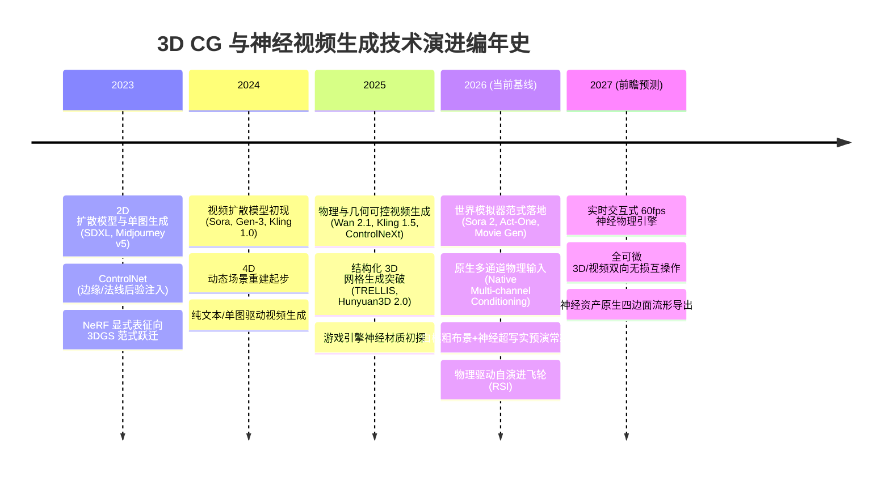
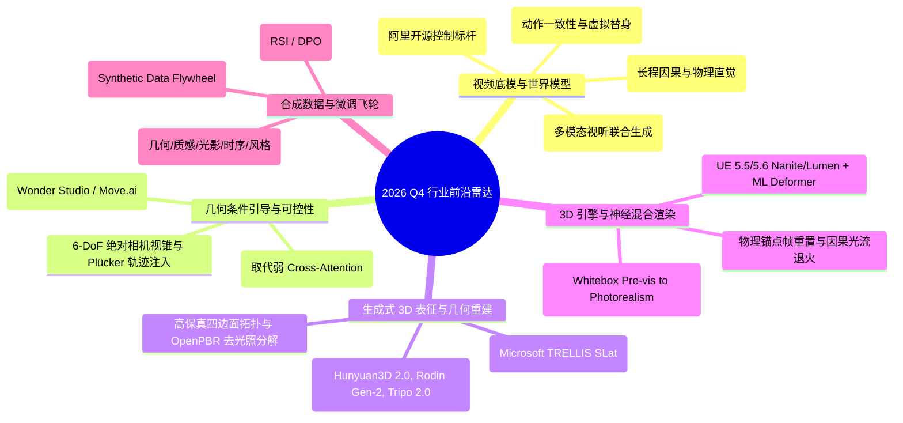
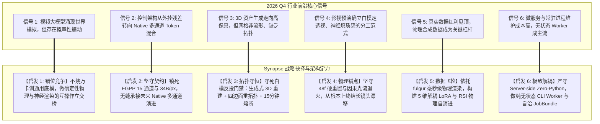

# Synapse 行业前沿追踪、趋势演进与架构启示录 (Industry Technology Radar, Trends & Architectural Insights)

> **文档定位**：Layer 2 算法 SDK、推理容器核与评测基准的行业坐标雷达与演进指南  
> **初始基线时间戳**：`2026-11-11T23:15:00+08:00` (2026 Q4)  
> **审阅周期与维护机制**：每双月度迭代审查（Bi-monthly Cadence），严格依据时间戳标注技术时效与有效性  
> **关联顶层基线**：
> - [docs/AUDIT_AND_ARCHITECTURE.md](AUDIT_AND_ARCHITECTURE.md) (整体目标审查与生态架构定界)
> - [docs/DESIGN_INDUSTRY_GAP_AND_COMPENSATION.md](DESIGN_INDUSTRY_GAP_AND_COMPENSATION.md) (行业差距分析与代偿设计规范)
> - [docs/DESIGN_REVIEW_AND_ALIGNMENT.md](DESIGN_REVIEW_AND_ALIGNMENT.md) (架构设计深度评审与对齐决议)
> - [docs/IMPLEMENTATION_PLAN.md](IMPLEMENTATION_PLAN.md) (M1–M8 实施总计划)

---

## 1. 追踪文档时效性管理与评级规范 (Traceability & Freshness Protocol)

为了杜绝技术文档“写完即过时、时效边界模糊”的常见缺陷，本文档建立严格的**时间切片追踪标准**与**技术假说状态标识**：

### 1.1 时效状态标记 (Freshness Status Badges)

| 状态标记 | 含义定义 | 应对动作与指导准则 |
| :--- | :--- | :--- |
| `🟢 Active Baseline` | 已经过充分验证的当前工业标准，已融入主工程架构 | 作为当前生产代码（M1–M4）的直接设计依据，锁死接口规范 |
| `🟡 Rapidly Evolving` | 过去 3–6 个月内出现的高速爆发技术，工业界尚未统一标准 | 在适配器层（M2/M5）预留接口槽位，建立 Mock 验证与小步迭代 |
| `🔵 Horizon Spec` | 处于论文验证或早期内测阶段的前瞻范式（6–18 个月视野） | 纳入 RSI 飞轮与评测基准（M4/M7），不直接入侵主干运行时 |
| `🔴 Deprecated / Pivoted` | 经工业界或本团队验证被证伪、存在致命硬伤或已被更优方案替代 | 归档并记录教训，在架构中设下“防踩坑”工程门禁 |

### 1.2 历史演进阶段划分 (Temporal Horizon Milestones)

---

## 2. 行业前沿最新进展全景追踪 (Industry State-of-the-Art Deep Dive)

截至 **2026 年第 4 季度**，数字内容创作（DCC）、AAA 游戏引擎与神经视频生成正在发生根本性的范式转移：**生成模型不再满足于 2D 像素的统计拟合，而是全面进阶为具备空间几何、光影守恒与动力学直觉的“物理世界模拟器 (World Foundation Models)”**。以下从五大前沿赛道深入剖析行业最新技术进展：

---

### 2.1 赛道一：视频生成底模与世界模型（Video Foundation & World Models）

#### 1. 阿里开源标杆：Wan 2.1 (Wan 2.1 14B / T2V / I2V) `🟢 Active Baseline`
- **最新进展**：Wan 2.1 作为 2025–2026 年开源领域最具工业价值的视频基础模型，采用 3D 因果 VAE（Causal Video VAE，压缩比高达 $4\times 8\times 8$）与 DiT（Diffusion Transformer）架构。其开源的 14B 权重不仅展现了与闭源模型（如 Gen-3、Kling 1.5）相当的运动大幅度与画面真实感，更因其开放权重与完整的潜空间表征，成为全球可控生成研究（ControlNeXt、Video-ControlNet）的黄金底座。
- **关键机制**：
  - 引入因果卷积与时空解耦注意力机制，有效降低显存峰值并支持自回归流式推演；
  - 具备出色的提示词依从度与局部光影渲染能力，但在面对无纹理白模、米制线性深度等非自然场景分布时，原厂潜空间仍存在几何解析钝化。

#### 2. OpenAI Sora / Sora 2 (World Simulators) `🟡 Rapidly Evolving`
- **最新进展**：从单纯的文生视频扩展至支持多智能体物理交互与 3D 摄像机平滑长程运镜。Sora 体系证实了通过海量时空 Patch Token 预训练，神经网络能够在潜空间内部自发涌现“重力、碰撞、遮挡、反射”等物理直觉（Physical Plausibility）。
- **行业瓶颈**：尽管视觉效果震撼，但依然是**概率统计驱动**而非**数值确定性驱动**。在复杂机械转动、精密足底着地摩擦、刚体铰接等极端情况下，仍然不可避免地发生“穿模”、“质量不守恒”与“结构幻觉”。

#### 3. 快手可灵 (Kling 1.5 / 2.0) 与 Runway Gen-3 Alpha / Act-One `🟢 Active Baseline`
- **最新进展**：
  - **Kling 2.0**：大幅强化了复杂运镜控制（水平平移、环绕、推拉变焦）下的画面稳定性，在 10 秒以上长视频中保持人物脸部与服装 ID 的高度一致；
  - **Runway Act-One**：实现了仅凭单路消费级手机摄像头的真人表演，无缝驱动复杂 3D 虚拟角色或写实数字人的微表情与大动态骨骼运动，彻底跳过了传统昂贵的面捕点云重定向流程。

#### 4. Meta Movie Gen `🟡 Rapidly Evolving`
- **最新进展**：Meta 发布的 Movie Gen 模型（30B 参数），集成了视频生成、精准视频编辑与环境音/拟音/配乐联合生成。其最大创新在于**精确指令局部重绘**：允许用户通过自然语言对视频中的特定物体进行物理级属性修改，同时保持背景像素和相机视差的绝对稳定。

---

### 2.2 赛道二：3D/物理几何条件引导与控制（3D & Physical Conditioning）

#### 1. 控制架构演进：从“外挂偏置注入”走向“原生多通道 Token 混合” `🟡 Rapidly Evolving`
- **技术现状**：早期 ControlNet 依靠残差分支将边缘图或法线图通过零卷积（Zero Convolution）注入 DiT 的 Cross-Attention 层。这种设计属于“事后强行纠正”，在底模先验强烈时容易出现“控制失效”或“画面严重降质变脏”。
- **2026 前沿趋势**：以 ControlNeXt 与 Wan-Control 为代表，行业转向 **Native Multi-channel Conditioning**。将渲染引擎产出的 15 通道几何特征（米制深度、世界法线、运动矢量）经过预对齐编码器直接映射为 Latent Tokens，在 DiT 的第 0 层就与视频潜变量拼接（Concatenation）或进行多流自注意力交互（Multi-stream Self-Attention），使得空间几何成为视频生成的内生一等公民。

#### 2. 6-DoF 绝对相机视锥与轨迹注入 `🟢 Active Baseline`
- **技术现状**：传统方案仅依靠相机运动方向提示词（如“pan left”, “zoom in”）或粗糙的光流偏置，完全无法用于精密影视合成。
- **2026 前沿趋势**：采用 **Plücker Coordinates 射线编码** 或 **相机外参矩阵投影 Tokens（Camera Extrinsic Tokens）**。渲染引擎在每帧导出精确的 $4\times 4$ 视图投影矩阵（View-Projection Matrix），模型利用对极几何约束（Epipolar Constraints）对潜在特征施加几何引导，确保长达 120 帧的复杂大曲率运镜不发生透视塌缩。

#### 3. 刚体骨骼与物理接触约束（Wonder Studio / Move.ai） `🟢 Active Baseline`
- **技术现状**：Autodesk Wonder Studio 证明了影视工业对“无标记点动捕（Markerless Mocap）+ 自动化替身替换”的刚性需求。通过预先绑定具有物理维度的 Humanoid 骨骼，在生成与合成过程中施加**足底零相对位移（Zero Foot-sliding IK）**与**关节角极限物理约束（Joint Angle Limits）**，彻底消除 AI 视频中常见的“滑步”与“关节脱臼”。

---

### 2.3 赛道三：生成式 3D 资产表征与反投重建（Generative 3D & Inversion Reconstruction）

#### 1. 结构化潜空间 3D (Microsoft TRELLIS SLat) `🟢 Active Baseline`
- **最新进展**：TRELLIS 提出了统一的 **Structured Latent (SLat)** 表征，攻克了长期以来 3D 生成中“显式几何（Mesh）与隐式神经场（NeRF/3DGS）难以兼得”的痛点。
- **核心机制**：
  - 第一阶段：通过 Sparse 3D VAE 将输入的单图/多图映射为 3D 稀疏潜空间张量；
  - 第二阶段：利用 Flow Matching 直接生成包含 Radiance Fields、3D Gaussian Splatting 与变形网格（Deformable Mesh）的多模态解耦几何。生成的 3D 模型不仅具有高保真辐射外观，更原生携带水密（Watertight）的多边形网格拓扑。

#### 2. 工业级 3D 资产生成器（Tencent Hunyuan3D 2.0 / Rodin Gen-2 / Tripo 2.0） `🟢 Active Baseline`
- **最新进展**：Hunyuan3D 2.0 与 Rodin Gen-2 将单资产生成时间压缩至 10–30 秒，且支持高保真 PBR 贴图烘焙（Albedo, Roughness, Metallic, Normal）。
- **行业瓶颈**：原厂生成的网格通常为高密度密集三角网格（Triangle Soup），面数普遍在 10 万至 50 万面之间，且存在大量退化非流形边缘（Non-manifold Edges），无法直接投入游戏或影视动画骨骼蒙皮。

#### 3. 工业化重拓扑与去光照材质解耦（Remeshing & OpenPBR Decomposition） `🟡 Rapidly Evolving`
- **前沿趋势**：
  - **自动四边面重拓扑（Quad Remeshing）**：利用 QuadWild 与混合整数规划（Mixed-Integer Optimization），将密集三角网格自动转化为遵循人体解剖结构与机械边缘流（Edge Loops）的规整四边面，面数精简至 1.5k–5k 游戏级标准；
  - **去光照内生分解（Intrinsic Image Decomposition）**：利用微调扩散先验将神经视频生成的烘焙画面彻底剥离出直接光照、高光残影与阴影，还原纯净的 OpenPBR 漫反射基础色（BaseColor），确保资产反投回 3D 引擎后可在任意全新光照环境下二次物理渲染。

---

### 2.4 赛道四：3D 引擎与神经混合渲染的融合（Deterministic 3D + Neural Render Fusion）

#### 1. 游戏引擎巨头的神经化演进（Epic UE 5.5/5.6 & NVIDIA Omniverse） `🟡 Rapidly Evolving`
- **最新进展**：
  - **Epic Games**：在 Unreal Engine 5.5/5.6 中深度集成 Nanite 几何微表面与 Lumen 实时光追的同时，重度引入机器学习变形器（ML Deformer）、神经超采样（Neural Super Sampling）以及神经材质（Neural Materials）；
  - **NVIDIA**：通过 ACE（Avatar Cloud Engine）与 DLSS 4 探索神经渲染与物理模拟的实时结合，推动实时 60fps 交互级神经角色管线。

#### 2. 影视与游戏工业的前置预演新范式（Whitebox Pre-vis to Photorealism） `🟢 Active Baseline`
- **行业痛点与新范式**：过去影视制作前期布景、灯光打样、运镜分镜设计耗时数月。目前好莱坞与顶级游戏工作室普遍转向**“粗白模布景 + 运镜锁定 + 神经生成超写实渲染 + 2D 瑕疵回填”**的高效流水线。
- **核心法则**：3D 引擎负责锁定严格的**空间透视（Perspective）、遮挡关系（Occlusion）与时间轴动作（Motion Timing）**，神经渲染模型负责填补**高频微表面纹理、复杂大气雾效与次表面散射（SSS）**，二者分工明确，绝不互相越界。

#### 3. 消除潜空间果冻与蠕动（Latent Drift / Jittering Mitigation） `🟢 Active Baseline`
- **技术现状**：神经视频生成最严重的工程顽疾是帧间微小的高频几何蠕动（Flicker）与累积漂移。
- **2026 前沿解法**：
  - **物理强锚点（Physical Keyframe Anchoring）**：在固定步长（如 48 帧）强制回读 3D 引擎确定性光栅帧作为硬约束切断误差；
  - **因果光流退火（Causal Optical Flow Annealing）**：利用 3D 引擎计算的精确运动矢量对神经生成的潜空间特征进行流式翘曲（Warping），仅在残差未对齐区域释放去噪自由度。

---

### 2.5 赛道五：合成数据与微调飞轮（Synthetic Data & Self-Evolution Flywheels）

#### 1. 物理合成数据革命（Synthetic-to-Real Domain Adaptation） `🟢 Active Baseline`
- **最新进展**：互联网公开视频的标注质量已达到收益递减临界点，头部大厂已全面转向使用高精度物理渲染引擎（如 Unreal Engine、Fulgur）批量渲染成对的**“几何真值（EXR 15 通道）+ 超写实视频”**作为训练集。
- **价值验证**：合成数据具备 100% 准确的无噪点深度、世界法线、精确无误差相机矩阵与物理材质属性，能够将模型对复杂几何与光影守恒的感知精度提升一个数量级。

#### 2. 5 维解耦 LoRA 多分支微调 `🟢 Active Baseline`
- **技术演进**：传统的单一全局 LoRA 会导致几何形状与画面质感“争抢参数容量”。
- **前沿范式**：将微调解耦为 5 个正交维度：
  1. `Geometry-LoRA`：仅对 DiT 的空间注意力层微调，学习深度与法线边缘对齐；
  2. `Material-LoRA`：学习粗糙度、金属度与微表面高光散射；
  3. `Lighting-LoRA`：学习高动态范围（HDR）辐射能量传递与阴影柔化；
  4. `Temporal-LoRA`：对时间注意力层微调，学习因果惯性与运动平滑；
  5. `Style-LoRA`：对跨模态投影层微调，注入特定美术风格先验。

#### 3. 物理验证器驱动的递归自演进（Physical RSI / DPO） `🔵 Horizon Spec`
- **前沿趋势**：将强化学习对齐从“人类主观打分（RLHF）”升级为“**物理规则打分（Physical RLAIF / DPO）**”。由物理引擎充当判别器（Judge）：
  - 自动检测视频帧中的足底滑步、透视畸变、光影能量不守恒；
  - 将物理违背度（Physical Violation Score）转化为惩罚奖励项，持续微调视频模型，构建无需人工干预的递归自我演进飞轮。

---

## 3. 行业前沿对 Synapse 的六大战略启发与架构定调 (Strategic Insights & Directives)

行业最新趋势充分验证了 `synapse` 在 sautille-stroke / DervGen 生态中的顶层架构决策是极其前瞻且正确的。针对大厂技术路线与开源前沿，我们确立**六大战略定力与差异化落地指引**：

---

### 3.1 启发 1：确立错位竞争护城河——不烧万卡训通用底模，做确定性物理与神经渲染的互操作桥梁

- **战略剖析**：作为初创或专注型工程团队，盲目投入上万张 GPU 去预训练通用的文生视频千亿模型是不可行的，也是战略上的以己之短攻敌之长。行业通用底模（如 Sora、Wan 2.1、Kling）虽然画面极其惊艳，但天然缺失**工业级厘米度量、绝对机械装配公差、可重用 3D 拓扑结构与可微光照二次编辑能力**。
- **Synapse 定位**：我们的护城河是**“物理绝对确定性 3D 引擎（`fulgur`/`caelum-core`）+ 纯 C++ 几何算法核（`vg-core`）+ 神经视频生成的往返互操作桥梁（`synapse`）”**。我们不生产底模，我们为底模插上物理引擎的翅膀，把不可控的概率像素转化为可入库、可编辑、可烘焙的工业级 3D 资产。

---

### 3.2 启发 2：坚守 FGPP 15 通道与 34 B/px，无缝承接未来原生多通道 Token 架构

- **战略剖析**：行业从 ControlNet 外挂式注入向 Native Multi-channel 演进的趋势，彻底证明了我们在 Layer 0（`@aether//fgpp`）中通过 C++20 强类型锁死 15 标量通道（`BaseColor.RGB`, `CameraLinearDepth.Z`, `Cryptomatte.ID`, `DirectRadiance.RGB`, `MotionVector.XY`, `RoughnessMetallic.GR`, `WorldNormal.XYZ`）的英明性。
- **落地指引**：
  - 严禁在 Python 端私自增减或重命名通道（如 RV-01 纠偏）；
  - `synapse.fgpp` 作为线格式校验器，不仅服务于当下的 `Wan 2.1` 适配器，更在数据布局上直接兼容未来将 15 通道作为原生 Token 输入的新一代物理视频底模。

---

### 3.3 启发 3：白模反投防呆铁律——必须经“生成式 3D 重建 + 四边面重拓扑”，严禁粗暴贴图反投

- **战略剖析**：TRELLIS 与 Hunyuan3D 2.0 的进展表明，单纯依靠 2D 视频反投到光滑的无纹理白模 UV 上，必然导致严重拉伸、透视伪影与烘焙死光。
- **落地指引（RFC 0044 §4.1 & §4.4）**：
  - **白模顶点底线**：角色白模代理必须满足顶点数 $\ge 1500$ 且具备铰接四肢；
  - **重建与重拓扑门禁**：AI 生成的视频必须先经 3D 资产重建（TRELLIS/Hunyuan3D）恢复三维体素，再经 `vg-core` 进行四边面重拓扑（Quad Remeshing）与去光照解耦，最后才能作为 PBR 资产反投回 USD 场景；
  - **HITL 工程熔断**：单镜头人工精修超过 **15 分钟** 必须自动触发工程降级，防止生产线被局部瑕疵彻底阻塞。

---

### 3.4 启发 4：48 帧物理强锚点与流式因果滑窗是击穿潜空间漂移的核心武器

- **战略剖析**：大厂依靠单纯扩大模型上下文窗口来缓解漂移，计算复杂度呈平方级膨胀且无法彻底避免累积误差。
- **落地指引**：
  - 坚持 **48 帧物理重置（Physical Reset）**：在固定步长处强行回读 3D 引擎的真值缓冲切断潜空间蠕动；
  - 坚持 **因果流式滑窗（16 帧重叠退火）**：显存峰值严格压制在单卡 24GB/48GB 物理边界内，使长达数千帧的连贯影视运镜能够在单台 GPU 节点上稳定无损输出。

---

### 3.5 启发 5：依托 fulgur 毫秒级渲染，构建 5 维解耦 LoRA 与 RSI 物理自演进飞轮

- **战略剖析**：合成数据是弥补大厂算力差距的最佳杠杆。`fulgur` 作为现代 C++20 AAA 渲染器，具备毫秒级无头批量导出 FGPP 序列的能力。
- **落地指引**：
  - 在 `synapse.lora` 中全面落地 **5 维解耦 LoRA 训练流水线**，避免单一权重导致的能力冲突；
  - 在 `synapse.rsi` 中将物理验证指标（足底滑动、穿模检测、光能守恒）直接挂入迭代反馈环，实现“物理渲染合成数据 $\to$ 模型微调 $\to$ 物理质检 $\to$ 权重自演进”的无人值守飞轮。

---

### 3.6 启发 6：坚守 Server-side Zero-Python，极致收敛为无状态 CLI Worker

- **战略剖析**：复杂的微服务架构、常驻常态化 Python 服务往往伴随着内存泄漏、CUDA 驱动死锁与复杂的分布式运维黑洞。
- **落地指引（Rule 11 & NG-5）**：
  - `synapse` 绝不编写 HTTP/WebSocket 服务端守护进程，生产调度统一交由 Go（`render-farm` / `narrative-rail`）承载；
  - `synapse` 保持为**纯无状态 CLI Worker**（输入一个自洽的 `JobBundle` 目录，单次执行完毕后立即释放全部 GPU 显存并退出），统一采用确定性退出状态码（`0/10/20/30/40`）与 `agent_fix_hint`，完美适配 Kubernetes/Slurm 等弹性算力编排。

---

## 4. 落地行动路线映射与版本演进看板 (Actionable Roadmap to Synapse M1–M8)

将行业前沿技术启发无缝对齐至仓内实施总计划 [docs/IMPLEMENTATION_PLAN.md](IMPLEMENTATION_PLAN.md)：

| 行业前沿技术 | 核心技术点 | 对应 Synapse 实施模块 | 承接 PR 编号 | 验收标准与交付物 |
| :--- | :--- | :--- | :--- | :--- |
| **Wan 2.1 / DiT 适配** | 3D 因果 VAE、流式滑窗 | `synapse.adapters.wan21` | `PR-05`, `PR-06` | 支持 Wan 2.1 14B 本地与云端推理，支持 48f 滑窗与因果退火 |
| **FGPP 物理多通道校验** | 15 通道 ASCII 字典序、34B/px | `synapse.fgpp` | `PR-02` | 与 `@aether//fgpp` C++ 跨语言黄金测试字节级 100% 对齐 |
| **绝对相机控制与去色调** | 6-DoF 矩阵外参、ACEScg 双曲软肩 | `synapse.composite` | `PR-07`, `PR-08` | 辐射能量严格守恒，杜绝极端高光 NaN 溢出，对齐视图投影矩阵 |
| **跨模态基准与对齐评测** | 几何、时序、风格三级质检 | `synapse.bench` | `PR-09`–`PR-14b` | 场景创建、指标流水线、HTML/Markdown 报告与 CLI `evaluate` |
| **5 维解耦 LoRA 飞轮** | 几何/质感/光影/时序分层微调 | `synapse.lora` | `PR-16`–`PR-20` | 支持成对 FGPP 合成数据打包、分层 LoRA 训练与权重合并导出 |
| **白模反投与 3D 质检门禁** | 顶点下限、拓扑流形、15分钟熔断 | `synapse.inspect` | `PR-21`–`PR-23` | 1500 顶点粗糙度下限防呆，四边面重拓扑对接，HITL 熔断监控 |
| **物理驱动自演进 (RSI)** | 物理裁判驱动 DPO/自演进 | `synapse.rsi` | `PR-24`–`PR-26` | 自动化误差归因，自动化生成纠偏数据集并驱动循环自训练 |
| **桌面端轻量可视化审查** | 零重型 Python 桌面端交互 | `tools/data-inspector` | `PR-27`–`PR-29` | Electron + C++ 原生视口，实时检查 15 通道 FGPP 与合成视频对齐 |

---

## 5. 追踪文档持续维护与审阅日志 (Living Changelog & Tracking Radar)

本文档设立增量维护机制，后续每次行业重大技术发布或双月度例行业务评审时，依循下表记录演进追踪：

| 修订时间 (ISO-8601) | 审阅责任人 / 模型标识 | 追踪技术事件 / 论文 / 工业发布 | 状态评级变动 | 对主架构影响与决策记录 |
| :--- | :--- | :--- | :---: | :--- |
| `2026-11-11T23:15:00+08:00` | sautille-stroke 核心架构组 / `[gemini3.8]` | **文档初始化**：全面梳理 2026 Q4 行业前沿格局（Wan 2.1, Sora 2, TRELLIS, UE 5.6 等），建立时效追踪体系与六大架构启发 | `🟢 Baseline Established` | 确立 3D 物理底座代偿路线；锁死 FGPP 15 通道；固化白模反投四边面门禁与 15 分钟熔断 |
| *待定 (2027 Q1 预定)* | *待定* | *追踪 Wan 2.2 / Sora 2 API 开放情况及 TRELLIS-v2 拓扑导出特性* | *待审阅* | *评估是否在 M5 引入原生多流自注意力微调算子* |

---

> **结语与核心宗旨**：  
> “行业巨头用数万张 GPU 构建概率性的世界幻觉，我们用现代 C++ AAA 物理确定性构建真实世界的基石。**让物理回归物理，让神经填充想象，二者交汇之处，即是 Synapse。**”
