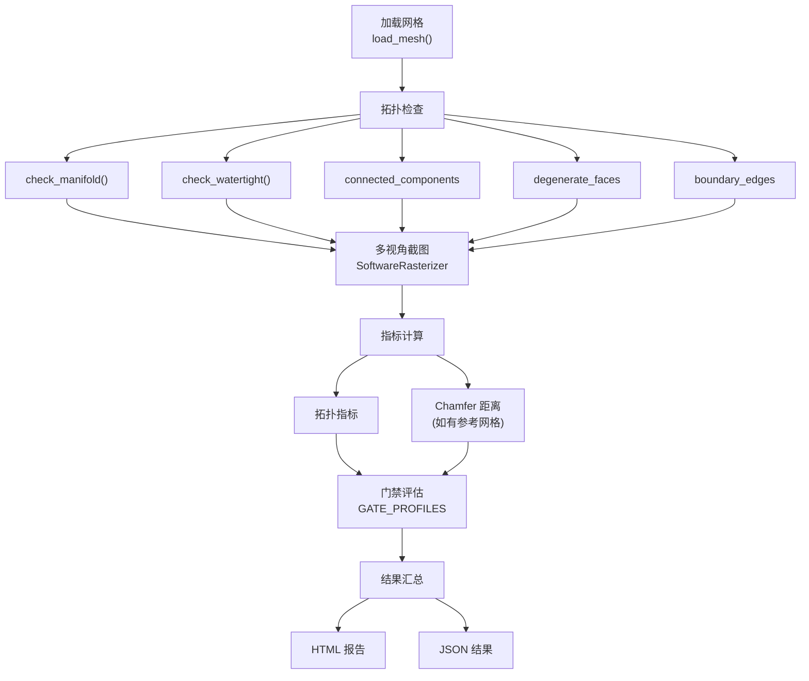

# 3D 模型评估体系 — 完整交付清单与 Review 指南

> **会话时间**: 2026-11-12 18:30 ~ 21:25 (UTC+8)
> **操作模型**: `opus4.6` / `gemini3.8`
> **目标仓库**: `sautille-stroke/synapse` (`main` branch)
> **最终 Commit**: [`caa6a8d`](https://github.com/sautille-stroke/synapse/commit/caa6a8d)
> **回归验证**: ✅ 全仓 739 passed, 2 skipped, 0 failures (222s)

---

## 一、Commit 日志总览

本次会话共产出 **3 个有效 Commit**（另有 1 个 `1202fae` 为其他会话的 PR merge，不在本次 scope 内）：

| # | Commit | 类型 | 标题 | 新增行 | 操作者 |
|:--|:-------|:-----|:-----|------:|:-------|
| 1 | `7777201` | docs | 3D 质量检测与训练数据规范 v1.0 | +404 | `gemini3.8` |
| 2 | `7c3a7f0` | docs | 评估指标矩阵、外部数据集规范与差距路线图 v2.0 | +206 | `opus4.6` |
| 3 | `caa6a8d` | feat | 评估脚本 + HTML 报告模板 + 测试 | +1,603 | `opus4.6` |
| | | | **合计** | **+2,213** | |

---

## 二、Commit 1 — 设计文档 v1.0 (7777201)

**标题**: `docs(inspect): add self-contained 3D quality inspection and training data specs [gemini3.8]`

### 变更文件

| 文件 | 变更 | 说明 |
|:-----|:-----|:-----|
| [`docs/DESIGN_3D_MODEL_ENHANCEMENT_AND_DATA_SPEC.md`](file:///h:/dervgen/synapse/docs/DESIGN_3D_MODEL_ENHANCEMENT_AND_DATA_SPEC.md) | **新建** (+347) | 3D 生成模型质量提升方法论与训练数据工程规范 |
| [`docs/DESIGN_3D_INSPECTION_AND_REFINEMENT.md`](file:///h:/dervgen/synapse/docs/DESIGN_3D_INSPECTION_AND_REFINEMENT.md) | 修改 (+59/-4) | 新增 Tier 0 确定性几何门禁、脱耦自包含架构边界 |
| [`docs/plans/PLAN-M6-M7-INSPECTION-AND-RSI-FLYWHEEL.md`](file:///h:/dervgen/synapse/docs/plans/PLAN-M6-M7-INSPECTION-AND-RSI-FLYWHEEL.md) | 修改 (+1/-1) | 更新自包含架构引用 |
| [`AGENTS.md`](file:///h:/dervgen/synapse/AGENTS.md) | 修改 (+1/-1) | 添加文档导航条目 |

### 核心内容

**`DESIGN_3D_MODEL_ENHANCEMENT_AND_DATA_SPEC.md` v1.0** 包含 5 个章节：

1. **§1 概述与核心痛点** — 生成式 3D 模型的质量断层问题定义
2. **§2 缺陷全景病理诊断** — 4 层级缺陷分类体系（几何拓扑 → UV/展开 → 材质外观 → 语义/物理）
3. **§3 多层递进质量提升方法论** — 从确定性规则清洗到可微反演精修
4. **§4 高品质训练数据工程规范** — 数据格式、通道、分布与标注契约
5. **§5 工业落地路线图** — 验收自查清单

### Review 要点

- [ ] §2 的 4 层级缺陷分类是否覆盖了我们实际遇到的所有问题？
- [ ] §3 的质量提升方法论优先级是否合理（确定性清洗 > 可微精修 > 推理微调）？
- [ ] §4 的训练数据规范与 FGPP v1.0 线格式是否对齐？

---

## 三、Commit 2 — 评估体系完整性审计与补全 (7c3a7f0)

**标题**: `docs(eval): complete 3D model evaluation metrics matrix, external dataset spec and gap roadmap [opus4.6]`

### 变更文件

| 文件 | 变更 | 说明 |
|:-----|:-----|:-----|
| [`docs/DESIGN_3D_MODEL_ENHANCEMENT_AND_DATA_SPEC.md`](file:///h:/dervgen/synapse/docs/DESIGN_3D_MODEL_ENHANCEMENT_AND_DATA_SPEC.md) | 修改 (+203) | 升级至 v2.0，新增 3 个核心章节 |
| [`docs/DESIGN_3D_INSPECTION_AND_REFINEMENT.md`](file:///h:/dervgen/synapse/docs/DESIGN_3D_INSPECTION_AND_REFINEMENT.md) | 修改 (+5/-3) | 添加跨文档对齐说明 |
| [`AGENTS.md`](file:///h:/dervgen/synapse/AGENTS.md) | 修改 (+1) | 更新导航标题 |

### 核心内容 — v2.0 新增 3 个章节

#### §6 评估指标全景矩阵

完整盘点了 18 个已实现指标 + ~15 个设计未实现指标，按 4 个支柱分类：

| 支柱 | 已实现指标 | 未实现指标（P0/P1） |
|:-----|:----------|:-------------------|
| Temporal | `flicker_score`, `temporal_warp_error` | — |
| FGPP Fidelity | `depth_rmse_m`, `normal_angular_error_deg`, `silhouette_iou` | `scale_invariant_depth_error` |
| Roundtrip | `chamfer_mm`, `volume_breathing`, `f_score` | **`psnr_db`**, **`ssim`**, **`lpips`** (P0) |
| Style | `style_color_de`, `style_light_error_deg` | `dino_cosine_sim`, `lpips_vgg` (P0) |
| Topology | `is_manifold`, `is_watertight` (bool) | `euler_characteristic`, `connected_components_count` (P1) |
| UV | — | `uv_area_distortion`, `seam_discontinuity_deg` (P1) |
| Curvature | — | `discrete_mean_curvature_variance` (P1) |

#### §7 外部 3D 数据集集成规范

覆盖 7 个外部数据集的接入方式：GSO, Objaverse-XL, ABO, OmniObject3D, Thingi10K, Tanks&Temples, CO3D

#### §8 差距修复路线图

| 阶段 | 优先级 | 预期工时 | 内容 |
|:-----|:-------|:---------|:-----|
| P0-Sprint | 🔴 | 1-3 天 | PSNR/SSIM/LPIPS/CIE∆E2000 + DINOv2 + 场景指标名映射 |
| P1-Topo | 🟡 | 2-3 天 | Euler 特征、连通分量计数、退化面计数、非流形边计数 |
| P1-UV | 🟡 | 2-3 天 | UV 面积畸变、接缝不连续角度、纹素密度方差 |
| P1-Curvature | 🟡 | 2-3 天 | 离散平均曲率方差、表面粗糙度 |
| P1-Data | 🟡 | 3-5 天 | 集成外部 3D 资产数据集 |
| P2-Misc | 🟢 | 1-2 天 | 尺度不变深度误差、直方图交集 |

### Review 要点

- [ ] §6 的指标优先级分类是否合理？P0 是否应优先实施？
- [ ] §7 外部数据集选型是否满足我们的实际评测需求？
- [ ] §8 的工时估算是否与团队节奏匹配？

---

## 四、Commit 3 — 评估脚本与报告模板 (caa6a8d) ⭐ 核心交付

**标题**: `feat(eval): add 3D model evaluation script and HTML report template [opus4.6]`

### 变更文件

| 文件 | 行数 | 变更 | 说明 |
|:-----|:-----|:-----|:-----|
| [`python/synapse/inspect/eval_report.py`](file:///h:/dervgen/synapse/python/synapse/inspect/eval_report.py) | 533 | **新建** | HTML 报告生成器 |
| [`scripts/evaluate_3d_models.py`](file:///h:/dervgen/synapse/scripts/evaluate_3d_models.py) | 625 | **新建** | CLI 评估脚本 |
| [`tests/test_eval_report.py`](file:///h:/dervgen/synapse/tests/test_eval_report.py) | 396 | **新建** | 24 项自动化测试 |
| [`docs/DESIGN_3D_MODEL_ENHANCEMENT_AND_DATA_SPEC.md`](file:///h:/dervgen/synapse/docs/DESIGN_3D_MODEL_ENHANCEMENT_AND_DATA_SPEC.md) | +49 | 修改 | 新增 §8.3 评估脚本文档 |

---

### 4.1 评估脚本 [`scripts/evaluate_3d_models.py`](file:///h:/dervgen/synapse/scripts/evaluate_3d_models.py)

#### CLI 接口

```bash
python scripts/evaluate_3d_models.py \
  --input-dir ./models/             # 输入模型目录 (.obj/.glb/.ply)
  --output-dir ./eval_output/       # 输出目录 (HTML + JSON)
  --reference-dir ./reference/      # 可选: 参考网格 (计算 Chamfer)
  --profile TRACK_A_ASSET           # 门禁配置
  --resolution 256                  # 截图分辨率
  --num-views 8                     # 多视角截图数量
  --json                            # 纯 JSON 输出到 stdout
```

#### 退出码 (per AGENTS.md §3)

| Code | 含义 |
|:-----|:-----|
| `0` | 成功，所有模型通过门禁 |
| `10` | 参数校验失败 |
| `20` | 输入目录/文件缺失 |
| `40` | 门禁未通过（报告仍生成） |

#### 评估流程 (每个模型)



#### 门禁配置

| Profile | `is_manifold` | `is_watertight` | `degenerate` | `chamfer_mm` |
|:--------|:-------------|:----------------|:------------|:-------------|
| `TRACK_A_ASSET` | ✓ 必须 | ✓ 必须 | = 0 | < 5mm |
| `TRACK_B_VIDEO` | ✓ 必须 | — | — | < 10mm |
| `RSI_PROMOTION` | ✓ 必须 | ✓ 必须 | = 0 | < 3mm |

#### 零外部依赖设计

- **网格加载**: 内置纯 Python OBJ 解析器；`trimesh` 仅作可选 fallback
- **截图渲染**: `SoftwareRasterizer` 纯 NumPy 软件光栅化，无 GPU 需求
- **PNG 编码**: 纯 Python 实现 (`struct` + `zlib`)，无需 PIL/opencv
- **Chamfer 距离**: 纯 NumPy 向量化计算（>10K 顶点自动降采样）

### Review 要点

- [ ] 门禁阈值（特别是 `chamfer_mm`）是否与生产要求匹配？
- [ ] 是否需要增加更多门禁配置（如按资产类别区分）？
- [ ] `--resolution 256` 默认值是否足够（截图清晰度 vs 渲染速度）？

---

### 4.2 HTML 报告生成器 [`python/synapse/inspect/eval_report.py`](file:///h:/dervgen/synapse/python/synapse/inspect/eval_report.py)

#### 数据模型

```python
@dataclass
class TopologyResult:
    is_manifold: bool
    is_watertight: bool
    num_vertices: int
    num_faces: int
    num_connected_components: int
    has_degenerate_faces: bool
    num_boundary_edges: int

@dataclass
class ModelEvalResult:
    model_name: str
    model_path: str
    topology: TopologyResult
    metrics: dict[str, float]
    gate_results: dict[str, bool]
    screenshots_base64: list[str]   # base64 PNG 内联图
    screenshot_labels: list[str]    # 视角标签
    overall_passed: bool
    error: str | None = None

@dataclass
class EvalReportData:
    timestamp: str
    profile_name: str
    models: list[ModelEvalResult]
    reference_dir: str | None = None
```

#### 报告结构

| 报告组件 | 实现方式 | 说明 |
|:---------|:--------|:-----|
| 概要仪表盘 | HTML 表格 | 模型名、状态徽章、顶点数、面数、流形、水密 |
| 聚合雷达图 | 内联 SVG | 跨模型平均归一化得分 |
| 逐模型详情卡 | HTML 卡片 | 绿/红边框区分 PASS/FAIL |
| ├─ 截图画廊 | base64 `` | 200×200 CSS Flex 布局，暗色背景 |
| ├─ 拓扑摘要 | HTML 表格 | ✓/✗ 图标 |
| ├─ 指标表 | HTML 表格 | 数值 + PASS/FAIL 徽章 |
| └─ 逐模型雷达图 | 内联 SVG | 归一化指标可视化 |

#### 指标归一化映射 (`_normalize_metric`)

| 指标 | 归一化公式 | 含义 |
|:-----|:----------|:-----|
| `chamfer_mm` | `1 - min(val/10, 1)` | 0mm → 1.0, 10mm → 0.0 |
| `volume_breathing` | `1 - min(abs(val)/0.5, 1)` | 0 → 1.0, ±0.5 → 0.0 |
| `silhouette_iou` | `val` (直接使用) | 0~1 越大越好 |
| `is_manifold/watertight` | `1.0 if val≥0.5 else 0.0` | 布尔转浮点 |

### Review 要点

- [ ] 报告样式/布局是否满足 review 需求？
- [ ] 归一化映射的范围选择是否合理（如 chamfer 10mm = 0 分）？

---

### 4.3 测试覆盖 [`tests/test_eval_report.py`](file:///h:/dervgen/synapse/tests/test_eval_report.py)

#### 测试清单 (24 项全部通过)

| 测试类 | 测试方法 | 验证内容 |
|:-------|:---------|:---------|
| **TestDataModel** | `test_topology_result_creation` | TopologyResult 字段访问 |
| | `test_model_eval_result_creation` | ModelEvalResult 构造 |
| | `test_eval_report_data_creation` | EvalReportData 构造 |
| **TestHTMLReport** | `test_generate_basic_report` | 2 模型(1 pass/1 fail)报告，验证 HTML 包含标题、模型名、PASS/FAIL、SVG、base64 截图 |
| | `test_generate_empty_report` | 空模型列表仍产出有效 HTML |
| | `test_report_contains_metrics_table` | 每个指标名出现在 HTML 中 |
| | `test_report_screenshot_gallery` | 4 张截图标签全部出现 |
| | `test_report_creates_parent_dirs` | 深层嵌套目录自动创建 |
| **TestTopologyChecks** | `test_cube_is_manifold` | 程序化 Cube 通过流形检查 |
| | `test_cube_not_watertight_due_to_split_vertices` | Cube 因分裂顶点非水密（预期行为） |
| | `test_sphere_is_manifold` | 程序化 Sphere 通过流形检查 |
| | `test_sphere_not_watertight_due_to_seam` | Sphere 因 UV 接缝非水密（预期行为） |
| | `test_plane_not_watertight` | 开放平面正确判定为非水密 |
| **TestNormalizeMetric** | `test_chamfer_zero` | chamfer=0 → 1.0 |
| | `test_chamfer_ten` | chamfer=10 → 0.0 |
| | `test_chamfer_five` | chamfer=5 → 0.5 |
| | `test_manifold_true` | manifold=1.0 → 1.0 |
| | `test_manifold_false` | manifold=0.0 → 0.0 |
| | `test_silhouette_iou` | iou=0.95 → 0.95 |
| | `test_volume_breathing_zero` | breathing=0 → 1.0 |
| | `test_volume_breathing_half` | breathing=0.25 → 0.5 |
| **TestEvalScript** | `test_smoke_run` | 🔗 端到端集成测试：Cube→OBJ→CLI→JSON+HTML |
| | `test_missing_input_dir` | 不存在目录 → exit code 20 |
| | `test_empty_input_dir` | 空目录 → exit code 20 |

### Review 要点

- [ ] 是否需要增加负面测试（如损坏的 OBJ 文件）？
- [ ] 集成测试是否需要覆盖 `--reference-dir` 路径？

---

## 五、全仓回归验证

```
Platform: Windows 11 / Python 3.12.8 / pytest 9.1.1
Duration: 222.24s (3m 42s)
Result:   739 passed, 2 skipped, 0 failures ✅
```

> [!NOTE]
> 2 个 skip 为预期行为（依赖可选 GPU 或特定网络环境的测试）。
> 按照 AGENTS.md 规范，全量测试应在 `ubuntu24` 云端机器上验证以获取最终 CI 结果。

---

## 六、文件索引快速导航

### 新建文件

| 文件 | 行数 | 用途 |
|:-----|:-----|:-----|
| [`docs/DESIGN_3D_MODEL_ENHANCEMENT_AND_DATA_SPEC.md`](file:///h:/dervgen/synapse/docs/DESIGN_3D_MODEL_ENHANCEMENT_AND_DATA_SPEC.md) | 595 | 设计规范 v2.0 (方法论 + 指标矩阵 + 数据集 + 路线图) |
| [`python/synapse/inspect/eval_report.py`](file:///h:/dervgen/synapse/python/synapse/inspect/eval_report.py) | 533 | HTML 报告生成器 |
| [`scripts/evaluate_3d_models.py`](file:///h:/dervgen/synapse/scripts/evaluate_3d_models.py) | 625 | CLI 评估脚本 |
| [`tests/test_eval_report.py`](file:///h:/dervgen/synapse/tests/test_eval_report.py) | 396 | 24 项自动化测试 |

### 修改文件

| 文件 | 变更摘要 |
|:-----|:---------|
| [`AGENTS.md`](file:///h:/dervgen/synapse/AGENTS.md) | 添加文档导航条目 |
| [`docs/DESIGN_3D_INSPECTION_AND_REFINEMENT.md`](file:///h:/dervgen/synapse/docs/DESIGN_3D_INSPECTION_AND_REFINEMENT.md) | Tier 0 门禁 + 跨文档对齐说明 |
| [`docs/plans/PLAN-M6-M7-INSPECTION-AND-RSI-FLYWHEEL.md`](file:///h:/dervgen/synapse/docs/plans/PLAN-M6-M7-INSPECTION-AND-RSI-FLYWHEEL.md) | 架构引用更新 |

---

## 七、后续 TODO（未在本次实施范围内）

> 以下均来自 §8 路线图，按优先级排列：

| 优先级 | 项目 | 预期工时 | 依赖 |
|:-------|:-----|:---------|:-----|
| 🔴 P0 | 实现 `psnr_db`/`ssim`/`lpips`/`ciede2000` 计算函数 | 1-3 天 | `metrics/image_quality.py` (新建) |
| 🔴 P0 | 实现 `dino_cosine_sim`/`lpips_vgg` 感知指标 | 1-2 天 | 可选依赖 `torch`/`timm` |
| 🔴 P0 | 修复场景指标名称映射 (alias) | 0.5 天 | `metrics/profiles.py` |
| 🟡 P1 | 量化拓扑指标 (euler, components, non-manifold edges) | 2-3 天 | `recon/geometry.py` |
| 🟡 P1 | UV 质量指标 (面积畸变, 接缝不连续) | 2-3 天 | 新建模块 |
| 🟡 P1 | 集成 GSO + Objaverse 外部数据集 | 3-5 天 | 网络 + 存储 |
| 🟢 P2 | 报告增加参考网格对比截图 (side-by-side) | 1 天 | `eval_report.py` |
| 🟢 P2 | 增加 `--compare-mode` 差分热力图 | 1-2 天 | `eval_report.py` |
