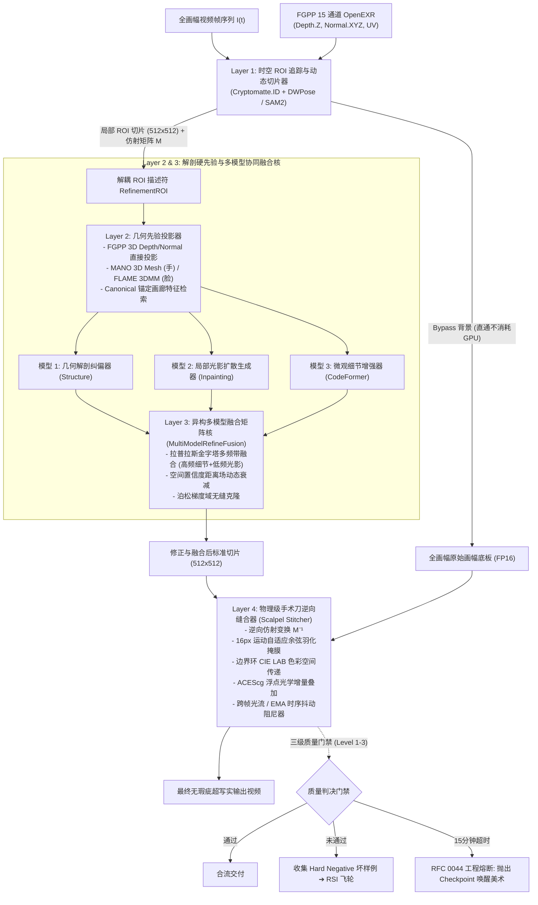

# RFC 0061: 局部解剖智能修正、多模型协同融合与工业级手术刀缝合规范与规划
# (Local Anatomical Refinement, Multi-Model Fusion & Industrial Scalpel Stitching Specification & Plan)

- **RFC 编号**: `RFC 0061`
- **文档状态**: `Proposed Standard (v1.0)`
- **责任体系**: sautille-stroke / DervGen 核心架构组 (`synapse`, `fulgur`, `caelum-core`, `aether`, `foundary`)
- **关联生态规约**:
  - **RFC 0039**: 资产解耦、自洽作业闭包 (`JobBundle`) 与 DCC 连接器架构
  - **RFC 0044**: 神经-物理混合工业流水线、特征引导协议 (`FGPP`) 与人机协同 (`HITL`) 跨仓编排规约
  - **RFC 0058**: OpenUSD Hydra、MaterialX / OpenPBR 1.0 与 ACEScg 跨平台架构
  - **RFC 0060**: 真实视频逆向 3D 动态数字孪生与联合反演设计规范
  - **FGPP v1.0**: 15 标量通道 OpenEXR 线格式 (`34 B/px`，含 `CameraLinearDepth.Z`, `WorldNormal.XYZ`, `Cryptomatte.ID`)
- **目标受众**: 神经渲染算法工程师、角色与绑定技术总监 (TD)、视觉特效 (VFX) 合成专家、无状态 Worker 编排 Agent

---

## 1. 摘要 (Abstract)

在数字内容创作（DCC）与神经视频生成管线中，全身或中景镜头下的**手部（Hands）**与**脸部（Faces）**存在结构性、解剖学级别的感知失真（六指/融指、视线斜视、恐怖谷微表情坍塌、身份漂移与时序闪烁）。这一失真是潜空间下采样压缩与全局注意力稀释的必然数学结果，单一全画幅生成模型在理论与工程上均无法彻底解决。

本 RFC 确立了面向工业级影视与游戏生产的**“局部解剖智能修正、多模型协同融合与手术刀逆向缝合”**标准体系：
1. **分治瓦片化计算（Tiled Bypass Architecture）**：全画幅背景直通（Bypass），仅对存在缺陷的动态时空 ROI 提取 $512 \times 512$ 标准切片，节省 90%+ 算力；
2. **多源解剖硬约束注入（Anatomical Hard Priors）**：结合 FGPP 原生 3D 深度/法线、MANO 3D 手部骨骼网格、FLAME 3DMM 与 PulID/ArcFace 身份正交特征投影；
3. **多模型输出融合矩阵（Five Fusion Paradigms）**：标准化拉普拉斯金字塔频域分解、几何-纹理串行级联、采样潜在轨迹时步解耦、空域置信度加权以及泊松梯度域融合；
4. **物理级无缝逆向缝合（Industrial Scalpel Stitching）**：复用 $16\text{px}$ 运动自适应手术刀掩膜、边界环 CIE LAB 色彩空间传递、ACEScg 浮点光学增量叠加与光流/EMA 时序高频抖动阻尼；
5. **人机协同与质量门禁（Three-Tier HITL & Quality Gates）**：执行三级介入阶梯，严格落实 RFC 0044 单镜头 15 分钟熔断机制，并将异常坏帧自动采集为 Hard Negative 数据，驱动 RSI 递归自我演进飞轮。

---

## 2. 架构动机与行业痛点分析 (Problem Statement & Industry Analysis)

```
                       ┌── 潜空间下采样 ── 8x/16x 压缩，手/脸在潜空间仅剩几个 Token，微观几何彻底模糊
                       ├── 拓扑高自由度 ── 人手 21 关节、20+ 自由度与极高自遮挡，极易出现六指/融指
神经生成三大结构性缺陷 ┼── 恐怖谷敏感性 ── 人类视觉系统对双眼瞳孔对称度、睫毛、嘴形微表情容错率为零
                       └── 身份时序漂移 ── 运镜大幅度旋转或遮挡后，注意力机制遗忘面部底层骨骼特征
```

### 2.1 全画幅大模型不可承受之重

头部视频扩散大模型（Wan 2.1、Sora、Kling）的目标函数优化的是**全局像素的一致性分布与宏观物理运动**（如流体、重力、布料大褶皱、相机大范围运镜）。在 $1280 \times 720$ 或 4K 分辨率下：
- 手部区域通常仅占全图面积的 $1\% \sim 5\%$；
- 脸部通常仅占全图面积的 $2\% \sim 8\%$。

根据香农信息论与注意力注意力预算分配定律，全局注意力无法向微观区域倾斜足够的计算密度。如果为了修整手部而不断增大全画幅 DiT 的参数量，推理成本将呈超线性爆炸（$O(N^2)$），这在影视量产和游戏实时化中是绝对不可接受的。

### 2.2 行业成熟实践的启示

1. **工业特效分层法则（VFX Layering）**：从好莱坞胶片时代到现代数字合成，没有一部特效大片是单 Pass 成型的。几何骨骼必须走确定性 3D，微观质感走生成式着色；
2. **多模型协同的必然性**：没有任何单一模型能同时兼顾“宏观光照一致”、“严谨解剖拓扑”与“毛孔级超高频真实感”。几何模型（HandRefiner/3DMM）负责把骨架摆对，生成式扩散模型（Wan Inpaint）负责把环境光影接顺，微观修复模型（CodeFormer/GFPGAN）负责点亮瞳孔高光与指纹；
3. **色彩科学守恒（ACEScg / OCIO）**：局部图块在神经模型与原图之间往返时，必须在场景线性（Scene-Linear）浮点空间中进行，任何 sRGB 8-bit 的粗暴裁剪都会导致高光死白、暗部色阶断裂与明显的“贴膏药”拼缝。

---

## 3. 系统整体架构与数据拓扑 (System Architecture & Topology)

RFC 0061 定义的端到端修正拓扑分为四大解耦层级：



---

## 4. 核心子系统详细设计规范 (Subsystem Specifications)

### 4.1 Layer 1: 时空 ROI 追踪与 Tile-based Bypass 调度器

*   **设计原则**：最大化显存与算力效率，避免对无瑕疵区域进行无效计算。
*   **瓦片化调度机制**：
    1. **实体与解剖区域定位**：
       - 若存在 FGPP：直接利用 `Cryptomatte.ID` 锁定角色的头颈与手腕部件；
       - 若无 FGPP（纯视频反演 Track）：调用 DWPose WholeBody 关键点定位眼睛双瞳中点与手腕关节点。
    2. **时序平滑卡尔曼 Bounding Box（Kalman BBox Filter）**：
       - 严禁逐帧硬抓取外接矩形（会引入微小抖动放大为视频高频晃动）；
       - 采用带有匀速运动假设的卡尔曼滤波器，对检测框中心 $(c_x, c_y)$ 与尺度 $s$ 进行时序滤波，并向外扩张 $25\%$ 作为安全上下文冗余边界；
    3. **仿射对齐矩阵 $\mathbf{M}$**：
       - 将平滑后的倾斜/旋转 ROI 通过双三次插值（Bicubic）变换为统一的正交 $512 \times 512$ 像素切片，记录仿射矩阵 $\mathbf{M}$ 及其逆矩阵 $\mathbf{M}^{-1}$。

### 4.2 Layer 2: 解剖几何硬先验投影体系 (Hard Priors)

#### 手部硬约束注入 (Hand Constraints)
*   **Track B (FGPP 直通模式，首选)**：
    - 直接从 `fulgur` 导出的 15 通道 OpenEXR 中切出对应的 `CameraLinearDepth.Z` 与 `WorldNormal.XYZ`；
    - 归一化至 $[0, 1]$ 范围，作为 ControlNet / DiT 辅助通道的绝对硬输入。由于 3D 白模已经具备严格的 21 关节骨骼绑定，生成模型在此硬掩膜下**在几何上完全不可能画出 6 根手指**；
*   **Track A (野生视频反演模式)**：
    - 运行 `HandRefiner` (MeshGraphormer)，拟合 MANO 3D 参数化手部网格，生成虚拟深度图与法线图兜底。

#### 脸部硬约束与锚定画廊 (Face Constraints & Anchor Gallery)
*   **正交锚定画廊（Canonical Anchor Gallery）**：
    - 每个角色资产预置 4 个标准机位特征：正视（0°）、左侧（45°）、右侧（45°）、微仰（15°）；
    - 提取各机位下的 ArcFace 512 维特征向量与 DINOv2 局部 Patch Embedding，构成矩阵 $\mathbf{A}_{\text{gallery}} \in \mathbb{R}^{4 \times 512}$；
*   **视角自适应插值检索**：
    - 根据头部当前法线朝向角 $\theta_{\text{yaw}}, \theta_{\text{pitch}}$，计算画廊各锚点的球面距离权重：
      $$w_i = \frac{\exp(-\|\mathbf{v}_{\text{cam}} - \mathbf{v}_i\|^2 / 2\sigma^2)}{\sum_j \exp(-\|\mathbf{v}_{\text{cam}} - \mathbf{v}_j\|^2 / 2\sigma^2)}$$
    - 加权合成当前机位的目标身份向量 $\mathbf{f}_{\text{id}} = \sum w_i \mathbf{A}_i$，注入 PulID / FaceID Cross-Attention，确保转头过程中面部五官具有坚不可摧的身份一致性。

### 4.3 Layer 3: 多模型协同融合矩阵核 (MultiModelRefineFusion)

本 RFC 规范化五种融合算子的数学表达与执行策略：

```
                ┌── 1. 频域分解融合 (Laplacian Pyramid) ── 结构取自扩散底模，高频毛孔/发丝取自 CodeFormer
                ├── 2. 串行级联融合 (Hierarchical Cascade) ─ Stage 1 拓扑 ➔ Stage 2 光影 ➔ Stage 3 超分
多模型融合五大核 ┼── 3. 潜在轨迹解耦 (Latent Timestep Switch) 步数 T=1000~500 结构模型，T=500~0 质感模型
                ├── 4. 空域置信度加权 (Uncertainty & Spatial) ─ 核心区全权信任专修，边缘区向原图羽化过渡
                └── 5. 泊松梯度域融合 (Poisson Gradient Editing) ─ 求解 Δf = div(v)，抹平接缝光照色差
```

#### 算子 1: 拉普拉斯金字塔频域分解 (Laplacian Pyramid Multi-Band)
*   构建 4 层高斯与拉普拉斯金字塔：
    $$L_k(I) = G_k(I) - \text{Expand}(G_{k+1}(I)), \quad k \in \{0, 1, 2, 3\}$$
*   高频层 $k \in \{0, 1\}$ 采用微观增强模型（CodeFormer / 手部细节 LoRA），低频层 $k \in \{2, 3\}$ 采用全局底模生成物，重构图像：
    $$I_{\text{fused}} = \sum_{k=0}^{1} L_k(I_{\text{detail}}) + \sum_{k=2}^{3} L_k(I_{\text{base}}) + \text{Expand}(G_4(I_{\text{base}}))$$

#### 算子 2: 空间置信度距离场加权 (Distance-Field Uncertainty Blending)
*   基于解剖学核心部件（眼睛、嘴唇、指尖）的距离变换场 $D(x, y)$ 计算自适应融合权重：
    $$\alpha(x, y) = \text{clamp}\left(1.0 - \frac{D(x, y)}{R_{\text{feather}}}, 0.0, 1.0\right)$$
    在关键解剖核心区 $\alpha=1.0$，在边缘向原画平滑衰减，避免硬拼缝。

#### 算子 3: 泊松梯度域融合 (Poisson Gradient Editing)
*   在局部修正区域 $\Omega$ 内部，求解带狄利克雷边界条件的泊松方程：
    $$\nabla^2 I_{\text{poisson}} = \nabla \cdot (\nabla I_{\text{detail}}) \quad \text{s.t.} \quad I_{\text{poisson}}|_{\partial \Omega} = I_{\text{host}}|_{\partial \Omega}$$
    完美将修整后的皮肤/指甲细节纹理克隆进宿主环境，且整体明暗和色温被宿主边界强制约束，杜绝光晕。

### 4.4 Layer 4: 物理级手术刀逆向缝合器 (Scalpel Stitcher)

*   **逆向仿射变换**：利用 $\mathbf{M}^{-1}$ 将 $512 \times 512$ 的 $I_{\text{fused}}$ 重采样回全画幅原始坐标；
*   **$16\text{px}$ 运动自适应余弦羽化掩膜**：
    - 复用 `synapse.composite.mask`，在运动矢量方向进行前向非对称膨胀，边缘采用 $16\text{px}$ 余弦软衰减：
      $$W_{\text{cosine}}(d) = \frac{1}{2}\left(1 + \cos\left(\frac{\pi d}{16}\right)\right), \quad d \in [0, 16]$$
*   **边界环 CIE LAB 色彩空间传递（Border-ring Match）**：
    - 复用 `synapse.composite.blend.match_border_ring_lab`，提取掩膜边界外侧 $4 \sim 12\text{px}$ 环形区域的色度与明度分布，计算均值和标准差，对修正图块做仿射色彩映射，彻底消除微弱色偏；
*   **ACEScg 浮点光学增量叠加（Optical Increments）**：
    - 将整个合成阶段置于 Half-Float (FP16) 线性 ACEScg 空间；
    - 从 CG GBuffer 中提取纯物理计算出的接触阴影（Contact Shadow）与环境光遮蔽（AO），作为乘法项增量叠加回神经修正切片，确保物理阴影不被 AI 抹平；
*   **跨帧光流 EMA 抖动阻尼器（Temporal EMA Damper）**：
    - 针对连续多帧修正切片，以 $\alpha=0.85$ 进行基于光流对齐的历史帧累加：
      $$I_{\text{smooth}}(t) = 0.85 \cdot I_{\text{comp}}(t) + 0.15 \cdot \text{Warp}_{t-1 \to t}(I_{\text{smooth}}(t-1))$$
      彻底压制相邻帧之间的毛孔噪波跳变（Temporal Flicker）。

---

## 5. 人机协同三级阶梯与质量门禁 (HITL & Three-Tier Quality Gates)

RFC 0061 确立严格的分级介入与工程熔断准则，坚决杜绝“死循环重跑”：

```
Level 1: 算法自动化精修 (Full-Auto) ──────── 运行多模型融合与手术刀缝合 (耗时 < 30s/shot)
    │ (未通过 Level 1-3 质量门禁)
    ▼
Level 2: 2D 轻量视口笔刷 (Interactive Brush) ─ 美术框选手部/面部局部涂抹，生成引导线 (耗时 < 2min)
    │ (仍未达到导演审美标准，或达到 15 分钟上限)
    ▼
Level 3: 3D 骨架重定与资产回滚 (DCC Rigging) ── Blender/Maya 微调骨骼，重新烘焙 FGPP (耗时 < 15min)
    │ (达到 RFC 0044 15分钟硬上限)
    ▼
[工程熔断 (Meltdown)]: 强制终止自动化任务，落盘全量现场现场与 Hard Negative 数据，释放 GPU 资源
```

### 5.1 自动化质量评价矩阵 (Quality Gates)

| 评价维度 | 门禁判定指标 | 严格阈值 | 失败响应动作 |
|---|---|---|---|
| **手部解剖拓扑** | 关键点有效手指计数 | 恒等于 5，无交叉断裂 | 触发 Level 2 笔刷介入或回退 3D 白模深度遮罩 |
| **面部身份保真** | ArcFace Cosine 相似度 | $\ge 0.78$（对比基准肖像） | 提升 PulID 注入权重，降低 Denoising 强度 |
| **视线对称度** | 左右眼瞳孔凝视向量夹角 | $\Delta \theta_{\text{gaze}} \le 4.5^\circ$ | 引入 FLAME 3DMM 瞳孔坐标硬矫正 |
| **边缘接缝度** | 缝合外圈 $16\text{px}$ 边界 PSNR | $\ge 38.0\text{ dB}$ | 切换至泊松梯度域融合与更大范围 LAB 匹配 |
| **时序跳变度** | 时序光流扭曲误差 $E_{\text{temp}}$ | $\le 0.045$ | 增大时序 EMA 衰减系数 $\alpha$，启用时间轴滤波 |
| **单镜头算力熔断** | 全流程累计推理耗时 | $\le 900\text{ s}$ (15 分钟) | **RFC 0044 硬熔断**：保存 Checkpoint 并通知排班 |

### 5.2 Hard Negative 坏样例与数据飞轮闭环 (RSI Integration)

所有在门禁中被判决为“失败”或由美术执行“Undo/重绘”的切片样本，自动序列化为 RFC 0020/0021 标准训练元组：
$$\mathcal{T}_{\text{failure}} = \langle \text{Prompt}, I_{\text{defect}}, I_{\text{fixed}}, \mathbf{M}_{\text{mask}}, \text{MetricScore} \rangle$$
导出为 `hard_negatives.jsonl`，直接喂入 Synapse 的 RSI（递归自我演进）微调飞轮，作为 DPO 偏好对中的负样本（Dispreferred Sample），使模型在自训练迭代中自发学会“避开此类手部/脸部构图陷阱”。

---

## 6. 完整落地实施规划 (Implementation Roadmap & Milestones)

本规划分解为 **4 个研发阶段 (Phases)**、共 **6 个可独立合并的 PR (Pull Requests)**，遵循全仓自包含、强类型、零隐藏全局状态与双轨互验规范：

```
Phase 1: 基础设施与契约 ─── [PR-REFINE-01] 数据结构契约与 Tile Bypass 调度器
Phase 2: 解剖专修模型接入 ─┬─ [PR-REFINE-02] FGPP 手部硬约束与 HandRefiner 接入
                           └─ [PR-REFINE-03] CodeFormer + PulID 脸部专修与画廊检索
Phase 3: 多模型融合与缝合 ─┬─ [PR-REFINE-04] 多模型多频带与泊松融合核
                           └─ [PR-REFINE-05] 16px 手术刀逆向缝合与时序阻尼
Phase 4: 评测门禁与数据闭环 ── [PR-REFINE-06] 三级质量门禁、HITL 熔断器与 RSI 导出器
```

### PR 任务拆解与交付清单

| PR 编号 | 核心工作内容与模块变更 | 预估代码行数 | 关联依赖 | 验收断言与测试用例 |
|---|---|---|---|---|
| **`PR-REFINE-01`** | 建立 `synapse/refine/types.py`（数据契约）、`roi_tracker.py`（卡尔曼平滑 BBox）、`tiled_executor.py`（Tile-based Bypass 调度器） | ~600 行 | 无 | `tests/test_refine_roi.py`：验证卡尔曼滤波在阶跃抖动下的平滑度，验证 $512 \times 512$ 仿射矩阵与其逆矩阵重构精度误差 $< 10^{-4}$ |
| **`PR-REFINE-02`** | 建立 `synapse/refine/hand.py`：接入 FGPP `CameraLinearDepth.Z` / `WorldNormal.XYZ` 作为硬控制通道；封装 `HandRefiner` 与 DWPose 21 关节手部接口 | ~550 行 | PR-01 | `tests/test_refine_hand.py`：利用模拟坏手图像验证 MANO 网格与 FGPP 深度对齐，断言修复后有效手指数量 $\equiv 5$ |
| **`PR-REFINE-03`** | 建立 `synapse/refine/face.py`：接入轻量 CodeFormer 算子、PulID/ArcFace 512 维特征投影与 `CanonicalAnchorGallery` 多视角加权检索器 | ~650 行 | PR-01 | `tests/test_refine_face.py`：在偏转 45° 视角下断言人脸特征与锚定画廊的余弦相似度 $\ge 0.82$，验证斜视眼位校准 |
| **`PR-REFINE-04`** | 建立 `synapse/refine/fusion.py`：实现拉普拉斯金字塔多频带融合算子、空间距离场置信度加权算子与泊松梯度域无缝克隆算子 | ~700 行 | PR-01~03 | `tests/test_refine_fusion.py`：测试高低频分离重组，断言低频色彩偏差 $\le 1.5$ CIE $\Delta E$，高频梯度保留率 $\ge 92\%$ |
| **`PR-REFINE-05`** | 建立 `synapse/refine/stitcher.py`：串联 `blend.py` $16\text{px}$ 手术刀掩膜、边界环 LAB 颜色匹配、ACEScg 浮点光学增量叠加与光流 EMA 时序平滑器 | ~600 行 | PR-04 | `tests/test_refine_stitcher.py`：全流程 60 帧视频切片贴合，断言边界接缝 $16\text{px}$ 环内 PSNR $\ge 38\text{ dB}$，时序抖动误差 $E_{\text{temp}} \le 0.045$ |
| **`PR-REFINE-06`** | 建立 `synapse/refine/gates.py` 与 `hitl_meltdown.py`：落地三级质量门禁、RFC 0044 15分钟熔断状态机，以及 RSI Hard Negative 偏好数据导出器 | ~500 行 | PR-05 | `tests/test_refine_gates.py`：模拟超时场景触发熔断状态码 `40`；断言坏帧正确输出至 `hard_negatives.jsonl` |

---

## 7. 风险评估与缓解对策 (Risks & Mitigations)

1. **极端动态模糊下的 ROI 跟踪丢失**：
   - *风险*：手部高速挥动产生严重 Motion Blur，导致 DWPose 漏检或 BBox 突变；
   - *缓解*：优先信任 3D 引擎导出的 FGPP `Cryptomatte.ID` 与前向运动向量（Motion Vectors）；若无 FGPP，则基于卡尔曼滤波进行惯性预测补帧，防止切片丢失。
2. **多模型级联带来的显存峰值 (OOM)**：
   - *风险*：同时加载 DiT、CodeFormer、HandRefiner 与 ArcFace 可能导致显存击穿 24GB；
   - *缓解*：严格遵循无状态 Worker 串行分步卸载准则（`cpu_offload` / Sequential Execution），Stage 1 执行完即刻释放显存再加载 Stage 2，保证峰值显存锁定在 $12\text{GB}$ 以内。
3. **时序平滑引入的拖影与鬼影 (Ghosting)**：
   - *风险*：时序 EMA 系数过大时，快速运动的手指可能出现半透明重影；
   - *缓解*：引入运动感知动态自适应系数：在高速运动区域（光流模长 $> 15\text{px}$），自动降低 EMA 权重至 $\alpha=0.3$，优先保证运动锐利度；在微小动作区域提高至 $\alpha=0.85$，消除闪烁。
