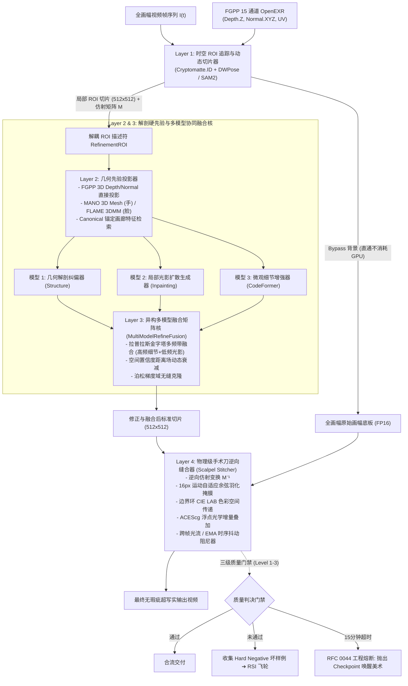

# RFC 0061: 局部解剖智能修正、多模型协同融合与工业级手术刀缝合规范与规划
# (Local Anatomical Refinement, Multi-Model Fusion & Industrial Scalpel Stitching Specification & Plan)

- **RFC 编号**: `RFC 0061`
- **文档状态**: `Accepted (v1.1 — Aligned with M10)`
- **责任体系**: sautille-stroke / DervGen 核心架构组 (`synapse`, `fulgur`, `caelum-core`, `aether`, `foundary`, `forgekit`)
- **关联设计文档 (Layer B)**:
  - [DESIGN_LOCAL_REFINEMENT_AND_MULTI_MODEL_FUSION.md](DESIGN_LOCAL_REFINEMENT_AND_MULTI_MODEL_FUSION.md)
  - [DESIGN_FORGEKIT_ANATOMICAL_REFINE_TOOLING.md](DESIGN_FORGEKIT_ANATOMICAL_REFINE_TOOLING.md)
- **关联实施计划 (Layer C)**: [PLAN-M9-M12-HORIZON3-LANDING.md](plans/PLAN-M9-M12-HORIZON3-LANDING.md) (`M10: PR-33 ~ PR-37`)
- **关联生态规约**:
  - **RFC 0039**: 资产解耦、自洽作业闭包 (`JobBundle`) 与 DCC 连接器架构
  - **RFC 0044**: 15 分钟 HITL 工程熔断机制与白模粒度守护（复用 `synapse.bridge.hitl.evaluate_hitl_circuit_breaker`）
  - **RFC 0044**: 神经-物理混合工业流水线、特征引导协议 (`FGPP`) 与人机协同 (`HITL`) 跨仓编排规约
  - **RFC 0058**: OpenUSD Hydra、MaterialX / OpenPBR 1.0 与 ACEScg 跨平台架构
  - **RFC 0060**: 真实视频逆向 3D 动态数字孪生与联合反演设计规范
  - **FGPP v1.0**: 15 标量通道 OpenEXR 线格式 (`34 B/px`，含 `CameraLinearDepth.Z`, `WorldNormal.XYZ`, `Cryptomatte.ID`)
- **目标受众**: 神经渲染算法工程师、角色与绑定技术总监 (TD)、视觉特效 (VFX) 合成专家、无状态 Worker 编排 Agent

---

## 1. 摘要 (Abstract)

在数字内容创作（DCC）与神经视频生成管线中，全身或中景镜头下的**手部（Hands）**、**脸部（Faces）**与**毛发/毛皮（Hair/Fur）**存在结构性、解剖学级别的感知失真（六指/融指、视线斜视、恐怖谷微表情坍塌、身份漂移、发丝粘连为“塑料头盔发”、各向异性高光缺失与时序闪烁）。这一失真是潜空间下采样压缩与全局注意力稀释的必然数学结果，单一全画幅表面网格生成模型在理论与工程上均无法彻底解决。

本 RFC 确立了面向工业级影视与游戏生产的**“局部解剖智能修正、多模型协同融合与手术刀逆向缝合”**标准体系：
1. **分治瓦片化计算（Tiled Bypass Architecture）**：全画幅背景直通（Bypass），仅对存在缺陷的动态时空 ROI 提取 $512 \times 512$ 标准切片，节省 90%+ 算力；
2. **多源解剖硬约束注入（Anatomical Hard Priors）**：结合 FGPP 原生 3D 深度/法线、MANO 3D 手部骨骼网格、FLAME 3DMM、PulID/ArcFace 身份正交特征投影，以及**专用毛发/毛皮导引曲线（Guide Strands）与头皮毛囊生长场（Scalp Follicles）**；
3. **多模型输出融合矩阵（Five Fusion Paradigms）**：标准化拉普拉斯金字塔频域分解、几何-纹理串行级联、采样潜在轨迹时步解耦、空域置信度加权以及泊松梯度域融合；
4. **物理级无缝逆向缝合（Industrial Scalpel Stitching）**：复用 $16\text{px}$ 运动自适应手术刀掩膜、边界环 CIE LAB 色彩空间传递、ACEScg 浮点光学增量叠加与光流/EMA 时序高频抖动阻尼；
5. **人机协同与质量门禁（Three-Tier HITL & Quality Gates）**：执行三级介入阶梯，严格落实 RFC 0044 单镜头 15 分钟熔断机制，并将异常坏帧自动采集为 Hard Negative 数据，驱动 RSI 递归自我演进飞轮。

---

## 2. 架构动机与行业痛点分析 (Problem Statement & Industry Analysis)

```
                       ┌── 潜空间下采样 ── 8x/16x 压缩，手/脸在潜空间仅剩几个 Token，微观几何彻底模糊
                       ├── 拓扑高自由度 ── 人手 21 关节、20+ 自由度与极高自遮挡，极易出现六指/融指
神经生成三大结构性缺陷 ┼── 恐怖谷敏感性 ── 人类视觉系统对双眼瞳孔对称度、睫毛、嘴形微表情容错率为零
                       └── 身份时序漂移 ── 运镜大幅度旋转或遮挡后，注意力机制遗忘面部底层骨骼特征
```

### 2.1 全画幅大模型不可承受之重

头部视频扩散大模型（Wan 2.1、Sora、Kling）的目标函数优化的是**全局像素的一致性分布与宏观物理运动**（如流体、重力、布料大褶皱、相机大范围运镜）。在 $1280 \times 720$ 或 4K 分辨率下：
- 手部区域通常仅占全图面积的 $1\% \sim 5\%$；
- 脸部通常仅占全图面积的 $2\% \sim 8\%$。

根据香农信息论与注意力注意力预算分配定律，全局注意力无法向微观区域倾斜足够的计算密度。如果为了修整手部而不断增大全画幅 DiT 的参数量，推理成本将呈超线性爆炸（$O(N^2)$），这在影视量产和游戏实时化中是绝对不可接受的。

### 2.2 行业成熟实践的启示

1. **工业特效分层法则（VFX Layering）**：从好莱坞胶片时代到现代数字合成，没有一部特效大片是单 Pass 成型的。几何骨骼必须走确定性 3D，微观质感走生成式着色；
2. **多模型协同的必然性**：没有任何单一模型能同时兼顾“宏观光照一致”、“严谨解剖拓扑”与“毛孔级超高频真实感”。几何模型（HandRefiner/3DMM）负责把骨架摆对，生成式扩散模型（Wan Inpaint）负责把环境光影接顺，微观修复模型（CodeFormer/GFPGAN）负责点亮瞳孔高光与指纹；
3. **色彩科学守恒（ACEScg / OCIO）**：局部图块在神经模型与原图之间往返时，必须在场景线性（Scene-Linear）浮点空间中进行，任何 sRGB 8-bit 的粗暴裁剪都会导致高光死白、暗部色阶断裂与明显的“贴膏药”拼缝。

---

## 3. 系统整体架构与数据拓扑 (System Architecture & Topology)

RFC 0061 定义的端到端修正拓扑分为四大解耦层级：



---

## 4. 核心子系统架构契约与关键决策 (Subsystem Specifications & Architecture Contracts)

### 4.1 四层子系统职责与边界

| 层级 | 子系统模块 | 核心职责 | 关键契约与输出 |
|---|---|---|---|
| **Layer 1** | 时空 ROI 追踪与 Tile Bypass (`synapse.refine.roi_tracker`, `tiled_executor.py`) | 实体定位、卡尔曼平滑 BBox 与背景直通 | 仅对缺陷时空 ROI 提取 $512 \times 512$ 标准切片，记录仿射矩阵 $\mathbf{M}$ 与 $\mathbf{M}^{-1}$；背景直通（Bypass）不消耗 GPU |
| **Layer 2** | 解剖几何硬先验投影体系 (`synapse.refine.hand`, `synapse.refine.face`, `hair_groom.py`, `body_garment.py`) | 3D 骨骼/深度/法线先验注入与身份画廊 | 手部 FGPP 3D 深度/法线直通（或 MANO 3D Mesh）；面部 4 机位正交锚定画廊；毛发头皮生长场与发流导引线；人体与衣物分层解耦与 SDF 零穿模（$\delta \ge 2.0\,\text{mm}$） |
| **Layer 3** | 多模型协同融合矩阵核 (`synapse.refine.fusion`) | 异构专修模型输出频域与空域融合 | 频域分解（拉普拉斯金字塔）、串行级联、采样轨迹解耦、空间置信度加权以及泊松梯度域融合，输出高质量 $512 \times 512$ 融合图块 |
| **Layer 4** | 物理级手术刀逆向缝合器 (`synapse.refine.stitcher`, `gates.py`) | 逆向仿射变换、色彩传递与时序阻尼 | $\mathbf{M}^{-1}$ 逆仿射、16px 运动自适应余弦羽化掩膜、边界环 CIE LAB 色彩空间传递（$\Delta E_{00} \le 2.0$）、ACEScg 浮点光学增量叠加与光流/EMA 时序高频抖动阻尼 |

### 4.2 核心解剖硬约束与先验注入决策
1. **手部绝对几何硬门禁**：Track B（FGPP 直通模式，首选）直接提取 `CameraLinearDepth.Z` 与 `WorldNormal.XYZ`，白模已具备 21 关节骨骼绑定，生成模型在此硬掩膜下**在几何上完全杜绝 6 指**；Track A（野生视频模式）调用 `HandRefiner` 拟合 MANO 3D 参数化手部网格兜底。
2. **面部正交锚定画廊（Canonical Anchor Gallery）**：角色资产预置 4 机位（正视、左右 45°、微仰）ArcFace 512 维特征向量，根据头部法线朝向角球面加权合成当前机位目标身份向量，注入 Cross-Attention 杜绝转头身份漂移。
3. **毛发/毛皮专属模型与头皮生长场**：通过 FGPP `Cryptomatte.ID` 精准切分发丝与皮肤，结合头皮毛囊生长域约束（Scalp Follicle Mask）杜绝发丝长入颅骨；反演 500~1500 根 3D 导引曲线簇（Guide Strands），支持曲线轨（Strand-based Curves）与游戏发片轨（Auto Hair Cards）双轨导出。
4. **人体与衣物分层解耦与 SDF 防穿模**：严格执行“内层标准解剖裸模基底 + 外层分层独立衣物”规范。外层衣物所有顶点受身体裸模符号距离场约束 $\Phi_{\text{body}}(\mathbf{v}_{\text{cloth}}) \ge 2.0\,\text{mm}$，物理硬推离穿透顶点，彻底消灭穿模。

### 4.3 五大多模型协同融合范式
RFC 0061 规范化五种融合算子的执行策略：
1. **频域分解融合 (Laplacian Pyramid Multi-Band)**：4 层拉普拉斯金字塔分解，高频层采用微观增强模型（CodeFormer / 手部细节 LoRA），低频层采用全局底模生成物保留真实环境光照与肤色基调；
2. **串行几何-纹理分阶级联 (Hierarchical Cascade)**：Stage 1 几何硬矫正（骨架与深度）➔ Stage 2 语义生成（光影与形态）➔ Stage 3 感知超分与 ID 锁定；
3. **采样轨迹潜在空间动态调度 (Latent Timestep Switch)**：高噪声大结构步数（$T=1000 \sim 500$）使用结构模型，低噪声微细节步数（$T=500 \sim 0$）切换为质感模型；
4. **空间置信度距离场加权 (Uncertainty-Aware Spatial Blending)**：核心五官/指尖全权信任专修，边缘向原图平滑羽化衰减；
5. **泊松梯度域融合 (Poisson Gradient Editing)**：求解带狄利克雷边界条件的泊松偏微分方程，无缝克隆皮肤纹理，宿主边界强制约束明暗与色温。

### 4.4 物理级手术刀逆向缝合决策
1. **逆向仿射变换**：利用 $\mathbf{M}^{-1}$ 将 $512 \times 512$ 融合图块重采样回全画幅原始坐标；
2. **16px 运动自适应余弦羽化掩膜**：在运动矢量方向进行前向非对称膨胀，边缘采用 16px 余弦软衰减；
3. **边界环 CIE LAB 色彩空间传递**：提取掩膜边界外侧 16px 环状区域色彩统计量，做仿射色彩映射，使边界色差满足 `border_ring_ciede2000 <= 2.0`；
4. **ACEScg 浮点光学增量叠加**：全合成链路采用 FP16/FP32 场景线性 ACEScg 张量，叠加 FGPP 接触阴影与焦散增量，确保物理光影不被 AI 抹平；
5. **跨帧光流 EMA 抖动阻尼器**：光流引导对齐历史帧累加（高速运动光流模长 $>15\text{px}$ 时自适应降低 EMA 权重至 0.3，微小动作提升至 0.85），彻底压制相邻帧闪烁。

> [!NOTE]
> **详细设计与算法实现指引**：
> 各层的详细数学推导（拉普拉斯金字塔重构、球面高斯加权公式、泊松偏微分方程）、专修模型规格矩阵、核心数据契约（`RefinementROI`, `HandRefineCondition`, `ScalpelStitchResult`）及 Python 类签名完整详见 Layer B 技术规范：**[docs/DESIGN_LOCAL_REFINEMENT_AND_MULTI_MODEL_FUSION.md](DESIGN_LOCAL_REFINEMENT_AND_MULTI_MODEL_FUSION.md)**。

---

## 5. 人机协同三级阶梯与质量门禁 (HITL & Three-Tier Quality Gates)

RFC 0061 确立严格的分级介入与工程熔断准则，坚决杜绝“死循环重跑”：

```
Level 1: 算法自动化精修 (Full-Auto) ──────── 运行多模型融合与手术刀缝合 (耗时 < 30s/shot)
    │ (未通过 Level 1-3 质量门禁)
    ▼
Level 2: 2D 轻量视口笔刷 (Interactive Brush) ─ 美术框选手部/面部局部涂抹，生成引导线 (耗时 < 2min)
    │ (仍未达到导演审美标准，或达到 15 分钟上限)
    ▼
Level 3: 3D 骨架重定与资产回滚 (DCC Rigging) ── Blender/Maya 微调骨骼，重新烘焙 FGPP (耗时 < 15min)
    │ (达到 RFC 0044 15分钟硬上限)
    ▼
[工程熔断 (Meltdown)]: 强制终止自动化任务，落盘全量现场现场与 Hard Negative 数据，释放 GPU 资源
```

### 5.1 自动化质量评价矩阵 (Quality Gates) & 非目标/替代权衡

| 评价维度 | 门禁判定指标 | 严格阈值 (对齐 REVIEW SSOT) | 失败响应动作 |
|---|---|---|---|
| **手部解剖拓扑** | 关键点有效手指计数 | 恒等于 `5`，无交叉断裂 | 触发 Level 2 笔刷介入或回退 3D 白模深度遮罩 |
| **面部身份保真** | ArcFace Cosine 相似度 | 正视锚点 $\ge 0.82$；$45^\circ$ 侧偏 $\ge 0.78$ | 提升 PulID 注入权重，降低 Denoising 强度 |
| **毛发各向异性与连续性** | 发流切线角连续性方差<br/>发丝粘连度 (Clump/Helmet Index) | $\text{Var}(\theta_{\text{flow}}) \le 0.05$<br/>$\text{HelmetRatio} \le 0.08$ | 切换为 HairGroomRefiner 导引曲线重绘与 Marschner 切线 Pass |
| **衣物身体无穿模度** | 衣物穿透裸模顶点比例<br/>最大穿透深度 $\max(-\Phi_{\text{body}})$ | 顶点穿透率 $= 0.0\%$<br/>深度 $\le 0.0\,\text{mm}$ | 触发 SDF 投影硬推离，或回退至 Stage 1 裸模重新解算布料松弛 |
| **视线对称度** | 左右眼瞳孔凝视向量夹角 | $\Delta \theta_{\text{gaze}} \le 4.5^\circ$ | 引入 FLAME / 人脸 3D 关键点瞳孔坐标硬矫正 |
| **边缘接缝与色差** | 缝合外圈 $16\text{px}$ 边界 PSNR<br/>`border_ring_ciede2000` | $\ge 38.0\text{ dB}$<br/>$\le 2.0$（对齐 `profiles.py`） | 切换至泊松梯度域融合与 LAB 边界环匹配 |
| **时序跳变度** | `temporal_warp_error` (`[0,1]` 归一化光流 RMSE) | Hero $\le 0.015$；Wide $\le 0.020$ | 增大时序 EMA 衰减系数 $\alpha$，启用光流引导 Warp |
| **单镜头算力熔断** | 全流程累计推理/人工耗时 | $\le 900.0\text{ s}$ (`evaluate_hitl_circuit_breaker`) | 触发 `CircuitBreakerError` (退出码 `40`) 保存 Checkpoint |

- **非目标 (Non-Goals)**：不在全局视频扩散阶段常驻加载所有专修大模型；不在 `synapse` 侧实现 Electron UI 或常驻 HTTP 预览服务（UI 归属 `@dervgen/forgekit-anatomical-refine`，经 RFC 0039 `JobBundle` 通信）。
- **备选方案权衡**：选用独立 512×512 Tile 切片 + `M⁻¹` 手术刀缝合（而非全画幅 Latent Inpainting），原因在于全画幅受限于 `Wan 2.1` 全局分辨率与高显存占用，难以保留毛孔与指节微观高频纹理；且独立切片便于无损旁路（Bypass）未退化帧。

### 5.2 Hard Negative 坏样例与数据飞轮闭环 (RSI Integration)

所有在门禁中被判决为“失败”或由美术执行“Undo/重绘”的切片样本，自动序列化为 RFC 0020/0021 标准训练元组：
$$\mathcal{T}_{\text{failure}} = \langle \text{Prompt}, I_{\text{defect}}, I_{\text{fixed}}, \mathbf{M}_{\text{mask}}, \text{MetricScore} \rangle$$
导出为 `hard_negatives.jsonl`，直接喂入 Synapse 的 RSI（递归自我演进）微调飞轮，作为 DPO 偏好对中的负样本（Dispreferred Sample），使模型在自训练迭代中自发学会“避开此类手部/脸部构图陷阱”。

---

## 6. 实施规划绑定与 CLI 入口 (`M10: PR-33 ~ PR-37`)

完整文件清单、函数签名与测试验证方案见 Layer C 实施总览 **[PLAN-M9-M12-HORIZON3-LANDING.md](plans/PLAN-M9-M12-HORIZON3-LANDING.md)（`M10` 里程碑）**，统一废除早期 `PR-REFINE-01..06` 离散编号并严格复用 `synapse.bridge.hitl` 熔断器（不新建 `hitl_meltdown.py`）：

| PR 编号 | 核心交付范畴 | 目标模块 / CLI Stage |
|---|---|---|
| **`PR-33`** | 解剖 ROI 追踪与切片契约 | `synapse/refine/types.py`, `roi_tracker.py`, `tiled_executor.py` |
| **`PR-34`** | FGPP 手部硬先验与面部正交锚定画廊 | `synapse/refine/hand.py`, `synapse/refine/face.py` |
| **`PR-35`** | 5 类多模型协同融合核（含频域分解与泊松梯度求解） | `synapse/refine/fusion.py` |
| **`PR-36`** | 激活光流 Warp 的 ACEScg 手术刀缝合、三级门禁与 RSI 导出 | `synapse/refine/stitcher.py`, `gates.py`, `composite/blend.py` |
| **`PR-37`** | CLI 与 Worker 接线 + ForgeKit 数据会话联调 | `synapse refine anatomical --json`、`anatomical_refine` Stage、`refine_session.v1.0` |

---

## 7. 风险评估与缓解对策 (Risks & Mitigations)

1. **极端动态模糊下的 ROI 跟踪丢失**：
   - *风险*：手部高速挥动产生严重 Motion Blur，导致 DWPose 漏检或 BBox 突变；
   - *缓解*：优先信任 3D 引擎导出的 FGPP `Cryptomatte.ID` 与前向运动向量（Motion Vectors）；若无 FGPP，则基于卡尔曼滤波进行惯性预测补帧，防止切片丢失。
2. **多模型级联带来的显存峰值 (OOM)**：
   - *风险*：同时加载 DiT、CodeFormer、HandRefiner 与 ArcFace 可能导致显存击穿 24GB；
   - *缓解*：严格遵循无状态 Worker 串行分步卸载准则（`cpu_offload` / Sequential Execution），Stage 1 执行完即刻释放显存再加载 Stage 2，保证峰值显存锁定在 $12\text{GB}$ 以内。
3. **时序平滑引入的拖影与鬼影 (Ghosting)**：
   - *风险*：时序 EMA 系数过大时，快速运动的手指可能出现半透明重影；
   - *缓解*：引入运动感知动态自适应系数：在高速运动区域（光流模长 $> 15\text{px}$），自动降低 EMA 权重至 $\alpha=0.3$，优先保证运动锐利度；在微小动作区域提高至 $\alpha=0.85$，消除闪烁。

---

## 8. 工具链建设：基于 ForgeKit 的解剖局部精修组件规范 (ForgeKit Tooling Integration)

详见配套规范：[docs/DESIGN_FORGEKIT_ANATOMICAL_REFINE_TOOLING.md](DESIGN_FORGEKIT_ANATOMICAL_REFINE_TOOLING.md)。

为支撑上层交互式创作工坊（`grand-studio` / `scene-forge` / `asset-forge`）中的角色手/脸解剖精修，在前端 UI 工具包 `@dervgen/forgekit` 中设立独立子包 **`@dervgen/forgekit-anatomical-refine`** (`packages/anatomical-refine`)，深度对标 **Unreal Engine 5**（Control Rig, MetaHuman Animator, MRQ）与 **Blender 4.x**（Pose Library, Sculpt Pose Brush, Cryptomatte Compositor）：

1. **`PoseLibraryShelf`（姿态资产架）**：对标 Blender Asset Shelf 悬停拖拽融合（Hover-Scrub）与 UE5 Control Rig 姿态资产，提供标准 21 关节手部与 52 维表情预设；
2. **`ScalpelViewportOverlay`（视口手术刀画布）**：提供基于 FGPP Cryptomatte 的一键精准拾取、带动态 $16\text{px}$ 余弦羽化外环的手术刀笔刷，以及 $512 \times 512$ 画中画微距放大镜视口（Macro PIP）；
3. **`MultiModelBlendInspector`（多模型融合监视器）**：提供 A/B/C 交互卷帘对比、低频光照与高频微观结构独立频带滑块、以及置信度热力图（Confidence Heatmap）；
4. **`CanonicalGalleryManager`（正交锚定画廊资产柜）**：管理 4 机位标准肖像，根据视口相机航向/俯仰角动态高亮显示 Cross-Attention 注入权重；
5. **`RefineTimelineTrack`（精修时间轴轨）**：提供时序 EMA 阻尼滑块、缺陷区间红/黄/绿染色条以及 RFC 0044 15分钟熔断倒计时与快照保存器。

