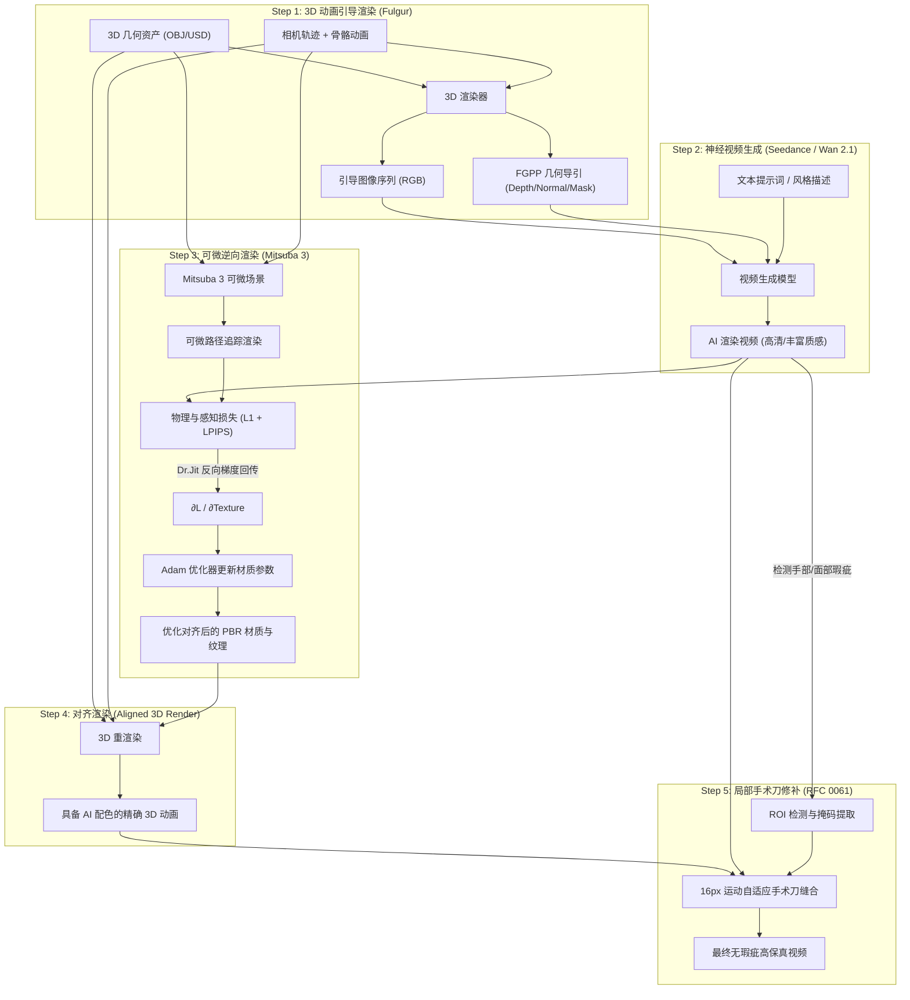

# RFC 0062: 3D 动画引导生成、可微逆向渲染与局部修补双向闭环设计规范
# (3D-Guided Generation, Differentiable Inverse Rendering & Local Patching Closed-Loop Specification)

- **RFC 编号**: `RFC 0062`
- **文档状态**: `Accepted (v1.1 — Aligned with M11)`
- **责任体系**: sautille-stroke / DervGen 核心架构组 (`synapse`, `fulgur`, `caelum-core`, `aether`, `foundary`)
- **关联设计文档 (Layer B)**: [DESIGN_INVERSE_RENDERING_CLOSED_LOOP.md](DESIGN_INVERSE_RENDERING_CLOSED_LOOP.md)
- **关联实施计划 (Layer C)**: [PLAN-M9-M12-HORIZON3-LANDING.md](plans/PLAN-M9-M12-HORIZON3-LANDING.md) (`M11: PR-38 ~ PR-40`)
- **关联生态规约**:
  - **RFC 0044**: 神经-物理混合工业流水线、特征引导协议 (`FGPP`)
  - **RFC 0060**: 真实视频逆向 3D 动态数字孪生与联合反演
  - **RFC 0061**: 局部解剖智能修正、多模型协同融合与手术刀逆向缝合
  - **FGPP v1.0**: 15 标量通道 OpenEXR 线格式 (`CameraLinearDepth.Z`, `WorldNormal.XYZ`, `Cryptomatte.ID`)

---

## 1. 摘要与核心思想 (Executive Summary)

传统“单向野外视频反演”试图在完全未知的相机、几何与光照条件下求解 3D 资产，属于高度病态（ill-posed）的盲猜问题。

**RFC 0062 确立了 Synapse 生态中真正的核心飞轮——“3D 引导生成 ➔ 神经视频增益 ➔ 可微逆向回收 ➔ 3D 精准修补”双向闭环**：

```
┌─────────────────────────────────────────────────────────────────────────────┐
│                       3D ↔ 神经视频 双向互操作飞轮                          │
└─────────────────────────────────────────────────────────────────────────────┘
  [1] 3D 动画引导 (已知精确几何 M + 相机 C_t + 姿态)
         │
         ▼
  [2] 视频生成大模型 (Seedance / Wan 2.1)
         │  赋予宏观物理动态、真实微观质感、色彩风格与生动光影
         ▼
  [3] 可微逆向渲染 (Mitsuba 3 + Dr.Jit AD) ───►【几何已知！无解耦病态！】
         │  以视频大模型为真值，可微反传优化 3D 资产的 PBR 材质与纹理
         ▼
  [4] 材质对齐的 3D 资产 (完美吸收视频大模型的配色与质感)
         │
         ▼
  [5] 局部手术刀修补 (Scalpel Patching, RFC 0061)
            修补大模型在手部、面部、拓扑自遮挡处的坍塌与时序闪烁！
```

**两大核心突破**：
1. **逆向渲染从“盲猜”变为“良态优化”**：由于正向 3D 引导已提供了**绝对精确的网格拓扑 $M$ 与相机轨迹 $C_t$**，可微渲染不需要猜测相机与大形，只需优化材质纹理（$T_{basecolor}, T_{roughness}, T_{metallic}$）与环境光照基底（Spherical Harmonics），优化问题收敛极快且保真度极高。
2. **3D 几何确定性与 AI 表现力的完美闭合**：3D 负责守住骨骼解剖、几何接触与时序绝对不闪烁；AI 负责提供丰富、具有电影感的色彩质感。通过逆向渲染将 AI 的色彩“蒸馏”回 3D 资产，使 3D 渲染画面具备与 AI 视频无缝融合成一帧的色彩亲和力。

---

## 2. 为什么选择 Mitsuba 3 承担可微逆向渲染？

在系统架构中，**fulgur 与 Mitsuba 3 各司其职，严禁职责混乱**：

| 特性 | fulgur (实时渲染引擎) | Mitsuba 3 (逆向物理渲染核心) |
|---|---|---|
| **生态角色** | 实时视口交互、正向 FGPP 引导生成、游戏运行端 | 离线可微物理反演、材质参数优化求解 |
| **自动微分 (AD)** | ❌ 无 AD，仅前向光栅化/光追 | ✅ 原生 Dr.Jit 巨量并行前向/反向自动微分 |
| **求解变量** | 顶点缓冲区、材质常量绑定 | $\partial \mathcal{L} / \partial \text{TextureMap}$，$\partial \mathcal{L} / \partial \text{Roughness}$ |
| **光传输模型** | Split-sum GGX 实时近似 | 物理无偏路径追踪 (Unbiased Path Tracing) |
| **跨框架接口** | 原生 C++20 / Bazel 目标 | 原生 Python API，与 PyTorch 零拷贝共享内存 |

### 2.1 非目标与备选方案权衡 (Non-Goals & Alternatives)
- **非目标**：不在 `fulgur` C++20 渲染管线中添加可微光栅磁带；不在基础安装中强绑闭源或重型 `Mitsuba 3`/`drjit`（统一归入 `[invrender]` 可选 extra，默认环境提供纯 NumPy 解析 UV 微分 CPU 代理 `AnalyticUVInverseOptimizer` 以保障 `ubuntu24` 全绿回归）。
- **备选方案**：在可微求解引擎与 2D 伪逆光调映射之间，选择 `Mitsuba 3` + 解析 UV Jacobian 双轨，确保物理粗糙度、金属度与反照率在能量守恒约束下被解耦吸收。

---

## 3. 闭环五步流水线 (The 5-Step Pipeline)



---

## 4. 最小闭环实验方案 (MVP Verification Loop)

为了在不引入复杂重型大模型的前提下，快速在工程与算法上验证整套闭环的收敛性与数值正确性，设计以下**最小自洽验证方案（Minimal Viable Loop）**：

### 4.1 最小测试场景 (Test Scenario)

1. **几何体**：具备平滑法线与 UV 展开的标准几何体（例如带纹理的 Stanford Bunny、低模人形站姿模型或光滑球体-立方体组合）；
2. **相机轨迹**：环绕旋转相机（Orbit 360°，30 帧，半径 2.5m）；
3. **初始 3D 材质（$M_{init}$）**：纯白/浅灰白模材质（BaseColor = 0.8，Roughness = 0.5，无贴图）；
4. **目标视觉画面（$V_{target}$）**：
   - *Phase A（确定性 Golden Case）*：赋予目标材质（如带青金石与金色雕花的彩绘纹理）渲染生成的“真值视频”；
   - *Phase B（真实神经视频）*：输入 Seedance / Wan 生成的具有丰富微观质感与环境光影的视频。

### 4.2 优化目标函数与光度学域对齐 (Radiometric-Consistent Loss Function)

优化目标是求解材质贴图 $T_{\text{albedo}} \in \mathbb{R}^{H \times W \times 3}$ 与粗糙度/金属度贴图 $T_{\text{rough}}, T_{\text{metal}}$：

$$\min_{T} \sum_{t=1}^{N} \left( \lambda_1 \| I_{mit,\text{lin}}(t; T) - \mathcal{T}_{\text{inv}}(V_{target}(t)) \|_1 + \lambda_2 \mathcal{L}_{LPIPS}\big(\mathcal{T}_{\text{disp}}(I_{mit,\text{lin}}(t; T)), V_{target}(t)\big) + \lambda_3 \| \nabla T \|_2^2 \right)$$

- **$I_{mit,\text{lin}}(t; T)$**：场景线性 **ACEScg** 物理渲染输出；
- **$\mathcal{T}_{\text{inv}}(V_{target}(t))$**：对显示域 sRGB 视频执行去伽马及 Reinhard/ACES 软肩逆色调映射后的近似线性辐射观测，确保 $\mathcal{L}_1$ 梯度物理可加；
- **$\mathcal{T}_{\text{disp}}(\cdot)$**：ACEScg $\to$ Display sRGB 前向色调映射，确保感知损失 `LPIPS` 在模型原生图像域度量；
- **$\| \nabla T \|_2^2$**：全变分平滑正则化（TV Regularization），抑制高频噪点与反光过拟合。

### 4.3 差异量化度量体系 (Evaluation Metrics)

闭环执行后，系统自动产出四维量化对比表：

| 指标 | 初始 3D 渲染 vs 目标视频 | 逆向优化后 3D vs 目标视频 | 预期达标门禁 |
|---|---|---|---|
| **PSNR (dB)** | 14 ~ 18 dB (白模失配) | **$\ge 28.5\text{ dB}$** | 提升 $\ge 10\text{ dB}$ |
| **SSIM** | 0.45 ~ 0.65 | **$\ge 0.88$** | 结构与色块高度吻合 |
| **CIE $\Delta E_{00}$ 色差** | $\ge 12.0$ (肉眼明显色差) | **$\le 2.5$** | 达到工业级感知一致 |
| **局部修补边缘接缝** | — | **$\Delta E_{00} \le 1.8$** | 16px 缝合无任何割裂贴膏药感 |

---

## 5. 主动协同生成与标定协议 (Cooperative Active Generation & LookDev Calibration Protocol)

传统逆向渲染在工业界的最大死穴是：**假定输入视频来自不可控的第三方黑盒，强硬光、死黑阴影与复杂环境反光高度耦合在 RGB 像素中，导致材质去光照（De-lighting）极易退化，贴图满是脏斑。**

然而在 DervGen / sautille-stroke 生态中，**视频生成模型（Wan 2.1 / Seedance）与正向 3D 渲染（Fulgur / Caelum-core）全栈完全自研且源码级可控**。我们可以实施**“软硬件级协同设计（Co-Design）”**，在视频生成阶段有意识地引导生成有利于逆向渲染的特殊场景，将求解难度从“不可控盲解”降低为“良态快速收敛”：

```
┌─────────────────────────────────────────────────────────────────────────────┐
│                 主动协同生成协议 (Cooperative Active Generation)            │
└─────────────────────────────────────────────────────────────────────────────┘
  [3D 引擎控制端]                             [神经视频生成端 (Wan/Seedance)]
   │                                                 │
   ├── ① 注入 N_preroll ∈ {4, 8} LookDev 标定预卷 ───► 无阴影 5500K 漫射 + κ=1.0 切镜锚定
   │     (严格满足 T_total = 4k + 1 与 4 帧潜空间对齐)   │
   ├── ② FGPP DirectRadiance 剔除硬阴影 ─────────────► 宏观平滑照明、微观细节丰富
   │                                                 │
   ├── ③ 动态光源扫描 (Light Sweep) ─────────────────► 激发动态高光 (反解粗糙度/金属度)
   │                                                 │
   ▼                                                 ▼
  [可微逆向渲染 Mitsuba 3 / CPU Jacobian] ◄──────── [纯净、解耦的目标视频帧]
     低方差快速收敛，BaseColor 零阴影污染，PBR 三件套完美分离！
```

### 5.1 标定预卷与因果 VAE 相位锁定协议 (LookDev Calibration Pre-roll)

在生成正式镜头动画前，正向调度器可插入极短“LookDev 校准预卷”（仅用于材质反演抽取，不进入正片成片）：
1. **3D 因果 VAE 相位锁定 ($T = 4k + 1$ 铁律)**：由于 `Wan 2.1` 3D Causal VAE 以 $4\times$ 时域步长压缩潜变量且总帧数须满足 $T_{\text{total}} = 4k + 1$，预卷帧数**严禁**取任意 `3~5` 帧，必须严格锁定为 **`N_preroll` $\in \{0, 4, 8\}$**（例如 `4` 帧预卷 + `93` 帧正片 $= 97 = 4 \times 24 + 1$）；
2. **强切镜时序重锚定 ($\kappa = 1.0$)**：在正片首帧索引 $t = N_{\text{preroll}}$ 处，必须通过 `ConditionScheduler` 强制触发 $\kappa = 1.0$ 硬切镜锚定并清理预卷潜状态记忆，防止预卷中的 5500K 摄影棚漫射光“漏光（Lighting Bleed）”污染正片戏剧打光；
3. **相机外参与神经 Prompt**：围绕目标主体布置平滑半周转台运镜并注入 `"soft diffuse overcast studio lighting, shadowless neutral 5500K lookdev environment, clean albedo capture"`，使观测像素近似满足 $V_{\text{lin}}(u,v) \approx T_{\text{albedo}}(u,v)\cdot \bar{E}/\pi$，实现低方差快速收敛并杜绝烤死阴影斑块。

### 5.2 FGPP 直接光解耦注入 (DirectRadiance Channel Decoupling)

基于 Synapse 的 15 通道 OpenEXR（FGPP v1.0）架构，视频大模型直接接收 `DirectRadiance.RGB` 与 `WorldNormal.XYZ`：
1. **正向引导剔除硬阴影**：在正向渲染白模条件时，主动关闭定向点光源/平行光源投射的硬自阴影（Cast Shadows），仅将平滑半球环境光（Hemispheric Ambient）写入 `DirectRadiance` 通道；
2. **生成大模型响应特性**：神经模型受无阴影的辐射度引导，将所有注意力算力集中在生成**微观材质质感**（毛孔、布料纹理、金属微瑕疵），而不会虚构出剧烈的宏观明暗交界线。

### 5.3 动态光源激发反解 PBR 参数 (Dynamic Light Sweep for Roughness & Metallic)

在静态单帧中，无法数学区分高光到底是由于“材质原本就白”还是由于“粗糙度低镜面反射强”。通过主动生成协同：
1. **移动光源激发**：正向渲染在两帧之间让点光源沿切向快速滑动一段微小距离；
2. **物理响应分类**：
   - **全角度亮度恒定的区域** $\rightarrow$ 绝对为朗伯漫反射固有色（BaseColor）；
   - **随光源滑动出现狭窄强亮斑的区域** $\rightarrow$ 亮斑宽度逆向拟合微表面粗糙度（Roughness $\alpha$）；
   - **高光颜色吸收了材质固有色的区域** $\rightarrow$ 严格判定为金属（Metallic $\approx 1.0$）；高光呈白色中性的判定为电介质（Metallic $\approx 0.0$）。

---

## 6. 模块契约、CLI 入口与依赖分层 (Architecture & CLI)

详细架构、数据流图及双轨算法实现规范见 Layer B 文档 **[DESIGN_INVERSE_RENDERING_CLOSED_LOOP.md](DESIGN_INVERSE_RENDERING_CLOSED_LOOP.md)**。在 `synapse.recon` 下新增无状态子模块：

```
python/synapse/recon/loop/
├── __init__.py
├── types.py               # InverseRenderConfig, LookDevPrerollSpec, ClosedLoopReport
├── radiometric.py         # sRGB <-> ACEScg 逆/前向色调映射（光度学损失对齐）
├── forward_guide.py       # T=4k+1 预卷引导 + κ=1.0 切镜锚定 + 无阴影 DirectRadiance 烘焙
├── mitsuba_optimizer.py   # MitsubaInverseOptimizer ([invrender]) + AnalyticUVInverseOptimizer (CPU)
├── texture_extractor.py   # UV 空间 PBR 贴图烘焙、光照解耦与接缝修复
└── closed_loop_runner.py  # 5 步闭环端到端驱动 + RFC 0061 手术刀回接
```

### 核心接口契约摘要 (`synapse.recon.loop`) & CLI 入口

```python
class InverseOptimizerProtocol(Protocol):
    def optimize_material_from_video(self, target_srgb: np.ndarray, uv_visibility: np.ndarray | None = None) -> OptimizedMaterialResult: ...
```
- **GPU 高精轨道 (`[invrender]`)**：`MitsubaInverseOptimizer` 调用 `mitsuba>=3.5`（`cuda_ad_rgb` / `llvm_ad_rgb`）。
- **CPU 确定性代理 (`ubuntu24`)**：`AnalyticUVInverseOptimizer` 纯 NumPy 解析 UV 微分求解，实现零 GPU CI 回归。
- **CLI 与 Worker 契约**：统一暴露 `synapse recon closed-loop --json` 及 `JobBundle` Stage `inverse_render_loop`（遵守 `ExitCode 0/10/20/30/40/50`）。

---

## 7. 实施规划绑定 (`M11: PR-38 ~ PR-40`)

完整文件、测试断言与验收脚本见 **[PLAN-M9-M12-HORIZON3-LANDING.md](plans/PLAN-M9-M12-HORIZON3-LANDING.md)（`M11` 里程碑）**：

| PR 编号 | 交付范围 | 核心验证门禁 |
|---|---|---|
| **`PR-38`** | `loop/types.py`, `radiometric.py`, `forward_guide.py` | 校验 `N_preroll in {0, 4, 8}` 满足 $T=4k+1$、$\kappa=1.0$ 切镜防漏光及线性/sRGB 光度一致性 |
| **`PR-39`** | `mitsuba_optimizer.py`（双轨）, `texture_extractor.py` | CPU 解析 Jacobian 闭环将 Stanford/程序化贴图 PSNR 提升 $\ge 10\text{ dB}$ 且 $\Delta E_{00} \le 2.5$ |
| **`PR-40`** | `closed_loop_runner.py` + `synapse recon closed-loop` + RFC 0061 对接 | 端到端 5 步闭环（含局部手术刀回接）+ `[invrender]` 可选依赖延迟加载验证 |
