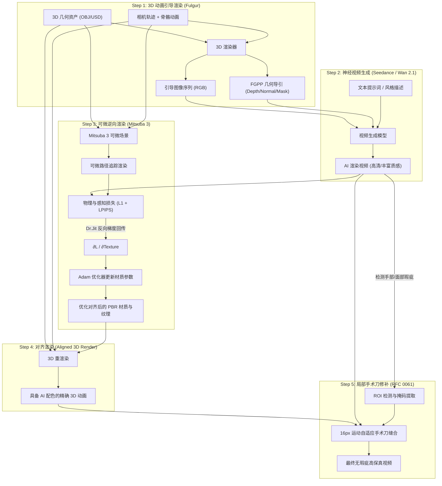

# RFC 0062: 3D 动画引导生成、可微逆向渲染与局部修补双向闭环设计规范
# (3D-Guided Generation, Differentiable Inverse Rendering & Local Patching Closed-Loop Specification)

- **RFC 编号**: `RFC 0062`
- **文档状态**: `Proposed Standard (v1.0)`
- **责任体系**: sautille-stroke / DervGen 核心架构组 (`synapse`, `fulgur`, `caelum-core`, `aether`, `foundary`)
- **关联生态规约**:
  - **RFC 0044**: 神经-物理混合工业流水线、特征引导协议 (`FGPP`)
  - **RFC 0060**: 真实视频逆向 3D 动态数字孪生与联合反演
  - **RFC 0061**: 局部解剖智能修正、多模型协同融合与手术刀逆向缝合
  - **FGPP v1.0**: 15 标量通道 OpenEXR 线格式 (`CameraLinearDepth.Z`, `WorldNormal.XYZ`, `Cryptomatte.ID`)

---

## 1. 摘要与核心思想 (Executive Summary)

传统“单向野外视频反演”试图在完全未知的相机、几何与光照条件下求解 3D 资产，属于高度病态（ill-posed）的盲猜问题。

**RFC 0062 确立了 Synapse 生态中真正的核心飞轮——“3D 引导生成 ➔ 神经视频增益 ➔ 可微逆向回收 ➔ 3D 精准修补”双向闭环**：

```
┌─────────────────────────────────────────────────────────────────────────────┐
│                       3D ↔ 神经视频 双向互操作飞轮                          │
└─────────────────────────────────────────────────────────────────────────────┘
  [1] 3D 动画引导 (已知精确几何 M + 相机 C_t + 姿态)
         │
         ▼
  [2] 视频生成大模型 (Seedance / Wan 2.1)
         │  赋予宏观物理动态、真实微观质感、色彩风格与生动光影
         ▼
  [3] 可微逆向渲染 (Mitsuba 3 + Dr.Jit AD) ───►【几何已知！无解耦病态！】
         │  以视频大模型为真值，可微反传优化 3D 资产的 PBR 材质与纹理
         ▼
  [4] 材质对齐的 3D 资产 (完美吸收视频大模型的配色与质感)
         │
         ▼
  [5] 局部手术刀修补 (Scalpel Patching, RFC 0061)
            修补大模型在手部、面部、拓扑自遮挡处的坍塌与时序闪烁！
```

**两大核心突破**：
1. **逆向渲染从“盲猜”变为“良态优化”**：由于正向 3D 引导已提供了**绝对精确的网格拓扑 $M$ 与相机轨迹 $C_t$**，可微渲染不需要猜测相机与大形，只需优化材质纹理（$T_{basecolor}, T_{roughness}, T_{metallic}$）与环境光照基底（Spherical Harmonics），优化问题收敛极快且保真度极高。
2. **3D 几何确定性与 AI 表现力的完美闭合**：3D 负责守住骨骼解剖、几何接触与时序绝对不闪烁；AI 负责提供丰富、具有电影感的色彩质感。通过逆向渲染将 AI 的色彩“蒸馏”回 3D 资产，使 3D 渲染画面具备与 AI 视频无缝融合成一帧的色彩亲和力。

---

## 2. 为什么选择 Mitsuba 3 承担可微逆向渲染？

在系统架构中，**fulgur 与 Mitsuba 3 各司其职，严禁职责混乱**：

| 特性 | fulgur (实时渲染引擎) | Mitsuba 3 (逆向物理渲染核心) |
|---|---|---|
| **生态角色** | 实时视口交互、正向 FGPP 引导生成、游戏运行端 | 离线可微物理反演、材质参数优化求解 |
| **自动微分 (AD)** | ❌ 无 AD，仅前向光栅化/光追 | ✅ 原生 Dr.Jit 巨量并行前向/反向自动微分 |
| **求解变量** | 顶点缓冲区、材质常量绑定 | $\partial \mathcal{L} / \partial \text{TextureMap}$，$\partial \mathcal{L} / \partial \text{Roughness}$ |
| **光传输模型** | Split-sum GGX 实时近似 | 物理无偏路径追踪 (Unbiased Path Tracing) |
| **跨框架接口** | 原生 C++20 / Bazel 目标 | 原生 Python API，与 PyTorch 零拷贝共享内存 |

---

## 3. 闭环五步流水线 (The 5-Step Pipeline)



---

## 4. 最小闭环实验方案 (MVP Verification Loop)

为了在不引入复杂重型大模型的前提下，快速在工程与算法上验证整套闭环的收敛性与数值正确性，设计以下**最小自洽验证方案（Minimal Viable Loop）**：

### 4.1 最小测试场景 (Test Scenario)

1. **几何体**：具备平滑法线与 UV 展开的标准几何体（例如带纹理的 Stanford Bunny、低模人形站姿模型或光滑球体-立方体组合）；
2. **相机轨迹**：环绕旋转相机（Orbit 360°，30 帧，半径 2.5m）；
3. **初始 3D 材质（$M_{init}$）**：纯白/浅灰白模材质（BaseColor = 0.8，Roughness = 0.5，无贴图）；
4. **目标视觉画面（$V_{target}$）**：
   - *Phase A（确定性 Golden Case）*：赋予目标材质（如带青金石与金色雕花的彩绘纹理）渲染生成的“真值视频”；
   - *Phase B（真实神经视频）*：输入 Seedance / Wan 生成的具有丰富微观质感与环境光影的视频。

### 4.2 优化目标函数与梯度流 (Loss Function)

优化目标是求解材质贴图 $T_{diffuse} \in \mathbb{R}^{H \times W \times 3}$ 与粗糙度贴图 $T_{rough}$：

$$\min_{T} \sum_{t=1}^{N} \left( \lambda_1 \| I_{mit}(t; T) - V_{target}(t) \|_1 + \lambda_2 \mathcal{L}_{LPIPS}(I_{mit}(t; T), V_{target}(t)) + \lambda_3 \| \nabla T \|_2^2 \right)$$

- **$I_{mit}(t; T)$**：Mitsuba 3 可微渲染器在时刻 $t$ 使用当前材质 $T$ 渲染的图像；
- **$V_{target}(t)$**：视频生成模型在该时刻的输出帧；
- **$\| \nabla T \|_2^2$**：全变分正则化（TV Regularization），抑制高频噪点与反光斑点过拟合。

### 4.3 差异量化度量体系 (Evaluation Metrics)

闭环执行后，系统自动产出四维量化对比表：

| 指标 | 初始 3D 渲染 vs 目标视频 | 逆向优化后 3D vs 目标视频 | 预期达标门禁 |
|---|---|---|---|
| **PSNR (dB)** | 14 ~ 18 dB (白模失配) | **$\ge 28.5\text{ dB}$** | 提升 $\ge 10\text{ dB}$ |
| **SSIM** | 0.45 ~ 0.65 | **$\ge 0.88$** | 结构与色块高度吻合 |
| **CIE $\Delta E_{00}$ 色差** | $\ge 12.0$ (肉眼明显色差) | **$\le 2.5$** | 达到工业级感知一致 |
| **局部修补边缘接缝** | — | **$\Delta E_{00} \le 1.8$** | 16px 缝合无任何割裂贴膏药感 |

---

## 5. 主动协同生成与标定协议 (Cooperative Active Generation & LookDev Calibration Protocol)

传统逆向渲染在工业界的最大死穴是：**假定输入视频来自不可控的第三方黑盒，强硬光、死黑阴影与复杂环境反光高度耦合在 RGB 像素中，导致材质去光照（De-lighting）极易退化，贴图满是脏斑。**

然而在 DervGen / sautille-stroke 生态中，**视频生成模型（Wan 2.1 / Seedance）与正向 3D 渲染（Fulgur / Caelum-core）全栈完全自研且源码级可控**。我们可以实施**“软硬件级协同设计（Co-Design）”**，在视频生成阶段有意识地引导生成有利于逆向渲染的特殊场景，将求解难度从“不可控盲解”降低为“良态快速收敛”：

```
┌─────────────────────────────────────────────────────────────────────────────┐
│                 主动协同生成协议 (Cooperative Active Generation)            │
└─────────────────────────────────────────────────────────────────────────────┘
  [3D 引擎控制端]                             [神经视频生成端 (Wan/Seedance)]
   │                                                 │
   ├── ① 注入 3~5 帧 LookDev 标定预卷 ───────────────► 强制无阴影 5500K 漫射生成
   │                                                 │
   ├── ② FGPP DirectRadiance 剔除硬阴影 ───────────► 宏观平滑照明、微观细节丰富
   │                                                 │
   ├── ③ 动态光源扫描 (Light Sweep) ────────────────► 激发动态高光 (快速反解粗糙度/金属度)
   │                                                 │
   ▼                                                 ▼
  [可微逆向渲染 Mitsuba 3] ◄────────────────────── [纯净、解耦的目标视频帧]
     秒级收敛，BaseColor 零阴影污染，PBR 三件套完美分离！
```

### 5.1 标定预卷机制 (LookDev Calibration Pre-roll)

在生成正式镜头动画前，正向调度器可选择性插入一段 **3~5 帧的极短“校准预卷”**（不计入正片，仅供材质反演抽取）：
1. **相机外参控制**：3D 引擎调度一段围绕目标主体（或核心局部）的平滑半周匀速转台运镜（Orbit 180°）；
2. **神经 Prompt 强制约束**：在预卷时序区间内，向视频模型注入影视级 LookDev 提示词：
   `"soft diffuse overcast studio lighting, shadowless neutral 5500K lookdev environment, pure ambient occlusion, clean albedo capture, zero hard specular glare"`；
3. **数学原理**：在完全均匀的半球漫射光照 $\bar{E}$ 下，观测像素值满足：
   $$V_{target}(u, v) \approx T_{basecolor}(u, v) \cdot \frac{\bar{E}}{\pi}$$
   Mitsuba 3 的反求损失函数直接退化为准线性凹凸优化，**BaseColor 贴图在 10 步迭代内即可收敛，彻底杜绝阴影被当成色斑烤死在贴图中的致命缺陷！**

### 5.2 FGPP 直接光解耦注入 (DirectRadiance Channel Decoupling)

基于 Synapse 的 15 通道 OpenEXR（FGPP v1.0）架构，视频大模型直接接收 `DirectRadiance.RGB` 与 `WorldNormal.XYZ`：
1. **正向引导剔除硬阴影**：在正向渲染白模条件时，主动关闭定向点光源/平行光源投射的硬自阴影（Cast Shadows），仅将平滑半球环境光（Hemispheric Ambient）写入 `DirectRadiance` 通道；
2. **生成大模型响应特性**：神经模型受无阴影的辐射度引导，将所有注意力算力集中在生成**微观材质质感**（毛孔、布料纹理、金属微瑕疵），而不会虚构出剧烈的宏观明暗交界线。

### 5.3 动态光源激发反解 PBR 参数 (Dynamic Light Sweep for Roughness & Metallic)

在静态单帧中，无法数学区分高光到底是由于“材质原本就白”还是由于“粗糙度低镜面反射强”。通过主动生成协同：
1. **移动光源激发**：正向渲染在两帧之间让点光源沿切向快速滑动一段微小距离；
2. **物理响应分类**：
   - **全角度亮度恒定的区域** $\rightarrow$ 绝对为朗伯漫反射固有色（BaseColor）；
   - **随光源滑动出现狭窄强亮斑的区域** $\rightarrow$ 亮斑宽度逆向拟合微表面粗糙度（Roughness $\alpha$）；
   - **高光颜色吸收了材质固有色的区域** $\rightarrow$ 严格判定为金属（Metallic $\approx 1.0$）；高光呈白色中性的判定为电介质（Metallic $\approx 0.0$）。

---

## 6. 模块设计与接口契约 (Software Architecture)

在 `synapse.recon` 中新增专门的可微逆向闭环子模块：

```
python/synapse/recon/
  ├── loop/
  │   ├── __init__.py
  │   ├── forward_guide.py       # 3D 几何与相机导出，组织引导序列
  │   ├── mitsuba_optimizer.py   # Mitsuba 3 + Dr.Jit 可微反演核心
  │   ├── texture_extractor.py   # UV 空间材质参数解耦与重投影烘焙
  │   └── closed_loop_runner.py  # 最小闭环端到端驱动器
  └── ...
```

### 核心接口定义 (`mitsuba_optimizer.py`)

```python
@dataclass
class InverseRenderConfig:
    resolution: tuple[int, int] = (512, 512)
    spp: int = 16                      # Samples Per Pixel (可微渲染采样数)
    iterations: int = 100              # 优化迭代步数
    learning_rate: float = 0.03        # Adam 学习率
    tv_weight: float = 0.005           # 全变分平滑正则化权重
    variant: str = "cuda_ad_rgb"       # GPU: cuda_ad_rgb, CPU: llvm_ad_rgb

class MitsubaInverseOptimizer:
    """使用 Mitsuba 3 和 Dr.Jit 对 3D 资产的材质纹理进行可微反演。"""

    def __init__(self, mesh_path: Path, camera_trajectory: list[dict], config: InverseRenderConfig):
        self.mesh_path = mesh_path
        self.cameras = camera_trajectory
        self.config = config
        self._init_mitsuba_scene()

    def optimize_material_from_video(
        self,
        target_video_frames: np.ndarray, # (T, H, W, 3) 浮点 [0, 1]
    ) -> OptimizedMaterialResult:
        """
        以目标视频帧为 Ground Truth，反向求导更新材质贴图。
        返回优化后的 BaseColor 纹理、Roughness 参数以及收敛度量历史。
        """
        ...
```

---

## 7. 实施路标与里程碑 (Milestones)

- **M-LOOP-1: 最小闭环桩与可运行验证（CPU/GPU 双模）**
  - 构建 Stanford Bunny 旋转动画与无阴影漫射测试基线；
  - 编写合成目标视频测试用例（含 LookDev 标定预卷测试）；
  - 跑通 Mitsuba 3 `llvm_ad_rgb` / `cuda_ad_rgb` 贴图反求；
  - 验证 PSNR 提升 $\ge 10\text{ dB}$，生成对比报告图。
- **M-LOOP-2: 主动协同生成与视频大模型局部缝合对接**
  - 在 `synapse.adapters.wan` 中加入 LookDev Pre-roll 提示词拦截注入与 FGPP 无硬阴影条件烘焙；
  - 接入 Seedance / Wan 2.1 风格化生成视频作为真实目标输入；
  - 将材质优化后的 3D 渲染送入 RFC 0061 局部手术刀（Scalpel）修补手部/面部。
