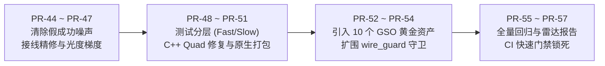

# RFC 0063: Synapse 质量保障、测试验证机制与行业横向评测基准规范

- **RFC 编号**: `RFC 0063`
- **文档状态**: `Proposed (v1.0)`
- **责任体系**: sautille-stroke / DervGen 核心架构组 (`synapse`, `fulgur`, `caelum-core`, `aether`)
- **关联详细设计 (Layer B)**: [DESIGN_INDUSTRY_GAP_AND_COMPENSATION.md](DESIGN_INDUSTRY_GAP_AND_COMPENSATION.md) · [DESIGN_3D_MODEL_ENHANCEMENT_AND_DATA_SPEC.md](DESIGN_3D_MODEL_ENHANCEMENT_AND_DATA_SPEC.md)
- **关联架构审计**: [audits/AUDIT-POST-REFACTOR-2026-11.md](audits/AUDIT-POST-REFACTOR-2026-11.md) · [audits/AUDIT-RFC0063-AND-CODEBASE-2026-11.md](audits/AUDIT-RFC0063-AND-CODEBASE-2026-11.md)
- **关联实施计划 (Layer C)**: [plans/PLAN-M13-M16-POST-REFACTOR-REMEDIATION.md](plans/PLAN-M13-M16-POST-REFACTOR-REMEDIATION.md) (`PR-44 ~ PR-57`) · [plans/PLAN-M17-M20-QUALITY-GOVERNANCE-AND-BENCHMARK-LANDING.md](plans/PLAN-M17-M20-QUALITY-GOVERNANCE-AND-BENCHMARK-LANDING.md) (`PR-58 ~ PR-73`)
- **跨仓 SSOT 契约**: `@aether//fgpp` (`fgpp.v1.0`), `@aether//style`, `synapse.bench` (30 黄金场景 / 16 维质量门禁)

---

## 1. 背景与动机 (Context & Motivation)

`synapse` 承担确定性 3D CG 渲染与潜空间神经视频生成的跨模态双向互操作。系统面临长链路误差级联放大、DiT 概率模型潜空间蠕动以及多语言（C++20 / Python / CUDA）契约协同三大挑战。

近期全库架构审计（`AUDIT-POST-REFACTOR-2026-11`）揭示了现有测试体系的核心隐患：
1. **假成功脱敏**：缺失输入文件或可选依赖时，部分 Worker 阶段适配器与 CLI 自动回退至 `np.random` 伪造假张量并以退出码 `0` 返回，使集成测试产生虚假全绿；
2. **测试分层缺失**：30 个场景的纯 NumPy 软光栅长测导致 `pytest` 耗时达 413 秒，缺乏快慢分层机制；
3. **闭环门禁吞没**：局部精修与可微逆向阶段缺乏像素/拓扑级有效改善断言，部分熔断异常被宽泛捕获吞没；
4. **行业对标协议缺失**：缺少直接对接业界公开基准（GSO、Objaverse-LVIS、VBench）的标准化评测协议。

`RFC 0063` 旨在确立代码正确性保障四大机制、四级测试金字塔架构以及直接对标行业的量化评测协议。

---

## 2. 目标与非目标 (Goals & Non-Goals)

### 2.1 核心目标 (Goals)
1. **确立四级测试金字塔与执行分层**：解耦 `<20s` 本地快速单测与 400s+ 全量黄金场景回归，建立健全的 CI 执行秩序。
2. **根除伪造噪声与假成功**：全面贯彻“防静默失败三问”（存在问 / 接线问 / 执行问），对张量有效方差与前向改善实施强门禁，缺失输入严格抛出确定性异常退出码（`10/20/30/40/50`）。
3. **锁死三大正确性保障机制**：固化跨语言线格式 SSOT（FGPP 15 通道 / 34 B/px）、C++20 原生内核与 Python Oracle 双轨对抗互验、48 帧物理强锚点与 ACEScg 软肩逆色调映射。
4. **统一行业横向评测协议**：规范直接对标 3D 重建（TRELLIS / Hunyuan3D）、视频时空可控（Wan 2.1 / VBench）、数字替身动力学（Wonder Studio）及物理光影（Mitsuba 3）的标准数据集与直接度量指标。

### 2.2 非目标 (Non-Goals)
- **非服务端常驻大盘**：不引入常驻 HTTP/WebSocket 测试监控守护进程，遵守 Server-side Zero-Python 铁律。
- **无卡 CI 严禁拉起重型大模型**：日常 CI 不依赖真实 14B GPU 显存，全链路逻辑通过 `MockVideoAdapter`、参数化投影与 CPU 解析 Jacobian 验证。

---

## 3. 四级测试金字塔架构规范 (Quality & Testing Pyramid)

```
                            ┌──────────────────────────────────────────┐
                            │    Tier-3: Synapse-Bench 30 黄金基准     │
                            │   (T1~T5 场景, 16 维门禁, 慢测隔离)      │
                            └────────────────────▲─────────────────────┘
                                                 │
                            ┌────────────────────┴─────────────────────┐
                            │    Tier-2: 闭环工作流与有效方差门禁      │
                            │   (残差单调下降, 拒伪造噪声, 15min 熔断) │
                            └────────────────────▲─────────────────────┘
                                                 │
                            ┌────────────────────┴─────────────────────┐
                            │    Tier-1: 物理守恒与核心算子单测        │
                            │   (深度可逆对数映射, ACEScg软肩, 滑窗)   │
                            └────────────────────▲─────────────────────┘
                                                 │
                            ┌────────────────────┴─────────────────────┐
                            │    Tier-0: 跨语言硬契约与双轨算子互验    │
                            │   (wire_guard 34B/px, C++ ⟷ Python 对抗) │
                            └──────────────────────────────────────────┘
```

### 3.1 Tier-0：跨语言契约与双轨算子对抗
- **Wire Guard 自动化静态守卫**：`tools/wire_guard.py` 对比 `@aether//fgpp` C++ 头文件，锁死 15 标量通道 ASCII 序、`34 B/px` 内存步进及 `UINT32` Cryptomatte ID 逐 bit 完整性。
- **双轨几何算子数值互验**：`csrc/geometry`（纯 C++20，零异常）与 `synapse.recon.geometry`（Python Oracle）构建全对称校验用例。强制覆盖四边面（Quad）双三角形扇形拆分、共面不相交网格、完全重叠退化面、蝶形非流形拓扑及非水密边界。

### 3.2 Tier-1：物理与数值守恒单测
- **深度无损映射可逆性**：米制线性深度 $z \in [z_{\text{near}}, z_{\text{far}}]$ 与对数归一化深度 $d_{\text{norm}}$ 满足双向变换误差 $\le 10^{-12}$：
  $$d_{\text{norm}} = \frac{\ln(z) - \ln(z_{\text{near}})}{\ln(z_{\text{far}}) - \ln(z_{\text{near}})}$$
- **辐射能量守恒与 NaN 免疫**：ACEScg 双曲正切软肩逆色调映射在高光过曝区间必须严格平滑收敛，单测断言在全动态范围输入下零 `NaN` / `Inf`。
- **白模反投防呆**：强制拦截顶点数 $<1500$ 或缺失铰接四肢的输入，返回校验失败。

### 3.3 Tier-2：闭环工作流与有效方差门禁
- **消除假成功回退**：彻底移除缺失输入时的 `np.random` 随机假帧生成逻辑，强制抛出 `AssetNotFoundError(20)` 或 `ContractValidationError(10)`。
- **执行问张量方差校验**：算子输出必须满足 $\mathrm{Var}(X) > 10^{-4}$，拒绝全黑、全灰假通过。
- **优化器残差单调下降**：逆向反演与精修算子处理后，要求关键区域 $\Delta E_{00}$ 或 Chamfer 距离具备单调下降断言，严禁无梯度的纯 TV 伪拟合。
- **工程熔断穿透断言**：人工精修介入超过 900 秒必须穿透抛出 `CircuitBreakerError(40)`，禁止被宽泛 `except` 静默捕获。

### 3.4 Tier-3：Synapse-Bench 黄金基准套件与分层
- **30 个黄金场景矩阵**：涵盖 T1 刚体几何、T2 运动轨迹、T3 复杂遮挡、T4 极限光影与 T5 97 帧长时序运镜。
- **测试快慢分层规范**：
  - **Fast 单测集**（`pytest -m "not slow"`）：控制在 **$\le 20\text{s}$**，执行 Tier-0 到 Tier-2 核心逻辑，作为本地与 PR 提交门禁；
  - **Slow 基准集**（`pytest -m "slow"`）：包含 30 场景纯 CPU 软光栅长测，交由云端主机（`ubuntu24`）夜间或全量回归执行。

---

## 4. 代码正确性保障机制体系 (Correctness Assurance Matrix)

| 保障层级 | 核心机制 | 对应代码位置 | 正确性验证标准 |
| :--- | :--- | :--- | :--- |
| **契约层** | 跨语言线格式 SSOT | `fgpp/schema.py`<br>`tools/wire_guard.py` | 15 通道 / 34 B/px / 列主序 $4\times 4$ 矩阵无偏差 |
| **算法层** | 双轨几何算子对抗 | `csrc/geometry/`<br>`recon/geometry.py` | C++20 与 Python Oracle 对退化/共面网格判定 100% 对齐 |
| **物理层** | 48 帧物理强锚点截断 | `fgpp/schema.py`<br>`adapters/wan_adapter.py` | $T=97$ 时第 `0, 48, 96` 帧注入渲染真值，切断蠕动累积 |
| **光学层** | ACEScg 软肩逆色调映射 | `style/aces_color.py`<br>`composite/blend.py` | 双曲正切平滑过渡，能量守恒，消除高光除零与溢出 |
| **执行层** | 确定性状态码与防静默三问 | `errors.py`<br>`telemetry.py` | 严格区分 `0/10/20/30/40/50`，包含 `agent_fix_hint` |

---

## 5. 行业横向对标坐标系与直接可比协议 (Industry Benchmark Mapping Protocol)

本协议确立四大细分赛道的工业级对标系统、公开标准数据集及直接对比数学度量：

### 5.1 赛道 1：生成式 3D 资产与拓扑重构
- **行业对标 SOTA**：Microsoft TRELLIS、Tencent Hunyuan3D-2.0、Rodin Gen-2、Meshy。
- **公共标准数据集**：**Google Scanned Objects (GSO)**、**Objaverse-LVIS**。
- **直接对比指标 (Direct Metrics)**：
  1. **对称倒角距离**：$d_{\text{CD}}(S_1, S_2) = \frac{1}{|S_1|}\sum_{x\in S_1}\min_{y\in S_2}\|x-y\|_2 + \frac{1}{|S_2|}\sum_{y\in S_2}\min_{x\in S_1}\|x-y\|_2$（单位：$\text{mm}$）；
  2. **表面 F-Score@1mm / 5mm**：在给定距离阈值下的 Precision 与 Recall 调和平均值；
  3. **法线一致性均方差**：$\text{Normal MAE} = \frac{1}{N}\sum \arccos(\mathbf{n}_i \cdot \hat{\mathbf{n}}_i)$（单位：$^\circ$）；
  4. **水密流形比率 (Watertight %)**：非自相交且边邻接三角形恰为 2 的网格比例。
- **门禁基线**：Track-A 资产门禁要求 $d_{\text{CD}} \le 5.0\text{ mm}$，$\text{F-score@1mm} \ge 0.70$。

### 5.2 赛道 2：视频时空连续性与几何可控生成
- **行业对标 SOTA**：Wan 2.1 14B + ControlNeXt、Runway Gen-3 Alpha、Kwai Kling 2.0。
- **公共标准数据集**：**VBench** (CVPR 2024)、**ChronoMagic-Bench**。
- **直接对比指标 (Direct Metrics)**：
  1. **Fréchet Video Distance (FVD)**：衡量合成视频与真实分布在潜空间的时空特征距离；
  2. **时序扭曲误差 (Temporal Warp Error)**：利用光流反向重投影计算相邻帧光度残差：$E_{\text{warp}} = \frac{1}{T-1}\sum_{t} \|I_t - \mathcal{W}(I_{t+1}, V_{t\to t+1})\|_1$；
  3. **高频闪烁得分 (Flicker Score)**：相邻帧拉普拉斯算子响应的高频方差波动；
  4. **足底滑步位移 (Foot-sliding)**：角色步态支撑相中足底接地点相对世界坐标的最大位移（$\text{cm}$）。
- **门禁基线**：Track-B 视频门禁要求 $\text{FVD} \le 150.0$，$E_{\text{warp}} \le 0.015$，$\text{Foot-sliding} \le 0.3\text{ cm}$。

### 5.3 赛道 3：动作捕捉与数字替身动力学
- **行业对标 SOTA**：Autodesk Wonder Studio、Move.ai、DeepMotion。
- **公共标准数据集**：Human3.6M、BEDLAM 动态数据集。
- **直接对比指标 (Direct Metrics)**：
  1. **骨骼长度漂移率 (Bone Length Drift %)**：刚体骨骼链长度随时间拉伸的最大变化百分比；
  2. **体积伪膨胀率 (Volume Breathing %)**：动态网格瞬时封闭体积相对初帧的波动方差；
  3. **剪影重合交并比 (Silhouette IoU)**：多视角渲染剪影与物理白模投影的一致性。
- **门禁基线**：Track-A 门禁要求骨骼漂移 $\le 2.0\%$，体积膨胀 $\le 3.0\%$，$\text{IoU} \ge 0.88$。

### 5.4 赛道 4：物理光影解耦与可微逆向渲染
- **行业对标 SOTA**：UE5 MRQ (Movie Render Queue)、Mitsuba 3、NVIDIA Kaolin。
- **直接对比指标 (Direct Metrics)**：
  1. **漫反射色差**：$\text{Albedo } \Delta E_{00}$（CIEDE2000 色差公式）；
  2. **手术刀拼接色差**：$\text{Border-ring } \Delta E_{00}$（16px 缝合过渡环带色差）；
  3. **估计主光角误差**：反演主光源向量与物理相机光照真值的角距离（$\text{deg}$）；
  4. **深度均方根误差**：$\text{Depth RMSE}$（米制空间）。
- **门禁基线**：Track-A 门禁要求 $\text{Albedo } \Delta E_{00} \le 2.5$，$\text{Border } \Delta E_{00} \le 2.5$，主光误差 $\le 10.0^\circ$。

---

## 6. 治理与整改路线图 (Governance & Remediation Roadmap)

本规范整改举措全面纳入 **Horizon 4 (`M13–M16`)** 研发台账：



1. **`PR-44 / PR-45`（M13）**：清除 `bundle_worker.py` 与 `stages/` 中 9 处假成功与 `np.random` 回退；`LocalRefinementPipeline` 真实接线子精修器并恢复 900s 熔断抛出。
2. **`PR-48 / PR-50`（M14）**：引入 `@pytest.mark.slow` 分层，默认单测缩短至 $\le 20\text{s}$；修复 `csrc/geometry` Quad 第二三角形漏检，补齐 `.bazelignore`。
3. **`PR-54 / PR-57`（M15–M16）**：在 `synapse.bench` 中扩充 10 个来自 Google Scanned Objects 的工业扫描模型真值，自动导出可直接与 TRELLIS、Hunyuan3D 对齐的 16 维雷达图与工业评测报告。

> [!IMPORTANT]
> **Post-Review 治理修正与 Horizon 5 真实落地计划 (`2026-11-14`, `[gemini4]`)**：经对照当前代码库（`b98c6e5`）实测审计（详见 [AUDIT-RFC0063-AND-CODEBASE-2026-11.md](audits/AUDIT-RFC0063-AND-CODEBASE-2026-11.md)），上述 H4 路线存在编号错位（如 `pytest -m 'not slow'` 实际仍需 `143.6s–151.6s`、GSO 10 资产与 HF/L-Asset 下载器尚缺、`setup_colab.sh` 在 `relative_to(REPO_ROOT)` 必崩、`§5` 误将 `TRACK_A_ASSET` 写为 Track-B 且 `temporal_warp_error` 仍算 RMSE 非 L1）。**本 RFC 的全部未闭环条款及规范对齐修复已正式移交并锁死在 Horizon 5（`M17–M20`, `PR-58 ~ PR-73`）**：详见 [PLAN-M17-M20-QUALITY-GOVERNANCE-AND-BENCHMARK-LANDING.md](plans/PLAN-M17-M20-QUALITY-GOVERNANCE-AND-BENCHMARK-LANDING.md)。
