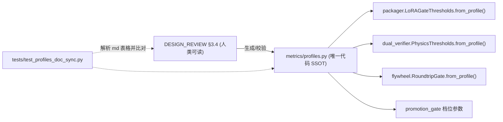
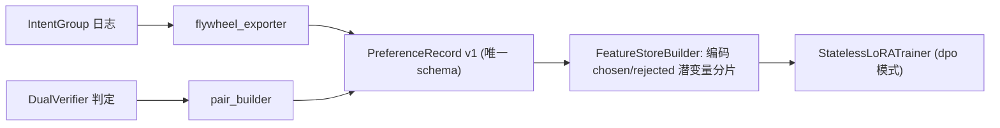

# PR #17 / PR #18 联合评审与改进计划

> **评审对象**
> - PR #17 `feat(pipeline): add training, RSI flywheel, data inspector, and assault plan [gemini3.8]` → squash 合入 `8df7424`（52 个文件，+8824 / −74）
> - PR #18 `fix(training): P0 review fixes — DPO sign, L_normal, thresholds, dead code [opus4.6]` → squash 合入 `6974515`（7 个文件，+121 / −129）
>
> **状态**：两个 PR 都**已合入 `main`**，所以本文是**合入后的整改计划**，不是合入前的拦截意见。本文只给建议，不改代码。
>
> **验证依据**（在 `ubuntu24` 上用 `git archive origin/main` 快照执行，跑完后已清理）
> | 检查项 | 结果 |
> | --- | --- |
> | `mypy python/synapse/{training,rsi,inspect}` | ❌ **6 个错误**（其中 `jev_critic.py:395 Name "JevTransport" is not defined`） |
> | `ruff check …/{training,rsi,inspect,cli}` | ❌ **14 个错误**（含 F821 未定义名、F401 未使用导入、I001 导入排序） |
> | `pytest` 跑本次新增的 6 个测试文件 | ✅ 131 passed / ⚠️ **6 skipped**：`ubuntu24` 的 venv **没装 `torch`**，所以 `StatelessLoRATrainer` 的全部 torch 路径（包括 PR18 改过的 DPO 符号）**在 CI 主力机上一次都没跑过** |

---

## 0. 总体结论

| 维度 | 评价 |
| --- | --- |
| 设计方向 | ✅ 和 `DESIGN_RSI_FLYWHEEL` / `DESIGN_LORA_PIPELINE` / `PLAN-M5~M8` 的蓝图一致：物理先验证、单调晋级门禁、20% 黄金样本、Jev 校准 critic 这些概念都对上了。 |
| 实现成熟度 | ⚠️ 主要是**骨架和桩代码**，但很多地方**对外报告成功**：CLI 子命令和 stage handler 返回 `"configured"`、`"merged"`、`"aligned"` 并以退出码 0 结束；质量门禁缺指标时直接放行。这直接违反 `AGENTS.md` §1 第 4 条「防静默失败三问」。 |
| PR18 修复质量 | ⚠️ 6 项 P0 里只有 2 项真正修好（死代码删除、`NON_MANIFOLD` 映射）。**DPO 公式本身就不成立**，单纯翻转符号不够；阈值没有收敛到 SSOT，反而**多了一份副本**；P0-6 **新引入了一个静默降级到 Mock 的路径**。 |
| 契约与 SSOT | ❌ 阈值有 4 份副本（`profiles.py` / `packager.py` / `dual_verifier.py` / 文档），偏好对 schema 有 2 套（`DPORecord` 和 `PreferencePair`），Bench 因子表有 2 套（`curriculum.py` 和 `bench/conditions.py`），而且它们**互相对不上**。 |
| 工程规范 | ❌ mypy/ruff 不干净；C++ 子工程直接包含 `<windows.h>`/`<unistd.h>`，违反生态铁律 9；`try/catch` 与 `-fno-exceptions` 冲突；`cc_binary` 用了不存在的 `hdrs` 属性。 |
| 流程 | ⚠️ PR17 一次塞了文档、训练、RSI、质检、Electron、C++ 六个领域，8.8k 行，没法有效评审；PR18 自己写着「full suite TBD」就合入了；PR17 的模型标识写成了 `\[gemini3.8]`（转义错误）。 |

---

## 1. PR #18 修复项逐条复核

| 编号 | PR18 声称 | 复核结论 | 说明 |
| --- | --- | --- | --- |
| P0-1 | 修复 DPO 符号 | ❌ **只修了表面** | 见 §2.1。`trainer._dpo_step` **没有参考模型项**，退化成「chosen 误差 < rejected 误差」的 margin loss：模型可以同时把两边误差都抬高，loss 照样下降。`losses.diffusion_dpo_loss` 算的是 `‖v_ref − v_θ‖²`（到参考模型的距离），也不是 Diffusion-DPO 要的 `‖v_target − v_θ‖² − ‖v_target − v_ref‖²`。两个实现**互相不一致**，也都**不对**。另外没有任何测试断言「方向」（chosen 更好时 loss 更低），符号再次写反也不会被发现。 |
| P0-2 | 补 `normal_reconstruction_loss` | ⚠️ 函数有了，**没接线** | 没有导出到 `training/__init__`；trainer 的 `_sft_step` 只算 flow loss，`λ_edge=0.1`（HP-01）和 `λ_normal=0.05`（HP-02）**都没进训练循环**；而且潜空间 DiT 本身不输出法线，`n_pred` 从哪来没有设计（见 §2.1-T5）。另外没有背景掩码：零法线会被归一化成 0 向量，loss 恒为 1。`shape[0]==3` 判断通道在前也有歧义（H=3 时会误判）。 |
| P0-3 | packager 阈值对齐 REVIEW §3.4 | ⚠️ **SSOT 更乱了** | `metrics/profiles.py::RSI_PROMOTION` 仍然是 `chamfer_mm=1.0 / silhouette_iou=0.97 / normal=5.0 / border_ring=1.5`。现在同一个档位有「文档值」「profiles 值」「模块硬编码值」三套，并且 `normal_angular_error_deg=12.0` 实际是 REVIEW 表里的值，和 profiles 也不一致。 |
| P0-4 | `silhouette_iou` 0.88→0.90 | ⚠️ 同上 | 依然是硬编码，没有消费 `get_profile("rsi_promotion")`。`foot_sliding` 的单位统一（CR-01 第 4 条，m/s → cm）**没做**。 |
| P0-5 | 删除重复的 LoRALinear | ✅ | 删干净了。剩余问题见 §2.1。 |
| P0-6 | Jev 支持真实 VLM 传输 | ❌ **引入新的 P0** | `synapse.inspect.vlm_transport` **这个模块在仓库里不存在**，导致 `ImportError` → **静默回退到 `MockJevTransport`**（默认严重度 0.05，等于「资产干净」）。也就是说**生产环境传了 endpoint，所有资产都会被判定合格**。同时 `JevTransport` 类型名未定义（mypy/ruff 都报 F821）。没有对应测试。 |
| Bonus | `NON_MANIFOLD → control` | ✅ | 但「非流形」归到 `control` LoRA 的语义值得再讨论：它是网格拓扑问题，不是视频控制问题，应该路由给重拓扑/修复流程，而不是 LoRA 重训。 |

---

## 2. 分模块评审

> 严重度：**P0** = 结果会出错或静默放行；**P1** = 设计缺陷，会阻塞后续接线；**P2** = 质量或可维护性问题

### 2.1 `training/`（losses / trainer / packager）

**[trainer.py](../../python/synapse/training/trainer.py)**

| ID | 级别 | 问题 | 建议 |
| --- | --- | --- | --- |
| T1 | P0 | `_dpo_step`（L347-373）没有参考模型：`logit = β(err_l − err_w)`，β=500 写死 | 标准 Diffusion-DPO：`logit = −β·[(err_θ,w − err_ref,w) − (err_θ,l − err_ref,l)]`。参考模型可以用「LoRA 关闭的同一个 backbone」实现（`torch.no_grad()` 下临时 disable adapter），零额外显存拷贝。β 从 config 注入，并**和 loss 的 reduction 方式（mean 还是 sum）一起锁定**：β 的量级取决于 reduction，HP-03 必须写清楚。 |
| T2 | P0 | flow-matching 约定可能和底模相反：代码是 `x_t=(1−t)x_0+t·x_1`（x_0 是噪声），`v=x_1−x_0`；Wan 2.1 / SD3 系列常见约定是 `x_t=(1−t)x_data+t·ε`，`v=ε−x_data` | 约定必须**由 adapter 声明**（`WanAdapter.flow_convention`），trainer 去读取，不能自己定。约定写反的话，LoRA 会和底模的速度场对着干。 |
| T3 | P0 | `module(x_t)` 没有传 timestep 和条件（文本、7 通道 FGPP 条件）；`t` 是 `rand(1)`，整个 batch 共用一个，而且是均匀分布 | 定义 `DiTForwardProtocol(x_t, t, cond)`；按样本独立采样 t，采用底模同款分布（logit-normal + shift）。 |
| T4 | P1 | 配置字段 `lr_temporal`、`grad_accum_steps`、`mixed_precision`、`max_steps` **全部没被使用**；每步都 `zero_grad`，梯度累积失效 | 用 param groups 区分 spatial 和 temporal 的学习率；加上累积计数和 autocast。用不上的字段要么实现，要么删掉，不能留着「看起来支持」。 |
| T5 | P1 | 复合损失 `L_flow + λ_edge·L_edge + λ_normal·L_normal` 没进训练循环，而且 `L_normal` 在潜空间里无法计算 | 先做设计决策：(a) 解码出 RGB 后跑一个冻结的法线估计器（成本高）；(b) 在潜空间加一个轻量法线 head（会改变底模结构）；(c) 只在验证阶段算 `L_normal`。**建议先选 (c)**，写进 `DESIGN_LORA_PIPELINE §4.2`，同时修正 HP-02 的表述。 |
| T6 | P1 | `freeze_backbone`（L145-185）先冻结全部参数再检查「可训练比例 ≤ 3%」，结果恒为 0，**这个检查永远成立，没有意义** | 改成在 `inject_lora` **之后**检查可训练比例，并且要求 `0 < ratio ≤ 3%`（为 0 说明注入失败）。 |
| T7 | P1 | `LoRALinear` 的参数在 CPU 上以 fp32 创建，和 `orig` 的 device/dtype 不一致（GPU 上会直接报错）；A 用 `randn·0.01` 初始化，而不是 Kaiming；没有 dropout；重复调用 `inject_lora` 时，`xxx.orig` 这个 Linear 仍然会被 pattern 命中，**导致重复注入** | 参数的 `device`/`dtype` 跟随 `orig.weight`；跳过 `LoRALinear` 的子模块；`named_modules()` 只构建一次 dict（现在每次替换都重建，是 O(n²)）。 |
| T8 | P1 | `export_checkpoint` 不写元数据（rank、alpha、target、底模哈希、flow 约定）；key 命名和 PEFT/diffusers 不兼容 | 在 safetensors 的 `metadata` 里写入上述字段；key 采用 PEFT 规范（`base_model.model.<name>.lora_A.weight`），这样 `MultiLoRAManager` 可以直接加载。 |
| T9 | P0 | `lora_train` 这个 stage（L386-404）**不训练任何东西**，直接返回 `status: configured`；还会改写 `manifest.params` 里嵌套的 dict；缺 `category` 时静默默认成 `style` | 没实现完之前就**显式失败**：新增退出码，或者用 `NotImplementedStageError`（复用 10/20/30/40 之外的保留码，或者返回 `status:"not_implemented"` 并以非零码退出）。`category` 改为必填。 |

**[losses.py](../../python/synapse/training/losses.py)**

| ID | 级别 | 问题 | 建议 |
| --- | --- | --- | --- |
| L1 | P1 | 用 numpy 实现，不可微，**不能用于训练**；和 trainer 里的 torch 实现是两套逻辑，已经出现分歧 | 训练用的 loss 统一用 torch 写一份（放在 `training/losses_torch.py`，延迟导入）；numpy 版降级为**测试 oracle**，用参数化测试保证两者数值一致（`atol=1e-6`）。 |
| L2 | P0 | `diffusion_dpo_loss` 的语义错误（见 T1） | 签名改为 `(v_θ_w, v_θ_l, v_ref_w, v_ref_l, target_w, target_l, β)`。 |
| L3 | P2 | `normal_reconstruction_loss` 没有 mask，并且靠启发式判断通道布局 | 增加 `mask` 参数（取 FGPP alpha / `Cryptomatte.ID≠0`）和显式的 `layout: Literal["HWC","CHW"]`。 |

**[packager.py](../../python/synapse/training/packager.py)**

| ID | 级别 | 问题 | 建议 |
| --- | --- | --- | --- |
| P1 | P0 | 权重文件不存在时会 `touch()` 一个空的占位文件（L149-153），然后计算空文件的 SHA，照常产出 bundle；测试 `test_missing_weights_creates_placeholder` **把这个 bug 固化成了预期行为** | 抛 `AssetNotFoundError`（退出码 20），并删除/改写这条测试。 |
| P2 | P0 | 门禁**缺指标即放行**（`if chamfer is not None`），`bench_metrics={}` 时 `passed=True`；stage handler 固定 `skip_bench=True` → **永远通过**；NaN 和阈值比较结果恒为 False，所以 NaN 也放行 | 门禁默认 **fail-closed**：档位要求的指标缺失或非有限值，一律算失败。`skip_bench` 必须写入 `evaluation_report.waived=true`，并且 `lora eval` 遇到 waived 时拒绝晋级。 |
| P3 | P1 | manifest 是手拼的 dict，没有经过已有的 [LoRAManifest](../../python/synapse/adapters/lora/manifest.py#L56) 校验（target_modules 白名单、拒绝 pickle 等安全规则都被绕过） | 先构造 `LoRAManifest(...)` 再序列化；补上 `base_model_id/sha`、`flow_convention`、`train_config_sha` 这几个字段。 |
| P4 | P1 | 阈值硬编码（见 §3.1） | 改为 `LoRAGateThresholds.from_profile("rsi_promotion")`。 |
| P5 | P2 | handler 默认 `output_dir=/tmp/lora_bundle`；捕获 `QualityGateError` 后转成 dict 返回，退出码语义不统一；文件写入不是原子的 | 输出路径改必填；错误统一交给 bundle_worker 映射到 CLI 退出码；写文件用「临时文件 + `os.replace`」。 |

### 2.2 `rsi/`

**[dual_verifier.py](../../python/synapse/rsi/dual_verifier.py)**

| ID | 级别 | 问题 | 建议 |
| --- | --- | --- | --- |
| R1 | P0 | **NaN 会通过物理检查**：`sil < t` 遇到 NaN 为 False，不会记为失败 | 入口处做 `math.isfinite` 校验，非有限值直接报 `ContractValidationError(10)`。 |
| R2 | P1 | 「可选」指标缺失就跳过：motion 样本不提供 `foot_slide` 也能通过 | 按**样本域**定义必填集合（`rigid` / `character` / `motion`），例如 motion 域必须提供 foot_sliding 和 interpenetration。 |
| R3 | P1 | Verdict 语义混乱：物理通过、PRM 中等 → 判 `HARD_NEGATIVE`；PRM 很低 → 判 `REJECT`。按通行定义，hard negative 应该是「看起来好、实际坏」的样本 | 重新定义状态机：`PHYS_FAIL → HARD_NEGATIVE`（可作为 DPO 的 rejected）、`PHYS_PASS & PRM≥accept → ACCEPT`、`PHYS_PASS & PRM<reject → PRM_DISAGREE`（进入人工抽检，**这恰好是校准 PRM 的数据来源**）、中间态 `UNCERTAIN`。在 `DESIGN_RSI_FLYWHEEL` 里补一张状态图。 |
| R4 | P2 | 没有校验 `prm_accept > prm_reject`；`prm_score` 越界时抛的是 pydantic 的 `ValidationError`，不是 `ContractValidationError` | 在构造函数和 verify 入口做校验。 |
| R5 | P2 | `physics_metrics: dict[str, float]` 里混进了 bool（`is_manifold_watertight`）；`verdict` 被推断成 str，mypy 报错 | 用 pydantic 定义 `PhysicsMetrics` 模型（字段带单位后缀），替代裸 dict。 |

**[promotion_gate.py](../../python/synapse/rsi/promotion_gate.py)**

| ID | 级别 | 问题 | 建议 |
| --- | --- | --- | --- |
| G1 | P0 | **候选报告可以通过「丢掉场景」来过门禁**：baseline 有、candidate 没有的场景被静默忽略（L183-186 只遍历 candidate） | 要求两边场景集合**完全相等**，否则报 `ContractValidationError`；同时校验两份报告的 `bench_version`、`scenario_set_sha256`、`seed_set` 一致。 |
| G2 | P1 | 单场景只检查 `overall`，不检查 `geom` 和 `temporal` | 单场景的每个子分都做不回退检查。 |
| G3 | P1 | `noise_tolerance=0` 加上单次评测：Bench 本身有噪声，会**导致几乎没有候选能晋级**，或者被迫把容差调大 | 多 seed 评测，用配对 bootstrap 或符号检验，判据改为「回退的置信下界 > 0」才算回退；`epsilon_min` 和容差写进档位配置。 |
| G4 | P2 | 失败时既 raise 又构造 result，`write_quarantine_manifest` 只能从异常的 `details` 里反序列化出来 | 改为**纯函数返回 `PromotionResult`**，由调用方（CLI/stage）决定写隔离清单和退出码 40。 |
| G5 | P2 | 分数字段只有 `ge=0`，没有上限，没有 NaN 校验；`lora_sha256` 不和文件比对 | 补齐校验；晋级时重新计算 adapter 的 SHA。 |

**[pair_builder.py](../../python/synapse/rsi/pair_builder.py)**

| ID | 级别 | 问题 | 建议 |
| --- | --- | --- | --- |
| B1 | P1 | `is_golden` 和 `source` 两个字段冗余：通过 `add_self_pairs` 传入 `is_golden=True` 的样本，比例计算时算作非黄金，导出统计时又算作黄金，**两个口径不一致** | 删掉一个字段（建议保留 `source` 并改成 enum），比例统一用一个谓词计算。 |
| B2 | P1 | 靠复制黄金样本凑够 20%：黄金样本少的时候会严重过拟合（比如 1 条复制 250 次） | 设上限 `max_oversample_factor`（比如 4），超过就失败，提示补充数据；或者改成**损失加权**而不是复制样本。 |
| B3 | P1 | 没有校验：`pair_id` 去重、`chosen_uri≠rejected_uri`、URI 非空、`category` 是合法枚举、**黄金样本不能和 Bench 评测场景重叠（防数据泄漏）** | 补齐这些校验，泄漏检查按 `asset_id/scenario_id` 做。 |
| B4 | P2 | `rsi_dual_verify` 这个 stage 注册在 `pair_builder.py` 里，放错了模块 | 迁到 stage 适配层（见 §3.4）。 |
| B5 | P2 | `min_golden_ratio` 没有上限，≥1 时分母会被截到 0.01 | 加 `Field(gt=0, lt=1)`。 |

**[curriculum.py](../../python/synapse/rsi/curriculum.py)**

| ID | 级别 | 问题 | 建议 |
| --- | --- | --- | --- |
| C1 | P0 | **因子表和 Bench 不一致**：这里写死了 `F02_distance / F05_animation / F06_occlusion / F07_background / F08_resolution`，而 [bench/conditions.py](../../python/synapse/bench/conditions.py#L27) 里的是 `F02_background / F05_geometry / F06_animation / F07_occlusion / F08_scale / F09~F11`，一共 11 个因子 | 直接导入 `RENDERING_CONDITION_FACTORS` 作为唯一来源。 |
| C2 | P1 | 权重公式在阈值处不连续（刚低于阈值时从 1 跳到 `boost`），分数为 0 时权重 4.33，超过 `boost` | 改成 `w = 1 + (boost−1)·clip((thr−s)/thr, 0, 1)`，连续且有上界。 |
| C3 | P1 | 缺失的因子默认给 0.5 分，会被当成「弱项」加权；CLI 传的是空 dict，所以**所有因子都被当成弱项** | 缺分的因子要么显式报错，要么用中性权重 1.0，并在输出里标出来。 |
| C4 | P2 | `scenario_id` 每轮都是 `rsi_challenge_0000`，跨轮会冲突；采样是手写线性扫描 | ID 里加上 `round_id` 和参数哈希；采样改用 `rng.choices`。 |
| C5 | P1 | 只产出 `ChallengeScenario`，**没有接到** `bench.Scenario` 或场景生成器 | 输出改成可以直接喂给 `Scenario.from_dict` 的条件组合，可以是多因子组合，而不只是单因子。 |

### 2.3 `inspect/`（jev_critic / flywheel_exporter）

**[jev_critic.py](../../python/synapse/inspect/jev_critic.py)**

| ID | 级别 | 问题 | 建议 |
| --- | --- | --- | --- |
| J1 | P0 | 传了 endpoint 却静默降级成 Mock（见 §1 P0-6） | endpoint 存在但传输层不可用时 → 抛 `BackendUnavailableError(30)`。Mock 只能通过显式参数 `transport: "mock"` 启用，并在报告里写 `transport_kind`。 |
| J2 | P0 | **缺 token 时按「干净」处理**：`logprobs.get("Yes", -10.0)`、`.get("No", -0.1)`；真实 tokenizer 返回的往往是 `" Yes"` / `"yes"` 这种形式，结果会**永远判为干净** | token 先做规范化（strip、casefold，合并同义变体）；两个 token 都缺时报错，**不能给默认值**。 |
| J3 | P1 | 温度 `T=1.5` 是拍脑袋定的，所谓「校准」实际上没做校准 | 每个缺陷类别在带标注的 holdout 集上拟合 `T_c`（最小化 NLL），把 ECE 写入报告；`T_c` 表做成版本化的 JSON 配置。 |
| J4 | P1 | **伪造 3D 定位**：`center_3d=[0,0,0]`、`radius=0.05`、`confidence=severity×1.2`；下游的 `auto_remesh` 会去修原点附近的网格 | `DefectAnnotation3D` 增加 `localized: bool`，坐标改为 Optional；没定位的缺陷禁止路由到局部自动修复，只能走全局修复或 HITL。`confidence` 要么删掉，要么换成有定义的量（比如多视角一致性）。 |
| J5 | P1 | 所有图像拼成一次查询；没有逐视角聚合，没有重试和超时，只捕获 `ConnectionError` | 逐视角查询，再用 max 或 noisy-OR 聚合；传输层统一处理 timeout、重试、HTTP 错误，并映射到退出码 30。 |
| J6 | P2 | `image_uris` 为空时照样评估，结果判为干净 | 为空就报错 `ContractValidationError(10)`。 |
| J7 | P2 | Mock 通过模糊匹配 prompt 文本来推断类别，很脆弱 | Protocol 的签名里显式传入 `category`。 |

**[flywheel_exporter.py](../../python/synapse/inspect/flywheel_exporter.py)**

| ID | 级别 | 问题 | 建议 |
| --- | --- | --- | --- |
| F1 | P0 | 没有 `auto_fix_fn` 时状态是 `no_auto_fix_available`，但仍然 **`fixed_count += 1`**（L204-206） | 不计入已修复数；整体 `status` 设为 `incomplete`，以非零码退出。 |
| F2 | P0 | 只有传了 `manifold_check_fn` 才跑门禁，**默认直接通过**；stage 和 CLI 都不传这个参数 → 永远通过 | 门禁必须执行；没有检查器就报错（20/30）。 |
| F3 | P1 | 文档写的是「ΔF-score 必须 > 0」，代码却是 `< 0.0` 才算失败，**等于 0 也能通过** | 改成严格大于，或者把 `delta_fscore_1mm` 的含义改为「最小改进量」，并设一个正的默认值。 |
| F4 | P0 | **DPO 配对逻辑不成立**：按 `asset_id` 分组后，把每个 rejected 和**第一个** chosen 配对，不管时间顺序、不管是不是同一个缺陷、不管 `initial_state` 是否相同。DPO 要求 chosen 和 rejected **共享同一个条件（prompt 和起始状态）** | 配对键改为 `(asset_id, defect_id/intent_key, initial_state_sha)`；IntentGroup 增加 `timestamp`、`parent_intent_id`；要求 `rej.initial_state_uri == ch.initial_state_uri`，否则丢弃并计数。 |
| F5 | P1 | 宣称「违反流形的状态绝不进入 chosen」，但实际只看 `final_passed_gate` 这一个布尔值 | 导出时显式校验 `non_manifold_edges==0`（从门禁记录里读取）。 |
| F6 | P1 | `asset_id=""` 的样本被归到同一组；没有去重、没有 train/val 划分、没有 schema_version 和来源数据哈希；写入不是原子的 | 在 JSONL 头部或旁边的 sidecar 文件里写 `schema_version`、`source_log_sha256`；按 asset 做确定性划分。 |
| F7 | P2 | 宽泛的 `except Exception`；参数名 `format` 遮蔽了内置函数；IntentGroup 的 `final_passed_gate` 默认是 True（**乐观默认值**） | 默认值改为 False；只捕获具体的异常类型。 |

### 2.4 CLI 与 stage 注册

**[cli/\_\_init\_\_.py](../../python/synapse/cli/__init__.py#L544-L810)**

| ID | 级别 | 问题 |
| --- | --- | --- |
| X1 | P0 | `lora prepare-data / train / merge`、`inspect align` 都是**纯回显桩**，退出码 0，状态写着 `prepared` / `configured` / `merged` / `aligned`。Agent 会把这些当成真实成功。 |
| X2 | P0 | `rsi verify` 把**通过所需的物理指标写死在代码里**（L727-748），`rsi build-pairs` 写死了一条黄金样本，`rsi gate-promote` 用一个标量冒充完整报告：这些命令**对任何输入都输出「通过」**。 |
| X3 | P0 | `lora train` 遇到 `JSONDecodeError` 时静默换成 `{}`（L564）；`inspect eval` 固定用 Mock；`inspect refine` 找不到报告文件时用空缺陷列表，结果「完成」。 |
| X4 | P1 | 测试（例如 `test_lora_prepare_data_json`、`test_lora_train_json`、`test_lora_merge_json`）**把桩行为固化成了预期**。 |

**建议**：没实现的子命令统一返回 `{"status":"not_implemented","agent_fix_hint":...}`，并使用专门的非零退出码（建议在 `errors.py` 增加 `NotImplementedStageError`，退出码 `50`，同步写进 `AGENTS.md` §3 的退出码表）。参数都从文件或 flag 读取，**禁止在 CLI 里内置测试数据**；冒烟测试的数据放到 `tests/fixtures/`。

**Stage 注册方式（横切问题）**：`training/*`、`rsi/*`、`inspect/*` 都在模块末尾 `from synapse.pipeline.bundle_worker import register_stage  # noqa: E402`。后果是：
1. 算法库反向依赖 worker 运行时（分层倒置），`import synapse` 时会把所有 stage 都注册一遍，带来副作用；
2. stage 散落在各个领域模块里（比如 `rsi_dual_verify` 写在 `pair_builder.py` 里）；
3. 容易出现循环导入。
→ 方案见 §3.4。

### 2.5 `tools/data-inspector`（Electron + C++）

| ID | 级别 | 问题 | 建议 |
| --- | --- | --- | --- |
| D1 | P0 | **[BUILD.bazel](../../tools/data-inspector/native/BUILD.bazel) 无法构建**：`cc_binary` 没有 `hdrs` 属性；`MODULE.bazel` 没有声明 `rules_cc` / `platforms` 依赖，但用到了 `@rules_cc` 和 `@platforms`；`main.cc` 里的 `try/catch(...)` 和 `std::stoul` 与生态统一的 `-fno-exceptions` 冲突 | 头文件放进 `srcs`，或者拆出一个 `cc_library`；补上 `bazel_dep`；数字解析改用 `std::from_chars`。把 `bazel build` 加进 CI（ubuntu24）。 |
| D2 | P0 | **违反生态铁律 9**：`inspector_shm_server.cc` 和 `inspector_app.cc` 直接包含 `<windows.h>` / `<unistd.h>` / `<poll.h>`，自己又实现了一遍 SHM，而依赖里明明已经有 `@aether//pal`（自带 SharedMemory） | 改用 `aether::pal::SharedMemory`，以及 aether 已有的 stdin/IPC 抽象。 |
| D3 | P1 | SHM 协议：`reinterpret_cast` 成 `std::atomic` 属于 UB 边缘用法；只有两块缓冲，读端可能读到撕裂帧；SHM 名字固定为 `/inspector-frame`，多开实例会冲突 | 头部直接声明成 `std::atomic` 字段（加 `static_assert(is_always_lock_free)`）；改三缓冲或 seqlock；名字带上 PID 或会话 ID。最好**直接复用 fulgur explorer 和 anima-studio 已有的 SHM 协议实现**，不要再造一个 `INSP` 魔数的变体。 |
| D4 | P0 | **整条帧链路是空的**：`main.js:124` 监听 `nativeProc.on('frame')`，但 `native-process.js` 从来不 emit `'frame'`；`shm-reader.js` 的 `open()` 恒返回 false；native 端的 RHI 初始化、模型加载、截图全是 `TODO(PR-27)`；`config.headless = … \|\| true` 恒为真 | 在 README 和 UI 上明确标注「脚手架，没有渲染」；BUILD 里先不要依赖 `@fulgur//engine/renderer` 等重量级目标（现在是白拖一整套编译依赖）。 |
| D5 | P1 | 安全：`sandbox:false`；`innerHTML` 拼接 manifest 里的不可信字段（`bundle_id`、文件名），有 XSS 风险；`native-send-command` 把任意对象原样透传到 native 进程的 stdin；`onNative*` 注册的监听器没法注销 | 打开 `sandbox:true`；用 `textContent` 渲染不可信字段；IPC 命令做白名单 + schema 校验；preload 返回 unsubscribe 函数。 |
| D6 | P1 | stdout 按数据块 `split('\n')` 解析，JSON 行跨块时会被截断 | 加行缓冲（`readline` 或累积缓冲区）。 |
| D7 | P1 | 选型和工程规范：没有用 `@dervgen/electronkit` / `forgekit`；`electron ^33` 是浮动版本，没有 pnpm lock；C++ 代码不在任何命名空间里（应放在 `namespace synapse::inspector`） | 按 `electron-desktop-dev` 和 `forge-ui-design` skill 对齐；作为 `synapse` 内部自用诊断工具保留在 `tools/data-inspector/`，先把 `InspectionBundle`、IPC 与 SHM 渲染协议做成高内聚的自洽模块，便于后续按需抽离或贡献到上层工作台（见 §3.6）。 |

### 2.6 文档

- [PLAN-ALGO-TRAINING-DATA-PIPELINE.md](../PLAN-ALGO-TRAINING-DATA-PIPELINE.md)：§0.3 正确识别出了阈值矛盾，但 CR-01 的裁决是「以文档为准，profiles.py 当作远期目标」，**却没有给出代码层面怎么落地**，于是 PR18 走了硬编码的路子。HP-03（β=500，号称「和原论文量级一致」）没有说明 reduction 方式，HP-02 没有说明 `L_normal` 在潜空间里怎么计算。§3.2 里把 `pair_builder` 标成「✅ 工程就绪」，**这个标记过于乐观**。
- 新增的 `INDUSTRY_TRACKING_AND_TRENDS.md`（286 行）是调研性质的文档，本次评审没有深读，建议单独发 PR 评审。

---

## 3. 设计层面的改进建议

### 3.1 阈值唯一来源（Threshold SSOT）

- `profiles.py` 是**唯一的代码事实来源**。CR-01 说的「远期目标」另外建一个档位 `rsi_promotion_target`，**不要在各个模块里硬编码**。
- 各个阈值类只提供 `from_profile(name)`，默认值全部来自 profile。
- 加一个文档同步测试，解析 §3.4 的表格和 profile 逐项比对，防止再次漂移。
- 字段名带上单位，比如 `foot_sliding_cm`；别名映射和单位换算集中在一个地方处理。

### 3.2 所有门禁默认 fail-closed

所有门禁统一遵守：**档位要求的指标缺失、或者值为 NaN/Inf，一律判为失败**。豁免必须显式声明（`waivers=[...]`），并写进报告。可以抽一个共用的 `evaluate_gate(metrics, profile, required, waivers) -> GateReport`，packager、dual_verifier、flywheel、promotion 四处门禁共用。

### 3.3 偏好数据契约统一

目前 `DPORecord`（flywheel）、`PreferencePair`（rsi）和 trainer 期望的 `batch["chosen"/"rejected"]` 张量三者之间**没有转换路径**，飞轮在数据层面是断开的。建议：

- `PreferenceRecord v1` 至少包含这些字段：`pair_id, condition_key(prompt + initial_state_sha), chosen_uri, rejected_uri, source(enum), category, split, provenance{log_sha, verifier_version}`。
- `FeatureStoreBuilder` 增加 DPO 分片格式，trainer 只消费潜变量分片。

### 3.4 Stage 适配层

把所有 `register_stage` 迁到 `synapse/pipeline/stages/{training,rsi,inspect}.py`，算法模块里**不再出现** `bundle_worker` 的导入。注册改成显式的注册表（或者 `entry_points`），worker 按 stage 名称延迟导入。每个 stage 统一做三件事：参数先过 pydantic 校验、输出路径必填、异常映射到退出码。

### 3.5 「未实现」要诚实暴露

新增 `NotImplementedStageError`（退出码 50），作为 CLI 子命令、stage、Electron 功能的统一出口。CI 加一条规则：`grep -E '"status": *"(configured|merged|aligned|prepared)"'` 匹配到就失败。

### 3.6 `tools/data-inspector` 定位与模块化设计（已决议：作为 `synapse` 内部工具保留开发）

> **架构决议**：`tools/data-inspector` 明确作为 `synapse` 仓库自身的训练与评测数据可视化诊断工具继续开发（对应 `PLAN-M8` 的 `PR-26` ~ `PR-29`），暂不外迁；待功能成熟稳定后，再决定是否将通用组件贡献到 `@dervgen/forgekit` 或 `grand-studio`。

为保证其在 `synapse` 内部健康演进且未来易于复出/贡献，需遵守以下模块化与工程边界：
1. **与 Python 核心包零耦合**：保持独立子目录 `tools/data-inspector/`（独立 `package.json` 与 `native/MODULE.bazel`），绝不反向污染 `python/synapse` 的轻量依赖；所有评测重算与 EXR 降级转换均通过标准 CLI（`synapse-bench evaluate --bundle`、`synapse fgpp inspect`）子进程交互。
2. **全面收敛 OS 原语至 `@aether//pal`**：删除 `inspector_shm_server.cc` / `inspector_app.cc` 中手写的 `<windows.h>` / `<unistd.h>` / `shm_open` / `CreateFileMappingA` 代码，统一复用 `@aether//pal` 的共享内存与平台抽象，C++ 源码统一纳入 `namespace synapse::inspector` 并严格遵守 `-fno-exceptions`。
3. **打通端到端真渲染闭环（分步消解 `TODO(PR-27)`）**：
   - 先在 `TOOL-1` 中修复 `BUILD.bazel` / `MODULE.bazel` 构建问题，接入 `@fulgur//engine/rhi`（支持 `--rhi=null --headless` 在 `ubuntu24` 上跑通 CI 冒烟，以及 `--rhi=metal/vulkan/d3d12` 本地真机渲染），打通 `InspectorShmServer` → Electron `shm-reader` / IPC 帧传输全链路；
   - 再按 `PLAN-M8` 推进 `PR-28`（骨骼动画播放 + FGPP 多通道悬停读值 + 统一时间轴）与 `PR-29`（BVH 距离热力图 + 4 模式对比 + 指标仪表盘）。
4. **安全与协议自洽**：开启 Electron `sandbox: true`、修复 DOM `innerHTML` 注入、为 stdin/stdout JSON-RPC 增加行缓冲与命令 Schema 白名单校验，使协议层具备未来直接迁移至 `electronkit` 的干净接口。

---

## 4. 整改执行计划（建议拆成 7 个 PR，按顺序推进）

| PR | 范围 | 关键交付 | 验收标准（防静默失败三问） |
| --- | --- | --- | --- |
| **FIX-1** 止血（P0，1–2 天） | jev / packager / flywheel / dual_verifier / promotion | J1、J2、P1、P2、F1、F2、R1、G1；修复 `JevTransport` 名称；mypy 和 ruff 清零 | 新增反例测试：endpoint 不可用 → 退出码 30；权重缺失 → 20；指标缺失或 NaN → 40；候选报告少一个场景 → 10。**删除** `test_missing_weights_creates_placeholder`。 |
| **FIX-2** 诚实桩 | cli / stages | §3.5 的 `NotImplementedStageError`；去掉 CLI 里内置的测试数据（X1~X4） | 桩子命令一律返回非零码；CI 加 grep 守卫。 |
| **ARCH-1** 阈值 SSOT 与 fail-closed 门禁 | metrics / training / rsi / inspect | §3.1、§3.2；`foot_sliding` 单位统一；`rsi_promotion_target` 档位 | 文档同步测试变绿；4 处门禁全部走 `evaluate_gate`。 |
| **ARCH-2** Stage 适配层 | pipeline | §3.4；领域模块里不再出现 `E402` 导入 | 加一个 import-linter 规则：`synapse.{training,rsi,inspect}` 禁止导入 `synapse.pipeline`。 |
| **ALGO-1** Trainer 正确性 | training | T1~T8、L1~L3；adapter 声明 flow 约定；按样本采样 t；参考模型 DPO；PEFT 格式导出 | 在 ubuntu24 的 venv 里加装 CPU 版 `torch`（作为 `[gpu]` 可选依赖的 CPU 变体），**消除那 6 个 skip**。新增测试：①DPO 方向测试（chosen 误差降低 → loss 降低）；②参考模型等于策略模型时 loss = ln2；③numpy oracle 和 torch 实现一致；④在小型 MLP 上过拟合 toy 偏好对，偏好准确率 > 0.95；⑤在 GPU 节点上验证 device/dtype 跟随 `orig`。 |
| **DATA-1** 偏好数据契约 | inspect / rsi / training | §3.3：`PreferenceRecord v1`、F4 条件对齐配对、B1~B3、C1~C5 | 跑通端到端：intent 日志 → JSONL → 潜变量分片 → 1 步 DPO 训练，产出非空 checkpoint，`LoRAManifest` 校验通过。 |
| **TOOL-1** Inspector 构建修复、安全加固与渲染打通 | tools/data-inspector | 修复 D1~D7：修好 `MODULE.bazel` / `BUILD.bazel` 与 `-fno-exceptions`；改用 `@aether//pal` SHM；打通 `--rhi=null` 无头帧输出与 Electron 端帧接收显示；落实 D5/D6 安全与行缓冲修复 | `bazel build //:data-inspector-native` 在 `ubuntu24` 上零告警编译通过；`--rhi=null --headless` 下发送 `load_bundle` + `camera` 指令能产出非空 SHM 帧并被 Node 测试验真；`npm test` 全绿；安全检查清单（sandbox、CSP、textContent、IPC 白名单）全部通过。 |

**并行关系**：FIX-1 和 FIX-2 可以并行；ARCH-1 和 ARCH-2 依赖 FIX-1；ALGO-1 和 DATA-1 依赖 ARCH-1；TOOL-1 和其他 PR 互不依赖。

---

## 5. 流程改进建议

1. **PR 粒度**：单个 PR 控制在 ≤ 1.5k 行、只涉及一个领域。PR17 应该拆成 6 个：文档、training、rsi、inspect、CLI、inspector。
2. **合入门槛**：PR 描述里必须贴出 ubuntu24 上 `pytest` / `mypy` / `ruff` 的完整输出；**出现 skip 要说明原因**。写着「full suite TBD」不能合入。
3. **修复类 PR 必须带回归测试**：每个 P0 修复至少配一条反例测试。PR18 的 P0-1 和 P0-6 都没有。
4. **评审意见对齐**：PR18 声称阈值「对齐了 REVIEW §3.4」，评审时应该同时检查 `profiles.py`。建议在 PR 模板里加一项「涉及阈值或契约时，列出所有引用位置」。
5. **模型标识格式**：PR17 的正文写成了 `\[gemini3.8]`，按规范应该是 `` `[gemini3.8]` ``。
