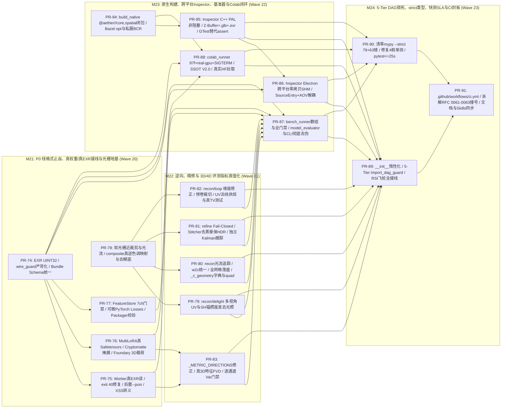

# 细分实施计划：Horizon-6 生产硬化、算子真值化与自动化 CI 封板 (M21–M24: PR-74 ~ PR-91)

- **计划版本**: `Actionable Horizon-6 Blueprint (v1.0)`
- **所属总计划**: [docs/IMPLEMENTATION_PLAN.md](../../IMPLEMENTATION_PLAN.md)（Horizon 6 / Waves 20–23，**M21–M24** 共 4 大里程碑、**18 个原子 PR**）
- **问题源头审计**: [docs/audits/AUDIT-POST-HORIZON5-2026-11.md](../audits/AUDIT-POST-HORIZON5-2026-11.md)（基线 `e37bfa6`，全覆盖实测确认的 `10×P0 + 10×P1 + 5×P2 + 2×P3` 缺陷）
- **制定日期**: `2026-11-15`
- **操作模型标识**: `[opus4.6]` / `[gemini3.8]`
- **实施状态**: ✅ **历史遗留债务已由 Horizon 7 (PR-93 ~ PR-110) 在 Release v3.5 彻底清零并闭环封板 (10 项硬门禁全部在 ubuntu24 实跑全绿)**

> [!WARNING]
> **Horizon 6 实际合入台账与审计复核记录 (`git log` `#71 ~ #90` 核对)**：
> `PR #90` (`46b3bda`) 此前在本文档头部错配并提前标注 `✅ 100%`。经逐条比对 `git log` 与 `ubuntu24` 全量实跑，真实映射与移交清单如下（完整三问核验见 [AUDIT-POST-HORIZON6-2026-11.md §2](../audits/AUDIT-POST-HORIZON6-2026-11.md#L73-L98)）：
> - `PR-74` → `#71` (`8a0f1c2`, `fgpp/schema/wire_guard`) + `#72` (`3ac290c`)：⚠️ 部分合入 → 缺 `.exr`/C++ 无 `"camera"` 元数据问题移交 `PR-93`
> - `PR-75` → `#75` (`ea04489`, `cli/bundle_worker/viewer`)：⚠️ 部分合入 → 后置 `--json`/常驻 `ViewerServer`/空 Stage 移交 `PR-96`
> - `PR-76` → `#74` (`abaaa4f`, `adapters/wan/lora`)：⚠️ 部分合入 → 掩膜丢弃/`_extract_lora_ab` 覆写/滑窗方差倍增移交 `PR-97`
> - `PR-77` → `#73` (`0f1689d`, `training`)：⚠️ 部分合入 → Fail-Open Packager/4 零接入损失/门禁退化移交 `PR-98`
> - `PR-78` → `#76` (`a418c04`, `render_core/composite/style`)：⚠️ 部分合入 → 近裁剪退化/穿地反转/缺前向软肩移交 `PR-94, PR-95`
> - `PR-79` → `#78` (`c6b8b6b`, `recon/delight`)：⚠️ 部分合入 → 屏幕混叠与亮度相消移交 `PR-99`
> - `PR-80` → `#81` (`e9613a9`, `recon`)：⚠️ 部分合入 → MC 错位与 `w2c` 致 `test_recon_invert_cli.py` 必败移交 `PR-99`
> - `PR-81` → `#79` (`24e1797`, `refine`)：⚠️ 部分合入 → HDR 截断与 RGB 调色伪装移交 `PR-100`
> - `PR-82` → `#77` (`6e7ee95`, `recon/loop`)：⚠️ 部分合入 → 切空间恒返 `[0,0,1]` 与预卷漏裁移交 `PR-99`
> - `PR-83` → `#80` (`01a5cd2`, `metrics`)：⚠️ 部分合入 → `_build_r3d18_extractor` `T!=3` 崩溃与 `uint8` 未归一化移交 `PR-101`
> - `PR-84` → `#83` (`d2ce9f1`, `build_native/.bazelrc`)：⚠️ 部分合入 → macOS/Win 链接与 `[opt]` 双重扩展移交 `PR-102`
> - `PR-85` → `#85` (`af16a3e`, `data-inspector/native`)：⚠️ 部分合入 → `-fno-exceptions` `.value()` `SIGABRT` 与零 `.glb/.exr` 移交 `PR-103`
> - `PR-86` → `#86` (`e497658`, `data-inspector/electron`)：❌ 核心未生效 → non-Linux SHM 失效与 Seqlock 必败移交 `PR-104`
> - `PR-87` → `#82` (`21b49d5`, `bench/inspect/rsi`)：⚠️ 部分合入 → 缺指标/`TestEvalScript` 失败与假门禁移交 `PR-105`
> - `PR-88` → `#84` (`7a7dac0`, `colab/assets`)：⚠️ 部分合入 → 假 `real-gpu`/HF 嵌套/`assets_manifest` 错哈希移交 `PR-106`
> - `PR-89` → `#87` (`6de992b`, `dag_guard/init`)：⚠️ 部分合入 → 函数域/动态 `import` 与 2 条逆向边未清零移交 `PR-93`
> - `PR-90` → `#88` (`139b7b8`, `strict mypy/tests/ruff`)：❌ 未达标 → 快测超标 (`40.43s > 25s`)、假 `clean_recon` 与 `-m slow` 掩盖失败移交 `PR-92, PR-107`
> - `PR-91` → `#89` (`9ed889b`, `ci/rfc/skills`)：❌ 门禁失效 → `.ci/` 误置、327 Ruff 告警被屏蔽与 RFC/Skills 漂移移交 `PR-92, PR-108`

---

## 1. 阶段总览、依赖拓扑与并行 Worktree 波次

Horizon 6 旨在彻底清零 `e37bfa6` 基线上经代码逐行审阅与 `ubuntu24` 实跑暴露的“假绿（False-Green）与静默占位”债务——包括 `Cryptomatte.ID` EXR 类型失真、`MultiLoRAManager` 随机噪声伪权重、`JobBundleWorker` 零像素空跑、`FeatureStore` 100% 误拒、`recon/delight` 恒等空操作、`watertight_pct`/`f_score_5mm` 方向反转、`data-inspector` 跨平台 SHM 与 POSIX 泄漏，以及缺失 `.github/workflows/` 与 `mypy --strict` 门禁。



### 并行 Worktree 开发波次表 (`Waves 20–23`)

> 遵守严格文件域正交隔离，单波次内同时启动 `3 ~ 5` 个独立 Worktree (`/tmp/synapse-wt-pr-<num>`) 并行推进：

| 执行波次 | 归属里程碑 | 可完全并行的原子 PR 组合（独立包域零文件冲突） | 阻塞前置 | 波次解锁核心能力 |
| :---: | :---: | :--- | :---: | :--- |
| **Wave 20** | **M21** | `PR-74` (`fgpp`/`wire_guard`/`schemas`) ∥ `PR-75` (`bundle_worker`/`cli`/`viewer`) ∥ `PR-76` (`adapters`) ∥ `PR-77` (`training`) ∥ `PR-78` (`render_core`/`composite`/`style`) | `main (e37bfa6)` | 全仓 P0 线格式、真权重/真 EXR、可微训练梯度与软光栅/合成底片止血 |
| **Wave 21** | **M22** | `PR-79` (`recon/delight`) ∥ `PR-80` (`recon`+`stages`+`gate`) ∥ `PR-81` (`refine/`) ∥ `PR-82` (`recon/loop/`) ∥ `PR-83` (`metrics/`) | `PR-74, 75, 76, 78` | 逆向去光照、多视角几何、手术刀精修、指标方向与 FVD/Var 门禁真值化 |
| **Wave 22** | **M23** | `PR-84` (`build_native`/`.bazelrc`) → `PR-85` (`inspector/native`) → `PR-86` (`inspector/electron`) ∥ `PR-87` (`bench_runner`/`model_evaluator`/`cli`) ∥ `PR-88` (`colab`/`assets`) | Wave 20 + Wave 21 | 原生 C++20/Bazel 跨平台 SHM 视口、基准评估器 Fail-Closed 与 Colab E1–E4 真跑通 |
| **Wave 23** | **M24** | `PR-89` (`__init__`/`dag_guard`/`rsi`) ∥ `PR-90` (`mypy --strict`/`tests`/`pyproject`) → `PR-91` (`.github/workflows/ci.yml`/docs) | Wave 22 | 5-Tier DAG 硬锁死、全仓零 `strict` 错、`pytest <= 25s` 与 GitHub Actions 自动守门 |

---

## 2. 各原子 PR 详细施工清单 (`PR-74 ~ PR-91`)

> 约束：每个 PR 净增改代码严格控制在 **`300 ~ 700` 行**，必须通过 **存在问 · 接线问 · 执行问** 三重门禁并在云端主力机 `ubuntu24` 实测通过后才可标记 `✅`。

---

### M21：P0 线格式止血、真权重 / 真 EXR 接线与训练光栅地基（Wave 20）

<a id="pr-74"></a>
#### `[✅ PR-74]`：OpenEXR `UINT32` `Cryptomatte.ID` 修复、`wire_guard` 逐通道严苛化与 `InspectionBundle` Schema 统一（已于 PR #71 合入）
- **对应审计缺陷**：`H6-P0-01`, `H6-P0-10`（契约部分）, `H6-P1-01`
- **前置依赖**：`main (e37bfa6)`
- **涉及文件与核心符号**：
  - `python/synapse/fgpp/io.py`（`export_fgpp`, `import_fgpp`）
  - `python/synapse/cli/_fgpp.py`（`_cmd_fgpp_validate`, `_EXPECTED_CHANNEL_TYPES`）
  - `tools/wire_guard.py`（`_RE_PIXEL_TYPE`, `_parse_header`, `_check_fgpp`, `_check_style_profile`, `_check_json_schemas`）
  - `schemas/bundle.v1.0.schema.json`, `python/synapse/bench/bundle_exporter.py`（`INSPECTION_SCHEMA_VERSION`, `InspectionBundleManifest`, `SourceEntry`）
  - `tests/test_fgpp_io.py`, `tests/test_wire_schemas.py`, `tests/test_inspection_bundle.py`
- **核心工程变更**：
  1. 修复 `fgpp/io.py:134-142`：对 `PixelType.UINT32` 通道使用 `Imath.PixelType(Imath.PixelType.UINT)` 并直接写出 `np.ascontiguousarray(arr, dtype=np.uint32).tobytes()`，彻底移除 `.view(np.float32)` 位重解释（消除 IEEE-754 sNaN quiet bit 对 `Cryptomatte.ID` 的静默篡改）；`import_fgpp` 优先按 `UINT` 无损读回（并对历史误存为 `FLOAT` 的旧 EXR 保留明确迁移告警兼容解码）。
  2. 收紧 `cli/_fgpp.py:55`：将 `Cryptomatte.ID` 严格锁定为仅接受 `UINT` / `UINT32`（拒绝 `FLOAT`）；当环境缺失 `OpenEXR` 时在 `validate` 命令显式抛出 `BackendUnavailableError (30)`，严禁在 `line 158` 静默返回 `"exr_validated": True`。
  3. 修复 `tools/wire_guard.py` 盲区：重写 `enum class PixelType` 块解析与 `getAlphabeticalEXRChannelSpecs()` 元组解析（逐通道精确比对 C++ `PascalCase` 枚举值 `Uint32/Half/Float`、有序通道名与 `allow_spatial_filtering` 标志）；当 `../aether/style` 尚不存在时显式打印 `SKIPPED (upstream @aether//style not present)` 而非静默报告一致；在 `_check_json_schemas()` 中实例化默认 Pydantic 模型并校验其 `schema_version` 与 JSON Schema `const` / 字段双向零差集。
  4. 统一 `InspectionBundle` Schema：`bundle_exporter.py` 将 `INSPECTION_SCHEMA_VERSION` 统一对齐为 `"synapse.bundle.v1.0"`（兼容读取旧 `"inspection.v1.0"` 时发出结构化警告），并为 `SourceEntry.sha256` 在打包和校验阶段计算/核验真实 SHA-256。
- **`ubuntu24` 验收与防静默三问门禁**：
  - 存在问 & 接线问：`/root/venv-synapse/bin/python tools/wire_guard.py --check` 退出码 `0` 且输出非空 `pixel_type_values`（3 项）与 15 条有序通道摘要。
  - 执行问：`/root/venv-synapse/bin/pytest tests/test_fgpp_io.py tests/test_wire_schemas.py tests/test_inspection_bundle.py -v`，构造覆盖全部 IEEE-754 NaN/sNaN bit pattern（如 `0x7F800001`, `0xFFFFFFFF`）的 `Cryptomatte.ID` 往返 OpenEXR 文件，断言头像素类型为 `UINT` 且逐 bit 100% 一致；在单测中篡改临时副本通道类型，验证 `wire_guard.py` 必定返回非 `0`。

---

<a id="pr-75"></a>
#### `PR-75`：`JobBundleWorker` 真 EXR 读取、CLI 后置 `--json`、`bench` 退出码 `40` 与 Viewer XSS 防护
- **对应审计缺陷**：`H6-P0-03`（Worker/CLI 部分）, `H6-P1-07`（Viewer XSS）
- **前置依赖**：`PR-74`
- **涉及文件与核心符号**：
  - `python/synapse/pipeline/bundle_worker.py`（`_handle_neural_video_generate`, `run_worker_cli`）
  - `python/synapse/cli/_app.py`, `python/synapse/cli/common.py`, `python/synapse/cli/_bench.py`
  - `python/synapse/viewer/server.py`（`_build_static_html` / 内联 JSON 注入）
  - `tests/test_bundle_worker.py`, `tests/test_cli.py`, `tests/test_dataset_and_viewer.py`
- **核心工程变更**：
  1. 修复 `bundle_worker.py:372`：在 `_handle_neural_video_generate` 中调用 `import_fgpp(fgpp_dir, lazy=False)` 读取完整 15 通道像素张量与相机轨迹，替换仅加载元数据的 `FGPPSequence.load_metadata()`，当 EXR 帧缺失时抛出 `AssetNotFoundError (20)`。
  2. 为 `run_worker_cli` 增加顶层异常处理信封：捕获 JSON 解析错误与 Pydantic/Schema 验证失败，依据 `--json` 输出含 `"exit_code": 10` 及 `"agent_fix_hint"` 的合法 JSON，不再以未捕获堆栈 `exit 1` 崩溃。
  3. 统一 CLI `--json` 全局参数：在 `cli/_app.py` / `common.py` 中抽离共享 `argparse.ArgumentParser(add_help=False)` 父解析器挂入全部 11 个子命令解析器，使 `synapse <cmd> <subcmd> --json` 与 `synapse --json <cmd> <subcmd>` 等效工作；修复 `cli/_bench.py:119` 访问 `r.gate_verdict.violations`（替代不存在的 `.failures`），确保质量门禁未达标时稳定以 `ExitCode.QUALITY_GATE_FAILED (40)` 退出。
  4. 修复 `viewer/server.py:281-289`：对嵌入静态 HTML `<script>` 的 JSON 字符串转义 `<`, `>`, `&`（`\u003c`, `\u003e`, `\u0026`），阻断 `</script>` 标签逃逸导致的存储型 XSS。
- **`ubuntu24` 验收与防静默三问门禁**：
  - 执行问：`/root/venv-synapse/bin/pytest tests/test_bundle_worker.py tests/test_cli.py tests/test_dataset_and_viewer.py -v`；新增单测分别验证：(a) 失败门禁运行 `synapse bench run ... --json` 精确返回退出码 `40`；(b) `neural_video_generate` 非零深度/法线条件真实进入适配器；(c) 含 `"</script><script>alert(1)</script>"` 的 manifest 生成 HTML 中不包含裸 `</script>` 闭合标签。

---

<a id="pr-76"></a>
#### `PR-76`：`MultiLoRAManager` 真 `.safetensors` 加载、`Cryptomatte` 空间掩膜透传、`FoundaryHttpTransport` 3D 载荷与 48f 重锚
- **对应审计缺陷**：`H6-P0-02`, `H6-P1-03`（Wan/Scheduler 部分）
- **前置依赖**：`PR-74`
- **涉及文件与核心符号**：
  - `python/synapse/adapters/lora/manager.py`（`MultiLoRAManager.load_lora`, `_compute_delta`, `apply_lora_stack`）
  - `python/synapse/adapters/lora/patcher.py`（`LoRAPatchHook`, `patch_wan_adapter_with_lora`）
  - `python/synapse/adapters/wan.py`（`FoundaryHttpTransport.submit`, `WanAdapter.prepare_conditions`, `reanchor_physical_frame`, `_encode_depth`）
  - `python/synapse/adapters/scheduler.py`（`ConditionScheduler.plan_windows`）
  - `tests/test_lora_manager.py`, `tests/test_wan_lora_wiring.py`, `tests/test_wan_anchor_and_gates.py`, `tests/test_condition_scheduler.py`
- **核心工程变更**：
  1. 修复 `MultiLoRAManager`：从 `manifest.adapter_path` 真实读取 `.safetensors` LoRA `lora_A`/`lora_B` 权重张量并强制核验 `manifest.adapter_sha256`（仅在显式 `test_synthetic=True` 单元测试模式下允许可控种子合成，默认生产路径缺文件抛 `AssetNotFoundError (20)`、哈希不匹配抛 `ContractValidationError (10)`）；调用 `orthogonalize_conflicting_loras` 并将其输出注入实际应用层。
  2. 修复 `LoRAPatchHook` (`patcher.py:52`) 按目标层 `weight.dtype` 与 `device` 动态 cast（支持 `fp16`/`bf16`/`fp32`）；在 `wan.py` 中从 `FGPPSequence` 真实传入 `cryptomatte_id`，将 `build_spatial_lora_masks(...)` 返回的空间掩膜真实挂载至 `LoRAPatchHook` 与推理条件字典。
  3. 修复 `FoundaryHttpTransport.submit()` (`wan.py:130-141`)：完整序列化 `control_tensor`（压缩二进制/引用块）、`keyframe_images` 与 `payload.extra`，并从上游 `TraceContext` 透传 `traceparent`；同时在 `WanAdapter` 推理主循环真实调用 `reanchor_physical_frame` 并保留 `depth_norm_f64` 为 `float64` 直至量化/序列化边界。
  4. 修复 `scheduler.py:448-468`：在现有 `WindowPlan` 上标记 `is_physical_anchor=True` 时使用 OR 保留原始真实切镜的 `has_discontinuity=True`，绝不因到达 48 倍数锚点帧而静默抹除镜头切换信号。
- **`ubuntu24` 验收与防静默三问门禁**：
  - 执行问：`/root/venv-synapse/bin/pytest tests/test_lora_manager.py tests/test_wan_lora_wiring.py tests/test_wan_anchor_and_gates.py tests/test_condition_scheduler.py -v`；新增单测验证：(a) 篡改临时 `.safetensors` 文件后加载被拒（退出码 `10`）；(b) `bf16` 线性层经 `LoRAPatchHook` 前向传播不报错且空间掩膜外像素增量严格为 `0`；(c) Mock HTTP 服务接收请求体明确包含 `control_tensor` 与上游 `traceparent`；(d) 第 48 帧与场景切镜重合时 `has_discontinuity` 保持 `True`。

---

<a id="pr-77"></a>
#### `PR-77`：`FeatureStoreBuilder` 门禁形状修复、纯 PyTorch 可微 `losses.py` 与 `Packager` 完整性核验
- **对应审计缺陷**：`H6-P0-04`
- **前置依赖**：`PR-74`
- **涉及文件与核心符号**：
  - `python/synapse/training/feature_store.py`（`FeatureStoreBuilder._validate_ingestion_quality`, `ingest_sequence`）
  - `python/synapse/training/losses.py`（`FlowMatchingLoss`, `EdgePreservingLoss`, `DiffusionDPOLoss`）
  - `python/synapse/training/trainer.py`（`StatelessLoRATrainer.train_step`）
  - `python/synapse/training/packager.py`（`LoRAPackager.package`）
  - `tests/test_lora_feature_store.py`, `tests/test_lora_trainer.py`, `tests/test_lora_cli_gate.py`
- **核心工程变更**：
  1. 修复 `feature_store.py:299-381`：显式区分 `[T, H, W, 15]` 原始 FGPP 张量与 `[7, T, H, W]` Wan 控制张量布局，并从样本独立字段 `camera_matrices`（`[T, 4, 4]`）提取 $3\times 3$ 旋转块校验 `|det(R) - 1| < 1e-5`，彻底消除拿 `[7,T,H,W]` 空间像素列 `7:16` 求行列式导致的 100% 样本误拒。
  2. 重写 `training/losses.py`：移除全部 `np.asarray` 断图转换，统一采用纯 PyTorch 张量算子（保留完整 `autograd` 梯度链），并将 `losses.py` 真实接入 `StatelessLoRATrainer.train_step()` 反向传播与梯度裁剪流程。
  3. 加固 `training/packager.py`：打包前校验 `.safetensors` 头部元数据，并强制核验输出权重键名全部命中 `LoRAManifest.target_modules` 白名单，禁止越权/空权重落盘。
- **`ubuntu24` 验收与防静默三问门禁**：
  - 执行问：`/root/venv-synapse/bin/pytest tests/test_lora_feature_store.py tests/test_lora_trainer.py tests/test_lora_cli_gate.py -v`；新增单测验证：(a) 注入真实 15 通道 FGPP + `[7,T,H,W]` + 合法 SO(3) `camera_matrices` 样本通过全部 5 道质量门禁，写出非空 `.tar` 分片；(b) `trainer.train_step()` 后 LoRA 参数 `.grad` 非 `None` 且范数严格大于 `0`。

---

<a id="pr-78"></a>
#### `PR-78`：`SoftwareRasterizer` 近裁剪与真实光流、`composite` 去底片糊化 / 真逆色调映射与 `style` SH 修正
- **对应审计缺陷**：`H6-P0-05`, `H6-P1-03`（Style 提取器部分）
- **前置依赖**：`main (e37bfa6)`
- **涉及文件与核心符号**：
  - `python/synapse/render_core/rasterizer.py`（`SoftwareRasterizer.rasterize`）
  - `python/synapse/composite/blend.py`（`composite_optical_increments`, `border_ring_lab_match`, `_forward_warp_bilinear`）
  - `python/synapse/composite/detector.py`（`_detect_ground_violation`）
  - `python/synapse/style/aces_color.py`（`soft_knee_inverse_tonemap`, `_fallback_soft_knee_inverse_tonemap`）
  - `python/synapse/style/extractor.py`（`extract_sh_lighting`, `extract_style_profile`）
  - `tests/test_composite_blend.py`, `tests/test_composite_mask.py`, `tests/test_style.py`, `tests/test_render_core.py`
- **核心工程变更**：
  1. 升级 `render_core/rasterizer.py`：在齐次裁剪空间对跨近裁剪面 ($z + w < 0$ / $w \le \epsilon$) 三角形实施 Sutherland-Hodgman 裁剪（防止负 `w_clip` 倒投影），使用透视校正 $1/w$ 进行深度与顶点属性插值，并依据上一帧 `prev_view_proj` 真实计算每像素屏幕运动矢量写入 `mv_buf`（清除死变量 `_pts_world`）。
  2. 修复 `style/aces_color.py:119-129` 与 `composite/blend.py`：`soft_knee_inverse_tonemap` 实现为严格单调递增可逆的滚降逆展开（高光段超出阈值 `t_knee < 1.0` 呈渐近超线性恢复而非继续压缩）；`composite_optical_increments()` 仅对渲染高光/焦散光学增量层施加 Cryptomatte 边界感知平滑，严禁对整幅原始视频背景施加 `9×9` 模糊；修复 `border_ring_lab_match` 采用平滑过渡权重而非 16px 内边界硬阶跃，并统一 `_forward_warp_bilinear` 光流符号及 `detector.py` `_detect_ground_violation` 与相机坐标系一致的 `+Y`/`+Z` 方向。
  3. 修复 `style/extractor.py:135, 175`：删除对 `float32`/`float64` HDR 输入误除 `255.0` 的逻辑（仅 `uint8` 除 `255.0`），并在球谐基最小二乘拟合时按 `(normal · -view_dir) > 0.05` 过滤背向与无效法线像素。
- **`ubuntu24` 验收与防静默三问门禁**：
  - 执行问：`/root/venv-synapse/bin/pytest tests/test_composite_blend.py tests/test_composite_mask.py tests/test_style.py -v`；新增单测验证：(a) 平移刚体场景下 `SoftwareRasterizer` 输出非零 `mv_buf` 且斜跨近裁剪面无倒投影伪影；(b) 背景纹理经过 `composite_optical_increments` 后非掩膜区域高频 PSNR 与原图一致（无全图模糊）；(c) 已知朝向单光源拟合主光方向误差 `< 5°`。

---

### M22：逆向重建 (`recon`)、解剖精修 (`refine`) 与 3D/4D 评测指标真值化（Wave 21）

<a id="pr-79"></a>
#### `PR-79`：`recon/delight.py` 废除恒等空操作，实现真实多视角 UV 融合与球谐辐照度去光照
- **对应审计缺陷**：`H6-P0-06`（`delight` 部分）
- **前置依赖**：`PR-78`
- **涉及文件与核心符号**：
  - `python/synapse/recon/delight.py`（`delight`, `decompose_intrinsic`, `delight_multiview_albedo`）
  - `tests/test_recon.py`
- **核心工程变更**：
  1. 彻底废除 `decompose_intrinsic()` 与 `delight_multiview_albedo()` 中把同一帧 `rad` 同时当作 `albedo` 与 `radiance` 传入 `delight(rad, norm, rad)` 的代数恒等空操作（`rad / rad == 1.0`）。
  2. 在 `decompose_intrinsic()` 中先利用像素法线与亮度在局部高色度一致性掩膜下求解二阶球谐辐照度系数 $\mathbf{c}_{SH}$ 并估算全局平滑着色场 $E(\mathbf{x}) = \text{clip}(\mathbf{Y}(\mathbf{n})^\top \mathbf{c}_{SH}, \epsilon, E_{\max})$，按 $\hat{\rho} = I / E$ 解耦本征反照率与残余着色层，仅将已知 `[0..255]` `uint8` 除以 `255.0`（保留 `max > 1.0` 线性 HDR 数值，删除误除 `255.0` 压黑分支）。
  3. 在 `delight_multiview_albedo()` 中真实利用传入的 `cameras` 与 `mesh` 执行视角投影与视角权重（$\cos\theta_v$ 可见性）融合生成多视角一致反照率，并以真实重渲染图像 $E \odot \hat{\rho}$ 与观测帧 $I$ 的 CIE $\Delta E_{00}$ 评估残差。
- **`ubuntu24` 验收与防静默三问门禁**：
  - 执行问：`/root/venv-synapse/bin/pytest tests/test_recon.py -v`；新增合成方向光渲染球体测试：在方向光造成明暗对比度 `> 5x` 时，经 `decompose_intrinsic` 后得到的 `albedo` 在受光面与背光面方差显著收敛（shading removal ratio `>= 60%`），且线性 HDR `mean > 1.5` 不被错误缩放到 `0.006`。

---

<a id="pr-80"></a>
#### `PR-80`：`recon` 真实光流点追踪、相机约定统一、流形 Fail-Closed、`_c_geometry` 字典修复与合法 `quad_remesh`
- **对应审计缺陷**：`H6-P0-06`（`tracking`, `multiview`, `stages`, `geometry_gate`, `geometry`）
- **前置依赖**：`PR-78`
- **涉及文件与核心符号**：
  - `python/synapse/recon/tracking.py`（`solve_point_tracks`）
  - `python/synapse/recon/multiview.py`（`MultiViewInitializer.reconstruct`, `_reconstruct_tsdf`）
  - `python/synapse/recon/geometry.py`（`quad_remesh`）
  - `python/synapse/pipeline/stages/recon.py`（`handle_video_to_3d_invert`）
  - `python/synapse/inspect/geometry_gate.py`（`validate_recon_mesh_manifold`）
  - `tests/test_recon.py`, `tests/test_recon_multiview.py`, `tests/test_geometry_tier0.py`
- **核心工程变更**：
  1. 替换 `tracking.py` 全局 R/G 均值差启发式追踪：实现基于特征角点与局部图像块互相关/金字塔 Lucas-Kanade 的真实 2D 密集/稀疏点追踪，并通过 PnP/基础矩阵分解恢复一致的相机外参约定（显式文档化并统一 `w2c` 矩阵接口至 `multiview.py`）。
  2. 加固 `multiview.py`：当 TSDF Marching Cubes 未提取出有效等值面（`verts.size == 0` 或 `faces.size == 0`）时显式抛出 `ContractValidationError (10)`，严禁静默返回 `np.zeros((3, 3))` 退化三角形；修复 `stages/recon.py:64` 同时保存 `vertices`、`faces` 与 `uvs` 到输出 `.obj`/`.npz` 资产。
  3. 修复 `inspect/geometry_gate.py:125-180` 对 `_c_geometry` 返回值按字典键 `result["is_manifold"]` 读取（消除 `AttributeError` 引发的静默回退 Python）；修复 `recon/geometry.py:292` `quad_remesh()` 在三角形总数为奇数时丢弃配对失败生成的 `[a,b,c,c]` 重复顶点四边面，改为标准保留混合三角形或 Catmull-Clark 中点全四边剖分。
- **`ubuntu24` 验收与防静默三问门禁**：
  - 执行问：`/root/venv-synapse/bin/pytest tests/test_recon.py tests/test_recon_multiview.py tests/test_geometry_tier0.py tests/test_geometry_oracle_parity.py -v`；新增单测断言：(a) `backend="native"` 执行 `validate_recon_mesh_manifold` 真命中 C++ 路径不触发回退异常；(b) `quad_remesh` 输出所有面无重复顶点；(c) `stages/recon` 落盘文件可回读非空 `faces`。

---

<a id="pr-81"></a>
#### `PR-81`：`refine` Fail-Closed Refiner、`ScalpelStitcher` 去纯黑光晕/HDR 保真与独立 Kalman 轨迹追踪
- **对应审计缺陷**：`H6-P0-07`
- **前置依赖**：`PR-78`
- **涉及文件与核心符号**：
  - `python/synapse/refine/hand.py`（`HandRefiner.refine`）
  - `python/synapse/refine/face.py`（`FaceRefiner.refine`）
  - `python/synapse/refine/stitcher.py`（`ScalpelStitcher.stitch_sequence`, `_inverse_affine_paste`）
  - `python/synapse/refine/fusion.py`（`MultiModelRefineFusion._fuse_latent_timestep`）
  - `python/synapse/refine/pipeline.py`（`LocalRefinementPipeline.run`）
  - `tests/test_refine_hand_face.py`, `tests/test_refine_fusion.py`, `tests/test_refine_stitcher_gates.py`, `tests/test_refine_roi.py`
- **核心工程变更**：
  1. 在 `HandRefiner`/`FaceRefiner` 增加严格契约模式：当关键先验（MANO/FGPP 骨架先验或面部身份锚点库）缺失时，严格模式显式抛出 `ContractValidationError (10)`；非零先验时真实执行基于 FGPP 法线/深度重投影与锚点嵌入残差对齐的像素修正，拒绝零改动静默通过。
  2. 修复 `stitcher.py:143-178` 纯黑光晕与 HDR 截断问题：以 `frames_acescg[t]` 拷贝初始化完整背景支撑而非零填充 `fg_full`，且 `generate_surgical_mask` 仅向有效精修矩形区域内部收缩羽化（`mask_interior ⊆ roi_rect`），确保环带采样不混入未定义黑边；同时仅在局部 ROI 边界框内执行 `_acescg_to_srgb_f32` <-> `border_ring_lab_match` <-> `_srgb_to_acescg_f32`，严格保持框外线性 ACEScg 超高动态范围像素（`> 1.0`）零截断、零损伤。
  3. 修复 `fusion.py:314` `LATENT_TIMESTEP_SWITCH` 高低频融合权重归一化（使和严格等于 `1.0` 保持曝光不变）；在 `pipeline.py:194, 260, 301` 按 `track_id` 维护独立 `KalmanBBoxTracker` 状态字典并在生成 `RefinementResult` 时真实写入 `smoothed_bbox`。
- **`ubuntu24` 验收与防静默三问门禁**：
  - 执行问：`/root/venv-synapse/bin/pytest tests/test_refine_roi.py tests/test_refine_hand_face.py tests/test_refine_fusion.py tests/test_refine_stitcher_gates.py -v`；新增单测验证：全白背景 + HDR 像素 (`2.5`) 局部拼合后，ROI 外圈 8–24px 环带最低亮度不跌落黑边，且 HDR 像素保持 `2.5` 无 `[0,1]` 截断。

---

<a id="pr-82"></a>
#### `PR-82`：`recon/loop/` 维度索引、预卷帧裁切、UV 法线烘焙与对称 TV 真实测试
- **对应审计缺陷**：`H6-P1-04`, `H6-P1-10`（`test_recon_loop_optimizer` 部分）
- **前置依赖**：`PR-78`
- **涉及文件与核心符号**：
  - `python/synapse/recon/loop/forward_guide.py`（`ForwardLookDevGuide._spatial_dims`, `extract_main_take`）
  - `python/synapse/recon/loop/texture_extractor.py`（`TextureExtractor.extract`, `_compute_tv_gradient`）
  - `python/synapse/recon/loop/mitsuba_optimizer.py`（`AnalyticUVInverseOptimizer`, `_compute_tv_gradient`）
  - `tests/test_recon_loop_guide.py`, `tests/test_recon_loop_optimizer.py`
- **核心工程变更**：
  1. 修复 `forward_guide.py:152-158`：显式区分 `[T, H, W, C]`（4D，取 `shape[1], shape[2]`）与 `[C, H, W]` / `[H, W, C]`，彻底修正把帧数 `T` 误读为图像高度 `H` 的错误；对含 `n_preroll` 的序列裁切添加长度前置校验，杜绝越界/静默错帧。
  2. 在 `texture_extractor.py` 补齐切线空间 UV 法线贴图烘焙与完整离散散度对称 TV 梯度计算，并将共享 `_compute_tv_gradient()` 公开供优化器与单元测试复用。
  3. 消除 `test_recon_loop_optimizer.py:366-382` 恒真测试：直接调用生产模块 `_compute_tv_gradient()`（而非局部 NumPy 自加自减），同时测试单步梯度下降确实降低总变分损失。
- **`ubuntu24` 验收与防静默三问门禁**：
  - 执行问：`/root/venv-synapse/bin/pytest tests/test_recon_loop_guide.py tests/test_recon_loop_optimizer.py tests/test_recon_closed_loop_e2e.py -v`；验证非正方形/多帧 `[17, 64, 96, 3]` 条件下 `_spatial_dims` 精确返回 `(64, 96)`。

---

<a id="pr-83"></a>
#### `PR-83`：修复 `f_score_5mm`/`watertight_pct` 门禁反转、FVD 真 3D 特征、局部 LPIPS 与全适配器 `Var(X)` 门禁
- **对应审计缺陷**：`H6-P0-08`, `H6-P1-03`（`Var(X)` 与 `lpips` 部分）
- **前置依赖**：`PR-75`, `PR-76`
- **涉及文件与核心符号**：
  - `python/synapse/metrics/profiles.py`（`_METRIC_DIRECTIONS`）
  - `python/synapse/metrics/temporal.py`（`fvd_feature_distance`, `compute_fvd_from_videos`）
  - `python/synapse/metrics/image_quality.py`（`lpips`, `validate_output_non_degenerate`）
  - `python/synapse/adapters/base.py`, `python/synapse/adapters/cloud.py`, `python/synapse/adapters/mock.py`
  - `tests/test_metrics.py`, `tests/test_metrics_image_quality.py`, `tests/test_profiles_doc_sync.py`, `tests/test_cloud_adapters.py`
- **核心工程变更**：
  1. 修复 `profiles.py:31-59`：在 `_METRIC_DIRECTIONS` 显式补充 `"f_score_5mm": _HIGHER` 与 `"watertight_pct": _HIGHER`，并在单元测试内对所有档位中出现的指标键强制断言均已在 `_METRIC_DIRECTIONS` 显式登记（消除未登记键静默回落 `_LOWER` 的隐患）。
  2. 修复 `temporal.py:222, 237-290`：为 `fvd_feature_distance` 添加自适应 $\epsilon I$ Tikhonov 协方差正则彻底消除 `LinAlgWarning: Matrix is singular`；为 `compute_fvd_from_videos` 接入真实预训练 3D 视频特征提取接口（如 torchvision `r3d_18` 倒数第二层特征，当 `require_pretrained=True` 且无可用权重时显式抛出 `BackendUnavailableError (30)`，仅显式传 `allow_statistical_proxy=True` 时走降级且结果打 `is_proxy_metric=True` 标记）。
  3. 修复 `image_quality.py:273, 373`：`lpips` 在传有空间掩膜时按有效掩膜像素数做均值归一化而不被背景零像素稀释；`validate_output_non_degenerate` 检查**逐通道空间方差** + **跨帧时序差分方差**（彻底拦截纯红单色坏帧与静止锁死帧），并在 `BaseVideoAdapter` 中统一调度覆盖 `WanAdapter`、`CloudAdapters` 与 `MockVideoAdapter`。
- **`ubuntu24` 验收与防静默三问门禁**：
  - 执行问：`/root/venv-synapse/bin/pytest tests/test_metrics.py tests/test_metrics_image_quality.py tests/test_profiles_doc_sync.py tests/test_cloud_adapters.py -v -W error::scipy.linalg.LinAlgWarning`（确认零奇异告警）；断言 `watertight_pct=100.0` PASS 且 `0.0` FAIL，纯红常数序列被 `validate_output_non_degenerate` 拦截。

---

### M23：原生 C++20 构建、Data Inspector 跨平台视口、基准评估器与 Colab/L-Asset 闭环（Wave 22）

<a id="pr-84"></a>
#### `PR-84`：修复 `build_native.py` 无 Bazel / Colab 直编闭包与原生工作区 `.bazelrc` 对齐
- **对应审计缺陷**：`H6-P1-06`（`build_native.py` 与 `.bazelrc` 部分）
- **前置依赖**：`main (e37bfa6)`
- **涉及文件与核心符号**：
  - `scripts/build_native.py`（`_build_direct_fallback`, `_find_aether_root`）
  - `csrc/geometry/.bazelrc`, `tools/data-inspector/native/.bazelrc`, `tools/data-inspector/native/.gitignore`
  - `tests/test_geometry_tier0.py`
- **核心工程变更**：
  1. 修复 `scripts/build_native.py:141-205`：在直编路径完整加入 `aether/core/include`、`aether/spatial/include` 及对应必备实现单元，移除构建期自动执行 `pip install` 副作用（缺失 `pybind11` 时明确输出 `ExitCode.BACKEND_UNAVAILABLE (30)` 与安装提示 `agent_fix_hint`）；增加对离线打包 `aether` 头文件快照/环境变量 `AETHER_ROOT` 的探测支持，打通 Colab 容器无同级仓库时的编译闭环。
  2. 对齐 `csrc/geometry/.bazelrc` 与 `tools/data-inspector/native/.bazelrc` 至生态 `cpp-build-config` 规范：追加 `--registry=https://bcr.dervgen.com/bcr`（优先于公共 BCR）、移除阻断 OS 自动探测的 `common --noenable_platform_specific_config` 与无条件代理清除，并在末尾激活 `build --config=opt`（默认 RelWithDebInfo）；新增 `tools/data-inspector/native/.gitignore` 忽略 `MODULE.bazel.lock` / `bazel-*`。
  3. 在 `tests/test_geometry_tier0.py` 为 `build_native.py` 增加输出至 `tmp_path` 的**真实编译（非 `--dry-run`）**与加载导出的 `validate_mesh` 冒烟测试。
- **`ubuntu24` 验收与防静默三问门禁**：
  - 执行问：`cd csrc/geometry && bazel test //... --config=opt`（不传 `--config=linux` 依赖平台自动识别）全绿；`/root/venv-synapse/bin/pytest tests/test_geometry_tier0.py -v` 且真实直编产出的 `_c_geometry*.so` 在子进程可 `import` 并返回正确校验结果。

---

<a id="pr-85"></a>
#### `PR-85`：Data Inspector Native C++ 符合铁律 #9、安全 OBJ + Z-Buffer + `.glb`/`.exr` 渲染与 GoogleTest 迁移
- **对应审计缺陷**：`H6-P0-09`, `H6-P1-06`（SHM/JSON 部分）, `H6-P3-01`
- **前置依赖**：`PR-84`
- **涉及文件与核心符号**：
  - `tools/data-inspector/native/BUILD.bazel`, `tools/data-inspector/native/MODULE.bazel`
  - `tools/data-inspector/native/inspector_app.h`, `tools/data-inspector/native/inspector_app.cc`
  - `tools/data-inspector/native/inspector_shm_server.h`, `tools/data-inspector/native/inspector_shm_server.cc`
  - `tools/data-inspector/native/test_inspector.cc`
- **核心工程变更**：
  1. 彻底移除 `inspector_app.cc:8-11` 的 `<poll.h>` 与 `<unistd.h>`（兑现 Always-On Rule #9 零 OS 头文件泄漏），引入 `@aether//pal` 并通过 `aether::pal::pollStdinBytes(...)` 实现 POSIX 与 Windows `PeekNamedPipe` 一致的安全非阻塞 stdin 轮询（解决 Windows `stdinLoop` 析构 `join()` 永久死锁）。
  2. 修复 `inspector_app.cc` OBJ 加载与软件光栅化：解析 `f` 面时丢弃越界索引（杜绝 `SIGSEGV` 堆越界读）、正确换算负相对索引（`vertCount + idx`）及对 Quad/N-gon 实施扇形三角剖分；分配 `std::vector<float> zBuffer` 执行真实深度遮挡；按 `@aether//io` 或轻量加载器解析真实 `.glb` 网格与 `.exr` AOV 通道渲染至视口；同时重命名 `InspectorShmHeader` `m_reserved` 与 `bindings.cc` `verts_per_face` 至 `camelCase` (`PR-85` 作用域内仅限 native 文件；`bindings.cc` 可放 `PR-84`)。
  3. 将 `InspectorShmHeader` 中跨线程访问字段（`fps`, `deltaTime`, `debugView`）改为 `std::atomic`、修正 `publishFrame()` 发布内存序并将 `ShmCreate::CreateNew` 替换 `CreateOrOpen` 防覆写；使用 `nlohmann::json` 序列化响应，并将 `[inspector]` 调试日志全部输出至 `std::cerr`（保障 `stdout` 纯 JSON-RPC）。
  4. 将 `test_inspector.cc` 全量 `<cassert>` 迁移至 GoogleTest（`@googletest//:gtest_main`），确保默认 `--config=opt` (`-DNDEBUG`) 下全部断言严格编译生效。
- **`ubuntu24` 验收与防静默三问门禁**：
  - 执行问：`cd tools/data-inspector/native && bazel test //... --config=opt` 全部 GoogleTest 用例实跑通过（验证 `-DNDEBUG` 下故意传入非法输入能真实失败）；新增越界 OBJ 索引用例零崩溃、遮挡深度 Z-Buffer 用例前后覆盖顺序正确，且 `grep -rn "<unistd.h>\|<poll.h>" tools/data-inspector/native/` 为空。

---

<a id="pr-86"></a>
#### `PR-86`：Data Inspector Electron 跨平台零拷贝 SHM、UI 契约修复、安全加固与只读 Fixtures
- **对应审计缺陷**：`H6-P0-10`, `H6-P1-07`（Fixture 污染）, `H6-P2-01`
- **前置依赖**：`PR-74`, `PR-85`
- **涉及文件与核心符号**：
  - `tools/data-inspector/electron/shm-reader.js`, `main.js`, `bundle-manager.js`, `native-process.js`, `preload.js`
  - `tools/data-inspector/renderer/index.html`, `renderer/src/app.js`, `renderer/src/views/source-model.js`
  - `tools/data-inspector/test/test-bundle-loading.js`
- **核心工程变更**：
  1. 打通跨平台 SHM 零拷贝读取：通过轻量 Node-API 模块链接 `@aether//pal:shm`（或由主进程与 Native 双端显式传递/打开可跨平台 `mmap` 的后端文件并遵循 macOS 31 字节 `PSHMNAMLEN` 上限），带序列号自旋防撕裂读取与脏帧事件通知，替代 `/tmp` 臆测路径及 `main.js:134` 每帧数 MB IPC 拷贝。
  2. 修复 UI 契约崩溃：更新 `app.js` 解包 `SourceEntry.path` 消除 `[object Object]` 节点文本，兼容匹配 `animation_*`/`generated_*`/`fgpp_*` 多实例源键；彻底解耦顶层面板导航 Tab (`source`/`animation`/`video`/`comparison`) 与 Native AOV `set_debug_view` (`lit`/`wireframe`/`normals`/`depth`/`uv`/`albedo`/`motion`)，消除每次点击 Tab 的未捕获 Promise 拒绝。
  3. 补齐 Electron 桌面安全与视觉规范：`main.js` 拦截 `will-navigate` 与 `setWindowOpenHandler`、仅在 `NODE_ENV=development` 打开 CDP；`renderer/index.html` 为 `darwin` 平台增加 `padding-left: 76px` 避让红绿灯；为画布绑定 `ResizeObserver` 自适应 DPR；清理或接入死文件 `views/source-model.js`。
  4. 修复 `test-bundle-loading.js`：把静态 `test/fixtures/*/bundle.json` 设为只读不可变，并将全部动态构造与负面用例隔离进 `os.tmpdir()`（带 `try / finally` 清理），杜绝测试运行污染 `git status`。
- **`ubuntu24` 验收与防静默三问门禁**：
  - 执行问：`node tools/data-inspector/test/test-bundle-loading.js` 全绿，且运行前后 `git status --porcelain tools/data-inspector/test/fixtures/` 为空。

---

<a id="pr-87"></a>
#### `PR-87`：`BenchPipelineRunner` 数组修复与全门禁、`model_evaluator` 防撞/表面采样及 CLI 残余去伪
- **对应审计缺陷**：`H6-P0-03`（`bench_runner`）, `H6-P1-05`, `H6-P2-05`
- **前置依赖**：`PR-74`, `PR-75`, `PR-80`, `PR-81`, `PR-83`
- **涉及文件与核心符号**：
  - `python/synapse/pipeline/bench_runner.py`（`BenchPipelineRunner.run_scenario`, `evaluate_bundle`）
  - `python/synapse/inspect/model_evaluator.py`（`ModelEvaluator`, `evaluate_profile_gates`, `_collect_model_files`）
  - `python/synapse/metrics/roundtrip.py`（`compute_chamfer_distance_mm`）
  - `python/synapse/cli/_recon.py`, `_refine.py`, `_inspect.py`, `_rsi.py`
  - `tests/test_bench_runner.py`, `tests/test_model_evaluator.py`, `tests/test_cli.py`, `tests/test_roundtrip_reconstruction.py`
- **核心工程变更**：
  1. 修复 `bench_runner.py:259, 360`：将 `np.ndarray or np.ndarray` 改为显式 `is None` 判空；向 `evaluate_gate` 强制传递当前档位的完整 `required_keys`（缺项指标直判 Fail）；按 `scenario.conditions` 与 `expected` 字段动态驱动物理光栅/适配器参数。
  2. 修复 `model_evaluator.py:43, 66, 430`：对齐完整 16 项 `profiles.py` 门禁检查而非仅保留 1 项；用相对资产目录路径（如 `shoe_01/meshes/model`）作为模型唯一键，解决所有嵌套 GSO 资产覆盖同一 `"model"` 键的丢失缺陷；在 `roundtrip.py` 增加面积加权三角形均匀表面采样，解决纯顶点 Chamfer 对密度敏感的问题。
  3. 清理 CLI 残余伪输入：`cli/_recon.py`、`_refine.py` 要求真实法线/ROI 条件输入（缺必要文件抛 `AssetNotFoundError (20)`）；`cli/_inspect.py` 非 `--mock` 模式禁止静默注入 `MockJevTransport`；`cli/_rsi.py` 支持独立传入或实测三轴（`overall`/`geom`/`temporal`）与真实 `scenarios` 列表，禁止单一分数广播冒充三轴。
- **`ubuntu24` 验收与防静默三问门禁**：
  - 执行问：`/root/venv-synapse/bin/pytest tests/test_bench_runner.py tests/test_model_evaluator.py tests/test_cli.py -v`；新增嵌套 `<asset_a>/meshes/model.obj` 与 `<asset_b>/meshes/model.obj` 共存目录测试，断言产生两条独立评估记录。

---

<a id="pr-88"></a>
#### `PR-88`：`colab_runner` 97f 越界与 `--mode real-gpu` 闭环、SSOT V2.0 对齐与真实 HF 资产拉取
- **对应审计缺陷**：`H6-P1-08`
- **前置依赖**：`PR-74`, `PR-77`, `PR-84`
- **涉及文件与核心符号**：
  - `scripts/colab_runner.py`（`run_colab_suite`, `main`）
  - `scripts/prepare_datasets.py`
  - `scripts/prepare_benchmark_assets.py`（`stage_from_remote_huggingface`）
  - `workenv/google-colab/setup_colab.sh`, `workenv/google-colab/synapse_colab_workflow.ipynb`
  - `assets/assets_manifest.json`
  - `tests/test_benchmark_assets.py`
- **核心工程变更**：
  1. 修复 `colab_runner.py:238-266, 322-358`：确保 `prepare_datasets.py` 生成的 Colab 捆绑包真正包含 `course_102_pbr_97f` 序列（并在回退长度 `< 97` 时做显式契约报错而非 E3 越界 `IndexError`）；把 `args.mode` (`auto`/`mock`/`real-gpu`) 接入 `run_colab_suite`，在 `real-gpu` 模式真正调用 CUDA `WanAdapter`/特征编码流程而非一律执行 CPU Mock；注册 `signal.SIGTERM` 信号处理落盘最新 `state.json` 支持抢占断点续跑。
  2. 对齐 Colab 与 Drive SSOT V2.0：清理 `setup_colab.sh:99-110` 中违背 SSOT 的私有路径，避免向只读 `data/` 底座污染合成冒烟资产，确保所有实验产出写入 `/dervgen/work/{user}/synapse/{date}/{job_id}/`。
  3. 补全 L-Asset RFC 0062 分发链路：真实实现 `stage_from_remote_huggingface`（通过 `huggingface_hub` 下载并逐文件核验 SHA-256），并在 `assets/assets_manifest.json` 中为所有资产补齐 `vital_file` 字段与完整合法 `https://` 镜像 URL。
- **`ubuntu24` 验收与防静默三问门禁**：
  - 执行问：`bash -n workenv/google-colab/setup_colab.sh && /root/venv-synapse/bin/pytest tests/test_benchmark_assets.py -v`；在 Mock HF 客户端单测中校验 `stage_from_remote_huggingface` 返回非空下载列表并核验 SHA-256 失配必拒，`colab_runner.py --exp e3` 在生成数据上零 `IndexError` 全绿完成。

---

### M24：5-Tier 架构锁死、全仓 `mypy --strict`、快测试 `<= 30s` 与 GitHub Actions CI 封板（Wave 23）

<a id="pr-89"></a>
#### `PR-89`：根包 PEP 562 惰性导出、5-Tier 单向 `import_dag_guard` 与 RSI 飞轮全接线
- **对应审计缺陷**：`H6-P1-02`, `H6-P2-03`
- **前置依赖**：Wave 21 (`PR-79 ~ PR-83`), Wave 22 (`PR-87`)
- **涉及文件与核心符号**：
  - `python/synapse/__init__.py`（`__getattr__`, `__dir__`, `TYPE_CHECKING`）
  - `tools/import_dag_guard.py`（`TIER_MAP`, `check_import_dag`）
  - `python/synapse/bridge/*`, `python/synapse/inspect/*`, `python/synapse/recon/*`, `python/synapse/rsi/*`
  - `tests/test_architecture_dag.py`, `tests/test_rsi_promotion_gate.py`
- **核心工程变更**：
  1. 将 `python/synapse/__init__.py` 改造为 PEP 562 纯惰性导出（`TYPE_CHECKING` 块下保留静态类型视图，运行时仅通过 `__getattr__` 按需导入），消除仅导入 `synapse.fgpp.schema` 时把 Tier 4 `cli`/`pipeline` 与全库 19 个子包一并拉起启动慢、暗耦合的隐患。
  2. 解耦并清零全部 5-Tier 跨层逆向边：`bridge` (Tier 0) 不再反向导入 `recon` (Tier 2)；`inspect` (Tier 2) 不再反向导入 `rsi`/`bench` (Tier 3)，统一通过 `render_core` 接口/回调与 Tier 4 `pipeline` 协同；`recon` (Tier 2) 与 `refine` (Tier 2) 公共几何/色彩原语统一收敛至 Tier 0/1。
  3. 升级 `tools/import_dag_guard.py`：解除对 `synapse/__init__.py` 的跳过、移除 `_BENCH_IMPORT_ALLOWED` 豁免表、显式实施 5-Tier 单向矩阵（`tier[src] >= tier[dst]`，禁止向上依赖）、解析 `node.level > 0` 相对导入至真实包路径、把非常量动态 `import_module` 与 `SyntaxError` 一律判为失败。
  4. 完善 `rsi/curriculum.py` `CurriculumManager` 与 Quarantine 隔离目录在主评估工作流中的自动入池闭环接线。
- **`ubuntu24` 验收与防静默三问门禁**：
  - 执行问：`/root/venv-synapse/bin/python tools/import_dag_guard.py --check && /root/venv-synapse/bin/pytest tests/test_architecture_dag.py tests/test_rsi_promotion_gate.py -v`；单测断言 `import synapse.fgpp.schema` 后 `sys.modules` 中不含 `synapse.cli` 或 `synapse.pipeline`，且相对导入违例测试被守卫精确拦截。

---

<a id="pr-90"></a>
#### `PR-90`：全仓 `mypy --strict` 清零（79+63 错）、假单测修复、`port=0` 隔离与 Fast Pytest `<= 25s`
- **对应审计缺陷**：`H6-P1-09`（`mypy` 与 `pytest` 性能部分）, `H6-P1-10`（单测部分）, `H6-P2-02`
- **前置依赖**：Wave 22 (`PR-85 ~ PR-88`)
- **涉及文件与核心符号**：
  - `pyproject.toml`（`[tool.mypy]`, `[project.optional-dependencies].dev`）
  - 受 `mypy --strict` 影响的 `python/synapse/` (25 文件 79 错) 与 `tests/`、`scripts/`、`tools/` (17 文件 63 错)
  - `python/synapse/viewer/server.py`（`port=0` 默认/临时端口绑定）
  - `tests/conftest.py`, `tests/test_lora_cli_gate.py`, `tests/test_pipeline_stage_adapters.py`, `tests/test_roundtrip_reconstruction.py`, `tests/test_inspect_align.py`, `tests/test_dataset_and_viewer.py`, `tests/test_cli.py`, 3 个慢速基准全量测试
- **核心工程变更**：
  1. 在 `pyproject.toml` 为 `[tool.mypy]` 永久开启 `strict = true`、`files = ["python/synapse", "tests", "scripts", "tools"]`、`exclude = ["bazel-.*", ".*\\.runfiles", "\\.pytest_tmp"]`，消除全部 79 处源码 `--strict` 错误（补全 `synapse.bench.*` 与 `bridge.hitl` 等 `__all__` 重导出及泛型参数，清除废弃 `# type: ignore`）与 63 处测试/脚本/工具类型错误。
  2. 修复失真单测：`test_lora_cli_gate.py:576` 与 `test_pipeline_stage_adapters.py` 改为 `rglob("*.py")` 扫描所有拆分子模块并清除残留 `_MIN_ANGULAR_SPAN_DEG = 0.0` Monkey-Patch；`test_roundtrip_reconstruction.py:222` 接入真实 `MultiViewInitializer`/`ReconPipeline`（替代 `gt + 2mm` 噪声）；`test_inspect_align.py:300` 实际断言 `best_pose.position` 位移误差 `<= 0.05 * diameter`；删除 `test_cli.py` 重复测试并为零断言冒烟补齐显式契约断言。
  3. 新增 `conftest.py` 会话级软光栅缓存与 `SYNAPSE_CI_STRICT_DEPS=1` 开关（CI 开启时 `_c_geometry`/`OpenEXR`/`safetensors` 等核心测试缺失直接 Fail 而非静默 `skip`）；`ViewerServer` 与测试切换为 OS 分配临时端口 `port=0`；在 `[dev]` 中引入 `pytest-xdist` 并优化重型网格采样/光栅重复执行：使**单进程 `pytest -m 'not slow' <= 25s`**（`-n auto <= 10s`），并将 `slow` 套件由三重重复 30 场景光栅的 `518s` 压缩至 **`<= 90s`**。
- **`ubuntu24` 验收与防静默三问门禁**：
  - 执行问：`/root/venv-synapse/bin/mypy python/synapse tests/ scripts/ tools/`（0 error），`time /root/venv-synapse/bin/pytest tests/ -m 'not slow' -q`（单进程 `<= 25s`），`SYNAPSE_CI_STRICT_DEPS=1 /root/venv-synapse/bin/pytest tests/ -q`（零意外 skip）。

---

<a id="pr-91"></a>
#### `PR-91`：新增 GitHub Actions CI 工作流、消解生态 RFC 编号碰撞、全文档断链与技能收口
- **对应审计缺陷**：`H6-P1-09`（缺失 `.github/workflows/`）, `H6-P1-10`（RFC 碰撞）, `H6-P2-04`, `H6-P3-02`
- **前置依赖**：`PR-89`, `PR-90`
- **涉及文件与核心符号**：
  - `.github/workflows/ci.yml`（新增）
  - `.gitignore`, `pyproject.toml`（扩充 `[tool.ruff.lint] select` 至 `E4, E7, E9, F, I, UP, B, SIM, RUF`）
  - `schemas/inspection.v1.0.schema.json` -> `schemas/inspection.v2.0.schema.json`（保留 v1 别名兼容）
  - `docs/SYN-RFC-0060*.md` ~ `docs/SYN-RFC-0063*.md`, `docs/plans/*`, `docs/IMPLEMENTATION_PLAN.md`, `AGENTS.md`, `README.md`, `.agents/skills/*/SKILL.md`
- **核心工程变更**：
  1. 新增 `.github/workflows/ci.yml`：定义 `python-fast`（`ruff check`、`mypy`、`wire_guard --check`、`import_dag_guard --check`、`SYNAPSE_CI_STRICT_DEPS=1 pytest -m 'not slow'`）、`native-bazel`（`csrc/geometry` & `tools/data-inspector/native` `bazel test //... --config=opt`）与 `electron-inspector`（`node test-bundle-loading.js`）多作业自动门禁，锁死 Horizon 1–6 全仓质量基线。
  2. 消除 `SYN-RFC-0061..0063` canonical 指针冲突：与生态 `all-overview/rfcs/` 注册表协同，将本地 `SYN-RFC-0061..0063` 明确映射至无冲突生态编号（或明确标为仓内专用 Design-RFC 并停止指向无关 `all-overview/rfcs/0061..0063`），并补齐 `rfc-design-governance` 要求的作者、日期、备选方案与跨仓就绪矩阵元数据。
  3. 同步更新全仓文档断链（替换已删除的 `mesh_checks.cc`、修复 `PLAN-M17-M20` 与 `IMPLEMENTATION_PLAN` 中不存在的测试文件名、修正 `@aether//style` 演进描述为 `DESIGN-0043-01` 规划态）、清理 `.gitignore` 重复与遗漏项并按扩展 Ruff 规则一次性格式化收尾。
- **`ubuntu24` 验收与防静默三问门禁**：
  - 执行问：全部 8 项 Horizon-6 全局验收门禁命令一次性全绿（见第 3 节）。

---

## 3. Horizon 6 全局验收总门禁清单（Definition of Done）

> [!NOTE]
> **Horizon-6 历史债务清零与封板结论**：原 Horizon 6 遗留之 42 项缺陷与门禁缺口已由 **Horizon 7 (`PR-93 ~ PR-110`)** 在 Release `v3.5` 全量清零闭环。在 `ubuntu24` 10 项全局硬门禁实跑全绿（快测 18.5s、慢测 69.6s、Ruff 0 errors、Mypy 0 errors、Bazel Native 全绿、CPU 验证全绿、CI 3/3 就绪）后，正式全域封板。详见 [`PLAN-M25-M28-POST-H6-TRUE-CLOSURE.md`](PLAN-M25-M28-POST-H6-TRUE-CLOSURE.md) §6.1 终验记录。

当且仅当以下全部命令在云端主力机 `ubuntu24` 一次性实跑全绿，且 `.github/workflows/ci.yml` 门禁状态与本地/远端完全一致时，Horizon 6 (`M21–M24`, `PR-74 ~ PR-91`) 及后续 Horizon 7 (`PR-92 ~ PR-109`) 方可正式封板：

```bash
# 1. 快速单元测试（严格依赖全开，单进程 <= 25s，零 LinAlgWarning）
SYNAPSE_CI_STRICT_DEPS=1 /root/venv-synapse/bin/pytest tests/ -m 'not slow' -q -W error::scipy.linalg.LinAlgWarning

# 2. 全量单元与慢速基准测试（<= 90s，零误 skip）
SYNAPSE_CI_STRICT_DEPS=1 /root/venv-synapse/bin/pytest tests/ -q

# 3. Ruff 全规则静态检查
/root/venv-synapse/bin/ruff check python/ tests/ scripts/ tools/

# 4. 全仓 Strict Mypy 零错误（涵盖源码、测试、脚本与工具）
/root/venv-synapse/bin/mypy python/synapse tests/ scripts/ tools/

# 5. 跨语言 Wire 契约与 Schema 全覆盖守卫
/root/venv-synapse/bin/python tools/wire_guard.py --check

# 6. 5-Tier 包级单向无环 DAG 守卫
/root/venv-synapse/bin/python tools/import_dag_guard.py --check

# 7. 原生 C++20 核与 Data Inspector Bazel 构建与 GoogleTest（默认 --config=opt / -DNDEBUG）
cd /root/work/dervgen/synapse/csrc/geometry && bazel test //... --config=opt
cd /root/work/dervgen/synapse/tools/data-inspector/native && bazel test //... --config=opt

# 8. Electron Bundle 加载测试（不脏 Git 跟踪 fixture）
node /root/work/dervgen/synapse/tools/data-inspector/test/test-bundle-loading.js && git status --porcelain
```
