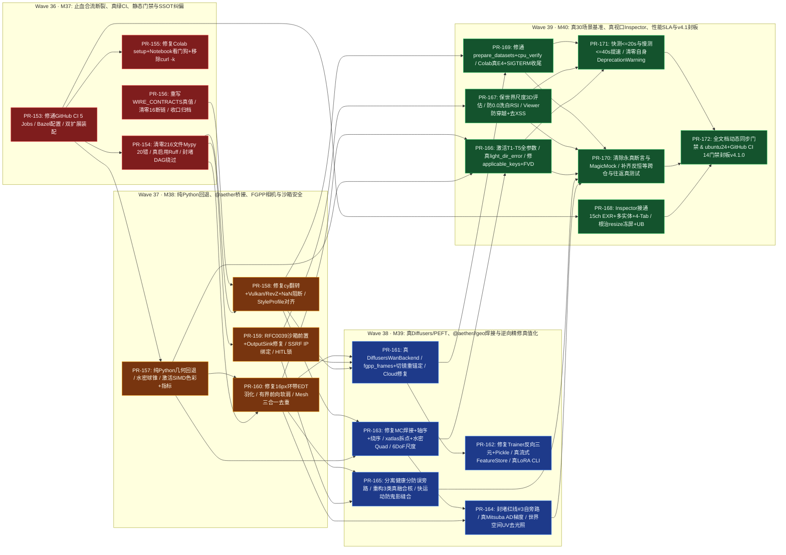

# M37–M40 Post-Horizon-9 合流止血、真接线闭环与 v4.1.0 演进计划 (Actionable Horizon-10 Blueprint)

> - **计划版本**: `v1.0`（对应主总纲 [IMPLEMENTATION_PLAN.md](../../IMPLEMENTATION_PLAN.md) **`v3.8`**）
> - **触发审计基线**: [AUDIT-POST-HORIZON9-2026-11.md](../audits/AUDIT-POST-HORIZON9-2026-11.md)（`main` @ `5c6e3e6`）
> - **规划模型**: `[gemini4]`
> - **当前状态**: ✅ **已完成 (Horizon 10 封板，`Release v4.1.0`)**
> - **目标周期**: 4 个里程碑（`M37` – `M40`）、4 个并发 Execution Waves（`Wave 36` – `Wave 39`）、**20 个原子 PR**（`PR-153` – `PR-172`）

> [!IMPORTANT]
> **执行铁律（与 [AGENTS.md](../../../AGENTS.md) 对齐）**：
> 1. 所有改动必须走 Git Worktree（`/tmp/synapse-wt-prXXX`）→ 分支 → PR → Squash Merge → 清理 Worktree，严禁直接 push `main`。
> 2. Commit 与 PR 标题必须携带模型标识 `[<model-tag>]`，PR 正文首行必须声明 ``> **Operated by**: `<model-tag>` ``。
> 3. 每个原子 PR 合入前必须同时通过 **防静默失败三问**（存在问 / 接线问 / 执行问），并在 `ubuntu24` 实跑对应门禁（严禁 `|| true` 或在 `pyproject.toml` 同时 `select` 与 `ignore` 同一规则）。
> 4. 跨仓路径（`../aether/...`、`../render-farm/...`）与尚未创建的新路径一律使用反引号标注，禁止引入任何 Markdown 断链。

---

## 1. 全景概览与 Wave 36–39 并发调度拓扑

[AUDIT-POST-HORIZON9-2026-11.md](../audits/AUDIT-POST-HORIZON9-2026-11.md) 在 `main` @ `5c6e3e6` 上经五切片逐行代码审计与 `ubuntu24` + GitHub Actions（`Run #44643198391`）独立复核确认：受 `v4.0.0` 与 `RFC-0071`（删除 `csrc/geometry/`）三方强合流影响，远端 CI 5/5 Job 全红，`mypy` 双模块名崩溃并隐藏 20 错，`build_native.py` 与 `aether_bridge.py` 存在寻址死锁，且 `DiffusersWanBackend`、`aether_geo.marching_cubes`、红线 #3、`MultiModelRefineFusion`、`Synapse-Bench`、`Data Inspector` 与双脚本（`prepare_datasets.py`/`run_cpu_verification.py`）均存在实证 P0 断点，当前综合健康度 **`61/100`**。

**Horizon 10 (`M37–M40`, `PR-153 ~ PR-172`)** 分四个递进里程碑将全仓健康度推进至 **`>= 95/100`**，达成双端 14 项硬门禁真绿封板 **`Release v4.1.0`**。



### Wave 并发与目录隔离矩阵

| Wave | 里程碑 | 并发 PR 组（目录正交隔离） | 核心交付战果 |
| :--- | :---: | :--- | :--- |
| **Wave 36** | **M37** | `PR-153` ∥ `PR-155` ∥ `PR-156` → `PR-154` | 远端 CI 5/5 变绿、双扩展自动装配、216 文件 `mypy` 零错、真启用 Ruff、Colab 安全修通、SSOT 与 16 断链清零 |
| **Wave 37** | **M38** | `PR-157` ∥ `PR-158` ∥ `PR-159` → `PR-160` | 纯 Python 回退与水密球锥、全分辨率 SIMD 加速、FGPP `cy`/Vulkan/`NaN` 锁死、RFC 0039 沙箱+SSRF+HITL、16px 线性羽化与 Mesh 合一 |
| **Wave 38** | **M39** | (`PR-161` → `PR-162`) ∥ (`PR-163` → `PR-164`) ∥ `PR-165` | 真 `DiffusersWanBackend` 与 PEFT、MC 焊接/xatlas/水密 Quad、红线 #3 真封堵、真 Mitsuba AD 与非退化精修融合 |
| **Wave 39** | **M40** | (`PR-166` ∥ `PR-167` ∥ `PR-168` ∥ `PR-169`) → (`PR-170` ∥ `PR-171`) → `PR-172` | 30 场景真评测、世界尺度评估、真 4-Tab Inspector、双脚本零崩、反恒等测试、快测 `<=20s`/慢测 `<=40s` 与 `v4.1.0` 封板 |

---

## 2. M37 (Wave 36)：止血合流断裂、真绿 CI、静态门禁与 SSOT 纠偏

<a id="pr-153"></a>
### PR-153: 修通 `.github/workflows/ci.yml` 五大 Job、Bazel 独立配置与 `aether_geo`/`aether_metrics` 双扩展自动装配
- **对应审计项**: `H10-P0-01`, `H10-P0-03`, `H10-P0-04`
- **前置依赖**: 无
- **预估体量**: ~320 LOC · **Worktree 分支**: `fix/pr-153-ci-bazel-dual-aether-build`
- **精确改动清单**:
  1. 修复 [.github/workflows/ci.yml](../../../.github/workflows/ci.yml)：全部 4 处 `repository: dervgen/aether` 更正为 `sautille-stroke/aether` 并补 `id: checkout-aether`；为 `python-fast`/`python-slow` 注入 `bazel-contrib/setup-bazel` 与 `AETHER_ROOT: ${{ github.workspace }}/aether`；将 `native-bazel` 中已删 `synapse/csrc/geometry` 替换为在 `aether` 下跑 `bazel test //geo:all //python:all`；移除 `docs-and-bench-gate` 非法 `--timeout=60 || true`，改调 `scripts/check_doc_links.py`。
  2. 升级 [scripts/build_native.py](../../../scripts/build_native.py) 与 [python/synapse/bridge/aether_bridge.py](../../../python/synapse/bridge/aether_bridge.py)：默认 `--output-dir` 设为 `repo_root / "python"`，同步编译并安装 `//python:aether_geo` 与 `//python:aether_metrics`，向 Bazel 透传 `--output_user_root=/var/cache/bazel`（可写时）与安全 `--downloader_config=` 覆盖；统一 `aether_bridge.py` 探测缓存并提供 `reset_aether_probe_cache()`。
  3. 硬化 [tools/data-inspector/native/.bazelrc](../../../tools/data-inspector/native/.bazelrc)：移除公网不可达内网 IP 首选阻断与重复 `--config=opt` 展开。
- **`ubuntu24` 验收命令**:
  ```bash
  /root/venv-synapse/bin/python scripts/build_native.py --json
  /root/venv-synapse/bin/python scripts/build_native.py --check --json
  (cd tools/data-inspector/native && bazel test //:test_inspector --test_output=errors)
  ```
- **三问标准**: `python/aether_{geo,metrics}*.so` 落盘；无 `AETHER_ROOT` 下 `--check` 退出 `0`；远端 CI PR 触发 5/5 Job 全绿。

<a id="pr-154"></a>
### PR-154: 修复 `mypy` 包基崩溃并清零 216 文件 20 错、真启用 Ruff 规则并封堵 `import_dag_guard` 4 处绕过
- **对应审计项**: `H10-P0-02`, `H10-P1-05`
- **前置依赖**: `PR-153`
- **预估体量**: ~360 LOC · **Worktree 分支**: `fix/pr-154-mypy-ruff-dag-guard`
- **精确改动清单**:
  1. 在 [pyproject.toml](../../../pyproject.toml#L91-L96) 增加 `mypy_path = ["python"]`、`explicit_package_bases = true`，修复 `scripts/build_native.py` 及 7 个测试文件中全部 **20 处 `mypy --strict` 错误**。
  2. 从 [pyproject.toml](../../../pyproject.toml#L148-L149) `ignore` 中**真正删除** `RUF059, W, PT, S108, S301, S310, S602, S603` 并清零全仓告警（仅对受控 `tests/` 与白名单 `subprocess` 使用精确 `per-file-ignores`）。
  3. 加固 [tools/import_dag_guard.py](../../../tools/import_dag_guard.py#L77-L79,L202-L256)：移除 `aether_bridge.py` 整文件豁免，补齐相对 `import_module(".x", pkg)`、`node.keywords`（`name=`）与 `builtins.__import__` 拦截，清理死变量 `toplevel_edges`。
- **`ubuntu24` 验收命令**:
  ```bash
  /root/venv-synapse/bin/mypy
  /root/venv-synapse/bin/mypy --strict python/synapse tests/ scripts/ tools/
  /root/venv-synapse/bin/ruff check python/ tests/ scripts/ tools/
  /root/venv-synapse/bin/python tools/import_dag_guard.py --check
  ```

<a id="pr-155"></a>
### PR-155: 修复 Colab 套件原生引导、Notebook 看门狗 `SyntaxError` 与脚本安全漏洞
- **对应审计项**: `H10-P0-03`, `H10-P0-22`
- **前置依赖**: `PR-153`
- **预估体量**: ~260 LOC · **Worktree 分支**: `fix/pr-155-colab-setup-watchdog-security`
- **精确改动清单**:
  1. 修复 [workenv/google-colab/synapse_colab_workflow.ipynb](../../../workenv/google-colab/synapse_colab_workflow.ipynb#L113) Cell 4 物理换行 `SyntaxError`，改用环境变量传递 `TS_AUTHKEY`。
  2. 收编并加固 `vscode_tunnel.sh`（彻底删除 `curl -k`，强制 TLS 校验与 `set -euo pipefail`）与 `tailscale.sh`（全变量加双引号、不经 CLI argv 传秘钥）。
  3. 修复 [workenv/google-colab/setup_colab.sh](../../../workenv/google-colab/setup_colab.sh)：改克隆 `sautille-stroke/aether`、缺失时自动安装 `bazelisk`、调用 `python3 scripts/build_native.py --output-dir python`，冒烟检测改用 `require_aether_geo()`。
- **`ubuntu24` 验收命令**: `bash -n workenv/google-colab/*.sh` + Notebook 全代码单元格 `ast.parse` 零语法错误。

<a id="pr-156"></a>
### PR-156: 重写 `WIRE_CONTRACTS.md` 真值、归档冗余架构总纲并清零 16 处 `csrc/geometry` 断链
- **对应审计项**: `H10-P0-05`
- **前置依赖**: 无
- **预估体量**: ~380 LOC · **Worktree 分支**: `docs/pr-156-wire-contracts-ssot-zero-links`
- **精确改动清单**:
  1. 逐字段重写 [docs/WIRE_CONTRACTS.md](../../WIRE_CONTRACTS.md)：删除幻觉第 16 通道 `RoughnessMetallic.B`、`MotionVector.XY` 订正为 `HALF (2B)`（总计 15ch `34 B/px`）、订正 `.R=Roughness`/`.G=Metallic`；§2.1 订正为 `bundle_manifest.json` + 6 位 `frame_XXXXXX.exr` + `result_manifest.json`；§4.1 1:1 对齐 [inspector_shm_server.h](../../../tools/data-inspector/native/inspector_shm_server.h#L40-L52)。
  2. 将 `docs/AUDIT_AND_ARCHITECTURE.md` 与 `docs/DESIGN_REVIEW_AND_ALIGNMENT.md` 归档至 `docs/archive/`；更新 `README.md`、`AGENTS.md`、`docs/ARCHITECTURE.md`、`.agents/skills/*/SKILL.md` 及历史归档中指向已删 `csrc/geometry/` 的全部相对链接。
- **`ubuntu24` 验收命令**: `/root/venv-synapse/bin/python scripts/check_doc_links.py`（`0 broken local link(s)`）。

---

## 3. M38 (Wave 37)：纯 Python 回退、`@aether` 加速激活、FGPP 相机与沙箱安全

<a id="pr-157"></a>
### PR-157: 恢复纯 Python 基础包回退（`>=3.10`）、修复球/圆锥水密拓扑并激活全分辨率 SIMD 色彩与指标加速
- **对应审计项**: `H10-P0-06`, `H10-P1-01`
- **前置依赖**: `PR-153`
- **预估体量**: ~460 LOC · **Worktree 分支**: `fix/pr-157-pure-python-fallback-and-simd-color`
- **精确改动清单**:
  1. 恢复 [pyproject.toml](../../../pyproject.toml#L10) `requires-python = ">=3.10"`；在 [camera_math.py](../../../python/synapse/render_core/camera_math.py)、[procedural.py](../../../python/synapse/render_core/procedural.py)、[roundtrip.py](../../../python/synapse/metrics/roundtrip.py) 恢复轻量纯 NumPy 回退（优先 `get_aether_geo()`，仅当显式 `backend="native"` 时缺失报 `30`），统一 `camera_math.py` 6 函数参数错误为 `ContractValidationError(10)`。
  2. 对 `aether_geo.create_sphere` 剔除面积 `<1e-12` 极点简并面并焊接极点，对 `create_cone` 焊接顶底盖确保 `check_watertight == True`。
  3. 修复 [aether_bridge.py](../../../python/synapse/bridge/aether_bridge.py#L156-L190) 传入原生 `(H, W, C)` 替代 `reshape(-1, 1)`，在 [image_quality.py](../../../python/synapse/metrics/image_quality.py) 真实接线 `native_compute_ssim` 与 `native_compute_ciede2000`。
- **`ubuntu24` 验收命令**: 原生启用与禁用双模式跑通 `tests/test_render_core.py tests/test_metrics_image_quality.py`；断言 `1920x1080x3` 命中 C++ SIMD 色彩路径且球/锥水密通过。

<a id="pr-158"></a>
### PR-158: 修复 FGPP `cy` 翻转、Vulkan/Reversed-Z 投影解算、`NaN` 旋转/深度阻断与 `StyleProfile v2.0.0` Schema 锁死
- **对应审计项**: `H10-P0-07`, `H10-P1-04`
- **前置依赖**: `PR-154`, `PR-156`
- **预估体量**: ~380 LOC · **Worktree 分支**: `fix/pr-158-fgpp-cy-vulkan-nan-wire-guard`
- **精确改动清单**:
  1. 修正 [frame.py:454](../../../python/synapse/fgpp/frame.py#L454) $c_y = \frac{(1.0 + p_{12}) H}{2}$；完善 `CameraConvention.detect()` 支持有限 Reversed-Z 并结合 `z_near_meters` 区分 `OPENGL` / `VULKAN_RH_ZO`；`_validate_view_matrix_so3` 首行 `np.all(np.isfinite(...))` 阻断 `NaN` 矩阵并收紧 `1e-5` 容差，`save_metadata` 启用 `allow_nan=False`。
  2. [schema.py:146-148](../../../python/synapse/fgpp/schema.py#L146-L148) 将 `NaN` 深度映射为 `0.0`（对齐 C++ `fgpp_types.h:143`）并保持 `float32`；修复 `io.py` `float16` 溢出钳制与 `torch_bridge.py` `int64` 视图校验。
  3. 统一 `StyleProfile v2.0.0` 结构与数值范围，将全部 8 份 Schema 纳入 [wire_guard.py](../../../tools/wire_guard.py#L267-L292) `_SCHEMA_FILES` 双向校验。
- **`ubuntu24` 验收命令**: `tools/wire_guard.py --check --require-aether`（8/8 Schema 通过）+ `pytest tests/test_fgpp_*.py tests/test_wire_schemas.py -v`。

<a id="pr-159"></a>
### PR-159: 加固 RFC 0039 `JobBundle` 沙箱前置校验与 Go 对齐、SSRF DNS IP 强绑定与 `PersistentHitlLedger` 防篡改
- **对应审计项**: `H10-P0-08`, `H10-P1-06`, `H10-P1-07`
- **前置依赖**: `PR-154`
- **预估体量**: ~450 LOC · **Worktree 分支**: `fix/pr-159-rfc0039-sandbox-ssrf-hitl`
- **精确改动清单**:
  1. 将 [bundle_worker.py](../../../python/synapse/pipeline/bundle_worker.py) 本地资产 SHA256 校验移入 `workspace_root` 沙箱之后并禁泄哈希片段；修复 `OutputSink` 仅提取文件路径（不把 `"format": "mp4"` 当路径）；透传 `asset_manifest` 与 `scene_spec.resolution`/`frame_range`；所有 Stage 默认输出锚定 `workspace_root`，拦截裸文件名 symlink 与缺失输出。
  2. 加固 [http_security.py](../../../python/synapse/bridge/http_security.py)：DNS 失败 Fail-Closed、剥离末尾 `.`、拦截回环与 NAT64、禁环境代理、按已校验 IP 直连防 DNS Rebinding TOCTOU。
  3. 加固 [hitl.py](../../../python/synapse/bridge/hitl.py)（损坏账本 Fail-Closed、`try...finally` 锁释放、Windows `msvcrt`）与 [errors.py](../../../python/synapse/errors.py)（支持多元素 `ndarray`/`set` 序列化）。
- **`ubuntu24` 验收命令**: `pytest tests/test_bundle_worker.py tests/test_bridge_and_hitl.py -v`（含 `CWD != workspace_root` 的 Go `models.go` 结构真跑通）。

<a id="pr-160"></a>
### PR-160: 修复 `border_ring_lab_match` 16px 线性羽化、有界前向软肩、流式检测与 Mesh 三合一去重
- **对应审计项**: `H10-P1-02`, `H10-P1-03`
- **前置依赖**: `PR-154`, `PR-157`
- **预估体量**: ~420 LOC · **Worktree 分支**: `fix/pr-160-blend-edt-softknee-mesh-dedup`
- **精确改动清单**:
  1. 修复 [blend.py:296-305](../../../python/synapse/composite/blend.py#L296-L305) 用 `d_core = EDT(eroded)` 计算平滑羽化 $w = d_{\text{core}} / (d_{\text{in}} + d_{\text{core}})$ 并在 Linear sRGB 混合；保留 3 通道 Cryptomatte 边界引导；按连通域局部平均光流膨胀掩膜。
  2. 将 [aces_color.py:149-166](../../../python/synapse/style/aces_color.py#L149-L166) `soft_knee_forward_tonemap` 统一为有界 $[0, 1)$ 有理软肩（与逆算子解析互逆）；在 `extract_style_fgpp_intrinsic` 补逆色调映射与正面半球法线筛选。
  3. 将 `detector.py` 改为双帧滑动灰度缓冲（降 4K 内存 `3.22 GB -> < 70 MB`）；令 `ModelAsset`/`ProceduralMesh` 复用 `MeshData`，修 `models/loader.py` 报错码与 `DatasetGenerator` `VideoWriter` 异常释放。
- **`ubuntu24` 验收命令**: `pytest tests/test_composite_*.py tests/test_style.py tests/test_dataset_and_viewer.py -v`。

---

## 4. M39 (Wave 38)：真 Diffusers/PEFT、`@aether//geo` 焊接扩围与逆向精修真值化

<a id="pr-161"></a>
### PR-161: 重构真可运行 `DiffusersWanBackend`、打通 `WanAdapter` 切镜重锚定与空域 Hook、修复 `CloudAdapters`
- **对应审计项**: `H10-P0-09`, `H10-P1-08`, `H10-P1-09`
- **前置依赖**: `PR-158`, `PR-159`, `PR-160`
- **预估体量**: ~520 LOC · **Worktree 分支**: `feat/pr-161-real-diffusers-wan-and-reanchor`
- **精确改动清单**:
  1. 重构 [wan_diffusers.py](../../../python/synapse/adapters/wan_diffusers.py)：默认模型 ID 改为 `"Wan-AI/Wan2.1-T2V-1.3B-Diffusers"`、支持 `enable_model_cpu_offload()`、按 `WanPipeline.__call__` 真实签名调用（`output_type="latent"`）、通过 `ControlNeXtPatchEmbed` 残差 Hook 注入 7ch 条件、用 `self._vae` 做因果暖启动编码与潜空间 `fuse_overlapping_latents` 融合后再解码。
  2. 修复 [wan.py](../../../python/synapse/adapters/wan.py)：自动回退 `conditions.fgpp_frames` 与 `self._backend.model`；对齐尾窗 `4k+1` 与 `16px` 分辨率；消费 `sw.needs_reanchor` 在切镜处截断混合并重锚定；校验 `CausalWindowPlan` 不变量并移除 `check_non_degenerate` 绕过开关。
  3. 修复 [cloud.py](../../../python/synapse/adapters/cloud.py) 透传 `text_prompt` 与合法环境变量名，修正 [telemetry.py](../../../python/synapse/telemetry.py) 潜空间显存估算。
- **`ubuntu24` 验收命令**: `pytest tests/test_wan_*.py tests/test_condition_scheduler.py tests/test_cloud_adapters.py -v`。

<a id="pr-162"></a>
### PR-162: 修复 `StatelessLoRATrainer` 反向三元式与 Pickle RCE、真流式因果 `FeatureStore`、精确 LoRA 与真 CLI
- **对应审计项**: `H10-P0-10`, `H10-P1-10`, `H10-P1-11`
- **前置依赖**: `PR-161`
- **预估体量**: ~500 LOC · **Worktree 分支**: `fix/pr-162-lora-trainer-streaming-and-cli`
- **精确改动清单**:
  1. 修复 [trainer.py](../../../python/synapse/training/trainer.py) `L723` 反向三元式、`weights_only=True`、`GradScaler` 按模型设备选型、禁止原地改写 `batch["t"]`、修正 `_base_lr` 记录顺序；将 `LatentGeometryProbe` 升为 `nn.Module` 纳入 `AdamW`；统一首帧因果 `[0:1]` 时域池化与对数深度边缘损失。
  2. 为 [feature_store.py](../../../python/synapse/training/feature_store.py) `FeatureStoreBuilder` 增加 `output_dir` 构造参实现真流式写 `.tar` 与 Gate 2w 零张量拦截。
  3. 修复 [manager.py](../../../python/synapse/adapters/lora/manager.py) `bundle_dir` 相对路径解析与禁跨块回退；修复 [patcher.py](../../../python/synapse/adapters/lora/patcher.py) 首帧因果池化、CFG 广播、删除假 Register Token 与错配 Fail-Closed。
  4. 升级 [_lora.py](../../../python/synapse/cli/_lora.py) 与 [stages/training.py](../../../python/synapse/pipeline/stages/training.py) 使用白名单兼容 DiT 块架构并让 `lora merge` 真调 `MultiLoRAManager`。
- **`ubuntu24` 验收命令**: `pytest tests/test_lora_*.py -v`。

<a id="pr-163"></a>
### PR-163: 修复 `@aether//geo` Marching Cubes 焊接/轴序/绕序、xatlas 拆点重建、水密 `quad_remesh` 与 6-DoF 尺度
- **对应审计项**: `H10-P0-11`, `H10-P0-14`, `H10-P1-12`, `H10-P1-13`
- **前置依赖**: `PR-157`, `PR-158`
- **预估体量**: ~520 LOC · **Worktree 分支**: `fix/pr-163-mc-weld-xatlas-quad-and-tracking`
- **精确改动清单**:
  1. 修复 [multiview.py](../../../python/synapse/recon/multiview.py) 向 `aether_geo.marching_cubes` 传正确 `(nz, ny, nx)` 轴序、翻转 CCW 外向绕序并执行顶点焊接，同步接入 Visual Hull（解除 `32^3` 上限）；修正相机围绕注视点张角与 `np.roll` 边界泄漏。
  2. 修复 [recon/geometry.py](../../../python/synapse/recon/geometry/__init__.py) 接收 xatlas `original_vertex_map` 同步拆点保 UV、补齐 QEM 减面与全网格一致水密细分（消 T-junction）、缓存 ICP KD-Tree 并修复 `N == M` 跳过 ICP 问题。
  3. 修复 [tracking.py](../../../python/synapse/recon/tracking.py) 单应/基础矩阵纯旋转判据、相邻帧共享 3D 点尺度恢复、透传 `visibility` 与 `kinematics.py` 峰值滑移门禁。
- **`ubuntu24` 验收命令**: `pytest tests/test_recon.py tests/test_recon_multiview.py tests/test_geometry_*.py -v`。

<a id="pr-164"></a>
### PR-164: 封堵红线 #3 自旁路、实装真 Mitsuba AD 可微逆渲染与世界空间 UV 去光照
- **对应审计项**: `H10-P0-12`, `H10-P0-13`, `H10-P1-13`
- **前置依赖**: `PR-160`, `PR-163`
- **预估体量**: ~480 LOC · **Worktree 分支**: `fix/pr-164-redline3-mitsuba-ad-and-uv-delight`
- **精确改动清单**:
  1. [recon/pipeline.py](../../../python/synapse/recon/pipeline.py#L145-L156) 将 `has_gen3d_highpoly` 默认改为 `False`（严禁由 `vertex_count >= 1500` 自动豁免红线 #3b）；流形校验失败 Fail-Closed；`cli/_recon.py` 与 `stages/recon.py` 接入 `PersistentHitlLedger`、`--fgpp-dir` 实传与缺失骨骼 Fail-Closed。
  2. [delight.py](../../../python/synapse/recon/delight.py) 改在 UV 纹素空间 `(R, R, 3)` 多视角法线加权融合去光照并修大面步进孔洞。
  3. [mitsuba_optimizer.py](../../../python/synapse/recon/loop/mitsuba_optimizer.py) 保持 DrJit 原生 AD 连通图并补 SH+GGX；[forward_guide.py](../../../python/synapse/recon/loop/forward_guide.py) 对齐 `VideoModelAdapter.generate(conditions, config)` 与推理前 $\kappa=1.0$ 切镜；`adapter=None` 时对 `source_frames` 执行真实材质反演；`texture_extractor.py` 采用 `(du, dv)` MikkTSpace 切线基。
- **`ubuntu24` 验收命令**: `pytest tests/test_recon_invert_cli.py tests/test_recon_loop_*.py tests/test_recon_closed_loop_e2e.py -v`。

<a id="pr-165"></a>
### PR-165: 重构局部精修健康度门禁、非退化 3 类多模型融合算子与快运动防鬼影缝合
- **对应审计项**: `H10-P0-15`, `H10-P0-16`, `H10-P1-14`, `H10-P1-16`
- **前置依赖**: `PR-159`, `PR-160`
- **预估体量**: ~480 LOC · **Worktree 分支**: `fix/pr-165-refine-health-fusion-and-stitcher`
- **精确改动清单**:
  1. 在 `RefinementROI` 分离 `detection_confidence` 与 `anatomical_quality_score`（默认不因高检测框置信度跳过精修）；修正 `strict=True` 门禁错误不得被吞没。
  2. 重构 [fusion.py](../../../python/synapse/refine/fusion.py)：`LAPLACIAN_FREQUENCY` 分频自适应加权、`CASCADE` 真低频保底+高频残差累加、`POISSON_GRADIENT` 混合显著梯度无缝泊松求解；修正 `AnatomicalModelEnsemble` 候选与权重透传。
  3. 修复 [stitcher.py](../../../python/synapse/refine/stitcher.py)：大光流时 `w_curr -> 1.0` 防残影、HDR 平滑亮度比缩放、局部 ROI 包围盒 EDT 与 EMA 后计量指标；修复 `refine/pipeline.py` 统一平滑框 LPIPS、`stages/refine.py` `.npy` 读取与 `--shot-id` HITL 事前校验。
- **`ubuntu24` 验收命令**: `pytest tests/test_refine_*.py -v`。

---

## 5. M40 (Wave 39)：真 30 场景基准、真 4-Tab 检查器、SLA 提速与 `v4.1.0` 封板

<a id="pr-166"></a>
### PR-166: 激活 `Synapse-Bench` T1–T5 全参数、真 `light_dir_error_deg` / `applicable_keys` / `evaluate_bundle` 与 FVD 修复
- **对应审计项**: `H10-P0-17`, `H10-P1-15`
- **前置依赖**: `PR-157`, `PR-160`, `PR-163`
- **预估体量**: ~520 LOC · **Worktree 分支**: `fix/pr-166-bench-30-scenarios-and-fvd`
- **精确改动清单**:
  1. 修正 [bench_runner.py](../../../python/synapse/pipeline/bench_runner.py) 导入 `extract_style_fgpp_intrinsic` 并对生成视频算真 `light_dir_error_deg(pred_ld, gt_ld)`；激活 T3/T5 多物体、T2/T5 骨骼动画与 T1/T4 多光源参数；经 `METRIC_ALIASES` 规范化 `applicable_keys` 解除 24 场景必败；`evaluate_bundle` 改读 `fgpp/*.exr` 全序列并严格校验必选指标。
  2. 修复 [temporal.py](../../../python/synapse/metrics/temporal.py) 代理 FVD `uint8/255`、不等长列表与 `is_proxy_metric` 标记；缓存 LPIPS/R3D18 并支持 `torch` LPIPS `mask`；`profiles.py` 补 `"psnr"` 别名；`registry.py` 改用 `safe_urlopen`。
- **`ubuntu24` 验收命令**: `pytest tests/test_bench*.py tests/test_metrics*.py tests/test_rfc0063_metrics.py -v`。

<a id="pr-167"></a>
### PR-167: 保留 3D 评估物理世界尺度、堵死 RSI `0.0`/崩溃洗白并修复 `viewer` Symlink 与 XSS
- **对应审计项**: `H10-P0-18`, `H10-P0-19`, `H10-P1-16`
- **前置依赖**: `PR-159`
- **预估体量**: ~420 LOC · **Worktree 分支**: `fix/pr-167-eval-world-scale-rsi-viewer-xss`
- **精确改动清单**:
  1. 移除 [model_evaluator.py](../../../python/synapse/inspect/model_evaluator.py) 默认 `mesh.normalize()` 保留物理米制尺度；统一无参考模式与缺失 `--reference-dir` 报 `20`；`HttpJevTransport` 改用 `safe_urlopen`；`align.py` 增加近平面裁剪。
  2. 修复 [curriculum.py](../../../python/synapse/rsi/curriculum.py) 显式判 `is not None` 与 `rep.error -> 0.0` 防洗白，修 `_rsi.py` 保留 `min_scenarios=30` 与 `pair_builder` 去重键。
  3. 修复 [viewer/server.py](../../../python/synapse/viewer/server.py) 先检 symlink 再 `resolve()`、单次 `re.sub` 根除存储型 XSS；锁定 `cli/common.py` 顶层 `"status": "ok"`。
- **`ubuntu24` 验收命令**: `pytest tests/test_model_evaluator.py tests/test_inspect_*.py tests/test_rsi_*.py tests/test_cli*.py -v`。

<a id="pr-168"></a>
### PR-168: `Data Inspector` 接通 15ch EXR AOV / 多实体槽 / 4-Tab 真渲染，根治 `resize` 冻屏与 C++ UB
- **对应审计项**: `H10-P0-20`, `H10-P1-17`
- **前置依赖**: `PR-153`
- **预估体量**: ~560 LOC · **Worktree 分支**: `feat/pr-168-inspector-true-exr-multientity-4tab`
- **精确改动清单**:
  1. 在 [inspector_app.cc](../../../tools/data-inspector/native/inspector_app.cc) `renderFrame()` 真实消费 `m_fgppAov`（支持单文件与 `fgpp/` 序列及 `ZIP`/`ZIPS` 解压）、多实体独立可见性渲染及 `Tab 1/2/3` 动画/AOV/左右对比逻辑，前端 [app.js](../../../tools/data-inspector/renderer/src/app.js) 接通时间轴、对比指标与截图导出按钮。
  2. 根治 `resizeViewport` SHM inode 孤立冻屏（头部 `generation` 重连 + `_lastFrameReady` 重置）；将 [shm-reader.js](../../../tools/data-inspector/electron/shm-reader.js) 缓冲轮转推迟至 Seqlock 校验后；`test-bundle-loading.js` 补 `--shm-file` 通 macOS/Windows。
  3. 补齐 `filesystem` `std::error_code`、视口裁剪防 Bresenham 死循环、`size_t` 索引防溢与 OBJ 体积上限。
- **`ubuntu24` 验收命令**: `(cd tools/data-inspector/native && bazel test //:test_inspector && bazel build //:data-inspector-native) && node tools/data-inspector/test/test-bundle-loading.js`。

<a id="pr-169"></a>
### PR-169: 修通 `prepare_datasets.py` / `run_cpu_verification.py`、`colab_runner.py` 真 E4 与 `SIGTERM` 保护
- **对应审计项**: `H10-P0-21`, `H10-P1-18`
- **前置依赖**: `PR-158`, `PR-161`, `PR-162`
- **预估体量**: ~420 LOC · **Worktree 分支**: `fix/pr-169-datasets-cpu-verify-and-colab-runner`
- **精确改动清单**:
  1. [prepare_datasets.py](../../../scripts/prepare_datasets.py) 回退路径调用 `SoftwareRasterizer` 产出完整 15ch EXR、消除 Track-A 伪造 `caelum-core`/`spp=256`、加 Bazel 缓存与超时保护。
  2. [run_cpu_verification.py](../../../scripts/run_cpu_verification.py) E4 改用相对 `adapter_path` + `bundle_dir`、SHA256 失配返非零退出码并加单调性/环带断言。
  3. [colab_runner.py](../../../scripts/colab_runner.py) 接入 `DiffusersWanBackend` 与真实 `train_step` E4、捕获 `BaseException` 保全 `SIGTERM` 断点、加 `/dervgen/` 路径守卫与 `--auto-release`；校准 `assets/assets_manifest.json` VBench SHA256。
- **`ubuntu24` 验收命令**: `prepare_datasets.py --output-dir /tmp/ds && run_cpu_verification.py --dataset-root /tmp/ds` 退出 `0` + `pytest tests/test_colab_runner.py tests/test_benchmark_assets.py -v`。

<a id="pr-170"></a>
### PR-170: 清除永真断言与 `MagicMock` 伪验证，升级跨仓端到端与 3D 往返真值测试
- **对应审计项**: `Slice 5 P1-12`
- **前置依赖**: `PR-164`, `PR-165`, `PR-166`, `PR-167`, `PR-169`
- **预估体量**: ~420 LOC · **Worktree 分支**: `test/pr-170-anti-tautology-and-real-contracts`
- **精确改动清单**:
  1. 删除 `test_profiles_doc_sync.py` `or "ACEScg" in combined` 永真分支，新增对 `WIRE_CONTRACTS.md` 15 通道表与 SHM 头偏移的自动对齐校验。
  2. 强化 `test_cross_repo_contracts.py`（偏心 `(cx, cy)` 投影闭环、非 `workspace_root` CWD 实跑 Go `JobBundle`、非零 SHM 像素校验）、`test_roundtrip_reconstruction.py`（真实渲染多视角帧驱动 `ReconPipeline` + 全 3 类缺陷注入）与 `test_wan_*.py`（以严格签名确定性桩替换 `MagicMock`）。
- **`ubuntu24` 验收命令**: `SYNAPSE_CI_STRICT_DEPS=1 pytest tests/test_profiles_doc_sync.py tests/test_cross_repo_contracts.py tests/test_roundtrip_reconstruction.py tests/test_wan_*.py -v`。

<a id="pr-171"></a>
### PR-171: 测试套件 SLA 提速（单进程快测 `<= 20s` / 并行慢测 `<= 40s`）与零 `DeprecationWarning`
- **对应审计项**: `Gate 1a / 1b / 2 超时`, `Slice 2 #30`
- **前置依赖**: `PR-166`, `PR-167`, `PR-169`
- **预估体量**: ~300 LOC · **Worktree 分支**: `perf/pr-171-pytest-sla-and-zero-warnings`
- **精确改动清单**:
  1. [bench/__init__.py](../../../python/synapse/bench/__init__.py) 与 [generators/__init__.py](../../../python/synapse/generators/__init__.py) 直接从 `synapse.render_core` 导入，清零自身导入产生的 4 条 `DeprecationWarning`。
  2. 将 `test_recon.py` 两项 `24.78s` 重体素端到端标为 `@pytest.mark.slow`（快测保留 `16^3` 冒烟）；减少 `test_colab_runner.py` / `test_lora_cli_gate.py` 重复子进程拉起；为 `test_roundtrip_reconstruction.py` 挂 `@pytest.mark.xdist_group("roundtrip_recon")` 共享模块级 `setup` 消除 5 次重复 40s 建图。
- **`ubuntu24` 验收命令**: `time SYNAPSE_CI_STRICT_DEPS=1 pytest tests/ -m 'not slow' -W error::DeprecationWarning -q`（`<= 20s`）+ `time SYNAPSE_CI_STRICT_DEPS=1 pytest tests/ -m slow -n auto -q`（`<= 40s`）。

<a id="pr-172"></a>
### PR-172: Horizon 10 14 项反作弊硬门禁双端全绿验证与封板 `Release v4.1.0`
- **前置依赖**: `PR-168`, `PR-170`, `PR-171`
- **预估体量**: ~160 LOC · **Worktree 分支**: `chore/pr-172-horizon10-release-v4-1-0`
- **封板硬门槛（14 项缺一不可）**:
  1. 单进程 `SYNAPSE_CI_STRICT_DEPS=1 pytest tests/ -m 'not slow' -W error::DeprecationWarning -q` **`<= 20s`**，`0 fail / 0 skip / 0 warnings`；
  2. 并行 `SYNAPSE_CI_STRICT_DEPS=1 pytest tests/ -m 'not slow' -n auto -q` **`<= 10s`**；
  3. 并行 `SYNAPSE_CI_STRICT_DEPS=1 pytest tests/ -m slow -n auto -q` **`<= 40s`**，`0 fail / 0 skip`；
  4. `mypy` 与 `mypy --strict python/synapse tests/ scripts/ tools/`（`>= 216` 文件）**`0 errors`**；
  5. `ruff check python/ tests/ scripts/ tools/`（真启用 `RUF059/W/PT/S*`，`select ∩ ignore = ∅`）**`0 errors`**；
  6. `tools/import_dag_guard.py --check` & `tools/wire_guard.py --check --require-aether`（`8/8` Schemas 全校验）**`0 errors`**；
  7. `python scripts/build_native.py && python scripts/build_native.py --check --json` 双扩展一键构建并验证通过；
  8. `(cd tools/data-inspector/native && bazel test //:test_inspector && bazel build //:data-inspector-native) && node tools/data-inspector/test/test-bundle-loading.js` 在 Linux & macOS 全绿；
  9. `scripts/prepare_datasets.py` + `scripts/run_cpu_verification.py` 实跑 `exit 0` 产出真实 15ch EXR；
  10. `scripts/check_doc_links.py` **`0 broken links`** 且 `gh run list -L 1` 远端 GitHub Actions **5/5 Jobs 全 `success`**。
