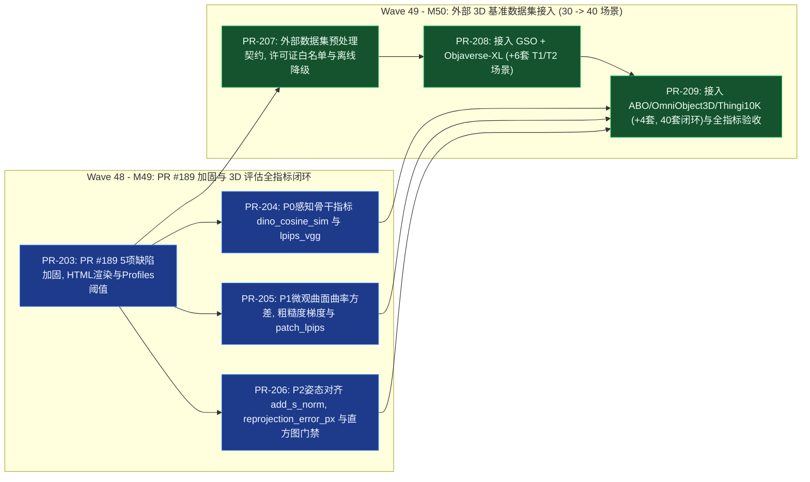

# M49–M50 PR #189 缺陷加固、3D 评估全指标闭环与外部基准数据集落地计划 (Actionable Horizon-13A Blueprint)

> - **计划版本**: `v1.0`（对应主总纲 [`IMPLEMENTATION_PLAN.md`](../../IMPLEMENTATION_PLAN.md) **`v4.0`**）
> - **触发源**:
>   1. `sautille-stroke/synapse#189`（`45b8461`）源码级深度复核检出的 5 项实证实现缺口；
>   2. [`DESIGN_3D_MODEL_ENHANCEMENT_AND_DATA_SPEC.md`](../../DESIGN_3D_MODEL_ENHANCEMENT_AND_DATA_SPEC.md) §6.2（P0 感知骨干、P1 曲率与特写、P2 姿态对齐）、§7（外部 3D 数据集 `GSO`/`Objaverse-XL`/`ABO`/`OmniObject3D`/`Thingi10K`）与 §8.1 剩余 Backlog。
> - **规划模型**: `[gemini4]`
> - **当前状态**: ✅ **已完成 (Horizon 13A · M49 PR #191 + M50 PR #192 全部合入闭合)**
> - **目标周期**: 2 个里程碑（`M49` – `M50`）、2 个并发 Execution Waves（`Wave 48` – `Wave 49`）、**7 个原子 PR**（`PR-203` – `PR-209`）

> [!IMPORTANT]
> **执行铁律（与 [`AGENTS.md`](../../../AGENTS.md) 对齐）**：
> 1. 所有改动必须走 Git Worktree（`/tmp/synapse-wt-prXXX`）→ 分支 → PR → Squash Merge → 清理 Worktree，严禁直接 push `main`。
> 2. Commit 与 PR 标题必须携带模型标识 `[<model-tag>]`，PR 正文首行必须声明 ``> **Operated by**: `<model-tag>` ``。
> 3. **零 `import synapse` 副作用 & 懒加载铁律**：`dino_cosine_sim` / `lpips_vgg` 等需 `torch` / `timm` / `torchvision` 的感知骨干指标必须在函数内懒加载，缺失时抛出带 `agent_fix_hint` 的结构化错误；快测（`-m 'not slow'`）保持 `0 torch import` 与单进程 `<= 20s` SLA。
> 4. **离线 CI 不中断铁律**：外部数据集场景必须携带 `fallback_procedural` 降级定义；在 `SYNAPSE_CI_STRICT_DEPS=1` 无外网环境下自动采用程序化回退或 `@pytest.mark.external_data` 隔离重资产，确保 CI 5/5 Jobs 绿灯。
> 5. **链接规范**：尚未创建的新文件（如 `python/synapse/metrics/perceptual.py`、新场景 JSON、新单测文件）与跨仓路径一律使用反引号标注，禁止引入 Markdown 断链。

---

## 1. PR #189 源码复核与评估体系缺口盘点

`synapse#189`（`45b8461`）已率先在 [python/synapse/recon/geometry.py](../../../python/synapse/recon/geometry/__init__.py) 实现 5 项拓扑/UV 指标并接入 [model_evaluator.py](../../../python/synapse/inspect/model_evaluator.py#L387-L438)。经逐行源码复核，检出以下 **5 项待加固缺陷** 及 **6 项设计规约 Backlog**，统一归口本计划 `M49–M50` 彻底闭环：

| 来源分类 | 实证定位 (`file:line`) | 问题 / 缺口详情 | 承接 PR |
|---|---|---|:---:|
| **PR #189 缺陷 #1** | `recon/geometry.py:1640-1673` | `compute_euler_characteristic` 用 `len(v)` 而非实际引用顶点数 `len(np.unique(f))`（孤立顶点导致 $\chi$ 虚高）且边统计使用 Python `zip` 循环 | **`PR-203`** |
| **PR #189 缺陷 #2** | `recon/geometry.py:1676-1717` | `count_non_manifold_edges` 仅统计共享面 $> 2$ 或定向冲突边，遗漏非单伞“领结 (bowtie)”顶点扇面检验（`DESIGN §6.2.2`）且未接入 `@aether//geo` 原生双轨 | **`PR-203`** |
| **PR #189 缺陷 #3** | `recon/geometry.py:1780-1836` & `model_evaluator.py:429-431` | ① `model_evaluator` 未传 `uv_faces`，导致 `compute_seam_discontinuity_deg` 内 `v_edge == uv_edge` 恒成立、`seam_edges` 恒空并静默返回 `0.0°`（OBJ 按 UV 拆点时同样如此）；② 当前测量接缝边两端点 `norms[u]` vs `norms[w]` 夹角（量边曲率），而非接缝两侧相邻面/分裂顶点法线跳变 | **`PR-203`** |
| **PR #189 缺陷 #4** | `model_evaluator.py:435-438` & `eval_report.py:412-426` | 无 UV 网格伪造 `1.0 / 0.0 / 0.0` 满分而非 Fail-Closed `None`/显式缺失标记；`TopologyResult` 新增 `euler_characteristic` / `num_non_manifold_edges` 未渲染进 HTML 拓扑摘要表 | **`PR-203`** |
| **PR #189 缺陷 #5** | `metrics/profiles.py:53-163` | 仅登记方向与部分别名，未将 `uv_area_distortion_ratio <= 1.5`、`seam_discontinuity_deg <= 5.0`、`texel_density_variance <= 0.3` 纳入门禁阈值表 | **`PR-203`** |
| **设计 Backlog (`P0-Perceptual`)** | `DESIGN §6.2.1`, `§8.1` | 缺失 `dino_cosine_sim` (`>= 0.85`) 与 `lpips_vgg` (`<= 0.15`)（`metrics/perceptual.py`） | **`PR-204`** |
| **设计 Backlog (`P1-Curvature`)** | `DESIGN §6.2.4`, `§8.1` | 缺失 `discrete_mean_curvature_variance` (`<= 0.08`)、`surface_roughness_var` (`<= 0.08`)、`patch_lpips` (`<= 0.12`) | **`PR-205`** |
| **设计 Backlog (`P2-Misc`)** | `DESIGN §6.2.5`, `§8.1` | 缺失 `add_s_norm` (`<= 0.05 * d_obj`)、`reprojection_error_px` (`<= 4.0 px`) 与 `histogram_intersection` 三级门禁阈值 | **`PR-206`** |
| **设计 Backlog (`P1-Data`)** | `DESIGN §7.1-7.3`, `bench/scenario.py` | 全 30 套场景 100% `PROCEDURAL`；缺 `GSO` / `Objaverse-XL` / `ABO` / `OmniObject3D` / `Thingi10K` 接入（目标 `36~40` 套）与预处理门禁 | **`PR-207`~`209`** |



### Wave 并发与目录隔离矩阵

| Wave | 里程碑 | 并发 PR 组（目录隔离） | 关键交付 |
| :---: | :---: | :--- | :--- |
| **Wave 48** | **M49** | `PR-203` (`geometry.py`, `eval_report.py`, `profiles.py`) → [`PR-204` (`metrics/perceptual.py`) ∥ `PR-205` (`recon/geometry.py`, `inspect/macro.py`) ∥ `PR-206` (`inspect/align.py`)] | 修复 PR #189 5 项实证缺陷 + 补齐全部 P0/P1/P2 评估指标 |
| **Wave 49** | **M50** | `PR-207` (`bench/scenario.py`, `bench/registry.py`) → `PR-208` (+6 场景) → `PR-209` (+4 场景 & 全指标门禁验收) | Synapse-Bench 场景库从 30 扩展至 40 套，覆盖真实扫描/PBR/高亏格资产 |

---

## 2. M49 (Wave 48)：PR #189 遗留缺陷加固与 3D 评估全指标闭环

<a id="pr-203"></a>
### PR-203: 加固 PR #189 拓扑/UV 指标缺陷、完善 HTML 报告与 `@aether//geo` 原生双轨互验
- **来源编号**: `synapse#189` 源码复核发现 #1~#5, `DESIGN_3D_MODEL_ENHANCEMENT_AND_DATA_SPEC.md` §6.2.2–6.2.3
- **前置依赖**: 无（基于 `45b8461`）
- **预估体量**: ~420 LOC · **Worktree 分支**: `fix/pr-203-harden-pr189-topo-uv-metrics`
- **精确改动清单**:
  1. 修复 [python/synapse/recon/geometry.py](../../../python/synapse/recon/geometry/__init__.py)：
     - `compute_euler_characteristic`：改用实际引用顶点数 `len(np.unique(f))`（或显式过滤未引用孤立顶点）与纯向量化 `np.unique(..., axis=0)` 边去重，避免孤立点污染 $\chi$。
     - `count_non_manifold_edges`：补齐非单伞扇面（bowtie 顶点）统计选项，并在 `../aether/geo` 与 `aether_bridge` 对接原生加速实现与双轨互验测试（`tests/test_geometry_oracle_parity.py`）。
     - `compute_seam_discontinuity_deg`：通过 3D 顶点位置量化焊接（如 $10^{-6}\text{ m}$ 容差）识别共享空间边但在 UV 空间分裂的真实接缝边，并对比接缝两侧相邻三角形/分裂顶点的法线夹角跳跃均值（不再对比边两端点 `norms[u]` 与 `norms[w]`）。
  2. 修复 [python/synapse/inspect/model_evaluator.py](../../../python/synapse/inspect/model_evaluator.py#L425-L438) 与 [python/synapse/inspect/eval_report.py](../../../python/synapse/inspect/eval_report.py#L412-L426)：
     - 无 UV 网格（`uvs is None or len(uvs) == 0`）不再写入 `1.0 / 0.0 / 0.0` 虚假满分，改为跳过或标记未提供 UV（显式记录 `has_uv=False`）；有 `uv_indices` 时透传给 UV 指标函数。
     - 在 `eval_report._append_model_card()` 拓扑摘要表中渲染 `Euler Characteristic` 与 `Non-Manifold Edges` 行，保证 HTML 报告与 `TopologyResult` 数据结构完全对齐。
  3. 同步 [python/synapse/metrics/profiles.py](../../../python/synapse/metrics/profiles.py)：在 `TRACK_A_ASSET` / `RSI_PROMOTION` 等门禁档位中按 `DESIGN §6.2.3` 补全 `uv_area_distortion_ratio` (`<= 1.5`)、`seam_discontinuity_deg` (`<= 5.0`)、`texel_density_variance` (`<= 0.3`) 门禁配置，并在 `tests/test_geometry_advanced_metrics.py` 增加带孤立顶点、真实接缝法线跳变与无 UV 网格的回归测试。
- **`ubuntu24` 验收命令**:
  ```bash
  /root/venv-synapse/bin/pytest tests/test_geometry_advanced_metrics.py tests/test_model_evaluator.py tests/test_eval_report.py tests/test_geometry_oracle_parity.py -v
  ```
- **防静默失败三问**: 带 UV 接缝法线撕裂的 OBJ 模型（未传 `uv_faces`）可检出非零接缝跳变度数；无 UV 网格不再获得 `seam_discontinuity_deg=0.0` 假高分；HTML 报告源码包含欧拉示性数与非流形边数。

<a id="pr-204"></a>
### PR-204: 实现 `P0-Perceptual` 预训练骨干感知语义指标（`dino_cosine_sim` & `lpips_vgg`）
- **来源编号**: `DESIGN_3D_MODEL_ENHANCEMENT_AND_DATA_SPEC.md` §6.2.1 & §8.1 (`P0-Perceptual`)
- **前置依赖**: `PR-203`
- **预估体量**: ~380 LOC · **Worktree 分支**: `feat/pr-204-perceptual-dino-and-lpips-vgg`
- **精确改动清单**:
  1. 新建 `python/synapse/metrics/perceptual.py`：
     - 实现 `compute_dino_cosine_sim(pred_images, gt_images, *, model_name="dinov2_vitl14", backbone=None) -> float`：提取 DINOv2 ViT-L/14 CLS Token L2 归一化余弦相似度（门禁阈值 `>= 0.85`）。
     - 实现 `compute_lpips_vgg(pred_images, gt_images, *, net="vgg", evaluator=None) -> float`：预训练 VGG-16 特征多层加权距离（门禁阈值 `<= 0.15`，补充现有确定性轻量化 `lpips`）。
     - 严格遵守 `AGENTS.md §3.3`：模块顶层禁止导入 `torch` / `timm` / `torchvision` / `lpips`；仅在默认权重路径时懒加载，缺失时抛出带明确 `pip install synapse[gpu]` 指引的 `BackendUnavailableError(30)`；支持注入自定义确定性骨干/桩以便无网 CPU 测试。
  2. 在 `python/synapse/metrics/__init__.py`、`python/synapse/metrics/profiles.py`（`_METRIC_DIRECTIONS` 与档位阈值）与 `python/synapse/inspect/model_evaluator.py`（通过可选开关 `enable_perceptual_backbone: bool = False` 挂载，避免无 GPU CI 阻塞）接入上述两项指标。
  3. 新增 `tests/test_metrics_perceptual.py`（`@pytest.mark.slow` 分层隔离真实 `torch`，快测使用零外部依赖注入骨干校验数值单调性与缺失报错退出码 `30`）。
- **`ubuntu24` 验收命令**:
  ```bash
  /root/venv-synapse/bin/pytest tests/test_metrics_perceptual.py tests/test_profiles_doc_sync.py -v
  /root/venv-synapse/bin/python tools/import_dag_guard.py --check
  ```
- **防静默失败三问**: 快测套件保持 `0 torch imports`；注入骨干下相同图得 `dino_cosine_sim == 1.0` / `lpips_vgg == 0.0`，扰动图单调下降/上升；无依赖调用默认路径报 `BackendUnavailableError(30)`。

<a id="pr-205"></a>
### PR-205: 实现 `P1-Curvature` 微观曲面与特写切片指标（曲率方差 / 粗糙度梯度 / `patch_lpips`）
- **来源编号**: `DESIGN_3D_MODEL_ENHANCEMENT_AND_DATA_SPEC.md` §6.2.4 & §8.1 (`P1-Curvature`)
- **前置依赖**: `PR-203`
- **预估体量**: ~420 LOC · **Worktree 分支**: `feat/pr-205-curvature-roughness-and-patch-lpips`
- **精确改动清单**:
  1. 在 [python/synapse/recon/geometry.py](../../../python/synapse/recon/geometry/__init__.py) 实现：
     - `compute_discrete_mean_curvature_variance(vertices, faces) -> float`：基于 Cotangent-weight 拉普拉斯算子计算逐顶点离散平均曲率 $H_i = \frac{1}{2 A_i} \|\sum_{j \in \mathcal{N}(i)} (\cot\alpha_{ij} + \cot\beta_{ij})(v_i - v_j)\|$ 并输出方差（门禁 `<= 0.08`）；
     - `compute_surface_roughness_var(vertices, faces) -> float`：基于 1-ring 邻域曲率局部梯度方差度量微表面高频噪声/阶梯伪影（门禁 `<= 0.08`）。
  2. 在 [python/synapse/inspect/macro.py](../../../python/synapse/inspect/macro.py) 实现 `compute_patch_lpips(pred_crop, gt_crop, *, patch_size=512) -> float`（支持自动对齐 512×512 特写局部切片调用 `synapse.metrics.lpips`，门禁 `<= 0.12`）。
  3. 挂载至 `model_evaluator.py`、`eval_report.py` 与 `metrics/profiles.py`（`_METRIC_DIRECTIONS`），并新增高噪声/阶梯扰动球体对比光滑球体的单调差分测试（`tests/test_geometry_advanced_metrics.py` & `tests/test_inspect_macro.py`）。
- **`ubuntu24` 验收命令**:
  ```bash
  /root/venv-synapse/bin/pytest tests/test_geometry_advanced_metrics.py tests/test_inspect_macro.py -v
  ```
- **防静默失败三问**: 光滑球面曲率方差与粗糙度接近 `0.0`，叠加顶点高频抖动后两项指标显著超过 `0.08` 被门禁拦截；512×512 局部糊化切片可触发 `patch_lpips > 0.12`。

<a id="pr-206"></a>
### PR-206: 实现 `P2-Misc` 姿态对齐指标（`add_s_norm`, `reprojection_error_px`）与 `histogram_intersection` 门禁补全
- **来源编号**: `DESIGN_3D_MODEL_ENHANCEMENT_AND_DATA_SPEC.md` §6.2.5 & §8.1 (`P2-Misc`)
- **前置依赖**: `PR-203`
- **预估体量**: ~340 LOC · **Worktree 分支**: `feat/pr-206-pose-alignment-metrics-and-histogram-gate`
- **精确改动清单**:
  1. 在 [python/synapse/inspect/align.py](../../../python/synapse/inspect/align.py) 实现：
     - `compute_add_s_norm(pred_points, gt_points, pred_pose, gt_pose) -> float`：利用最近邻对称点距离归一化物体包围盒直径 $d_{\text{obj}}$ 计算 ADD-S（门禁 `<= 0.05`）；
     - `compute_reprojection_error_px(joints_3d, keypoints_2d, camera_matrix, intrinsics) -> float`：利用标准右手系 `w2c` 投影矩阵与内参计算 2D 骨骼关键点重投影 RMSE 像素误差（门禁 `<= 4.0 px`）。
  2. 在 [python/synapse/metrics/profiles.py](../../../python/synapse/metrics/profiles.py) 补全 `histogram_intersection`（`_HIGHER`）、`add_s_norm`（`_LOWER`）、`reprojection_error_px`（`_LOWER`）的 `TRACK_B_VIDEO` / `TRACK_A_ASSET` / `RSI_PROMOTION` / `RSI_PROMOTION_TARGET` 门禁阈值，并按需同步文档阈值说明以通过 `tests/test_profiles_doc_sync.py`。
  3. 在 `tests/test_inspect_align.py` 与 `tests/test_profiles_doc_sync.py` 补齐对称旋转不变性、偏心内参重投影误差与门禁拦截测试。
- **`ubuntu24` 验收命令**:
  ```bash
  /root/venv-synapse/bin/pytest tests/test_inspect_align.py tests/test_profiles_doc_sync.py tests/test_metrics.py -v
  ```
- **防静默失败三问**: 对称立方体绕对称轴旋转后 `add_s_norm < 1e-6`；偏移关键点可精确复现预期像素 RMSE；`evaluate_metrics_gate` 对过低 `histogram_intersection` 严格判失败。

---

## 3. M50 (Wave 49)：外部 3D 基准数据集接入（30 → 40 套场景，`P1-Data`）

<a id="pr-207"></a>
### PR-207: 外部 3D 数据集统一接入契约、坐标系归一化、许可证白名单与离线降级底座
- **来源编号**: `DESIGN_3D_MODEL_ENHANCEMENT_AND_DATA_SPEC.md` §7.2, §7.3, §8.1 (`P1-Data`)
- **前置依赖**: `PR-203`
- **预估体量**: ~420 LOC · **Worktree 分支**: `feat/pr-207-external-dataset-contract-and-fallback`
- **现状核查**: [python/synapse/bench/scenario.py](../../../python/synapse/bench/scenario.py#L32-L68) 当前 `AssetSource` 仅定义 `PROCEDURAL`, `KHRONOS`, `OBJAVERSE`, `LOCAL`, `REGISTRY`，且 30 套场景文件全部为 `procedural`；[python/synapse/bench/registry.py](../../../python/synapse/bench/registry.py) 缺失多数据源扩展、许可证白名单及拓扑入库预检。
- **精确改动清单**:
  1. 扩展 [python/synapse/bench/scenario.py](../../../python/synapse/bench/scenario.py)：`AssetSource` 增补 `GSO = "gso"`, `ABO = "abo"`, `OMNIOBJECT3D = "omniobject3d"`, `THINGI10K = "thingi10k"`；`Asset` 模型增补 `fallback_procedural: str | None = None`、`physical_scale_m: float | None = None` 与 `asset_id` 兼容别名。
  2. 升级 [python/synapse/bench/registry.py](../../../python/synapse/bench/registry.py) 实现 `DESIGN §7.2` 5 条硬契约：
     - **许可证白名单**：严格放行 `CC-BY-4.0`, `CC0-1.0`, `CC0`, `Apache-2.0`, `MIT`，拒绝未授权或限制商业许可证；
     - **坐标与尺度归一化**：右手系 Y-up 底面中心对齐 `(0, 0, 0)`，包围球半径归一化至 `[0.8, 1.2]`（或读取 `physical_scale_m`）；
     - **Stage 0 拓扑预过滤**：调用 `validate_mesh_geometry(require_watertight=True)` 校验 2-流形、水密性、零退化面（`Thingi10K` 负样本压力测试显式标记例外）；
     - **离线安全降级**：当外部资产未本地缓存且处于离线/CI 模式时，按 `fallback_procedural` 无缝降级为等价程序化几何，确保快测 SLA `<= 20s` 不受网络影响。
  3. 同步 `schemas/` 场景 Schema 与 `tools/wire_guard.py`，新增 `tests/test_bench_external_registry.py`。
- **`ubuntu24` 验收命令**:
  ```bash
  /root/venv-synapse/bin/pytest tests/test_bench.py tests/test_bench_external_registry.py -v
  /root/venv-synapse/bin/python tools/wire_guard.py --check
  ```
- **防静默失败三问**: 非法许可证或非流形网格被入库预检拒绝；离线无缓存时读取 `gso` + `fallback_procedural="sphere"` 场景 JSON 可稳定降级且 `0 skipped`。

<a id="pr-208"></a>
### PR-208: 接入 P0 外部资产基准（Google Scanned Objects + Objaverse-XL，+6 套 T1/T2 场景）
- **来源编号**: `DESIGN_3D_MODEL_ENHANCEMENT_AND_DATA_SPEC.md` §7.1, §7.3, §8.1 (`P1-Data`)
- **前置依赖**: `PR-207`
- **预估体量**: ~380 LOC · **Worktree 分支**: `feat/pr-208-gso-and-objaverse-scenarios`
- **精确改动清单**:
  1. 在 `python/synapse/bench/scenarios/` 新增 **6 套标准外部资产场景 JSON**（3 套 `GSO` 扫描物体 + 3 套 `Objaverse-XL` 长尾资产，覆盖 `T1` 静物环绕与 `T2` 动态轨迹，均配 `fallback_procedural` 与 `dino_cosine_sim` 等新期望阈值，总数 `30 -> 36`）。
  2. 升级 [scripts/prepare_benchmark_assets.py](../../../scripts/prepare_benchmark_assets.py) 与 `workenv/google-colab/benchmarks.json`：登记这 6 套 P0 资产的受控镜像地址与 SHA-256 摘要，打通本地 `DERVGEN_OPEN_DATA` 快速路径与缓存落盘。
  3. 更新 `tests/test_bench.py` 与 `tests/test_pr192_coverage_and_ssot.py` 验证 `ScenarioRegistry.list_scenarios()` 包含至少 6 套 `GSO`/`OBJAVERSE` 外部数据源场景。
- **`ubuntu24` 验收命令**:
  ```bash
  /root/venv-synapse/bin/pytest tests/test_bench.py tests/test_bench_runner.py tests/test_pr192_coverage_and_ssot.py -v
  ```
- **防静默失败三问**: `synapse-bench list --json` 返回 `36` 套场景，且在离线与本地有缓存双模式下均可全量跑通 `BenchPipelineRunner`。

<a id="pr-209"></a>
### PR-209: 接入 P1 外部压力场景（ABO / OmniObject3D / Thingi10K，+4 套至 40 套）与全指标覆盖验收
- **来源编号**: `DESIGN_3D_MODEL_ENHANCEMENT_AND_DATA_SPEC.md` §7.1, §8.2 (`P1-Data` & 全部完成验收标准)
- **前置依赖**: `PR-204`, `PR-205`, `PR-206`, `PR-208`
- **预估体量**: ~360 LOC · **Worktree 分支**: `feat/pr-209-abo-thingi10k-40-scenarios-closure`
- **精确改动清单**:
  1. 在 `python/synapse/bench/scenarios/` 新增 **4 套 P1 外部压力场景 JSON**（2 套 `ABO` PBR 材质真实电商物体 + 1 套 `OmniObject3D` + 1 套 `Thingi10K` 高亏格镂空拓扑压力件，场景库达 **40 套**，正式达成 `DESIGN §8.2` `36~40 套` 目标）。
  2. 更新 `python/synapse/pipeline/bench_runner.py` 扩展新指标计算挂载与可配置降级，更新 [docs/DESIGN_3D_MODEL_ENHANCEMENT_AND_DATA_SPEC.md](../../DESIGN_3D_MODEL_ENHANCEMENT_AND_DATA_SPEC.md) §6.2–§8.1 全量标记为 `✅ 已完成`。
  3. 在 `tests/test_rfc0063_metrics.py` 新增全指标覆核断言：验证 `evaluate_metrics_gate(results, "rsi_promotion")` 对本规划全部新指标维度具备门禁校验且无静默遗漏。
- **`ubuntu24` 验收命令**:
  ```bash
  /root/venv-synapse/bin/pytest tests/test_bench_runner.py tests/test_rfc0063_metrics.py tests/test_profiles_doc_sync.py -v
  /root/venv-synapse/bin/python scripts/check_doc_links.py
  ```
- **防静默失败三问**: `ScenarioRegistry` 稳定列出 40 套场景（含 10 套非 `PROCEDURAL` 外部数据源）；全部新增拓扑/UV/曲率/感知/对齐指标均参与真实门禁判决。
