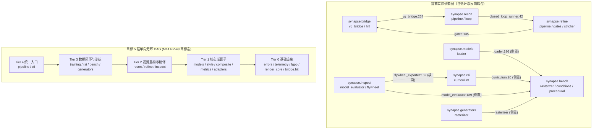

# Synapse 大规模重构后全库架构、工程实现与技术债务深度审计报告

- **文档状态**: `Accepted Audit Report (v1.0)`
- **审计基线**: `main` @ `87e88b1`（Horizon 1–3 / M1–M12 合入后全量代码基线）
- **审计日期**: `2026-11-14`
- **操作模型标识**: `[gemini4]`
- **关联修复计划**: [docs/plans/PLAN-M13-M16-POST-REFACTOR-REMEDIATION.md](../plans/PLAN-M13-M16-POST-REFACTOR-REMEDIATION.md)（Horizon 4: `M13–M16` / `PR-44 ~ PR-57`）
- **关联总计划**: [docs/IMPLEMENTATION_PLAN.md](../IMPLEMENTATION_PLAN.md)
- **前序基线审计**: [docs/AUDIT_AND_ARCHITECTURE.md](../AUDIT_AND_ARCHITECTURE.md) · [docs/DESIGN_REVIEW_AND_ALIGNMENT.md](../DESIGN_REVIEW_AND_ALIGNMENT.md)

---

## 1. 执行摘要与全库健康度基线 (Executive Summary)

### 1.1 代码库定量规模与环境验证基线

在 `87e88b1` 基线上对 `synapse` 仓库进行了全目录 AST 静态扫描、跨仓线格式审计及云端主力机 `ubuntu24` 全套构建测试验证：

| 维度 | 实测指标 | 备注 |
| :--- | :--- | :--- |
| **Python SDK (`python/synapse/`)** | **32,290 LOC**（18 个子包） | `bench` (4,040) · `recon` (3,759) · `inspect` (3,485) · `adapters` (3,167) · `refine` (2,305) · `cli` (2,219) · `pipeline` (2,076) · `training` (1,740) · `metrics` (1,585) · `composite` (1,571) · `rsi` (1,324) · `fgpp` (1,195) · `style` (821) · `bridge` (770) · `viewer` (723) · `generators` (601) · `<root>` (491) · `models` (418) |
| **原生 C++20 核 (`csrc/geometry/`)** | **1,500 LOC**（Bazel 9.3.1） | `@aether//math` (`DVec3`) + `-fno-exceptions` + pybind11 + GTest |
| **桌面检查器 (`tools/data-inspector/`)** | **856 LOC** C++20 + **1,253 LOC** JS | `native/` (独立 Bazel) + `electron/` + `renderer/` |
| **脚本与测试规模** | `scripts/` **1,720 LOC** · `tests/` **50 文件** | `951 passed, 10 skipped, 6 warnings` |
| **`ubuntu24` CI 基线** | `pytest`: `413.14s (0:06:53)` | `ruff check`: `0` 报错；`mypy`: `0` 报错（115 文件，非 strict）；`wire_guard.py --check`: `PASS`；`csrc/geometry` `bazel test //:test_geometry --config=linux`: `PASSED (0.1s)` |

### 1.2 重构亮点与正向工程遗产 (What Went Right)

1. **`FGPP v1.0` 跨仓线格式零漂移**：`tools/wire_guard.py --check` 针对 `../aether/fgpp/include/aether/fgpp/fgpp_types.h` 的 15 标量通道、`34 B/px` 布局与 `Cryptomatte.ID` (`UINT32` 逐 bit 保留) 校验 100% 通过。
2. **重型可选依赖严格零顶层引入**：全仓 32,290 行 `python/synapse` 经 AST 全量扫描，`torch`、`openexr`、`cv2`、`trimesh`、`mitsuba` 顶层导入数为 **0**，且公共函数返回类型注解覆盖率达 **99.15% (`699/705`)**。
3. **Agent-Native 确定性错误分类体系**：[errors.py](../../python/synapse/errors.py) 与 [telemetry.py](../../python/synapse/telemetry.py) 统一实现了 `ExitCode`（`0/10/20/30/40/50`）、`agent_fix_hint` 与 W3C `TraceContext`。
4. **双轨 Tier-0 自包含几何内核**：[csrc/geometry](../../csrc/geometry/)（`@aether//math` `DVec3`）与 Python Oracle [recon/geometry.py](../../python/synapse/recon/geometry.py) 形成双轨互验，摆脱对外部 `vg-core` 的编译期强绑定。
5. **领域解耦的 Stage Adapter**：通过 `python/synapse/pipeline/stages/` 注册模式，避免下游领域包直接依赖 `synapse.pipeline`。

### 1.3 全库健康度多维评分卡

| 审查维度 | 得分 | 核心诊断结论 |
| :--- | :---: | :--- |
| **跨仓边界与 Wire 契约 (`FGPP`)** | **88 / 100** | EXR 15 通道齐整，但 JSON Schema 与逐通道 `PixelType` 守卫尚有缺口 |
| **仓内包级依赖拓扑 (DAG)** | **58 / 100** | 存在 **`bridge → recon → refine → bridge`** 三角循环依赖，且 4 个核心包反向依赖顶层评测套件 `bench/` |
| **工程实现与防静默失败三问** | **52 / 100** | Horizon 1–2 基座稳固；Horizon 3 (`M9–M11`) 与 `bundle_worker.py` 存在 **9 处假成功/随机噪声回退**、未接线 Refiner、被吞没的 `CircuitBreakerError` 及无光度梯度的优化器 |
| **原生 C++ 核与分发打包** | **66 / 100** | Quad 多边形（`verts_per_face > 3`）存在第二三角形漏检；`pip`/Colab 未编入 `_c_geometry` 导致 `backend="native"` 开箱 `ImportError`；缺 `.bazelignore` |
| **技术债务与文档真实性** | **68 / 100** | `M8` `data-inspector` 文档与代码严重失真；`cli/__init__.py` 膨胀至 2,211 行；`pytest` 无快慢分层（413s）；Horizon-3 计划表与 Git 状态脱节 |
| **综合健康度总评** | **66 / 100** | **条件通过（Conditional Pass）** —— 进入 `foundary`/`render-farm` 生产容器部署前须先完成 `M13–M16` 硬化 |

---

## 2. 整体架构深度审查 (`ARCH-01 ~ ARCH-06`)

### 2.1 包级依赖现状 vs 目标分层拓扑

### 2.2 架构级问题详单

#### `[P0-ARCH-01]` 仓内 3 包循环依赖与 `bench/` 反向依赖倒置
- **定位**:
  - **三元闭环**: `python/synapse/bridge/vg_bridge.py:267-308`（`SynapseReconBackend` 导入 `synapse.recon.{delight, geometry, kinematics}`）→ `python/synapse/recon/loop/closed_loop_runner.py:42-43`（导入 `synapse.refine.{stitcher, types}`）→ `python/synapse/refine/gates.py:135`（导入 `synapse.bridge.hitl`）。
  - **向上反向依赖评测套件 `synapse.bench`**:
    - `python/synapse/models/loader.py:196` → `synapse.bench.procedural`
    - `python/synapse/rsi/curriculum.py:20` → `synapse.bench.conditions`
    - `python/synapse/inspect/model_evaluator.py:189,190,245,419` → `synapse.bench.{camera, rasterizer, model_loader}`
    - `python/synapse/generators/rasterizer.py:5,36` → `synapse.bench.rasterizer`
  - **横向域耦合**: `python/synapse/inspect/flywheel_exporter.py:162-163` 直接导入 `synapse.rsi.pair_builder`。
- **危害**: `bench/` 作为顶层评测套件被动成为隐式基础库，任何包重构或瘦身拆分都会触发循环引用崩溃或引入整套评测场景依赖。
- **改进建议**:
  1. 在 `M14 (PR-48)` 提取低层无状态包 `synapse.render_core`（容纳 `SoftwareRasterizer`、`Camera`、基础几何程序化生成、光照条件参数与公共 JSONL 样本构建原语），`bench/` 仅作消费端与场景编排；
  2. 将 `bridge.hitl` 独立于底层，移除 `vg_bridge.py` 中反向引用 `recon` 的 `SynapseReconBackend`；
  3. 用 `tools/import_dag_guard.py` 通过 AST 校验分层导入并在 `pytest` 中门禁。

#### `[P1-ARCH-02]` `synapse.bridge.vg_bridge` 双脑遗留与生产绕过原生 C++ 内核
- **定位**: `python/synapse/bridge/vg_bridge.py:31,288,333-364`；`python/synapse/recon/pipeline.py:15,96`。
- **现象**: `AGENTS.md` §1 明确声明“已彻底脱离外部 `vg-core`”，但 `get_vg_backend()` 默认仍以 `prefer_native=True` 探测不存在的外部 `import vg`（`NativeVgBackend` 提示 `pip install vg-core`）；同时 `SynapseReconBackend.check_manifold` 与 `ReconPipeline.run` 在生产路径直接调用纯 Python Oracle (`synapse.recon.geometry.check_manifold`) 而非 C++20 `_c_geometry`。
- **改进建议**: 在 `M14 (PR-49)` 下线废弃的 `import vg` 探测分支，生产几何拓扑校验统一优先路由 `synapse._c_geometry`（Oracle 仅限双轨校验测试）。

#### `[P1-ARCH-03]` 原生 Bazel 孤岛工作区、缺少 `.bazelignore` 与 `pip`/Colab `_c_geometry` 断链
- **定位**: `csrc/geometry/MODULE.bazel`、`csrc/geometry/.bazelrc`、`tools/data-inspector/native/MODULE.bazel`、`pyproject.toml`、`workenv/google-colab/setup_colab.sh`、`python/synapse/inspect/geometry_gate.py:86`。
- **实测故障**:
  1. 在 `ubuntu24` 进入 `csrc/geometry` 执行 `bazel test //... --config=linux` 失败，因为无 `.bazelignore` 忽略上次构建留下的 `bazel-*` 目录/软链，导致 `//...` 递归扫描 `bazel-geometry/external/rules_python++...windows-msvc` 报错；且 `.bazelrc` 对 `--config=linux` 重复展开 `unix-common`。
  2. `geometry_gate.py:86` 默认 `backend="native"` 找不到 `_c_geometry` 时直接抛裸 Python `ImportError`（违反 `ExitCode.BACKEND_UNAVAILABLE = 30`）；`pyproject.toml` 未构建 `_c_geometry`，`setup_colab.sh` 也未编译扩展，导致干净 `pip` 或 Colab 环境调用 `validate_mesh_geometry()` 即崩。
- **改进建议**: 在 `M14 (PR-49/PR-50)` 补齐 `.bazelignore` 与 `.bazelrc` 去重，提供 `scripts/build_native.py` 并在 `setup_colab.sh` 接入 `_c_geometry` 编译归位，缺失时规范抛出 `BackendUnavailableError(exit_code=30)`。

#### `[P1-ARCH-04]` `synapse.viewer.server` 常驻 HTTP Daemon 风险重审
- **定位**: `python/synapse/viewer/server.py:14,55-96`；`python/synapse/cli/__init__.py:118-163,1410-1419`。
- **现象**: 尽管 [AUDIT_AND_ARCHITECTURE.md §2.3](../AUDIT_AND_ARCHITECTURE.md) 对 `synapse view` 给予了本地调试豁免，但当前实现存在三项硬伤：
  1. `server.py:64` 篡改全局类属性 `socketserver.TCPServer.allow_reuse_address = True`；
  2. 直接通过 `SimpleHTTPRequestHandler` 暴露目标目录文件且未对 `host` 强制锁死回环地址 `127.0.0.1`；
  3. `while True: time.sleep(1)` 常驻进程阻塞，与 `--json` Agent 无头契约冲突。
- **改进建议**: 在 `M14 (PR-51)` 默认改为导出零进程静态自包含 HTML；仅 `--serve-local` 显式开启回环预览并实例级设置 `allow_reuse_address`，`--json` 模式下快速失败 (`10`)。

#### `[P1-ARCH-05]` 公共包导出与可选依赖矩阵缺口
- **定位**: `python/synapse/__init__.py:51-63` 遗漏 `refine` 子模块（导致 `import synapse; synapse.refine` 报 `AttributeError`）；`pyproject.toml:46,57` `[project.optional-dependencies].full` 遗漏 `invrender`。
- **改进建议**: 在 `M14 (PR-49)` 同步补齐。

#### `[P1-ARCH-06]` 跨语言契约 SSOT 缺口与 RFC 治理边界偏离
- **定位**: `tools/wire_guard.py`、`docs/RFC-0060-*.md`、`docs/RFC-0061-*.md`、`docs/RFC-0062-*.md`。
- **现象**:
  1. `wire_guard.py` 仅校验了通道名列表与总字节数 `34 B/px`，未校验逐通道 `PixelType` (`HALF`/`FLOAT`/`UINT32`)，也未覆盖 `@aether//style` `StyleProfile v2.0.0` 及 `job_bundle.v1.0` / `lora.v1.0` / `inspection.v1.0` / `refine_session.v1.0` JSON 契约；
  2. 按 `rfc-design-governance` 规范，生态级 RFC 应收口至 `all-overview/rfcs/` 且单篇 `<= 500` 行，`synapse/docs/` 仅保留详细工程设计 (`DESIGN_*.md`)。
- **改进建议**: 在 `M15 (PR-54)` 扩围 `wire_guard.py` 并完成 RFC 文档分层归位。

---

## 3. 工程实现与“防静默失败三问”深度审查 (`ENG-01 ~ ENG-05`)

> 依据 `AGENTS.md §1` 红线 #4（存在问 / 接线问 / 执行问），逐模块排查重构后代码，识别出以下 **3 类 P0 级 + 2 类 P1 级工程实现缺陷**。

### 3.1 `[P0-ENG-01]` Worker 阶段适配器与 CLI 中广泛存在的静默伪造输入及假成功回退

下表列出全仓 **9 处高危静默伪造链路**（缺失真实文件/依赖时仍返回 `exit_code = 0`）：

| 序号 | 精确文件与符号位置 | 静默降级 / 假成功行为 | 违反的红线 / 正确退出码 |
| :---: | :--- | :--- | :--- |
| **1** | `bundle_worker.py:358-363` `_handle_neural_video_generate` | 忽略 `manifest.inputs["fgpp_dir"]`，直接向 `adapter.generate()` 传入空的 `PreparedConditionPayload()` | 违背接线问，应加载 FGPP 并调用 `prepare_conditions()`（缺失抛 `20`） |
| **2** | `bundle_worker.py:424-439` `_handle_style_extract_and_map` | `Pillow` 缺失或 `frames_dir` 无 PNG 时用 `np.zeros` 全黑假帧生成 YAML 并退出 `0` | 应按缺失类型抛 `BackendUnavailableError(30)` / `AssetNotFoundError(20)` |
| **3** | `bundle_worker.py:454-514` `_handle_surgical_composite` | 完全忽略 `manifest.inputs["rendered_dir"]` 与 `["neural_dir"]`，硬编码全黑背景 + `128` 灰块 + 圆形掩膜并退出 `0` | 同上（缺失真实序列应硬拦截抛 `20`） |
| **4** | `bundle_worker.py:551-578` `_handle_inverse_reconstruct` | 无真实帧时伪造均匀灰帧 `120+(i%20)`，且在生产代码内**直接篡改模块全局变量 `_mv._MIN_ANGULAR_SPAN_DEG = 0.0`**（非线程安全），且未落盘保存 `result.mesh` | 违背架构洁净与线程安全；移除全局 Monkey-Patch，保存真实重构网格 |
| **5** | `stages/recon.py:44-62` & `cli/__init__.py:1045-1065` | `video_to_3d_invert` 缺失 `--video` 时用随机数生成假视频；CLI 捕获 `except Exception:` 构造 `_EmptyResult(mesh=None)` 后返回退出码 `0` | 掩盖 `ContractValidationError(10)` / `AssetNotFoundError(20)` |
| **6** | `stages/recon.py:130-150` & `cli/__init__.py:1113-1131` | `inverse_render_loop` / `synapse recon closed-loop` 缺失视频时伪造随机像素 + `+Z` 平板法线 + 线性平面 UV | 应强制校验真实输入并读取 FGPP 法线/UV |
| **7** | `stages/refine.py:51-93` & `cli/__init__.py:976-1012` | `anatomical_refine` 缺失视频时生成随机帧与居中 1/4 矩形假 ROI，且不传 `candidates_per_roi` 退化为恒等自混合 | 应加载真实视频/ROI 契约并在缺失时抛 `20`/`10` |
| **8** | `stages/training.py:28-75,132` `handle_lora_preencode` / `package` | `lora_preencode` 完全忽略 `manifest.inputs` 用 `RandomState` 编码随机噪音；`lora_package` 默认 `skip_bench=True` | `skip_bench` 默认应为 `False`（强制门禁）；输入缺失抛 `20` |
| **9** | `cli/__init__.py:1319-1339` `_cmd_rsi_gate_promote` | 无参数调用默认填充 `baseline_overall=0.7, candidate_overall=0.8`，直接产出 `"promoted": True` | 门禁指标参数缺失应抛 `ContractValidationError(10)` |

### 3.2 `[P0-ENG-02]` `M10` (`synapse.refine`) 核心算子未接线、门禁硬编码及 900s 熔断被吞没

1. **`LocalRefinementPipeline` 孤岛化 (`python/synapse/refine/pipeline.py:209-247`)**：
   - 该类全文件未导入也未调用 `HandRefiner`、`FaceRefiner`、`KalmanBBoxTracker` 或 `TiledBypassExecutor`。
   - 当 `candidates_per_roi is None` 时，第 `224` 行令 `cands = [roi.crop_acescg]`，将未经任何精修的原裁切块送入多模型融合（自身与自身融合）。
2. **吞没 15 分钟工程熔断红线 (`refine/pipeline.py:252-271`)**：
   - 第 `253` 行丢弃了 `evaluate_refinement_gates(...)` 的返回值 `GateVerdict`；第 `259` 行使用宽泛 `except Exception:` 捕获一切异常并记录“不失败”——连 `evaluate_hitl_circuit_breaker` 超过 900s 抛出的 `CircuitBreakerError(exit_code=40)` 也被静默吞没，直接违反 `AGENTS.md §1` 红线 #3！
3. **`Tier-2` 神经门禁恒真占位 (`refine/gates.py:131-132`)**：
   - `# -- Tier 2: Neural perceptual (placeholder — always pass) --` 硬编码 `verdict.tier_results["tier2_neural"] = True`，未接入 `synapse.metrics.lpips` 或 `VisualJevCritic`。
4. **`FaceRefiner.refine` 未实际融合多视角身份库 (`refine/face.py:244-254`)**：
   - 虽构建了 `CanonicalAnchorGallery.interpolate_identity()`，但 `refine()` 仅判断 `num_anchors > 0` 后执行 `np.clip(lum, 0.15, 0.85)` 亮度裁剪，未消费锚点加权嵌入与面部先验。
5. **`ScalpelStitcher.stitch_sequence` 与文档声称的四阶段算子严重脱节 (`refine/stitcher.py:72-157`)**：
   - 文件头 docstring 声称执行“1. 逆仿射变换 `M⁻¹`、2. 手术刀掩膜、3. 16px 环带 LAB 匹配、4. 光学增量叠加”，但实际代码：
     - 未使用参数 `motion_vectors`、未使用 `StitchConfig.ema_alpha` / `max_flow_magnitude`、未应用逆仿射变换（仅做轴对齐切片拼接）；
     - 未调用 `synapse.composite` 已实现的 `generate_surgical_mask` / `border_ring_lab_match` / `composite_optical_increments`；
     - 第 `140` 行用 `float(np.sqrt(mse)) * 100` 近似伪造 `mean_border_ciede2000`，而非调用 `synapse.metrics` 真实 $\Delta E_{00}$。

### 3.3 `[P0-ENG-03]` `M9/M11` (`synapse.recon`) 算法捷径与无数据拟合梯度

1. **`ReconPipeline` 产生与视频内容无关的 1m 常数薄壳 (`recon/pipeline.py:76-87` & `recon/multiview.py:197-201`)**：
   - `ReconPipeline.run` 调用 `MultiViewInitializer.reconstruct(frames=frames, cameras=...)` 时未传 `depths` 与 `masks`，落入第 `200` 行 fallback：`synth_depths = np.ones((len(cameras), h, w), dtype=np.float32) * 1.0` —— `_reconstruct_tsdf` 对该常数深度运行，实际重构结果与输入 `frames` 内容无关。
2. **`ReconPipeline` 运动学蒸馏硬编码正弦假步态 (`recon/pipeline.py:105-128`)**：
   - 当 `skeleton_template is None` 时，第 `117-126` 行直接硬编码 `0.04 * math.sin(t * 0.4)` 与 30 帧周期双足支撑相位，然后对其执行 `solve_zero_slip_ik` 并上报遥测，完全未从 `video_frames` 或点云轨迹提取关节点。
3. **`AnalyticUVInverseOptimizer` 纯 Python 像素双循环且优化迭代无光度梯度 (`recon/loop/mitsuba_optimizer.py:156-198,303`)**：
   - 第 `156-161` 行使用 `for row in range(h): for col in range(w):` 纯 Python 逐像素累加贴图（应向量化为 `np.add.at`）；
   - 第 `175-198` 行的迭代主循环仅计算并施加平滑正则梯度 `tv_grad`，**缺失光度数据残差梯度 `(rendered - frames) * ndotl` 反传**，本质是在执行纯 TV 模糊；
   - 第 `303-306` 行 `_approx_ciede2000` 再次使用 RGB 欧氏距离 `× 100` 替代真实 $\Delta E_{00}$。

### 3.4 `[P1-ENG-04]` 原生 C++20 `csrc/geometry` 多边形漏检、3 倍冗余建表与未释放 GIL

1. **Quad/N-gon 第二三角形盲区 (`csrc/geometry/src/mesh_checks.cc:455-457,552-563`)**：
   - `checkDegenerateFaces` 与 `checkSelfIntersections` 均接收 `verts_per_face`（支持四边面 `verts_per_face = 4` 等 `quad_remesh` 产物），但实现仅读取前三个顶点 `(f[0], f[1], f[2])`，完全忽略 `(f[0], f[2], f[3])` 等后续扇形三角形。
2. **单次检查构建 3 次边哈希表 & Dead Binding (`geometry_gate.py:109-133` & `mesh_checks.cc:407,671-678`)**：
   - `geometry_gate.py` 连续发起 5 次 pybind11 FFI 往返，导致 C++ 已绑定的统一入口 `pyValidateMeshGeometry` (`bindings.cc:172`) 处于死代码状态；且 `checkWatertight` 内部重调 `checkManifold` 并再次遍历全网格构建边哈希表，单次全量检查触发 3 次边映射构建。
3. **纯 C++ 计算函数持有 Python GIL (`bindings.cc:232-260`)**：
   - `bindings.cc` 中 6 个只读 Numpy Buffer 的纯 C++ 函数均未声明 `py::call_guard<py::gil_scoped_release>()`。

### 3.5 `[P1-ENG-05]` 指向虚构外部包的弃用告警与自弃用内部导入

- `python/synapse/metrics/temporal.py:30-35` 与 `python/synapse/style/aces_color.py:32-37`（在 `bench_runner.py:468,516` 每次基准触发）提示用户 `Install 'fulgur-metrics'`，但生态中并不存在此 Python 包（Layer 0 SSOT 归属 `@aether//metrics` 与 `@aether//color`）。
- `python/synapse/generators/dataset.py:121` 仍在导入仓内已标记废弃的垫片 `synapse.generators.rasterizer`，导致 `pytest` 测试输出持续触发 `DeprecationWarning`。

---

## 4. 技术债务、计划真实性与工程治理审查 (`DEBT-01 ~ DEBT-05`)

### 4.1 `[P1-DEBT-01]` `M8` `tools/data-inspector` 文档声称与代码实现严重失真
- `docs/IMPLEMENTATION_PLAN.md` 与 `docs/plans/PLAN-M8-DATA-INSPECTOR-DESKTOP.md` 将 `PR-27/28/29` 标注为 `✅ 已实施`（声称包含 `@fulgur` 3D 视口、骨骼八面体 Gizmo、FGPP 叠加时间轴及 C++ `ComparisonEngine` Wipe/Ghost）。
- **代码实测现状**:
  - `tools/data-inspector/native/inspector_app.cc:126` 无任何 `@fulgur` 依赖，渲染器仅对 `bundlePath` 计算 `fnv1aHash` 后绘制 2D UV 色彩渐变；
  - 第 `156-162` 行命令解析依赖脆弱 `std::string::find` 字符串匹配；析构函数对阻塞在 `std::cin` 的 `m_stdinThread` 执行 `detach()`；
  - `tools/data-inspector/electron/main.js:128-137` 通过 Electron IPC 在 30fps 下拷贝传输完整 RGBA 像素帧（高分辨率下约 ~110 MB/s）；
  - `tools/data-inspector/renderer/src/app.js:67-69` 中 `animation` / `comparison` 视图 Tab 为无实际逻辑的占位按钮。

### 4.2 `[P1-DEBT-02]` `2,211` 行单体 `cli/__init__.py` 维护性失控
- `python/synapse/cli/__init__.py`（2,211 LOC）承载所有子命令解析、业务调度、`--json` 封装与输入读取，与多个 Stage Adapter 复制同一套路径读取和兜底逻辑，亟需按领域模块拆分。

### 4.3 `[P2-DEBT-03]` 跨包图像处理与指标算法重复造轮子
- 可分离高斯卷积、2× 上/下采样与拉普拉斯金字塔在 `python/synapse/composite/blend.py:103-206` 与 `python/synapse/refine/fusion.py:30-119` 重复实现两份（甚至精度与插值逻辑轻微漂移）；双线性缩放在 `refine/stitcher.py` 与 `refine/fusion.py` 重复；PSNR 与简化 $\Delta E_{00}$ 在 `mitsuba_optimizer.py`、`refine/stitcher.py` 各自实现，未复用 `synapse.metrics`。
- `csrc/geometry/src/mesh_checks.cc:15-18` 已登记未来迁移合入 `@aether//geo` 的待办项，需保持接口边界收敛。

### 4.4 `[P2-DEBT-04]` 测试分层缺失（413s）与静态门禁宽松漏洞
- `ubuntu24` 全量 `pytest tests/` 耗时 **413.14s**（受 30 场景纯 NumPy 软光栅长测拖累），缺少 `@pytest.mark.slow` 分层使日常单测无法 `< 30s` 快速反馈；且存在 `PytestDeprecationWarning: asyncio_default_fixture_loop_scope is unset` 告警。
- `pyproject.toml` 中 `[tool.mypy]` 未开启 `check_untyped_defs = true`、`disallow_incomplete_defs = true` 与 `warn_return_any = true`；`[tool.ruff.lint]` line 90 全局豁免 `F841`（未使用变量）。

### 4.5 `[P2-DEBT-05]` 计划表真值漂移、Git 合并规范失守与 Skills 脱节
- `docs/IMPLEMENTATION_PLAN.md` 仍将已在 `main` 合入的 `PR-30 ~ PR-43` 全数标为 `📋 已规划`，同时高估 `M8`；
- Horizon-3 提交历史中出现了未走 Squash Merge 的本地合并、跨模型标签重叠提交等违背 `github-pr-workflow` 的记录；
- `.agents/skills/synapse-overview/SKILL.md` 等技能索引尚未纳入 `synapse.refine` 与 `synapse.recon.loop`。

---

## 5. `M1–M12` 交付真实性逐项核对总表（防静默失败三问矩阵）

| 里程碑 | 领域 | 存在问 | 接线问 | 执行问 | 真实成熟度判定 | 对应整改 PR |
| :---: | :--- | :---: | :---: | :---: | :--- | :---: |
| **M1** | `fgpp` 契约、IO、`errors`、`cli` 基座 | ✅ | ✅ | ⚠️ | **⚠️ 核心稳固·CLI 需拆分**（`viewer`/`cli` 需收敛） | `PR-51, PR-53, PR-54` |
| **M2** | `adapters` 双轨适配器与因果滑窗 | ✅ | ⚠️ | ✅ | **✅ SDK 稳固·Worker 需接线**（`bundle_worker` 空条件调用） | `PR-44` |
| **M3** | `style`、`composite`、`bridge` 熔断 | ✅ | ⚠️ | ⚠️ | **⚠️ 域算子稳固·`vg_bridge` 待清理** | `PR-48, PR-49, PR-56` |
| **M4** | `metrics`、`profiles`、`bench` 30 场景 | ✅ | ⚠️ | ⚠️ | **⚠️ 指标完备·存在反向依赖与 413s 慢测** | `PR-44, PR-48, PR-57` |
| **M5** | `adapters/lora`、`training` PEFT 流水线 | ✅ | ⚠️ | ⚠️ | **⚠️ 算法通过·`stages/training` 含噪声回退** | `PR-44, PR-54` |
| **M6** | `inspect` 3D 模型评估 & `csrc/geometry` | ✅ | ⚠️ | ⚠️ | **⚠️ 评估可用·原生打包与 Quad 检查待修** | `PR-48, PR-49, PR-50, PR-52` |
| **M7** | `rsi` 课程采样、双重验算与晋升门禁 | ✅ | ⚠️ | ⚠️ | **⚠️ 核心可用·依赖 `bench` 且 CLI 含假默认** | `PR-44, PR-48` |
| **M8** | `tools/data-inspector` 原生可视化检查器 | ⚠️ | ❌ | ❌ | **❌ 仅脚手架（Hash 渐变画布 + 无操作 Tab）** | `PR-55` |
| **M9** | `recon` 视频逆向 3D 与 `multiview` | ✅ | ⚠️ | ❌ | **⚠️ 骨架已合入·1m 常数深度与正弦假步态** | `PR-44, PR-47, PR-48` |
| **M10** | `refine` 局部解剖精修与 `ScalpelStitcher` | ✅ | ❌ | ❌ | **⚠️ 算子已合入·`Pipeline` 未接线且吞掉 `40` 熔断** | `PR-44, PR-45, PR-46` |
| **M11** | `recon/loop` 可微逆向闭环与优化器 | ✅ | ⚠️ | ❌ | **⚠️ 框架已合入·迭代缺光度梯度且存在三包循环** | `PR-44, PR-47, PR-48` |
| **M12** | `domain_randomizer`、`WanLoRA`、`profiles` | ✅ | ✅ | ⚠️ | **✅ 契约对齐·依赖与静态门禁待收紧** | `PR-48, PR-57` |

---

## 6. 全量缺陷优先级台账与整改映射 (`Master Defect Ledger`)

| 审计编号 | 严重度 | 核心问题描述 | 关键位置 | 目标修复计划 |
| :--- | :---: | :--- | :--- | :---: |
| **`P0-ARCH-01`** | **P0** | `bridge → recon → refine → bridge` 3 包循环 + 4 包倒置依赖 `bench/` | `vg_bridge.py`, `closed_loop_runner.py`, `gates.py`, `bench/*` | `M14 PR-48` |
| **`P0-ENG-01`** | **P0** | Worker/Stage/CLI 共 9 处缺失输入静默噪声假成功 + 全局 Monkey-Patch | `bundle_worker.py`, `stages/*`, `cli/__init__.py` | `M13 PR-44` |
| **`P0-ENG-02`** | **P0** | `LocalRefinementPipeline` 未接 Refiner/Tracker、吞没 `900s` 熔断、`ScalpelStitcher` 未用 `motion_vectors`/`composite` | `refine/pipeline.py`, `gates.py`, `face.py`, `stitcher.py` | `M13 PR-45, PR-46` |
| **`P0-ENG-03`** | **P0** | `ReconPipeline` 1m 常数深度与正弦假步态；`AnalyticUVInverseOptimizer` 迭代无光度残差梯度 | `recon/pipeline.py`, `multiview.py`, `mitsuba_optimizer.py` | `M13 PR-47` |
| **`P1-ARCH-02`** | **P1** | `vg_bridge` 残留 `import vg` 分支且生产绕过 `_c_geometry` | `bridge/vg_bridge.py`, `recon/pipeline.py` | `M14 PR-49` |
| **`P1-ARCH-03`** | **P1** | 缺 `.bazelignore` 与 `.bazelrc` 告警；`_c_geometry` 未打入 `pip`/Colab 且缺 `ExitCode 30` | `csrc/geometry/`, `setup_colab.sh`, `geometry_gate.py` | `M14 PR-49, PR-50` |
| **`P1-ARCH-04`** | **P1** | `viewer.server` 修改全局 `TCPServer` 状态、未强锁 `127.0.0.1` 且阻塞 `--json` | `viewer/server.py`, `cli/__init__.py` | `M14 PR-51` |
| **`P1-ARCH-05`** | **P1** | `synapse.__init__` 漏导出 `refine`；`pyproject.toml` `[full]` 漏 `invrender` | `python/synapse/__init__.py`, `pyproject.toml` | `M14 PR-49` |
| **`P1-ARCH-06`** | **P1** | `wire_guard` 缺逐通道 `PixelType` 与 JSON Schema 守卫；`RFC 0060–0062` 治理归位 | `tools/wire_guard.py`, `docs/RFC-0060~0062` | `M15 PR-54` |
| **`P1-ENG-04`** | **P1** | C++20 `csrc/geometry` Quad 第二三角形漏检、3 次边表重建及未释放 GIL | `csrc/geometry/src/{mesh_checks.cc, bindings.cc}` | `M15 PR-52` |
| **`P1-ENG-05`** | **P1** | 弃用告警指引不存在的 `fulgur-metrics` 包；内部仍引用已弃用 `generators.rasterizer` | `metrics/temporal.py`, `style/aces_color.py`, `generators/dataset.py` | `M16 PR-56` |
| **`P1-DEBT-01`** | **P1** | `M8` `data-inspector` 实为 Hash 渐变画布，缺真实 3D/EXR 加载与线程安全退出 | `tools/data-inspector/` | `M16 PR-55` |
| **`P1-DEBT-02`** | **P1** | `cli/__init__.py` 2,211 行单体臃肿 | `python/synapse/cli/__init__.py` | `M15 PR-53` |
| **`P2-DEBT-03`** | **P2** | 高斯/金字塔/双线性缩放与指标公式跨包重复 | `composite/blend.py`, `refine/fusion.py`, `stitcher.py` | `M16 PR-56` |
| **`P2-DEBT-04`** | **P2** | `pytest` 缺快慢分层（413s），`mypy` 未开 `check_untyped_defs`，`ruff` 豁免 `F841` | `pyproject.toml`, `tests/` | `M16 PR-57` |
| **`P2-DEBT-05`** | **P2** | `IMPLEMENTATION_PLAN` 状态过期、Git 非 Squash 合入与 `.agents/skills/` 缺漏 | `docs/IMPLEMENTATION_PLAN.md`, `.agents/skills/` | 本文档已校准 `PLAN`；`PR-57` 同步 Skills |
