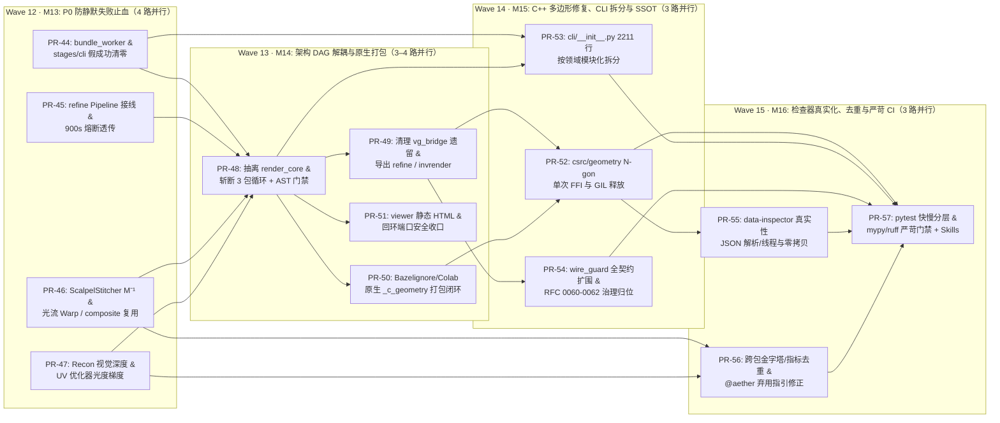

# 细分实施计划：Horizon-4 重构后架构解耦、防静默失败清零与工程硬化 (M13–M16: PR-44 ~ PR-57)

- **计划版本**: `Active Remediation Blueprint (v1.0)`
- **所属总计划**: [docs/IMPLEMENTATION_PLAN.md](../IMPLEMENTATION_PLAN.md)（Horizon 4 / Waves 12–15，**M13–M16** 共 4 大里程碑、**14 个原子 PR**，预估约 19.5 人天）
- **问题源头审计**: [docs/audits/AUDIT-POST-REFACTOR-2026-11.md](../audits/AUDIT-POST-REFACTOR-2026-11.md)（基线 `87e88b1`，覆盖 `4×P0 + 8×P1 + 4×P2`）
- **修订日期**: `2026-11-14`
- **操作模型标识**: `[gemini4]`

> [!WARNING]
> **Horizon 4 落地后审计核验结论（`2026-11-14`, `b98c6e5`）**：尽管 `PR #49` 在总计划中将 `PR-44 ~ PR-57` 统一标记为 `✅ 已合入`，但经对照 [AUDIT-RFC0063-AND-CODEBASE-2026-11.md](../audits/AUDIT-RFC0063-AND-CODEBASE-2026-11.md) 逐项审计：`PR-51` 已完整落地；**`PR-55`（`data-inspector` 真实视口 / 低拷贝 IPC / Bazel 私服）尚未实施**；其余 PR 尚存遗留防静默回退、DAG `importlib` 绕过、快测试超时（~144s–152s）及 `#47/#48` 引发的原生编译与 Colab 必崩缺口。所有未闭环事项已统一收口至 Horizon 5：[PLAN-M17-M20-QUALITY-GOVERNANCE-AND-BENCHMARK-LANDING.md](PLAN-M17-M20-QUALITY-GOVERNANCE-AND-BENCHMARK-LANDING.md)（`PR-58 ~ PR-73`）。

---

## 1. Horizon-4 总体编排、并行波次与执行铁律 (Wave 12 – Wave 15)

Horizon-4 遵循 **“先止血假成功（M13）→ 再断循环与补分发（M14）→ 硬化原生内核与契约边界（M15）→ 收口检查器与严苛 CI（M16）”** 四段式收敛路径。每个 PR 净增改严格控制在 `300 ~ 650` 行，强制使用隔离 Git Worktree 走 PR Squash Merge 落地。



### 全局工程硬约束（适用 PR-44 ~ PR-57）
1. **Worktree + Squash Merge 铁律**：所有 PR 在 `/tmp/synapse-wt-<branch>` 独立工作区完成，`Commit` / `PR Title` / `PR Body` 必须标注模型标识 `[model-tag]`，严格通过 `gh pr merge --squash --delete-branch` 合入 `main`。
2. **`ubuntu24` P0 主力测试铁律**：所有回归测试在 `ubuntu24` 上运行；仅在涉及 GPU / CUDA / Colab 验证时使用 `win-dev` 或 Colab 节点，严禁在本地 Mac 跑全量回归套件。
3. **防静默失败三问门禁**：任何修复 PR 不得以“删除校验”或“伪造全黑/全白/随机数输入返回退出码 `0`”换取绿灯；缺失资产必须返回 `ExitCode.ASSET_NOT_FOUND (20)`，契约不合返回 `ExitCode.CONTRACT_ERROR (10)`，依赖不可用返回 `ExitCode.BACKEND_UNAVAILABLE (30)`，超时熔断或门禁拦截返回 `ExitCode.QUALITY_GATE_FAILED (40)`。

---

## 2. M13: P0 防静默失败清零与 Horizon-3 核心链路实接 (`PR-44 ~ PR-47`)

<a id="pr-44"></a>
### `[PR-44]` Worker / Stage Adapter / CLI 假成功回退彻底清零与输入契约硬校验 (Wave 12)
- **对应审计编号**: `P0-ENG-01`
- **前置依赖**: `main` (`87e88b1`) · **预估规模**: ~520 LOC（1.5 人天）
- **建议标题**: `fix(pipeline): enforce fail-closed input loading across worker stages and CLI [model-tag]`
- **改造清单**:
  - `[MODIFY]` [python/synapse/pipeline/bundle_worker.py](../../python/synapse/pipeline/bundle_worker.py)
    - `_handle_neural_video_generate`：强校验 `manifest.inputs["fgpp_dir"]` 存在性并加载 FGPP 帧序列，显式调用 `adapter.prepare_conditions(...)` 传入 `adapter.generate(...)`，移除空 `PreparedConditionPayload()`；
    - `_handle_style_extract_and_map` & `_handle_surgical_composite`：分别加载真实 `frames_dir` / `rendered_dir` & `neural_dir`（EXR 或 PNG），移除 `np.zeros` / `np.full(..., 128)` 假帧兜底，缺失文件抛 `AssetNotFoundError (20)`、缺 Pillow 抛 `BackendUnavailableError (30)`；
    - `_handle_inverse_reconstruct`：移除缺失 `frames_dir` 合成灰帧回退，移除 `_mv._MIN_ANGULAR_SPAN_DEG = 0.0` 模块全局 Monkey-Patch（改为只通过构造函数配置 `MultiViewConfig.min_angular_span_deg`，默认严格保持 `15.0°`），并将 `result.mesh` 显式序列化导出至 `manifest.outputs["mesh"]`。
  - `[MODIFY]` [python/synapse/pipeline/stages/recon.py](../../python/synapse/pipeline/stages/recon.py) · [python/synapse/pipeline/stages/refine.py](../../python/synapse/pipeline/stages/refine.py) · [python/synapse/pipeline/stages/training.py](../../python/synapse/pipeline/stages/training.py)
    - `handle_video_to_3d_invert` / `handle_inverse_render_loop` / `handle_anatomical_refine`：缺失真实输入文件直接抛 `AssetNotFoundError (20)`，禁止合成随机噪声帧、居中假 ROI 或吞掉 `ContractValidationError` 返回 `_EmptyResult`；
    - `handle_lora_preencode`：真实读取 `manifest.inputs["dataset_dir"]`（FGPP + 视频样本）编码分片；`handle_lora_package` 将 `skip_bench` 默认值改为 `False`（须显式传入 `bench_metrics` 方可打包）。
  - `[MODIFY]` [python/synapse/cli/\_\_init\_\_.py](../../python/synapse/cli/__init__.py)
    - 移除 `_cmd_recon_invert_video` 中 `_EmptyResult` 异常吞没与随机数兜底；`_cmd_rsi_gate_promote` 移除 `0.7 / 0.8` 假默认分数，改为强制传入 `--baseline-overall` / `--candidate-overall` 或报告 JSON，否则返回 `ContractValidationError (10)`。
  - `[MODIFY]` `tests/test_bundle_worker.py` · `tests/test_pipeline_stage_adapters.py` · `tests/test_cli.py`（将依赖缺失兜底的旧单测迁移为显式真实测试夹具并增加缺参报错断言）
- **`ubuntu24` 验收命令与门禁断言**:
  ```bash
  ssh ubuntu24 "cd ~/work/dervgen/synapse && /root/venv-synapse/bin/pytest tests/test_bundle_worker.py tests/test_pipeline_stage_adapters.py tests/test_cli.py -q"
  ```
  - **存在/接线/执行门禁**: 无任何路径在输入缺失时返回退出码 `0`；`handle_lora_package` 未提供指标时必须返回退出码 `10`/`40`；`grep -rn "_MIN_ANGULAR_SPAN_DEG" python/` 仅允许在 `recon/multiview.py` 内部定义处出现，Worker 零篡改。

---

<a id="pr-45"></a>
### `[PR-45]` `synapse.refine` 全链路算子接线、Face 身份库融合与 900s 熔断透传 (Wave 12)
- **对应审计编号**: `P0-ENG-02`
- **前置依赖**: `main` (`87e88b1`) · **预估规模**: ~480 LOC（1.5 人天）
- **建议标题**: `fix(refine): wire HandRefiner/FaceRefiner/Kalman/LPIPS gates and propagate CircuitBreakerError [model-tag]`
- **改造清单**:
  - `[MODIFY]` [python/synapse/refine/pipeline.py](../../python/synapse/refine/pipeline.py)
    - `LocalRefinementPipeline.__init__` 注入或构造 `KalmanBBoxTracker`、`HandRefiner`、`FaceRefiner`、`TiledBypassExecutor`；
    - 当 `candidates_per_roi is None` 时，依据 `roi.region` 分派 `HandRefiner.refine(roi, ...)` / `FaceRefiner.refine(roi, ...)`（配合 `TiledBypassExecutor` 大图分块调度与 `KalmanBBoxTracker.update(roi.bbox_xyxy)` 时序平滑），**严禁再出现 `[roi.crop_acescg]` 恒等自混占位**；
    - 消费 `evaluate_refinement_gates(...)` 返回的 `GateVerdict`：若 `verdict.passed is False`，记录结构化 `hard_negatives` 并按 `strict` 配置触发回退原帧或抛 `QualityGateError (40)`；
    - 显式 `except CircuitBreakerError: raise` —— 超过 `900s` HITL 上限**必须向外抛出退出码 `40`**，彻底禁绝 `except Exception:` 静默吞没。
  - `[MODIFY]` [python/synapse/refine/face.py](../../python/synapse/refine/face.py)
    - 在 `FaceRefiner.refine` 中真实调用 `active_gallery.interpolate_identity(...)` 获取多锚点 IDW 加权身份特征/色彩锚定统计，指导人脸高频纹理保真增强并记录 `gaze_dev`。
  - `[MODIFY]` [python/synapse/refine/gates.py](../../python/synapse/refine/gates.py)
    - 删除 `verdict.tier_results["tier2_neural"] = True` 硬编码占位，在提供原/修复图像张量时计算 `synapse.metrics.image_quality.lpips` 并支持可选注入 `VisualJevCritic` 裁决结果。
  - `[MODIFY]` `tests/test_refine_cli_wire.py` · `tests/test_refine_hand_face.py` · `tests/test_refine_stitcher_gates.py`
- **`ubuntu24` 验收命令与门禁断言**:
  ```bash
  ssh ubuntu24 "cd ~/work/dervgen/synapse && /root/venv-synapse/bin/pytest tests/test_refine_cli_wire.py tests/test_refine_hand_face.py tests/test_refine_stitcher_gates.py -q"
  ```
  - **门禁断言**: 注入 `elapsed_seconds=901.0` 时 `LocalRefinementPipeline.run` 必须抛出 `CircuitBreakerError` (`exit_code == 40`)；未传 `candidates_per_roi` 时，输出补丁与输入 `crop_acescg` 不应完全恒等（经 Refiner 处理）；`tier2_neural` 能够对高 LPIPS 破坏样本准确触发拒绝。

---

<a id="pr-46"></a>
### `[PR-46]` `ScalpelStitcher` 逆仿射回贴、光流 EMA Warp 与 `synapse.composite` 算子闭环 (Wave 12)
- **对应审计编号**: `P0-ENG-02`
- **前置依赖**: `main` (`87e88b1`) · **预估规模**: ~420 LOC（1.5 人天）
- **建议标题**: `fix(refine): activate inverse affine warp, motion_vectors EMA and composite LAB/DeltaE in ScalpelStitcher [model-tag]`
- **改造清单**:
  - `[MODIFY]` [python/synapse/refine/types.py](../../python/synapse/refine/types.py) & [python/synapse/refine/stitcher.py](../../python/synapse/refine/stitcher.py)
    - `RefinementResult` 可选携带标准正方形尺寸与 `inverse_affine_2x3`（或通过 `compute_affine_align(patch.bbox_xyxy)` 计算准确 `M⁻¹`）并在 `ScalpelStitcher.stitch_sequence` 中实现真实仿射逆采样回贴；
    - 激活 `motion_vectors` 参数：基于 `motion_vectors[t]` 对上一帧融合掩膜与补丁做双线性反向 Warp，并结合 `config.ema_alpha` 与 `config.max_flow_magnitude`（运动幅值超阈值自动衰减/重置权重防拖影）；
    - 直接复用 [python/synapse/composite/mask.py](../../python/synapse/composite/mask.py) 的 `generate_surgical_mask` 与 [python/synapse/composite/blend.py](../../python/synapse/composite/blend.py) 的 `border_ring_lab_match`、`laplacian_pyramid_blend` 与可选 `composite_optical_increments`；
    - 删除 `float(np.sqrt(mse)) * 100` 近似公式，改用 `synapse.metrics` / `synapse.style.aces_color.ciede2000_delta_e` 计算真实 `mean_border_ciede2000`。
  - `[MODIFY]` `tests/test_refine_stitcher_gates.py`
- **`ubuntu24` 验收命令与门禁断言**:
  ```bash
  ssh ubuntu24 "cd ~/work/dervgen/synapse && /root/venv-synapse/bin/pytest tests/test_refine_stitcher_gates.py -q"
  ```
  - **门禁断言**: 传入非零 `motion_vectors` 与全零 `motion_vectors` 必须产生可测差异且显著降低相邻帧边界闪烁 (`temporal_warp_error <= 0.015`)；`mean_border_ciede2000` 与 `ciede2000_delta_e` 误差 $< 10^{-4}$。

---

<a id="pr-47"></a>
### `[PR-47]` `ReconPipeline` 视觉剪影深度估计与 `AnalyticUVInverseOptimizer` 向量化光度反传 (Wave 12)
- **对应审计编号**: `P0-ENG-03`
- **前置依赖**: `main` (`87e88b1`) · **预估规模**: ~460 LOC（1.5 人天）
- **建议标题**: `fix(recon): replace constant 1m depth / sine kinematics with visual-hull estimation and vectorize UV photometric gradient [model-tag]`
- **改造清单**:
  - `[MODIFY]` [python/synapse/recon/multiview.py](../../python/synapse/recon/multiview.py) & [python/synapse/recon/pipeline.py](../../python/synapse/recon/pipeline.py)
    - 当 `depths=None` 且 `masks=None` 时，基于输入 `frames` 计算前景显著性/背景差分掩膜走 `_reconstruct_visual_hull` 或极线立体匹配估深，**彻底删除 `np.ones(...) * 1.0` 常数深度假重构**；若无法有效分离前景，抛出 `ContractValidationError (10)`；
    - `ReconPipeline.run`: 当 `skeleton_template is None` 且无法从轨迹恢复关节点时，不再伪造 `0.04 * math.sin(t * 0.4)` 假正弦步态——提供基于 4D 点轨聚类的运动代理恢复或显式置空并在遥测中标记 `kinematics_status="skipped_no_skeleton"`。
  - `[MODIFY]` [python/synapse/recon/loop/mitsuba_optimizer.py](../../python/synapse/recon/loop/mitsuba_optimizer.py)
    - 第 `156-161` 行双层 Python `for row / for col` 循环改为扁平索引 + `np.add.at` 纯向量化累加；
    - 在迭代循环 (`175-198` 行) 中加入**物理光子/光度数据残差反传梯度**：$\nabla_{\text{albedo}} \mathcal{L}_{\text{photo}} = \text{scatter\_uv}\!\left((\hat{I}_v - I_v) \cdot (\mathbf{N}_v \cdot \mathbf{L}_v)\right)$，与 `tv_grad` 联合收敛至全局最小能量；
    - 移除 `_approx_ciede2000`，统一调用 `synapse.metrics.image_quality.ciede2000` 与 `psnr_db`。
  - `[MODIFY]` `tests/test_recon.py` · `tests/test_recon_multiview.py` · `tests/test_recon_loop_optimizer.py`
- **`ubuntu24` 验收命令与门禁断言**:
  ```bash
  ssh ubuntu24 "cd ~/work/dervgen/synapse && /root/venv-synapse/bin/pytest tests/test_recon.py tests/test_recon_multiview.py tests/test_recon_loop_optimizer.py -q"
  ```
  - **门禁断言**: `MultiViewInitializer.reconstruct(depths=None)` 对不同前景视频形状应产出显著不同的非平面网格；`AnalyticUVInverseOptimizer` 向量化实现 `512×512` UV 优化耗时 `< 100ms` 且在仅给定初始扰动贴图时通过梯度下降持续降低光度 MSE 与提高 `ΔPSNR`。

---

## 3. M14: 包级单向 DAG 解耦、原生构建打包闭环与零常驻服务加固 (`PR-48 ~ PR-51`)

<a id="pr-48"></a>
### `[PR-48]` 抽离 `synapse.render_core` 共享渲染基元并斩断 3 包循环依赖 (Wave 13)
- **对应审计编号**: `P0-ARCH-01`
- **前置依赖**: `PR-44 ~ PR-47` · **预估规模**: ~600 LOC（2.0 人天）
- **建议标题**: `refactor(arch): extract synapse.render_core and enforce acyclic module DAG [model-tag]`
- **改造清单**:
  - `[NEW]` `python/synapse/render_core/{__init__, rasterizer, camera, procedural, conditions, pair_schema}.py`
    - 将 [python/synapse/bench/rasterizer.py](../../python/synapse/bench/rasterizer.py)、[camera.py](../../python/synapse/bench/camera.py)、`procedural.py`、`conditions.py` 中的无状态基础算法下沉到 `render_core`；在 `bench/` 原路径保留薄 re-export 保持对外向后兼容。
  - `[MODIFY]` [python/synapse/models/loader.py](../../python/synapse/models/loader.py) · [python/synapse/rsi/curriculum.py](../../python/synapse/rsi/curriculum.py) · [python/synapse/inspect/model_evaluator.py](../../python/synapse/inspect/model_evaluator.py) · [python/synapse/generators/rasterizer.py](../../python/synapse/generators/rasterizer.py) · [python/synapse/inspect/flywheel_exporter.py](../../python/synapse/inspect/flywheel_exporter.py)
    - 将上述模块所有 `synapse.bench.*` 与 `synapse.rsi.*` 导入全部切换至 `synapse.render_core.*`，彻底消除反向与横向耦合。
  - `[MODIFY]` [python/synapse/bridge/vg_bridge.py](../../python/synapse/bridge/vg_bridge.py) · `python/synapse/recon/loop/closed_loop_runner.py` · [python/synapse/refine/gates.py](../../python/synapse/refine/gates.py)
    - `bridge/hitl.py` 归入 Tier 0 仅依赖 `errors.py`；从 `vg_bridge.py` 中解绑反向导入 `synapse.recon.*` 的耦合（由高层调用 `recon` 或 `inspect` 代替）；解开 `bridge → recon → refine → bridge` 闭环。
  - `[NEW]` `tools/import_dag_guard.py` & `tests/test_architecture_dag.py`
    - 基于 Python AST 扫描 `python/synapse/` 全量文件间内部 `synapse.<pkg>` 导入边，断言零强连通环（Tarjan SCC 全为单节点）及 0 条反向依赖顶层包规则。
- **`ubuntu24` 验收命令与门禁断言**:
  ```bash
  ssh ubuntu24 "cd ~/work/dervgen/synapse && /root/venv-synapse/bin/python tools/import_dag_guard.py --check && /root/venv-synapse/bin/pytest tests/test_architecture_dag.py -q"
  ```
  - **门禁断言**: 内部子包依赖图 Tarjan 强连通分量数等于子包总数（0 循环），`bench/` 被反向依赖次数为 `0`。

---

<a id="pr-49"></a>
### `[PR-49]` 清理 `vg_bridge` 双脑遗留、统一路由 `_c_geometry` 与公开包导出对齐 (Wave 13)
- **对应审计编号**: `P1-ARCH-02`, `P1-ARCH-03`, `P1-ARCH-05`
- **前置依赖**: `PR-48` · **预估规模**: ~340 LOC（1.0 人天）
- **建议标题**: `refactor(bridge): retire legacy vg import, route manifold checks to _c_geometry, and export refine/invrender [model-tag]`
- **改造清单**:
  - `[MODIFY]` [python/synapse/bridge/vg_bridge.py](../../python/synapse/bridge/vg_bridge.py)
    - 删除尝试 `import vg` (`pip install vg-core`) 的已废弃 `NativeVgBackend` 遗留分支，明确收敛至自包含原生扩展与统一语义契约。
  - `[MODIFY]` [python/synapse/inspect/geometry_gate.py](../../python/synapse/inspect/geometry_gate.py) & [python/synapse/recon/pipeline.py](../../python/synapse/recon/pipeline.py)
    - `geometry_gate.py` 捕获 `_c_geometry` 缺失的 `ImportError` 并封装为结构化 `BackendUnavailableError(exit_code=30)`，携带 `python scripts/build_native.py` 修复提示；
    - `ReconPipeline.run` 优先调用 `synapse.inspect.geometry_gate`（原生 `_c_geometry`），仅在单元测试明确启用 Oracle 时回退 `recon.geometry`。
  - `[MODIFY]` [python/synapse/\_\_init\_\_.py](../../python/synapse/__init__.py) & [pyproject.toml](../../pyproject.toml)
    - 在 `_LAZY_SUBMODULES` 与 `__all__` 中补齐 `"refine"` 与 `"render_core"`；在 `[project.optional-dependencies].full` 中补齐 `"mitsuba>=3.5.0"`, `"drjit>=0.4.5"`（或引用 `[invrender]` 包清单）。
  - `[MODIFY]` `tests/test_bridge_and_hitl.py` · `tests/test_geometry_tier0.py`
- **`ubuntu24` 验收命令与门禁断言**:
  ```bash
  ssh ubuntu24 "cd ~/work/dervgen/synapse && /root/venv-synapse/bin/pytest tests/test_bridge_and_hitl.py tests/test_geometry_tier0.py -q"
  ```
  - **门禁断言**: `python -c "import synapse; assert synapse.refine is not None"` 成功且未引入任何 `torch`/`openexr`；缺失 `_c_geometry` 时抛出 `BackendUnavailableError`（`exit_code == 30`）。

---

<a id="pr-50"></a>
### `[PR-50]` Bazel 构建卫生修复与 `pip`/Colab 原生 `_c_geometry` 自动编译归位 (Wave 13)
- **对应审计编号**: `P1-ARCH-03`
- **前置依赖**: `PR-48` · **预估规模**: ~320 LOC（1.0 人天）
- **建议标题**: `build(native): add .bazelignore, fix unix-common config, and bundle _c_geometry build in Colab/scripts [model-tag]`
- **改造清单**:
  - `[NEW]` `.bazelignore` · `[NEW]` `csrc/geometry/.bazelignore` · `[NEW]` `tools/data-inspector/native/.bazelignore`
    - 统一排除 `bazel-*`、`node_modules`、`.venv`、`dist`、`build`，消除 `bazel test //...` 递归扫描外部平台仓库报错。
  - `[MODIFY]` `csrc/geometry/.bazelrc` & `tools/data-inspector/native/.bazelrc`
    - 修复 `WARNING: The following configs were expanded more than once: [unix-common]` 重复展开告警。
  - `[NEW]` `scripts/build_native.py` & `[MODIFY]` [workenv/google-colab/setup_colab.sh](../../workenv/google-colab/setup_colab.sh)
    - 一键检测并编译 `csrc/geometry:_c_geometry`（优先 Bazel `//:_c_geometry.so`，无 Bazel 时提供 C++20 compiler/`pybind11` 后备构建），自动拷贝命名对齐当前 Python ABI 的 `_c_geometry*.so` 至 `python/synapse/`，并在 `setup_colab.sh` 安装阶段自动执行及运行 `validate_mesh_geometry(backend="native")` 冒烟。
- **`ubuntu24` 验收命令与门禁断言**:
  ```bash
  ssh ubuntu24 "cd ~/work/dervgen/synapse && /root/venv-synapse/bin/python scripts/build_native.py && (cd csrc/geometry && bazel test //... --config=linux) && /root/venv-synapse/bin/pytest tests/test_geometry_oracle_parity.py -q"
  ```
  - **门禁断言**: `cd csrc/geometry && bazel test //... --config=linux` 零告警全绿退出 `0`；Python 原生 `import synapse._c_geometry` 在全新环境直接可用。

---

<a id="pr-51"></a>
### `[PR-51]` `synapse.viewer` 静态自包含 HTML 化与本地回环端口安全收口 (Wave 13)
- **对应审计编号**: `P1-ARCH-04`
- **前置依赖**: `PR-48` · **预估规模**: ~340 LOC（1.0 人天）
- **建议标题**: `refactor(viewer): default to static self-contained HTML export and harden local preview server [model-tag]`
- **改造清单**:
  - `[MODIFY]` [python/synapse/viewer/server.py](../../python/synapse/viewer/server.py)
    - 新增静态自包含离线 HTML 报告导出路径作为默认渲染产物（零后台常驻进程、零 HTTP 监听）；
    - 移除对全局 `socketserver.TCPServer.allow_reuse_address = True` 的类级篡改，改为构建 `class _ReusableHTTPServer(socketserver.TCPServer)` 子类设置实例属性；
    - 当启动本地预览服务器时强制校验 `host in {"127.0.0.1", "localhost", "::1"}`、限制仅允许读取扩展白名单文件（`.html/.json/.png/.svg`），禁止列出越权目录或隐藏文件（`..`/`.`）。
  - `[MODIFY]` [python/synapse/cli/\_\_init\_\_.py](../../python/synapse/cli/__init__.py)
    - `synapse view` 默认仅导出静态 HTML 并返回 JSON 路径，`--serve-local` 显式启动短时回环预览；若同时指定 `--json` 与 `--serve-local` 则快速拒绝 (`ExitCode.CONTRACT_ERROR = 10`)，杜绝 Agent 会话无限 `while True` 挂起。
- **`ubuntu24` 验收命令与门禁断言**:
  ```bash
  ssh ubuntu24 "cd ~/work/dervgen/synapse && /root/venv-synapse/bin/pytest tests/test_dataset_and_viewer.py tests/test_cli.py -q"
  ```
  - **门禁断言**: 非回环 `host="0.0.0.0"` 与 `--serve-local --json` 组合必须被拦截抛出 `ContractValidationError (10)`；静态导出不占用任何端口且产出有效 HTML。

---

## 4. M15: 原生 C++20 几何核多边形修复、CLI 模块化拆分与跨语言契约 SSOT (`PR-52 ~ PR-54`)

<a id="pr-52"></a>
### `[PR-52]` `csrc/geometry` Quad/N-gon 扇形剖分修复、单次 FFI 聚合与 GIL 释放 (Wave 14)
- **对应审计编号**: `P1-ENG-04`
- **前置依赖**: `PR-49, PR-50` · **预估规模**: ~460 LOC（1.5 人天）
- **建议标题**: `fix(csrc): support n-gon fan triangulation in degenerate/intersection checks, single-pass FFI and release GIL [model-tag]`
- **改造清单**:
  - `[MODIFY]` [csrc/geometry/src/mesh_checks.cc](../../csrc/geometry/src/mesh_checks.cc) · [csrc/geometry/src/bindings.cc](../../csrc/geometry/src/bindings.cc) · `csrc/geometry/tests/test_geometry.cc`
    - `checkDegenerateFaces` 与 `checkSelfIntersections`：对 `verts_per_face > 3` 的多边形/四边面按统一三角扇 `(f[0], f[k], f[k+1])`（`k = 1 .. verts_per_face - 2`）完整展开所有子三角形，彻底消除 Quad 第二三角形 `(f[0], f[2], f[3])` 漏检盲区；
    - 优化内部拓扑校验路径，提取共享边表辅助函数避免 `checkWatertight` 重复调用 `checkManifold` 造成的 3× 边哈希表重建；
    - 为 `bindings.cc` 全量 6 个纯 C++ 导出函数挂载 `py::call_guard<py::gil_scoped_release>()`（在完成 Numpy Buffer 解析与验证后或无 Python 对象操作区间释放 GIL）。
  - `[MODIFY]` [python/synapse/inspect/geometry_gate.py](../../python/synapse/inspect/geometry_gate.py) · [python/synapse/recon/geometry.py](../../python/synapse/recon/geometry.py)
    - `geometry_gate.py`（`backend="native"`）改为单次调用已存在但此前闲置的 `_cg.validate_mesh_geometry(...)` 聚合入口，将 FFI 往返次数从 5 次降至 1 次；同步校准 Python Oracle 中 Quad/N-gon 行为并在 `test_geometry_oracle_parity.py` 新增四边面退化/自交双轨互验测试。
- **`ubuntu24` 验收命令与门禁断言**:
  ```bash
  ssh ubuntu24 "cd ~/work/dervgen/synapse/csrc/geometry && bazel test //... --config=linux && cd .. && /root/venv-synapse/bin/pytest tests/test_geometry_tier0.py tests/test_geometry_oracle_parity.py -q"
  ```
  - **门禁断言**: 构造第 `(0,2,3)` 半边退化或相交的 Quad 网格，`C++20` 与 Python Oracle 必须一致检出失败，且单次 `validate_mesh_geometry` 边映射遍历次数减至 `1`。

---

<a id="pr-53"></a>
### `[PR-53]` `2,211` 行单体 `cli/__init__.py` 按领域子命令模块化拆分 (Wave 14)
- **对应审计编号**: `P1-DEBT-02`
- **前置依赖**: `PR-44, PR-48` · **预估规模**: ~550 LOC 净重组（1.5 人天）
- **建议标题**: `refactor(cli): split monolithic 2211-line cli/__init__.py into domain subcommand modules [model-tag]`
- **改造清单**:
  - `[NEW]` `python/synapse/cli/common.py`（统一 `--json` 输出信封包装、异常退出码映射、`Path` 存在性校验器、Lazy 子模块分发工具）
  - `[NEW]` `python/synapse/cli/{fgpp, generate, style_composite, bench, inspect, lora, rsi, recon, refine, worker, app}.py`（按领域拆分，单文件严格 `< 300` 行）
  - `[MODIFY]` [python/synapse/cli/\_\_init\_\_.py](../../python/synapse/cli/__init__.py)（收敛为薄门面导出 `main_synapse` 与 `main_bench`，对外所有子命令、参数名及 `--json` 返回结构保持 100% 向后兼容）
- **`ubuntu24` 验收命令与门禁断言**:
  ```bash
  ssh ubuntu24 "cd ~/work/dervgen/synapse && /root/venv-synapse/bin/pytest tests/test_cli.py tests/test_recon_invert_cli.py tests/test_refine_cli_wire.py tests/test_lora_cli_gate.py -q"
  ```
  - **门禁断言**: `python/synapse/cli/` 下任何单文件行数 `< 350` 行；全部 CLI `--help` 与 `--json` 契约测试零回归。

---

<a id="pr-54"></a>
### `[PR-54]` `tools/wire_guard.py` 全契约扩围与 `RFC 0060–0062` 治理归位 (Wave 14)
- **对应审计编号**: `P1-ARCH-06`
- **前置依赖**: `PR-49` · **预估规模**: ~480 LOC（1.5 人天）
- **建议标题**: `feat(contracts): extend wire_guard for PixelType/StyleProfile/JSON schemas and align RFC 0060-0062 governance [model-tag]`
- **改造清单**:
  - `[NEW]` `schemas/{job_bundle.v1.0, lora.v1.0, inspection.v1.0, refine_session.v1.0}.schema.json`
  - `[MODIFY]` [tools/wire_guard.py](../../tools/wire_guard.py)
    - 新增对 OpenEXR 15 通道逐通道 **`PixelType`**（`HALF` vs `FLOAT` vs `UINT32` 逐字段精确解析 C++ 头文件枚举）的强校验；
    - 新增对 `@aether//style` `StyleProfile v2.0.0` 核心字段与 Pydantic 模型一致性校验，以及上述 4 个跨语言 JSON Schema 与 Python 数据模型/TS 解析方的对齐校验（含 `synapse.refine` `forgekit` 会话协议）。
  - `[MODIFY]` [docs/RFC-0060-REAL-VIDEO-TO-3D-DIGITAL-TWIN.md](../RFC-0060-REAL-VIDEO-TO-3D-DIGITAL-TWIN.md) · [docs/RFC-0061-LOCAL-REFINEMENT-AND-MULTI-MODEL-FUSION.md](../RFC-0061-LOCAL-REFINEMENT-AND-MULTI-MODEL-FUSION.md) · [docs/RFC-0062-INVERSE-RENDERING-AND-3D-NEURAL-CLOSED-LOOP.md](../RFC-0062-INVERSE-RENDERING-AND-3D-NEURAL-CLOSED-LOOP.md)（与 `all-overview/rfcs/` 对齐：按 `rfc-design-governance` 规范将仓内 RFC 转为指向生态 SSOT 的瘦身决策摘要 `<= 500` 行，具体模块实现细节全部收敛至对应 `DESIGN_*.md`）。
  - `[NEW]` `tests/test_wire_schemas.py`
- **`ubuntu24` 验收命令与门禁断言**:
  ```bash
  ssh ubuntu24 "cd ~/work/dervgen/synapse && /root/venv-synapse/bin/python tools/wire_guard.py --check && /root/venv-synapse/bin/pytest tests/test_fgpp_contract.py tests/test_wire_schemas.py -q"
  ```
  - **门禁断言**: `wire_guard.py --check` 对 PixelType 篡改或 Schema 字段漂移可精确报失败；每篇仓内 RFC 文档不超过 `500` 行。

---

## 5. M16: Data Inspector 真实性收口、跨包算法去重与严苛 CI 分级门禁 (`PR-55 ~ PR-57`)

<a id="pr-55"></a>
### `[PR-55]` `tools/data-inspector` (`M8`) 真实性对齐、安全 JSON/线程与无拷 IPC 加固 (Wave 15)
- **对应审计编号**: `P1-DEBT-01`
- **前置依赖**: `PR-52` · **预估规模**: ~620 LOC（2.0 人天）
- **建议标题**: `fix(inspector): replace hash-gradient stub with real bundle/mesh/EXR preview and safe IPC/thread shutdown [model-tag]`
- **改造清单**:
  - `[MODIFY]` `tools/data-inspector/native/BUILD.bazel` · [tools/data-inspector/native/inspector_app.cc](../../tools/data-inspector/native/inspector_app.cc)
    - 引入轻量标准 JSON 解析（消除脆弱 `std::string::find` 解析）；
    - 使用非阻塞轮询/EOF 通知并优雅 `join()` 回收 `m_stdinThread`，消除析构 `detach()` 带来的野指针与竞态风险；
    - 实装真实的 `inspection.v1.0` Bundle 读取：解析 `.obj`/`.glb` 网格投影线框/法线着色与真实通道数据渲染（替换 `fnv1aHash` 纯渐变占位画布），响应 `viewMode`（`mesh` / `fgpp` / `comparison`）与时间轴锚点切换。
  - `[MODIFY]` [tools/data-inspector/electron/main.js](../../tools/data-inspector/electron/main.js) · [tools/data-inspector/renderer/src/app.js](../../tools/data-inspector/renderer/src/app.js)
    - 将全帧 `Buffer.from` 跨 Electron IPC 的 ~110 MB/s 内存拷贝优化为按需降采样/脏区更新或原生 SHM 直读协议，同步连通 `animation` / `video` / `comparison`（Wipe/Diff）UI Tab 状态控制流与测试。
- **`ubuntu24` 验收命令与门禁断言**:
  ```bash
  ssh ubuntu24 "cd ~/work/dervgen/synapse/tools/data-inspector/native && bazel test //... --config=linux"
  node /Volumes/work/dervgen/synapse/tools/data-inspector/test-bundle-loading.js
  ```
  - **门禁断言**: 原生二进制加载样本 `InspectionBundle` 在不同视图模式下输出的帧缓冲区应真实反映网格线框/FGPP 通道而非 Hash 固定渐变色，退出过程零 `std::terminate` / `detach` 悬挂。

---

<a id="pr-56"></a>
### `[PR-56]` 跨包金字塔/缩放/指标重复代码消融与 `@aether` 弃用指引修正 (Wave 15)
- **对应审计编号**: `P1-ENG-05`, `P2-DEBT-03`
- **前置依赖**: `PR-46, PR-47` · **预估规模**: ~350 LOC（1.0 人天）
- **建议标题**: `refactor(dedup): unify pyramid/resize helpers across composite and refine, and fix @aether deprecation messages [model-tag]`
- **改造清单**:
  - `[MODIFY]` [python/synapse/composite/blend.py](../../python/synapse/composite/blend.py) · [python/synapse/refine/fusion.py](../../python/synapse/refine/fusion.py) · [python/synapse/refine/stitcher.py](../../python/synapse/refine/stitcher.py)
    - 将可分离高斯模糊、2× 上/下采样（含双线性缩放到任意目标尺寸）及拉普拉斯金字塔构造/重构抽取为公共基础算子（归入 `render_core/pyramid.py` 或 `composite/blend.py` 并由 `refine` 复调），彻底消除三处重复实现与 float32/float64 行为微差；
    - 检查并清理所有私有近似 `_compute_psnr` / 欧氏近似 `ΔE`，统一复用 `synapse.metrics`。
  - `[MODIFY]` [python/synapse/metrics/temporal.py](../../python/synapse/metrics/temporal.py) · [python/synapse/style/aces_color.py](../../python/synapse/style/aces_color.py) · [python/synapse/generators/dataset.py](../../python/synapse/generators/dataset.py)
    - 修正 `temporal.py` 与 `aces_color.py` 中错误提示 `Install 'fulgur-metrics'` 的弃用字符串（不存在此外部包），改为面向真实 Layer-0 演进计划（`@aether//metrics` 与 `@aether//color` 原生绑定扩展，并消除日常基准运行期噪音告警）；
    - 将 `generators/dataset.py:121` 迁移至标准 `SoftwareRasterizer`，彻底消除自弃用导入触发的 4 条 `DeprecationWarning`。
- **`ubuntu24` 验收命令与门禁断言**:
  ```bash
  ssh ubuntu24 "cd ~/work/dervgen/synapse && /root/venv-synapse/bin/pytest tests/test_composite_blend.py tests/test_refine_fusion.py tests/test_dataset_and_viewer.py -W error::DeprecationWarning -q"
  ```
  - **门禁断言**: 在开启 `-W error::DeprecationWarning` 下核心合成、融合与数据集生成测试零告警全绿；`grep -rn "fulgur-metrics" python/` 返回空。

---

<a id="pr-57"></a>
### `[PR-57]` `pytest` 快慢分层、严苛 `mypy`/`ruff` 门禁开启与 Agent Skills 全景同步 (Wave 15)
- **对应审计编号**: `P2-DEBT-04`, `P2-DEBT-05`
- **前置依赖**: `PR-52 ~ PR-56` · **预估规模**: ~360 LOC（1.0 人天）
- **建议标题**: `chore(ci): tier slow pytest suites, tighten mypy/ruff strictness, and sync agent skills [model-tag]`
- **改造清单**:
  - `[MODIFY]` [pyproject.toml](../../pyproject.toml) & 长耗时测试文件（如 `tests/test_bench_full_suite.py`, `tests/test_domain_randomizer_and_gate.py` 等）
    - 在 `[tool.pytest.ini_options]` 中显式设置 `asyncio_default_fixture_loop_scope = "function"` 消除 `PytestDeprecationWarning`；注册 `slow` marker，使日常快速回归 `pytest -m "not slow"` 在 `ubuntu24` 上稳定控制在 **30 秒内完成**，完整 30 场景/300 DR 压测明确标记 `@pytest.mark.slow` 供 PR 全量门禁执行；
    - `[tool.mypy]` 开启 `check_untyped_defs = true`、`disallow_incomplete_defs = true`、`warn_return_any = true`；`[tool.ruff.lint]` 移除全局 `F841` 豁免，清零全仓潜在未检查测试/辅助函数类型及未使用变量。
  - `[MODIFY]` [.agents/skills/synapse-overview/SKILL.md](../../.agents/skills/synapse-overview/SKILL.md) 及其余 3 个内置 Skills
    - 更新全模块索引表纳入 `synapse.render_core`、`synapse.refine`、`synapse.recon.loop` 与全新模块级 CLI 结构；更新测试执行章节补充 `-m "not slow"` 与 `scripts/build_native.py` 指引。
- **`ubuntu24` 全量终局收口验证命令**:
  ```bash
  ssh ubuntu24 "cd ~/work/dervgen/synapse && \
    /root/venv-synapse/bin/pytest tests/ -m 'not slow' -q && \
    /root/venv-synapse/bin/pytest tests/ -q && \
    /root/venv-synapse/bin/ruff check python/ tests/ scripts/ tools/ && \
    /root/venv-synapse/bin/mypy python/synapse && \
    /root/venv-synapse/bin/python tools/wire_guard.py --check && \
    /root/venv-synapse/bin/python tools/import_dag_guard.py --check && \
    (cd csrc/geometry && bazel test //... --config=linux)"
  ```
  - **门禁断言**: 快测 `< 30s` 全绿；全量套件零 `DeprecationWarning`、零 `mypy --check-untyped-defs` 报错、零 `ruff` 报错、`wire_guard` 与 `import_dag_guard` 双绿、`csrc/geometry` `bazel test //...` 全绿。

---

## 6. 全量整改追溯矩阵 (Audit-to-PR Traceability Matrix)

| 审计缺陷编号 | 问题一句话摘要 | 整改 PR | 预期里程碑收益 |
| :--- | :--- | :---: | :--- |
| `P0-ENG-01` | Worker/Stage/CLI 9 处假帧/随机噪音假成功及全局变量篡改 | `PR-44` | 彻底清零静默假 `exit_code=0`，恢复 `10/20/30/40` 语义契约 |
| `P0-ENG-02` | `LocalRefinementPipeline` 未接 Refiner、吞掉 `900s` 熔断、`ScalpelStitcher` 空转 | `PR-45, PR-46` | 闭合 RFC 0061 实时解剖精修、光流防闪烁与 HITL 熔断红线 |
| `P0-ENG-03` | `ReconPipeline` 1m 常数深度/假正弦步态、`AnalyticUV` 迭代缺光度梯度 | `PR-47` | 恢复真实图像驱动多视角重构与物理残差反演收敛 |
| `P0-ARCH-01` | `bridge → recon → refine → bridge` 闭环及 4 包反向耦合 `bench/` | `PR-48` | 建立 5 层无环内部 DAG 与 AST 自动门禁 |
| `P1-ARCH-02,05` | `vg_bridge` 残留 `import vg`、未优先用 `_c_geometry`、缺导出 `refine`/`invrender` | `PR-49` | 清理历史双脑包袱，统一公开 API 与依赖 Extra |
| `P1-ARCH-03` | 缺 `.bazelignore`、`.bazelrc` 警告、Colab/pip 缺 `_c_geometry` | `PR-50` | 原生 C++20 内核一键编译分发，开箱通过 Tier-0 门禁 |
| `P1-ARCH-04` | `viewer.server` 修改全局 `TCPServer`、缺回环强制与 `--json` 互斥 | `PR-51` | 默认零常驻静态 HTML，满足 Zero-Python 服务端规范 |
| `P1-ENG-04` | C++20 `csrc/geometry` Quad 第二三角形漏检、3× 建表、未释 GIL | `PR-52` | 四边面几何门禁零盲区，3× 减少边哈希构建并释放 GIL |
| `P1-DEBT-02` | 2,211 行单体 `cli/__init__.py` | `PR-53` | 拆分 11 个 `< 350` 行领域 CLI 模块与统一 `--json` 信封 |
| `P1-ARCH-06` | `wire_guard` 缺 PixelType/JSON Schema 守卫与 RFC 治理归位 | `PR-54` | 全跨语言契约自动化防漂移与 `all-overview` RFC 收口 |
| `P1-DEBT-01` | `tools/data-inspector` (`M8`) Hash 画布占位与 `std::cin` 线程隐患 | `PR-55` | 真实 Bundle/3D/EXR 检查器、零悬挂退出与高性能帧传输 |
| `P1-ENG-05, P2-DEBT-03` | `fulgur-metrics` 误导告警、金字塔/缩放与指标跨包重复 | `PR-56` | 清除全部自发 `DeprecationWarning` 与重复金字塔代码 |
| `P2-DEBT-04,05` | 413s 未分层单测、非严格 `mypy`/`ruff` 与 Skills 文档脱节 | `PR-57` | 日常快测 `< 30s`、严格静态类型扫描全绿、Skills 实时对齐 |
