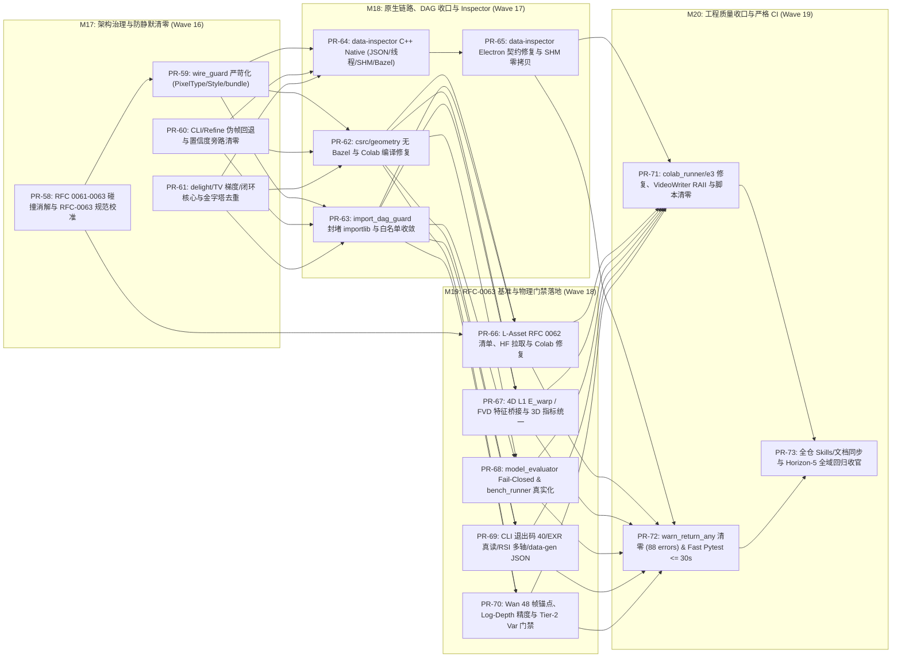

# 细分实施计划：Horizon-5 质量治理、架构收口与 RFC-0063 基准落地 (M17–M20: PR-58 ~ PR-73)

- **计划版本**: `Active Quality & Benchmark Landing Blueprint (v1.0)`
- **所属总计划**: [docs/IMPLEMENTATION_PLAN.md](../IMPLEMENTATION_PLAN.md)（Horizon 5 / Waves 16–19，**M17–M20** 共 4 大里程碑、**16 个原子 PR**，预估约 24.5 人天）
- **问题源头审计**: [docs/audits/AUDIT-RFC0063-AND-CODEBASE-2026-11.md](../audits/AUDIT-RFC0063-AND-CODEBASE-2026-11.md)（基线 `b98c6e5`，覆盖 `5×P0 + 8×P1 + 5×P2` 及 `PR-44~57` 遗留欠账）
- **关联规范**: [docs/RFC-0063-TESTING-CORRECTNESS-AND-BENCHMARKS.md](../RFC-0063-TESTING-CORRECTNESS-AND-BENCHMARKS.md)
- **修订日期**: `2026-11-14`
- **操作模型标识**: `[gemini4]`

---

## 1. 阶段总览、依赖拓扑与并行波次

Horizon 5 承接 Horizon 4 的未闭环欠账（尤其是完全未实施的 `PR-55`、`#47` 破坏的原生编译链路、`#48/#50` 的 Colab/L-Asset 数据集基建缺陷），并系统性兑现 [RFC-0063](../RFC-0063-TESTING-CORRECTNESS-AND-BENCHMARKS.md) 的 5 层测试金字塔与 4 轨道行业横向评测规范。

### 并行 Worktree 开发波次表

| 执行波次 | 并行 PR 组合（各自独立 `/tmp/synapse-wt-<pr>`） | 阻塞前置 | 波次里程碑产出 |
| :---: | :--- | :---: | :--- |
| **Wave 16** | `PR-58` ∥ `PR-59` ∥ `PR-60` ∥ `PR-61` | `main` | RFC 编号碰撞登记表、全覆盖线守卫、CLI/Refine 零伪输入、逆向核心正确性修复 |
| **Wave 17** | `PR-62` ∥ `PR-63` ∥ `PR-64` → `PR-65` | Wave 16 | Colab `_c_geometry` 恢复可用、零 `importlib` DAG 环路、`PR-55` (`data-inspector`) 完整闭环 |
| **Wave 18** | `PR-66` ∥ `PR-67` ∥ `PR-68` ∥ `PR-69` ∥ `PR-70` | Wave 16, `PR-62`, `PR-63` | 符合生态 `RFC 0062` 的资产分发与 Colab 开箱运行、`RFC-0063` 4 轨道评测真实执行 |
| **Wave 19** | `PR-71` ∥ `PR-72` → `PR-73` | Wave 17, Wave 18 | 零 `warn_return_any`、`pytest -m 'not slow' <= 30s`、全生态文档与技能全同步 |

---

## 2. 各原子 PR 详细施工清单 (`PR-58 ~ PR-73`)

### M17：架构治理、防静默清零与逆向算子修复（Wave 16）

---

#### `PR-58`：RFC-0061–0063 生态编号碰撞消解与 RFC-0063 规范校准
- **对应缺陷**：`AUD-P1-03`（治理层）、`AUD-P2-05`
- **关联 RFC 条款**：`RFC-0063 §1–§6`、`GOVERNANCE.md`
- **涉及文件**：
  - `docs/RFC-0061-LOCAL-REFINEMENT-AND-MULTI-MODEL-FUSION.md`
  - `docs/RFC-0062-INVERSE-RENDERING-AND-3D-NEURAL-CLOSED-LOOP.md`
  - `docs/RFC-0063-TESTING-CORRECTNESS-AND-BENCHMARKS.md`
  - `docs/AUDIT_AND_ARCHITECTURE.md`（追加本地 RFC 与 `all-overview/rfcs/` 对照注册表）
- **核心变更**：
  1. 在 `RFC-0061`、`RFC-0062`、`RFC-0063` 顶部显式标注仓内命名空间 alias（如 `SYN-RFC-0061 / 0062 / 0063`）与生态权威 `all-overview/rfcs/0061..0063` 的语义区分说明（或按生态治理决议重编号并保留向后跳转说明），消除 Agent/开发者检索混淆。
  2. 补齐 `RFC-0063` 缺失的 `GOVERNANCE.md` 必填节：`Status: Accepted (v1.1)`、作者/日期、`Alternatives Considered`、`4-Repo Readiness Matrix`（`aether` / `fulgur` / `caelum-core` / `synapse`）与 `Landing Matrix`。
  3. 修正 `RFC-0063` 技术事实漂移：
     - 第 123 行：`TRACK_B_VIDEO` 门禁回正为 `temporal_warp_error <= 0.020, fvd <= 300.0, foot_sliding_cm <= 0.5`，并显式区分 `TRACK_A_ASSET` (`0.015 / 150.0 / 0.3`)；
     - 第 138/141 行：补充 `depth_rmse_m`（`0.05` / `0.04`）与规范键名 `border_ring_ciede2000`；
     - 第 95 行 & `§3.2`：将错写的 `adapters/wan_adapter.py` 与 `QualityGateCircuitBreakerError` 纠正为 `adapters/wan.py` 与 `CircuitBreakerError` / `QualityGateError`（无位置参数 `40`）；
     - 第 6 节：将错位的 Horizon 4 路线图统一指向 Horizon 5（`PR-58 ~ PR-73`）。
- **验收门禁 (`ubuntu24`)**：
  - `/root/venv-synapse/bin/pytest tests/test_profiles_doc_sync.py -q`（必须零回归）；
  - 人工核对与相对路径检查脚本验证 `RFC-0063` 与 `synapse/metrics/profiles.py` 数值 100% 一致。

---

#### `PR-59`：`wire_guard.py` 严苛化与跨端 Schema 收口
- **对应缺陷**：`AUD-P1-03`
- **关联 RFC 条款**：`RFC-0063 §3.1`, `@aether//fgpp`, `@aether//style`
- **涉及文件**：
  - `tools/wire_guard.py`
  - `schemas/inspection.v1.0.schema.json` -> `schemas/inspection.v2.0.schema.json`（保留 v1 兼容别名或同步升级）
  - `schemas/bundle.v1.0.schema.json`（新增，对齐 `tools/data-inspector` 与 `export_inspection_bundle`）
  - `tests/test_wire_schemas.py`
- **核心变更**：
  1. 修复 `tools/wire_guard.py:118-120` `_EXPECTED_PIXEL_TYPES`：将 `WorldNormal.X/Y/Z` 严格锁定为 `{"HALF"}`（移除错误的 `"FLOAT"` 放行），锁定 `34 B/px`。
  2. 启用第 373 行死正则 `_RE_PIXEL_TYPE`（或结构化 C++ 头文件解析器），逐通道断言 `aether/fgpp/include/aether/fgpp/fgpp_types.h` 与 `synapse/fgpp/schema.py` 的名称、索引与 `PixelType` 一致性。
  3. 完善 `_check_style_profile`（185–220 行），实际解析 `@aether//style` 头文件枚举/常量，禁止仅校验 Python 自身常量自洽。
  4. 对齐 `inspection` Schema 版本号（`2.0.0`）并新增 `bundle.v1.0.schema.json`（约束 `manifest.sources` 为对象结构 `SourceEntry` 而非裸字符串），将其纳入 `wire_guard.py --check`。
- **验收门禁 (`ubuntu24`)**：
  - `/root/venv-synapse/bin/python tools/wire_guard.py --check`
  - `/root/venv-synapse/bin/pytest tests/test_wire_schemas.py -v`
  - **防静默断言**：单测中人为篡改临时拷贝的 `WorldNormal.X` 为 `FLOAT`，确认 `wire_guard` 报错退出（非 0）。

---

#### `PR-60`：CLI 与精修流水线伪输入回退及置信度旁路清零
- **对应缺陷**：`AUD-P0-01`, `AUD-P0-04`（部分）
- **关联 RFC 条款**：`RFC-0063 §3.2`（防静默失败零容忍）
- **涉及文件**：
  - `python/synapse/cli/_recon.py`
  - `python/synapse/cli/_refine.py`
  - `python/synapse/refine/pipeline.py`
  - `python/synapse/refine/fusion.py`
  - `tests/test_recon_invert_cli.py`, `tests/test_refine_cli_wire.py`
- **核心变更**：
  1. 移除 [cli/_recon.py:92-109](../../python/synapse/cli/_recon.py#L92-L109) 与 [cli/_refine.py:63-92](../../python/synapse/cli/_refine.py#L63-L92) 中缺失 `--video` 或路径不存在时的 `np.random.default_rng(42)` 伪帧合成，改为严格抛出 `ContractValidationError (10)`（缺失必需参数）或 `AssetNotFoundError (20)`（路径不存在），携带结构化 `agent_fix_hint`。
  2. 删除 `cli/_refine.py:89` 伪造的 `confidence=0.9` 默认 ROI（避免静默触发 `TiledBypassExecutor` `roi.confidence > 0.8` 旁路），改为从传入 `--roi-meta` / FGPP 提取或强制校验后以合理初始置信度（如 `<= 0.5`）进入真实精修分支。
  3. 修复 `refine/pipeline.py:317-362`：向 `evaluate_refinement_gates` 传入真实的 `original_patch` 与 `refined_patch` 计算 $\Delta E_{00}$ / LPIPS / PSNR，移除非严格模式静默复制原始输入帧作输出的后门（降级时显式标注 `bypassed=True` 并记录原因，严格门禁失败必须抛出 `QualityGateError`）。
  4. 清理 `refine/fusion.py:184` 无意义裸除法语句。
- **验收门禁 (`ubuntu24`)**：
  - `/root/venv-synapse/bin/pytest tests/test_recon_invert_cli.py tests/test_refine_cli_wire.py tests/test_refine_hand_face.py -v`
  - **防静默断言**：新增 CLI 测试不传 `--video` 执行 `synapse recon invert` / `synapse refine run`，断言退出码 `!= 0`（`10`/`20`）且 stdout JSON 含 `"agent_fix_hint"`；确认精修像素与输入不全等（非旁路复制）。

---

#### `PR-61`：逆向去光照、TV 梯度守恒与闭环核心硬化
- **对应缺陷**：`AUD-P1-01`, `AUD-P2-01`（部分）
- **关联 RFC 条款**：`RFC-0063 §5` Track 4、`RFC-0062`
- **涉及文件**：
  - `python/synapse/recon/delight.py`
  - `python/synapse/pipeline/stages/recon.py`
  - `python/synapse/recon/loop/mitsuba_optimizer.py`
  - `python/synapse/recon/loop/forward_guide.py`
  - `python/synapse/recon/loop/closed_loop_runner.py`
  - `tests/test_recon.py`, `tests/test_recon_multiview.py`, `tests/test_recon_loop_optimizer.py`
- **核心变更**：
  1. 修复 `recon/delight.py:198-200`：在转换为 `float32` 之前完成 `if rad.dtype == np.uint8:`（归一化 `/ 255.0`），并依据去光照前后重投影帧差使用 `metrics/image_quality.ciede2000` 计算真实 `delta_e_residual`，移除写死的 `1.85`。
  2. 修复 `pipeline/stages/recon.py:81`：从 `result.camera_trajectory` 还原真实的相机矩阵列表传入 `delight_multiview_albedo`，严禁传递 `cameras=[]`。
  3. 修复 `recon/loop/mitsuba_optimizer.py:244-255`：将单边差分 TV 梯度修正为完整散度守恒形式（在 `albedo[:-1]` 加正项并在 `albedo[1:]` 减对偶项，`[:, :-1]` 与 `[:, 1:]` 同理），确保 $\sum \nabla_{\text{TV}} = 0$。
  4. 明确 `MitsubaInverseOptimizer.optimize`（346–350 行）在真实可执行前严格抛出 `NotImplementedStageError (50)` 或完成最小可执行 `drjit`/Mitsuba 可微反照率优化步骤。
  5. 为 `forward_guide.py:112-117` 增加 `frames.shape[0]` 越界防御，并区分 `ClosedLoopRunner` 的生产模式（必须收到真实 FGPP 通道或明确标注 synthetic diagnostic mode）。
- **验收门禁 (`ubuntu24`)**：
  - `/root/venv-synapse/bin/pytest tests/test_recon.py tests/test_recon_multiview.py tests/test_recon_loop_optimizer.py -v`
  - **防静默断言**：单测验证 `uint8`（`[0..255]`）辐射度输入在 `delight_multiview_albedo` 后均值落在 `(0, 1)` 而非饱和为 `1.0`；验证 `tv_grad.sum()` 在浮点数精度内为 `0`。

---

### M18：原生编译链路、DAG 封堵与 `data-inspector` (`PR-55`) 闭环（Wave 17）

---

#### `PR-62`：`csrc/geometry` 无 Bazel / Colab 构建修复（修复 `#47` 遗留断裂）
- **对应缺陷**：`AUD-P0-02`
- **前置依赖**：Wave 16
- **涉及文件**：
  - `scripts/build_native.py`
  - `workenv/google-colab/setup_colab.sh`
  - `csrc/geometry/BUILD.bazel`, `csrc/geometry/src/bindings.cc`
  - `tests/test_geometry_tier0.py`, `tests/test_geometry_oracle_parity.py`
- **核心变更**：
  1. 修复 `#47`（`d0aa898`）删除 `csrc/geometry/src/mesh_checks.cc` 并改为 `#include <aether/geo/mesh_checks.h>` 后导致的 `scripts/build_native.py` 失效问题：
     - 移除 `build_native.py:142` 对已不存在的 `csrc/geometry/src/mesh_checks.cc` 的硬编码引用；
     - 在 `_find_aether_geo_include` 中自动扫描 `@aether` 同级目录（`../aether/geo/include`）与 `AETHER_ROOT` 环境变量，并同时注入 `aether/math/include` 与 `aether/geo/include`；
     - 针对无同级 `../aether` 且无 Bazel 的孤立环境（如 Google Colab 容器），提供清晰的二选一方案：（A）在 `setup_colab.sh` 通过浅克隆/Bazel 获取 `@aether` 头文件依赖，或（B）显式降级为 Fail-Fast 提示并标注纯 Python Oracle 模式，**严禁编译不存在的 `.cc` 导致安装中断**。
  2. 添加针对 `scripts/build_native.py --dry-run` / `--backend=direct` 的自动化冒烟测试，杜绝上游 `@aether` 重构后再次静默破坏直编路径。
- **验收门禁 (`ubuntu24`)**：
  - `cd csrc/geometry && bazel test //... --config=linux`
  - `/root/venv-synapse/bin/python scripts/build_native.py --check`
  - `/root/venv-synapse/bin/pytest tests/test_geometry_tier0.py tests/test_geometry_oracle_parity.py -v`

---

#### `PR-63`：`import_dag_guard.py` 封堵动态绕过与层级真值收口
- **对应缺陷**：`AUD-P1-02`
- **前置依赖**：Wave 16
- **涉及文件**：
  - `tools/import_dag_guard.py`
  - `python/synapse/bridge/vg_bridge.py`
  - `python/synapse/recon/loop/closed_loop_runner.py`
  - `python/synapse/render_core/`（收敛共享 Refine/Recon 轻量类型契约）
  - `tests/test_architecture_dag.py`
- **核心变更**：
  1. 扩展 `tools/import_dag_guard.py` AST 扫描规则：
     - 同步检测 `importlib.import_module("synapse....")` 与 `__import__("synapse....")` 字符串常量调用；
     - 移除 `len(parts) < 2`（第 97 行）豁免，纳入 `python/synapse/__init__.py` 顶层导出边界检查；
     - 审查并收紧 `201` 行白名单（将跨层共享 DTO 下沉至 `synapse.render_core` 或 `synapse.metrics`，禁止通过白名单隐藏反转依赖）。
  2. 消除 [vg_bridge.py:181-215](../../python/synapse/bridge/vg_bridge.py#L181-L215) 与 [closed_loop_runner.py:226-229,352-357](../../python/synapse/recon/loop/closed_loop_runner.py#L226-L229) 中的 `importlib.import_module` 绕过：将 `StitchConfig` / `AnatomicalRegion` / 轻量裁剪拼接协议或 `BackendResult` 下沉至公共基础层，令全仓静态 + 动态导入均满足严格单向 DAG。
- **验收门禁 (`ubuntu24`)**：
  - `/root/venv-synapse/bin/python tools/import_dag_guard.py --check`
  - `/root/venv-synapse/bin/pytest tests/test_architecture_dag.py -v`
  - **防静默断言**：单测构造含 `importlib.import_module("synapse.cli")` 的低层模块源码，确认 `import_dag_guard` 检出并失败。

---

#### `PR-64`：`tools/data-inspector` C++ Native Server 完整落地（补齐 `PR-55` Native 部分）
- **对应缺陷**：`AUD-P0-05`
- **前置依赖**：Wave 16
- **涉及文件**：
  - `tools/data-inspector/native/.bazelrc`, `tools/data-inspector/native/MODULE.bazel`, `tools/data-inspector/native/BUILD.bazel`
  - `tools/data-inspector/native/inspector_app.cc`
  - `tools/data-inspector/native/test_inspector.cc`（新增 C++ 单元测试）
- **核心变更**：
  1. **修复 Bazel 构建**：在 `tools/data-inspector/native/.bazelrc` 配置私有 BCR 镜像源（与 `csrc/geometry/.bazelrc` 对齐 `bcr.dervgen.com` + `--registry`），并去除 `native/BUILD.bazel` 中与 `.bazelrc` 重复的 `COMMON_COPTS`（`-fno-exceptions -fno-rtti`）。
  2. **修复 `std::cin.rdbuf(nullptr)` C++20 未定义行为**：使用非阻塞 POSIX `poll()` + 自唤醒 `pipe` / 状态原子标记替代主线程强置 `rdbuf(nullptr)`，保障 `stdin` 读线程安全退出并洁净 `join()`。
  3. **替换手写字符串 JSON 解析**：通过 Bazel 引入标准 JSON 库（如 `nlohmann_json` 或 `aether::json`）替换 46–93 行的 `line.find()` 解析。
  4. **替换假渲染管线**：实现真实资产加载与多通道 AOV 渲染（解析 `InspectionBundle` 指定 `.obj` 几何轮廓线框或直接解码 `.exr` 中的 `DirectRadiance` / `CameraLinearDepth.Z` / `WorldNormal` / `Cryptomatte.ID` 色图），写入 POSIX Shared Memory RGBA 缓冲，彻底删除 `fnv1aHash` 伪噪点生成代码。
- **验收门禁 (`ubuntu24`)**：
  - `cd tools/data-inspector/native && bazel test //... --config=linux`
  - 无头 SEP 脚本向标准输入喂入 `open_bundle` + `switch_view` + `shutdown` JSON-RPC，断言进程在 `< 1s` 优雅退出码 `0` 且 SHM 写入非恒定真实帧。

---

#### `PR-65`：`tools/data-inspector` Electron 壳契约修复与 SHM 零拷贝消费（补齐 `PR-55` Electron 部分）
- **对应缺陷**：`AUD-P1-04`
- **前置依赖**：`PR-64`
- **涉及文件**：
  - `tools/data-inspector/electron/bundle-manager.js`
  - `tools/data-inspector/electron/main.js`
  - `tools/data-inspector/renderer/src/app.js`
  - `tools/data-inspector/tests/test-bundle-loading.js`
- **核心变更**：
  1. 修复 `electron/bundle-manager.js:61,83`：按 `schemas/bundle.v1.0.schema.json` 解析 Python `export_inspection_bundle` 输出的对象列表 `manifest.sources`（读取 `source.path`、`source.label`、`source.modality`），修复 `path.join(bundleDir, sourceObj)` 运行时 `TypeError`。
  2. 打通真 SHM / 低拷贝视口传输：由 `electron/main.js` 通过只读 mmap / `shm_open` 辅助或原生 N-API 读取 C++ SHM RGBA 帧并渲染到 `<canvas>`，停止经由 Electron JSON IPC 传递整帧像素大数组。
  3. 联动 `renderer/src/app.js:186-193` `currentView` 状态与 SEP `switch_view` RPC 调用，支持 RGB / Depth / Normal / Cryptomatte AOV 实时切换。
- **验收门禁 (`ubuntu24`)**：
  - `node tools/data-inspector/tests/test-bundle-loading.js`（覆盖 Python `export_inspection_bundle` 真实导出的 Bundle 目录加载验证）。

---

### M19：`RFC-0063` 四轨道评测基准与物理门禁落地（Wave 18）

---

#### `PR-66`：生态 `RFC 0062` 资产清单收敛、HF/HTTP 拉取与 Colab 安装链路修复（修复 `#48/#50`）
- **对应缺陷**：`AUD-P0-03`, `AUD-P2-04`（部分）
- **关联 RFC 条款**：生态 `RFC 0062` (L-Asset)、`RFC-0063 §5`
- **涉及文件**：
  - `assets/assets_manifest.json`（按 `RFC 0062` 规范重构/迁移 `data/manifests/benchmark_assets_manifest.json`）
  - `scripts/prepare_benchmark_assets.py`
  - `workenv/google-colab/benchmarks.json`
  - `workenv/google-colab/setup_colab.sh`
  - `tests/test_benchmark_assets.py`（新增）
- **核心变更**：
  1. **解除 Colab 必崩缺陷**：修复 `prepare_benchmark_assets.py:97,120,158,182,218,240` 中对外部 `--target-dir`（如 `/content/datasets/...`）调用 `dst.relative_to(REPO_ROOT)` 引发的 `ValueError`（改为相对于 `--target-dir` 记录 `relative_path`）；移除硬编码 Windows `F:/dervgen/open_data`，支持 `--source-root` / `DERGVEN_OPEN_DATA` 环境探测。
  2. **禁止篡改受控仓库清单**：生成的目标目录清单只写入 `<target-dir>/staged_manifest.json`；当本地离线且缺少可下载源时，显式报错退出（除非显式传递 `--allow-synthetic-smoke`），**绝对禁止用 1 个立方体覆盖仓库 Git 受控清单**。
  3. **真实数据源与 `--tier` / `--force` 接线**：
     - 统一 `benchmarks.json` 与脚本的层级名（`starter_dev` / `standard_eval` / `full_industrial`）及数据集 ID；
     - 接入基于 `urllib` / `huggingface_hub` 的 SHA-256 校验与断点续传下载器，支持 **10 个 GSO 扫描黄金资产**、**16 维完整 VBench 套件**与 **Poly Haven PBR** 真实拉取，以及对 `ryushinn/Human3.6M`（`#50`）增加学术许可确认/HF Token 友好提示；
     - 补全 `--tier` 过滤与 `--force` 重拉逻辑。
  4. **完善 `setup_colab.sh`**：在第 44 行补充 `".[mesh,image,metrics]"` 与 `huggingface_hub` 安装，确保 `trimesh` 与测试资产开箱即用。
- **验收门禁 (`ubuntu24`)**：
  - `/root/venv-synapse/bin/pytest tests/test_benchmark_assets.py -v`（测试临时外部目录 `--target-dir /tmp/...` 零 `ValueError`、`--tier starter_dev` 精确过滤、`git diff data/` 零意外修改）。

---

#### `PR-67`：4D 时序 L1 $E_{\text{warp}}$、FVD 特征桥接与 3D 几何指标协议统一
- **对应缺陷**：`AUD-P1-06`（部分）, `AUD-P2-04`
- **关联 RFC 条款**：`RFC-0063 §4.4, §5` Track 1–2
- **涉及文件**：
  - `python/synapse/metrics/temporal.py`
  - `python/synapse/metrics/roundtrip.py`
  - `tests/test_metrics_parity.py`, `tests/test_temporal.py`（或新增 `tests/test_rfc0063_metrics.py`）
- **核心变更**：
  1. **对齐 $E_{\text{warp}}$ L1 定义**：在 `metrics/temporal.py` 新增清晰的 L1 遮挡加权光流弯曲误差实现（及对原生 `@aether//metrics` 与 `RFC-0063` L1 定义之间 RMSE/L1 口径差异的显式 `metric="l1" | "rmse"` 参数与默认校准），并消除空壳 `_warn_fallback`。
  2. **接入 FVD 视频特征提取桥**：为 `fvd_feature_distance` 新增轻量可插拔特征提取入口 `compute_fvd_from_videos(real_videos, gen_videos, feature_extractor=...)`（支持延迟加载 `torchvision`/I3D 或明确抛出带指引的 `BackendUnavailableError (30)`，避免仅停留在矩阵 API）。
  3. **补全 3D 几何评测指标**：在 `metrics/roundtrip.py` 补全 `f_score_5mm` 与 `watertight_pct`，并在 `chamfer_mm` 增加 `reduction: Literal["mean", "sum"] = "mean"` 与行业对比换算说明（消除与 PointNet/TRELLIS `sum` 惯例的 $2\times$ 误比）。
- **验收门禁 (`ubuntu24`)**：
  - `/root/venv-synapse/bin/pytest tests/test_rfc0063_metrics.py tests/test_temporal.py tests/test_roundtrip_metrics.py -v`

---

#### `PR-68`：`model_evaluator.py` Fail-Closed、`bench_runner.py` 真实资产与闭环评测
- **对应缺陷**：`AUD-P0-04`（部分）, `AUD-P1-06`（部分）, `AUD-P2-03`
- **关联 RFC 条款**：`RFC-0063 §4.3, §5` Track 1/3
- **涉及文件**：
  - `python/synapse/inspect/model_evaluator.py`
  - `python/synapse/pipeline/bench_runner.py`
  - `scripts/run_roundtrip_verification.py`
  - `tests/test_bench_runner.py`, `tests/test_bench_full_suite.py`, `tests/test_model_evaluator.py`
- **核心变更**：
  1. **消除双份门禁真值源与 Fail-Open**：将 `model_evaluator.GATE_PROFILES`（36–62 行）重构为从 `synapse.metrics.profiles`（`TRACK_A_ASSET`、`TRACK_B_VIDEO`、`RSI_PROMOTION`、`RSI_PROMOTION_TARGET`）动态派生，移除静态硬编码复制；`evaluate_profile_gates` 禁止跳过缺失指标（仅在显式未提供 `reference_dir` 时返回 `reference_required_not_evaluated` 状态并禁标 `overall_passed=True` 给完整门禁），且停止无声吞掉渲染/参考模型加载异常。
  2. **递归目录扫描**：将 `model_evaluator.py:403` `input_dir.iterdir()` 替换为 `rglob("*")`（兼容 GSO/Objaverse 嵌套目录结构 `meshes/*.obj`）。
  3. **修复 `bench_runner.py` 6 场景与通道错配**：通过 `AssetRegistry.resolve(scenario.asset.id)` 加载 `humanoid_53` 等内置资产；停止把亮度/RGB 帧当深度与世界法线比较，改为使用适配器/光栅化真实或显式提取的 Depth/Normal，缺失时在报告中标为 `N/A (not_produced)` 而非输出虚假数值。
  4. **清理 `run_roundtrip_verification.py:278` `0.5` 灰图占位**：接入 `SoftwareRasterizer` 真实重渲染视图后再计算外观与往返指标。
- **验收门禁 (`ubuntu24`)**：
  - `/root/venv-synapse/bin/pytest tests/test_model_evaluator.py tests/test_bench_runner.py tests/test_bench_full_suite.py -v`
  - **防静默断言**：验证 `bench_runner.run_all()` 对所有 `humanoid_53` 场景 `error is None`（0 例因资产名解析失败）。

---

#### `PR-69`：CLI 确定性退出码、`fgpp validate` 真读 EXR 与多轴晋升收口
- **对应缺陷**：`AUD-P1-05`
- **关联 RFC 条款**：`SYNAPSE AGENTS.md §3.4`, `RFC-0063 §3.1`
- **涉及文件**：
  - `python/synapse/cli/_bench.py`
  - `python/synapse/cli/_rsi.py`
  - `python/synapse/cli/_fgpp.py`
  - `python/synapse/cli/_generate.py`
  - `tests/test_cli.py`, `tests/test_fgpp.py`
- **核心变更**：
  1. `_cmd_bench_run`：当启用门禁 Profile（`--profile`）且任一场景 `gate_verdict.passed is False` 时，严格抛出 `QualityGateError`（返回退出码 **`40`**）而非悄然以 `0` 成功退出。
  2. `_cmd_rsi_gate_promote`：新增独立参数 `--baseline-geom`、`--candidate-geom`、`--baseline-temporal`、`--candidate-temporal`（当未提供细粒度轴分时显式校验并拒绝把单一 `overall` 伪造广播为三轴）。
  3. `_cmd_fgpp_validate`：在校验 `metadata.json` 之外，真实调用 `import_fgpp` / OpenEXR 读取器逐帧核验 `.exr` 文件是否包含完整 15 通道、对应 `PixelType`（含 `Cryptomatte.ID == UINT32`）及非 NaN/Inf 有限值。
  4. `main_data_gen`（`cli/_generate.py:20-100`）：补齐 `--json` 与 `_run_with_json_mode` 统一信封支持，消除独立 CLI 入口纯文本泄漏。
- **验收门禁 (`ubuntu24`)**：
  - `/root/venv-synapse/bin/pytest tests/test_cli.py tests/test_fgpp.py -v`

---

#### `PR-70`：`WanAdapter` 48 帧物理锚点、Float64 对数深度与 Tier-2 `Var(X) > 1e-4` 门禁
- **对应缺陷**：`AUD-P1-08`
- **关联 RFC 条款**：`RFC-0063 §3.1, §4.1`
- **涉及文件**：
  - `python/synapse/adapters/wan.py`
  - `python/synapse/adapters/scheduler.py`
  - `python/synapse/telemetry.py`（或 `python/synapse/metrics/gates.py`）
  - `tests/test_wan_adapter.py`, `tests/test_fgpp.py`
- **核心变更**：
  1. **接入 48 帧物理锚点**：将 `DEFAULT_PHYSICAL_ANCHOR_INTERVAL_FRAMES (48)` 接入 `ConditionScheduler` 与 `WanAdapter.prepare_conditions()`，在输出 `PreparedConditionPayload.extra` 中生成并校验 `physical_anchor_indices` 与局部重锚定窗口标注。
  2. **消除 `float32` 提前截断**：在 `WanAdapter.prepare_conditions` 调用 `linear_to_log_normalized_depth` 时保留 `float64` 中间态与可选高精通道校验钩子（仅在最终组装视频模型张量切片时转为 `float32`/target dtype），确保物理深度编解码往返误差在科学计算端 `< 1e-12`。
  3. **落地 Tier-2 输出非退化检查**：新增 `validate_output_non_degenerate(frames, min_variance=1e-4)`（检验有限性、全零退化与方差 `Var(X) > 1e-4`，不达标抛出 `QualityGateError (40)`），并在 Adapter 生成链路末端可选/默认开启。
- **验收门禁 (`ubuntu24`)**：
  - `/root/venv-synapse/bin/pytest tests/test_wan_adapter.py tests/test_scheduler.py tests/test_fgpp.py -v`
  - **防静默断言**：纯常数灰帧测试触发 `validate_output_non_degenerate` 严格报错（`exit_code=40`）。

---

### M20：工程质量收口、Mypy/Pytest 严格门禁与全域同步（Wave 19）

---

#### `PR-71`：脚本可靠化、`VideoWriter` RAII 与形态学/金字塔去重收口
- **对应缺陷**：`AUD-P1-05`（脚本部分）, `AUD-P2-01`, `AUD-P2-02`, `AUD-P2-03`（路径部分）
- **前置依赖**：Wave 17, Wave 18
- **涉及文件**：
  - `scripts/colab_runner.py`
  - `scripts/prepare_datasets.py`
  - `python/synapse/generators/dataset.py`
  - `python/synapse/composite/blend.py`, `python/synapse/refine/fusion.py`
- **核心变更**：
  1. 修复 `scripts/colab_runner.py:205`：启动时自动将 `REPO_ROOT` 注入 `sys.path` 避免直接执行报错 `No module named 'scripts'`；在 `EXPERIMENTS` 补齐 `e3`（切镜重锚定实验）并支持明确区分 mock smoke 与真实 GPU 推理模式。
  2. 清理 `scripts/prepare_datasets.py:321,327,333,345` 对个人绝对路径 `/root/work/...` 的默认硬编码，改为相对仓库路径 + 环境变量探测。
  3. 在 `generators/dataset.py:190-296` 使用 `contextlib.ExitStack` / `try ... finally` 包裹 3 路 `cv2.VideoWriter` 的 `.release()`，确保渲染异常时 MP4 容器不泄漏/损坏。
  4. 抽取共用形态学膨胀/腐蚀与高斯-拉普拉斯金字塔核函数，令 `composite/blend.py` 与 `refine/fusion.py` 单点复用，消除残余 ~150 行重复逻辑。
- **验收门禁 (`ubuntu24`)**：
  - `/root/venv-synapse/bin/pytest tests/test_dataset_and_viewer.py tests/test_composite_and_pipeline.py -W error::DeprecationWarning -v`
  - `/root/venv-synapse/bin/python scripts/colab_runner.py --help`（零 `ModuleNotFoundError`）。

---

#### `PR-72`：Mypy `--warn-return-any` 88 处清零与 Fast Pytest `<= 30s` 加速收口
- **对应缺陷**：`AUD-P1-07`
- **前置依赖**：Wave 17, Wave 18
- **涉及文件**：
  - `pyproject.toml`（开启 `warn_return_any = true` 与 `explicit_package_bases = true`）
  - 37 个受影响 `python/synapse/**/*.py` 文件（逐步消除 88 处 `Returning Any` 类型泄漏）
  - `tests/test_inspect_align.py` 等高耗时测试文件（为重型光栅化/全循环用例补充 `@pytest.mark.slow` 或降低 smoke 分辨率）
- **核心变更**：
  1. 清零 `mypy --warn-return-any python/synapse` 报告的全部 88 处类型错误，并在 `pyproject.toml:83` 永久打开 `warn_return_any = true`。
  2. 在 `pyproject.toml` 配置 `explicit_package_bases = true`（或规范 `scripts/` 包初始化），消除 `mypy tests/ scripts/ tools/` 在 `scripts/run_cpu_verification.py` 处的双模块名冲突。
  3. 对照 `pytest --durations=30` 剖面精准优化 `tests/test_inspect_align.py`（占 ~70s）等重型测试，将其拆分为轻量合约校验（fast）+ `@pytest.mark.slow`（slow），使 `pytest tests/ -m 'not slow'` 在 `ubuntu24` 从 `143.6s–151.6s` 压降至 **`<= 30s`**。
- **验收门禁 (`ubuntu24`)**：
  - `/root/venv-synapse/bin/mypy python/synapse tests/ scripts/ tools/`（0 error）
  - `time /root/venv-synapse/bin/pytest tests/ -m 'not slow' -q`（全部通过且总耗时 `<= 30s`）。

---

#### `PR-73`：全生态 Skills / 文档同步与 Horizon-5 全域收官验证
- **对应缺陷**：`AUD-P2-05`
- **前置依赖**：`PR-71`, `PR-72`
- **涉及文件**：
  - `.agents/skills/synapse-overview/SKILL.md`
  - `.agents/skills/synapse-fgpp-and-datasets/SKILL.md`
  - `.agents/skills/synapse-adapters-and-experiments/SKILL.md`
  - `docs/IMPLEMENTATION_PLAN.md`, `docs/plans/PLAN-M17-M20-QUALITY-GOVERNANCE-AND-BENCHMARK-LANDING.md`
  - `docs/RFC-0063-TESTING-CORRECTNESS-AND-BENCHMARKS.md`（状态更新为 `Implemented`）
- **核心变更**：
  1. 修正 `.agents/skills/synapse-overview/SKILL.md:68` 中虚构异常名 `QualityGateCircuitBreakerError` 为 `CircuitBreakerError` / `QualityGateError`，并同步 `csrc/geometry` 已委托 `@aether//geo`、新增 L-Asset `assets/assets_manifest.json`、快测试 `<= 30s` 与 `warn_return_any = true` 等最新基线。
  2. 执行 Horizon-5 收官全绿验收后，更新总计划与子计划中 `PR-58 ~ PR-73` 及相关 H4 修正项为最终真实 `✅ 已合入`。
- **最终域内全量回归门禁 (`ubuntu24`)**：
  1. `/root/venv-synapse/bin/pytest tests/ -m 'not slow' -q`（`<= 30s` 且 0 fail）
  2. `/root/venv-synapse/bin/pytest tests/ -q`（全量含 `slow` 全部通过）
  3. `/root/venv-synapse/bin/ruff check python/ tests/ scripts/ tools/`
  4. `/root/venv-synapse/bin/mypy python/synapse tests/ scripts/ tools/`
  5. `/root/venv-synapse/bin/python tools/wire_guard.py --check`
  6. `/root/venv-synapse/bin/python tools/import_dag_guard.py --check`
  7. `cd csrc/geometry && bazel test //... --config=linux`
  8. `cd tools/data-inspector/native && bazel test //... --config=linux`
  9. `node tools/data-inspector/tests/test-bundle-loading.js`

---

## 3. 完整闭环追溯矩阵

### 3.1 审计缺陷 → Horizon-5 PR 追溯表

| 缺陷 ID | 严重度 | 归属里程碑 | 负责 PR | 核心关闭判据 |
| :--- | :---: | :---: | :---: | :--- |
| `AUD-P0-01` | P0 | M17 | `PR-60` | CLI 缺输入严禁 `np.random`，`_refine` 默认不再伪造 `confidence=0.9` |
| `AUD-P0-02` | P0 | M18 | `PR-62` | `scripts/build_native.py` 清除已删除 `mesh_checks.cc`，Colab/Bazel 均不报错 |
| `AUD-P0-03` | P0 | M19 | `PR-66` | Colab `setup_colab.sh` 成功落地；`prepare_benchmark_assets.py` 不破环仓库受控清单且接通下载器 |
| `AUD-P0-04` | P0 | M17 / M19 | `PR-60`, `PR-68` | `evaluate_refinement_gates` / `evaluate_profile_gates` 真算真拒，`bench_runner` 0 场景资产加载失败 |
| `AUD-P0-05` | P0 | M18 | `PR-64` | `inspector_app.cc` 移除 `rdbuf(nullptr)` UB 与 FNV 伪帧，Bazel 测试绿灯 |
| `AUD-P1-01` | P1 | M17 | `PR-61` | `delight` 修复 `uint8`、真实 $\Delta E_{00}$、实传 `cameras`、对称 TV 散度 |
| `AUD-P1-02` | P1 | M18 | `PR-63` | `import_dag_guard.py` 拦截 `importlib`，`vg_bridge` / `closed_loop_runner` 无隐藏环路 |
| `AUD-P1-03` | P1 | M17 | `PR-58`, `PR-59` | 消解三重 RFC 碰撞；`wire_guard` 锁死 `WorldNormal=HALF`、`@aether//style` 与 `bundle` Schema |
| `AUD-P1-04` | P1 | M18 | `PR-65` | `bundle-manager.js` 正常读取 `SourceEntry`，SHM 低拷贝与 `currentView` AOV 切换生效 |
| `AUD-P1-05` | P1 | M19 / M20 | `PR-69`, `PR-71` | CLI 门禁失败 exit 40、`fgpp validate` 读 `.exr`、`colab_runner` 无 `ModuleNotFoundError` |
| `AUD-P1-06` | P1 | M19 | `PR-67`, `PR-68` | `RFC-0063` 阈值对齐 `profiles.py`，L1 $E_{\text{warp}}$、FVD、`f_score_5mm`、`rglob` 全落地 |
| `AUD-P1-07` | P1 | M20 | `PR-72` | `mypy --warn-return-any` 0 error；`pytest -m 'not slow' <= 30s` |
| `AUD-P1-08` | P1 | M19 | `PR-70` | 48 帧锚点与 `float64` Log-Depth 入链；`Var(X) > 1e-4` 运行时退化拦截生效 |
| `AUD-P2-01` | P2 | M17 / M20 | `PR-61`, `PR-71` | 消除 `composite/blend.py` 与 `refine/fusion.py` 金字塔及形态学重复代码 |
| `AUD-P2-02` | P2 | M20 | `PR-71` | `generators/dataset.py` 3 路 `VideoWriter` 具备异常安全 `.release()` |
| `AUD-P2-03` | P2 | M19 / M20 | `PR-68`, `PR-71` | 清除 `0.5` 灰图评估与 `/root/work/...` 默认私路泄露 |
| `AUD-P2-04` | P2 | M19 | `PR-66`, `PR-67` | VBench 扩展至 16 维完整套件 + I3D/ResNet FVD 特征提取接口 |
| `AUD-P2-05` | P2 | M17 / M20 | `PR-58`, `PR-73` | `IMPLEMENTATION_PLAN` 状态去虚高；`.agents/skills/` 全面对齐真实源码 |

### 3.2 `RFC-0063` 条款 → 落地 PR 映射表

| `RFC-0063` 章节 | 条款核心要求 | 承接 PR | 验证方式 |
| :--- | :--- | :---: | :--- |
| 治理与文档契约 | 消除 `0061–0063` 三重碰撞、补齐 `GOVERNANCE.md` 必填表、校准阈值与路径名 | `PR-58` | `test_profiles_doc_sync.py` + 人工核对 |
| `§3.1` 5 层金字塔 | Tier-1 `<= 30s`（目标 `< 20s`）；Tier-2 `Var(X) > 1e-4`；Tier-3 GSO/VBench；Tier-5 Inspector | `PR-64`, `PR-65`, `PR-66`, `PR-70`, `PR-72` | `pytest -m 'not slow'` + `bazel test` + `node test` |
| `§3.2` 防静默失败 | 清零 CLI 伪数据/旁路、Fail-Open Evaluator、错误 `exit 0`、异常类统一 `40` | `PR-60`, `PR-68`, `PR-69` | CLI 非法输入与 Gate 失败单测 |
| `§4.1` 物理条件闭环 | 每 48 帧物理锚点接入调度、Log-Depth `< 1e-12`、严苛 15 通道 EXR 守卫 | `PR-59`, `PR-69`, `PR-70` | `wire_guard --check` + `test_fgpp.py` |
| `§4.2–§4.4` 几何与逆向 | Colab/C++ `@aether//geo` 编译、`delight`、对称 TV 散度与多视角往返 | `PR-61`, `PR-62`, `PR-68` | `test_geometry_oracle_parity.py` + `test_recon*` |
| `§5` 四轨道基准 | GSO-10 / VBench-16 / Human3.6M / 完整 4 轨指标（L1 $E_{\text{warp}}$、FVD、F-score 5mm、$\Delta E_{00}$） | `PR-66`, `PR-67`, `PR-68` | `test_benchmark_assets.py` + `test_rfc0063_metrics.py` |
