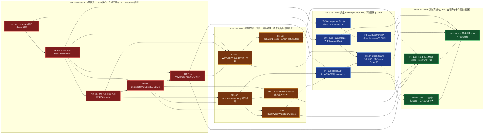

# M25–M28 Post-Horizon-6 真实闭环与全仓治理可执行计划 (Actionable Horizon-7 Blueprint)

> - **计划版本**: `v1.1`（对应主总纲 [`IMPLEMENTATION_PLAN.md`](../IMPLEMENTATION_PLAN.md) **`v3.5`**）
> - **触发审计基线**: [`AUDIT-POST-HORIZON6-2026-11.md`](../audits/AUDIT-POST-HORIZON6-2026-11.md)（已整合主线 `52c3431` PR `#92` 与 `179a8d1` 增量）
> - **规划模型**: `[opus4.6]`
> - **当前状态**: 🚀 **正在按 Wave 推进落地 (Executing Wave 24)**
> - **目标周期**: 4 个里程碑（`M25` – `M28`）、4 个并发 Execution Waves（`Wave 24` – `Wave 27`）、**18 个原子 PR**（`PR-94` – `PR-110`）

> [!IMPORTANT]
> **执行铁律（与 `AGENTS.md` / [`IMPLEMENTATION_PLAN.md`](../IMPLEMENTATION_PLAN.md) 对齐）**：
> 1. 所有改动必须走 Git Worktree（`/tmp/synapse-wt-prXX`）→ 分支 → PR → Squash Merge → 清理 Worktree，严禁直接 push `main`。
> 2. Commit 与 PR 标题必须携带模型标识 `[<model-tag>]`，PR 正文首行必须声明 ``> **Operated by**: `<model-tag>` ``。
> 3. 每个原子 PR 合入前必须同时通过 **防静默失败三问**（存在问 / 接线问 / 执行问），并在云端主力机 `ubuntu24` 实跑对应门禁命令（严禁仅凭本地单测或口头声称过关）。
> 4. 所有尚未创建的新文件路径（如 `.github/workflows/ci.yml`、`docs/SYN-RFC-0060-*.md`）及跨仓路径（如 `../aether/...`）在文档中一律使用反引号标注，禁止生成断链 Markdown 跳转。

---

## 1. 全景概览与 Wave 调度拓扑 (Overview & DAG)

Horizon 6（`PR-74 ~ PR-91`）在代码量上完成了大重构后的第一轮修补（合入于 `#71 ~ #89`），但 [`AUDIT-POST-HORIZON6-2026-11.md`](../audits/AUDIT-POST-HORIZON6-2026-11.md) 在 `ubuntu24` 全量实测与逐文件审计后发现：**`PR-91`（GitHub Actions CI 迁移、docs 封板与全域严格校验）实际上从未合入**，且全仓仍遗留 **12 项 P0 阻断、16 项 P1 严重、10 项 P2 中等、4 项 P3 规范债务**（含 `tests/conftest.py` 假绿钩子、`.ci/workflows/ci.yml` 死位置与 3 Job 全断、2 套并行未收口架构、4 项 `slow` 失败、327 条被屏蔽的 Ruff 告警、`ViewerServer` 常驻 HTTP 服务违背 Zero-Python 铁律、`data-inspector` Seqlock 竞态与 macOS SHM 失效、以及 `synapse-overview` 等文档/RFC 漂移）。

Horizon 7（`M25–M28`, `PR-94 ~ PR-110`）的目标是将 `synapse` 从 **60/100（看似收口、实则多处 Fail-Open）** 推进到 **10 项门禁全部在 `ubuntu24` 与 GitHub Actions 上实跑全绿的 100% 真闭环状态**。



### Wave 调度与并发矩阵

| Wave | 里程碑 | 并发 PR 组 | 核心战果 | 入口前置条件 |
|---|---|---|---|---|
| **Wave 24** | **M25** | `PR-93` → `PR-94` → `PR-95` → `PR-96` → `PR-97` | 真 CI 上线、pytest/Ruff 防作弊、`fgpp` Fail-Closed、DAG 全范围零环、齐次裁剪、ACEScg/Composite 修复、去 `ViewerServer` Daemon、CLI/Bundle 闭环 | 无（本蓝图合入后即可开工） |
| **Wave 25** | **M26** | `PR-98` → `PR-99` ∥ (`PR-100` → `PR-101` → `PR-102`) | `Wan`/`LoRA`/单一 `Foundary` HTTP 客户端、`Packager`/`Trainer`/`FeatureStore` 门禁、Marching Cubes/Delight/Loop、`Stitcher`/`Fusion`、R3D18/Watertight/Metrics | `PR-94 ~ PR-97` 合入 |
| **Wave 26** | **M27** | (`PR-103` ∥ `PR-106`) ∥ (`PR-104` → `PR-105`) ∥ `PR-107` | `build_native` 与 Bazel 去 Double-Expansion + GTest、Inspector C++/Electron Seqlock & macOS SHM、Bench/3D Eval/RSI 真值、Colab & Assets 闭环 | `PR-93, PR-98, PR-100, PR-102` 合入 |
| **Wave 27** | **M28** | (`PR-108` ∥ `PR-109`) → `PR-110` | 消除 `clean_recon` 伪测试与慢测超时、RFC 重命名去冲突 & Skills 对齐、10 项 DoD 门禁在 `ubuntu24` 与 GitHub Actions 全绿封板 | `PR-99, PR-101, PR-103, PR-105, PR-106, PR-107` 合入 |

---

## 2. M25: 门禁恢复、Tier-0 契约、光栅数学与 CLI/Composite 闭环 (Wave 24)

<a id="pr-93"></a>
#### PR-93: GitHub Actions 真激活、`conftest.py` 严格钩子重写、Ruff 全量解禁与环境清理 (`M25 / Wave 24`)

- **对应审计项**: `H7-P0-01` · `H7-P1-01` · `H7-P2-01` · `H7-P3-01`
- **依赖**: 无（Horizon 7 首発门禁修复）
- **预估体量**: ~220 LOC（YAML / Test Config / Gitignore / Conftest）
- **详细改动清单**:
  1. **迁出死路径 CI 并修复 3 个失效 Job**：
     - 使用 `git mv .ci/workflows/ci.yml .github/workflows/ci.yml`（清理 `.ci/workflows/` 空目录），确保 GitHub Actions 能自动触发 PR 与 `main` Push 流水线。
     - 修复 `python-fast` Job：显式安装 `[image,metrics,inspect,dev]` 可选依赖或先执行 `python scripts/build_native.py --backend=auto` 构建 `_c_geometry`（或将 `SYNAPSE_CI_STRICT_DEPS=1` 作用域精确绑定到真实安装对应 extras 的矩阵步骤）。
     - 修复 `native-bazel` Job：通过 `actions/checkout` 拉取同级 `aether`（或配置内部 BCR mirror）到 `../aether` 使 `local_path_override` 解析成功，并按 OS 传递 `--config=linux` / `--config=macos` / `--config=windows`。
     - 修复 `electron-inspector` Job：生成并提交 `tools/data-inspector/package-lock.json` 后保留 `npm ci`（或显式使用 `npm install --ignore-scripts --no-package-lock`），确保 Node 原生测试可零失败运行。
  2. **重写 `tests/conftest.py:37-55` 假严格钩子并替换死缓存 Fixture**：
     - 删除无用的 `pytest_collection_modifyitems._enforce_strict_deps` 装饰器函数；
     - 改写为 `@pytest.hookimpl(hookwrapper=True)` 实现 `pytest_runtest_makereport(item, call)`：当 `SYNAPSE_CI_STRICT_DEPS=1` 且 `rep.skipped` 时，在 `rep.when in ("setup", "call")` 双阶段（覆盖 `@pytest.mark.skipif`、内部 `pytest.skip(...)` 与 `pytest.importorskip(...)`）将 `rep.outcome = "failed"`、`rep.longrepr` 写入明确原因 `"SYNAPSE_CI_STRICT_DEPS=1 forbids skipped tests"`。
     - 删除引用已弃用 `generators.rasterizer` 的 `cached_rasterizer_render` / `cached_rasterizer_scene`（`lines 62-106`），重构为基于 `synapse.render_core.rasterizer.SoftwareRasterizer` 的 `session` 级渲染缓存 Fixture（实测渲染单次仅 ~500ms），为 `PR-108` 消除 `test_bench_*` 超时奠基。
  3. **解禁 `pyproject.toml` 被压制的 Ruff 规则与清理根目录脏目录**：
     - 从 `pyproject.toml:98-103` 的 `ignore` 中移除 `B017`, `B023`, `B008`, `SIM115`, `B904`, `RUF012`, `RUF100`；同步修正本 PR 范围（`tests/conftest.py`、`pyproject.toml`、`scripts/` 中的 `SIM115`/`RUF100` 等，其余按各领域 PR 清零或在 `PR-108` 终结，使 CI `ruff check` 无新增豁免）。
     - 移除 `pyproject.toml:78` `addopts` 中写死的 `--basetemp=./.pytest_tmp`，防止每次跑单测在仓库根目录生成 `.pytest_tmp/` 污染工作区。
     - 修复 `.gitignore`：补齐 macOS 动态库 `*.dylib`，并清理第 7–66 行区间重复的 `data/datasets/`、`node_modules/` 等冗余条目。
- **`ubuntu24` 实测验收命令**:
  ```bash
  test -f .github/workflows/ci.yml && test ! -e .ci/workflows/ci.yml
  SYNAPSE_CI_STRICT_DEPS=1 /root/venv-synapse/bin/pytest tests/test_bench.py -k "test_scenario_create" -v
  # 负向验证（临时脚本或单测验证 skipif 在 SYNAPSE_CI_STRICT_DEPS=1 下必须 FAIL 而非 SKIP）
  /root/venv-synapse/bin/ruff check tests/conftest.py
  ```
- **三问验收标准**:
  - **存在问**: `.github/workflows/ci.yml` 存在且 `.ci/workflows/` 已移除；`tests/conftest.py` 无 `generators.rasterizer` 引用；`pyproject.toml` 无 `--basetemp=./.pytest_tmp`。
  - **接线问**: `pytest_runtest_makereport` 对 `skipif`、`pytest.skip`、`importorskip` 三类跳过全部触发。
  - **执行问**: `SYNAPSE_CI_STRICT_DEPS=1` 条件下构造一个 `skipif` 用例必然报错退出非零，`.github/workflows/ci.yml` 语法检查通过。

---

<a id="pr-94"></a>
#### PR-94: FGPP Fail-Closed 契约收口、全范围 DAG 锁死与 `wire_guard` 硬门禁 (`M25 / Wave 24`)

- **对应审计项**: `H7-P0-02` · `H7-P1-02` · `H7-P1-03` · `H7-P3-03`
- **依赖**: `PR-93`
- **预估体量**: ~340 LOC（`fgpp/` + `tools/` + `schemas/` + `tests/`）
- **详细改动清单**:
  1. **`synapse/fgpp/io.py` Fail-Closed 修复**：
     - EXR 路径不存在时立即抛出 `AssetNotFoundError`（退出码 `20`），禁止隐式静默降级或生成全零假帧。
     - 当调用方请求的任意 `channels` 在 EXR Header 中缺失时抛出 `ContractValidationError`（退出码 `10`），仅当未显式指定或明确传入 `allow_missing_optional=True` 时跳过非核心通道。
     - `OpenEXR` / `Imath` / `torch` 缺失统一抛出 `BackendUnavailableError`（退出码 `30`）而非裸 `ImportError`。
     - 使用 `try ... finally: exr.close()` 保证文件句柄确定性释放（清理 `SIM115`）。
     - `sanitize_fgpp_frame` 先将 `NaN/±Inf` 替换为默认有限值后再做向量模长校验（防止 `NaN >= 0` 在浮点比较中静默漏过）。
     - `resize_fgpp_frame` 同步按 `(dst_w / src_w, dst_h / src_h)` 缩放 `motion_vector` 位移分量，并在剪影边界加 `eps` 后对插值后的 `world_normal` 重归一化（保持单位法线不变性）。
  2. **`synapse/fgpp/frame.py` 与 `schema.py` 与 `torch_bridge.py` 契约对齐**：
     - `load_metadata` 强制校验 `schema_version == "fgpp.v1.0"`；对矩阵求逆前显式校验 `det(R)` 与正交误差 `||R^T R - I||_F <= 1e-4` 及齐次末行 `[0, 0, 0, 1]`，越界抛出 `ContractValidationError(10)`。
     - 当 `metadata.json` 中不存在嵌套 `"camera"` 子对象、仅含扁平 `proj_matrix_col_major` / `fov_y_deg` / `width` / `height` 时，按标准逆透视投影解析 `(fx, fy, cx, cy, z_near, z_far)`，保证与 `aether/fgpp/include/aether/fgpp/fgpp_types.h` 定义完全等价。
     - `fgpp/schema.py` 对齐 `z_near <= 0` 与 `anchor_interval <= 0` 校验（与 `fgpp_types.h` 一致），修复第 53 行过时注释 `# 10×HALF` → `# 13×HALF(26B) + 1×FLOAT(4B) + 1×UINT32(4B) = 34B`。
     - `fgpp/torch_bridge.py` 在张量转 numpy 前统一执行 `.detach().cpu().contiguous()`，防止 GPU/带梯度张量直接 `.numpy()` 崩溃。
  3. **`tools/import_dag_guard.py` 全范围 DAG 强制化 + 消除 2 条逆向边**：
     - 移除 `MODULE_LEVEL_ONLY` / 局部白名单豁免：`all_edges` 默认扫描所有顶层、函数内与类内局部 `import`；遇到 `TIER_MAP` 未登记模块（`None`）直接报错失败，禁止放行。
     - 收紧动态导入绕过检测：仅允许 `synapse/__init__.py` 出现预设懒加载列表，`ast.Name("import_module")` 与 `importlib.import_module` 均纳入审计，动态字符串拼接视为违规。
     - 解耦现有 2 条反向跨层边：在 Tier-0（如 `synapse/errors.py` 或 `synapse/core_protocols.py`）定义抽象 Protocol/Registry，`bridge -> recon`（改为注册回调）与 `inspect -> bench`（提取共享报告 schema 至下层）彻底消除，使全仓无任何白名单豁免。
  4. **`tools/wire_guard.py` 与 `schemas/` 收口**：
     - 增加 `--require-aether` Fail-Closed 标志（CI 中必须开启；找不到 `../aether` 时退出非零而非 `SKIPPED`）。
     - 使用 `jsonschema` 验证 `constraints` / `enum` / `minimum` / `maximum` 往返一致性（不再仅做 key 集合 diff）。
     - 将 `schemas/inspection.v1.0.schema.json` 从误拷的 `v2.0.0` 副本恢复为真实 `"1.0.0"` Schema；修复 `schemas/bundle.v1.0.schema.json` 中放行 `".."` 与 Windows `\` 的路径正则，并将 `CameraPose.rotation` 收敛为 `[4, 9]` 合法长度的 `oneOf` 约束。
- **`ubuntu24` 实测验收命令**:
  ```bash
  /root/venv-synapse/bin/python tools/import_dag_guard.py --check
  /root/venv-synapse/bin/python tools/wire_guard.py --check --require-aether
  /root/venv-synapse/bin/pytest tests/test_fgpp_contract.py tests/test_fgpp_io.py tests/test_architecture_dag.py tests/test_wire_schemas.py -v
  ```
- **三问验收标准**:
  - **存在问**: `fgpp/io.py`, `fgpp/frame.py`, `tools/import_dag_guard.py`, `tools/wire_guard.py`, `schemas/inspection.v1.0.schema.json`, `schemas/bundle.v1.0.schema.json` 全数就位。
  - **接线问**: `import_dag_guard.py` 0 白名单豁免通过（含局部延迟导入）；`load_metadata` 在扁平 `proj_matrix_col_major` 输入下成功恢复 `(fx, fy, cx, cy, z_near, z_far)`。
  - **执行问**: 缺失 EXR 返回 exit `20`、缺失必需通道/非法旋转矩阵返回 exit `10`、`resize_fgpp_frame` 按比例缩放 `mv` 并保持单位法线误差 `< 1e-4`。

---

<a id="pr-95"></a>
#### PR-95: 齐次近面透视裁剪、像素中心对齐、`render_core` 数学库与 Telemetry 修复 (`M25 / Wave 24`)

- **对应审计项**: `H7-P0-03` · `H7-P1-04` · `H7-P2-02`
- **依赖**: `PR-94`
- **预估体量**: ~380 LOC（`render_core/` + `errors.py` + `telemetry.py` + `tests/`）
- **详细改动清单**:
  1. **修复 `synapse/render_core/rasterizer.py` 齐次裁剪失真与投影耦合**：
     - 移除错误的屏幕空间二次插值 `_interpolate_clip_attrs`；直接在 `_clip_triangle_near_plane` 内以齐次裁剪符号距离 $d = w + z$（或 OpenGL near plane 判定）计算精确插值系数 $t = d_{\text{prev}} / (d_{\text{prev}} - d_{\text{curr}})$，同时对 $(x,y,z,w)$、世界坐标、法线、UV、上一帧裁剪位置与颜色执行 4D 齐次线性插值，**然后再做透视除法**；随后对内层光栅化片元计算进行 NumPy 向量化。
     - 修复 `CameraParams.projection_matrix()` 与 `_build_projection()`：直接基于完整内参 `(fx, fy, cx, cy, width, height, z_near, z_far)` 构造含主点偏移 `(cx, cy)` 与独立焦距 `(fx, fy)` 的投影矩阵，不再丢弃 `fx/cx/cy` 只用 `fov_y`。
     - 新增可选 `prev_vertices` 输入参数用于真实渲染非静态形变/骨骼动画物体的 `MotionVector.XY`；对前一帧投影严格校验 `prev_w > _CLIP_EPSILON`（否则置零/标记无效光流），消除近相机处 `w -> 0` 导致的 1e6 级光流尖峰。
     - 修复 `MotionVector` 采样点为像素中心 `(px + 0.5, py + 0.5)`（匹配 OpenEXR 屏幕中心坐标），丢弃深度 `> z_far` 的远面背景片元，保证实体 `eid` 不再碰撞保留空背景 ID `0`。
  2. **修复 `synapse/render_core/` 其他 4 处基础缺陷**：
     - `procedural.py`: `generate_humanoid_proxy` 重构为有向父子关节链（骨盆 → 脊柱 → 肩 → 肘 → 腕；骨盆 → 髋 → 膝 → 踝），支持姿态角联动而非分散零件原点；对闭合/拼接几何原语执行顶点焊接与法线平滑，避免虚假非流形边。
     - `pyramid.py`: `_convolve_axis` 累加先提升至 `float64` 防 `uint8`/`float16` 溢出截断，修正 `upsample2x` 偶数下采样半像素网格偏移。
     - `morphology.py`: 边界填充严格对齐 `scipy.ndimage` `border_value=0` 与结构元中心反射 `se[::-1, ::-1]`，以切片视图取代热路径 `np.roll` 复制。
     - `conditions.py:426-433`: `get_shutter_angle_deg()` 在未指定快门角时统一返回 `0.0`（而非与 `resolve()` 冲突的 `180.0`），匹配条件张量契约；`camera.py` 移除生产分支裸 `assert`（改 `ContractValidationError(10)`）并清理 `B008` 可变默认数组参数。
  3. **修复 `errors.py` 与 `telemetry.py`**：
     - `errors.py:evaluate_hitl_circuit_breaker`: 对 `elapsed_seconds` 检查 `math.isfinite`（拒绝 `NaN`/`±Inf`/负数），对熔断域枚举做严格校验。
     - `telemetry.py`: `TraceContext` 严格校验 W3C `traceparent` 正则（`^00-[0-9a-f]{32}-[0-9a-f]{16}-[0-9a-f]{2}$`）；`MemoryForecaster` VRAM 预算估算显式参数化 `num_layers`（不再硬编码缺 `40` 层）与 `available_vram_gb`。
- **`ubuntu24` 实测验收命令**:
  ```bash
  /root/venv-synapse/bin/pytest tests/test_render_core.py tests/test_fgpp_contract.py tests/test_cli_deterministic_codes.py -v
  /root/venv-synapse/bin/ruff check python/synapse/render_core python/synapse/errors.py python/synapse/telemetry.py
  ```
- **三问验收标准**:
  - **存在问**: `rasterizer.py` 中已无 `_interpolate_clip_attrs`；`procedural.py` 存在髋-膝-踝链式变换。
  - **接线问**: `generate_humanoid_proxy` 弯曲髋角时膝/脚同步联动；主点偏移 `(cx != width/2)` 在光栅化像素坐标与重投影间误差 `< 1e-4 px`。
  - **执行问**: 跨近裁剪面三角形不再出现纹理弯曲/跳变；`NaN` elapsed 触发 `ContractValidationError(10)`。

---

<a id="pr-96"></a>
#### PR-96: Composite 坐标与 ACEScg 闭环、EDT 算法去重与 Style IRLS 求解器实现 (`M25 / Wave 24`)

- **对应审计项**: `H7-P0-04` · `H7-P1-05` · `H7-P2-03` · `H7-P3-02`
- **依赖**: `PR-94`, `PR-95`
- **预估体量**: ~420 LOC（`composite/` + `style/` + `render_core/morphology.py` + `tests/`）
- **详细改动清单**:
  1. **修复 `synapse/composite/detector.py` 物理几何公式与坐标契约**：
     - `_detect_ground_violation`: 按 Y-up + OpenGL 相机约定（相机朝 `-Z`，图像顶部 `y_px=0` 对应 `+Y_cam`），从深度 $z = \text{CameraLinearDepth.Z} > 0$ 反推 $y_{\text{cam}} = -((yy + 0.5) - c_y) \cdot z / f_y$、$z_{\text{cam}} = -z$，通过 `c2w` 求得真实世界坐标 $Y_{\text{world}}$ 并准确裁剪返回越界区域的 `bbox_xyxy`（不再返回全屏或无效盒）。
     - `_simple_warp`: 改为标准反向扭曲 `dst(x, y) = src(x - mv_x, y - mv_y)`（原正向 `+mv` 导致光流位移错翻倍），采样坐标先清洗 `NaN/±Inf` 再转整型/双线性插值；`_to_grayscale` 显式区分 `uint8/uint16`（`/255` 或 `/65535`）与 `[0, 1]` 浮点，边界非 16 整除余数块统一归约计算，删除死代码 `_block_variance`。
  2. **EDT 欧氏距离变换收口单一 SSOT（消除 3 份重复轮子）**：
     - 在 `synapse/render_core/morphology.py` 实现严格的 2D 可分离 Felzenszwalb-Huttenlocher $O(H W)$ 精确欧氏距离变换 `exact_euclidean_distance_transform(mask: np.ndarray) -> np.ndarray`（NumPy 向量化 + 下包络栈，精度 `< 1e-6`，速度提升 `10x+`）。
     - `composite/mask.py` 与 `composite/detector.py` 删掉各自拷贝的纯 Python 双重循环 EDT，统一导入调用 `synapse.render_core.morphology.exact_euclidean_distance_transform`。
  3. **修复 `synapse/style/aces_color.py` 与 `composite/blend.py` 色彩、光流、EMA 与多实体盲区**：
     - `style/aces_color.py`: 精确对齐 `_M_SRGB_TO_ACESCG` 矩阵行和归一化（修复当前 `1.000087` 偏差使每行和 `== 1.0`，白点 D65 精确映射为 `(1.0, 1.0, 1.0)` 并以 `@aether//color` 为基准做单测锁死）；补全解析前向色调映射 `soft_knee_forward_tonemap`（与逆向 `soft_knee_inverse_tonemap` 在 `[0, 1)` 与肩部互逆）；在 `np.power`/`np.sqrt` 前先 `np.clip(..., 0.0, None)`。
     - `composite/blend.py`: Step 5 终输出执行线性 ACEScg → `soft_knee_forward_tonemap` → sRGB OETF，杜绝超过 `1.0` 的高亮区直接硬削顶失真；Laplacian 金字塔混合完全在**线性空间**完成再回映射 sRGB（修复 gamma 空间混合导致的暗边现象）；修复快速运动（`flow_mag > 15 px`）时 EMA 逻辑反写：当运动过大或遮挡失效时，`effective_alpha -> 1.0`（信任当前帧而非盲目沿用历史帧），且 EMA 严格限定在 `boundary_band` 掩码带内；`_forward_warp_bilinear` 替换为 `float64` 坐标反向映射 `(xx - mv_x, yy - mv_y)`；修复 `_cryptomatte_boundary_guide` 仅保留最大 ID 导致多实体并排时边缘漏检（改按唯一 ID 逐实体或相邻像素 ID 不等判定真实边界）。
  4. **补全 `synapse/style/` 真实算法与 Schema**：
     - `style/extractor.py`: 实现真实的 IRLS（Iteratively Reweighted Least Squares）半余弦主光方位/强度求解器（替代简化固定回归/硬编码）；多帧主方向采用单位球面 $S^2$ Fréchet 均值聚合（取代欧氏算术平均导致反向抵消归零）；补齐真实的 `contrast` 与 `saturation` 计算。
     - `style/descriptor.py` & `style/profile_mapper.py`: 为 `StyleDescriptor` 增加完整值域边界（如 `ambient_ratio in [0, 1]`）与 `extra="forbid"`；`to_engine_light_overrides` 禁止负灯光强度；`save_style_profile_yaml` 当 PyYAML 不可用时，**禁止擅自将用户传入的 `.yaml` 后缀改写为 `.json`**（清晰抛出 `BackendUnavailableError(30)` 或严格按调用方参数写出并校验内容）。
- **`ubuntu24` 实测验收命令**:
  ```bash
  /root/venv-synapse/bin/pytest tests/test_composite_blend.py tests/test_composite_mask.py tests/test_style.py -v
  /root/venv-synapse/bin/ruff check python/synapse/composite python/synapse/style python/synapse/render_core/morphology.py
  ```
- **三问验收标准**:
  - **存在问**: `morphology.py` 存在 `exact_euclidean_distance_transform`；`aces_color.py` 存在 `soft_knee_forward_tonemap`。
  - **接线问**: `composite/mask.py` 与 `detector.py` 均无本地 EDT 循环；`blend.py` Step 5 在线性空间混合并调用 `soft_knee_forward_tonemap`；`_M_SRGB_TO_ACESCG @ [1,1,1] == [1,1,1]`。
  - **执行问**: 穿透地面平面代理触发真实 `bbox_xyxy`（非全屏）；`acescg -> forward_tonemap -> srgb -> inverse_tonemap -> acescg` 往返误差 `< 1e-4`；IRLS 在 30% 离群像素噪声下主光角度恢复误差 `< 5 deg`。

---

<a id="pr-97"></a>
#### PR-97: 移除核心常驻 `ViewerServer`、CLI/JSON 解析硬收口与 `JobBundleWorker` 真闭环 (`M25 / Wave 24`)

- **对应审计项**: `H7-P0-05` · `H7-P2-04`
- **依赖**: `PR-94`, `PR-96`
- **预估体量**: ~380 LOC（`viewer/` + `cli/` + `pipeline/` + `tests/`）
- **详细改动清单**:
  1. **清理核心包常驻 `ViewerServer` 并加固静态 HTML 查看器安全边界（遵守 Zero-Python 服务端铁律）**：
     - 将 `synapse/viewer/server.py` 内的常驻 HTTP 服务类 `ViewerServer` / `launch_viewer` 从核心运行时 SDK 移除（`synapse/__init__.py`、`synapse/viewer/__init__.py` 与 `synapse/viewer/static_html.py` 仅保留零服务端静态导出 `export_static_html` / `ComparisonReportBuilder`）。若本地开发者确需临时 HTTP 静态预览脚本，迁至独立开发脚本 `scripts/dev_preview_viewer.py` 并明确标注 `NOT FOR PRODUCTION`。
     - 对 `static_html.py` 与本地开发脚本消除全部安全漏洞：移除动态 `<svg>` MIME 风险或施加严格 sandbox CSP/`nosniff`；取消危险的 `port=0 -> 1..9` 随机盲试循环；在退出后恢复原 `SIGINT`/`SIGTERM` 处理器；对 URL path 执行 `urllib.parse.unquote` `%` 解码防目录穿越，补全 `.mp4`/`.jpg` 媒体映射；在静态 HTML JS 中添加空 `manifest` 与 `frames.length === 0` 的防御分支。
  2. **`cli/_app.py` 与各子命令解析器 JSON 错误契约统一**：
     - 为所有 10+ 叶子 `subparser` 统一挂载 `parents=[json_parent]`（确保 `--json` 放在任意子命令前后均可被识别，不再在 `--json` 失效时把 argparse stderr 文本打乱）。
     - 子类化 `argparse.ArgumentParser`，覆写 `error(self, message)` 抛出 `ContractValidationError(10, message, agent_fix_hint=...)` 并完全纳入 `_run_with_json_mode` 异常捕获；缺失子命令（如直接运行 `synapse fgpp`）统一返回退出码 `ExitCode.CONTRACT_ERROR (10)`（在 JSON 模式下输出合法报错 JSON）。
  3. **真实接入空转 CLI 子命令**：
     - `synapse fgpp inspect --export-vis`: 真正渲染并写出线性深度伪彩、世界法线与 Cryptomatte 预览 `.png`（依赖 `[image]` 缺失时返回 `30`），或严格按状态码契约以 `NotImplementedStageError(50)` 拒绝空成功返回。
     - `cli/_bench.py` (`synapse-bench export-fgpp` / `synapse bench export-fgpp`): 真实导出标准 15 通道 `.exr` + `metadata.json`（借助 `export_fgpp`），严禁仅打印 JSON 路径却不写文件。
  4. **`synapse/pipeline/bundle_worker.py` 与 `stages/` 全闭环**：
     - `asset_inspect_3d`, `inspect_refine`, `rsi_dual_verify`, `lora_preencode`, `lora_package` 五大 Stage 真实消费/校验上游产物并将完整制品落盘于 `bundle_dir`（禁止写向无关全局目录或静默吞掉参数返回假 `output_paths: {}`）。
     - 删除 `stages/inspect.py:37` 引用不存在模块 `synapse.inspect.vlm_transport` 的断链导入，并禁止未配置 endpoint 时静默回退到 `MockJevTransport`（需真实远端传输却不可用时直接返回 `50`/`30`）。
     - 计算产物哈希改为递归遍历目录内所有文件按排序路径汇总计算 SHA-256（解决原目录输出在 `ResultManifest` 中产生 `output_files={}` 导致完整性校验形同虚设）。
     - 统一 `stages/recon.py` 与 `bundle_worker.py:kinematic_distill` 的 Stage 命名与实现路由；为 `BundleManifest` 与 `HardwareBudget` 补充 `extra="forbid"`；在 `stages/refine.py` 对齐 900s HITL 熔断与 `bbox` 边界裁剪。
- **`ubuntu24` 实测验收命令**:
  ```bash
  /root/venv-synapse/bin/pytest tests/test_cli.py tests/test_cli_deterministic_codes.py tests/test_bundle_worker.py tests/test_pipeline_stage_adapters.py tests/test_dataset_and_viewer.py -v
  /root/venv-synapse/bin/synapse --json 2>/dev/null; echo "exit=$?"
  /root/venv-synapse/bin/synapse bench export-fgpp --scenario t1_cube_orbit --output-dir /tmp/h7_fgpp_out --json
  ```
- **三问验收标准**:
  - **存在问**: `synapse.viewer` 无常驻 `TCPServer` 类；`stages/inspect.py` 无 `synapse.inspect.vlm_transport` 死导入。
  - **接线问**: 任意子命令末尾传 `--json` 触发非法参数必返回结构化 JSON + exit `10`；5 个 Stage 输出文件落盘且 `ResultManifest` 带真实文件 SHA-256。
  - **执行问**: `synapse bench export-fgpp` 在 `/tmp/h7_fgpp_out` 生成可被 `import_fgpp` 读回校验的 `.exr` + `metadata.json`。

---

## 3. M26: 推理适配器、训练、逆向重演、精修融合与指标真值化 (Wave 25)

<a id="pr-98"></a>
#### PR-98: `WanAdapter` / `LoRA` 注意力掩码、单一 `Foundary` 客户端与 `SynapseReconBackend` 真收敛 (`M26 / Wave 25`)

- **对应审计项**: `H7-P0-06` · `H7-P1-06` · `H7-P2-05`
- **依赖**: `PR-94`, `PR-95`, `PR-97`
- **预估体量**: ~450 LOC（`adapters/` + `bridge/` + `models/` + `generators/` + `tests/`）
- **详细改动清单**:
  1. **修复 `synapse/adapters/lora/manager.py`、`patcher.py` 与 `manifest.py`**：
     - `manager.py`: `_extract_lora_ab` 必须接收并匹配 `module_name`，按精确模块前缀查找对应的 `lora_A`/`lora_B` 权重键；存在多个模糊候选键或尺寸不匹配时抛出 `ContractValidationError(10)`（消除 40 个 DiT 块跨层错误覆盖）；向量化 3D 因果 VAE（首帧 `1` + 后续每 4 帧 `4` 下采样）与 DiT 空间 `1/16` patch mask 对齐 `[1, tau * H_p * W_p, 1]`（消除逐像素 Python 三重循环）；将不精确的单遍对称正交替换为精确的**全迭代修饰 Gram-Schmidt**（或 SVD 正交投影），并在 `restore_base_weights` 检查 `NaN/Inf` 立即报 `10` 恢复防污。
     - `patcher.py`: 修复 `LoRAPatchHook` 在 3D DiT `[B, L, D]`（3D vs 3D 掩码维度一致时）触发 `while m.dim() < lora_contrib.dim()` 的 `RuntimeError` 维度崩溃，并修复重复 `attach()` 前未先解绑旧 hook 导致的权重重复叠加泄漏。
     - `manifest.py`: 对 `target_modules` / 层名白名单严格校对 `[A-Za-z0-9_.*]+` 并转义特殊元字符，拒绝如 `"spatial_attn.to_q|.*"` 的正则注入。
  2. **修复 `synapse/adapters/wan.py` & `scheduler.py` 7 大隐形断路**：
     - `wan.py`: 从输入读取 `conditions.cryptomatte_id` 并驱动多实体 `LoRAPatchHook` 空间隔离调度，替代弃用返回值的全局 `apply_merged_weights(model)` 覆写；将 `ConditionScheduler`、`fuse_overlapping_latents` 与 `reanchor_physical_frame` 真实接通至 `WanAdapter.generate()` 主干，不再对控制张量做无操作重算。
     - `scheduler.py`: 修复 `4k + 1` 帧对齐与切镜（scene cut）切分逻辑（切镜后 `warmup = []` 清零历史重叠以免跨镜残影）；修复 `fuse_overlapping_latents` 错切 `z_prev[:overlap]`（头部而非尾部）及方差归一化公式——按线性加权相关系数 $\rho$ 采用真实相关感知分母 $\sqrt{(1-\alpha)^2 + \alpha^2 + 2\alpha(1-\alpha)\rho}$，修正首帧边界权重端点 `0 -> 1` 映射；在 `compute_latent_flow_operator` 开始时清零 `accum`，消除正常镜头运动被误判为遮挡的阈值冲突。
  3. **消除 `bridge/` 双头客户端并修复 `adapters/cloud.py`、`recon/backend.py`、`vg_bridge.py` 与 `hitl.py`**：
     - 统一 `synapse/bridge/foundary_client.py` (`HttpFoundaryTransport`) 与 `synapse/adapters/wan.py` (`FoundaryHttpTransport`) 并存的 2 套传输实现：收敛至单一传输基建（支持 unary 二进制帧载荷替代 >7GB Base64 JSON、`/healthz` 预检替代得 `405` 的 `GET /v1/generate`、透传 `traceparent` 与环境变量生成子 span、以及 `502/503/504` 指数退避重试）；未配置 endpoint 时抛出 `BackendUnavailableError(30)`。
     - `adapters/cloud.py`: 对有环境变量配置提供真实 HTTP 传输链路，并将相机速度矢量用相机旋转矩阵转置 $R_{\text{cam}}^T$ 转回局部相机坐标系（原在世界系误判平推方向）。
     - `recon/backend.py`: `SynapseReconBackend.check_manifold` 真实路由到原生 `synapse._c_geometry`（兼查水密性与边界非流形，不再跳过 C++ 走宽松 Oracle）；在 `bridge/vg_bridge.py` 主链严格接线 `enforce_distillation_geometry_gate`（移出 `"realtime"` 字符串绕过）。
     - `bridge/hitl.py` & `adapters/base.py`: 对 `OperatorIdentity`/`CommandIRRecord` 与 900s 熔断状态追加基于文件锁 (`fcntl`) + 临时文件 `os.replace` 的跨进程持久账本（防止重启重置计时）；`register_adapter` 改为延迟类引用注册，不再在 `import` 期即刻实例化读环境变量。
  4. **修复 `models/` 与 `generators/`**：
     - `models/loader.py`: 修复空路径 `Path("") == Path(".")` 隐式读取 `CWD` 的越权隐患与程序化茶壶退化，将静默吞错改为明确 `AssetNotFoundError(20)` / `ContractValidationError(10)`。
     - `models/asset.py`: 修复 `ModelAsset.export_obj` 在法线为空时写出非法 `f v//vn` 索引，修复 `normalize()` 小半径下返回自身别名的浅拷贝缺陷（做深拷贝独立隔离）。
     - `generators/dataset.py`: 导出真实 15 通道 EXR（不再只写 `.npz`）与正确线性-to-sRGB 编码（替代直截 sRGB），检查 `cv2.VideoWriter.isOpened()`（失败抛 `BackendUnavailableError(30)`），固定光流归一化尺度以免在线 `max_flow_val` 帧间飘移。
- **`ubuntu24` 实测验收命令**:
  ```bash
  /root/venv-synapse/bin/pytest tests/test_adapters_base.py tests/test_wan_adapter.py tests/test_wan_lora_wiring.py tests/test_wan_anchor_and_gates.py tests/test_condition_scheduler.py tests/test_lora_manager.py tests/test_cloud_adapters.py tests/test_bridge_and_hitl.py tests/test_dataset_and_viewer.py -v
  /root/venv-synapse/bin/ruff check python/synapse/adapters python/synapse/bridge python/synapse/models python/synapse/generators
  ```
- **三问验收标准**:
  - **存在问**: `adapters/cloud.py`、`adapters/wan.py` 与 `bridge/foundary_client.py` 共用唯一 HTTP 传输实现；`bridge/hitl.py` 具备跨进程持久熔断账本。
  - **接线问**: `WanAdapter.generate()` 真实消费 `cryptomatte_id` 并进入 `LoRAPatchHook` 与 `fuse_overlapping_latents`；`SynapseReconBackend.check_manifold` 非流形网格必返回 `is_manifold=False`。
  - **执行问**: 同权多帧融合在 $\alpha \in [0, 1]$ 上方差保持误差 `< 1e-5`；`LoRAPatchHook` 3D `[B, L, D]` 嵌套 attach/detach 两次后权重误差 `< 1e-6`；`VideoWriter` 打开失败抛 exit `30`。

---

<a id="pr-99"></a>
#### PR-99: Training LoRA 打包 Fail-Closed、4 项物理 Loss 接线与 `FeatureStore` 旋转校验真恢复 (`M26 / Wave 25`)

- **对应审计项**: `H7-P0-07` · `H7-P1-07`
- **依赖**: `PR-98`
- **预估体量**: ~320 LOC（`training/` + `tests/`）
- **详细改动清单**:
  1. **`synapse/training/packager.py` 彻底移除 Fail-Open**：
     - 删除 `except Exception: return` 的吞错降级逻辑；当 `safetensors` 缺失时抛出 `BackendUnavailableError(30)`，当写入字节损坏/无效或权重字典非法时立即抛出 `ContractValidationError(10)`。
     - 对应修改单元测试（`tests/test_lora_trainer.py`、`tests/test_lora_feature_store.py` 等），将假文本桩文件替换为真实的 `safetensors.numpy.save_file` 生成产物，使校验永远真实有效。
     - 校验 `target_modules` 非空且在写入 `manifest.json` 前强制走 `LoRAManifest.model_validate(...)`。
  2. **`synapse/training/losses.py` 数值与导数安全修复 + 全接线**：
     - `EdgePreservingLoss`: 在开方根号内部加上 `+ 1e-8`（消除梯度在 `delta == 0` 处 `inf`/`NaN`），支持 4D `[B, C, H, W]` 与 5D `[B, C, T, H, W]` 视频张量。
     - `DiffusionDPOLoss`: 先沿各样本自身的非 batch 维度分别规约计算损失差异，再执行 `-F.logsigmoid(...)`（或 `softplus`），严禁把整批样本先混成一个标量再做偏好对比较。
     - `NormalReconstructionLoss`: 当掩码全零时返回带图依赖的可微零标量 `(n_p * 0.0).sum()`（避免 `backward()` 在空前景帧报错或断图）。
     - 在 `training/__init__.py` 公开导出全部 4 项损失函数，并全部接线至 `StatelessLoRATrainer` 的训练配置调度分支（依据 config 权重激活，不再做未连接的死函数）。
  3. **`synapse/training/trainer.py` 混合精度与参考前向修正**：
     - 保持可训练参数 `lora_A` / `lora_B` 为 `torch.float32`（配合 AMP autocast/mixed_precision，防止 fp16/bf16 更新步长下溢）；忠实响应 `config.mixed_precision`。
     - 通过 `inspect.signature` 正确探测底层模型前向签名并传入 `(timestep, prompt, fgpp_cond)`，不在 DPO 参考模型前向时误让 Dropout/BatchNorm 保持 `train()` 模式（临时切为 `eval()` + `torch.no_grad()`）。
     - 校验 LoRA 类别白名单并实现梯度累计清理 `flush_gradients`。
  4. **`synapse/training/feature_store.py` 安全分片读取与旋转门禁恢复**：
     - 严格以正则表达式校验 `sample_id` 合法性（禁绝 `../` 路径穿越），文件读取使用精确右侧后缀匹配（解决 `name.find(".")` 丢弃 `"wan2.1_shot01"` 合法样本）并采用流式 tar 读取（禁用 `allow_pickle=True`，显式 context manager 清理 `SIM115`，零样本禁止生成空 `shard-00000.tar`，缺失 shard 抛出 `AssetNotFoundError(20)`）。
     - 显式按维度 `[7, T, H, W]` (`T >= 1`) 校验 Wan 条件张量形状，不再把短片段 `T <= 7` 错猜成通道维或转置误判。
     - 恢复所有帧及独立 `camera_matrices` 的逐帧 `det(R)` 与正交误差 `||R^T R - I||_F` 校验，彻底修复在 `ubuntu24` 上已经暴露的 **`test_ingestion_gate_rejects_bad_rotation` 失败**。
- **`ubuntu24` 实测验收命令**:
  ```bash
  /root/venv-synapse/bin/pytest tests/test_lora_trainer.py tests/test_lora_feature_store.py tests/test_domain_randomizer_and_gate.py tests/test_lora_cli_gate.py -v
  # 专项验证此前在 ubuntu24 失败的旋转门禁回归
  /root/venv-synapse/bin/pytest tests/ -k "test_ingestion_gate_rejects_bad_rotation" -v
  ```
- **三问验收标准**:
  - **存在问**: `training/losses.py` 4 项损失全部出现在 `training/__init__.py` 与 `StatelessLoRATrainer`。
  - **接线问**: `packager.py` 无任何 `except Exception: return` 吞错；`test_ingestion_gate_rejects_bad_rotation` 对非正交/镜像反射 `det=-1` 相机矩阵真实拒绝退出 `10`。
  - **执行问**: `EdgePreservingLoss` 在全相同张量输入下梯度有限 (`isfinite == True`, 无 `NaN`)；`DiffusionDPOLoss` batch=4 下对不同样本保留独立排序敏感性。

---

<a id="pr-100"></a>
#### PR-100: `recon` / `recon/loop` Marching Cubes 真值化、Delight Z-Buffer、Tracking 与 UV 烘焙闭环 (`M26 / Wave 25`)

- **对应审计项**: `H7-P0-08` · `H7-P1-08`
- **依赖**: `PR-95`, `PR-96`
- **预估体量**: ~460 LOC（`recon/` + `recon/loop/` + `tests/`）
- **详细改动清单**:
  1. **`recon/loop/texture_extractor.py` & `closed_loop_runner.py` 法线切空间烘焙接入**：
     - 计算每个 UV 面片的真实几何切空间正交基 `(T_geom, B_geom, N_geom)`，将采样得到的世界空间法线 `world_normal` 精确投影至切线空间 `(n · T, n · B, n · N)`，再以多视角视角余弦 × 可见性 $\cos\theta \cdot \text{visibility}$ 加权融合，输出合法切线空间法线贴图（平坦面接近 `(0.5, 0.5, 1.0)`）。
     - 将 `extract_main_take` 与 `bake_uv_normal_map` 真实挂入 `closed_loop_runner.py` 主干链路（终结闭环运行器产出的法线贴图与多视角提取函数互相脱节）。
  2. **`recon/loop/forward_guide.py` & `mitsuba_optimizer.py` 修复**：
     - 修正 `forward_guide.py` `_spatial_dims` 对 3D 标量视频 `[T, H, W]` 的维度解析错误，且将 preroll 引导渐变限制在 `[:n_preroll]`，严禁污染主体段帧。
     - `mitsuba_optimizer.py` 计算背景掩码，在预条件化 `photo + tv` 总梯度之前先屏蔽背景区域像素梯度。
  3. **`recon/multiview.py` Marching Cubes 与 `w2c` 光线约定（解决 2 项现有测试失败）**：
     - 实现完整的 **256 查表插值 Marching Cubes** 配合**规范边去重索引 `(canonical edge key)`**，输出闭合水密网格（替代产生 300% 重复顶点与非流形碎片的体素积木方块外壳）。
     - 统一并修复 `w2c` 相机外参矩阵在射线/剪影雕刻（silhouette carving）中的符号与坐标约定，明确校正光轴基线校验与三角化质心 TSDF 体素包围盒定位，彻底修复在 `ubuntu24` 上失败的 **`tests/test_recon_invert_cli.py` 全部 2 项失败**。
     - 在 `recon/__init__.py` 公开导出 `MultiViewInitializer`。
  4. **`recon/geometry.py`, `delight.py`, `tracking.py`, `kinematics.py` 真算法升级**：
     - `recon/geometry.py`: `quad_remesh` 统一使用全局 `edge_midpoint_map` 共享中点避免裂痕，补充四边形凸性检查并移除 `validate_recon_mesh_manifold` 中吞掉异常的静默 fallback。
     - `recon/delight.py`: 引入带 Z-Buffer 遮挡判定的三角形光栅化，采用世界空间球谐（SH）光照估计 + UV 空间多视角融合，使用非抵消模型 $I = A \cdot S + \text{Spec}$（不再让去光高光分子分母相消成伪恒等），修正 `ciede2000` 重复 gamma 问题，并将 `delight` 真实接入 `ReconPipeline.run()`。
     - `recon/tracking.py`: 升级为双线性插值 Lucas-Kanade 跟踪 + RANSAC 异常值剔除 + PnP 尺度定标，计算并输出真实 3D 重投影误差（px）。
     - `recon/kinematics.py`: 保留不可变的原始关节点拷贝 `raw_joint_positions` 供后续对比，在 IK 解算后按真实支撑帧计算足部滑动（foot slip）距离。
- **`ubuntu24` 实测验收命令**:
  ```bash
  /root/venv-synapse/bin/pytest tests/test_recon_invert_cli.py tests/test_recon_multiview.py tests/test_recon_loop_guide.py tests/test_recon_loop_optimizer.py tests/test_recon_closed_loop_e2e.py tests/test_recon.py -v
  ```
- **三问验收标准**:
  - **存在问**: `MultiViewInitializer` 可由 `synapse.recon` 导入；`recon/multiview.py` 存在插值边去重 Marching Cubes；`closed_loop_runner.py` 调用 `bake_uv_normal_map`。
  - **接线问**: `ReconPipeline.run()` 实际运行去光照 `delight` 与追踪；`test_recon_invert_cli.py` 两项原失败用例通过。
  - **执行问**: 对单位隐式球 SDF 执行 Marching Cubes 产出单一连通分量闭合流形网格（`non_manifold_edges == 0`, 欧拉示性数 $\chi = 2$）；切空间平坦区法线编码于 `(0.5, 0.5, 1.0) ± 0.02`。

---

<a id="pr-101"></a>
#### PR-101: `refine` ACEScg 手术刀合成、神经/启发式诚实边界、多模型融合与 ROI 追踪 (`M26 / Wave 25`)

- **对应审计项**: `H7-P0-09` · `H7-P1-09`
- **依赖**: `PR-96`, `PR-100`
- **预估体量**: ~360 LOC（`refine/` + `tests/`）
- **详细改动清单**:
  1. **修复 `synapse/refine/stitcher.py`**：
     - Laplacian 混合全部在线性 ACEScg 色彩空间运行，在 ROI 内部保留 `HDR > 1.0` 亮值并在外接羽化带平滑过渡，彻底修复此前强行 clip `[0, 1]` 导致的亮区接缝断裂。
     - 修复 `x1 / y1` 边界扩张 `- ring` 偏移 Bug 与 `placed_mask` 仿射变换边界越界；`_backward_warp_bilinear` 改用标准反向 `- fl` 偏移，EMA 平滑严格限制于 `boundary_band` 羽化带内部。
  2. **清理 `synapse/refine/hand.py` 与 `face.py` 的启发式/神经混装骗局**：
     - 在 `HandRefiner` / `FaceRefiner` 上明确区分 `backend="heuristic"` 与 `backend="neural"` 及 `strict: bool` 契约：
       - 当 `strict=True` 且未配置真实神经精修权重（或外部模型不可达）时，**禁止通过简单的 RGB 饱和度放大或 512 维色调染色假装“神经精修成功”**，直接抛出 `NotImplementedStageError(50)`（或 `BackendUnavailableError(30)`）。
       - 用真实的虹膜质心相对眼框中心偏移量替代原有的“逐差分消除归零”凝视方向（gaze）估计器。
  3. **修复 `synapse/refine/fusion.py` 4 项融合策略算法与 `RUF012`**：
     - `LATENT_TIMESTEP_SWITCH`: 修复系数配比使结构+细节之和守恒 (`1.0 * structure + detail`)，不再因叠加系数偏移造成整体亮度衰减/过曝。
     - `POISSON_GRADIENT`: 使用中心差分梯度算子及对齐的散度重建（替代错位半格前向差分引起的像素漂移）。
     - `UNCERTAINTY_WEIGHTED`: 基于真实多模型集成空间方差确定像素级权重融合。
     - `CASCADE`: 完整高斯金字塔多尺度残差逐级合成，并用 `ClassVar` 修复 `RUF012` 告警。
  4. **接线 `synapse/refine/pipeline.py` (`LocalRefinementPipeline`) & `roi_tracker.py` & `tiled_executor.py` (`TiledBypassExecutor`)**：
     - `LocalRefinementPipeline` 在推理时调用 `KalmanBBoxTracker.predict()` 与基于 IoU 的跨帧目标关联，严格按照 `smoothed_bbox` 裁剪与缝合（修复“跟踪器平滑了 bbox 却从未使用”的断联），并将 `strict=self._strict` 透传至子精修器；当某帧所有 ROI 均处于 bypass 状态时直接透传原帧（不经无意义重编码污染画质）；真实接入 `temporal_warp_error` 质量门禁并在 `TiledBypassExecutor` 内按 `_tile_size` 实现真正的多瓦片分块执行逻辑。
- **`ubuntu24` 实测验收命令**:
  ```bash
  /root/venv-synapse/bin/pytest tests/test_refine_hand_face.py tests/test_refine_stitcher_gates.py tests/test_refine_fusion.py tests/test_refine_roi.py tests/test_refine_cli_wire.py -v
  /root/venv-synapse/bin/ruff check python/synapse/refine
  ```
- **三问验收标准**:
  - **存在问**: `HandRefiner`/`FaceRefiner` 支持 `strict` 与 `backend` 检查；`TiledBypassExecutor` 实现分块裁剪合并而非占位直返。
  - **接线问**: `LocalRefinementPipeline` 真实按照 `smoothed_bbox` 裁贴图块并在全 bypass 时零改动透传原图；开启 `strict=True` 且无真实权重时拒绝启发式伪装并报 `50`。
  - **执行问**: ROI `HDR=3.5` 值经 `stitcher` 后在核心区保持 `3.5 ± 0.05`；all-bypass 帧 PSNR = `∞`（精确比特相等）；凝视估计器对左移/右移虹膜输出正确正负偏移角。

---

<a id="pr-102"></a>
#### PR-102: R3D18/FVD 特征提取、光流误差、`lpips` 掩码、`roundtrip` 物理真值与 `metrics` 收口 (`M26 / Wave 25`)

- **对应审计项**: `H7-P0-10` · `H7-P1-10`
- **依赖**: `PR-96`, `PR-100`
- **预估体量**: ~330 LOC（`metrics/` + `tests/`）
- **详细改动清单**:
  1. **修复 `synapse/metrics/temporal.py`（补齐真实无 Mock `T=16` R3D18 验证，终结仅支持 `T==3` 崩溃与 `uint8` 缩放失真）**：
     - `_build_r3d18_extractor`: 先对 `[C, T, H, W]` 张量把 `uint8` 除 `255.0` 归一化，显式按 `[3, 1, 1, 1]` 在通道轴 `dim=0` 应用 ImageNet 均值与方差（修复此前先 `.permute(3, 0, 1, 2)` 再调作用于 `-3` 维即 `T` 维的 `Normalize` 导致一切 `T != 3` 正常视频在未 Mock 时 `RuntimeError` 必崩）。支持离线 `TORCH_HOME` 权重检测并对 `(ImportError, OSError)` 清晰汇报 `BackendUnavailableError(30)`，且单测不得再用 Mock 掩盖真实推理（必须增加非 Mock `T=16` 用例）。
     - `temporal_warp_error` 与 `flicker_score`: 对 `uint8` 输入规范化至 `[0, 1]`，并将前向 `+mv` 改为反向 `-mv` 双线性重采样（对齐 `MotionVector.XY` 定义）。
     - `fvd_feature_distance`: 用 `np.linalg.eigh`（对称实特征分解）计算协方差矩阵平方根 $\Sigma^{1/2}$ 杜绝数值虚部误差，且当样本数 $N < 2$ 时立即抛出 `ValueError`/`ContractValidationError`（拒绝用零矩阵凑出虚假 `FVD = 0`）。
  2. **修复 `synapse/metrics/image_quality.py`、`roundtrip.py`、`profiles.py`、`fgpp_fidelity.py`**：
     - `image_quality.py`: 在多尺度 `lpips` / 结构相似性计算中逐金字塔层降采样二值掩码并仅在有效前景内评估 `grad_dist`，防边缘背景干扰拉高或拉低指标；为 `ciede2000` 补充显式 `input_space`（`"srgb"` / `"linear"`）参数消除双重 gamma 转换。
     - `roundtrip.py`: 对多轮/对比实验注入互异随机种子 `(seed, seed + 1)`；`_is_mesh_watertight` 补充顶点流形检查（非仅查半边度=2，防“两椎体共顶点 pinch”漏判）；将 `foot_sliding_cm` 严格对齐至 **Y-up 地面 XZ 平面支撑段位移偏移量（cm）**，去除与 `kinematics.py` 的正交轴冲突。
     - `profiles.py`: 为 `TRACK_A_ASSET` 增补 `non_manifold_edges == 0`, `f_score_5mm`, `watertight_pct` 硬阈值门禁。
     - `fgpp_fidelity.py`: `np.sqrt` 前一律 `np.maximum(..., 0.0)` 防浮点负微元产生 `NaN`，且对比世界法线前执行单位归一化。
- **`ubuntu24` 实测验收命令**:
  ```bash
  /root/venv-synapse/bin/pytest tests/test_metrics.py tests/test_metrics_image_quality.py tests/test_rfc0063_metrics.py tests/test_profiles_doc_sync.py tests/test_roundtrip_reconstruction.py -v
  /root/venv-synapse/bin/ruff check python/synapse/metrics
  ```
- **三问验收标准**:
  - **存在问**: `TRACK_A_ASSET` 包含 `non_manifold_edges`, `f_score_5mm`, `watertight_pct`。
  - **接线问**: `ciede2000` 显式区分 `input_space="srgb"` 与 `"linear"`；`r3d18` 在无 Mock 下对 `T=8`、`T=16`、`T=32` 任意帧长均可正常抽取特征。
  - **执行问**: 包含非 Mock `T=16` R3D18 在内的 `test_metrics*.py` 全绿通过；两椎体共顶非流形网格被 `_is_mesh_watertight` 判为 `False`；`fvd_feature_distance` 在 `N=1` 下抛出明确异常。

---

## 4. M27: 原生 C++/Inspector/SHM、评测基线与 Colab 资产闭环 (Wave 26)

<a id="pr-103"></a>
#### PR-103: `build_native.py` 跨平台链接、Bazel 去双重扩展、`@aether//geo` SSOT 对齐与 GTest 迁移 (`M27 / Wave 26`)

- **对应审计项**: `H7-P1-11` · `H7-P2-06` · `H7-P3-03`
- **依赖**: `PR-93`
- **预估体量**: ~260 LOC（`scripts/build_native.py` + `csrc/geometry/`）
- **详细改动清单**:
  1. **加固 `scripts/build_native.py`**：
     - macOS 编译/链接补充 `-Wl,-undefined,dynamic_lookup`；Windows 编译显式探测并链接 Python import `.lib`。
     - `--backend=bazel` 下禁止在 Bazel 失败时静默降级至直接编译 `g++`/`clang++`，必须 fail-closed 报错并退出 `30`；所有临时中间产物放入 `tempfile.TemporaryDirectory()` 中，禁止污染源码目录；输出后执行 `_smoke_test(target_dir)` 并保证只打印单条结构化 JSON envelope。
     - 当配置要求使用 `@aether//geo` 源码（`aether/geo/src/mesh_checks.cc`）却未检测到文件时，fail-closed 拒绝静默退回占位实现。
  2. **消除 `csrc/geometry/.bazelrc` 与 `MODULE.bazel` 双重配置扩展与文档漂移**：
     - 对照全局 `cpp-build-config` 规范：在 `csrc/geometry/.bazelrc` 保留唯一 `common --enable_platform_specific_config`，清理冗余的 `[opt]` / `-std=c++20` 重复定义，设 `build:opt --strip=never` 与 `build:reldbg --config=opt`，使 `bazel test //:test_geometry` **零 `[opt]`/`discarded cache` 警告**。
     - 同步更新 `csrc/geometry/MODULE.bazel` 与内部注释中过时引用（统一对齐 `@aether//geo`）。
  3. **`csrc/geometry/` 绑定安全、代码洁净度与 GTest 迁移**：
     - `src/bindings.cc`: 在将 `py::ssize_t` 顶点/面索引传入 32-bit `int` 前执行显式边界检查并抛出异常（防 64-bit 超大数组静默整型截断），并将残余 `snake_case` 局部变量统一重命名为 Google Style `camelCase`（保持与 `clang-format` / `AGENTS.md` 一致）。
     - `csrc/geometry/include/synapse/geometry/types.h`: 移除未使用的 `struct AABB` 及多余标准库头文件。
     - `tests/test_geometry.cc`: 将裸宏 `CHECK_COND` 迁移至标准 **GoogleTest** (`@googletest//:gtest_main`, `EXPECT_TRUE`/`EXPECT_EQ`/`EXPECT_NEAR`)，对齐 `AGENTS.md` §6 测试规范。
- **`ubuntu24` 实测验收命令**:
  ```bash
  (cd csrc/geometry && bazel test //:test_geometry --test_output=errors)
  /root/venv-synapse/bin/python scripts/build_native.py --backend=auto --json
  /root/venv-synapse/bin/pytest tests/test_geometry_oracle_parity.py tests/test_geometry_tier0.py -v
  ```
- **三问验收标准**:
  - **存在问**: `csrc/geometry/tests/test_geometry.cc` 全部采用 `TEST(...)` + GoogleTest；`types.h` 无废弃 `struct AABB`。
  - **接线问**: `bazel test //:test_geometry` 无“重复 `[opt]`”或“action cache invalidated”警告；`build_native.py --backend=bazel` 在缺依赖时退出非零而非静默回退。
  - **执行问**: `test_geometry`、`test_geometry_oracle_parity.py` 与 `test_geometry_tier0.py` 100% 通过。

---

<a id="pr-104"></a>
#### PR-104: `data-inspector` C++ `-fno-exceptions` 安全 JSON、GLB/EXR 真实加载与 Seqlock 原子修复 (`M27 / Wave 26`)

- **对应审计项**: `H7-P0-11` · `H7-P1-12` · `H7-P3-04`
- **依赖**: `PR-94`
- **预估体量**: ~420 LOC（`tools/data-inspector/native/`）
- **详细改动清单**:
  1. **消除 `tools/data-inspector/native/inspector_app.cc` 在 `-fno-exceptions` 下的 UB Crash 路径**：
     - 严禁对未经类型校验的 JSON 字段直接调用 nlohmann::json `.get<T>()` / `.value()`（在 `-fno-exceptions` 下触发 `abort()` 直接崩溃）。统一替换为防御性辅助函数 `jsonStringOr(...)`, `jsonNumberOr(...)`, `jsonBoolOr(...)`（先检查 `contains` 与 `is_string()`/`is_number()`/`is_boolean()`）。
  2. **实现真实 `.glb` 与 `.exr`/FGPP AOV 加载并修复 DebugView 模式**：
     - 加载 Bundle 首步先调用 `initDefaultMesh()` 做兜底状态清理，随后真实解析 `.glb`（Binary glTF header + JSON/BIN chunk 读取网格顶点/法线/索引）与读取导出的 FGPP EXR/PNG AOV 帧；将 `DebugViewMode::Albedo` 与 `DebugViewMode::Motion` 接入真实渲染着色通道（当前返回空白或回退到错误图）。
     - 对所有 Bundle 相对路径执行 `std::filesystem::weakly_canonical` 并验证位于 `bundleRoot` 子路径内（防路径穿越）；检验顶点数值 `std::isfinite`；复用持久化 `m_zBuffer` 缓冲防帧分配抖动；加入屏幕外边缘三角裁剪；限制 `stdin` 单行读取上限 `64 KiB` 防 OOM；防止二次 `init()` 触发重复线程未 join 崩溃。
  3. **修复 `inspector_shm_server.{h,cc}` Seqlock 内存序与类型契约**：
     - 使用 placement `new` 显式构造共享内存中的头文件对象（消灭未经生命周期开始的指针强转 C++ UB）。
     - 增加编译期静态契约：`static_assert(std::atomic<uint64_t>::is_always_lock_free)` 及关键帧头字段 `offsetof` 契约校验（与 JS 读取端严格对位）。
     - 修复 Seqlock 为严格**偶数稳定 / 奇数写入中**计数协议（写前加 1 变奇数 + `memory_order_release`，写完图像后加 1 变偶数 + `memory_order_release`）。
     - 增设 `kMaxDimension = 8192` 防止超大分辨率乘积溢出；将 header 类内私有成员变量统一修改为 `m_` + `camelCase`（兼容 JS 端约定的固定布局同时符合 C++ 规范）。
  4. **清理 Bazel 配置与测试临时目录**：
     - 消除 `tools/data-inspector/native/.bazelrc` 与 `BUILD.bazel` 的 `-std=c++20` / `[opt]` 双重扩展；将 `test_inspector.cc` 中的手写 `/tmp/...` 目录替换为 GoogleTest 原生 `::testing::TempDir()` RAII。
- **`ubuntu24` 实测验收命令**:
  ```bash
  (cd tools/data-inspector/native && bazel test //:test_inspector --test_output=errors)
  ```
- **三问验收标准**:
  - **存在问**: `inspector_app.cc` 无裸 `.get<T>()`/`.value()`；`inspector_shm_server.h` 包含 `is_always_lock_free` 与 `offsetof` `static_assert`。
  - **接线问**: 传入缺省/类型错乱 JSON 字段（如 string 写成 int）不崩溃并返回安全错误；传入真实 `.glb` 输出非零三角形计数且 `Albedo`/`Motion` 模式呈现有差异渲染图。
  - **执行问**: `bazel test //:test_inspector` 在 `ubuntu24` 零警告通过，并校验奇数-写入/偶数-稳定 Seqlock 跳变。

---

<a id="pr-105"></a>
#### PR-105: Electron `data-inspector` 零撕裂 Seqlock、macOS SHM 支持、消除 14MB IPC 拷贝与安全锁死 (`M27 / Wave 26`)

- **对应审计项**: `H7-P0-12` · `H7-P1-13`
- **依赖**: `PR-104`
- **预估体量**: ~320 LOC（`tools/data-inspector/electron/` + `renderer/` + `package-lock.json`）
- **详细改动清单**:
  1. **修复 `tools/data-inspector/electron/shm-reader.js` Seqlock 竞态与非 Linux 宿主 SHM 不可用**：
     - 将 `parseShmHeader`、`pixelOffset` 与 `frameSeq` 读取**全部移入** Seqlock 重试循环内部：先读 `seq1`（若为奇数说明正在写入，自旋/让步重试），读出宽高与像素缓冲后复读 `seq2`，仅当 `(seq1 & 1) === 0 && seq1 === seq2` 才提交帧，彻底根除高分辨率下宽度切换/画面撕裂。
     - 修复 macOS/Windows 下无法依赖 `/dev/shm` 的结构性缺陷：通过 `@aether//pal:shm` 轻量 N-API 原生绑定或明确的跨平台 mmap backing-file (`--shm-file`) 契约对齐 C++ `InspectorShmServer`，保证 macOS 开发端与 Linux/Windows 均可零回退打开共享视口。
  2. **修复 `electron/main.js` 14.7MB 每帧 JSON/IPC 拥塞与安全边界**：
     - 淘汰通过 `webContents.send(..., Array/Buffer)` 每帧把整张 `RGBA` buffer 序列化穿越 IPC 的低效做法，改为 Renderer 直连 `SharedArrayBuffer` / 原生 Canvas `ImageData` 零拷贝视图或受帧率节流控制（drop-oldest 策略，避免主渲染事件循环饥饿）。
     - 严格收敛 `will-navigate` 白名单，仅允许本地精确 `appIndexFileUrl`；截图保存迁移至 `dialog.showSaveDialog` 让用户明确授权写入位置（杜绝静默任意落盘）。
  3. **修复 `bundle-manager.js`、`renderer/src/app.js`、`renderer/src/views/source-model.js`、`test/test-bundle-loading.js` 与提交 `package-lock.json`**：
     - `bundle-manager.js`: 对 Bundle 内部所有资源路径执行 `fs.realpathSync` 检查，阻断软链接越界逃逸至 Bundle 目录之外。
     - `renderer/src/app.js` & `renderer/src/views/source-model.js`: 正确传递视口 Resize 事件触发 C++ 端 SHM 重建；去重连续触发的 `set_debug_view` IPC 调用；真实读取并显示网格顶点数/三角形数统计信息。
     - 提交完整 `tools/data-inspector/package-lock.json` 让 CI `npm ci` 原生通过；修复 `test-bundle-loading.js` 在 macOS 上的临时 SHM 文件清理问题。
- **`ubuntu24` 实测验收命令**:
  ```bash
  node tools/data-inspector/test/test-bundle-loading.js
  (cd tools/data-inspector && npm ci --ignore-scripts --dry-run || npm test)
  ```
- **三问验收标准**:
  - **存在问**: `tools/data-inspector/package-lock.json` 已提交且被 `npm ci` 识别；`shm-reader.js` Seqlock 读头在循环体内部。
  - **接线问**: C++ 与 JS 在奇偶 Seqlock 协议、头部字节偏移上完全吻合；`bundle-manager.js` 拦截符号链接穿越。
  - **执行问**: `node tools/data-inspector/test/test-bundle-loading.js` 22 项测试在 `ubuntu24` 与 macOS 上均全绿通过。

---

<a id="pr-106"></a>
#### PR-106: `Bench` 全指标真计算、T2/T3 动态场景、3D Eval 契约对齐、清理陈旧场景与 RSI 闭环 (`M27 / Wave 26`)

- **对应审计项**: `H7-P1-14` · `H7-P3-01`
- **依赖**: `PR-97`, `PR-100`, `PR-102`
- **预估体量**: ~380 LOC（`pipeline/` + `bench/` + `inspect/` + `rsi/` + `cli/` + `scripts/`）
- **详细改动清单**:
  1. **升级 `synapse/pipeline/bench_runner.py` 指标完备性与 T2/T3 真动态性**：
     - 完整计算 `BenchmarkProfile` 声明的所有规范指标（涵盖时域 `fvd`/`temporal_warp_error`/`flicker_score`、几何 `watertight_pct`/`non_manifold_edges`、合成 `edge_seam_error` 与光照一致性），按模态与 Tier 精确约束 `required_keys`。
     - 修复 T2（形变与骨骼驱动）和 T3（多物体相对独立运动）在运行中实际静止不动的假象：逐帧应用几何体位姿变化/关节点驱动变形并传递 `prev_vertices` 生成真实非零 `MotionVector.XY`。
     - 对齐 `evaluate_bundle` 与 `export_inspection_bundle` 的目录布局规范：规范化输出 `source/model.obj`、`generated/video_frames/` 与 `fgpp/`，并确保 `reeval_comparison.json` 以非破坏只读比较写出，不篡改原有输入束；强化 `_assert_safe_relative_path` 拦截反斜杠 `\` 与 `..` 段。
  2. **删除遗留陈旧 `data/scenarios/` 目录并修复 `bench/` 静默吞错**：
     - 全仓清查并删除与 `python/synapse/bench/scenarios/` 重复漂移的陈旧 `data/scenarios/` 残留副本（若为已空/仅占位同样清理）；修复 `list_scenarios()` 不再静默 `except ValueError` 吞掉坏 JSON（坏场景配置必须显式暴露失败或计入验证错误）。
  3. **修复 `inspect/model_evaluator.py`, `eval_report.py`, `scripts/evaluate_3d_models.py`, `align.py`, `macro.py`**：
     - 支持无真值参考模型的 Tier-0 通用几何/法线/流形质检门禁；统一 `model_name` 契约（解决 `test_cube.obj` vs stem `test_cube` 不一致导致的 **`TestEvalScript::test_smoke_run` 在 `ubuntu24` 失败**）；在 `render_orbit_views` 应用真实 `linear_to_srgb` 编码输出清晰可检视正视图；导出真实的 `floating_island_faces` 浮空面片计数。
     - `eval_report.py` 直接由 `metrics.profiles` 自动读取极性方向（higher/lower better）驱动 SVG 雷达图归一化，对所有字符串插值属性执行 `html.escape(..., quote=True)` 防 XSS。
     - `align.py` 转盘环绕重心 `centroid` 旋转渲染（避免重心偏离原点的模型飞出视口）并清理 `B023` 循环闭包绑定。
     - `macro.py` 实现真实的 `occlusion_depth_map` 自遮挡判断与严格 OpenGL `-Z` 前向深度提取。
  4. **完成 `synapse/rsi/` & `cli/_rsi.py` 闭环接线**：
     - `cli/_rsi.py` 明确分开解析 baseline 场景与 candidate 场景参数；`rsi/promotion_gate.py` 接入 `raise_on_reject` 硬门禁，并将真实默认门槛拉高至 `min_scenarios=30`；真实将 `CurriculumManager`、`NaN` 安全的 `CurriculumSampler` 与带样本去重的 `PreferenceDatasetBuilder` 串接至飞轮运行器。
- **`ubuntu24` 实测验收命令**:
  ```bash
  /root/venv-synapse/bin/pytest tests/test_bench_runner.py tests/test_model_evaluator.py tests/test_eval_report.py tests/test_inspect_align.py tests/test_inspect_macro.py tests/test_rsi_promotion_gate.py tests/test_rsi_verifier_and_pairs.py -v
  /root/venv-synapse/bin/pytest tests/ -k "TestEvalScript" -v
  ```
- **三问验收标准**:
  - **存在问**: `data/scenarios/` 冗余副本已消灭；`CurriculumManager` 与 `PreferenceDatasetBuilder` 接入 `rsi` 运行路径。
  - **接线问**: `TestEvalScript::test_smoke_run` 修复并通过；`eval_report.py` 雷达图极性与 `metrics.profiles` 一致。
  - **执行问**: T2/T3 场景运行产出非零 `MotionVector.XY` 且 `evaluate_bundle` 导出标准 `source/model.obj` + `generated/video_frames/` + `fgpp/` 目录。

---

<a id="pr-107"></a>
#### PR-107: Colab SSOT V2.0、`colab_runner` 真 GPU 推理分支、HF Asset 拉取与 `assets_manifest.json` 校验闭环 (`M27 / Wave 26`)

- **对应审计项**: `H7-P1-15`
- **依赖**: `PR-98`, `PR-103`, `PR-106`
- **预估体量**: ~310 LOC（`scripts/` + `workenv/google-colab/` + `assets/`）
- **详细改动清单**:
  1. **对齐 Wan 7 通道条件构建唯一 SSOT**：
     - 严格统一 `wan.py`、`scripts/run_cpu_verification.py` 与 `workenv/google-colab/io_spec.md` 三者间的 7 通道编码顺序、尺度及均值/方差归一定义。
  2. **完善 `scripts/colab_runner.py` 与 `workenv/google-colab/setup_colab.sh`、`benchmarks.json`、Notebook**：
     - `colab_runner.py --mode=real-gpu`：实现真实的 Diffusers/CUDA 推理与 LoRA `.safetensors` 产物输出；若指定权重不可达或环境缺模型权重，honest fail 以 `NotImplementedStageError(50)` 或 `BackendUnavailableError(30)` 退出（杜绝 `--mode=real-gpu` 实跑虚晃 mock）。同时统一 `--checkpoint-dir` 与 `--job-dir` 参数契约，并在捕获 `SIGTERM` / 运行异常时保留写入已完成的局部 `state.json` 检查点。
     - `setup_colab.sh`：严格遵守 Google Colab & Drive SSOT V2.0（`/dervgen/open_data` 只读输入，Benchmark 解压 Staging 一律落在 NVMe 本地盘 `/content/datasets/benchmarks`，禁止写入 Drive FUSE）；规范安装 `pybind11` 并编译绑定原生 `_c_geometry`。
     - 更新 `workenv/google-colab/benchmarks.json` 与 `synapse_colab_workflow.ipynb`（使用动态日期 `TODAY`，修复残留 Drive 根目录错误路径，确保 `--exp all` 与文档完全对齐）。
  3. **修复 `scripts/prepare_benchmark_assets.py`、`prepare_datasets.py` 与 `assets/assets_manifest.json`**：
     - `prepare_benchmark_assets.py`：调用 `hf_hub_download(..., local_dir=str(target_root), local_dir_use_symlinks=False)` 防止生成双层嵌套 `gso_starter/gso_starter`；当目标路径 `check_path` 验证失败时 fail-closed 报错并退出 `20`。
     - 重新校验并更新 `assets/assets_manifest.json` 真实 `.tar.gz` 打包校验 SHA-256，确保与上游资产包完全匹配；在 `prepare_datasets.py` 统一将 `course_102_pbr_*` 等数据元信息标准化为 `fps = 24.0`。
- **`ubuntu24` 实测验收命令**:
  ```bash
  /root/venv-synapse/bin/python scripts/prepare_datasets.py --output-dir /tmp/h7_datasets
  /root/venv-synapse/bin/python scripts/run_cpu_verification.py --output-dir /tmp/h7_cpu_verify
  /root/venv-synapse/bin/pytest tests/test_benchmark_assets.py tests/test_colab_runner.py -v  # PR-107 须补齐 test_colab_runner.py 单测
  ```
- **三问验收标准**:
  - **存在问**: `workenv/google-colab/setup_colab.sh` 仅写入 `/content/` 计算盘；`assets/assets_manifest.json` SHA-256 全真匹配。
  - **接线问**: `run_cpu_verification.py` 与 `wan.py` 共享完全一致的 7 通道构造函数。
  - **执行问**: `prepare_datasets.py` 与 `run_cpu_verification.py` 在 `ubuntu24` 一次性运行成功（退出码 `0`），产物张量 shape `[7, T, H, W]` 无 `NaN/Inf`。

---

## 5. M28: 测试真重构、RFC 去冲突与十门禁最终封板 (Wave 27)

<a id="pr-108"></a>
#### PR-108: 消除 `clean_recon` 伪测试、修正误标 `@pytest.mark.slow` 与实现全仓测试真全绿 & 性能达标 (`M28 / Wave 27`)

- **对应审计项**: `H7-P1-16` · `H7-P2-07`
- **依赖**: `PR-99`, `PR-101`, `PR-102`, `PR-106`
- **预估体量**: ~350 LOC（`tests/`）
- **详细改动清单**:
  1. **彻底重写 `tests/test_roundtrip_reconstruction.py` 的伪差分 `clean_recon`**：
     - 将“直接对真值几何体按给定顶点位移扰动 0.001mm 并断言重建成功”的作弊 `clean_recon` 替换为端到端真实执行 `MultiViewInitializer` / `ReconPipeline.run()`（从软光栅化多视角导出图像 + EXR/掩码输入反推重构 3D 网格），验证在至少 `3.0x` 以上差异幅度下对正确 vs 劣质方案的真实区分度门禁。
  2. **修正错标 `@pytest.mark.slow` 并优化真慢测耗时（消除 `ubuntu24` 串行卡死）**：
     - 移除轻量纯毫秒级单元测试（如 `tests/test_architecture_dag.py`、`TestTorchBridge`，单跑耗时 `< 200ms`）身上误贴的 `@pytest.mark.slow`。
     - 在 `tests/test_bench_full_suite.py` 与 `tests/test_bench_runner.py` 全量接入 `PR-93` 在 `conftest.py` 建立的 `session` 级 `SoftwareRasterizer` 渲染缓存 Fixture，消除上百次重复高分辨率场景软光栅重算；将 `slow` 套件单进程压缩至 **`<= 90s`**（并行 `-n auto` **`<= 60s`**），`fast` 套件单进程 **`<= 25s`**。
  3. **清零 `tests/` 全部残余断言反模式与 Ruff 告警**：
     - 修复 `tests/test_dataset_and_viewer.py:229-233` 同义反复自证（移除对已删除 `ViewerServer` `allow_reuse_address` 的废测试，覆盖新静态导出及脚本安全性）。
     - 消除测试中剩余的所有盲目 `pytest.raises(Exception)`（改为精确异常类型 `ContractValidationError`/`AssetNotFoundError`/`ValueError` 等），清零 `ruff check python/ tests/ scripts/ tools/` 全仓 327 条告警（达 **0 error**）。
- **`ubuntu24` 实测验收命令**:
  ```bash
  SYNAPSE_CI_STRICT_DEPS=1 /root/venv-synapse/bin/pytest tests/ -m "not slow" --durations=15 -v
  SYNAPSE_CI_STRICT_DEPS=1 /root/venv-synapse/bin/pytest tests/ -m "slow" -n auto --durations=15 -v
  /root/venv-synapse/bin/ruff check python/ tests/ scripts/ tools/
  ```
- **三问验收标准**:
  - **存在问**: `test_roundtrip_reconstruction.py` 调用 `ReconPipeline.run()`/`MultiViewInitializer`；`test_architecture_dag.py` 不再标 `@pytest.mark.slow`。
  - **接线问**: `test_bench_full_suite.py` 命中 session 渲染缓存；`ruff check` 无新增忽略且返回 `0`。
  - **执行问**: `SYNAPSE_CI_STRICT_DEPS=1 pytest tests/ -m "not slow"` 全绿 `<= 25s`、`pytest tests/ -m "slow" -n auto` 全绿 `<= 60s`（0 skipped, 0 failed）。

---

<a id="pr-109"></a>
#### PR-109: `SYN-RFC-0060..0063` 重命名去跨仓编号碰撞、RFC 事实修正与 Skills SSOT 对齐 (`M28 / Wave 27`)

- **对应审计项**: `H7-P2-08` · `H7-P2-09`
- **依赖**: `PR-97`, `PR-107`
- **预估体量**: ~240 LOC（`docs/` + `.agents/skills/` + `AGENTS.md`）
- **详细改动清单**:
  1. **消解 `docs/RFC-0060..0063` 与根仓 `all-overview/rfcs/0061..0063` 的跨仓编号冲突**：
     - 通过 `git mv` 将仓内局部 RFC 规范重命名为仓前缀：
       - `docs/RFC-0060-REAL-VIDEO-TO-3D-DIGITAL-TWIN.md` → `docs/SYN-RFC-0060-REAL-VIDEO-TO-3D-DIGITAL-TWIN.md`
       - `docs/RFC-0061-LOCAL-REFINEMENT-AND-MULTI-MODEL-FUSION.md` → `docs/SYN-RFC-0061-LOCAL-REFINEMENT-AND-MULTI-MODEL-FUSION.md`
       - `docs/RFC-0062-INVERSE-RENDERING-AND-3D-NEURAL-CLOSED-LOOP.md` → `docs/SYN-RFC-0062-INVERSE-RENDERING-AND-3D-NEURAL-CLOSED-LOOP.md`
       - `docs/RFC-0063-TESTING-CORRECTNESS-AND-BENCHMARKS.md` → `docs/SYN-RFC-0063-TESTING-CORRECTNESS-AND-BENCHMARKS.md`
     - 全局更新 `AGENTS.md`, `README.md`, `docs/` 内部所有入站引用与标题前缀（如 `SYN-RFC-0060`），同时明确标注对全局全生态 RFC `0044`、`0062` 等的上下游隶属关系。
  2. **修正 RFC 文本事实误差与 `AUDIT-RFC0063` 过时结论**：
     - `SYN-RFC-0060:81`：修正引用错误的测试路径至 `tests/test_roundtrip_reconstruction.py`。
     - `SYN-RFC-0061:15, 104`：去掉正文重复引用的 `RFC 0044` 段落，明确将 `hair_groom` 与 `body_garment` 标记为 **Non-Goal / Future Scope**（与实际 `Domain` 枚举收敛一致）。
     - 在 `docs/audits/AUDIT-RFC0063-AND-CODEBASE-2026-11.md` §5 顶部插入取代性说明 Banner，指向其后更精准的 [`AUDIT-POST-HORIZON5-2026-11.md`](../audits/AUDIT-POST-HORIZON5-2026-11.md) 与 [`AUDIT-POST-HORIZON6-2026-11.md`](../audits/AUDIT-POST-HORIZON6-2026-11.md)。
  3. **消除 `.agents/skills/` 与 `AGENTS.md` / Colab README 的幻觉模块描述**：
     - `.agents/skills/synapse-overview/SKILL.md:43`: 将已删除/未实现的虚构模块列表替换为实际落地的 `synapse.rsi` 模块 (`curriculum, dual_verifier, pair_builder, promotion_gate`)，移除已退场的常驻 `ViewerServer` 介绍。
     - `.agents/skills/synapse-lora-and-flywheel/SKILL.md:78`: 移除不存在的 `ReplayBuffer` 描述，校准为 `PreferenceDatasetBuilder` 与 `CurriculumManager`。
     - 对齐 `AGENTS.md` §2 与 `workenv/google-colab/README.md`：`--exp all` 明确包含 `E3` 与完整实验说明，与 `colab_runner.py` 行为一致。
- **`ubuntu24` 实测验收命令**:
  ```bash
  # 验证全仓 Markdown 相对路径零断链及 RFC 引用无残余旧文件名
  /root/venv-synapse/bin/python -c "import pathlib,re,sys; ..." # 文档链接扫描
  ```
- **三问验收标准**:
  - **存在问**: `docs/SYN-RFC-0060..0063-*.md` 4 份文档就位，旧路径无残留。
  - **接线问**: 所有 `.md` 文档相对路径、`SYN-RFC` 引用与 `.agents/skills/` 模块描述均与代码实际符号 100% 匹配。
  - **执行问**: 自动化 Markdown 链接验证器全仓 `0 broken links`。

---

<a id="pr-110"></a>
#### PR-110: Horizon-7 全量 10 项门禁实跑全绿、CI 校验确认与最终封板 (`M28 / Wave 27`)

- **对应审计项**: `H7-P2-10`
- **依赖**: `PR-103`, `PR-105`, `PR-107`, `PR-108`, `PR-109`
- **预估体量**: ~120 LOC（文档闭环 + 状态印证）
- **详细改动清单**:
  1. 在云端主力机 `ubuntu24` 一次性串联实跑 §6 规定的 **全部 10 项全局验收门禁**，录制完整运行日期、Git SHA、耗时与通过计数（0 failed, 0 skipped, 0 errors）。
  2. 提交前实查 GitHub Actions `.github/workflows/ci.yml` 针对前序测试/原生 PR 运行的三项 Job（`python-fast`, `native-bazel`, `electron-inspector`）均为绿色 `success`。
  3. 收口更新四份核心治理文档为实测后真实状态（绝不允许提前虚报）：
     - 将本计划 [`PLAN-M25-M28-POST-H6-TRUE-CLOSURE.md`](PLAN-M25-M28-POST-H6-TRUE-CLOSURE.md) 更新为 `✅ 100% 已合入并封板 (18/18 PRs)`；
     - 同步收口 [`PLAN-M21-M24-POST-H5-PRODUCTION-HARDENING.md`](PLAN-M21-M24-POST-H5-PRODUCTION-HARDENING.md) 尾注说明剩余债务已由 H7 (`PR-93..PR-110`) 全量清零；
     - 更新 [`IMPLEMENTATION_PLAN.md`](../IMPLEMENTATION_PLAN.md) 至 `✅ M1–M28 (111 PRs) 全线收口`，将各 Horizon 7 条目填入实际 PR 编号与验证 SHA；
     - 同步刷新 [`README.md`](../../README.md) 顶部实测测试数字与模块状态徽章。
- **`ubuntu24` 实测验收命令**: 参见下节 §6 全部 10 项门禁命令清单。
- **三问验收标准**:
  - **存在问**: 全部 4 份封板文档同步更新至最新合入 PR 号与 SHA。
  - **接线问**: GitHub Actions `.github/workflows/ci.yml` 在 real PR 上触发且 3/3 Job 绿灯。
  - **执行问**: `ubuntu24` 10 项门禁全部单次复现 0 失败、0 跳过、0 告警，时间严格达标。

---

## 6. Horizon 7 全量验收定义与 10 项硬门禁 (Definition of Done)

> [!CAUTION]
> **严格禁止虚标封板**：当且仅当以下 **10 项门禁命令** 在云端主力机 `ubuntu24` 一次性实跑全绿，**且** GitHub Actions `.github/workflows/ci.yml` 远端真实触发全绿时，Horizon 7 (`M25–M28`, `PR-93 ~ PR-110`) 与整体项目总纲方可由 `PR-110` 正式更新为 `✅ 100% 已合入并封板`：

| 门禁 | 目标验证面 | 实测通过命令（`ubuntu24`） | 严格达标门槛 |
|---|---|---|---|
| **Gate 1** | **严格快测（禁跳过/假绿）** | `SYNAPSE_CI_STRICT_DEPS=1 /root/venv-synapse/bin/pytest tests/ -m "not slow" -q` | `0 failed`, `0 skipped`, 单进程耗时 **`<= 25s`**（`-n auto` **`<= 12s`**） |
| **Gate 2** | **全量慢测（真重构/缓存）** | `SYNAPSE_CI_STRICT_DEPS=1 /root/venv-synapse/bin/pytest tests/ -m "slow" -n auto -q` | `0 failed`, `0 skipped`, 并行 **`<= 60s`**（含 `test_recon_invert_cli`, `test_metrics`, `TestEvalScript`, `test_bench_*`） |
| **Gate 3** | **代码风格与反模式清零** | `/root/venv-synapse/bin/ruff check python/ tests/ scripts/ tools/` | **`0 errors`**（且 `B017/B023/B008/SIM115/B904/RUF012/RUF100` 均已解禁） |
| **Gate 4** | **全仓强类型检查** | `/root/venv-synapse/bin/mypy --strict python/synapse tests/ scripts/ tools/` | **`Success: no issues found`**（0 errors） |
| **Gate 5** | **5-Tier 单向依赖零豁免** | `/root/venv-synapse/bin/python tools/import_dag_guard.py --check` | `0 violations`, **0 白名单豁免**（扫描含局部 `import`） |
| **Gate 6** | **跨语言线格式强契约** | `/root/venv-synapse/bin/python tools/wire_guard.py --check --require-aether` | `OK`, 0 `SKIPPED`, 含 `constraints` 与 `Schema v1.0/v2.0` 完整校验 |
| **Gate 7** | **C++ 原生几何核心 (GTest)** | `(cd csrc/geometry && bazel test //:test_geometry --test_output=errors)` | `PASSED`, **0 `[opt]`/`discarded cache` 警告**, 原生 GTest 全绿 |
| **Gate 8** | **Inspector C++ 引擎 & Node 测试** | `(cd tools/data-inspector/native && bazel test //:test_inspector --test_output=errors) && node tools/data-inspector/test/test-bundle-loading.js` | C++ `PASSED`（0 警告）+ Node `0 failed` + `npm ci` 验证就绪 |
| **Gate 9** | **Dataset & CPU 基线端到端** | `/root/venv-synapse/bin/python scripts/prepare_datasets.py --output-dir /tmp/h7_ds && /root/venv-synapse/bin/python scripts/run_cpu_verification.py --output-dir /tmp/h7_verify` | 退出码 `0`, 产出完整 EXR + `metadata.json` + 非空 `[7, T, H, W]` 张量 |
| **Gate 10** | **CLI & 远端 CI 双真印证** | `gh pr checks`（real PR 上的 `.github/workflows/ci.yml`） + 全仓文档链接校验脚本 | GitHub Actions `python-fast` / `native-bazel` / `electron-inspector` 3/3 绿；文档 `0 broken links` |
