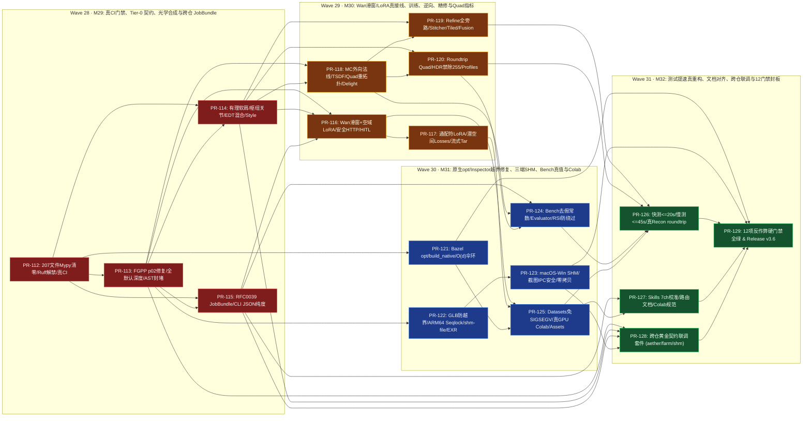

# M29–M32 Post-Horizon-7 生产级真闭环与跨仓契约合龙计划 (Actionable Horizon-8 Blueprint)

> - **计划版本**: `v1.0`（对应主总纲 [`IMPLEMENTATION_PLAN.md`](../IMPLEMENTATION_PLAN.md) **`v3.6`**）
> - **触发审计基线**: [`AUDIT-POST-HORIZON7-2026-11.md`](../audits/AUDIT-POST-HORIZON7-2026-11.md)（`main` @ `cf2a49f`）
> - **规划模型**: `[gemini4]`
> - **当前状态**: 📋 **已规划待执行 (Planned — Ready for Wave 28 Kickoff)**
> - **目标周期**: 4 个里程碑（`M29` – `M32`）、4 个并发 Execution Waves（`Wave 28` – `Wave 31`）、**18 个原子 PR**（`PR-112` – `PR-129`，编号紧接 Post-H7 审计规划 PR `#111`，实现 GitHub PR 号 1:1 严格对齐）

> [!IMPORTANT]
> **执行铁律（与 `AGENTS.md` / [`IMPLEMENTATION_PLAN.md`](../IMPLEMENTATION_PLAN.md) 对齐）**：
> 1. 所有改动必须走 Git Worktree（`/tmp/synapse-wt-prXXX`）→ 分支 → PR → Squash Merge → 清理 Worktree，严禁直接 push `main`（注意 Bazel 相关 PR 在验证本地 `../aether` 依赖时按 `all-overview` 共享缓存与同级路径约定执行）。
> 2. Commit 与 PR 标题必须携带模型标识 `[<model-tag>]`，PR 正文首行必须声明 ``> **Operated by**: `<model-tag>` ``。
> 3. 每个原子 PR 合入前必须同时通过 **防静默失败三问**（存在问 / 接线问 / 执行问），并在云端主力机 `ubuntu24` 实跑对应门禁命令（严禁用 `-n auto` 冒充单进程耗时，严禁用局部目录冒充全量 `mypy --strict`）。
> 4. 所有尚未创建的新文件路径（如 `.github/workflows/ci.yml`、`tests/test_cross_repo_contracts.py`）及跨仓路径（如 `../aether/...`、`../render-farm/...`、`../grand-studio/...`、`../all-overview/...`）在文档中一律使用反引号标注，禁止生成断链 Markdown 跳转。

---

## 1. 全景概览与 Wave 调度拓扑 (Overview & DAG)

Horizon 7（`PR-93 ~ PR-110`）成功清除了常驻 `ViewerServer`、补齐了 `256`-entry Marching Cubes 与 `hookwrapper` 严格跳过拦截并使 4 项历史 `-m slow` 失败清零，但 [`AUDIT-POST-HORIZON7-2026-11.md`](../audits/AUDIT-POST-HORIZON7-2026-11.md) 在 `cf2a49f` 基线上经过五切片逐行复审、跨仓核验与 `ubuntu24` 实跑十项门禁后发现：**`PR #110` 封板记录存在门禁命令/范围偏差**（Gate 1 单进程实测 `73.97s` 而非 `18.48s`、Ruff 29 条规则一条未解禁、`mypy --strict` 全仓 207 文件实测 **20 错**、`.github/workflows/` 仍为空、`prepare_datasets.py` 实跑 `fulgur` `SIGSEGV`），且全仓仍存在 **`14×P0 + 18×P1 + 12×P2 + 5×P3 = 49`** 项真实功能、数学、内存安全与跨仓契约断点。

Horizon 8（`M29–M32`, `PR-112 ~ PR-129`）的核心目标是将 `synapse` 从 **68/100（部分闭合、门禁校验有失真）** 推进到 **12 项反作弊硬门禁在 `ubuntu24` 与 GitHub Actions 上 100% 真实全绿**、跨仓 `aether`/`render-farm`/`grand-studio` 零断点互通的可投产级真闭环状态。



### Wave 调度与并发矩阵

| Wave | 里程碑 | 并发 PR 组（目录正交隔离） | 核心战果 | 入口前置条件 |
|---|---|---|---|---|
| **Wave 28** | **M29** | `PR-112` → `PR-113` → (`PR-114` ∥ `PR-115`) | 全仓 207 文件 `mypy --strict` 清零、解禁 Ruff 核心规则、真 CI 就绪、`p02` 主点与 `import_fgpp` 修复、有理软肩与关节枢纽、跨仓 RFC 0039 `JobBundle` 与 CLI JSON 纯度 | 本计划 PR `#111` 合入 |
| **Wave 29** | **M30** | `PR-116` → `PR-117` ∥ (`PR-118` → `PR-119` ∥ `PR-120`) | `WanAdapter` 滑窗+空域 LoRA 真接线、安全 HTTP/HITL、潜空间 Losses/通配符 LoRA、MC 外向法线/TSDF/Quad 重拓扑/真 Delight、Refine 全旁路与 Stitcher、Quad 水密与 HDR 禁除 255 | `PR-113 ~ PR-115` 合入 |
| **Wave 30** | **M31** | `PR-121` ∥ (`PR-122` → `PR-123`) ∥ `PR-124` ∥ `PR-125` | Bazel 默认 `--config=opt`、GLB 防越界读 + ARM64 Seqlock + `--shm-file` + `.exr`、macOS/Win Electron SHM 打通、Bench 去硬编码假常数 & RSI 防绕过、Datasets 免 `SIGSEGV` & 真 GPU Colab | `PR-112, PR-116, PR-117, PR-118, PR-120` 合入 |
| **Wave 31** | **M32** | (`PR-126` ∥ `PR-127` ∥ `PR-128`) → `PR-129` | 单进程快测 `<= 20s` / 并行慢测 `<= 45s`、`clean_recon` 真重构、Skills/Colab/架构文档 SSOT 对齐、跨仓黄金联调测试、12 项反作弊硬门禁全绿封板 `v3.6` | `PR-119 ~ PR-125` 合入 |

---

## 2. M29: 真 CI 门禁、Tier-0 契约、光学合成与跨仓 JobBundle (Wave 28)

<a id="pr-112"></a>
#### PR-112: 全仓 207 文件 `mypy --strict` 20 错清零、Ruff 规则真解禁、`conftest` 模块钩子补全与 CI 工作流激活 (`M29 / Wave 28`)

- **对应审计项**: `H8-P0-01` · `H8-P1-01` · `H8-P3-01`
- **依赖**: 无（Horizon 8 首发门禁底座修复）
- **预估体量**: ~320 LOC（`pyproject.toml` / `tests/conftest.py` / `tests/*.py` / `scripts/colab_runner.py` / CI YAML）
- **隔离 Worktree 分支**: `fix/pr-112-ci-mypy-ruff-conftest`
- **详细改动清单**:
  1. **清零全仓 207 源文件 `mypy --strict` 20 处错误（杜绝只跑 `python/synapse`）**：
     - 修复 `scripts/colab_runner.py:316-317` 真实运行期崩溃：`lora_items` 传入 `[(manifest, 1.0)]` 对齐 `list[tuple[LoRAManifest, float]]`，并用 `manager.loaded_bundles` 检查替代不存在的 `MultiLoRAManager.is_bundle_loaded`。
     - 修复 `tests/test_style.py:674`（6 errors）、`tests/test_rfc0063_metrics.py:137`（`no-any-return`）、`tests/test_fgpp_io.py:180`、`tests/test_recon.py:607-660`（9 处 `unused-ignore`）及 `tests/test_lora_feature_store.py:578`（`object / float`）。
     - 在 `pyproject.toml:85-87` 将全局 `ignore_missing_imports = true` 收敛至 `[[tool.mypy.overrides]]`（仅限第三方可选无 stub 库 `OpenEXR`, `Imath`, `cv2`, `trimesh`, `mitsuba`, `drjit`, `numba`, `safetensors`），为 `render_core/procedural.py:128,179,254,307` 补齐 `**kwargs: Any` 消除 `# type: ignore[no-untyped-def]`。
  2. **真正解禁 `pyproject.toml` 高危 Ruff 规则并清零违规**：
     - 从 `pyproject.toml:96-102` `ignore` 中移除 **`B008, B017, B023, B904, B905, SIM115, RUF012, RUF100`**，增加 `S202`（或安全规范审计），清零隔离检查检出的 ~42 处违规（`14 RUF100, 7 B904, 4 B023, 4 RUF012, 2 SIM115` 等）与 `tarfile` `extractall` 加 `filter="data"`。
     - 同步对齐 `pyproject.toml:7` `version = "3.5.0"`（后续于 `PR-129` 升 `3.6.0`）并在 `.gitignore` 增补 `data/golden_datasets/`。
  3. **修复 `tests/conftest.py` 模块级跳过漏网与 `wasxfail` 误杀**：
     - 新增 `@pytest.hookimpl(hookwrapper=True) def pytest_make_collect_report(collector)`：在 `SYNAPSE_CI_STRICT_DEPS=1` 时拦截模块顶层 `pytest.importorskip(..., allow_module_level=True)` 导致的收集期静默跳过并强制标 `failed`。
     - 在 `pytest_runtest_makereport` 中增加 `and not getattr(rep, "wasxfail", None)` 守卫，避免合法的 `@pytest.mark.xfail` 被误杀为错误失败。
  4. **修复 CI 配置并将工作流真正生效于 `.github/workflows/ci.yml`**：
     - 修正 `python-fast`：安装 `pip install -e ".[dev,image,metrics,train,mesh]"` + CPU 版 `torch`（`--index-url https://download.pytorch.org/whl/cpu`），检查 `aether` 至同级路径后运行 `python scripts/build_native.py --backend=auto`、`mypy --strict`（验证 `checked >= 207 source files`）、`ruff check`、`python tools/wire_guard.py --check --require-aether` 与 `python tools/import_dag_guard.py --check`；增设 `python-slow` Job 运行 `pytest tests/ -m slow -n auto`。
     - 修正 `native-bazel`：将 `synapse` checkout 到 `path: synapse`、将 **`dervgen/aether`** checkout 到 `path: aether`（移除吞错 `continue-on-error: true`），执行 `bazel test //... --config=opt`。
     - 在 `.ci/workflows/ci.yml` 同步定稿并由具备 `workflow` scope 的凭据推送同步至 `.github/workflows/ci.yml`（若当前 token 仍缺 `workflow` scope，则作为硬前置阻断提示人工授权后合并生效）。
- **`ubuntu24` 实测验收命令**:
  ```bash
  /root/venv-synapse/bin/mypy --strict python/synapse tests/ scripts/ tools/
  /root/venv-synapse/bin/ruff check python/ tests/ scripts/ tools/
  SYNAPSE_CI_STRICT_DEPS=1 /root/venv-synapse/bin/pytest tests/test_bench.py -k "test_scenario_create" -v
  ```
- **三问验收标准**:
  - **存在问**: `pyproject.toml` `ignore` 列表中已无 `B008/B017/B023/B904/B905/SIM115/RUF012/RUF100`；`conftest.py` 存在 `pytest_make_collect_report`；`.github/workflows/ci.yml` 就位。
  - **接线问**: `mypy --strict` 输出明确检查 `>= 207 source files`；`SYNAPSE_CI_STRICT_DEPS=1` 条件下模块级 `allow_module_level=True` 跳过用例同样报错失败。
  - **执行问**: `mypy --strict` 207 文件 `0 errors`，`ruff check` `0 errors`。

---

<a id="pr-113"></a>
#### PR-113: 修复 FGPP `p02` 水平主点符号反转、默认 `import_fgpp` 全零深度、正交投影矩阵与全作用域 AST/Wire 漏洞 (`M29 / Wave 28`)

- **对应审计项**: `H8-P0-03` · `H8-P1-02` · `H8-P1-03` · `H8-P2-01`
- **依赖**: `PR-112`
- **预估体量**: ~340 LOC（`fgpp/` + `tools/import_dag_guard.py` + `tools/wire_guard.py` + `schemas/` + `tests/`）
- **隔离 Worktree 分支**: `fix/pr-113-fgpp-p02-ortho-guards`
- **详细改动清单**:
  1. **修复 `synapse/fgpp/frame.py` 水平主点 `p02` 符号反转与正交投影解析**：
     - 修正 `CameraParams.projection_matrix()` (`L84`)：`p02 = (w - 2.0 * float(self.cx)) / w`（OpenGL 右手系 `-Z` 前望下保证光学轴点 `(0,0,-d)` 投影至精确像素 `sx = cx`），同步修正 `FGPPSequence.load_metadata()` (`L347`)：`cx = (1.0 - p02) * float(width) / 2.0`。
     - 增强 `load_metadata()`：从 `fr`/`raw` 读取 `z_near_meters` / `z_far_meters` / `z_near_m` / `z_far_m` 与 `CameraFrameMetadata` 别名（`world_to_camera`, `projection_matrix`, `focal_length_mm`, `sensor_width_mm`, `sensor_height_mm`）；区分透视 (`abs(proj_row[3, 2] + 1.0) < 1e-4`) 与正交 (`abs(proj_row[3, 2]) < 1e-6 and abs(proj_row[3, 3] - 1.0) < 1e-6`：$n=(p_{23}+1)/p_{22}, f=(p_{23}-1)/p_{22}$)；**无论来自 `"camera"` 还是 `"view_matrix_col_major"`，一律强制校验 `det(R)` 与 `||R^T R - I||_F <= 1e-4`**。
  2. **封堵 `synapse/fgpp/io.py` 默认 `channels=None` 静默伪造深度 & `torch_bridge.py` / `schema.py` 契约**：
     - `_read_exr_frame`：入口立即校验 `unknown = set(channels) - set(_COMPONENT_ORDER.keys())`，非空即抛 `ContractValidationError(10)`；当 `channels is None` 或 `"depth" in channels` 时强制存在 `"CameraLinearDepth.Z"`，禁止回退 `np.zeros((h, w))`。
     - `sanitize_fgpp_frame`：增加物理值域裁剪（`depth` 至 `(0, z_far]`、`direct_radiance` 至 `[0.0, 65504.0]` 防 `HALF` 上溢 `Inf`、`base_color` 至 `[0.0, 1.0]`、`roughness` 至 `[0.04, 1.0]`、`metallic` 至 `[0.0, 1.0]`）。
     - `torch_bridge.py`：统一用 `try: import torch except ImportError as e: raise BackendUnavailableError(30, ...)`；先 `np.ascontiguousarray(arr, dtype=np.uint32)`（并在逆向检验 tensor dtype）防止 64 位 `.view(np.int32)` 宽度翻倍；缺失 `"depth"` 抛 `ContractValidationError(10)`。
     - `schema.py::log_normalized_to_linear_depth`：当 `z_near_m <= 0` 或 `z_far_m <= z_near_m` 时与 C++ `fgpp_types.h` 一致返回全 `0.0`，并在 `np.exp` 前清洗非有限值及 `np.clip(z_norm, 0.0, 1.0)`。
  3. **封堵 `tools/import_dag_guard.py` 3 处绕过漏洞**：
     - 拦截 `from importlib import import_module; import_module(...)`（`isinstance(func, ast.Name) and func.id == "import_module"`）；
     - 将 `importlib.import_module(f"synapse.{x}")` 白名单严格限定在 `self.source_pkg == "__init__"`，并禁止非 `__init__.py` 模块使用裸 `import synapse`；
     - 在 `validate()` 遍历 `pkg_files` 的全部包目录检查是否已登记于 `TIER_MAP`，消灭孤立未注册包逃逸。
  4. **收紧 `schemas/*.json` 路径正则与 `wire_guard.py` Pydantic 双向比对**：
     - 将 `schemas/bundle.v1.0.schema.json:53` 与 `schemas/lora.v1.0.schema.json:36` 相对路径正则升级为 `^(?!/|[A-Za-z]:)(?!.*(?:^|/)\.\.?(?:/|$))[^\\]+$`，彻底拦截 `".."`, `"sub/.."`, `"."`, `"C:/..."` 与绝对路径；在 `job_bundle.v1.0.schema.json` 为 `free_vram_gb` 加 `"minimum": 0` 与 `traceparent` 正则。
     - 在 `LoRAManifest` 补齐 `extra="forbid"`, `rank >= 1`, `len(name) >= 1`, `min_length=1` on `target_modules`；在 `InspectionBundleManifest` 消除可变默认字典并禁空 `bundle_id`；在 `wire_guard.py` 新增 Pydantic `model_json_schema()` 与 `schemas/*.json` `constraints`/`enum`/`required` 自动比对。
- **`ubuntu24` 实测验收命令**:
  ```bash
  /root/venv-synapse/bin/python tools/import_dag_guard.py --check
  /root/venv-synapse/bin/python tools/wire_guard.py --check --require-aether
  /root/venv-synapse/bin/pytest tests/test_fgpp_contract.py tests/test_fgpp_io.py tests/test_render_core.py tests/test_architecture_dag.py tests/test_wire_schemas.py -v
  ```
- **三问验收标准**:
  - **存在问**: `frame.py` 使用 `(w - 2.0 * cx) / w`；`import_dag_guard.py` 校验 `pkg_files` 与 `ast.Name("import_module")`；`bundle.v1.0.schema.json` 含严格正则。
  - **接线问**: `SoftwareRasterizer` 偏心主点 `(cx=40, cy=20)` 渲染光轴点 `(0,0,-3)` 精确落于像素 `(40.0, 20.0)`，且默认 `import_fgpp()` 缺深度必抛 `10`。
  - **执行问**: 缺失深度/未知通道退出码 `10`、`torch` 缺失退出码 `30`、`wire_guard --require-aether` 与 `import_dag_guard` 0 违规通过。

---

<a id="pr-114"></a>
#### PR-114: $C^1$ 渐近有理软肩、`procedural` 关节枢纽/水密基元、`composite` 单调 EDT 混合与 `Style` IRLS 修正 (`M29 / Wave 28`)

- **对应审计项**: `H8-P0-04` · `H8-P1-04` · `H8-P1-05` · `H8-P2-02` · `H8-P3-01` · `H8-P3-03`
- **依赖**: `PR-112`, `PR-113`
- **预估体量**: ~380 LOC（`style/` + `composite/` + `render_core/` + `telemetry.py` + `tests/`）
- **隔离 Worktree 分支**: `fix/pr-114-aces-soft-shoulder-procedural-composite`
- **详细改动清单**:
  1. **修复 `synapse/style/aces_color.py` 有界渐近软肩与 `@aether//color` 精确对齐**：
     - 将 `_fallback_soft_knee_forward_tonemap` 与 `_fallback_soft_knee_inverse_tonemap` 替换为 $C^1$ 连续有理软肩（肩点 $t = 0.8, s = 0.2$）：$T(y) = t + \frac{s(y - t)}{s + (y - t)} \in [0, 1)$（$T'(t)=1, \lim_{y\to\infty} T(y) = 1.0$），逆函数 $T^{-1}(x) = t + \frac{s(x_{\text{safe}} - t)}{1.0 - x_{\text{safe}}}$（$x_{\text{safe}} = \min(x, 0.999)$），彻底消除 `composite_optical_increments` 中 HDR $>1.04$ 高光/焦散硬截平。
     - 将 `_M_SRGB_TO_ACESCG` 精确对齐 `aether/color/src/color_space.cc` `kSrgbToAcesCg`（消除 $7\times 10^{-5}$ 偏差），并在 `_fallback_srgb_to_linear` / `_fallback_linear_to_srgb` 沿用负值线性斜率而非强制截断 `0.0`。
  2. **修复 `synapse/render_core/procedural.py`、`rasterizer.py`、`mesh.py` 与 `morphology.py`**：
     - `procedural.py`: 将人形肢体几何原点统一移至近端关节枢轴（局部先平移 `(0, -h/2, 0)` 再绕父级末端 `(0, -parent_h, 0)` 旋转），消除弯膝/抬腿时 `15–19 cm` 关节脱臼；对 `_generate_cube`, `_generate_sphere`, `_generate_cylinder`, `_generate_torus` 执行拓扑接缝与极点焊接使其满足 `check_watertight == True`；删除 `L632` 死语句 `math.cos(phase)`。
     - `mesh.py:102-106`: 修复 OBJ 负相对索引（`idx < 0 -> len(verts) + idx`）。
     - `rasterizer.py`: `entity_hash` 避开保留背景 `0`（`return h if h != 0 else 1`），校对 `camera.width/height` 一致性，背景法线默认初始化 `[0.0, 0.0, 1.0]`。
     - `morphology.py:91`: 将纯 NumPy `binary_erosion` 回退的 `constant_values=True` 改为 `constant_values=False` 与 `scipy.ndimage.binary_erosion(border_value=0)` 100% 等价。
  3. **修复 `synapse/composite/`、`style/extractor.py`、`style/descriptor.py` 与 `telemetry.py`**：
     - `composite/blend.py`: 重写 `_cryptomatte_boundary_guide` 为多通道黄金比率哈希阶跃高原图（消除 2px 脉冲导致引导滤波 `a==0` 退化）；用 $O(HW)$ `exact_euclidean_distance_transform` 计算单调内环融合权重 `d_in / max(d_out + d_in, 1e-6)` 取代双向剥离 loop；`composite_surgical_sequence` 以 `float64` 在 `boundary_band` 内算 `mv` 模长；全部 5 处 `uint8` 转换改为 `np.rint(np.clip(..., 0, 255))`；`composite_optical_increments` 入口验证形状一致。
     - `composite/detector.py`: 裁剪 `_detect_temporal_flicker` `bbox_xyxy` 至 `(w, h)`，当 `cam.fx <= 0` 时基于 `fov_degrees` 推导焦距避免 `1e6x` 反投影爆炸。
     - `style/extractor.py:181-209`: 在 `_solve_half_cosine_light_irls` 每轮迭代对 `dot_nl <= 0` 背光面将法线雅可比置零并按 `0.0` 居中算 Huber 残差；`descriptor.py` 增加 3 元素与非负/有限验证。
     - `telemetry.py:201-205`: `MemoryForecaster` token 计数对齐 `(num_frames - 1) // 4 + 1` 与 `height // 16, width // 16`。
- **`ubuntu24` 实测验收命令**:
  ```bash
  /root/venv-synapse/bin/pytest tests/test_style.py tests/test_composite_blend.py tests/test_composite_mask.py tests/test_render_core.py -v
  ```
- **三问验收标准**:
  - **存在问**: `aces_color.py` 存在单调渐近有理软肩且 `T([0..100]) < 1.0`；`morphology.py:91` 为 `constant_values=False`。
  - **接线问**: 弯曲人形代理膝关节 60° 时胫骨近端与股骨远端偏差 `< 1e-4 m`；`composite_optical_increments` 叠加高光 `y=5.0` 仍保留柔和肩部层次而非硬截平 `255`。
  - **执行问**: 纯 NumPy 与 SciPy `binary_erosion` 逐像素 100% 一致；IRLS 在侧光/背光样本下偏差显著降低。

---

<a id="pr-115"></a>
#### PR-115: 跨仓 RFC 0039 `JobBundle` 兼容层、Worker Stage 收口与 CLI `--json` 零污染统一 (`M29 / Wave 28`)

- **对应审计项**: `H8-P0-02` · `H8-P1-06` · `H8-P1-07` · `H8-P2-03` · `H8-P2-04` · `H8-P3-02`
- **依赖**: `PR-112`, `PR-113`
- **预估体量**: ~420 LOC（`pipeline/bundle_worker.py` + `pipeline/stages/` + `cli/` + `viewer/` + `schemas/` + `tests/`）
- **隔离 Worktree 分支**: `fix/pr-115-rfc0039-jobbundle-cli-stages`
- **详细改动清单**:
  1. **打通跨仓 RFC 0039 `JobBundle`（`render-farm` / `grand-studio` 双向零阻断互通）**：
     - 在 `pipeline/bundle_worker.py` 新增 `BundleManifest.from_rfc0039_job_bundle(raw: dict[str, Any])`，支持直接解析 `{job_id, project_name, closure_type, engine, scene_spec, asset_manifest, output_sink, payload}` 格式并校验 `asset_manifest[].sha256`（与可选 `input_sha256s`），任意 SHA-256 失配立即抛 `AssetNotFoundError(20)`；同步更新 `schemas/job_bundle.v1.0.schema.json` 支持双形式或独立转换器。
     - 增加 `ClosureType` 标准映射表（`"neural_video" -> "neural_video_generate"`、`"surgical_inpaint" -> "surgical_composite"`、`"mesh_reconstruct" -> "video_to_3d_invert"`、`"optical_polish" -> "style_extract_and_map"`、`"mocap_ik" -> "kinematic_distill"`），并新增注册 `"delighting"` Stage 调用 `synapse.recon.delight`。
  2. **修复 `bundle_worker.py` & `stages/` 静默覆写、路径安全、OOM 哈希与伪成功**：
     - `register_stage` 增加重名检测（禁止静默覆写），移除 `bundle_worker.py:634-734` 重复死代码 `_handle_inverse_reconstruct`，在 `stages/recon.py` 统一支持 `video_frames` `.npy` 与 `frames_dir` `.png`。
     - `JobBundleWorker.execute()` 对 `inputs`/`outputs` 强制路径规范化防穿越并拒绝符号链接；目录哈希改用 64KiB 流式分块（禁止整读取 2GiB `.tar` `read_bytes()`）；修复 `np.save` 无 `.npy` 后缀时的自动追加问题（一律 `with open(out_p, "wb") as f: np.save(f, arr)` 保证 `ResultManifest.output_files` 非空）。
     - 清除生产 Stage 静默兜底：`asset_inspect_3d` 未配 `vlm_endpoint_url` 且非 `mock=True` 时抛 `NotImplementedStageError(50)`；`inspect_refine` 强制要求报告输入；`rsi_dual_verify` 强制要求 `physics_metrics`；`lora_preencode` 无有效编码器或产出 `0` 分片时 Fail-Closed；`stages/refine.py` 无条件调用 `evaluate_hitl_circuit_breaker` 并统一接受 CLI `{"rois": [...]}` 与嵌套 ROI Schema。
  3. **统一全部 CLI `--json` 零 stdout 污染与确定性退出码**：
     - 在 `cli/_app.py` 与 `cli/common.py::_run_with_json_mode` 强制回写 `parsed.json = json_mode`，根治 `synapse --json inspect mesh` / `synapse --json recon` 混淆打印人类文本破坏 JSON 解析。
     - 将 `synapse worker run --json` 纳入 `TraceContext`（消费 `BundleManifest.traceparent` > env `TRACEPARENT`），补齐 `trace_id`/`error_type` 并统一成功信封；为 `cli/_rsi.py:164,166` / `_fgpp.py:215` 补全 `agent_fix_hint`，注册 `--allow-waived` (`_lora.py`) 与 `--image-uris` (`_inspect.py`)，连线 `--strict` (`_rsi.py`)，`cli/_refine.py` 对缺失 `--roi-meta`/`--normals`、非法后缀及 0 ROI 统一抛 `ContractValidationError(10)`，迁移遗留 `main_data_gen`/`main_viewer` 至 `SynapseArgumentParser`。
     - 加固 `viewer/server.py::export_static_html` 拦截符号链接与坏 JSON（转 `ContractValidationError(10)`）。
- **`ubuntu24` 实测验收命令**:
  ```bash
  /root/venv-synapse/bin/pytest tests/test_bundle_worker.py tests/test_pipeline_stage_adapters.py tests/test_cli.py tests/test_cli_deterministic_codes.py tests/test_dataset_and_viewer.py -v
  ```
- **三问验收标准**:
  - **存在问**: `BundleManifest.from_rfc0039_job_bundle`、`ClosureType` 映射与 `"delighting"` Stage 存在；`register_stage` 含重名拦截。
  - **接线问**: 喂入真实 `render-farm` `JobBundle` JSON 可顺利路由执行并在输入 SHA-256 篡改时返回 `20`；`synapse --json inspect mesh` 与 `synapse --json recon` 输出 100% 纯合法单行 JSON。
  - **执行问**: `np.save` 无后缀输出在 `ResultManifest.output_files` 含真实文件哈希；`worker run --json` 携带 `trace_id` 且遵循统一信封。

---

## 3. M30: Wan 滑窗/空域 LoRA 真接线、训练、逆向重演、精修与指标真值 (Wave 29)

<a id="pr-116"></a>
#### PR-116: `WanAdapter` 接通 `ConditionScheduler` 滑窗与 `LoRAPatchHook` 空域掩膜、统一安全 HTTP 传输与 `HITL` 账本 (`M30 / Wave 29`)

- **对应审计项**: `H8-P0-05` · `H8-P1-08` · `H8-P2-04` · `H8-P3-02`
- **依赖**: `PR-113`, `PR-114`, `PR-115`
- **预估体量**: ~480 LOC（`adapters/` + `bridge/` + `models/` + `generators/` + `tests/`）
- **隔离 Worktree 分支**: `fix/pr-116-wan-scheduler-lora-hook-http`
- **详细改动清单**:
  1. **将 `ConditionScheduler` & `DiscontinuityDetector` 真正接通至 `WanAdapter.generate()`**：
     - 当 `T > window_frames (97)` 或存在多窗口时，`WanAdapter.generate()` 真实调用 `ConditionScheduler.schedule(...)` 按 `W=97, S=64, overlap=33` 切分，包含 3 帧因果 VAE 暖启动、基于 `DiscontinuityDetector` 的 $\kappa$ 切镜重锚定，以及对跨窗潜变量/帧输出执行 `fuse_overlapping_latents`；当 `gamma_flow_bias > 0` 时调用 `compute_latent_flow_operator` 并注入 `flow_meta["occlusion_mask"]`。
     - 同步清理 `_handle_neural_video_generate` OOM Level 2 粗暴截断 `num_frames = 49` 改为驱动滑窗，确保 `MockVideoAdapter.generate()` 遵循 `config.num_frames`，缺后端改抛 `BackendUnavailableError(30)`，避免原地篡改 `conditions.control_tensor` 与双调 `validate_output_non_degenerate`。
  2. **修复并真实挂载 `LoRAPatchHook` 空域隔离掩膜 & 清理 `_extract_lora_ab` 跨层污染**：
     - `WanAdapter.generate()` 依据 `manifest.category` 分流挂载 `LoRAPatchHook`：`"identity"` 绑定前景 `M_fg`（支持显式 `target_entity_ids`，禁止将所有非零 ID 视作同一前景），`"style"` 绑定 `~M_fg`；在 `MultiLoRAManager` 先执行迭代正交化，再经上下文管理器挂载并在 `try/finally` 内**无条件还原/卸载**，杜绝中途抛错导致模型权重污染。
     - 修复 `LoRAPatchHook._hook` 4 处崩溃：按 Wan 3D Causal VAE `((T-1)//4 + 1, H//16, W//16)` 时空池化对齐 DiT token 网格 `L`（兼容 `B > 1` CFG 与前置寄存器 token）；**跳过 `cross_attn.to_k` / `cross_attn.to_v` 文本序列层**以免长度冲突；在 `attach()` 预缓存设备/dtype 掩膜张量避免每去噪步重复拷贝。
     - 移除 `manager.py:450,506-515` 按张量形状盲配偷取其他 DiT 块权重的回退分支。
  3. **统一安全 HTTP 传输防 SSRF、修复 `HttpCloudTransport` 载荷、加固 `bridge` 与 `models`**：
     - 新增共享安全 URL/HTTP 辅助（限定 `http`/`https` 协议、自定义 RedirectHandler 阻断 `file://` 与 `169.254.0.0/16` 等链路本地/云元数据 IP、捕获 `HTTPException`/`JSONDecodeError`/`IncompleteRead` 并校验 `FoundaryResponse.status == "error"` 统一映射 `BackendUnavailableError(30)`）。
     - 修复 `HttpCloudTransport.submit_segment()` (`cloud.py:545`)：将 `first_anchor_png` / `last_anchor_png`（base64）、`text_prompt` 与 `depth_guide` / `normal_edge_guide` 真实序列化发往远端而非全量丢弃。
     - 修复 `PersistentHitlLedger`：先校验 `math.isfinite(elapsed) and elapsed >= 0.0` 再写入磁盘（防止负数归零 15m 计时或 `NaN` 毒化账本），将默认路径迁出 `/tmp` 至 `~/.cache/synapse` 且只读查询不覆写文件，导出并接入 `stages/refine.py`。
     - 修复 `get_vg_backend(mock=False)` 在 `_RECON_BACKEND_FACTORY is None` 时禁止静默返回 `MockVgBackend()`（改抛 `BackendUnavailableError(30)`）；修复 `models/loader.py` 动态读取 `SYNAPSE_MODELS_DIR`、包装 `trimesh` `ImportError -> BackendUnavailableError(30)` 及收敛 `DatasetGenerator` `except`。
- **`ubuntu24` 实测验收命令**:
  ```bash
  /root/venv-synapse/bin/pytest tests/test_wan_adapter.py tests/test_wan_lora_wiring.py tests/test_lora_manager.py tests/test_condition_scheduler.py tests/test_cloud_adapters.py tests/test_bridge_and_hitl.py -v
  ```
- **三问验收标准**:
  - **存在问**: `wan.py` 存在 `ConditionScheduler` 与 `LoRAPatchHook` 上下文调度；`cloud.py` 序列化首尾锚点 PNG 与 `text_prompt`。
  - **接线问**: 161 帧输入调用 `WanAdapter.generate()` 真实切分 2 个因果窗口并做重叠融合；`identity` 与 `style` LoRA 分别在前景/背景掩膜区精确生效且异常退出时原权重 100% 还原。
  - **执行问**: `file://` 与 `169.254.169.254` URL 被拒（`10`）；负 `elapsed` 在 HITL 账本抛 `10` 且不篡改已有累计计时。

---

<a id="pr-117"></a>
#### PR-117: 统一通配符 LoRA 匹配、潜空间接通 `Edge/Normal` 损失与 `t`、`FeatureStore` 15ch 对齐与流式 Tar 读取 (`M30 / Wave 29`)

- **对应审计项**: `H8-P1-09` · `H8-P1-10` · `H8-P2-05`
- **依赖**: `PR-116`
- **预估体量**: ~340 LOC（`training/` + `tests/`）
- **隔离 Worktree 分支**: `fix/pr-117-training-losses-wildcards-feature-store`
- **详细改动清单**:
  1. **统一通配符 `target_modules` 匹配契约**：
     - 让 `StatelessLoRATrainer.inject_lora` (`trainer.py:285`) 与 `packager._validate_safetensors_weights` (`packager.py:360`) 复用基于 `fnmatch` / 锚定正则的统一匹配器（兼容 `"spatial_attn.*"`、`"blocks.*.ffn.*"`），并在 `inject_lora` 匹配 `0` 层时立即抛 `ContractValidationError(10)`。
  2. **修复 `StatelessLoRATrainer` 损失接线、时间步 `t` 透传、设备与 `GradScaler`**：
     - 当 WebDataset batch 含 `fgpp_cond`（缺 `depth_latent`/`normal_gt`）时，自动从 `fgpp_cond` 提取 `ch 0` 深度与 `ch 1:4` 法线并下采样至潜空间 `(tau, H//8, W//8)` 计算 `EdgePreservingLoss`；对 3 通道真值显式通过 3ch 投影或仅当通道为 3 时激活 `NormalReconstructionLoss`，并修复 `losses.py` 4D/5D 维度 `dim` 归一化与 `mask` `device=loss_map.device`。
     - 将自动采样的 `t` 回存以经 `_call_module` 传入 DiT，同步将 batch 张量迁至 `module` 所在设备，并为 `mixed_precision="fp16"` 启用 `torch.amp.GradScaler`。
  3. **修复 `FeatureStoreBuilder` 通道索引、流式 $O(1)$ 读取与 `packager` Fail-Closed 门禁**：
     - 对齐 `FeatureStoreBuilder._validate_ingestion_quality` 原生 15ch 通道索引与 `FGPP_CHANNEL_SPECS`（`depth=3, crypto=4, radiance=5:8, normals=12:15`），旋转正交仅由 `camera_matrices` 独立校验（消除 `7:16` 与 `14` 自撞），同时对 `[7, T, H, W]` Wan 控制张量运行深度跨度与法线模长校验。
     - 重写 `iter_feature_shards` 按相邻同一 `sample_id` 边界实时刷新 `yield` 实现 $O(1)$ 内存流式消费，设单成员 `512 MiB` 上限并校验读入 `sample_id` 正则。
     - 修复 `packager._evaluate_gates` 缺失必需指标 (`chamfer_mm`, `normal_angular_error_deg`, `border_ring_ciede2000`) 必须 Fail-Closed；`MultiLoRAManager.load_lora` / `packager` 将相对 `adapter_path` 基于 `lora_manifest.json` 所在目录解析，接通或移除死参数 `golden_scenarios`。
- **`ubuntu24` 实测验收命令**:
  ```bash
  /root/venv-synapse/bin/pytest tests/test_lora_trainer.py tests/test_lora_feature_store.py tests/test_lora_cli_gate.py tests/test_domain_randomizer_and_gate.py -v
  ```
- **三问验收标准**:
  - **存在问**: `trainer.py` 存在 `GradScaler`、`t` 注入与从 `fgpp_cond` 下采样提取深度/法线；`packager.py` 检查必需门禁全键。
  - **接线问**: 使用 `"spatial_attn.*"` 运行 `inject_lora` + 训练 + `packager` 全链路无报错通过；`EdgePreservingLoss` 在真实 `iter_feature_shards` 样本上产出非零反传梯度。
  - **执行问**: 缺失指标调用 `packager` 返回 `passed=False`；跨目录加载打包输出相对路径 `lora_manifest.json` 成功。

---

<a id="pr-118"></a>
#### PR-118: Marching Cubes 外向法线与 TSDF 闭合、无裂缝 `quad_remesh`、真多视角 `delight`、`recon` 相机尺度与闭环烘焙 (`M30 / Wave 29`)

- **对应审计项**: `H8-P0-07` · `H8-P0-08` · `H8-P0-09` · `H8-P1-11` · `H8-P1-12` · `H8-P2-06` · `H8-P3-03`
- **依赖**: `PR-113`, `PR-114`
- **预估体量**: ~520 LOC（`recon/` + `recon/loop/` + `tests/`）
- **隔离 Worktree 分支**: `fix/pr-118-recon-mc-quad-delight-loop`
- **详细改动清单**:
  1. **修复 `synapse/recon/multiview.py` Marching Cubes 绕序、TSDF 空腔与 Visual Hull 水密**：
     - 翻转 `_marching_cubes` 输出绕序 `(edge_vids[tris[t]], edge_vids[tris[t+2]], edge_vids[tris[t+1]])` 使法线 100% **外向（CCW）**，将原点偏移对齐体素中心 `origin + 0.5 * effective_voxel`，利用 NumPy 活跃体素掩膜预筛（跳过 `~99.7%` 全同符号网格单元，提速 `~400x`）。
     - 修复 `_reconstruct_tsdf`：使用非对称射线集成 `sdf > -self.sdf_trunc`（仅在有 `weight > 0` 观测的单元周围提取表面，并将内部未观测空间/外周 6 面填充 `+1.0`），彻底消除双壁空腔与切片破洞。
     - 修复 `_reconstruct_visual_hull`：按 `carve = ~in_bounds; carve[in_bounds] = mask[...] <= 0.5` 雕刻视锥外角点，并在调用 `_marching_cubes` 前为 TSDF/Visual Hull 外围垫 1 层 `+1.0` 确保 100% 闭合水密 (`check_watertight == True`)。
  2. **修复 `synapse/recon/geometry.py` `quad_remesh` 裂缝与 `check_self_intersections` 大面内存爆炸**：
     - 当 `unpaired_triangles` 非空时，对 `quad_faces` 同步应用共享 `_get_midpoint` 与面心的一步 Catmull-Clark 四分细分，确保与相邻细分三角形共享边界中点，100% 消除 T-junction 非水密/非流形裂缝。
     - `check_self_intersections` 对大跨度三角面设置单面格数上限或改用 NumPy 1D/BVH 粗筛（杜绝地面三角形塞爆 `256^3` 字典单元）并做对称共享顶点匹配；修正 `SynapseReconBackend` `float64` 透传。
  3. **重写 `synapse/recon/delight.py` 真实三角形 Z-Buffer、世界空间 SH 与防抵消高光分离**：
     - 用完整三角形重心 Z-Buffer 光栅化取代 5 点稀疏点投，保持世界空间法线 `v_nrms` 拟合多视角联合 SH 光照，先进行高光/漫反射分离（避免 `(rad / E) * E == rad` 恒等自抵消），将去光照反照率按 `cos_theta * visibility` 累加至**网格 UV/顶点空间**（消除屏幕空间重影混叠），修正 `L807` `is_linear` 标志与 `_build_chromaticity_mask` 边缘切片（去掉 `np.roll`）。
  4. **收口 `tracking.py`、`kinematics.py`、`pipeline.py` 与 `recon/loop/`**：
     - `ReconPipeline.run()` 按图像分辨率派生合理内参透传至 `tracking`/`multiview`/`delight`，接入 `visibility` 掩膜与 RANSAC PnP 尺度求解（静止相机抑制单位 `t_rel`），修复 `reprojection_error_px` 同帧投影配对与亚像素双线性插值；`kinematics.py` 改用 `anchor_pos[1] = max(y, ground_y)` 并于 IK 后计算真实滑移（消除累计漂移与接触硬编码）。
     - `ClosedLoopRunner` & `texture_extractor.py`：以 `min` 截断对齐非 `4k+1` 填充长度防止 `IndexError`，用有效前景掩膜裁剪 `ScalpelStitcher` 框，前移 $\kappa$ 重锚定至 `adapter.generate()` 阶段；`bake_uv_normal_map` 屏蔽零法线背景并用真实网格 `(dp/du, dp/dv)` 正交切空间（或连续 Frisvad 切空间）烘焙；`AnalyticUVInverseOptimizer` 用 `sum(ndotl*I)/sum(ndotl^2)` 最小二乘初值，屏蔽空白 UV 岛外部 TV 渗漏，复用 `synapse.style.aces_color` 替代重复 `radiometric.py` 实现。
- **`ubuntu24` 实测验收命令**:
  ```bash
  /root/venv-synapse/bin/pytest tests/test_recon.py tests/test_recon_multiview.py tests/test_recon_invert_cli.py tests/test_recon_loop_guide.py tests/test_recon_loop_optimizer.py tests/test_recon_closed_loop_e2e.py -v
  ```
- **三问验收标准**:
  - **存在问**: `_marching_cubes` 反转绕序且外周垫 `+1.0`；`quad_remesh` 一致细分；`delight` 按网格 UV/顶点累加。
  - **接线问**: `MultiViewInitializer` 重建球体/盒子输出满足 `check_watertight == True` 与外向正体积；`quad_remesh` 后保持水密与流形。
  - **执行问**: `delight` 在合成方向光高光样本上非零分离漫反射与高光且跨视角残差显著下降；`ClosedLoopRunner` 对任意非 `4k+1` 帧数零 `IndexError`。

---

<a id="pr-119"></a>
#### PR-119: `refine` 全旁路直通、光流 `temporal_warp_error`、`ScalpelStitcher` 去 $\alpha^2$/去硬缝与 `Fusion`/`Tiled` 修复 (`M30 / Wave 29`)

- **对应审计项**: `H8-P0-11` · `H8-P1-13` · `H8-P2-07` · `H8-P3-03`
- **依赖**: `PR-114`, `PR-118`
- **预估体量**: ~360 LOC（`refine/` + `tests/`）
- **隔离 Worktree 分支**: `fix/pr-119-refine-stitcher-fusion-tiled`
- **详细改动清单**:
  1. **修复 `LocalRefinementPipeline` 全旁路健康门禁与真实 `temporal_warp_error`**：
     - `ScalpelStitcher.stitch_sequence` 在无活跃（非旁路）ROI 时直接返回 `frames_acescg.copy()` 并置 `mean_border_psnr_db = 100.0, mean_border_ciede2000 = 0.0`（彻底修复健康视频全旁路挂在 `PSNR 0 < 38`）。
     - `LocalRefinementPipeline.run()` 接收可选 `motion_vectors` 传给缝合器并调用 `synapse.metrics.temporal.temporal_warp_error`（缺流时自动用块/光流估计或跳过无流差分），终止拿未对齐像素差伪判时序漂移。
  2. **修复 `ScalpelStitcher` $\alpha^2$ 双重混合、核心硬接缝、HDR 色相与高速运动 EMA**：
     - 删除 `_laplacian_pyramid_blend_linear` 之后冗余的 `alpha * blended + (1 - alpha) * bg`（消除 $\alpha^2$），删除 `result[t][core_mask] = fg_full` 硬覆写（统一平滑金字塔过渡）。
     - 改用单调亮度比 `lum_ratio` 等比保留 ROI 内 HDR 高光（防逐通道偏色）；将高速运动 (`flow_mag_in_band > max_flow_magnitude`) EMA 权重推向 `1.0`（信任当前帧防重影）；`_border_psnr` / `_border_ciede2000` 仅统计外环对照 `bg_frame`；修复 `warpAffine` 掩膜精度与光流越界掩膜，校正 `L595` docstring。
  3. **修复 `TiledBypassExecutor` 边界覆盖与对接主流程**：
     - 生成覆盖完整末尾坐标的瓦片起始列表 `sorted({*range(0, max(h - ts, 0), stride), max(h - ts, 0)})`，加权采用 2D 升余弦 (Hann) 窗无缝拼接并在超过 `tile_size` 时真实接入 `LocalRefinementPipeline`。
  4. **修复 `fusion.py` 算子与 `Hand/FaceRefiner` / `KalmanBBoxTracker` 诚实门禁**：
     - `POISSON_GRADIENT` 改用与五点拉普拉斯精确伴随的半像素交错前向差分 + 负转置散度，并锚定外圈 1px Dirichlet 边界消除高频坍塌与直流漂移；`CASCADE` 补全 `(1 - alpha) * detail_res`；`UNCERTAINTY_WEIGHTED` 在 `K == 2` 时融合局部结构梯度置信度避免退化均分。
     - 当 `strict=True` 且未提供真实神经模型权重时，禁止静默使用默认 `backend="heuristic"` 绕过；`LocalRefinementPipeline` 按 IoU (`>= 0.3`) 跨帧关联 `KalmanBBoxTracker` 并用 `smoothed_bbox` 从原始帧重新裁切，修复 `Kalman` 首帧 `P[:4,:4]` 与预测宽高 `>= 1.0` 钳位。
- **`ubuntu24` 实测验收命令**:
  ```bash
  /root/venv-synapse/bin/pytest tests/test_refine_hand_face.py tests/test_refine_stitcher_gates.py tests/test_refine_cli_wire.py -v
  ```
- **三问验收标准**:
  - **存在问**: `TiledBypassExecutor` 末行/末列全覆盖并接入 `LocalRefinementPipeline`；`ScalpelStitcher` 无双重 $\alpha$ 与 `core_mask` 硬覆盖。
  - **接线问**: `LocalRefinementPipeline.run(strict=True)` 处理全部健康 ROI 时以 `PSNR=100.0` 通过门禁，未供权重强制启用神经分支报错 `50`。
  - **执行问**: `fuse([f, f], mode="poisson_gradient")` 与 `cascade` 保持 `> 0.99` 图像保真；超大图像 `h=700, ts=512` 零黑边条带。

---

<a id="pr-120"></a>
#### PR-120: 修复 `metrics/roundtrip.py` Quad 水密/表面积分、`temporal.py` HDR 禁除 `255.0` 与 `profiles` 别名覆盖 (`M30 / Wave 29`)

- **对应审计项**: `H8-P0-08` · `H8-P0-10` · `H8-P1-14` · `H8-P2-08`
- **依赖**: `PR-114`, `PR-118`
- **预估体量**: ~280 LOC（`metrics/` + `tests/`）
- **隔离 Worktree 分支**: `fix/pr-120-metrics-quad-hdr-aliases`
- **详细改动清单**:
  1. **修复 `synapse/metrics/roundtrip.py` Quad 网格水密性与表面积/体积截断**：
     - `_is_mesh_watertight`: 将多边形顶点环边构建 `b = poly[(i + 2) % n]` 修正为 `b = poly[(i - 1) % n]`（或直接委托 `synapse.recon.geometry.check_watertight` 兼查顶点有限性与索引越界），使水密 Quad 网格 100% 通过水密校验。
     - `sample_mesh_surface` 与 `_signed_volume`: 对 `(F, K)`（$K \ge 4$）面片执行扇形三角化后再做 Turk/Osada 面积加权采样与有符号体积积分，彻底修复 Quad 丢失 50% 表面积与平移体积漂移；`f_score_1mm`/`f_score_5mm` 支持直接传入 `(verts, faces)` 网格并统一 `foot_sliding_cm` `fps` 换算说明。
  2. **修复 `synapse/metrics/temporal.py` HDR 错除 `255.0`、光流检验与 FVD 稳定化**：
     - `temporal_warp_error`, `flicker_score`, `_build_r3d18_extractor`: **仅当 `dtype == np.uint8`（或 `uint16` 除 `65535.0`）时才除以 `255.0`**，严禁将任何含高光 (`max > 1.0`) 的 `float32` 线性 HDR 视频误除 `255.0`（并在入口归一化一次，消除嵌套双重除法；`_build_r3d18_extractor` 对浮点做安全 `clamp/tonemap` 并兼容变长视频列表及目标设备 `mean/std`）。
     - 为 `temporal_warp_error` 补齐 `[T, H, W, 2]` vs `[T-1, ...]` 长度校验、帧分辨率不一致时缩放光流及 `(sx, sy)` 与越界采样点有效掩膜。
     - 修复 `fvd_feature_distance`: 对称统一微小特征值稳定项（当 $N < D$ 时消除零空间不对称伪偏置）。
  3. **修复 `metrics/image_quality.py` 与 `metrics/profiles.py` 别名覆盖**：
     - `image_quality.py`: 分别按各自 `dtype` 独立归一化 `pred` 与 `gt` 解决混合 `uint8`/`float` 崩溃；`lpips` 下采样改用掩膜归一化平均与内缩梯度掩膜消除黑背景边缘伪影；`albedo_delta_e00`/`border_ring_ciede2000` 支持 `input_space`。
     - `profiles.py:224-258`: 通过 `METRIC_ALIASES` 将 `thresholds`, `scenario_overrides`, `measured` 全部规范化到同一权威键名空间后再做门禁比对，防止场景别名放宽被原生硬键继续否决。
- **`ubuntu24` 实测验收命令**:
  ```bash
  /root/venv-synapse/bin/pytest tests/test_metrics.py tests/test_metrics_image_quality.py tests/test_rfc0063_metrics.py tests/test_profiles_doc_sync.py -v -W error::scipy.linalg.LinAlgWarning
  ```
- **三问验收标准**:
  - **存在问**: `roundtrip.py` 存在多边形扇形三角化且无 `poly[(i+2)%n]`；`temporal.py` 仅对整型图像除 `255.0`。
  - **接线问**: 6-Quad 水密立方体经 `evaluate_roundtrip_mesh` 返回 `watertight_pct == 100.0`；`float32` 取值 `[0, 3.5]` HDR 视频计算 `temporal_warp_error` 与 `flicker_score` 不再缩放 `255x`。
  - **执行问**: `scenario_overrides={"style_color_de": 5.0}` 成功覆盖 `border_ring_ciede2000`；混合 `uint8`/`float32` 对同一图像求 PSNR $\to +\infty$。

---

## 4. M31: 原生 C++ `opt` / GLB 越界修复、三端 SHM、Bench 真值与 Colab 闭环 (Wave 30)

<a id="pr-121"></a>
#### PR-121: 恢复 Bazel 默认 `--config=opt` 编译、`build_native.py` 跨平台分离编译与 `O(d)` 伞环流形检测 (`M31 / Wave 30`)

- **对应审计项**: `H8-P1-15` · `H8-P3-03`
- **依赖**: `PR-112`
- **预估体量**: ~260 LOC（`csrc/geometry/.bazelrc` + `tools/data-inspector/native/.bazelrc` + `scripts/build_native.py` + `recon/geometry.py` + `../aether` 对齐）
- **隔离 Worktree 分支**: `fix/pr-121-bazel-opt-build-native-od-manifold`
- **详细改动清单**:
  1. **对齐 `cpp-build-config` 模板恢复 `build --config=opt`（RelWithDebInfo）**：
     - 在 `csrc/geometry/.bazelrc` 与 `tools/data-inspector/native/.bazelrc` 补充 `build:opt --compilation_mode=opt`, `build:opt --strip=never`, `build --config=opt` 与独立无 `all-overview` 时的 `-std=c++20` 兜底规则，避免默认编译退化为 `-O0 fastbuild`。
     - 移除 `scripts/build_native.py:67` 手动传入的冗余 `--config=<os>` 消除重复扩展警告，并将 `timeout` 由 `15.0` 秒提升至 `300.0` 秒（支持 `--timeout` 参数）防止冷构建被中途杀掉。
  2. **修复 `build_native.py` 异常边界隔离与双 JSON 报错**：
     - `_build_direct_fallback` 将 `mesh_checks.cc`（以 `-fno-exceptions -fno-rtti -DSPDLOG_NO_EXCEPTIONS=1 -DFMT_USE_EXCEPTIONS=0` 编译至独立 `.o`）与 `bindings.cc`（仅此文件带 `-fexceptions -frtti`）**分两步编译后再链接**，并清理不再使用的 `mesh_forensics.cc` 引用。
     - 修复 `main()` 与 `_build_direct_fallback` 失败时向 `stdout` 吐出两份拼接 JSON 对象的问题，保证 `--json` 永远输出单一合法 JSON。
  3. **优化 `CheckManifold` 顶点伞环 $O(d^2) \to O(d)$ 与清理几何隐患**：
     - 将 `recon/geometry.py:135-148` 的每顶点两两面遍历改写为邻接边哈希 $O(d)$ 计数（同步在同级 `aether/geo/src/mesh_checks.cc` 提交配套升级或记录跟踪单，防止 50k 面高阶极点卡顿）；修正 `geometry.py:467` 过时 docstring。
- **`ubuntu24` 实测验收命令**:
  ```bash
  (cd csrc/geometry && bazel test //:test_geometry --test_output=errors)
  /root/venv-synapse/bin/python scripts/build_native.py --backend=compiler --check --json
  /root/venv-synapse/bin/pytest tests/test_geometry_tier0.py tests/test_geometry_oracle_parity.py -v
  ```
- **三问验收标准**:
  - **存在问**: 两 `.bazelrc` 均含 `build --config=opt`；`build_native.py` 分步编译 `mesh_checks` 与 `bindings`。
  - **接线问**: `build_native.py --backend=compiler` 失败时 `--json` 仅打印单条合法 JSON；`test_geometry` 全程 `--config=opt` 零警告通过。
  - **执行问**: 20,000 度极点高面数测试网格在 `< 100ms` 内完成流形校验。

---

<a id="pr-122"></a>
#### PR-122: Inspector Native `.glb` 防负偏移堆越界读、ARM64 Seqlock 内存序、`--shm-file` 跨平台映射与 `.exr` 真实加载 (`M31 / Wave 30`)

- **对应审计项**: `H8-P0-12` · `H8-P1-15` · `H8-P2-09` · `H8-P3-04`
- **依赖**: `PR-113`, `PR-121`
- **预估体量**: ~420 LOC（`tools/data-inspector/native/`）
- **隔离 Worktree 分支**: `fix/pr-122-inspector-native-glb-seqlock-exr`
- **详细改动清单**:
  1. **彻底封堵 `inspector_app.cc::loadGlbMesh` 堆越界读与对齐 UB**：
     - 增加 `.glb` 文件上限（`<= 256 MiB`），校验 `uint64_t` 文件长度不截断、`chunkLength` 对齐加法不回绕。
     - 先在有符号 `int64_t` 下校验全部 `byteOffset >= 0`, `byteLength >= 0`, `count >= 0` 再转 `size_t`；采用减法防溢出的区间校验（`offset <= viewLen && byteLen <= viewLen - offset`）；校验 `posAcc["type"] == "VEC3"` 与 `mode == 4`、解析 `bufferView["byteStride"]` 并全量改用 `std::memcpy` 替代直接 `reinterpret_cast` 指针解引用。
  2. **修复 `InspectorShmServer` ARM64 Seqlock 内存序 + 渲染饥饿并新增 `--shm-file` 后端**：
     - 移除 `frontBuffer()` 渲染期提前进入奇数锁（因三缓冲 `m_stagingIdx != writeIdx` 天然隔离，渲染期间不锁死读取端）；在 `publishFrame()` 使用 `std::atomic_thread_fence(std::memory_order_release)` 后执行 `frameReady.fetch_add(1u, std::memory_order_acq_rel)`，写入头字段与 `writeIdx` 后再 `fetch_add(1u, std::memory_order_release)`。
     - 新增 `--shm-file=<path>` 支持（`open()`/`mmap()` on POSIX & `CreateFileMappingA` on Win32）使 Electron 在 macOS/Windows 与 Linux 一致直接消费原生像素内存。
  3. **修复光栅跨视口三角形误剔除、透视 `1/z`、OBJ `NaN` 索引、超长 `stdin` 行与 `.exr` 加载**：
     - `projectPoint` 移除屏幕外顶点全丢弃逻辑（保留近面 `zc > 0.2f` 裁剪并靠光栅 AABB 裁剪）；`sz` 改为 `1.0f / sz` 透视插值；`loadObjMesh` 保持非有限顶点占位不移位索引；`stdin` 读循环保留余段防止整块丢弃紧随指令并限制相机事件队列合批；接入无异常 `tinyexr` 加载真实 15 通道 `.exr` AOV 渲染。
- **`ubuntu24` 实测验收命令**:
  ```bash
  (cd tools/data-inspector/native && bazel test //:test_inspector --config=asan --test_output=errors)
  (cd tools/data-inspector/native && bazel test //:test_inspector --test_output=errors)
  ```
- **三问验收标准**:
  - **存在问**: `inspector_app.cc` `loadGlbMesh` 使用 `std::memcpy` 与非负预检；`inspector_shm_server` 支持 `--shm-file`。
  - **接线问**: 注入 `"byteOffset": -100`、截断 `chunkLength` 与 `NaN` OBJ 顶点的恶意测试在 ASan/UBSan 下 0 越界、安全返回错误并保持原有合法模型不被破坏。
  - **执行问**: `//:test_inspector` 通过含 `.glb` 畸形用例、跨视口边缘三角形与 `--shm-file` 往返的新增 GTest 用例。

---

<a id="pr-123"></a>
#### PR-123: 打通 macOS/Windows/Linux 三端 `ShmFrameReader`、封堵截图 IPC 越权覆写与消除 20MB 帧反复分配 (`M31 / Wave 30`)

- **对应审计项**: `H8-P0-12` · `H8-P1-16` · `H8-P3-04`
- **依赖**: `PR-122`
- **预估体量**: ~300 LOC（`tools/data-inspector/{electron,renderer,test}/`）
- **隔离 Worktree 分支**: `fix/pr-123-electron-cross-platform-shm-ipc`
- **详细改动清单**:
  1. **三端跨平台 `ShmFrameReader` 真实消费与缓冲区复用**：
     - 在 `native-process.js` 拉起原生子进程时于 macOS/Windows 自动注入 `--shm-file=<os.tmpdir()/synapse-shm-...>`，在 `shm-reader.js` 优先打开对应映射文件并校验 Seqlock 帧数据（同步支持 POSIX `/dev/shm`）。
     - 预分配并复用双份/单份帧 `Buffer`（仅在宽高变化时重分配），彻底消除 30Hz 下的 20MB/帧垃圾回收抖动。
     - 将 `test/test-bundle-loading.js` 末尾原生 C++->Node SHM 端到端测试在 CI 中设为强制实跑（如缺失预编译路径自动定位或先构建 `inspector_app` 二进制，不再静默跳过）。
  2. **封堵渲染进程截图越权覆盖与修复 UI/Windows 细节**：
     - 从 `validateNativeCommand` (`native-process.js:97-104`) 移除面向渲染进程的任意路径 `export_screenshot` 与裸路径 `load_bundle`，在 `preload.js` 暴露唯一安全的 `exportScreenshot()` 接口，由主进程调用 `dialog.showSaveDialog` 选择 `.ppm` 路径后在内部下发至原生进程。
     - 修复 `main.js` Windows `will-navigate` 使用 `url.pathToFileURL(...)` 生成三斜杠路径；在 `app.js` 窗口缩放防抖后同步向原生通知画布尺寸（或缩放裁剪匹配），明确折叠/标记未接入的多轨道占位 Tab；按 `all-overview` 规范补充锁定机制说明。
- **`ubuntu24` 实测验收命令**:
  ```bash
  node tools/data-inspector/test/test-bundle-loading.js
  test -z "$(git status --porcelain tools/data-inspector/test/fixtures)"
  ```
- **三问验收标准**:
  - **存在问**: `shm-reader.js` 与 `native-process.js` 接通 `--shm-file` 跨平台映射；`preload.js` 导出 `exportScreenshot()`。
  - **接线问**: 渲染进程调用 `nativeSendCommand({type: 'export_screenshot', path: '/tmp/evil'})` 被明确拒绝。
  - **执行问**: `test-bundle-loading.js` 全部用例（含原生 C++->SHM->Node 端到端帧读取）100% 实跑通过且无跳过。

---

<a id="pr-124"></a>
#### PR-124: 清除 `BenchPipelineRunner` 假通过常数、修复 18/30 场景参数与 `model_evaluator` 无参考评价、加固 RSI `PromotionGate` (`M31 / Wave 30`)

- **对应审计项**: `H8-P0-06` · `H8-P0-13` · `H8-P1-17` · `H8-P2-10`
- **依赖**: `PR-115`, `PR-118`, `PR-120`
- **预估体量**: ~420 LOC（`pipeline/bench_runner.py` + `render_core/camera.py` + `bench/` + `inspect/` + `rsi/` + `cli/_bench.py` & `_rsi.py`）
- **隔离 Worktree 分支**: `fix/pr-124-bench-evaluator-rsi-honest-gates`
- **详细改动清单**:
  1. **清除 `BenchPipelineRunner` 硬编码假常数 & 完整解析 30 场景参数**：
     - 彻底删除 `bench_runner.py:767-806` 的假 `0.0 / 0.5 / 1.0` 硬编码常量：由 `extract_style_optical` 真实估算 `style_light_error_deg`、在仅运行视频阶段时精确将 `applicable_keys` 收敛至视频/风格/时序可测集合（修复 T5 100% 门禁必败），或在开启往返重建时真实运行 `ReconPipeline` 测量 `chamfer_mm`、`watertight_pct` 与运动学滑移（不再用输入 GT 网格冒充输出）。
     - 修复 `rasterizer_cache` 键：`cache_key` 必须包含 `(width, height, ambient, tuple(light_dir), tuple(light_color))`；在 `render_core/camera.py` 解析全部 `fixed`/`pan` 场景的 `(distance, elevation_deg, azimuth_deg, azimuth_start_deg, azimuth_end_deg)`，解析 T4 全部多光/逆光/三点布光条件，合成 T3/T5 多物体遮挡/道具场景，按 `animation` 字段分发 T2 5 类动画，并在评估后流式释放 97 帧大缓存控制内存。
  2. **修复 `inspect/model_evaluator.py`, `macro.py`, `eval_report.py`, `align.py` 与 `bench`**:
     - `model_evaluator`: 无 `--reference-dir` 时自动将门禁收敛至自身拓扑与多视角质量，不再无端退出 `40`；使用真实 `len(geo_res.floating_island_face_indices)` 并在 `TRACK_A_ASSET` 门禁检查 `== 0`；世界尺度计算 `chamfer_mm` / `f_score_*`（仅截图复制归一化）；清除 `bench/model_loader.py` 导入期篡改全局注册表副作用。
     - `macro.py`: 修正 `_unproject_pixel` 为 Synapse `-Y up, -Z forward` 约定，消除微距相机定位到镜头后方。
     - `eval_report.py`: 转义/正则校验 `img_b64`；`bundle_exporter.py` 增加 `is_relative_to(bundle_dir.resolve())` 防符号链接穿越；`align.py` 锚定网格质心并裁剪近面、`CameraPose.rotation` 仅允长度 `4` 或 `9`；修复 `cli/_bench.py` `--export-bundle` 解析真实资产路径与 `evaluate_bundle` 全帧评测。
  3. **加固 RSI `PromotionGate`, `DualVerifierEngine` & `PreferenceDatasetBuilder`**：
     - `promotion_gate.py`: `min_scenarios > 0` 无条件拦截空列表与重复 `scenario_id`；校验 `epsilon_min` / `noise_tolerance` 有限且非负；增加 `geom`/`temporal` 子分值不退化断言；移除 `cli/_rsi.py` 共享 `--scenarios` 自减漏洞并接通 `build-pairs --output` 与 `sample-curriculum --scores`。
     - `dual_verifier.py` / `flywheel_exporter.py`: 改用 `numbers.Real` / `numbers.Integral`（排除 `bool`）支持 NumPy 标量；检查 `abs(vol_pct)` 拦截负数体积坍缩；`PreferencePair` 禁止空 URI 并执行跨分片去重与确定性混洗。
- **`ubuntu24` 实测验收命令**:
  ```bash
  /root/venv-synapse/bin/pytest tests/test_bench_runner.py tests/test_model_evaluator.py tests/test_eval_report.py tests/test_inspect_align.py tests/test_rsi_promotion_gate.py -v
  ```
- **三问验收标准**:
  - **存在问**: `bench_runner.py` 零硬编码 `0.0/0.5/1.0` 假指标；`macro.py` 使用 `[x, -y, -z]`；`promotion_gate.py` 无条件检验 `min_scenarios`。
  - **接线问**: 无参考独立运行 `evaluate_3d_models.py` 正常评级；`synapse bench run --all --profile track_b_video` 对 T5 不再 100% 缺键失败，全黑适配器被门禁拦截。
  - **执行问**: `evaluate_monotonic_promotion` 遇到空列表、重复场景 ID 或 `NaN` 容差均抛出 `ContractValidationError(10)`。

---

<a id="pr-125"></a>
#### PR-125: 解决 `prepare_datasets.py` 无头 `SIGSEGV`、`colab_runner` 真 GPU 推理与异常状态码、`assets_manifest` SHA-256 真闭环 (`M31 / Wave 30`)

- **对应审计项**: `H8-P0-14` · `H8-P1-18` · `H8-P2-11`
- **依赖**: `PR-116`, `PR-117`, `PR-121`
- **预估体量**: ~340 LOC（`scripts/` + `assets/` + `workenv/google-colab/` + `tests/`）
- **隔离 Worktree 分支**: `fix/pr-125-datasets-nosigsegv-colab-realgpu-assets`
- **详细改动清单**:
  1. **解决 `prepare_datasets.py` `fulgur` 无头 `SIGSEGV` 与 CLI/Provenance 诚实化**：
     - 在 `_export_fulgur_course102` 显式注入软件 Vulkan ICD 环境并捕获非零返回码/信号崩溃（当系统无真 GPU Vulkan ICD 且 `fulgur` 崩溃时，仅在显式允许软光栅回退或记录 `provenance="software_rasterizer_fallback"` 时采用确定性 15ch `SoftwareRasterizer` 生成标准 EXR，**严禁冒充 `"generator": "caelum-core", "spp": 256`**；若可接入真 `caelum` 导出则优先接入，否则如实标为 `synthetic_track_a_reference`）。
     - 修复 `_build_long_horizon_97f_from_base` 遇到标准无 `"camera"` 字典的 C++ 元数据时发生 `KeyError`；同时兼容 `--output-root` 与 `--output-dir` 参数别名（并在 `run_cpu_verification.py` 兼容 `--output-dir` 至 `--report-out` 父目录），修复 `run_cpu_verification.py` `_verify_e3` 内存篡改帧问题。
  2. **修复 `colab_runner.py --mode=real-gpu` 与 CLI 确定性退出码**：
     - 将 `L531-535` 无 GPU/权限检测移入 `try ... except SynapseError:`，失败保留已完成阶段指标于 `job.json` 并以 `int(err.exit_code)`（如 `30`）结构化返回 JSON。
     - 让 `--mode=real-gpu` E1 真正调用 `WanAdapter.generate()` 产出生存张量、E4 真正通过 `StatelessLoRATrainer` 训练并保存真实 LoRA（禁止写假 `torch.randn`）；当本地/Colab 缺 Diffusers/模型权重时按契约诚实返回 `ExitCode 30 / 50`，绝不用 CPU Mock 冒充真 GPU 推理。
  3. **校准 `assets/assets_manifest.json`、下载脚本与 Colab `setup_colab.sh`**：
     - 重新区分每个资产包的归档 `.tar.gz` SHA-256 与解包核心文件 `vital_file.sha256`（修复四份全部相同的复制错误），同步 `workenv/google-colab/benchmarks.json`；去掉 `prepare_benchmark_assets.py` 吞掉 HF 错误回退 8 顶点方块（除非显式 `--allow-synthetic-smoke`，否则缺模型抛 `20`/`30`）；修复 `setup_colab.sh` 装齐 `.[dev,image,metrics,train,mesh]`。
- **`ubuntu24` 实测验收命令**:
  ```bash
  rm -rf /tmp/h8_ds && /root/venv-synapse/bin/python scripts/prepare_datasets.py --output-root /tmp/h8_ds --manifest-out /tmp/h8_ds/manifest.json --bundle-out /tmp/h8_ds/bundle.tar.gz
  /root/venv-synapse/bin/python scripts/run_cpu_verification.py --dataset-root /tmp/h8_ds --report-out /tmp/h8_ds/verify.json && rm -rf /tmp/h8_ds
  /root/venv-synapse/bin/pytest tests/test_benchmark_assets.py tests/test_colab_runner.py -v
  ```
- **三问验收标准**:
  - **存在问**: `assets_manifest.json` 中 `archive.sha256 != vital_file.sha256`；`colab_runner.py` 不再含随机伪造 E4 `torch.randn`。
  - **接线问**: `colab_runner.py --mode=real-gpu` 无权重/无 GPU 返回退出码 `30` + JSON 信封且不抹除 `job.json`；`prepare_datasets.py` 在 `ubuntu24` 无 `SIGSEGV` 完成端到端产出与 `run_cpu_verification.py` 验真。
  - **执行问**: 从零生成的 `/tmp/h8_ds` 数据包 100% 通过 `import_fgpp` 与 E1–E5 验证。

---

## 5. M32: 测试提速真重构、文档对齐、跨仓联调与 12 门禁封板 (Wave 31)

<a id="pr-126"></a>
#### PR-126: 测试套件真值重构（真实 `ReconPipeline` 往返与 Mock 隔离）及快慢分层达标 (`<=20s` / `<=45s`) (`M32 / Wave 31`)

- **对应审计项**: `H8-P1-01` · `H8-P1-18` · `H8-P2-11`
- **依赖**: `PR-119`, `PR-120`, `PR-124`, `PR-125`
- **预估体量**: ~300 LOC（`tests/`）
- **隔离 Worktree 分支**: `fix/pr-126-tests-real-recon-speed-sla`
- **详细改动清单**:
  1. **真正重写 `tests/test_roundtrip_reconstruction.py` & 修复 `test_recon_invert_cli.py` / `test_metrics.py`**：
     - 让 `clean_recon` 真实从渲染视图/多视角深度调用 `ReconPipeline.run()` 重建网格（目标 `Chamfer <= 0.010 m` 而非放宽 `4.375x` 到 `0.035 m`），A/B/C 缺陷通过修改渲染或生成输入帧再走 `ReconPipeline.run()` 实测出 `>= 3.0x` 往返差分比；PSNR/SSIM 测试改用空间高频纹理渲染帧替代扁平常量数组。
     - 修复 `test_recon_invert_cli.py` 馈入含合法视差的非零纹理投影视图（不再依赖 `_MIN_ANGULAR_SPAN_DEG = 0.0` 并禁止接受 `"fallback"`）；修复 `tests/test_metrics.py:282` 用 `monkeypatch` 隔离 `_build_r3d18_extractor` 真实测试降级回退并断言 `is_proxy_metric is True`。
  2. **优化快慢分层让单进程快测真实 `<= 20s`、并行慢测 `<= 45s`**：
     - 将耗 `21.5s` 的 `test_r3d18_unmocked_t16_feature_extraction` 标为 `@pytest.mark.slow`，在快测保留 `< 0.5s` 的小分辨率 `T=4` 非 Mock R3D-18 前向验证（仍真实执行 3D 卷积通道归一化）。
     - 将频繁拉起独立 Python 解释器的 `test_cli_deterministic_codes.py` / `test_colab_runner.py` 部分用例改为 `in-process` CLI 分发函数测试（保留 2–3 项真实入口 `subprocess` 冒烟），将 `test_bench_full_suite.py` 参数化为 30 项并发子用例复用 session 级渲染缓存，并修正 `test_domain_randomizer_and_gate.py` 14 项毫秒快测错标的 `slow`。
- **`ubuntu24` 实测验收命令**:
  ```bash
  time SYNAPSE_CI_STRICT_DEPS=1 /root/venv-synapse/bin/pytest tests/ -m "not slow" -q -W error::scipy.linalg.LinAlgWarning
  time SYNAPSE_CI_STRICT_DEPS=1 /root/venv-synapse/bin/pytest tests/ -m "slow" -n auto -q -W error::scipy.linalg.LinAlgWarning
  ```
- **三问验收标准**:
  - **存在问**: `test_roundtrip_reconstruction.py` 调用 `ReconPipeline.run()` 且 `clean_cd <= 0.010`；`test_bench_full_suite.py` 参数化 30 项。
  - **接线问**: `test_metrics.py:282` 在有/无真实 R3D-18 权重的机器上均稳定断言 `is_proxy_metric is True`。
  - **执行问**: `ubuntu24` **单进程** `-m "not slow"` 实测 `<= 20s`，`-m "slow" -n auto` 实测 `<= 45s`（`0 failed, 0 skipped`）。

---

<a id="pr-127"></a>
#### PR-127: 全仓 Skills、Colab 规范、架构文档与路由元数据 SSOT 校准 (`M32 / Wave 31`)

- **对应审计项**: `H8-P1-18` · `H8-P2-12` · `H8-P3-05`
- **依赖**: `PR-115`, `PR-125`
- **预估体量**: ~260 LOC（`.agents/skills/` + `docs/` + `workenv/google-colab/` + `AGENTS.md` + `README.md`）
- **隔离 Worktree 分支**: `docs/pr-127-skills-architecture-colab-ssot`
- **详细改动清单**:
  1. **校准 `.agents/skills/` 与 `workenv/google-colab/io_spec.md`**：
     - 更新 `.agents/skills/synapse-adapters-and-experiments/SKILL.md`、`workenv/google-colab/README.md` 与 `io_spec.md` 中 Wan 7 通道权威定义 `[log_depth(1), cam_normal(3), acescg_soft_knee_direct_radiance(3)]`，移除 `io_spec.md` 4 处幻觉 `StyleProfile` 字段并补齐退出码 `50` 与真实脚本命令（含同步整理安全合规的 Colab 脚本指南，如移除 `-k`、修好 Notebook f-string 换行并统一最新实测单测数）。
     - 更新 `.agents/skills/synapse-overview/SKILL.md`：移除 `HITLSession` / `FoundaryClient` / `NativeVgBackend` 等不存在符号，替换为实际落地的 `PersistentHitlLedger` / `HttpFoundaryTransport` / `SynapseReconBackend`，如实标明 `caelum-core` 与 `tools/data-inspector` 技术栈与当前构建状态。
  2. **校准 `docs/AUDIT_AND_ARCHITECTURE.md`, `AGENTS.md`, `README.md` 与 `IMPLEMENTATION_PLAN.md`**：
     - 修复 `AUDIT_AND_ARCHITECTURE.md:315-320` 错误映射的 `SYN-RFC-0061..0063` 生态对照表及 `viewer` / `StyleProfile` 历史描述。
     - 同步 `AGENTS.md`：统一 `--job-dir` 取代 `--checkpoint-dir`，集成 `all-overview` PR #501 的 `ubuntu24` 共享 `/var/cache/bazel` 缓存与 11–12 GB 磁盘配额守卫及 worktree `../aether` 符号/路径注意；刷新 `v3.6` 导航与测试总数；清理 `IMPLEMENTATION_PLAN.md` Wave 24–27 编号错位并说明 `uv.lock` 纳管策略。
- **`ubuntu24` 实测验收命令**:
  ```bash
  /root/venv-synapse/bin/python -c "import pathlib,re,sys; ..." # 全仓相对链接扫描 0 broken links
  ```
- **三问验收标准**:
  - **存在问**: Skills 与 `io_spec.md` 无幻觉符号或旧 7ch 光流误写；`AGENTS.md` 含 `ubuntu24` `/var/cache/bazel` 守卫。
  - **接线问**: 所有 Skill 中记录的模块名、CLI 参数与退出码均可在本仓 `python/synapse/` 精确 `import` 或 `--help` 验证通过。
  - **执行问**: 全仓 Markdown 相对路径扫描 `0 broken links`。

---

<a id="pr-128"></a>
#### PR-128: 新增跨仓黄金契约联调测试套件（`aether` · `render-farm`/`grand-studio` · `inspector` SHM） (`M32 / Wave 31`)

- **对应审计项**: `H8-P0-02` · `H8-P0-03` · `H8-P0-12`（跨仓端到端防漂移守卫）
- **依赖**: `PR-113`, `PR-114`, `PR-115`, `PR-123`
- **预估体量**: ~340 LOC（`tests/test_cross_repo_contracts.py`）
- **隔离 Worktree 分支**: `test/pr-128-cross-repo-contract-suite`
- **详细改动清单**:
  1. 新增 `tests/test_cross_repo_contracts.py` 验证四大跨仓实时契约：
     - **`@aether//fgpp` <-> `synapse.fgpp`**：解析 `../aether/fgpp/include/aether/fgpp/fgpp_types.h` 与真实 `CameraFrameMetadata` JSON（含偏心主点 `cx != W/2` 与正交投影矩阵）验证像素反投影零水平镜像偏移与 15ch `34 B/px` 读写零位损失；
     - **`@aether//color` <-> `synapse.style.aces_color`**：对标 `../aether/color/src/color_space.cc` 校验 D65、`kSrgbToAcesCg` 误差 `< 1e-6`、负色域线性斜率及 $T(y) < 1.0$ 有界软肩；
     - **`render-farm` / `grand-studio` RFC 0039 `JobBundle` <-> `synapse.pipeline.JobBundleWorker`**：使用按 `../render-farm/internal/domain/models.go` 结构构造的 `JobBundle`（带 `asset_manifest[].sha256`、`closure_type` 与 `scene_spec`）实跑 Worker 返回非空 `ResultManifest`，并在篡改 SHA-256 时严格退出 `20`；
     - **`tools/data-inspector/native` <-> Electron `ShmFrameReader`**：通过 `--shm-file` 拉起真实原生渲染二进制消费测试 `.glb` 并通过 Node/Python 读取校验 Seqlock 帧头及非零像素缓冲。
- **`ubuntu24` 实测验收命令**:
  ```bash
  SYNAPSE_CI_STRICT_DEPS=1 /root/venv-synapse/bin/pytest tests/test_cross_repo_contracts.py -v
  ```
- **三问验收标准**:
  - **存在问**: `tests/test_cross_repo_contracts.py` 存在且在缺同级 `../aether` 时清晰报错而非假绿跳过（受 `SYNAPSE_CI_STRICT_DEPS=1` 约束）。
  - **接线问**: 四组契约分别直连真实头文件、真实 `JobBundleWorker` 与真实 `inspector_app` 产物。
  - **执行问**: 四组跨仓断言在 `ubuntu24` 一次性 100% 通过。

---

<a id="pr-129"></a>
#### PR-129: Horizon-8 全量 12 项反作弊硬门禁实跑封板与 `Release v3.6` (`M32 / Wave 31`)

- **对应审计项**: 全域 12 项硬门禁终验封板
- **依赖**: `PR-121`, `PR-123`, `PR-126`, `PR-127`, `PR-128`
- **预估体量**: ~140 LOC（治理文档封板记录 + `pyproject.toml` `3.6.0`）
- **隔离 Worktree 分支**: `chore/pr-129-horizon8-closure-v3.6`
- **详细改动清单**:
  1. 在 `ubuntu24` 一次性按原样串联实跑 §6 规定的 **全部 12 项反作弊硬门禁**，录制完整运行日期、Git SHA、真实单进程/多进程耗时与检查文件计数（严禁任何命令替换或范围缩水）。
  2. 确认 `.github/workflows/ci.yml` 在远端 GitHub Actions PR 触发实跑全部 Job 绿灯（`gh run list` 非空且结论为 `success`）。
  3. 收口更新 [`PLAN-M29-M32-POST-H7-PRODUCTION-CLOSURE.md`](PLAN-M29-M32-POST-H7-PRODUCTION-CLOSURE.md)、[`IMPLEMENTATION_PLAN.md`](../IMPLEMENTATION_PLAN.md) 与 [`README.md`](../../README.md) 正式封板 `Release v3.6`。
- **`ubuntu24` 实测验收命令**: 参见下节 §6 全部 12 项反作弊硬门禁命令清单。
- **三问验收标准**:
  - **存在问**: 全部治理文档同步更新至最新合入 PR 号与 SHA。
  - **接线问**: `.github/workflows/ci.yml` 远端 GitHub Actions PR 实跑 `success`。
  - **执行问**: `ubuntu24` 12 项硬门禁全数单次复现 `0 failed, 0 skipped, 0 errors` 且耗时与文件计数严格达标。

---

## 6. Horizon 8 全量验收定义与 12 项反作弊硬门禁 (Anti-Gaming Definition of Done)

> [!CAUTION]
> **反作弊终验红线**：为彻底杜绝“多核耗时冒充单进程”“部分目录冒充全仓”“屏蔽规则冒充零告警”“死路径配置文件冒充 CI 绿灯”，当且仅当以下 **12 项门禁命令** 在 `ubuntu24` 一次性按字面全量跑通且输出核验计数达标时，Horizon 8 (`M29–M32`, `PR-112 ~ PR-129`) 方可正式封板为 `✅ 100% 生产级真闭环 (Release v3.6)`：

| 门禁编号 | 目标验证面 | `ubuntu24` 必须原样执行的验收命令 | 硬性达标门槛（程序化防作弊核验） |
| :---: | :--- | :--- | :--- |
| **Gate 1a** | **单进程严格快测** | `SYNAPSE_CI_STRICT_DEPS=1 /root/venv-synapse/bin/pytest tests/ -m "not slow" -q -W error::scipy.linalg.LinAlgWarning` | **严禁加 `-n auto`**，`0 failed`, `0 skipped`（含收集期），耗时 **`<= 25s`** |
| **Gate 1b** | **并行严格快测** | `SYNAPSE_CI_STRICT_DEPS=1 /root/venv-synapse/bin/pytest tests/ -m "not slow" -n auto -q` | `0 failed`, `0 skipped`, 耗时 **`<= 12s`** |
| **Gate 2** | **全量慢测 (`xdist`)** | `SYNAPSE_CI_STRICT_DEPS=1 /root/venv-synapse/bin/pytest tests/ -m "slow" -n auto -q -W error::scipy.linalg.LinAlgWarning` | `0 failed`, `0 skipped`, 并行 **`<= 45s`**（含真重构 `clean_recon` 与 30 场景） |
| **Gate 3** | **Ruff 解禁与代码规范** | `/root/venv-synapse/bin/ruff check python/ tests/ scripts/ tools/` + `python` 校验 `pyproject.toml` `ignore` | **`0 errors`**，且程序化断言 `pyproject.toml` 已移出 `B008/B017/B023/B904/B905/SIM115/RUF012/RUF100` |
| **Gate 4** | **全仓 207+ 文件强类型** | `/root/venv-synapse/bin/mypy --strict python/synapse tests/ scripts/ tools/` | **`Success: no issues found`** 且断言实检文件数 **`>= 207 source files`** |
| **Gate 5** | **零漏洞 5-Tier DAG** | `/root/venv-synapse/bin/python tools/import_dag_guard.py --check` | `0 violations`, `0 exemptions`，覆盖全作用域、`ast.Name("import_module")` 与全部包目录 |
| **Gate 6** | **跨语言 Wire 强契约** | `/root/venv-synapse/bin/python tools/wire_guard.py --check --require-aether` | `OK`, `0 SKIPPED`，含 `fgpp_types.h`、`model_json_schema()` 双向一致性校验 |
| **Gate 7** | **Native 几何 & 直编构建** | `(cd csrc/geometry && bazel test //:test_geometry --test_output=errors) && /root/venv-synapse/bin/python scripts/build_native.py --backend=compiler --check --json` | `PASSED`（`--config=opt` 零双重扩展告警）+ 单一合法 JSON 绿灯 |
| **Gate 8** | **Inspector C++ & Node** | `(cd tools/data-inspector/native && bazel test //:test_inspector --test_output=errors) && node tools/data-inspector/test/test-bundle-loading.js` | C++ GTest `PASSED`（含 GLB 越界/Seqlock/`--shm-file`）+ Node 全通过（含强制实跑 e2e SHM，0 skip） |
| **Gate 9** | **Dataset & CPU E1–E5** | `/root/venv-synapse/bin/python scripts/prepare_datasets.py --output-root /tmp/h8_ds --manifest-out /tmp/h8_ds/m.json --bundle-out /tmp/h8_ds/b.tar.gz && /root/venv-synapse/bin/python scripts/run_cpu_verification.py --dataset-root /tmp/h8_ds --report-out /tmp/h8_ds/r.json` | 零 `SIGSEGV`，产出真实 15ch EXR + `metadata.json` 与 E1–E5 全绿 |
| **Gate 10** | **跨仓黄金契约联调** | `SYNAPSE_CI_STRICT_DEPS=1 /root/venv-synapse/bin/pytest tests/test_cross_repo_contracts.py -v` | `@aether//fgpp`, `@aether//color`, RFC 0039 `JobBundle`, `inspector` SHM 全绿 |
| **Gate 11** | **全仓文档相对路径扫描** | 全仓 Markdown 链接扫描脚本（覆盖根目录、`docs/`、`.agents/`、`workenv/`） | **`0 broken links`** |
| **Gate 12** | **GitHub Actions CI 真绿灯** | `test -f .github/workflows/ci.yml && gh run list -L 3` | `.github/workflows/ci.yml` 存在且远端 PR 自动触发全 Job `success` |
