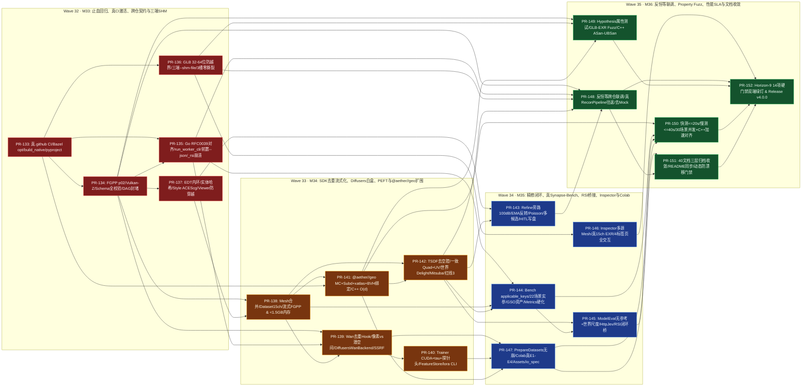

# M33–M36 Post-Horizon-8 全域复盘整改、原生扩围与真白盒演进计划 (Actionable Horizon-9 Blueprint)

> - **计划版本**: `v1.0`（对应主总纲 [`IMPLEMENTATION_PLAN.md`](../IMPLEMENTATION_PLAN.md) **`v3.7`**）
> - **触发审计基线**: [`AUDIT-POST-HORIZON8-AND-HOLISTIC-REVIEW-2026-11.md`](../archive/audits/AUDIT-POST-HORIZON8-AND-HOLISTIC-REVIEW-2026-11.md)（`main` @ `df93ac7`）
> - **规划模型**: `[gemini4]`
> - **当前状态**: 🚀 **Wave 33 (M34) 已完成 — PR-133 ~ PR-142 已合入 `main`，`ubuntu24` 全量测试通过**
> - **目标周期**: 4 个里程碑（`M33` – `M36`）、4 个并发 Execution Waves（`Wave 32` – `Wave 35`）、**20 个原子 PR**（`PR-133` – `PR-152`，紧接整体审查与规划 PR `#132`，实现 GitHub PR 号 1:1 严格对齐）

> [!IMPORTANT]
> **执行铁律（与 `AGENTS.md` / [`IMPLEMENTATION_PLAN.md`](../IMPLEMENTATION_PLAN.md) 对齐）**：
> 1. 所有改动必须走 Git Worktree（`/tmp/synapse-wt-prXXX`）→ 分支 → PR → Squash Merge → 清理 Worktree，严禁直接 push `main`。
> 2. Commit 与 PR 标题必须携带模型标识 `[<model-tag>]`，PR 正文首行必须声明 ``> **Operated by**: `<model-tag>` ``。
> 3. 每个原子 PR 合入前必须同时通过 **防静默失败三问**（存在问 / 接线问 / 执行问），并在 `ubuntu24` 实跑对应门禁（严格区分单进程 `-m "not slow"` 与并行 `-n auto`）。
> 4. 严禁修改测试来迁就错误公式（如复制错误 `p02` 符号、Mock 跳过核心权重注入、传入全黑帧 + 真值 `initial_mesh` 假装重构）。
> 5. 尚未创建的新路径（如 `.github/workflows/ci.yml`、`tests/test_property_contracts.py`、`docs/ARCHITECTURE.md`、`docs/WIRE_CONTRACTS.md`、`schemas/fgpp.v1.0.schema.json`、`schemas/style_profile.v2.0.0.schema.json`、`docs/archive/plans/`）及跨仓路径（`../aether/...`、`../render-farm/...`、`../grand-studio/...`）一律使用反引号标注，禁止生成断链 Markdown 跳转。

---

## 1. 全景概览、战略支柱映射与 Wave 32–35 调度拓扑

[`AUDIT-POST-HORIZON8-AND-HOLISTIC-REVIEW-2026-11.md`](../archive/audits/AUDIT-POST-HORIZON8-AND-HOLISTIC-REVIEW-2026-11.md) 在 `main` @ `df93ac7`（`v3.6.0`）上经过五切片逐行复审、跨仓 SSOT 核对（`../aether`、`../render-farm`、`../grand-studio`、`../fulgur`、`../caelum-core`）及 `ubuntu24` 无竞争独立复测 12 项门禁后确认：虽然静态工程基线显著改善（`209` 文件 `mypy --strict` 零错、Ruff 8 条核心规则解禁零报错、`1,156` 条文档链接零断链），但仍存在 **`18×P0 + 24×P1 + 12×P2 + 4×P3 = 58`** 项实证缺陷（含 **4 项 Horizon-8 新引入的必崩回归**），且测试 SLA（单进程快测 `38.60s` > `25s`，慢测 `90.75s` > `45s`）、`.github/workflows/ci.yml` 缺失与核心算子代差（`0` `diffusers` 接线、`32³` 玩具体素、`38.6 GB` `float64` 内存爆炸）尚未真正闭合。

**Horizon 9 (`M33–M36`, `PR-133 ~ PR-152`)** 将“止血回归清零”与“七大战略级架构进化支柱”合龙为四个递进里程碑，将全仓健康度从 **`67/100`** 推进至 **`>= 95/100`**（`Release v4.0.0`）。



### Wave 并发与目录隔离矩阵

| Wave | 里程碑 | 并发 PR 组（目录正交隔离） | 核心交付战果 |
| :--- | :---: | :--- | :--- |
| **Wave 32** | **M33** | `PR-133` → (`PR-134` ∥ `PR-135` ∥ `PR-136`) → `PR-137` | 激活真 GitHub CI + Bazel `opt`、修 `p02` 与跨仓 RFC 0039 `JobBundle`、解 `_rsi.py` 崩溃、封 GLB 溢出越界并通三端 SHM、修 EDT/Style/Viewer |
| **Wave 33** | **M34** | (`PR-138` → `PR-139` → `PR-140`) ∥ (`PR-141` → `PR-142`) | 合并网格与流式 `<1.5GB` 架构、打通 `WanAdapter`+真 `DiffusersWanBackend`、CUDA+时域对齐 PEFT 训练、绑定 `@aether//geo`、真 3D 逆向与 `Mitsuba` |
| **Wave 34** | **M35** | `PR-143` ∥ `PR-144` → `PR-145` ∥ `PR-146` ∥ `PR-147` | 解剖精修与 HITL 账本闭环、30 场景真实评测+GSO 资产、无参考/世界尺度评估与 RSI 飞轮桥、多源/真 EXR Inspector、Colab/Datasets 真运行 ✅ |
| **Wave 35** | **M36** | (`PR-148` ∥ `PR-149` ∥ `PR-150` ∥ `PR-151`) → `PR-152` | 反恒等跨仓/往返测试、`hypothesis`/ASan Fuzz、单进程快测 `<=20s` / 慢测 `<=40s`、文档三层收敛、14 项硬门禁双端绿灯封板 `v4.0.0` |

---

## 2. M33 (Wave 32): 止血回归、真 CI 激活、跨仓契约与三端 SHM

<a id="pr-133"></a>
#### PR-133: 激活 `.github/workflows/ci.yml`、恢复 Bazel `opt` 与 `build_native` 超时、补齐 `pyproject.toml` 依赖与规则 (`M33 / Wave 32`)

- **对应审计项 / 战略支柱**: `H9-P0-01` · `H9-P1-12` · `H9-P2-08` / 支柱一
- **前置依赖**: 无（Horizon 9 首发基础设施 PR）
- **预估体量**: ~240 LOC（`.github/workflows/ci.yml`, `.ci/`, `pyproject.toml`, `.gitignore`, `csrc/geometry/.bazelrc`, `tools/data-inspector/native/.bazelrc`, `scripts/build_native.py`）
- **隔离 Worktree 分支**: `fix/pr-133-true-ci-bazel-opt-pyproject`
- **详细改动清单**:
  1. **激活真实 CI 并消除 `.ci/` 分裂**：将 `.ci/workflows/ci.yml` 迁至 `.github/workflows/ci.yml`（用带 `workflow` scope 凭据推送）并删除 `.ci/`；修复 `python-fast` 改为同级检出 `synapse` (`path: synapse`) 与 `dervgen/aether` (`path: aether`，配只读 `DERVGEN_PAT` 兜底与 fork 降级提示)、装系统依赖 `libgl1 libopenexr-dev ffmpeg` 与 `pybind11`、去掉 `build_native.py` 的 `continue-on-error: true`、修复 `mypy` 执行逻辑（`set +e; OUTPUT=$(mypy ...); RC=$?; set -e; echo "$OUTPUT"; test $RC -eq 0` 保证出错不吞日志）、为 `python-slow` 注入 `SYNAPSE_CI_STRICT_DEPS: "1"` 与原生构建、`electron-inspector` Job 前置构建 `//:data-inspector-native`，并新增 Markdown 断链扫描与基准耗时门禁。
  2. **恢复 Bazel 默认 `--compilation_mode=opt` 与 `build_native.py` `--timeout`**：在 `csrc/geometry/.bazelrc:14` 与 `tools/data-inspector/native/.bazelrc:13` 显式补齐 `build:opt --compilation_mode=opt`（不依赖外部 `all-overview`）；修复 `scripts/build_native.py:662` 向 `_build_with_bazel(..., timeout=args.timeout)` 传参（默认值改为 `300.0`），移除重复 `--config=<os>`（`L66-67`），剔除冗余 `mesh_forensics.cc`（`L192`），为直编 C++ 补齐 `-DSPDLOG_NO_EXCEPTIONS=1 -DFMT_USE_EXCEPTIONS=0`。
  3. **补全 `pyproject.toml` 依赖、`mypy`/`ruff` 规则与 `.gitignore`**：在 `[gpu]` 补 `diffusers>=0.30.0`, `accelerate>=0.33.0`, `transformers>=4.44.0`, `huggingface_hub>=0.24.0`, `torchvision`；`[train]` 补 `webdataset>=0.2.86`；`[dev]` 补 `pybind11>=2.12.0`, `hypothesis>=6.100.0`, `jsonschema>=4.21.0`；Ruff 移除 `RUF059` 忽略并启用 `W`, `E501`, `PT`, `S108`, `S301`, `S310`, `S602`, `S603`（清零全仓新增告警）；`tool.mypy.python_version = "3.12"`；`.gitignore` 新增 `uv.lock` 与 `eval_output/`。
- **`ubuntu24` 实测验收命令**:
  ```bash
  /root/venv-synapse/bin/ruff check python/ tests/ scripts/ tools/
  /root/venv-synapse/bin/mypy --strict python/synapse tests/ scripts/ tools/
  (cd csrc/geometry && bazel test //:test_geometry --test_output=errors)
  /root/venv-synapse/bin/python scripts/build_native.py --backend=auto --timeout 300 --json
  ```
- **三问验收标准**:
  - **存在问**: `.github/workflows/ci.yml` 存在且 `.ci/` 已清除；两处 `.bazelrc` 含 `build:opt --compilation_mode=opt`；`.gitignore` 含 `uv.lock`。
  - **接线问**: `build_native.py --timeout 300` 实际传递至 `subprocess.run(..., timeout=300)`；`ruff` 主动捕获未使用的解包变量（`RUF059`）。
  - **执行问**: 本地静态检查全绿且远端 GitHub Actions PR 触发产生有效运行记录（`gh run list` 非空）。

---

<a id="pr-134"></a>
#### PR-134: 修复 FGPP `p02` 水平主点镜像、多引擎相机投影解析、EXR/深度校验与 `import_dag_guard`/`wire_guard` 漏洞 (`M33 / Wave 32`)

- **对应审计项 / 战略支柱**: `H9-P0-02` · `H9-P1-01` · `H9-P1-02` / 支柱二
- **前置依赖**: `PR-133`
- **预估体量**: ~380 LOC（`python/synapse/fgpp/`, `python/synapse/adapters/lora/manifest.py`, `python/synapse/inspect/schemas.py`, `schemas/`, `tools/import_dag_guard.py`, `tools/wire_guard.py`, `tests/`）
- **隔离 Worktree 分支**: `fix/pr-134-fgpp-p02-camera-schemas-guards`
- **详细改动清单**:
  1. **真正修复 `fgpp/frame.py` `p02` 符号反转与多引擎矩阵兼容性**：
     - 修正 `CameraParams.projection_matrix()` (`L80`)：`p02 = (w - 2.0 * float(self.cx)) / w`；同步修正 `FGPPSequence.load_metadata()` (`L339`)：`cx = (1.0 - p02) * float(width) / 2.0`。
     - 显式支持识别 OpenGL `[-1, 1]`、Vulkan `RH_ZO [0, 1]` 及 `fulgur` `Infinite Reversed-Z`（`p22 == 0, p32 == -1, p23 == z_near`）与正交投影矩阵，提供统一 `CameraConvention` 辅助转换器；无论是否含 `"camera"` 键，均强制运行 `SO(3)` (`det(R)=+1`, `||R^T R - I||_F <= 1e-4`) 与 `[0, 0, 0, 1]` 底行校验。
  2. **对齐 `fgpp/schema.py` 非有限值与 `fgpp/io.py` EXR 严格校验**：
     - 对标 `../aether/fgpp/include/aether/fgpp/fgpp_types.h:143-145`：当 `z_m`、`z_near_m`、`z_far_m` 任一非有限（`NaN`/`±Inf`）时 `linear_to_log_normalized_depth` 与 `log_normalized_to_linear_depth` 返回 `0.0`（不再把 `NaN` 钳成 `1.0`）。
     - `_read_exr_frame`：校验 `dataWindow` 宽高与 `camera.width/height` 一致，校验每条已读通道在 EXR 头部的 `PixelType`（`FLOAT`/`HALF`/`UINT`）匹配 `FGPP_CHANNEL_SPECS`，错配抛 `ContractValidationError(10)`；`export_fgpp(..., strict: bool = True)` 默认要求 15 个标量通道齐备并做边界值消毒。
  3. **封堵 `import_dag_guard.py` 两处绕过并升级 `wire_guard.py` 双向 Schema 校验**：
     - `import_dag_guard.py`：使用 `pkg_files` 检查所有发现子包均已登记于 `TIER_MAP`；拦截任何非 `__init__.py` 模块中的裸 `import synapse`（避免经 PEP 562 `__getattr__` 绕过 DAG）；清理死变量 `toplevel_edges`。
     - 新增 `schemas/fgpp.v1.0.schema.json` 与 `schemas/style_profile.v2.0.0.schema.json`；加固 `LoRAManifest.adapter_path` 拦截 `..` / `/` / `\` / `C:` 路径穿越及 `alpha` 有限非负；收紧 `CameraPose.rotation` 仅接受长度 `4` 或 `9`；升级 `wire_guard.py` 遍扫全部 `schemas/*.json` 并调用 Pydantic `model_json_schema()` 比对约束/枚举/类型/必填键与数值范围。
- **`ubuntu24` 实测验收命令**:
  ```bash
  /root/venv-synapse/bin/python tools/import_dag_guard.py --check
  /root/venv-synapse/bin/python tools/wire_guard.py --check --require-aether
  SYNAPSE_CI_STRICT_DEPS=1 /root/venv-synapse/bin/pytest tests/test_fgpp_contract.py tests/test_fgpp_io.py tests/test_architecture_dag.py tests/test_wire_schemas.py -v
  ```
- **三问验收标准**:
  - **存在问**: `fgpp/frame.py:80` 使用 `(w - 2.0 * cx) / w`；`schemas/` 含 `fgpp.v1.0` 与 `style_profile.v2.0.0`；`LoRAManifest` 拒绝 `../evil.safetensors`。
  - **接线问**: 偏心主点 `(cx=700, cy=200, W=1024, H=512)` 渲染点 `(0, 0, -5)` 在 `SoftwareRasterizer` 精确落于像素 `(700, 200)`；裸 `import synapse` 在非根包被 `import_dag_guard` 报错阻断。
  - **执行问**: 伪造 `FLOAT` 型 `Cryptomatte.ID` 或错位 `PixelType` EXR 返回 `ExitCode 10`；`wire_guard` 检出全量 8 份 Schema 零漂移。

---

<a id="pr-135"></a>
#### PR-135: 打通真实跨仓 RFC 0039 `JobBundle`、`run_worker_cli` 路由、全祖先沙箱与统一 CLI `--json` (`M33 / Wave 32`)

- **对应审计项 / 战略支柱**: `H9-P0-03` · `H9-P0-04` · `H9-P1-10` · `H9-P1-11` / 支柱二
- **前置依赖**: `PR-133`, `PR-134`
- **预估体量**: ~360 LOC（`python/synapse/pipeline/bundle_worker.py`, `python/synapse/cli/`, `schemas/job_bundle.v1.0.schema.json`）
- **隔离 Worktree 分支**: `fix/pr-135-rfc0039-worker-cli-rsi-json`
- **详细改动清单**:
  1. **修复 `run_worker_cli` 并 1:1 对齐 Go `render-farm` / TS `grand-studio` RFC 0039 `JobBundle`**：
     - 在 `bundle_worker.py:1052` 检测 `closure_type` 键自动路由 `BundleManifest.from_rfc0039_job_bundle(raw)`（消除 CLI 入口 `extra="forbid"` 直接拒收）。
     - 对照 `../render-farm/internal/domain/models.go` 与 `../grand-studio/src/core/job-bundle.ts`：兼容 `asset_manifest[].logical_path`（与 `path`）、`size_bytes`、`payload: null`、`OutputSink` (`{format, channels, write_capability}`) 嵌套解析、`EngineSpec` (`{name, version, mode}`) 与 `SceneSpec` (`resolution`, `frame_range`, `camera`, `crop_window`, `target_crypto_ids`) 透传（含 camelCase 别名），修复 `input_sha256s` 在 `scene_spec`/`inputs` 中寻址且缺文件直接抛 `AssetNotFoundError(20)`，传递 `hardware_budget` 并在 `HardwareBudget` 校验 `free_vram_gb >= 0`, `max_cpu_cores >= 1` 与 W3C `traceparent` 格式。
  2. **修复 `JobBundleWorker` 路径沙箱、空路径 CWD 与 `ResultManifest` 错误透传**：
     - 升级符号链接检查：不仅检查末级 `is_symlink()`，遍历全祖先组件禁止符号链接穿越，支持可选 `--workspace-root` 严格 `is_relative_to` 沙箱，同步校检 `manifest.params` 内的输入输出路径；拒绝空字符串 `""` 退化为 `Path(".")` CWD；将 `bundle_worker.py` `L871` 改用副本映射避免原地篡改入参 `manifest`。
     - 在 `ResultManifest` 新增 `error_type: str = ""` 与 `message: str = ""`，保证底层 `SynapseError` 异常文本不再被 `agent_fix_hint` 吞没，并在 `--json` 信封统一状态码与 `"status"` 字段语义。
  3. **修复 `cli/_rsi.py:269` `UnboundLocalError` 回归与全 CLI `--json` 零 stdout 污染**：
     - 在 `cli/_rsi.py:169` 初始化 `base_scenarios_raw = cand_scenarios_raw = None` 修复 `--baseline-report` + `--candidate-report` 崩溃，连线 `--strict` 至 `raise_on_reject`，去掉死参数 `--scenarios` 或将其明示弃用报错。
     - 在 `cli/common.py::_run_with_json_mode` 统一强制设置 `args.json = json_mode`，子命令 `--json` 参数统一设 `default=argparse.SUPPRESS`，根治 `synapse --json inspect/recon` 向 stdout 打印人类文本；统一退出码（缺可选包→`30`，缺必填参数→`10`），并将 `main_data_gen`/`main_viewer` 彻底纳入 `SynapseArgumentParser` 确定性错误体系。
- **`ubuntu24` 实测验收命令**:
  ```bash
  /root/venv-synapse/bin/pytest tests/test_bundle_worker.py tests/test_cli.py tests/test_cli_deterministic_codes.py tests/test_rsi_promotion_gate.py -v
  ```
- **三问验收标准**:
  - **存在问**: `run_worker_cli` 含 `from_rfc0039_job_bundle` 分支；`ResultManifest` 含 `error_type`/`message`；`_rsi.py:169` 预先初始化变量。
  - **接线问**: 喂入原汁原味 Go `render-farm` `JobBundle` JSON 运行 `synapse worker run --bundle ... --json` 正常分发；`synapse rsi gate-promote --baseline-report ... --candidate-report ...` 正常产出结论；`synapse --json inspect mesh ...` 输出纯单行可解析 JSON。
  - **执行问**: 含中间目录符号链接或篡改 `asset_manifest[].sha256` 的作业分别精准退出 `10` 与 `20`；缺依赖统一退出 `30`。

---

<a id="pr-136"></a>
#### PR-136: 封堵 `Data Inspector` `.glb` 32/64 位整数溢出堆越界读、打通三端 `--shm-file` 与 3 槽无撕裂环形缓冲 (`M33 / Wave 32`)

- **对应审计项 / 战略支柱**: `H9-P0-07` · `H9-P0-08` · `H9-P1-20` / 支柱六
- **前置依赖**: `PR-133`
- **预估体量**: ~340 LOC（`tools/data-inspector/native/{main.cc,inspector_app.cc,inspector_shm_server.cc}`, `tools/data-inspector/electron/{native-process.js,shm-reader.js,main.js}`, `tools/data-inspector/native/test_inspector.cc`, `tools/data-inspector/test/test-bundle-loading.js`）
- **隔离 Worktree 分支**: `fix/pr-136-inspector-glb-overflow-triplatform-shm`
- **详细改动清单**:
  1. **封堵 `loadGlbMesh` 32/64 位整型溢出堆缓冲区越界读漏洞 (`inspector_app.cc`)**：
     - 在计算总字节数前先用 `uint64_t` / `size_t` 校验 `rawIdxCount` 上限（例如 `kMaxMeshVertices = 16M`, `kMaxMeshIndices = 48M`）并**先强转为 `size_t` 再乘以 `2`/`4`/`elemBytes`**，彻底消灭 `uint32_t idxCount * 4` 绕回漏洞；对 `posViewOffset + posAccOffset` 与 `vi * byteStride` 全程采用溢流安全加法（`if (a > binChunk.size() || b > binChunk.size() - a) return false;`）。
     - 在 `test_inspector.cc` 补齐 `rawIdxCount = 0x40000001`、64 位 `byteOffset` 绕回与负 `byteStride` 恶意 `.glb` 单测，验证安全拒收零越界。
  2. **打通 macOS / Windows / Linux 三端 `--shm-file` 共享内存与零撕裂同步**：
     - 在 `tools/data-inspector/native/main.cc:69-81` 新增 `--shm-file=<path>` 解析，赋值给 `config.shmFilePath` 并置 `config.useShmFile = true`；收紧 `inspector_shm_server.cc:132` 文件权限为 `0600` + `O_NOFOLLOW`，默认退出析构及 Electron `stop()` 主动清理临时 SHM 文件。
     - 修复 `native-process.js:127,210` 路径不一致：将统一的 `this._shmFilePath = path.join(os.tmpdir(), ...)`（`darwin`/`win32` 下启用，或受控可测）直接传给 `--shm-file=...` 与 `new ShmFrameReader(shmTarget)`；修复错误提示目标名为 `//:data-inspector-native`。
     - **消除 `_pixelBuf` 撕裂竞态 & 收缩 Seqlock 持锁窗口**：在 `ShmFrameReader` 引入 3 槽 `Buffer` 轮转池（使 `main.js` 33ms 节流期间持有的 `pendingFrame.pixels` 永不被下一次 `pollOnce()` 失败覆写）；将 `InspectorShmServer::beginFrame` 从光栅前移至仅包裹写指针切换/发布阶段（零阻塞 CPU 光栅），避免 Reader 因 `MAX_SPIN_RETRIES=4` 饥饿丢帧。
- **`ubuntu24` 实测验收命令**:
  ```bash
  (cd tools/data-inspector/native && bazel test //:test_inspector --test_output=errors && bazel build //:data-inspector-native)
  node tools/data-inspector/test/test-bundle-loading.js
  ```
- **三问验收标准**:
  - **存在问**: `main.cc` 解析 `--shm-file`；`inspector_app.cc` 零 `uint32_t * 4` 溢出运算；`shm-reader.js` 含多槽缓冲池。
  - **接线问**: `InspectorProcessManager` 启动原生进程时两侧读写同一 SHM 文件路径且退出后临时文件清除；`test-bundle-loading.js` 同时验证默认 `/dev/shm` 与跨平台 `--shm-file` 两种 e2e 路径。
  - **执行问**: C++ `test_inspector` 全绿（含恶意 `.glb` 防护）；Node 端 23+ 项测试 0 skip 全绿。

---

<a id="pr-137"></a>
#### PR-137: 修复 `composite` EDT 单调内环与实体引导、`detector` 误报/FoV、`style` ACEScg/IRLS/Fréchet、`viewer` 符号链接及 `__init__`/`telemetry` (`M33 / Wave 32`)

- **对应审计项 / 战略支柱**: `H9-P0-13` · `H9-P1-04` · `H9-P1-05` · `H9-P2-05` · `H9-P2-06` / 支柱二、支柱三
- **前置依赖**: `PR-134`
- **预估体量**: ~380 LOC（`python/synapse/composite/`, `python/synapse/style/`, `python/synapse/viewer/`, `python/synapse/__init__.py`, `python/synapse/telemetry.py`, `python/synapse/errors.py`）
- **隔离 Worktree 分支**: `fix/pr-137-composite-style-viewer-telemetry`
- **详细改动清单**:
  1. **修复 `composite/blend.py` 与 `composite/detector.py`**：
     - `blend.py:297-317`：删除对双边受限 `inner_band` 的循环腐蚀剥离，直接调用 `exact_euclidean_distance_transform` 计算单调权重 `d_in / np.maximum(d_in + d_out, 1e-6)`（外缘 `1.0` 单调平滑降至内缘 `0.0`，零阶跃硬缝且提速 16 倍）。
     - `blend.py:714-738`：将 `_cryptomatte_boundary_guide` 改为按 `Cryptomatte.ID` 哈希映射至互异 3 通道黄金比率嵌入色（背景 `0 -> [0,0,0]`），并删除无用参数 `fgpp_frames` 或将其正确类型化。
     - `blend.py:564,589`：在 `boundary_band` 区域内测量运动矢量均值触发防重影，并按输入数据类型保留浮/整输出；统一复用 `style.aces_color` 的 CIE LAB 互转函数。
     - `detector.py:240-390`：将 `_detect_silhouette_drift` 限制在真实边界邻域走廊内并算双向轮廓 Chamfer 距离（消灭纹理画面 100% 假阳并能检出消失物体）；修正 `_detect_ground_violation` 退化焦距为 `fx = fy`（源自垂直 `fov_degrees`）并按连续时间段拆分缺陷事件，同时直接用单行矩阵点积算 `world_y` 降 8 倍内存。
  2. **修复 `style/extractor.py` 与 `style/aces_color.py`/`descriptor.py`/`profile_mapper.py`**：
     - `extractor.py`：在进入提取器时通过 `linear_srgb_to_acescg` 真实转换工作空间并基于 AP1 权重计算亮度与色品（估计 `key_light_rgb`、`tint` 与暗角）；重写 `_solve_half_cosine_light_irls` 为分段线性雅可比 `np.where(dot_nl[:, None] > 0, normals, 0.0)` 保留全部背光面环境光 $a_0$ 约束；重写 `_frechet_mean_s2` 使用数值稳定的 `theta = 2 * atan2(||x - mu||, ||x + mu||)` 消除对跖点 `31,416 rad` 爆炸；防御 `y == 0.1858` 零除、`T == 0` 空序列并钳位 `exposure_ev` 至 `[-20, 20]`。
     - `aces_color.py:308`：`_fallback_ciede2000_delta_e` 在 `sqrt` 前做 `np.maximum(..., 0.0)`；`descriptor.py` 校验 `key_light_dir_world` 非零向量与 `tone_curve_lut_1d` 有限值；`profile_mapper.py` JSON 序列化开启 `allow_nan=False`。
  3. **修复 `viewer/server.py` 防符号链接穿越、`__init__.py` 延迟导出与 `telemetry.py` 显存策略**：
     - `viewer/server.py:52-109`：在 `.resolve()` 之前递归检查源路径及其父链路与全数子目录/资源文件的 `is_symlink()` 及 `is_relative_to(dataset_path)`；修好模板连续 `.replace()` 注入顺序与 4 位以上帧索引溢出提示；清理 `server.py` / `static_html.py` 遗留 Server 文案。
     - `synapse/__init__.py`：将 `"errors"` 与 `"telemetry"` 加入 `_SUBMODULES`、`TYPE_CHECKING` 与 `__all__`；`errors.py:57` 在 `to_json_dict()` 中递归净化 `Path`/NumPy 标量/`NaN`；`telemetry.py` 将 `TraceContext.trace_id` 强制小写规范化，并在 `weight_gb > available_vram_gb` 时推荐 CPU Offload 策略而非无效的 `SPATIAL_TILE_2X2`。
- **`ubuntu24` 实测验收命令**:
  ```bash
  SYNAPSE_CI_STRICT_DEPS=1 /root/venv-synapse/bin/pytest tests/test_composite_blend.py tests/test_composite_mask.py tests/test_style.py tests/test_dataset_and_viewer.py -v
  ```
- **三问验收标准**:
  - **存在问**: `blend.py` 使用 EDT 比率权重与 3ch 实体哈希引导；`viewer/server.py` 在 `resolve()` 前检查 `is_symlink()`；`synapse/__init__.py` 可直接冷导入 `synapse.errors`。
  - **接线问**: `border_ring_lab_match` 对半径 50 圆盘掩膜呈现单调平滑过渡（内环边界跳变 `< 2/255`）；`extract_style_optical` 在纯背光/极暗 HDR 样本不抛异常且估算真实 `key_light_rgb`。
  - **执行问**: 含符号链接 `frames/leak.svg` 的数据集在 `export_static_html` 精确退出 `10`；`pytest` 相关套件全绿。

---

## 3. M34 (Wave 33): 核心去重流式化、`DiffusersWanBackend`、真实 PEFT 与 `@aether//geo` 扩围

<a id="pr-138"></a>
#### PR-138: 核心 SDK 网格/光栅/色彩去重，落地流式 `FGPPStream` 与 `< 1.5 GB` 逐帧 `float32` 内存架构 (`M34 / Wave 33`)

- **对应审计项 / 战略支柱**: `H9-P1-03` · `H9-P1-06` · `H9-P2-01` · `H9-P2-02` · `H9-P2-03` / 支柱三
- **前置依赖**: `PR-134`, `PR-137`
- **预估体量**: ~480 LOC（`python/synapse/render_core/`, `python/synapse/fgpp/io.py`, `python/synapse/models/asset.py`, `python/synapse/generators/`, `python/synapse/style/extractor.py`, `python/synapse/bench/`）
- **隔离 Worktree 分支**: `refactor/pr-138-core-dedup-streaming-lowmem`
- **详细改动清单**:
  1. **合并重复 Mesh 体系 & 修通全属性相机与水密基元 (`render_core/` & `models/`)**：
     - 统一 `MeshData`（`render_core/mesh.py`）作为唯一底层网格存储，`ProceduralMesh` 与 `ModelAsset` 委派或继承共享（消除 3 份重复 OBJ 导出与 `normalize` 不一致）；修复 `load_obj` UV 接缝顶角分裂及有 `vn` 无面索引时全零法线 Bug，缺失文件改抛 `AssetNotFoundError(20)`；重修 `procedural` 焊接几何体，消除 `Humanoid-53` 关节（如 `head`/`neck`）自穿插。
     - 在 `render_core/camera.py` 为全部 6 种轨迹生成器抽取 `_cam_kw` 转发 `z_near`, `z_far`, `aperture_fstop`, `shutter_angle_deg`；将 `bench/{rasterizer,camera,procedural,conditions}` 与 `generators/rasterizer` 收敛为带标准 `DeprecationWarning` 的薄别名并修正文档链接。
  2. **修复 `DatasetGenerator` 色彩与 15ch EXR，清除重复 `float64` 内存爆炸**：
     - `generators/dataset.py`：移除错误施加在 Linear sRGB 渲染输出上的 `acescg_to_linear_srgb`（或使 `SoftwareRasterizer` 统一输出域），传入 `base_color` 与 `roughness_metallic` 写出完整 15 通道（`34 B/px`）EXR，`except` 捕获 `BackendUnavailableError`，修复 `val_ratio == 0.0` 边界并用惰性导入封装 `cv2`/`PIL`（缺包报 `BackendUnavailableError(30)`）；删除 `generators/dataset.py` 死累积列表 `rgb_frames`/`depth_vis_frames` 与 `render_core/rasterizer.py:311` 死 `color_buf` (`24 B/px`)。
  3. **落地流式 `iter_fgpp_frames` & 逐帧 `float32` 降内存 (`< 1.5 GB` @ 97f 4K)**：
     - 在 `fgpp/io.py` 新增流式迭代器 `iter_fgpp_frames(input_dir, ...)`，消除 `_read_exr_frame` 末尾多余的 `.copy()` 并直接以 `float32` 处理非几何标量计算；升级 `style/extractor.py` (`extract_style_optical` / `extract_style_fgpp_intrinsic`) 改为逐帧 `float32` + 步进采样，彻底消灭 `38.6 GB` 双重全序列 `float64` 分配；修复 `render_core/pyramid.py` `uint8` 下溢、`1x1` `reflect` 崩溃及向量化 `upsample2x`。
- **`ubuntu24` 实测验收命令**:
  ```bash
  SYNAPSE_CI_STRICT_DEPS=1 /root/venv-synapse/bin/pytest tests/test_render_core.py tests/test_fgpp_io.py tests/test_style.py tests/test_dataset_and_viewer.py -v
  ```
- **三问验收标准**:
  - **存在问**: `fgpp.io` 导出 `iter_fgpp_frames`；`render_core/rasterizer.py` 无死 `color_buf`；`render_core/camera.py` 全轨迹透传 `z_near`/`z_far`/`aperture_fstop`/`shutter_angle_deg`。
  - **接线问**: `DatasetGenerator` 产出真实 15ch EXR；`extract_style_fgpp_intrinsic` 峰值内存较输入视频大小增长 `< 2.0x`（97f 4K `< 1.5 GB`）；`load_obj` 接缝模型保留全部接缝 UV。
  - **执行问**: 相关测试全绿，无 `MemoryError` 或 `DeprecationWarning` 内部误触发。

---

<a id="pr-139"></a>
#### PR-139: 修复 `WanAdapter` 滑窗/Hook/像素融合、落地真实 `DiffusersWanBackend` 与硬化 SSRF/云适配 (`M34 / Wave 33`)

- **对应审计项 / 战略支柱**: `H9-P0-09` · `H9-P1-07` · `H9-P1-08` · `H9-P2-07` / 支柱二、支柱四
- **前置依赖**: `PR-134`, `PR-135`, `PR-138`
- **预估体量**: ~520 LOC（`python/synapse/adapters/`, `python/synapse/bridge/http_security.py`, `python/synapse/bridge/foundary_client.py`）
- **隔离 Worktree 分支**: `feat/pr-139-wan-diffusers-lora-hook-ssrf`
- **详细改动清单**:
  1. **彻底修复 `WanAdapter.generate()` 4 大接线与数学缺陷 (`wan.py`, `lora/patcher.py`, `base.py`)**：
     - 删除 `wan.py:746-748` 冲突的无掩膜全局 `apply_merged_weights(model)` 调用，仅使用按滑窗局部切片 `sub_crypt` 挂载的 `manage_spatial_hooks(...)`（保证前景 `identity` 与背景 `style` 严格空域隔离、不叠加 `2x` Delta，并在 `finally` 绝对卸载）。
     - 修复 `LoRAPatchHook`：`h16 = max(h_m // 2, 1)` 兼容 `540p` 等奇数分辨率；扩展交叉注意力跳过列表至 Diffusers `attn2.to_k` / `attn2.to_v` / `add_k_proj` / `add_v_proj`（并按 `l_dim != tau_m * h16 * w16` 安全兜底防止维度崩溃）；扩展 `LoRAManifest` 匹配规则兼容 `blocks.{i}.attn1.*` / `attn2.*` 层级命名。
     - 修复因果暖启动切片：从 `prev_window_tail[stride - 3 : stride]`（全局 `[61:64]`）而非 `[-3:]`（未来帧 `[94:97]`）提取前导上下文，严格遵循 `sw.window.causal_warmup_prefix_indices` 切镜清零契约；在 `VideoModelAdapter.generate()` / `BenchPipelineRunner` 透传 `fgpp_frames` 激活 `DiscontinuityDetector` 与 `gamma_flow_bias` 光流偏置；区分**潜空间零均值保方差 Sigmoid 融合**与**像素空间线性光交叉溶解**（消除 `1.41x` 爆白闪烁）。
  2. **实现真实 `DiffusersWanBackend(WanBackendTransport)`（可选 `[gpu]` 后端）**：
     - 新增 `python/synapse/adapters/wan_diffusers.py`（惰性导入 `torch`, `diffusers`, `transformers`；缺依赖抛 `BackendUnavailableError(30)`），真实加载 `AutoencoderKLWan` / `WanPipeline` / `WanTransformer3DModel`，支持在 3D 因果潜空间 `[B, C, tau, H//8, W//8]` 执行分窗编码、3 帧因果暖启动、7 通道控制引导注入及潜空间 `fuse_overlapping_latents` 后统一 VAE 解码。
  3. **深度加固 `http_security.py` SSRF 防护与 `CloudAdapters` 完整性**：
     - `http_security.py`：调用 `socket.getaddrinfo()` 解析域名，显式解包 `ip.ipv4_mapped` / `sixtofour` / `teredo`（拦截 `::ffff:169.254.169.254`、十进制/八进制 IP、DNS 重绑定、云元数据地址 `fd00:ec2::254`/`100.100.100.200`），通过 IP 绑定连接执行请求；统一 `FoundaryHttpTransport` 与 `HttpFoundaryTransport` 并为其 `POST` 携带 `Idempotency-Key` 避免超时重试连开重复 GPU 任务。
     - `cloud.py`：转发 `conditions.text_prompt` 与 `camera_trajectory`、`Idempotency-Key` 请求头，采用有界软肩处理 HDR 引导帧。
- **`ubuntu24` 实测验收命令**:
  ```bash
  SYNAPSE_CI_STRICT_DEPS=1 /root/venv-synapse/bin/pytest tests/test_wan_adapter.py tests/test_wan_anchor_and_gates.py tests/test_wan_lora_wiring.py tests/test_condition_scheduler.py tests/test_cloud_adapters.py tests/test_bridge_and_hitl.py -v
  ```
- **三问验收标准**:
  - **存在问**: `wan.py` 已无 `apply_merged_weights` 重复调用；`wan_diffusers.py` 实现 `DiffusersWanBackend`；`http_security.py` 解包 `ipv4_mapped`。
  - **接线问**: 161 帧多窗口生成挂载空域 `LoRAPatchHook` 在真实多窗口 `540p` 与 `blocks.0.attn2.to_k` 下不崩溃且无跨掩膜污染；窗口 1 暖启动严格读取 `[61:64]` 帧（切镜时为空）；重叠区灰墙无 `1.41x` 亮度跳变；`validate_safe_url("http://[::ffff:169.254.169.254]/")` 抛出 `ContractValidationError(10)`。
  - **执行问**: 全部适配器/调度/SSRF 测试 100% 通过。

---

<a id="pr-140"></a>
#### PR-140: 修复 `StatelessLoRATrainer` CUDA/时域维度崩溃与潜空间探针损失，打通 `FeatureStore` 与 `synapse lora` 全套训练 CLI (`M34 / Wave 33`)

- **对应审计项 / 战略支柱**: `H9-P0-10` · `H9-P1-09` · `H9-P1-10` / 支柱四
- **前置依赖**: `PR-139`
- **预估体量**: ~420 LOC（`python/synapse/training/`, `python/synapse/cli/_lora.py`, `python/synapse/pipeline/stages/training.py`, `tests/`）
- **隔离 Worktree 分支**: `feat/pr-140-lora-trainer-cuda-probes-cli`
- **详细改动清单**:
  1. **修复 `StatelessLoRATrainer` 设备冲突、`T -> tau` 时域压缩与物理真实辅助损失 (`trainer.py`, `losses.py`)**：
     - `_extract_auxiliary_from_fgpp` 全程保留在 `fgpp_cond.device` / `x_1.device`（零 CPU NumPy 往返），兼容 4D `[C, T, H, W]` 与 5D `[B, C, T, H, W]` Batch 输入，并按 3D 因果步幅 `T -> tau = (T - 1)//4 + 1` 执行时域采样/平均池化对齐潜时间轴。
     - 废除用 16ch 潜速度前 3 维直接对齐 3D 世界法线的伪物理损失：引入可插拔轻量潜空间探针头 (`LatentGeometryProbe`, 1x1x1 卷积投影 16ch→1ch/3ch) 或基于冻结 `AutoencoderKLWan` 局部空间切片解码的 pixel-space `EdgePreservingLoss` / `NormalReconstructionLoss`（未提供探针头或解码器时显式标注跳过原因而非对 16ch 潜通道强行切片）。
     - 修复 `_dpo_step` 写入 `batch["t"] = t`；提供 `1D [B]` Diffusers 时间步适配并透传 `encoder_hidden_states`（仅捕获可预期的签名不匹配，禁止静默吞 `module.forward` 内部 `TypeError`）；`flush_gradients()` 在 `fp16` 下走 `self._grad_scaler.unscale_()` 与 `.step()`；增补梯度检查点（`gradient_checkpointing`）、cosine LR warmup 与断点状态字典保存/恢复（适配 Colab 抢占续跑）。
  2. **修复 `FeatureStoreBuilder` Gate 2w 对数深度校验、流式 Tar 与 `packager` 原子性**：
     - 按逆对数变换或合理对数跨度校验 Wan ch0（不再拿无量纲 `[0,1]` 对数深度跟 `0.1 m` 比较）；`add_sample()` 支持流式 `TarFile` 直写分片（消除 `1.5 GB/clip` 内存滞留）。
     - `packager.py` 先在临时目录校验全量门禁，通过后再原子重命名至 `output_dir`（门禁失败零残留）；修复 `lora_preencode` Stage 对接真/可配编码器并在 `0` 样本通过时 Fail-Closed 退出 `40`。
  3. **补齐 `synapse lora {prepare-data, train, merge}` 与 `lora_train` Stage（不再返回 50 空桩）**：
     - 在 `cli/_lora.py` 与 `stages/training.py` 真实串联 `FeatureStoreBuilder` → `StatelessLoRATrainer` → `MultiLoRAManager.merge_orthogonally` + `package_and_gate_lora_bundle`（缺 `torch`/`safetensors` 诚实退 `30`）。
- **`ubuntu24` 实测验收命令**:
  ```bash
  SYNAPSE_CI_STRICT_DEPS=1 /root/venv-synapse/bin/pytest tests/test_lora_trainer.py tests/test_lora_feature_store.py tests/test_lora_manager.py tests/test_lora_cli_gate.py -v
  ```
- **三问验收标准**:
  - **存在问**: `trainer.py` 在 `_extract_auxiliary_from_fgpp` 全程保留原 Tensor 设备；`cli/_lora.py` 与 `stages/training.py` 挂载完整 `prepare-data`/`train`/`merge` 实现。
  - **接线问**: 在 PyTorch `meta` / 异构设备模拟下零 `cpu/cuda` 跨设备错误；`T=17` `fgpp_cond` 与 `tau=5` 潜变量可无异常计算反向梯度；`synapse lora train --help` 与端到端 CPU 小模型训练产出门禁通过的 `.safetensors` 包。
  - **执行问**: 门禁失败时 `output_dir` 不留半成品权重；全部 LoRA 测试通过。

---

<a id="pr-141"></a>
#### PR-141: `@aether//geo` C++20 原生几何核大扩围（MC/Subd/`xatlas`/BVH）、C++ $O(d)$ 伞环与 Python 大面片漏检修复 (`M34 / Wave 33`)

- **对应审计项 / 战略支柱**: `H9-P1-12` · `H9-P2-02` · `H9-P2-04` · `H9-P3-04` / 支柱五
- **前置依赖**: `PR-133`, `PR-138`
- **预估体量**: ~460 LOC（`csrc/geometry/`, `../aether/geo/src/mesh_checks.cc`（若跨仓可改，否则同步提 PR 至 `aether` 并在 `csrc/geometry` 测试锁死）, `python/synapse/recon/{geometry,backend}.py`, `tests/`）
- **隔离 Worktree 分支**: `feat/pr-141-csrc-aether-geo-expansion`
- **详细改动清单**:
  1. **修复 Python Oracle 与原生一致性漏洞**：
     - `recon/geometry.py:759-789`：将触及超过 `_MAX_CELLS_PER_FACE = 512` 的大三角面放入 `large_faces` 列表，在窄相测试前对其与所有合法面做向量化 AABB 过滤，彻底消除穿过地面/墙面大三角形的漏检。
     - 对称化 `shared_pos` 相邻面剔除判定（Python `geometry.py:827` 与 C++ 对齐）；统一 `find_connected_components` 在 `bindings.cc` 与 `geometry.py` 中的函数签名；校验 `verts_per_face` 参数一致性；修复 `recon/backend.py:64-84` 直接透传 `float64` / `int64` 消除冗余 `float32` 降精度。
  2. **绑定 `@aether//geo` 现有 C++20 核并提速 ICP (`60 GB -> < 50 MB`)**：
     - 在 `csrc/geometry/BUILD.bazel`、`src/bindings.cc` 与 `scripts/build_native.py` 扩展绑定 `@aether//geo` 已有核：`marching_cubes`（从 3D 体素场快速抽面）、`catmull_clark_subdivide`（`SubdMesh`，保折痕与 UV）、`unwrap_uv_atlas`（`xatlas` 自动 UV 展平与打包）、`lod_simplify`（边折叠减面）与 `bvh_closest_points`（`@aether//spatial` BVH 加速）。
     - 修复 `recon/geometry.py:273` `refine_pose_6dof` 构造 `(N, M, 3)` 爆内存 Bug（优先走原生 BVH / `cKDTree`，兜底按 1024 行分块矩阵计算）。
  3. **C++ 伞环 $O(d)$ 与 Quad 单元测试扩充**：
     - 修复 `../aether/geo/src/mesh_checks.cc:341-375`（协同 `aether` 仓 PR）将 `analyzeManifold` 顶点伞环从 $O(d^2)$ 升级为局部邻接表 $O(d)$；在 `csrc/geometry/tests/test_geometry.cc` 补齐 Quad (`vpf=4`)、高阶星形极点（`d=10,000`）、浮动孤岛及新建 `MarchingCubes`/`SubdMesh`/`xatlas` 绑定单测。
- **`ubuntu24` 实测验收命令**:
  ```bash
  (cd csrc/geometry && bazel test //:test_geometry --test_output=errors)
  /root/venv-synapse/bin/python scripts/build_native.py --backend=auto --timeout 300 --json
  SYNAPSE_CI_STRICT_DEPS=1 /root/venv-synapse/bin/pytest tests/test_geometry_tier0.py tests/test_geometry_oracle_parity.py -v
  ```
- **三问验收标准**:
  - **存在问**: `synapse._c_geometry` 导出 `marching_cubes`, `catmull_clark_subdivide`, `unwrap_uv_atlas`, `bvh_closest_points`；`geometry.py` 含 `large_faces` 路径与分块 ICP。
  - **接线问**: 5 万顶点 `refine_pose_6dof` 在纯 NumPy 与原生模式下峰值增量内存 `< 100 MB`（不再爆 60GB）；大三角面穿刺用例 Python 与 C++ 结果 100% 一致。
  - **执行问**: C++ GoogleTest 与双轨互验单测全绿。

---

<a id="pr-142"></a>
#### PR-142: 修复 3D 逆向重建 (`TSDF`/`Quad+UV`/`Delight`/`Tracking`/`IK`)、挂载红线 #3、并落地真 `Mitsuba` + GGX/SH 可微闭环 (`M34 / Wave 33`)

- **对应审计项 / 战略支柱**: `H9-P0-14` · `H9-P0-15` · `H9-P0-16` · `H9-P1-10` · `H9-P1-13` · `H9-P1-14` · `H9-P3-03` / 支柱五
- **前置依赖**: `PR-138`, `PR-141`
- **预估体量**: ~560 LOC（`python/synapse/recon/`, `python/synapse/recon/loop/`, `python/synapse/pipeline/stages/recon.py`, `python/synapse/cli/_recon.py`）
- **隔离 Worktree 分支**: `fix/pr-142-recon-tsdf-quad-delight-mitsuba-redline3`
- **详细改动清单**:
  1. **修复 `multiview.py` & `geometry.py` 重建拓扑根疾**：
     - TSDF 融合：将 `weight > 0`（单元 8 角均有效观测或内部体素洪泛置 `-1.0`）传入 `_marching_cubes`（优先调用 `PR-141` C++20 `256³` MC），彻底消灭内部双壁空腔；Visual Hull `carve` 初始化为 `~in_bounds`；`_validate_cameras` 改以三维重建看点/体积中心算视差张角并拦截全共点零基线相机。
     - `quad_remesh`：当存在未配对三角形时对**全部 `quad_faces` 与 `unpaired_triangles`** 同步做一步 Catmull-Clark 均匀细分（消除一环 T-junction 裂缝，100% 满足 `check_watertight == True`），并在细分前结合 QEM 减面控制 `target_faces`；通过 `PR-141` `xatlas` 绑定或投影展开生成非空合法 `uvs`（供 `ClosedLoopRunner` & `fulgur` PBR 使用）。
  2. **重写 `delight.py`、修复 `tracking.py`、`kinematics.py` 并严格挂载红线 #3**：
     - `delight.py`：入口反伽马转线性空间，采用 Z-Buffer 完整三角形光栅化（Quad 扇形剖分）取代 5 点稀疏散点，在**世界空间法线**上跨视角联合拟合单组环境球谐光照，先做双色度高光分离再按有效观测在 **UV/顶点空间** 累积无光照反照率（消除 `(rad/E)*E` 自抵消、屏幕重影与相机系 SH 互消），直接复用 `style.aces_color` LAB 工具。
     - `tracking.py` / `kinematics.py`：向 `solve_camera_trajectory` 传入 `visibility`、加亚像素双线性 `patch_p` 与纯旋转 GRIC 抑漂、用共享三维点估计步间尺度、修正 `reprojection_error_px` `P1` 为 `t-1` 帧外参、全链路显式透传 `intrinsics` 与 OpenGL `-Z` ↔ OpenCV `+Z` 转换；`solve_zero_slip_ik` 在 Two-Bone IK 钳位**之后**重算滑移并从踝高+速度检测支撑相。
     - **序列化与红线 #3 落地**：修复 `stages/recon.py:111,291` 仅保存 `result.delight.albedo` ndarray（非 Pickle 对象）并修好无 `.npy` 后缀逻辑；打通 `kinematic_distill` 实际调用 `solve_zero_slip_ik` 导出骨骼轨迹；`cli/_recon.py` 持久化输出 `.obj`/`.usda` + OpenPBR 贴图并在 `--fgpp-dir` 实读 EXR；在 `ReconPipeline.run()`（`initial_mesh is not None`）与 `ClosedLoopRunner.run()` 强制挂载 `enforce_distillation_geometry_gate`（拦截粗糙白模直接反投）及 `evaluate_hitl_circuit_breaker(..., domain="asset_3d")`。
  3. **打通 `recon/loop/` 可微逆渲染真闭环 (`SYN-RFC-0062`)**：
     - `ForwardGuide`：在**调用 `adapter.generate()` 之前**将 `n_preroll` 边界 $\kappa=1.0$ 切镜配置注入 `ConditionScheduler`（杜绝 5500K 棚光跨窗渗漏）；`ClosedLoopRunner._build_refinements` 从前景色法线衍生紧凑 ROI bbox；`texture_extractor.py` 剔除 `[0,0,0]` 背景点并用 UV 偏导数对齐 MikkTSpace TBN。
     - `mitsuba_optimizer.py` & `radiometric.py`：委托 `style.aces_color` 消除矩阵重复，补齐 `AnalyticUVInverseOptimizer` 精确 `(ndotl > 0.05)` 初值 + 有效岛内掩膜 TV + 岛边膨胀填充 + 双线性 UV 与 GGX/SH 解析梯度；真实实现 `MitsubaInverseOptimizer.optimize_material_from_video`（支持 `cuda_ad_rgb` / `llvm_ad_rgb`、`principled` BSDF、`mi.ad.Adam` 与反向辐射误差优化，缺 `[invrender]` 诚实退 `30`/`50`）。
- **`ubuntu24` 实测验收命令**:
  ```bash
  SYNAPSE_CI_STRICT_DEPS=1 /root/venv-synapse/bin/pytest tests/test_recon*.py tests/test_recon_invert_cli.py tests/test_recon_closed_loop_e2e.py tests/test_pipeline_stage_adapters.py -v
  ```
- **三问验收标准**:
  - **存在问**: `stages/recon.py` 无 `np.save(DelightResult)`；`ReconPipeline.run()` 调用 `enforce_distillation_geometry_gate`；`MitsubaInverseOptimizer` 实现真实 `mitsuba` 分支。
  - **接线问**: 8 顶点粗白模直传 `ReconPipeline.run(initial_mesh=cube)` 被红线 #3 拦截退出 `10`；`TSDF` 重建球体单壳无内腔；`quad_remesh` 输出 `check_watertight == True` 且携带非空 `uvs`；`synapse recon invert-video` 在 `--output` 生成可加载 `.obj` 与贴图；方向光照射旋转视角下 `delight` 方差收敛 `>= 60%`。
  - **执行问**: 全量 `recon` 与 `recon/loop` 测试 100% 通过。

---

## 4. M35 (Wave 34): 解剖精修闭环、真 `Synapse-Bench`、RSI 桥接与 `Data Inspector` 完备化

<a id="pr-143"></a>
#### PR-143: 打通 `synapse.refine`（旁路 100dB / EMA / Fusion / Tiled / 多候选集成 / HITL 写盘） (`M35 / Wave 34`) ✅ 已实施

- **对应审计项 / 战略支柱**: `H9-P0-17` · `H9-P1-11` · `H9-P1-15` · `H9-P1-16` · `H9-P2-12` · `H9-P3-03` · `H9-P3-04` / 支柱五
- **前置依赖**: `PR-137`, `PR-142`
- **预估体量**: ~420 LOC（`python/synapse/refine/`, `python/synapse/pipeline/stages/refine.py`, `python/synapse/cli/_refine.py`, `python/synapse/bridge/hitl.py`）
- **隔离 Worktree 分支**: `fix/pr-143-refine-pipeline-fusion-stitcher-hitl`
- **详细改动清单**:
  1. **修复 `ScalpelStitcher` 与 `LocalRefinementPipeline` 门禁及融合逻辑**：
     - 全旁路健康视频（`total_patches == 0`）直接返回 `frames_acescg.copy()` 与 `mean_border_psnr_db = 100.0, mean_border_ciede2000 = 0.0`（不再因 `0.0 < 38.0` 报错且不写入 `hard_negatives.jsonl`）。
     - 修复 `_temporal_ema_blend`：高速运动时单调提高 `w_curr >= 0.85`（70% 历史重影变 15%），仅统计 `frame_boundary_band` 内光流幅值，越界坐标回退 `current`；为 `LocalRefinementPipeline.run()` 增加 `motion_vectors` 入参并传入 `stitch_sequence` 与 `temporal_warp_error`。
     - 修复接缝门禁与缝合精度：`_border_ring_mask` 改用外部环带 `dilated & (~fg_mask_bool)`；HDR 像素按标量亮度比保色缩放；`_warp_affine_bilinear` 对源像素改用 `BORDER_REPLICATE` 消除 1px 黑晕；基于 `smoothed_bbox` 重裁剪 `frames_acescg[t]`；跨帧按 IoU (`>= 0.3`) 匹配多目标跟踪（初始化 `P[:4,:4] = r * I` 并钳位 `predict()`）；打通 `TiledBypassExecutor.tile_and_execute`（超越 `tile_size` 自动触发）。
  2. **修复 `fusion.py`, `hand.py`, `face.py`, `types.py`, `gates.py` 与多候选集成**：
     - `fusion.py`：`_fuse_cascade` 补回 `(1.0 - alpha) * (result - coarse_res)` 保全高频细节；`_fuse_uncertainty` 在 `K=2` 时结合距心衰减/边缘锐度权重破除退化；`_fuse_poisson_gradient` 锚定外圈 1px Dirichlet 边界并用内域五点散度求解；`types.py` / `gates.py` 转 Linear sRGB 后做显示伽马与 LPIPS。
     - `hand.py` / `face.py`：`strict=True` 且无神经权重时不悄然放行启发式（未显式允许则报 `50`）；将 `hand.py` `axis=-1` 假均值替换为 `separable_gaussian` 空间滤波及极坐标轮廓抗旋转指节计数（`scipy.ndimage.label` 提速连通域）；`face.py` 分离左右眼独立质心测斜视、支持负偏航角并移除 ArcFace 矢量染色、`CanonicalAnchorGallery` 用 $S^2$ 单位方向角测地插值。
     - 定义多候选 `AnatomicalModelEnsemble`（可接入 `FoundaryTransport` 结构锁定 + 细节增强 + 原图引导多候选），激活 `MultiModelRefineFusion`。
  3. **修复 `stages/refine.py` / `cli/_refine.py` ROI 解析与 `PersistentHitlLedger` 持久化**：
     - 统一提取共用 ROI JSON 解析器（同时支持 `{"rois": [...]}`、`list[dict]` 与 `list[list[dict]]`），拒绝非法文件后缀与 0 ROI 并按裁剪后坐标更新 `RefinementROI.bbox_xyxy`。
     - `stages/refine.py` 与 `cli/_refine.py` 在执行结束后调用 `ledger.record_action(..., elapsed_seconds=...)` 真正累加 15 分钟 HITL 账本并在超时时触发 `ExitCode 40`（`hitl.py` 补全临时文件异常清理与跨平台锁兼容）。
- **`ubuntu24` 实测验收命令**:
  ```bash
  SYNAPSE_CI_STRICT_DEPS=1 /root/venv-synapse/bin/pytest tests/test_refine_cli_wire.py tests/test_refine_fusion.py tests/test_refine_hand_face.py tests/test_refine_roi.py tests/test_refine_stitcher_gates.py -v
  ```
- **三问验收标准**:
  - **存在问**: `pipeline.py` 透传 `motion_vectors` 并调用 `tile_and_execute`；`stages/refine.py` 调用 `ledger.record_action`。
  - **接线问**: 健康全旁路视频通过 `strict=True` 门禁（`PSNR=100.0`）；两轮 500s `anatomical_refine` 作业在 `PersistentHitlLedger` 累加到 `1000s > 900s` 并精准退出 `40`；向 `_fuse_cascade([X, X])` 注入同输入无 50% 高频衰减。
  - **执行问**: 全部 `refine` 测试 100% 通过。

---

<a id="pr-144"></a>
#### PR-144: 修复 `BenchPipelineRunner` 回归、激活 22/30 场景真实参数与 GSO 扫描资产、硬化 `metrics` 全维度门禁 (`M35 / Wave 34`) ✅ 已实施

- **对应审计项 / 战略支柱**: `H9-P0-05` · `H9-P0-18` · `H9-P1-06` · `H9-P1-17` · `H9-P2-01` · `H9-P2-07` · `H9-P3-01` / 支柱六
- **前置依赖**: `PR-135`, `PR-138`, `PR-142`
- **预估体量**: ~480 LOC（`python/synapse/pipeline/bench_runner.py`, `python/synapse/bench/`, `python/synapse/metrics/`, `python/synapse/cli/_bench.py`）
- **隔离 Worktree 分支**: `fix/pr-144-bench-30-scenarios-metrics-hardening`
- **详细改动清单**:
  1. **修复 `BenchPipelineRunner` & `evaluate_bundle` `applicable_keys` 回归并彻底激活 30 场景实参**：
     - 根据实际运行的阶段（`video_only` vs `with_recon`）严格收缩 `applicable_keys` 与 `evaluate_bundle` `required_keys`，用真实 `border_ring_ciede2000` 替换全图替代值、由 `extract_style_fgpp_intrinsic` 真实估测 `light_dir_error_deg`、在 `linear_to_srgb` 前先走 `acescg_to_linear_srgb` 并为 `depth_rmse_m`/`normal_angular_error_deg`/`silhouette` 传入真实 `valid_mask`（不再拿未焊接输入网格冒充输出拓扑）。
     - `render_core/camera.py` 为 `_generate_static` / `_generate_pan` 解析 `(distance, elevation_deg, azimuth_deg, azimuth_start_deg, azimuth_end_deg)`；`BenchPipelineRunner`（及 `cli/_bench.py` `export-fgpp`）接入 `Conditions.resolve()`、T3/T5 多物体组合布景、T4 多光/三点/逆光条件与 T2 5 类骨骼/刚体动画（调用 `generate_humanoid_proxy(pose_params=...)`）。
     - 修复 `bench/registry.py`（焊接 `cone` 消除退化面，下载 URL 哈希分桶 + 超时 + 禁 `file://` + 失败删残档，注册真 `GSO`/`Objaverse` 扫描纹理资产对接 `SYN-RFC-0063`）、`cli/_bench.py --export-bundle`（从 `AssetRegistry` 解析源资产）、`bundle_exporter.py`（防重名与动态锚点帧）、`report.py`（补齐 `normal_angular_error_deg`/`chamfer_mm` 支柱与防 `NaN` 耗时）与 `domain_randomizer.py`（清理死配置）。
  2. **硬化 `synapse.metrics` 数值、防作弊与性能**：
     - `profiles.py`：归一化去重别名避免单指标报双倍 `GateViolation`，补全 `"histogram_intersection": _HIGHER`。
     - `image_quality.py`：在 `validate_output_non_degenerate` 校验**逐帧空间方差**（拦截纯黑/纯白频闪）；逐帧 `float32` 流式计算 `ssim`（从 `20 GB` 降至 `< 100 MB`）；为 `lpips` 增加可选真 `torch`/`lpips` 后端及平坦区噪声抑制阈值与 `is_proxy_metric` 标记。
     - `roundtrip.py` / `fgpp_fidelity.py` / `style_consistency.py` / `temporal.py`：`watertight_pct` 必传 `vertices` 校验有限性；`f_score` 改用 `seed + 1` 独立点云采样；`albedo_delta_e00` 与 `border_ring_ciede2000` 统一处理 `uint8` 缩放并改用 EDT 加速（替代 800 次完整数组拷贝）；全模块增加形状一致性断言；`temporal.py` R3D-18 自动启用可用 CUDA 设备与批量推断。
- **`ubuntu24` 实测验收命令**:
  ```bash
  SYNAPSE_CI_STRICT_DEPS=1 /root/venv-synapse/bin/pytest tests/test_bench.py tests/test_bench_runner.py tests/test_metrics*.py tests/test_rfc0063_metrics.py tests/test_profiles_doc_sync.py -v -W error::scipy.linalg.LinAlgWarning
  ```
- **三问验收标准**:
  - **存在问**: `camera.py` `_generate_static`/`_generate_pan` 解析球坐标参数；`profiles.py` 含 `histogram_intersection`；`validate_output_non_degenerate` 检验每帧空域方差。
  - **接线问**: `synapse bench run --all --profile track_b_video` 在真实 `MockVideoAdapter` 下非无端全失败，而在纯黑/黑白频闪适配器下被严格拦截退出 `40`；`t2_humanoid_walk_side` 与 `frontal` 产出不同视角渲染。
  - **执行问**: 全部 `bench` & `metrics` 单测全绿，无 `LinAlgWarning`。

---

<a id="pr-145"></a>
#### PR-145: 修复 `model_evaluator` 无参考模式与世界尺度、`macro`/`align`/`inspect_refine`/`HttpJevTransport` 及打通 `RSI` 自演进飞轮自动桥 (`M35 / Wave 34`) ✅ 已实施

- **对应审计项 / 战略支柱**: `H9-P0-06` · `H9-P1-18` · `H9-P1-19` / 支柱六
- **前置依赖**: `PR-142`, `PR-144`
- **预估体量**: ~380 LOC（`python/synapse/inspect/`, `python/synapse/rsi/`, `python/synapse/pipeline/stages/{inspect,rsi}.py`）
- **隔离 Worktree 分支**: `fix/pr-145-inspect-evaluator-jev-rsi-bridge`
- **详细改动清单**:
  1. **修复 `inspect` 无参考评价、世界尺度、残差热力图与配准 (`model_evaluator.py`, `macro.py`, `align.py`, `jev_critic.py`, `flywheel_exporter.py`)**：
     - `model_evaluator.py`：向 `evaluate_profile_gates` 传入 `require_reference=(reference_mesh is not None)`，使无 `--reference-dir` 模式真正仅考核自身拓扑门禁不再全员退出 `40`；保留原始世界尺度计算 `chamfer_mm` / `f_score_*`（仅在渲染多视角截图时对临时副本做归一化对齐）。
     - `macro.py`：以物理感知归一化（如 `DeltaE / 20.0`、深度相对阈值）替代帧内 min-max 除极值，消除 1-LSB 量化噪点被放大成 `1.0` 缺陷，并在计算法线夹角时掩膜掉 `[0,0,0]` 背景。
     - `align.py`：将 Fibonacci 与 Nelder-Mead 相机围绕 `centroid` 布置（修复偏心模型失败），支持非方形图像并采用连续软轮廓/投影向量化加速；`inspect/schemas.py` 严格限定 `rotation` 长度为 `4` 或 `9` 且四元数先归一化。
     - **实装 `HttpJevTransport`（OpenAI/vLLM `top_logprobs`）与真实门禁诚实度**：打通 `VisualJevCritic` 与 `align.py`/`macro.py` 真实 3D ROI 坐标对齐并校准熵/概率置信度；`inspect_refine` Stage 与 CLI 在无真实 `auto_fix_fn` 时诚实抛出 `NotImplementedStageError(50)`（杜绝标 `waived=True` 退出 `0`）；`flywheel_exporter.py` 严禁同为空 URI 跨会话错配或重复复用 `chosen` 记录。
  2. **修复 `rsi` 验证/配对漏洞并建设自动化飞轮连接桥**：
     - `dual_verifier.py`：允许 `is_manifold_watertight` 传入 `bool`，且当 `thresholds.manifold_watertight == True` 时将其列为必填物理键；修正 `stages/rsi.py` 错误的 `agent_fix_hint` 键名。
     - `pair_builder.py`：拒绝 `chosen_uri == ""` / `rejected_uri == ""` 空 URI 计入 20% L0 黄金池；`from_dpo_record` 严格保留原始 `source` 与 `is_golden`（阻断 `self -> human` 溯源洗白）。
     - `promotion_gate.py` & `curriculum.py`：交叉核验 `BenchReport` 总分/子分与 `scenarios` 均值一致性（补齐 `style`/`fgpp_fidelity` 维度）、拒绝静默去重；在 `curriculum.py` 混入 `round` 序号避免每轮生成重复考题，并新增 `ChallengeScenario.to_bench_scenario()` 与 `scenario_reports_to_bench_report()` 转换器打通全自动飞轮闭环。
- **`ubuntu24` 实测验收命令**:
  ```bash
  SYNAPSE_CI_STRICT_DEPS=1 /root/venv-synapse/bin/pytest tests/test_model_evaluator.py tests/test_eval_report.py tests/test_inspect_align.py tests/test_inspect_macro.py tests/test_inspect_jev.py tests/test_inspect_flywheel.py tests/test_rsi_promotion_gate.py tests/test_rsi_verifier_and_pairs.py -v
  ```
- **三问验收标准**:
  - **存在问**: `evaluate_profile_gates` 含 `require_reference` 参数；`HttpJevTransport` 与 `scenario_reports_to_bench_report` 存在；`from_dpo_record` 保留 `source`。
  - **接线问**: 无 `--reference-dir` 对合格水密网格返回 `passed=True` (`ExitCode 0`)；10 倍尺度错误网格在世界尺度下被精确检出（不再 `chamfer_mm=0.0`）；`source="self"` 记录经 `from_dpo_record` 后保持 `"self"`。
  - **执行问**: 全量 `inspect` 与 `rsi` 测试 100% 通过。

---

<a id="pr-146"></a>
#### PR-146: 完备化 `Data Inspector`（多源网格管理、真 15ch EXR AOV、同步截图/`resize` 与四标签页桌面交互） (`M35 / Wave 34`) ✅ 已实施

- **对应审计项 / 战略支柱**: `H9-P1-20` · `H9-P2-10` / 支柱六
- **前置依赖**: `PR-136`
- **预估体量**: ~460 LOC（`tools/data-inspector/native/`, `tools/data-inspector/electron/`, `tools/data-inspector/renderer/`, `tools/data-inspector/test/`）
- **隔离 Worktree 分支**: `feat/pr-146-data-inspector-exr-multiview-ui`
- **详细改动清单**:
  1. **原生 C++ 视口升级 (`native/inspector_app.{h,cc}`, `BUILD.bazel`)**：
     - 独立管理 `source`、`animation`、`reconstructed` 多网格实体列表（替代单一 `m_mesh` 互相覆盖），支持按实体名触发 `set_entity_visible` 与按当前 Tab/实例切换渲染对象。
     - 接入真实 OpenEXR 读取（基于 `@aether//io` / `tinyexr`）消费 15 通道 FGPP AOV (`DirectRadiance`, `Depth`, `WorldNormal`, `MotionVector`, `BaseColor`, `RoughnessMetallic`, `Cryptomatte.ID`)，并实现真实网格 UV/材质 Albedo 渲染（替换当前合成假公式）。
     - 新增 `resize` 命令响应窗口尺寸变化动态调整输出缓冲与 SHM 重建，修复 `export_screenshot` 异步竞争（写盘完成后返回带 `ok`/`path` 的同步 ACK）。
  2. **Electron 与四标签页同步检查工作台 (`electron/`, `renderer/`)**：
     - `main.js` / `native-process.js`：移除冗余死 IPC `save-screenshot-dialog` 并接通真实菜单/按钮触发 `exportScreenshot` 同步等待 ACK；`ResizeObserver` 下发真实 `resize` 命令。
     - `renderer/src/app.js` / `index.html`：落地完整的 **`Animation`**（骨骼/帧滑条同步）、**`Video + FGPP`**（同步帧时间轴与 7 组 AOV 叠加模式切换）及 **`Comparison`**（并排/卷帘对比 + 读取渲染 `metrics/comparison.json` 仪表盘）标签页，打通左侧场景树点击显隐与真实 submesh/material 计数展示。
- **`ubuntu24` 实测验收命令**:
  ```bash
  (cd tools/data-inspector/native && bazel test //:test_inspector --test_output=errors && bazel build //:data-inspector-native)
  node tools/data-inspector/test/test-bundle-loading.js
  ```
- **三问验收标准**:
  - **存在问**: `inspector_app.cc` 管理多网格槽位并含真实 EXR AOV 读取与 `resize` 处理；`app.js` 实现 4 个标签页视图逻辑与场景树事件绑定。
  - **接线问**: 加载 `full-bundle` 后 `source` 与 `reconstructed` 网格互不覆盖，发送 `set_entity_visible` / `resize` / 切换 AOV 均在 SHM 像素输出产生可断言变化。
  - **执行问**: C++ GTest 与 Node 端测试 100% 通过。

---

<a id="pr-147"></a>
#### PR-147: 修复 `prepare_datasets` 崩溃与诚实溯源、`colab_runner` 真 E1/E4、资产离线快速路径及 Colab `setup`/`io_spec` 对齐 (`M35 / Wave 34`) ✅ 已实施

- **对应审计项 / 战略支柱**: `H9-P0-11` · `H9-P0-12` · `H9-P1-21` · `H9-P1-22` · `H9-P3-02` / 支柱四、支柱六
- **前置依赖**: `PR-139`, `PR-140`, `PR-141`
- **预估体量**: ~380 LOC（`scripts/`, `assets/assets_manifest.json`, `workenv/google-colab/`）
- **隔离 Worktree 分支**: `fix/pr-147-scripts-colab-realgpu-datasets-assets`
- **详细改动清单**:
  1. **彻底修复 `scripts/prepare_datasets.py` 崩溃与伪造溯源**：
     - 将 `bazel build //course:102-pbr-direct` 纳入 `try ... except (subprocess.CalledProcessError, OSError):` 并强制走 `/var/cache/bazel` 共享缓存（同时检查 `fulgur_repo.is_dir()`，不存在直接优雅回退）；移除 `env.setdefault("VK_ICD_FILENAMES", "")`（改为主动探测 Mesa Lavapipe `lvp_icd.*.json`）。
     - 修复 `_export_software_rasterizer_fallback`：真正构造多实体场景（地面 + 角色代理 + 道具）并调用 `SoftwareRasterizer().render(...)` 产出真实非零辐射、法线、运动矢量与 `37+` 独立 `Cryptomatte.ID`；在 `_export_caelum_track_a_17f` 接入真 `caelum` 光追调用（若 `caelum_repo` 不可用则如实写入 `provenance="synthetic_track_a_reference"`, `generator="synapse.render_core.SoftwareRasterizer"`，严禁再冒充 `"caelum-core", "spp": 256`）。
  2. **修复 `colab_runner.py --mode=real-gpu`、断点保护与 `run_cpu_verification`/`run_roundtrip_verification`**：
     - `colab_runner.py`：在 `_verify_e4_real_gpu` 使用含层级子模块 `cross_attn.to_k` 的小网络匹配 `category="style"` 并传相对 `adapter_path`；`_verify_e1_real_gpu` 在本地有模型权重时接入 `DiffusersWanBackend`，缺权重/GPU 时诚实返回 `ExitCode 30`；`except SynapseError` 保留 `completed_metrics` 与准确 `int(err.exit_code)`（不拿 `{}` 清空 `job.json`）；`< 97` 帧异常转 `ContractValidationError(10)`。
     - `run_cpu_verification.py`：修复 `--output-dir` 与 `--report-out` 目录冲突（传入目录时自动落盘 `<dir>/cpu_verification_report.json`）并增加 SHA-256 检验；`run_roundtrip_verification.py` 改由 `SoftwareRasterizer` 真实投影多视角帧（删除死函数）、向 `ReconPipeline.run()` 透传受损相机外参、门禁未达标时退出非零 `40`；`evaluate_3d_models.py` 补全路径引导与 `--json` 异常兜底。
  3. **同步 `assets/`、`benchmarks.json` 与干净修复 `workenv/google-colab/`**：
     - 为 `prepare_benchmark_assets.py` 增加本地快速路径跳过已有匹配 `vbench_prompts` 重拉、缺 `huggingface_hub` 报 `BackendUnavailableError(30)`、补充真实校验后的 `sha256_verified: true` 与由 `assets_manifest.json` 同步生成的 `workenv/google-colab/benchmarks.json`。
     - 修复 `setup_colab.sh`（默认 `libgl1` 仅在旧版 Ubuntu 兜底 `libgl1-mesa-glx`、可选浅克隆 `aether` 至同级路径编译原生 `_c_geometry`）；彻底清理工作区草稿暴露的 Notebook Cell 4 未转义换行 `SyntaxError`、去除 `vscode_tunnel.sh` `curl -k`、安全处理 `TAILSCALE_AUTHKEY`，并修正 `io_spec.md` 全数 6 处幻觉字段/标志/路径/类名。
- **`ubuntu24` 实测验收命令**:
  ```bash
  rm -rf /tmp/h9_ds && /root/venv-synapse/bin/python scripts/prepare_datasets.py --output-root /tmp/h9_ds --manifest-out /tmp/h9_ds/m.json --bundle-out /tmp/h9_ds/b.tar.gz
  /root/venv-synapse/bin/python scripts/run_cpu_verification.py --dataset-root /tmp/h9_ds --report-out /tmp/h9_ds/r.json && rm -rf /tmp/h9_ds
  /root/venv-synapse/bin/pytest tests/test_colab_runner.py tests/test_benchmark_assets.py -v
  ```
- **三问验收标准**:
  - **存在问**: `prepare_datasets.py` `bazel build` 在 `try` 内且含真实 `SoftwareRasterizer` 渲染；`io_spec.md` 与 `benchmarks.json` 无幻觉分裂。
  - **接线问**: `prepare_datasets.py` 在 `ubuntu24`（无论 `fulgur` 是否编译过）一次跑通且 `metadata.json` 如实反映生成源（非虚假 `spp=256`）；`colab_runner --mode=real-gpu` 无 GPU/权重时返回 `30` 并保留已完成阶段日志；`nbformat`/`json.load` + `ast.parse` 校验 Notebook 零 `SyntaxError`。
  - **执行问**: Gate 9 在 `ubuntu24` 零崩全绿；`test_colab_runner.py` 覆盖真实 `_verify_e4_real_gpu` 与异常保留路径。

---

## 5. M36 (Wave 35): 反恒等联调、Property Fuzz、性能 SLA 与文档三层收敛封板

<a id="pr-148"></a>
#### PR-148: 重写反恒等跨仓黄金契约测试、真 `ReconPipeline` 往返测试并移除关键路径过度 Mock (`M36 / Wave 35`)

- **对应审计项 / 战略支柱**: `H9-P0-02` · `H9-P0-03` · `H9-P0-18` · `H9-P1-24` / 支柱一、支柱二
- **前置依赖**: `PR-134`, `PR-135`, `PR-136`, `PR-142`, `PR-143`
- **预估体量**: ~400 LOC（`tests/test_cross_repo_contracts.py`, `tests/test_roundtrip_reconstruction.py`, `tests/test_wan_lora_wiring.py`, `tests/test_refine_fusion.py`, `tests/test_metrics.py`, `tests/conftest.py`）
- **隔离 Worktree 分支**: `test/pr-148-anti-tautology-cross-repo-roundtrip`
- **详细改动清单**:
  1. **重写 `tests/test_cross_repo_contracts.py` 消灭 3 处恒等自证**：
     - Contract 1：用 `SoftwareRasterizer` 与偏心相机 `(cx=700, cy=200, W=1024, H=512)` 渲染光轴点 `(0, 0, -5)`，直接断言投影像素命中 `(700.0, 200.0)` 且匹配 `fulgur` `RH_ZO` / `Infinite Reversed-Z` 矩阵。
     - Contract 3：若同级 `../render-farm/internal/domain/models.go` 存在则解析校验枚举与字段名，并调用真实 **`run_worker_cli()` / `JobBundleWorker().execute()`** 端到端产出非空 `ResultManifest` 与 SHA-256；篡改资产返回 `20`。
     - Contract 4：优先直接拉起已构建的 `data-inspector-native --shm-file=...` 产出帧并交由 SHM 解析器校验非黑帧（与 `test-bundle-loading.js` 同源契约）。
  2. **重写 `tests/test_roundtrip_reconstruction.py` 为真多视角重建**：
     - 使用 `_make_sphere_depth_maps` 与纹理球多视角渲染图在 `initial_mesh=None` 下跑通完整 `ReconPipeline.run()`（`clean_cd <= 0.010 m`），并通过扰动输入外参/深度/遮挡图而非直接改 GT 顶点实测出 `>= 3.0x` 差分比。
  3. **清理过度 Mock 与弱断言**：
     - `test_wan_lora_wiring.py`：移除对 `build_spatial_lora_masks`/`apply_merged_weights` 的 `MagicMock`，改用小确定性张量模块实测前景与背景在空间 Hook 前后的真实数值隔离与还原；新增 `StatelessLoRATrainer` 异构设备防 `cpu/cuda` 断言；`test_refine_fusion.py` 接入真实 `ciede2000` 并收紧能量守恒上界；`test_metrics.py` 恢复严格 `monkeypatch` + `is_proxy_metric is True` 并清理无差别 `except Exception`；`conftest.py` 统一 `_STRICT_DEPS` 解析与缺失缓存光栅直接报错。
- **`ubuntu24` 实测验收命令**:
  ```bash
  SYNAPSE_CI_STRICT_DEPS=1 /root/venv-synapse/bin/pytest tests/test_cross_repo_contracts.py tests/test_roundtrip_reconstruction.py tests/test_wan_lora_wiring.py tests/test_refine_fusion.py tests/test_metrics.py -v
  ```
- **三问验收标准**:
  - **存在问**: `test_cross_repo_contracts.py` 调用 `SoftwareRasterizer` 与 `run_worker_cli()`；`test_roundtrip_reconstruction.py` `initial_mesh=None` 无死代码。
  - **接线问**: `p02` 偏心相机一旦符号写反立即报错失败；`JobBundleWorker` 契约变化立即触发跨仓失败。
  - **执行问**: 五份重构测试文件在 `SYNAPSE_CI_STRICT_DEPS=1` 下 100% 实跑通过。

---

<a id="pr-149"></a>
#### PR-149: 新增 `hypothesis` 属性测试、畸形二进制 Fuzz 与 C++ ASan/UBSan 回归门禁 (`M36 / Wave 35`)

- **对应审计项 / 战略支柱**: `H9-P1-24` · `H9-P0-08` / 支柱一
- **前置依赖**: `PR-134`, `PR-136`, `PR-141`
- **预估体量**: ~320 LOC（`tests/test_property_contracts.py`, `csrc/geometry/tests/test_geometry.cc`, `tools/data-inspector/native/test_inspector.cc`）
- **隔离 Worktree 分支**: `test/pr-149-hypothesis-property-fuzz-asan`
- **详细改动清单**:
  1. **新增 `tests/test_property_contracts.py`（基于 `hypothesis`）**：
     - 任意有限正焦距/任意偏心主点 `(cx, cy)` 与随机 `SO(3)` 旋转的 `CameraParams.projection_matrix()` ↔ `load_metadata()` 往返精度 `<= 1e-6`；
     - `sanitize_fgpp_frame()` 在含 `NaN`/`±Inf`/亚正规数/超长向量任意组合下的不变式断言（输出全有限、归一化法线模长 `== 1.0`、物理范围合法）；
     - 使用 `jsonschema.validate()` 交叉校验随机生成合法/非法 `LoRAManifest`、`BundleManifest`、`InspectionBundleManifest` 与 `schemas/*.json` 100% 行为等价；
     - 随机三角/四边面扰动下的 `validate_mesh_geometry(backend="native")` vs `backend="python"` 拓扑等价属性检验。
  2. **强化 C++ Fuzz 与 ASan/UBSan 门禁**：在 `test_inspector.cc` 与 `test_geometry.cc` 增加畸形 `.glb` 随机截断/整型边界与退化多边形单测，支持 `--features=asan` / `--config=ubsan` 编译运行。
- **`ubuntu24` 实测验收命令**:
  ```bash
  SYNAPSE_CI_STRICT_DEPS=1 /root/venv-synapse/bin/pytest tests/test_property_contracts.py -v
  (cd tools/data-inspector/native && bazel test //:test_inspector --copt=-fsanitize=address,undefined --linkopt=-fsanitize=address,undefined --test_output=errors)
  ```
- **三问验收标准**:
  - **存在问**: `tests/test_property_contracts.py` 存在且在 CI 中确定性运行（固定 `derandomize=True` 或受控例数保证快测耗时 `< 2s`）。
  - **接线问**: `jsonschema` 与 Pydantic 模型若出现字段或范围分裂立即阻断。
  - **执行问**: ASan/UBSan 下 `test_inspector` 与 `test_property_contracts.py` 0 泄漏/0 越界全绿。

---

<a id="pr-150"></a>
#### PR-150: 测试并发化与原生加速达标严苛耗时 SLA（单进程快测 `<= 20s` / 并行慢测 `<= 40s`） (`M36 / Wave 35`)

- **对应审计项 / 战略支柱**: `H9-P2-09`（Gate 1a/1b/2 SLA） / 支柱一
- **前置依赖**: `PR-141`, `PR-144`, `PR-145`, `PR-147`
- **预估体量**: ~280 LOC（`tests/test_bench_runner.py`, `tests/test_inspect_align.py`, `tests/test_geometry_tier0.py`, `tests/test_*.py`, `python/synapse/inspect/align.py`）
- **隔离 Worktree 分支**: `perf/pr-150-test-sla-optimization`
- **详细改动清单**:
  1. **打散 Gate 2 慢测长尾瓶颈 (`90.75s -> <= 40s`)**：
     - 将 `test_bench_runner.py::test_run_all_scenarios` (`71.65s`) 与 `test_humanoid_53_scenarios_no_error` (`50.44s`) 参数化为按场景 ID 并发子用例，并引入 session/worker 级不可变基础网格与渲染缓存，充分吃满 `xdist` 16 核。
     - 在 `inspect/align.py` 用向量化投影 / `@aether//geo` 加速 Fibonacci 粗搜索（将 `test_inspect_align.py` 两用例从 `66.6s` 压降至 **`< 3s`**）；在 `test_real_direct_compile_and_load` (`69.10s`) 复用增量编译缓存目录压降至 **`< 10s`**。
  2. **压低 Gate 1a 单进程快测 (`38.60s -> <= 20s`) 与 Gate 1b (`16.03s -> <= 10s`)**：
     - 将快测文件中剩余 18 处低收益 `subprocess.run([sys.executable, ...])`（如 `test_benchmark_assets.py`, `test_eval_report.py`, `test_fgpp_contract.py`）收敛为进程内函数调用（每文件仅保留 1 项真实 CLI 进程冒烟）；共享 `import_dag_guard` 一次 AST 解析结果供 `test_architecture_dag.py` 复用（省 ~`3s`）；审查超 `1.5s` 快测项进行必要轻量化或合理分级。
- **`ubuntu24` 实测验收命令**:
  ```bash
  /usr/bin/time -p env SYNAPSE_CI_STRICT_DEPS=1 /root/venv-synapse/bin/pytest tests/ -m "not slow" -q -W error::scipy.linalg.LinAlgWarning
  /usr/bin/time -p env SYNAPSE_CI_STRICT_DEPS=1 /root/venv-synapse/bin/pytest tests/ -m "not slow" -n auto -q
  /usr/bin/time -p env SYNAPSE_CI_STRICT_DEPS=1 /root/venv-synapse/bin/pytest tests/ -m "slow" -n auto -q -W error::scipy.linalg.LinAlgWarning
  ```
- **三问验收标准**:
  - **存在问**: `test_bench_runner.py` 30 场景已参数化；`test_architecture_dag.py` 复用模块级缓存图。
  - **接线问**: 未通过删除测试用例或跳过断言换取提速（总用例数 `>= 1,420`）。
  - **执行问**: `ubuntu24` 实测 Gate 1a **`<= 20s`**、Gate 1b **`<= 10s`**、Gate 2 **`<= 40s`**，且 `0 failed, 0 skipped`。

---

<a id="pr-151"></a>
#### PR-151: 全仓文档三层归档收敛、SSOT 同步与程序化文档防漂移门禁 (`M36 / Wave 35`)

- **对应审计项 / 战略支柱**: `H9-P1-23` · `H9-P2-11` / 支柱七
- **前置依赖**: `PR-147`, `PR-148`
- **预估体量**: ~350 LOC（`docs/`, `README.md`, `AGENTS.md`, `.agents/skills/`, `tests/test_profiles_doc_sync.py`）
- **隔离 Worktree 分支**: `docs/pr-151-docs-three-tier-consolidation-sync`
- **详细改动清单**:
  1. **实施 40 份文档的三层治理结构**：
     - **归档历史层**：将已完成封板的历史子计划（`PLAN-M1-M2` 至 `PLAN-M29-M32` 共 11 份）迁入 `docs/archive/plans/`，将历史审计报告（`AUDIT-POST-*`）迁入 `docs/archive/audits/`，建立精炼归档索引。
     - **整合活文档核心层**：将 `AUDIT_AND_ARCHITECTURE.md` 与 `DESIGN_REVIEW_AND_ALIGNMENT.md` 收敛为单一权威 `docs/ARCHITECTURE.md`（修正 `render_core/` 缺失、`ViewerServer` 过时描述、`$T(y)\in[0,1)$` 有理软肩替代旧 `tanh`、统一 `--video`/`--output` CLI 语法表）；将跨仓协议说明收敛为 `docs/WIRE_CONTRACTS.md`；清理配对 `SYN-RFC-006X` 与 `DESIGN_*` 间重复段落并更新所有内部相对链接零断链。
  2. **同步 `README.md`、`AGENTS.md` 与 Skills**：
     - 彻底刷新 `README.md` §2/§3 状态表至 `v4.0.0` 真值；区分持久 CPU 节点 `synapse-colab-cpu` 与按需 GPU 节点 `synapse-colab-gpu` 主机名消除 Tailscale 冲突；清理外部仓脚本引用归属说明并刷新真实全仓测试数。
  3. **扩展程序化防漂移门禁 (`tests/test_profiles_doc_sync.py`)**：
     - 自动核验 `synapse` 全部子命令与 `--help` 参数表、`import_dag_guard.TIER_MAP` 全部注册包、`StyleDescriptor` 字段在文档中的拼写、以及 `README.md` 状态标记，防止后续迭代再发生文档失步。
- **`ubuntu24` 实测验收命令**:
  ```bash
  /root/venv-synapse/bin/pytest tests/test_profiles_doc_sync.py -v
  # 全仓 Markdown 相对路径扫描 0 broken links
  ```
- **三问验收标准**:
  - **存在问**: `docs/archive/plans/`、`docs/ARCHITECTURE.md`、`docs/WIRE_CONTRACTS.md` 就位。
  - **接线问**: `test_profiles_doc_sync.py` 自动断言 `ARCHITECTURE.md` 目录树/CLI/阈值与源码 100% 匹配。
  - **执行问**: 全仓 Markdown 相对路径 `0 broken links`，`test_profiles_doc_sync.py` 全绿。

---

<a id="pr-152"></a>
#### PR-152: Horizon-9 全量 14 项反作弊硬门禁实跑终验与 `Release v4.0.0` (`M36 / Wave 35`)

- **对应审计项 / 战略支柱**: 全域 14 项反作弊硬门禁终验封板
- **前置依赖**: `PR-146`, `PR-148`, `PR-149`, `PR-150`, `PR-151`
- **预估体量**: ~160 LOC（`pyproject.toml` 升 `4.0.0`, 治理文档封板实测记录）
- **隔离 Worktree 分支**: `chore/pr-152-horizon9-closure-v4.0.0`
- **详细改动清单**:
  1. 在 `ubuntu24` 按字面串联实跑下节 §6 的 **全部 14 项反作弊硬门禁**，录制完整测试时间戳、Git Commit SHA、无竞争耗时与检查文件数。
  2. 核验 `gh run list -L 5` 确认 `.github/workflows/ci.yml` 在远端 GitHub Actions 全部 4+ 个 Job（`python-fast`, `python-slow`, `native-bazel`, `electron-inspector`）真实触发并全绿 `success`。
  3. 更新 `IMPLEMENTATION_PLAN.md`、`PLAN-M33-M36-HOLISTIC-REMEDIATION-AND-EVOLUTION.md` 与 `README.md` 正式封板 **`Release v4.0.0`**。
- **`ubuntu24` 实测验收命令**: 参见下节 §6 全部 14 项命令清单。
- **三问验收标准**:
  - **存在问**: 治理文档完整记载全量实跑输出与 PR 链路；`pyproject.toml` 为 `4.0.0`。
  - **接线问**: GitHub Actions 远端 CI 实际运行且状态 `success`。
  - **执行问**: `ubuntu24` 14 项硬门禁单次按字面执行 `0 failed, 0 skipped, 0 errors`。

---

## 6. Horizon 9 全量验收定义与 14 项反作弊硬门禁 (Anti-Gaming DoD for `Release v4.0.0`)

> [!CAUTION]
> **反作弊终验红线**：当且仅当以下 **14 项门禁命令** 在 `ubuntu24` 按字面一次全通、且远端 GitHub Actions CI 实跑全绿时，Horizon 9 (`M33–M36`, `PR-133 ~ PR-152`) 方可正式封板为 `✅ Release v4.0.0`。

| 门禁 | 目标验证面 | `ubuntu24` 必须原样执行的验收命令 | 硬性达标门槛（程序化防作弊核验） |
| :---: | :--- | :--- | :--- |
| **Gate 1a** | **单进程严格快测** | `SYNAPSE_CI_STRICT_DEPS=1 /root/venv-synapse/bin/pytest tests/ -m "not slow" -q -W error::scipy.linalg.LinAlgWarning` | **严禁 `-n auto`**，`0 failed`, `0 skipped`，耗时 **`<= 20s`** |
| **Gate 1b** | **并行严格快测** | `SYNAPSE_CI_STRICT_DEPS=1 /root/venv-synapse/bin/pytest tests/ -m "not slow" -n auto -q` | `0 failed`, `0 skipped`，耗时 **`<= 10s`** |
| **Gate 2** | **全量并行慢测** | `SYNAPSE_CI_STRICT_DEPS=1 /root/venv-synapse/bin/pytest tests/ -m "slow" -n auto -q -W error::scipy.linalg.LinAlgWarning` | `0 failed`, `0 skipped`，耗时 **`<= 40s`**（含无 `initial_mesh` 真重构与 30 场景并发） |
| **Gate 3** | **Ruff 全规则规范** | `/root/venv-synapse/bin/ruff check python/ tests/ scripts/ tools/` | **`0 errors`**，且 `RUF059`/`E501`/`PT`/`S3xx` 已启用 |
| **Gate 4** | **全仓强类型** | `/root/venv-synapse/bin/mypy --strict python/synapse tests/ scripts/ tools/` | **`Success: no issues found`** 且实检文件数 **`>= 210 source files`** |
| **Gate 5** | **零死角 5-Tier DAG** | `/root/venv-synapse/bin/python tools/import_dag_guard.py --check` | `0 violations`, `0 exemptions`，覆盖 `pkg_files`、裸 `import synapse` 与动态导入 |
| **Gate 6** | **全 Schema Wire 强契约** | `/root/venv-synapse/bin/python tools/wire_guard.py --check --require-aether` | `OK`, 全 `schemas/*.json` + `model_json_schema()` + `fgpp_types.h` 双向零漂移 |
| **Gate 7** | **Native 几何 (`--config=opt`)** | `(cd csrc/geometry && bazel test //:test_geometry --test_output=errors) && /root/venv-synapse/bin/python scripts/build_native.py --backend=auto --timeout 300 --json` | `--compilation_mode=opt` 全通过（含 `@aether//geo` 扩展核与 Quad 单测）+ 单 JSON 绿灯 |
| **Gate 8** | **Inspector C++ & Node 全链路** | `(cd tools/data-inspector/native && bazel test //:test_inspector --test_output=errors && bazel build //:data-inspector-native) && node tools/data-inspector/test/test-bundle-loading.js` | C++ GTest `PASSED`（含 `.glb` 32/64 位溢出/ASan）+ Node 全过（含 `--shm-file` 与默认 SHM 双路径 e2e） |
| **Gate 9** | **Dataset & CPU E1–E5** | `/root/venv-synapse/bin/python scripts/prepare_datasets.py --output-root /tmp/h9_ds --manifest-out /tmp/h9_ds/m.json --bundle-out /tmp/h9_ds/b.tar.gz && /root/venv-synapse/bin/python scripts/run_cpu_verification.py --dataset-root /tmp/h9_ds --report-out /tmp/h9_ds/r.json` | 零 `exit 255`/零 `SIGSEGV`，真实 `SoftwareRasterizer` 或引擎导出 15ch EXR 且诚实溯源 |
| **Gate 10** | **反恒等跨仓黄金联调** | `SYNAPSE_CI_STRICT_DEPS=1 /root/venv-synapse/bin/pytest tests/test_cross_repo_contracts.py -v` | 偏心光栅 `sx==cx`、Go `JobBundle` 直通 `run_worker_cli()`、真 C++→SHM 读取全绿 |
| **Gate 11** | **全仓文档相对路径扫描** | 全仓 Markdown 链接扫描脚本（覆盖根目录、`docs/`、`.agents/`、`workenv/`） | **`0 broken links`** |
| **Gate 12** | **GitHub Actions CI 真绿灯** | `test -f .github/workflows/ci.yml && test ! -d .ci && gh run list -L 5` | `.github/workflows/ci.yml` 远端全 Job 实际触发并结论 `success` |
| **Gate 13** | **Property Fuzz & C++ ASan** | `SYNAPSE_CI_STRICT_DEPS=1 /root/venv-synapse/bin/pytest tests/test_property_contracts.py -v && (cd tools/data-inspector/native && bazel test //:test_inspector --copt=-fsanitize=address,undefined --linkopt=-fsanitize=address,undefined --test_output=errors)` | `hypothesis` 全属性不变量 + ASan/UBSan 零越界泄漏全绿 |
| **Gate 14** | **Doc-Code 动态防漂移门禁** | `/root/venv-synapse/bin/pytest tests/test_profiles_doc_sync.py -v` | 阈值矩阵、CLI 子命令、`TIER_MAP`、`StyleDescriptor` 与 `README.md` 动态 100% 同步 |
