# M45–M48 `PLAN-0100 Wave 4` 跨 RFC 视频逆向数字孪生与 3DGS 压缩落地计划 (Actionable Horizon-12 Blueprint)

> - **计划版本**: `v1.0`（对应主总纲 [`IMPLEMENTATION_PLAN.md`](../IMPLEMENTATION_PLAN.md) **`v4.0`**）
> - **跨仓上游总纲**: `dervgen/all-overview#692`（及 `#698` / `#700` / `#702` / `#711`）— `../all-overview/docs/tasks/plan-0100-geometry-compression-repair-inversion-unified-landing.md`（**`PLAN-0100 Wave 4`: `PR-100-14` ~ `PR-100-18` & `PR-100-19` 联合收口**）
> - **统管规范**:
>   - `RFC 0060 (v2.0 Implementing)` / [SYN-RFC-0060](../SYN-RFC-0060-REAL-VIDEO-TO-3D-DIGITAL-TWIN.md) / [DESIGN-0060](../DESIGN_REAL_VIDEO_TO_3D_INVERSE_RENDERING.md)
>   - `RFC 0061 (v1.2 Implementing)` Phase 4（点云 Draco 与 3DGS 球谐量化）
>   - `RFC 0063 (v2.0 Implementing)` `TASK-0063-09`（`synapse` 逆渲染几何/UV 自愈闭环）
>   - `RFC 0065 (v2.0 Implementing)` Wave 4（消费 `QuadriFlow`、原生 C++ IK 与 Slang 可微光栅）
> - **规划模型**: `[gemini4]`
> - **当前状态**: ✅ **已完成 (Horizon 12 · M45–M46 PR #193 + M47–M48 PR #194 全部合入闭合)**
> - **目标周期**: 4 个里程碑（`M45` – `M48`）、4 个 Execution Waves（`Wave 44` – `Wave 47`）、**10 个原子 PR**（`PR-193` – `PR-202`）

> [!IMPORTANT]
> **执行铁律（与 [`AGENTS.md`](../../AGENTS.md) 及 `all-overview` `PLAN-0100` 对齐）**：
> 1. 所有改动必须走 Git Worktree（`/tmp/synapse-wt-prXXX`）→ 分支 → PR → Squash Merge → 清理 Worktree，严禁直接 push `main`。
> 2. Commit 与 PR 标题必须携带模型标识 `[<model-tag>]`，PR 正文首行必须声明 ``> **Operated by**: `<model-tag>` ``。
> 3. **严格零 Python 生产几何/运动学铁律**：`synapse` 生产反演路径严禁继续用纯 Python 实现替代 C++ 算子；所有生产路径未就绪原生算子时必须 Fail-Closed 返回确定性退出码（`10` / `30` / `50`），严禁静默降级至 Python Oracle（`NEG-100-08`）。
> 4. **防静默失败三问**：每个原子 PR 合入前必须通过 **存在问**（接口与测试存在）、**接线问**（挂入 `synapse` CLI / `JobBundleWorker` 主链）、**执行问**（`ubuntu24` / `colab-gpu` 实跑断言通过）。
> 5. **链接规范**：本计划中跨仓路径（`../aether/...`、`../fulgur/...`、`../foundary/...`、`../all-overview/...`）与尚未创建的新文件路径一律使用反引号标注，禁止引入 Markdown 断链。

---

## 1. 跨计划映射与 Wave 44–47 调度拓扑

`all-overview#692`（`PLAN-0100 v1.0`）将跨 RFC 族（`RFC 0053/0060/0061/0063/0064/0065`）中归属 `synapse`（Layer 2.5）的生产级闭环任务统一收敛至 **`PLAN-0100 Wave 4`（`PR-100-14` ~ `PR-100-18`）**。为保持 `synapse` 单 PR 净增 `300~750` 行、目录正交可并行的原子工程粒度，本计划将上述 5 个跨仓任务卡精确拆解为 **10 个原子 PR（`PR-193` ~ `PR-202`）**：

| `PLAN-0100` 任务卡 | 审计/任务来源 | 本计划里程碑 & Wave | 拆解原子 PR | 核心验收门禁 |
| :--- | :--- | :---: | :--- | :--- |
| **`PR-100-14`** | `R100-F06`, `IMPL-0060 §4.1-4.2` | **M45 (Wave 44)** | `PR-193`, `PR-194` | `G100-10`（MP4 解封装、SAM2 `>= 98%`、重投影 `<= 1.2 px`、尺度误差 `<= 3%`） |
| **`PR-100-15`** | `RFC 0060 §4.3`, `RFC 0063 TASK-0063-09` | **M46 (Wave 45)** | `PR-195`, `PR-196` | `G100-10`, `NEG-100-08`（`>= 1500` 顶流形四边面、红线 #3、`aether_geo_worker` 门禁） |
| **`PR-100-16`** | `R100-F07`, `IMPL-0060 §4.3` | **M47 (Wave 46)** | `PR-197`, `PR-198` | `G100-11`, `NEG-100-08`, `NEG-100-09`（C++ IK 零滑移 `<= 0.2 cm`、`fulgur` Slang 可微拟合） |
| **`PR-100-17`** | `R100-F12`, `IMPL-0060 §4.4-4.5`, `IMPL-0061` | **M47 (Wave 46)** | `PR-199`, `PR-200` | `G100-11`, `G100-12`（C++ Graph-Cut `ΔE00 <= 2.0`、OpenUSD、Visual-JEV/HITL、3DGS `>= 70%`） |
| **`PR-100-18` / `19`** | `IMPL-0060`, `PLAN-0100 Wave 4-5` | **M48 (Wave 47)** | `PR-201`, `PR-202` | `colab-gpu` 野生真实视频端到端闭环 + 负向变异单测 + 跨仓回填签收 |

```mermaid
flowchart LR
    classDef m45 fill:#1e3a8a,stroke:#3b82f6,color:#eff6ff
    classDef m46 fill:#78350f,stroke:#f59e0b,color:#fffbeb
    classDef m47 fill:#581c87,stroke:#a855f7,color:#faf5ff
    classDef m48 fill:#14532d,stroke:#22c55e,color:#f0fdf4

    subgraph W44 ["Wave 44 - M45: 视频解码与 foundary 重底模对齐"]
        PR193["PR-193: MP4流式解封装与FGPP 15ch感知输出"]:::m45
        PR194["PR-194: foundary客户端扩展与WHAM/Metric3D/CoTracker3尺度锚定"]:::m45
    end

    subgraph W45 ["Wave 45 - M46: TRELLIS生成与 aether_geo_worker 桥接"]
        PR195["PR-195: 自适应关键帧与TRELLIS/Hunyuan3D生成接入"]:::m46
        PR196["PR-196: aether_geo_worker桥接(remediate与quadriflow门禁)"]:::m46
    end

    subgraph W46 ["Wave 46 - M47: 原生C++ IK, Slang可微, Graph-Cut, USD与3DGS压缩"]
        PR197["PR-197: kinematics桥接fulgur/aether C++ IK (零Python生产)"]:::m47
        PR198["PR-198: recon.loop对接fulgur Slang Differentiable可微光栅"]:::m47
        PR199["PR-199: C++ Graph-Cut缝合, 扩散去光照, RFC0058 OpenUSD与JEV/HITL"]:::m47
        PR200["PR-200: 3DGS球谐量化与aether//compress点云Draco压缩"]:::m47
    end

    subgraph W47 ["Wave 47 - M48: colab-gpu 端到端闭环与跨仓签收"]
        PR201["PR-201: colab_runner E6野生真实视频数字孪生与3DGS基准"]:::m48
        PR202["PR-202: NEG-100-08/09变异测试与all-overview跨仓签收"]:::m48
    end

    PR193 --> PR194
    PR193 --> PR195
    PR194 --> PR195 --> PR196
    PR194 --> PR197
    PR196 --> PR197 --> PR198 --> PR199
    PR196 --> PR200
    PR199 & PR200 --> PR201 --> PR202
```



### Wave 并发与目录隔离矩阵

| Wave | 里程碑 | 并发 PR 组（目录隔离） | 依赖上游仓前置交付 |
| :---: | :---: | :--- | :--- |
| **Wave 44** | **M45** | `PR-193` (`cli/_recon.py`, `recon/pipeline.py`) → `PR-194` (`bridge/foundary_client.py`, `recon/tracking.py`) | `foundary` 新增 `dust3r` / `metric3d` / `cotracker3` / `wham` Serving 端点 |
| **Wave 45** | **M46** | `PR-195` (`recon/multiview.py`) → `PR-196` (`bridge/aether_geo_worker_client.py`) | `aether#477`（`--algorithm remediate` 已合并）；`aether` 原生 `quadriflow` 实现（未合入前由 `PR-196` 严格退码 `50` 拦截） |
| **Wave 46** | **M47** | `PR-197` (`recon/kinematics.py`) → `PR-198` (`recon/loop/`) → `PR-199` (`recon/delight.py`, OpenUSD) ∥ `PR-200` (`recon/gs_quantizer.py`) | `aether` pybind11 IK + Graph-Cut 算子 + Draco 点云接口；`fulgur` Slang `[Differentiable]` 无头 Pass & `GaussianSplatPass`（`PR-98-07`） |
| **Wave 47** | **M48** | `PR-201` (`scripts/colab_runner.py`) → `PR-202` (`tests/`, `docs/`, `all-overview` 回填清单) | `Wave 44–46` 全量通过 + `colab-gpu`（L4 / A100）实测日志 |

---

## 2. M45 (Wave 44)：真实视频解封装、`foundary` 重底模生产调度与 FGPP 解耦 (`PR-100-14`)

<a id="pr-193"></a>
### PR-193: 真实视频流（MP4/MOV/MKV）解封装与 `@aether//fgpp` 15ch 感知输出接入
- **来源编号**: `PLAN-0100 PR-100-14`, `R100-F06`, `IMPL-0060 §4.1`
- **前置依赖**: 无（独立基座）
- **预估体量**: ~420 LOC · **Worktree 分支**: `feat/pr-193-mp4-demux-and-fgpp-recon`
- **现状核查**: [python/synapse/cli/_recon.py](../../python/synapse/cli/_recon.py#L37-L48) 目前强制要求 `--video` 指向 `.npy` 数组（`np.load(video_path_raw)`），尚未支持 MP4 等封装视频的按帧流式解码与采样；[python/synapse/pipeline/stages/recon.py](../../python/synapse/pipeline/stages/recon.py#L28-L31) `video_to_3d_invert` Stage 同样仅文档化 `(T,H,W,3) .npy` 输入。
- **精确改动清单**:
  1. 在 `python/synapse/recon/` 新增轻量视频解码工具（或扩展 `python/synapse/recon/io.py` 并在 [python/synapse/cli/_recon.py](../../python/synapse/cli/_recon.py) 接入）：支持 `.mp4` / `.mov` / `.mkv` / 帧目录与 `.npy` 统一读取；函数内懒加载 `av` / `cv2` 或受控 `subprocess` 调用 `ffmpeg`（符合 `AGENTS.md §3.3` 与 Ruff `S603` 规范，缺失解码后端时抛出带 `agent_fix_hint` 的 `SynapseError(ExitCode.RESOURCE_MISSING=20)` 或 `BackendUnavailableError(30)`）。
  2. 为 `synapse recon invert-video` 及 `video_to_3d_invert` Stage 补齐 `--fps`、`--max-frames`、`--foundary-url` 与 `--backend-mode` (`auto|foundary|oracle`) 参数；将解码后的 RGB、估计深度与 `Cryptomatte.ID`（`UINT32`）持久化为符合 `@aether//fgpp` `fgpp.v1.0` 15 通道（`34 B/px`）的 OpenEXR 序列输出供下游 `fulgur` / `synapse.composite` 消费。
  3. 同步更新 `tests/test_recon_invert_cli.py`：覆盖真实容器视频抽帧（含合成/临时 MP4 或受控解码桩）、无效路径返回退出码 `20` 与非法扩展名/损坏头返回退出码 `10`。
- **`ubuntu24` 验收命令**:
  ```bash
  /root/venv-synapse/bin/pytest tests/test_recon_invert_cli.py tests/test_fgpp_io.py -v
  /root/venv-synapse/bin/mypy --strict python/synapse/cli/_recon.py python/synapse/pipeline/stages/recon.py
  ```
- **防静默失败三问**: 输入真实/临时 `.mp4` 文件调用 `synapse recon invert-video --video <mp4> --json` 不再报 `.npy` 格式错，能产出完整 `(T, H, W, 3)` 帧与符合 `wire_guard` 校验的 15ch EXR 目录。

<a id="pr-194"></a>
### PR-194: 扩展 `foundary_client.py` 六位一体重底模调度与 `WHAM`/`Metric3D`/`CoTracker3` 尺度锚定
- **来源编号**: `PLAN-0100 PR-100-14`, `R100-F06`, `IMPL-0060 §4.1-4.2`
- **前置依赖**: `PR-193` · **跨仓前置**: `foundary` (`internal/service/`, `internal/worker/`) 上线 `dust3r` / `metric3d` / `cotracker3` / `wham` 容器清单
- **预估体量**: ~480 LOC · **Worktree 分支**: `feat/pr-194-foundary-multimodel-and-scale-anchor`
- **现状核查**: [python/synapse/bridge/foundary_client.py](../../python/synapse/bridge/foundary_client.py#L36) 当前 `FoundaryRequest.service` 仅允许 `Literal["trellis", "hunyuan3d", "sam2", "gvhmr", "visual_jev"]`，缺失 `dust3r`、`metric3d`、`cotracker3`、`wham`（与 `delight`）；[python/synapse/recon/tracking.py](../../python/synapse/recon/tracking.py) 仅有纯 NumPy Harris + LK 追踪与 PnP。
- **精确改动清单**:
  1. 扩展 [python/synapse/bridge/foundary_client.py](../../python/synapse/bridge/foundary_client.py)：将 `FoundaryRequest.service` 扩充涵盖 `"sam2"`, `"dust3r"`, `"metric3d"`, `"cotracker3"`, `"wham"`, `"trellis"`, `"hunyuan3d"`, `"gvhmr"`, `"delight"`, `"visual_jev"`；新增异步任务提交/状态轮询（`submit_async` / `poll_job`）、CAS 资产路径引用与幂等键透传，严格经由 `http_security.py` 防 SSRF / DNS Rebinding。
  2. 在 [python/synapse/recon/tracking.py](../../python/synapse/recon/tracking.py) 接入 `FoundaryTransport` 可选注入：`mode="foundary"` 下调度 `sam2` 掩膜 + `cotracker3` 稠密轨迹 + `dust3r`/`metric3d` 单目米制深度，并通过 `wham` 人体骨盆先验与多帧光束平差恢复真实米制仿射尺度（校验指标目标：SAM2 跨帧跟踪稳定性 `>= 98%`、背景相机重投影误差 `<= 1.2 px`、仿射尺度拟合误差 `<= 3%`）。
  3. 当生产模式未配置 live `foundary` 端点时严格 Fail-Closed 抛出 `BackendUnavailableError(30)`，严禁静默伪造 `MockFoundaryTransport` 假输出。
  4. 在 `tests/test_recon.py` 与 `tests/test_bridge_and_hitl.py` 新增重底模请求契约、仿射尺度对齐误差 `<= 3%` 与无端点 Fail-Closed 单测。
- **`ubuntu24` 验收命令**:
  ```bash
  /root/venv-synapse/bin/pytest tests/test_recon.py tests/test_bridge_and_hitl.py -v
  /root/venv-synapse/bin/python tools/import_dag_guard.py --check
  ```
- **防静默失败三问**: `FoundaryRequest(service="cotracker3")` 等全部服务可通过校验；断连时返回退出码 `30`；模拟真实内参/深度/轨迹输入下仿射尺度误差实测 `<= 3%`。

---

## 3. M46 (Wave 45)：自适应关键帧、TRELLIS 生成与 `aether_geo_worker` 重拓扑桥接 (`PR-100-15`)

<a id="pr-195"></a>
### PR-195: 自适应视点覆盖关键帧挑选与 `foundary` `TRELLIS` / `Hunyuan3D` 生成式 3D 重建接入
- **来源编号**: `PLAN-0100 PR-100-15`, `RFC 0060 §4.3`, `RFC 0063 TASK-0063-09`
- **前置依赖**: `PR-193`, `PR-194`
- **预估体量**: ~440 LOC · **Worktree 分支**: `feat/pr-195-adaptive-keyframes-and-trellis`
- **精确改动清单**:
  1. 在 [python/synapse/recon/multiview.py](../../python/synapse/recon/multiview.py) 新增视点球面覆盖率驱动的自适应关键帧选择算子（基于 `CameraTrajectory` 位姿夹角与遮挡清晰度挑选多视角参考帧），并与 `FoundaryTransport` 对接发起 `trellis` / `hunyuan3d` 高模生成请求。
  2. 在 [python/synapse/recon/pipeline.py](../../python/synapse/recon/pipeline.py) 串联生成式高模接收与绝对红线 #3 双重校验：必须经由已验证的 Gen-3D 生成输出 + 顶点数 `>= 1500` + 铰接四肢校验（`validate_whitebox_coarseness_floor`）后，方可显式置位 `has_gen3d_highpoly=True`，默认保持 `False` Fail-Closed 拦截 Track B 光滑白模直接反投。
  3. 补齐自适应关键帧覆盖均匀性测试与红线 #3 拒绝绕过单元测试（`tests/test_recon_multiview.py`）。
- **`ubuntu24` 验收命令**:
  ```bash
  /root/venv-synapse/bin/pytest tests/test_recon_multiview.py tests/test_recon_closed_loop_e2e.py -v
  ```
- **防静默失败三问**: 给定绕飞视频轨迹可挑出正交多视角关键帧；未通过 Gen-3D 重建的粗白模在生产路径必然被红线 #3 阻断。

<a id="pr-196"></a>
### PR-196: 封装 `@aether//tools:aether_geo_worker` 客户端（`remediate` + `quadriflow` 契约与 `NEG-100-08` 门禁）
- **来源编号**: `PLAN-0100 PR-100-15`, `G100-10`, `NEG-100-08`, `PLAN-0098 PR-98-08`
- **前置依赖**: `PR-195` · **跨仓联动**: `aether#477`（`--algorithm remediate` 已合并）；`aether` `quadriflow` 原生实现待替换桩代码
- **预估体量**: ~460 LOC · **Worktree 分支**: `feat/pr-196-aether-geo-worker-client`
- **源码实核陷阱（规划约束）**:
  > [!WARNING]
  > 经核查上游 `../aether/tools/aether_geo_worker.cc:1315-1338`，当前 `--algorithm quadriflow`（别名 `quad_remesh`）分支仍处于 `PLAN-0098 Plan B` 契约桩阶段（校验 `targetFaceCount` 后打印 `"Self-research quad remesh implementation is pending"` 并以 `return 1` 退出），而 `--algorithm remediate` / `auto_remediate`（L1339-1395）已随 `aether#477` 完整落地并实测 100k 面 `< 300 ms`。
  > 因此本 PR **必须实施严格 Fail-Closed 分流**：
  > 1. 生产模式调用 `quadriflow` 若 `aether_geo_worker` 返回非零（如桩退出码 `1`）或二进制不可达，**严禁静默降级回 Python `quad_remesh`**（遵守 `NEG-100-08`），必须显式抛出 `SynapseError(..., ExitCode.NOT_IMPLEMENTED=50)` 或 `ContractValidationError(10)`（含清晰 `agent_fix_hint`）；
  > 2. 同时定义并打通完整 `.fmesh.bin`（`0x48534D46`）往返编码器与 `remediate` 生产调用路径，待上游 `aether` 落地原生 `quadriflow` 或 `Plan B` 自研四边面重拓扑后零改动激活 `G100-10`（`>= 1500` 顶规整四边面、非流形边 `= 0`）。
- **精确改动清单**:
  1. 新增 `python/synapse/bridge/aether_geo_worker_client.py`：实现 `.fmesh.bin` 读写序列化、参数 JSON 构造、沙箱化子进程执行 `aether_geo_worker`（固定超时与内存边界、非 `shell=True`）、支持 `--algorithm remediate` 与 `--algorithm quadriflow` 双通道。
  2. 在 [python/synapse/recon/geometry.py](../../python/synapse/recon/geometry/__init__.py) 与 [python/synapse/recon/pipeline.py](../../python/synapse/recon/pipeline.py) 新增 `backend="worker"` 生产路由：在 `remediate` 阶段优先调用 `aether_geo_worker --algorithm remediate` 完成流形清洗与补洞；在 `quad_remesh` 生产态调用 `aether_geo_worker --algorithm quadriflow` 并严格按 `NEG-100-08` 在失败时抛 `50`/`10`。
  3. 同步在 `tools/import_dag_guard.py` 校验 `bridge/`（Tier 1）与 `recon/`（Tier 2）单向依赖（`recon -> bridge` 合法，零逆边）。
- **`ubuntu24` 验收命令**:
  ```bash
  /root/venv-synapse/bin/pytest tests/test_recon.py tests/test_architecture_dag.py -v
  /root/venv-synapse/bin/python tools/import_dag_guard.py --check
  ```
- **防静默失败三问**: `.fmesh.bin` 与真实 `aether_geo_worker --algorithm remediate` 往返在 `ubuntu24` 实测通过；屏蔽 `aether_geo_worker` 或命中 `quadriflow` 未实装退出码 `1` 时，生产模式 100% 抛出结构化错误并退出 `50`/`10`，不走 Python 悄悄回退。

---

## 4. M47 (Wave 46)：C++ IK 零 Python、Slang 可微光栅、Graph-Cut/USD 与 3DGS SH 量化 (`PR-100-16` & `PR-100-17`)

<a id="pr-197"></a>
### PR-197: 重构 `kinematics.py` 桥接 `@aether//animation` / `fulgur::animation` C++ IK（消除生产 Python 算子）
- **来源编号**: `PLAN-0100 PR-100-16`, `R100-F07`, `G100-11`, `NEG-100-08`, `NEG-100-09`
- **前置依赖**: `PR-194`, `PR-196` · **跨仓前置**: `aether/python/bindings*.cc` 暴露 `two_bone_ik` / `fabrik` / `foot_ik` pybind11 绑定（对齐 `../aether/animation/include/aether/animation/ik/{two_bone_ik.h,fabrik.h}` 与 `../fulgur/engine/animation/src/{foot_ik.cc,ik_solver.cc}`）
- **预估体量**: ~420 LOC · **Worktree 分支**: `feat/pr-197-cpp-ik-zero-python-bridge`
- **现状核查**: [python/synapse/recon/kinematics.py](../../python/synapse/recon/kinematics.py#L6-L13) 文档字符串仍误称 `fulgur/engine/animator/` 不存在并声明 Python IK 为唯一实现；实际上 `../fulgur/engine/animation/src/foot_ik.cc` 与 `../aether/animation/include/aether/animation/ik/two_bone_ik.h` 均已存在。
- **精确改动清单**:
  1. 清理 [python/synapse/recon/kinematics.py](../../python/synapse/recon/kinematics.py) 过时文档注释；扩展 [python/synapse/bridge/aether_bridge.py](../../python/synapse/bridge/aether_bridge.py) 增加 `has_aether_animation()` / `get_aether_animation()` 探测。
  2. 在 `solve_zero_slip_ik` 新增 `backend: Literal["native", "python"] = "native"`：生产默认路径强制委托 C++ IK 核求解（足底滑移 `<= 0.2 cm`）；当 `backend="native"` 且原生扩展不可用时严格抛出 `BackendUnavailableError(30)` / `ExitCode.CONTRACT_ERROR(10)` 阻断静默 Python 回退（`NEG-100-08`）；纯 Python `solve_two_bone_ik` 保留仅作 `tests/` 双轨数学 Oracle 对照。
  3. 强化足滑质检门禁：任何阶段实测 `foot_sliding_cm > 0.5`（`NEG-100-09`）直接阻断晋级并触发 `ExitCode.CIRCUIT_BREAKER = 40`。
- **`ubuntu24` 验收命令**:
  ```bash
  /root/venv-synapse/bin/pytest tests/test_recon.py tests/test_cross_repo_contracts.py -v
  ```
- **防静默失败三问**: C++ 与 Python Oracle 双轨 IK 关节位置误差 `< 1e-4 m`；原生缺失时生产态必报退出码 `30`/`10`；注入 `> 0.5 cm` 足滑时门禁返回 `40`。

<a id="pr-198"></a>
### PR-198: `recon.loop` 对接 `fulgur` Slang `[Differentiable]` 无头可微光栅残差 Pass
- **来源编号**: `PLAN-0100 PR-100-16`, `R100-F07`, `G100-11`
- **前置依赖**: `PR-197` · **跨仓前置**: `fulgur/engine/renderer` 基于 `../fulgur/engine/shader/include/fulgur/shader/slang_compiler.h`（`[Differentiable]` L53-55）落地无头可微光栅残差 Pass 与调用接口
- **预估体量**: ~460 LOC · **Worktree 分支**: `feat/pr-198-fulgur-slang-diff-raster-loop`
- **精确改动清单**:
  1. 在 [python/synapse/recon/loop/mitsuba_optimizer.py](../../python/synapse/recon/loop/mitsuba_optimizer.py) 与 [python/synapse/recon/loop/closed_loop_runner.py](../../python/synapse/recon/loop/closed_loop_runner.py) 扩展 `variant` 调度：支持 `"fulgur_slang_ad"`（生产默认 GPU 可微光栅残差求解，调用 `fulgur` 无头可微渲染后端反向优化骨骼/材质参数），保留 `"analytic_cpu"` 与 `"mitsuba_ad"` 作为高精度对照 Oracle。
  2. 在 `tests/test_recon_loop_optimizer.py` 新增 Slang AD 后端契约与收敛门禁验证（轮廓 `IoU >= 0.90`、Depth `RMSE <= 0.03 m`、`border_ring_ciede2000 <= 2.0`）。
- **`ubuntu24` 验收命令**:
  ```bash
  /root/venv-synapse/bin/pytest tests/test_recon_loop_optimizer.py tests/test_recon_closed_loop_e2e.py -v
  ```
- **防静默失败三问**: `synapse recon closed-loop --variant fulgur_slang_ad` 在 `fulgur` 后端就绪时真跑通反向优化并达成 `IoU >= 0.90` / `Depth RMSE <= 0.03 m`；缺失后端时严格报 `30`/`50`。

<a id="pr-199"></a>
### PR-199: C++ Graph-Cut 视向缝合、扩散去光照 OpenPBR、RFC 0058 OpenUSD 打包与 Visual-JEV/HITL 闭环
- **来源编号**: `PLAN-0100 PR-100-17`, `G100-11`, `IMPL-0060 §4.4-4.5`
- **前置依赖**: `PR-198` · **跨仓前置**: `@aether//geo` 落地 Graph-Cut 视向最优贴图缝合 C++20 算子；`foundary` 上线扩散去光照服务
- **预估体量**: ~520 LOC · **Worktree 分支**: `feat/pr-199-graphcut-delight-openusd-hitl`
- **现状核查**: [python/synapse/cli/_recon.py](../../python/synapse/cli/_recon.py#L188-L194) 当前仅调用 `_write_minimal_usda()` 写出 4 行极简引用 OBJ 的文本桩，远未满足 RFC 0058 OpenUSD + OpenPBR + `UsdSkel` 交付规范。
- **精确改动清单**:
  1. 升级 [python/synapse/recon/delight.py](../../python/synapse/recon/delight.py)：新增对 `@aether//geo` Graph-Cut 缝合算子与 `foundary` `delight` 容器服务的接线，实现多视角最优图块切割缝合（接缝 `ΔE00 <= 2.0`）与阴影去除（阴影残留 `<= 3%`）。
  2. 新增 `python/synapse/recon/usd_packager.py` 替换 `_write_minimal_usda()` 桩：构建符合 RFC 0058 规范的 OpenUSD (`.usdc`/`.usda`) + OpenPBR (`UsdShadeMaterial` / `UsdPreviewSurface` / `MaterialX`) + `UsdSkel` 骨骼动画资产包，附内置 Schema 与纹理引用完整性校验器。
  3. 串联 [python/synapse/inspect/jev_critic.py](../../python/synapse/inspect/jev_critic.py)（`VisualJevCritic` 宏微双尺度质检，置信度 `>= 0.85`）与 [python/synapse/bridge/hitl.py](../../python/synapse/bridge/hitl.py) `PersistentHitlLedger`（`> 15 min` 自动触发 RFC 0044 熔断退出码 `40` 并对接 `grand-studio` 精修流）。
- **`ubuntu24` 验收命令**:
  ```bash
  /root/venv-synapse/bin/pytest tests/test_recon_invert_cli.py tests/test_inspect_jev_critic.py tests/test_bridge_and_hitl.py -v
  ```
- **防静默失败三问**: `synapse recon invert-video` 导出完整包含 `UsdGeom` + `UsdSkel` + `UsdShade` OpenPBR 贴图的 OpenUSD 资产；缝合接缝实测 `ΔE00 <= 2.0`。

<a id="pr-200"></a>
### PR-200: `RFC 0061 Phase 4` 点云 Draco 桥接与 `synapse` 3DGS 球谐/方差量化工具
- **来源编号**: `PLAN-0100 PR-100-17`, `R100-F12`, `G100-12`, `IMPL-0061`
- **前置依赖**: `PR-196` · **跨仓联动**: `@aether//compress` 点云 Draco 接口；协同 `PLAN-0098 PR-98-07` (`../fulgur/engine/renderer/include/fulgur/renderer/passes/gaussian_splat_pass.h`)
- **预估体量**: ~420 LOC · **Worktree 分支**: `feat/pr-200-3dgs-sh-quantization-and-draco-pc`
- **精确改动清单**:
  1. 新增 `python/synapse/recon/gs_quantizer.py`：实现 3D Gaussian Splatting (3DGS) 属性分级压缩——SH 0 阶保持 FP16、SH 1~3 阶（9~45 系数）执行 K-Means 残差矢量量化/FP8 编码、四元数最小三维重构量化（Smallest-Three 10bit×3）、尺度/不透明度对数量化，并与 `@aether//compress` 点云 Draco 压缩接口对接打包。
  2. 提供解压重建与画质门禁函数：保证压缩比 **`>= 70%`** 下渲染重建 $\Delta\text{PSNR} \le 0.5\text{ dB}$，且输出格式与 `fulgur` `GaussianSplatPass` (`GaussianSplatDesc`) 字段 1:1 兼容。
  3. 挂载 CLI 子命令（`synapse recon compress-3dgs`）与完整往返单测（`tests/test_3dgs_quantizer.py`）。
- **`ubuntu24` 验收命令**:
  ```bash
  /root/venv-synapse/bin/pytest tests/test_3dgs_quantizer.py tests/test_cli.py -v
  /root/venv-synapse/bin/mypy --strict python/synapse/recon/gs_quantizer.py
  ```
- **防静默失败三问**: 真实 3DGS PLY/张量经 `gs_quantizer` 压缩后体积缩减 `>= 70%`，反量化后位置/SH/不透明度满足精度红线且 `CLI` 可通过 `--json` 调度。

---

## 5. M48 (Wave 47)：`colab-gpu` 端到端闭环基准与跨仓签收 (`PR-100-18` & `PR-100-19`)

<a id="pr-201"></a>
### PR-201: `colab_runner.py` 新增 `E6` 野生真实视频数字孪生 + 3DGS 量化端到端闭环基准
- **来源编号**: `PLAN-0100 PR-100-18`, `G100-10`, `G100-11`, `G100-12`
- **前置依赖**: `PR-199`, `PR-200`
- **预估体量**: ~380 LOC · **Worktree 分支**: `feat/pr-201-colab-e6-real-video-twin-bench`
- **精确改动清单**:
  1. 升级 [scripts/colab_runner.py](../../scripts/colab_runner.py) 新增实验阶段 **`E6`**：在 Google Colab GPU（L4 / A100）上从野生真实 MP4 视频片段起跑（或经受控 `foundary` 容器服务），串联 `PR-193 ~ PR-200` 全流程并校验 `IoU >= 0.90` / `Depth RMSE <= 0.03 m` / `Foot-sliding <= 0.2 cm` / `ΔE00 <= 2.0` / `3DGS 压缩比 >= 70%`。
  2. 严格遵循 Google Drive SSOT V2.0（`/dervgen/work/{user}/synapse/{date}/{job_id}/`）、`SIGTERM` 状态保留断点续跑与 `runtime.unassign` 自动释放铁律。
  3. 同步更新 [workenv/google-colab/README.md](../../workenv/google-colab/README.md) 与 `.agents/skills/synapse-colab-testing/SKILL.md`。
- **`ubuntu24` & `colab-gpu` 验收命令**:
  ```bash
  /root/venv-synapse/bin/pytest tests/test_colab_runner.py -v
  # 在 colab-gpu 节点执行：
  python scripts/colab_runner.py --exp e6 --mode real-gpu --auto-release
  ```
- **防静默失败三问**: `colab_runner.py --exp e6` 在 `ubuntu24` mock 门禁与 `colab-gpu` 真实 GPU 均完整产出 `e6_metrics.json` 与 OpenUSD 可重打光资产。

<a id="pr-202"></a>
### PR-202: 负向变异单测 (`NEG-100-08`/`09`) 锁死与 `PLAN-0100` 跨仓回填签收
- **来源编号**: `PLAN-0100 PR-100-18`, `PR-100-19`, `NEG-100-08`, `NEG-100-09`
- **前置依赖**: `PR-201`
- **预估体量**: ~320 LOC · **Worktree 分支**: `test/pr-202-plan0100-wave4-closure-and-neg-tests`
- **精确改动清单**:
  1. 在 `tests/test_cross_repo_contracts.py` 与 `tests/test_recon_closed_loop_e2e.py` 固化的 2 项 `PLAN-0100` 强制负向变异测试：
     - **`NEG-100-08`**：强制屏蔽 C++ IK / `aether_geo_worker` 连接时，`ReconPipeline` / `solve_zero_slip_ik` 生产模式必须显式抛出错误并返回非零退出码（`10`/`30`/`50`），严禁静默降级至 Python Oracle；
     - **`NEG-100-09`**：向运动学求解测试注入 `> 0.5 cm` 足底滑动时，门禁 `G100-11` 必须立即拦截并触发退出码 `40`。
  2. 更新 `README.md`、[docs/ARCHITECTURE.md](../ARCHITECTURE.md) 与 [docs/IMPLEMENTATION_PLAN.md](../IMPLEMENTATION_PLAN.md) 状态。
  3. 整理完整实测日志（Commit SHA、Pytest/Mypy/Ruff 输出、`colab-gpu` E6 实测数值）用于回填 `dervgen/all-overview` `IMPL-0060` / `IMPL-0061` / `IMPL-0063` / `IMPL-0065` 与 `PLAN-0100` Wave 4–5 签收。
- **`ubuntu24` 验收命令**: 全套 16 项门禁 + `python scripts/check_doc_links.py`。

---

## 6. 跨仓前置依赖与风险台账

| 风险/依赖项 | 归属仓库 | 对本计划影响 | 缓解与熔断策略 |
|---|---|---|---|
| `aether_geo_worker --algorithm quadriflow` 当前为退码 `1` 契约桩 | `aether` (`tools/aether_geo_worker.cc:1315`) | 阻断 `PR-196` 生产端四边面输出 | `PR-196` 严格按 `NEG-100-08` 抛退出码 `50`，待 `aether` 合入原生 `QuadriFlow`（或 Plan B 自研）后零代码激活 |
| `foundary` 新增 `dust3r`/`metric3d`/`cotracker3`/`wham`/`delight` 容器未上线 | `foundary` | 阻断 `PR-194`/`PR-199` 真实 GPU 端到端 | 本地 `ubuntu24` 测试注入签名一致的确定性 Transport 桩；`colab-gpu` 验收前先完成 `foundary` 镜像部署 |
| `fulgur` Slang `[Differentiable]` 无头可微光栅 Pass 尚未合入 | `fulgur` (`engine/renderer`) | 阻断 `PR-198` `fulgur_slang_ad` 后端 | `PR-198` 先保留 `mitsuba_ad` / `analytic_cpu` 双轨对照 Oracle，生产默认缺失 `fulgur_slang_ad` 时显式报 `30`/`50` |
| `@aether//animation` pybind11 IK 绑定与 Graph-Cut/Draco 点云未导出 | `aether` (`python/`) | 阻断 `PR-197`, `199`, `200` 原生路径 | 与 `aether` 团队按 Wave 46 排期同步落地绑定接口，Python Oracle 严禁冒充生产态 |
