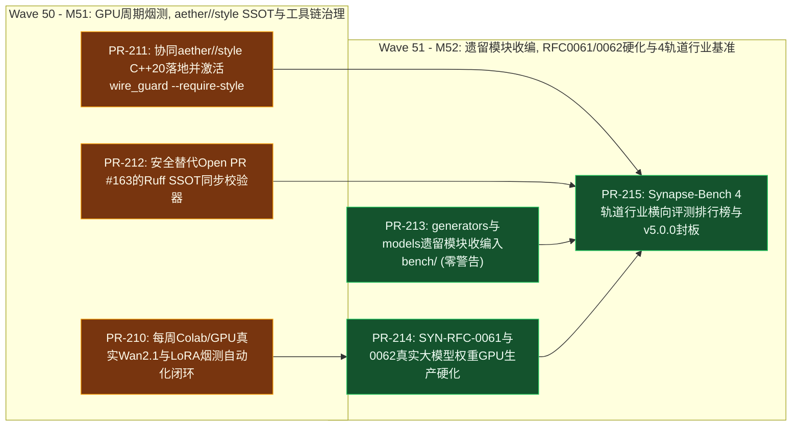

# M51–M52 Post-H10 战略待办收口与 4 轨道行业横向评测计划 (Actionable Horizon-13B Blueprint)

> - **计划版本**: `v1.0`（对应主总纲 [`IMPLEMENTATION_PLAN.md`](../IMPLEMENTATION_PLAN.md) **`v4.0`**）
> - **触发源**:
>   1. [`REVIEW-POST-HORIZON10-2026-11.md`](../audits/REVIEW-POST-HORIZON10-2026-11.md) §7.1 推荐近期行动（`P0` GPU 烟测、`P1` `@aether//style`、RFC 0061/0062 生产硬化、`P2` 遗留模块清理与 4 轨道横向评测）；
>   2. 长期挂起的 Open PR `sautille-stroke/synapse#163`（`pyproject.toml` Ruff 扩展全生态 SSOT）；
>   3. [SYN-RFC-0063](../SYN-RFC-0063-TESTING-CORRECTNESS-AND-BENCHMARKS.md) §5 四轨道行业横向对标协议与 [DESIGN_INDUSTRY_GAP_AND_COMPENSATION.md](../DESIGN_INDUSTRY_GAP_AND_COMPENSATION.md)。
> - **规划模型**: `[gemini4]`
> - **当前状态**: 📋 **规划就绪 (Horizon 13B · 可与 Horizon 12/13A 平行调度)**
> - **目标周期**: 2 个里程碑（`M51` – `M52`）、2 个 Execution Waves（`Wave 50` – `Wave 51`）、**6 个原子 PR**（`PR-210` – `PR-215`）

> [!IMPORTANT]
> **执行铁律（与 [`AGENTS.md`](../../AGENTS.md) 对齐）**：
> 1. 所有改动必须走 Git Worktree（`/tmp/synapse-wt-prXXX`）→ 分支 → PR → Squash Merge → 清理 Worktree，严禁直接 push `main`。
> 2. Commit 与 PR 标题必须携带模型标识 `[<model-tag>]`，PR 正文首行必须声明 ``> **Operated by**: `<model-tag>` ``。
> 3. **非服务端铁律 & 单仓自洽铁律**：禁止常驻 HTTP 服务；禁止破坏无父仓库（如公网 GitHub Actions Runner）下的 `ruff` / `mypy` / `pytest` 运行能力。
> 4. **Colab 算力释放铁律**：所有 GPU 烟测与生产硬化实验必须带看门狗超时熔断、Google Drive SSOT V2.0（`/dervgen/work/{user}/synapse/{date}/{job_id}/`）落盘以及 `runtime.unassign` 强制资源释放。
> 5. **链接规范**：尚未创建的新文件（如 `scripts/run_gpu_smoke.py`、`tools/sync_ruff_ssot.py`）与跨仓路径（`../aether/...`、`../rules_dervgen_env/...`）一律使用反引号标注，禁止引入 Markdown 断链。

---

## 1. 背景盘点与 Wave 50–51 调度拓扑

在 `v4.1.0`（H10）与 `v4.2.0`（H11）完成 16 项反作弊门禁全绿封板后，[`REVIEW-POST-HORIZON10-2026-11.md`](../audits/REVIEW-POST-HORIZON10-2026-11.md) §7.1 指出：当前 CI 100% 运行在 CPU `MockVideoAdapter` 上，仍缺真实 CUDA 大模型周期验证、`@aether//style` C++ 契约合龙、遗留兼容包收敛以及真实 4 轨道行业排行榜产出；同时仓内存在长期挂起的 Open PR `#163`（直接 `extend = "../rules_dervgen_env/config/ruff.toml"` 会在独立单仓克隆下导致 `ruff check` 报错）。

本计划分两个里程碑收口上述全部战略与工程债务，最终封板 **`Release v5.0.0`**：



### Wave 并发与目录隔离矩阵

| Wave | 里程碑 | 并发 PR 组（目录隔离） | 来源与目标 |
| :---: | :---: | :--- | :--- |
| **Wave 50** | **M51** | `PR-210` (`scripts/`, `.github/workflows/`) ∥ `PR-211` (`tools/wire_guard.py`, `style/`) ∥ `PR-212` (`tools/`, `pyproject.toml`) | Post-H10 P0 GPU 烟测、P1 `@aether//style`、Open PR `#163` 安全落地 |
| **Wave 51** | **M52** | `PR-213` (`bench/`, `generators/`, `models/`) ∥ `PR-214` (`refine/`, `recon/loop/`, `colab_runner.py`) → `PR-215` (`bench/`, `pipeline/`, `v5.0.0`) | Post-H10 P2 遗留清理、RFC 0061/0062 生产硬化与 4 轨道横向评测 |

---

## 2. M51 (Wave 50)：GPU 周期烟测、`@aether//style` SSOT 与工具链治理

<a id="pr-210"></a>
### PR-210: 建立每周 GPU 真实推理自动化烟测闭环（Post-H10 `P0` 行动项）
- **来源编号**: `REVIEW-POST-HORIZON10-2026-11.md` §7.1 `P0`
- **前置依赖**: 无
- **预估体量**: ~380 LOC · **Worktree 分支**: `feat/pr-210-weekly-gpu-smoke-pipeline`
- **精确改动清单**:
  1. 新增 `scripts/run_gpu_smoke.py`：在具备 CUDA 的节点（Google Colab T4/L4/A100 或 `win-dev`）执行真实非 Mock 最小闭环：
     - 拉起 `DiffusersWanBackend`（`Wan2.1-T2V-1.3B` 最低门槛 / 按 VRAM 自适应选择 `14B`）+ `ControlNeXtPatchifyStem` + `AutoencoderKLWan` 实跑单窗口因果生成；
     - 运行 `StatelessLoRATrainer` 真实梯度步与 `.safetensors` 导出/重载校验；
     - 输出含峰值 VRAM、吞吐、FVD/PSNR/SSIM/Warp 的 JSON 摘要并内嵌看门狗超时熔断与 `runtime.unassign` 钩子。
  2. 在 [workenv/google-colab/README.md](../../workenv/google-colab/README.md) 与 `workenv/google-colab/synapse_colab_workflow.ipynb` 挂载周级烟测执行按钮/说明；在 `.github/workflows/` 新增按需/周级 `workflow_dispatch` 产物校验工作流（仅做报告归档与 CPU 侧回归，不在公网无卡 Runner 上硬跑大模型）。
  3. 新增 `tests/test_gpu_smoke_cli.py`（CPU 下校验 `--dry-run`、结构化 JSON 输出与缺 CUDA 诚实报退出码 `30`）。
- **`ubuntu24` & `colab-gpu` 验收命令**:
  ```bash
  /root/venv-synapse/bin/pytest tests/test_gpu_smoke_cli.py -v
  # 在 colab-gpu 节点执行：
  python scripts/run_gpu_smoke.py --json --auto-release
  ```
- **防静默失败三问**: 无 GPU 时不伪造 `status: ok`（退出码 `30`）；在 `colab-gpu` 实跑产出非零差异真实视频帧与合法 LoRA 权重。

<a id="pr-211"></a>
### PR-211: 协同 `@aether//style` C++20 SSOT 落地与激活 `wire_guard.py --require-style`（Post-H10 `P1` 行动项）
- **来源编号**: `REVIEW-POST-HORIZON10-2026-11.md` §7.1 `P1`, `DESIGN_REVIEW_AND_ALIGNMENT.md` `RV-07`
- **前置依赖**: 无 · **跨仓前置**: `aether` 上游新建 `style/include/aether/style/style_types.h`（落地 `StyleDescriptor` v2.0.0 字段与常量枚举）
- **预估体量**: ~320 LOC · **Worktree 分支**: `feat/pr-211-aether-style-cpp-ssot-parity`
- **现状核查**: 实核 `/Volumes/work/dervgen/aether/style` 尚不存在；[tools/wire_guard.py](../../tools/wire_guard.py#L228-L262) 中跨仓校验逻辑在找不到 `style_types.h` 时打印 `"SKIPPED (upstream @aether//style not present)"`。
- **精确改动清单**:
  1. 升级 [tools/wire_guard.py](../../tools/wire_guard.py)：新增 `--require-style` 开关（与 `--require-aether` 对齐），在 `../aether/style/include/aether/style/style_types.h` 就绪后强制校验 `StyleDescriptor` v2.0.0（`working_colorspace`, `color_temp_kelvin`, `exposure_ev`, `soft_knee_threshold` 等）C++ ↔ Python Pydantic ↔ `schemas/style_profile.v2.0.0.schema.json` 三向逐字段对齐。
  2. 在 `tests/test_cross_repo_contracts.py` 新增 `@pytest.mark.external_data` 跨仓契约测试，断言在同级 `../aether` 存在 `style_types.h` 时 `wire_guard --require-style` 全绿。
  3. 同步更新 [docs/WIRE_CONTRACTS.md](../WIRE_CONTRACTS.md) 与 [AGENTS.md](../../AGENTS.md) §1 契约表，清除 "`@aether//style` 尚在规划" 标注。
- **`ubuntu24` 验收命令**:
  ```bash
  /root/venv-synapse/bin/python tools/wire_guard.py --check --require-aether --require-style
  SYNAPSE_CI_STRICT_DEPS=1 /root/venv-synapse/bin/pytest tests/test_cross_repo_contracts.py tests/test_wire_schemas.py -v
  ```
- **防静默失败三问**: 若在 C++ `style_types.h` 篡改字段名或默认值，`wire_guard --require-style` 立即以退出码 `1` 阻断；公网无 `aether` Runner 下通过 `@pytest.mark.external_data` 保持 CI 绿灯。

<a id="pr-212"></a>
### PR-212: 安全落地生态 Ruff SSOT 合规校验器并处置挂起的 Open PR `#163`
- **来源编号**: Open PR `sautille-stroke/synapse#163` (`feat(config): extend central ruff SSOT configuration`)
- **前置依赖**: 无
- **预估体量**: ~220 LOC · **Worktree 分支**: `chore/pr-212-ruff-ssot-sync-checker`
- **现状核查**: Open PR `#163` 尝试直接在 [pyproject.toml](../../pyproject.toml#L140-L159) 添加 `extend = "../rules_dervgen_env/config/ruff.toml"`。但在独立克隆与公网 GitHub Actions Runner 中，父目录不存在 `../rules_dervgen_env/`，直接 `extend` 会导致 `ruff check` 直接报错崩溃（击穿 Gate 3）。
- **精确改动清单**:
  1. 保持 [pyproject.toml](../../pyproject.toml) 自包含可独立执行（不写入会破坏公网 CI 的强路径 `extend`）；
  2. 新增 `tools/sync_ruff_ssot.py`（支持 `--check` 与 `--sync`）：当同级存在 `../rules_dervgen_env/config/ruff.toml` 时自动比对基线规则子集/目标版本/行宽是否与全生态 SSOT 漂移，缺失父仓时安全跳过（`--require-ssot` 下严格失败）；
  3. 在 `tests/test_pr192_coverage_and_ssot.py` 补充 SSOT 一致性单测并关闭已被安全替代的 PR `#163`。
- **`ubuntu24` 验收命令**:
  ```bash
  /root/venv-synapse/bin/ruff check python/ tests/ scripts/ tools/
  /root/venv-synapse/bin/python tools/sync_ruff_ssot.py --check
  ```
- **防静默失败三问**: 公网单仓无父仓环境下 `ruff check` 与 `sync_ruff_ssot.py --check` 退出码 `0`；存在 `../rules_dervgen_env` 且规则漂移时准确告警。

---

## 3. M52 (Wave 51)：遗留模块收编、`SYN-RFC-0061/0062` 生产硬化与 4 轨道行业横向评测 (`v5.0.0`)

<a id="pr-213"></a>
### PR-213: 将 `synapse.generators` 与 `synapse.models` 遗留模块收编入 `synapse.bench`（Post-H10 `P2` 行动项）
- **来源编号**: `REVIEW-POST-HORIZON10-2026-11.md` §7.1 `P2`
- **前置依赖**: 无
- **预估体量**: ~420 LOC · **Worktree 分支**: `refactor/pr-213-consolidate-generators-and-models`
- **现状核查**: 当前源码仍存在 `python/synapse/generators/{dataset.py,rasterizer.py,visualizer.py}` 与 `python/synapse/models/{asset.py,loader.py}` 两个顶层包，被 `cli/_generate.py`、`cli/_fgpp.py` 与 `tests/test_dataset_and_viewer.py` 引用；设计文档早已明确其应收编入 `synapse.bench`。
- **精确改动清单**:
  1. 将 `DatasetConfig`、`DatasetGenerator`、`visualize_*` 与 `ModelAsset`、`load_model`、`list_builtin_models` 核心实现迁入 `python/synapse/bench/`（保持与 `render_core` 的干净分层，Zero circular import）。
  2. 迁移 `python/synapse/cli/_generate.py`、`python/synapse/cli/_fgpp.py`、`tests/test_dataset_and_viewer.py` 等全仓调用方直接引用 `synapse.bench.*`。
  3. 在 `synapse.generators` 与 `synapse.models` 保留纯净向后兼容重导出 shim（确保 `pytest -W error::DeprecationWarning` 零报错，并在注释/文档中标注 `v6.0.0` 正式移除时间表），同步更新 `tools/import_dag_guard.py`、`docs/ARCHITECTURE.md` 与 `tests/test_profiles_doc_sync.py`。
- **`ubuntu24` 验收命令**:
  ```bash
  /root/venv-synapse/bin/pytest tests/test_dataset_and_viewer.py tests/test_bench.py tests/test_cli.py -W error::DeprecationWarning -v
  /root/venv-synapse/bin/python tools/import_dag_guard.py --check
  ```
- **防静默失败三问**: 全仓 `synapse.cli` / `tests/` 首要路径均切流至 `synapse.bench`，`DeprecationWarning` 门禁 0 告警，DAG Guard 0 违规。

<a id="pr-214"></a>
### PR-214: `SYN-RFC-0061` 与 `SYN-RFC-0062` 真实大模型权重 GPU 生产硬化（Post-H10 `P1` 行动项）
- **来源编号**: `REVIEW-POST-HORIZON10-2026-11.md` §7.1 `P1`（与 Horizon 12 `RFC 0060` 互补）
- **前置依赖**: `PR-210`
- **预估体量**: ~440 LOC · **Worktree 分支**: `feat/pr-214-rfc0061-0062-gpu-prod-hardening`
- **精确改动清单**:
  1. 硬化 [python/synapse/refine/pipeline.py](../../python/synapse/refine/pipeline.py) 与 `python/synapse/refine/{hand,face}.py`：接入真实 `foundary` / 本地 Diffusers 512×512 局部修补权重（支持 `K=2` 异构候选输入），在 `colab-gpu` 实跑 `MultiModelRefineFusion`（`LAPLACIAN_FREQUENCY` / `CASCADE` / `POISSON_GRADIENT`）+ `ScalpelStitcher` 手术刀缝合并验证环带 `ΔE00 <= 2.0` 与 `anatomical_quality_score` 门禁。
  2. 硬化 [python/synapse/recon/loop/closed_loop_runner.py](../../python/synapse/recon/loop/closed_loop_runner.py) 与 `forward_guide.py`：在 `colab-gpu` 上接入真实 `DiffusersWanBackend` 实跑 LookDev 预卷（`n_preroll in {0, 4, 8}` + 正片首帧 $\kappa=1.0$ 硬切镜重锚定）+ DrJit/Mitsuba AD（或 `fulgur_slang_ad`）反演并完成手术刀回接闭环。
  3. 在 [scripts/colab_runner.py](../../scripts/colab_runner.py) 将上述两条非 Mock 生产闭环纳入可断点续跑的验证用例。
- **`ubuntu24` & `colab-gpu` 验收命令**:
  ```bash
  /root/venv-synapse/bin/pytest tests/test_refine_fusion.py tests/test_recon_closed_loop_e2e.py -v
  # 在 colab-gpu 节点执行真实权重验证
  ```
- **防静默失败三问**: 真实大模型输出经手术刀缝合后 `border_ring_ciede2000 <= 2.0`；LookDev 预卷首帧棚光 0 渗漏至正片（`kappa=1.0` 硬切触发）。

<a id="pr-215"></a>
### PR-215: `Synapse-Bench` 4 轨道行业横向评测排行榜落地与 `Release v5.0.0` 封板（Post-H10 `P2` 行动项）
- **来源编号**: `REVIEW-POST-HORIZON10-2026-11.md` §7.1 `P2`, `SYN-RFC-0063` §5
- **前置依赖**: `PR-211`, `PR-212`, `PR-213`, `PR-214`（并可聚合 Horizon 13A `PR-209` 的 40 套数据集）
- **预估体量**: ~480 LOC · **Worktree 分支**: `feat/pr-215-4track-industry-benchmark-v5-0-0`
- **精确改动清单**:
  1. 在 `python/synapse/bench/` 新增 4 轨道横向评测聚合器（对应 [SYN-RFC-0063](../SYN-RFC-0063-TESTING-CORRECTNESS-AND-BENCHMARKS.md) §5.1–5.4）：
     - **赛道 1**：生成式 3D 资产与拓扑重构（`chamfer_mm`, `f_score_1mm`, 流形/欧拉/UV 质量）；
     - **赛道 2**：视频时空连续性与几何可控生成（`fvd`, `temporal_warp_error`, `foot_sliding_cm`）；
     - **赛道 3**：动作捕捉与数字替身动力学（`bone_length_drift_pct`, `volume_breathing_pct`, `silhouette_iou`）；
     - **赛道 4**：物理光影解耦与可微逆向渲染（`depth_rmse_m`, `border_ring_ciede2000`, `albedo_delta_e00`, `light_dir_error_deg`）。
  2. 升级 [python/synapse/bench/report.py](../../python/synapse/bench/report.py) 支持跨适配器 / 跨模型多维度对比排行表与 JSON/HTML 导出；补齐 CLI `synapse-bench compare` 子命令。
  3. 跑通全部 16 项反作弊硬门禁 + 远端 GitHub Actions 5/5 Jobs 全绿，更新 `pyproject.toml`、`CHANGELOG.md`、`README.md` 封板发布 **`Release v5.0.0`**。
- **`ubuntu24` 验收命令**:
  ```bash
  /root/venv-synapse/bin/pytest tests/test_bench.py tests/test_bench_runner.py tests/test_rfc0063_metrics.py -v
  /root/venv-synapse/bin/python scripts/check_doc_links.py
  ```
- **防静默失败三问**: 输入至少 2 个真实/基准适配器运行产物，可产出完整 4 轨道横向对比 HTML/JSON 排行榜且全部数值来自真实评测结果（禁止硬编码常量）。
