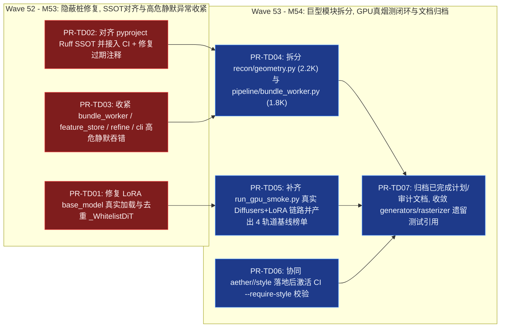

# M53–M54 全仓技术债务实证核查与收口治理计划 (Actionable Horizon-14 Blueprint)

> - **计划版本**: `v1.0`（对应主总纲 [`IMPLEMENTATION_PLAN.md`](../IMPLEMENTATION_PLAN.md) §4.16）
> - **核查基线**: `main` @ `2540b48`（post `v5.0.0`，含 Traceboard 整改封板）
> - **核查日期**: `2026-11-28`
> - **规划模型**: `[gemini4-hydrogen]`
> - **当前状态**: 🚧 **Wave 52 + Wave 53 本仓 6 PRs (`PR-TD01 ~ PR-TD05`, `PR-TD07`) 已落地合入 (`#223–#227` + 本 PR)；仅剩跨仓 `PR-TD06` 待上游 `dervgen/aether` 落地 `@aether//style` 后启用**
> - **前置基线**: [`REVIEW-POST-HORIZON10-2026-11.md`](../archive/audits/REVIEW-POST-HORIZON10-2026-11.md) · [`PLAN-M51-M52-POST-H10-STRATEGIC-GOVERNANCE-AND-BENCH.md`](../archive/plans/PLAN-M51-M52-POST-H10-STRATEGIC-GOVERNANCE-AND-BENCH.md) · [`PLAN-TRACEBOARD-REMEDIATION-AND-HARDENING.md`](../archive/plans/PLAN-TRACEBOARD-REMEDIATION-AND-HARDENING.md)

> [!IMPORTANT]
> **执行铁律（与 [`AGENTS.md`](../../AGENTS.md) 对齐）**：
> 1. 所有改动必须走 Git Worktree（`/tmp/synapse-wt-prXXX`）→ 分支 → PR → Squash Merge → 清理 Worktree，严禁直接 push `main`。
> 2. Commit 与 PR 标题必须携带模型标识 `[<model-tag>]`，PR 正文首行必须声明 ``> **Operated by**: `<model-tag>` ``。
> 3. **反门禁剧场铁律**：严禁以 `--dry-run`、玩具模型或自构造假文件替代真实契约与端到端校验；任何未接入真实权重的训练/推理路径必须显式失败或走独立明确标定的 mock 入口。
> 4. **跨仓路径链接规范**：跨仓路径（如 `` `../aether/...` ``、`` `../rules_dervgen_env/...` ``）及尚未创建的拆分目标模块一律使用反引号标注，禁止引入 `check_doc_links.py` 断链。

---

## 1. 技术债务逐项实证复核结论（`2540b48` 基线）

本计划首先对全库早期静态扫描清单（`D-01 ~ D-15`）逐行核对源码、Git 历史与本地工具输出，区分为**真实存在（含范围修正）**、**误判/过时/夸大**以及**新检出隐蔽真问题**三类。

### 1.1 实证确认真实存在的债务

| 编号 | 核查结论 | 实证依据与定位 |
|:---:|:---:|---|
| **D-01** | ✅ **真实存在** *(实现名实不符)* | [`.github/workflows/ci.yml`](../../.github/workflows/ci.yml) 5 个 Job 均在 CPU `ubuntu-latest` 执行；`PR #196` 新增的 [`gpu-smoke-weekly.yml`](../../.github/workflows/gpu-smoke-weekly.yml#L15-L36) 同样运行在 CPU `ubuntu-latest` 且仅执行 `--dry-run`；[`scripts/run_gpu_smoke.py`](../../scripts/run_gpu_smoke.py#L97-L118) 的 CUDA 分支也未实现其 `--dry-run` `planned_stages` 宣称的 `diffusers_wan_backend_single_window` 与 `safetensors_export_reload`（仅运行 `_build_controlnext_patchify_stem` + 裸 `torch.nn.Linear(16, 16)`）。 |
| **D-03** | ✅ **真实存在** | 同级目录 `` `../aether/style` `` 尚不存在。实跑 `python3.12 tools/wire_guard.py --check --require-aether` 时 StyleProfile 校验输出 `SKIPPED (upstream @aether//style not present)`；加上 `--require-style` 直接失败（exit 1）。CI 未传 `--require-style`，[`tests/test_m51_governance.py`](../../tests/test_m51_governance.py#L72-L89) 仅用 `tmp_path` 临时生成的假 `style_types.h` 通过测试。 |
| **D-04** | ✅ **真实存在** *(规模更重)* | [`python/synapse/`](../../python/synapse/__init__.py) 实有 **152 `.py` 文件 / 57,503 LOC**（原清单沿用旧审计 124 文件且被 `head -25` 截断）；其中 **>500 行共 43 个**，**>1,000 行共 9 个**（[`recon/geometry/`](../../python/synapse/recon/geometry/__init__.py) `2,229`、[`pipeline/bundle_worker.py`](../../python/synapse/pipeline/bundle_worker.py) `1,768`、[`pipeline/bench_runner.py`](../../python/synapse/pipeline/bench_runner.py) `1,394`、[`recon/delight.py`](../../python/synapse/recon/delight.py) `1,365`、[`render_core/procedural.py`](../../python/synapse/render_core/procedural.py) `1,144`、[`recon/multiview.py`](../../python/synapse/recon/multiview.py) `1,081`、[`adapters/wan.py`](../../python/synapse/adapters/wan.py) `1,064`、[`training/trainer.py`](../../python/synapse/training/trainer.py) `1,041`、[`recon/tracking.py`](../../python/synapse/recon/tracking.py) `1,011`），外加 [`inspector_app.cc`](../../tools/data-inspector/native/inspector_app.cc) 单文件 `1,920` 行。 |
| **D-02** | ⚠️ **部分真实** *(原计数有误)* | AST 统计 `python/synapse/` 共 `211` 处 `ExceptHandler`，捕获 `Exception` 共 **90 处**（非 `82` 处，更非误匹配的 `210`），`bare except` 为 `0`。其中 `26` 处重新 `raise`、`25` 处记录日志，**40 处**无日志也无 `raise`（约半数为合理的可选 C++ 加速回退、`/healthz` 探活或资源释放，如 [`aether_bridge.py`](../../python/synapse/bridge/aether_bridge.py#L85-L105)、[`roundtrip.py`](../../python/synapse/metrics/roundtrip.py#L46-L52)）。**真正高危的静默吞错点**集中在： • [`bundle_worker.py`](../../python/synapse/pipeline/bundle_worker.py#L317-L364)：`SceneSpec`/`OutputSink` 校验失败直接置 `None` 并透传未校验原始字典； • [`feature_store.py`](../../python/synapse/training/feature_store.py#L786-L790)：`meta.json` 解析失败静默置 `needs_fgpp = False`； • [`refine/pipeline.py`](../../python/synapse/refine/pipeline.py#L412-L427)：`foundary_client.infer` 任意异常直接 `continue`； • [`cli/_bench.py`](../../python/synapse/cli/_bench.py#L105-L117)：场景/资产解析失败静默回退 `"cube"`； • [`cli/_recon.py`](../../python/synapse/cli/_recon.py#L195-L200)、[`stages/recon.py`](../../python/synapse/pipeline/stages/recon.py#L53-L58)、[`bench_runner.py`](../../python/synapse/pipeline/bench_runner.py#L1250-L1263,L1386-L1390)：读取 `.exr`/`.npy` 或 GT 光照提取异常静默跳过； • [`align.py`](../../python/synapse/inspect/align.py#L176)：`except (ImportError, Exception): pass` 吞掉 `cv2.fillPoly` 运行时异常。 |
| **D-09 / D-10** | ✅ **真实存在** *(缺真模型闭环产出)* | `PR #197` 已交付 [`refine/pipeline.py`](../../python/synapse/refine/pipeline.py) `foundary_client` K=2 接线、[`closed_loop_runner.py`](../../python/synapse/recon/loop/closed_loop_runner.py#L228-L250) `kappa` 遥测及 [`bench/compare.py`](../../python/synapse/bench/compare.py) 4 轨道比较器 CLI；但 [`test_m52_consolidation_and_compare.py`](../../tests/test_m52_consolidation_and_compare.py#L66-L165) 仅用 `_MockFoundaryK2` 与人工造 JSON 验证，[`colab_runner.py`](../../scripts/colab_runner.py#L376-L407) E4 仅训 `_ToyAttnBlock(64)`，全仓无真实大模型跑出的 4 轨道榜单产物。 |
| **D-13** | ✅ **部分真实** *(无断链，缺归档)* | [`scripts/check_doc_links.py`](../../scripts/check_doc_links.py) 实测 `68` 篇 Markdown **0 断链**；但 `docs/plans/` 中 `PLAN-M37-M40`、`M45-M48`、`M49-M50`、`M51-M52`、`PLAN-TRACEBOARD-REMEDIATION-AND-HARDENING` 等已完成计划与 `docs/audits/` 中 3 份历史审计尚未移入 `docs/archive/`。 |
| **D-14** | ✅ **真实存在** *(上游阻塞)* | `` `../aether/tools/aether_geo_worker.cc:1533-1565` `` 中 `quadriflow` 仍为 `return 1` 契约桩（`PLAN-0098 Plan B`）；Synapse 侧 [`aether_geo_worker_client.py`](../../python/synapse/bridge/aether_geo_worker_client.py#L332-L398) 已按契约 fail-closed 抛出退出码 `50`。 |

### 1.2 原报告误判、过时或夸大条目

| 编号 | 原报告说法 | 核查实态 |
|:---:|---|---|
| **D-11** | `HttpFoundaryTransport` 仍是 placeholder | **❌ 误判（仅注释过期）**：[`foundary_client.py`](../../python/synapse/bridge/foundary_client.py#L317-L520) 仅第 `9`、`285` 行 docstring 遗留 `placeholder` 字样；实际已实现 `is_available`、`submit`（`safe_urlopen` SSRF 防护、`Idempotency-Key`、`traceparent`、502/503/504 退避重试）、`submit_job`、`poll_job` 与 `list_serving_recipes`。 |
| **D-08** | `generators/` 与 `models/` 均为待清遗留 shim | **⚠️ 半误判**：[`generators/dataset.py`](../../python/synapse/generators/dataset.py) 与 [`generators/visualizer.py`](../../python/synapse/generators/visualizer.py) 已在 `PR #197` 转为零警告 shim，仅 [`generators/rasterizer.py`](../../python/synapse/generators/rasterizer.py)（138 行）保留旧包装类；而 [`models/asset.py`](../../python/synapse/models/asset.py) 与 [`models/loader.py`](../../python/synapse/models/loader.py) **并非 shim**，而是被 [`bench/dataset_gen.py`](../../python/synapse/bench/dataset_gen.py#L21-L22) 和 [`bench/model_loader.py`](../../python/synapse/bench/model_loader.py#L15-L16) 依赖的真实实现。 |
| **D-12** | Traceboard 刚落地仍在连续打补丁 | **⚠️ 过时**：`#214–#221` 系按 [`PLAN-TRACEBOARD-REMEDIATION-AND-HARDENING.md`](../archive/plans/PLAN-TRACEBOARD-REMEDIATION-AND-HARDENING.md) 推进的 8-PR 整改闭环，已在 `#219–#221` 收官并通过 CI 真 `.tbevt` 校验。 |
| **D-05/06/07** | `37` `type: ignore`、`13` `noqa`、`24` `DEPRECATED` | **⚠️ 夸大/非真债**：`type: ignore` 集中于 `argparse._SubParsersAction`、optional imports 和 `camera.py` kwargs 强转（仅 [`procedural.py`](../../python/synapse/render_core/procedural.py#L72) 返回类型漏写 `\| None`）；`noqa` 属合理豁免；`24` 处 deprecated 含 docstring 与过渡 shim 说明。 |
| **D-15** | `observability.py` no-op 造成盲区 | **❌ 非债务**：按 `AGENTS.md` 懒加载可选 `[traceboard]` extra 设计，CI 在装包路径执行完整端到端二进制校验。 |

### 1.3 新检出但原报告漏报的 2 项隐蔽真问题

| 新编号 | 严重度 | 实证缺陷详情 |
|:---:|:---:|---|
| **D-NEW-1** | 🔴 **P0** | **LoRA 训练入口校验 `--base-model` 后仍强走 `_WhitelistDiT` 1 层玩具模型（隐蔽桩代码）** 在 [`pipeline/stages/training.py`](../../python/synapse/pipeline/stages/training.py#L174-L270) 与 [`cli/_lora.py`](../../python/synapse/cli/_lora.py#L126-L248) 中：两者均先严格校验 `--base-model`（缺失且未传 `--mock-backbone` 时以退出码 `50` 拒绝）并检查路径存在，但通过校验后**均完全丢弃 `base_model` 参数**，直接实例化复制了两份的 `_WhitelistDiT` 1-block 64 维玩具模型进行 LoRA 注入与训练。传入真实 Wan DiT 权重目录时也会静默在玩具模型上训练。 |
| **D-NEW-2** | 🟠 **P1** | **Ruff 全生态 SSOT 已漂移且 CI 未检验（`sync_ruff_ssot.py --check` 实测失败）** 实跑 `python3.12 tools/sync_ruff_ssot.py --check` 直接返回 `exit 1`：`FAIL: Missing SSOT lint.select rule(s) in pyproject.toml: ['E', 'N', 'A', 'T20']`。[pyproject.toml](../../pyproject.toml#L139) 与 `` `../rules_dervgen_env/config/ruff.toml` `` 已经漂移，而 [ci.yml](../../.github/workflows/ci.yml) 未运行 `sync_ruff_ssot.py --check`，[`test_m51_governance.py`](../../tests/test_m51_governance.py#L92-L139) 仅拿手写迷你 `aligned_ruff.toml` 测试，掩盖了真实漂移。 |

---

## 2. M53–M54 整改架构与 Wave 调度拓扑

本计划分 2 个里程碑（`M53` 止血与门禁对齐、`M54` 架构拆分与真实 GPU 闭环）、2 个 Execution Waves、**7 个原子 PR**（`PR-TD01` ~ `PR-TD07`）彻底清零上述核实债务：

### Wave 并发与目录隔离矩阵

| Wave | 里程碑 | 并发 PR 组（目录隔离） | 覆盖债务项 |
| :---: | :---: | :--- | :--- |
| **Wave 52** | **M53** | `PR-TD01` (`training/`, `cli/_lora.py`) ∥ `PR-TD02` (`pyproject.toml`, `ci.yml`, `foundary_client.py`, `procedural.py`) ∥ `PR-TD03` (`bundle_worker.py`, `feature_store.py`, `refine/pipeline.py`, `cli/_bench.py`, `align.py`) | `D-NEW-1`, `D-NEW-2`, `D-11`(注释), `D-05`(微瑕), `D-02` |
| **Wave 53** | **M54** | `PR-TD04` (`recon/`, `pipeline/`) ∥ `PR-TD05` (`scripts/run_gpu_smoke.py`, `bench/`) ∥ `PR-TD06` (`ci.yml`, `tools/wire_guard.py`) → `PR-TD07` (`docs/`, `generators/`, `tests/`) | `D-04`, `D-01`, `D-09/D-10`, `D-03`, `D-08`, `D-13` |

---

## 3. M53 (Wave 52)：隐蔽桩修复、Ruff SSOT 对齐与高危异常收紧

### `PR-TD01`: 修复 `--base-model` 静默走 `_WhitelistDiT` 玩具模型的缺陷并去重
- **对应债务**: `D-NEW-1` (`P0`)
- **预估体量**: ~320 LOC · **Worktree 分支**: `fix/td01-lora-base-model-loading`
- **精确改动清单**:
  1. 抽取共享模块 `` `python/synapse/training/backbone.py` ``：
     - 将 [`stages/training.py`](../../python/synapse/pipeline/stages/training.py#L189-L269) 与 [`cli/_lora.py`](../../python/synapse/cli/_lora.py#L170-L247) 中重复的 `_WhitelistDiT` 与 `_CATEGORY_DEFAULT_TARGETS` 收敛为单一受控 mock 工厂 `build_mock_dit_backbone(dim=...)`；
     - 新增 `load_real_dit_backbone(base_model_path: Path, ...)`：当传入 `--base-model` / `params["base_model"]` 时，真实加载本地 Diffusers / Safetensors transformer 目录（缺失依赖或权重结构非法时 fail-closed 抛出 `BackendUnavailableError` / `ContractValidationError`，**严禁静默回退到 `_WhitelistDiT`**）。
  2. 修改 [`stages/training.py`](../../python/synapse/pipeline/stages/training.py#L174-L270) 与 [`cli/_lora.py`](../../python/synapse/cli/_lora.py#L126-L248)：仅当显式开启 `mock_backbone=True` / `--mock-backbone` 时才实例化 `_WhitelistDiT`；传入 `base_model` 时必须调用 `load_real_dit_backbone()`，并在返回结果元数据中记录 `backbone_kind`（`"real"` vs `"mock"`）。
  3. 在 `tests/test_lora_trainer.py` 新增回归测试：传入损坏或无效 `--base-model` 目录必须 fail-closed 报错，严禁静默训练玩具模型；校验通过合法 mock torch transformer 目录加载真实权重并完成 LoRA 注入。
- **防静默失败三问**: 传入无效 `--base-model` 路径不再返回 `exit 0`；返回 JSON 明确区分 `backbone_kind="real"` 与 `"mock"`；`_WhitelistDiT` 全仓仅保留唯一定义。

### `PR-TD02`: 对齐全生态 Ruff SSOT、修复过期注释与返回值注解微瑕
- **对应债务**: `D-NEW-2` (`P1`), `D-11` (过期注释), `D-05` (微瑕)
- **预估体量**: ~180 LOC · **Worktree 分支**: `fix/td02-ruff-ssot-and-stale-annotations`
- **精确改动清单**:
  1. 对齐 [`pyproject.toml`](../../pyproject.toml#L139) 与 `` `../rules_dervgen_env/config/ruff.toml` ``：在 `tool.ruff.lint.select` 补全 `E`、`N`、`A`、`T20`（并依据现有 CLI/脚本 print 约束在 `per-file-ignores` 显式声明 `T201` 白名单），修复全部新增规则命中的真实代码违规（禁止用无意义 `noqa` 遮掩），使 `python tools/sync_ruff_ssot.py --check` 在父仓就绪时 **exit 0**。
  2. 在 [`.github/workflows/ci.yml`](../../.github/workflows/ci.yml) `python-fast` Job 中挂载 `python tools/sync_ruff_ssot.py --check`（无父仓 `rules_dervgen_env` 时按脚本既定逻辑安全 `SKIPPED`）。
  3. 清理 [`foundary_client.py`](../../python/synapse/bridge/foundary_client.py#L9,L285) 过时的 `"placeholder"` 模块文档与注释；修正 [`render_core/procedural.py`](../../python/synapse/render_core/procedural.py#L72) `_create_primitive_mesh` 返回类型注解为 `dict[str, Any] | None` 并移除 `# type: ignore[return-value]`。
- **防静默失败三问**: `sync_ruff_ssot.py --check` 与 `ruff check python/ tests/ scripts/ tools/` 在 `ubuntu24` 同步零报错通过。

### `PR-TD03`: 收紧高危静默 `except Exception` 吞错点
- **对应债务**: `D-02` (核实后的高危静默点)
- **预估体量**: ~260 LOC · **Worktree 分支**: `fix/td03-narrow-silent-exceptions`
- **精确改动清单**:
  1. [`pipeline/bundle_worker.py`](../../python/synapse/pipeline/bundle_worker.py#L317-L364)：对 `SceneSpec.model_validate` 与 `OutputSink.model_validate` 捕获 `ValidationError` 记录结构化告警或在严格模式下抛出 `ContractValidationError`，禁止无声置 `None` 透传坏字段。
  2. [`training/feature_store.py`](../../python/synapse/training/feature_store.py#L786-L790)：收窄为 `except (json.JSONDecodeError, UnicodeDecodeError) as exc:` 并记录 `logger.warning`，禁止损坏 `meta.json` 伪装为 `needs_fgpp = False`。
  3. [`refine/pipeline.py`](../../python/synapse/refine/pipeline.py#L412-L427)：调用 `foundary_client.infer` 失败时按 `(BackendUnavailableError, SynapseError)` 记录 `logger.warning` 并在 `strict=True` 时显式上抛。
  4. [`cli/_bench.py`](../../python/synapse/cli/_bench.py#L105-L117)、[`cli/_recon.py`](../../python/synapse/cli/_recon.py#L195-L200)、[`pipeline/stages/recon.py`](../../python/synapse/pipeline/stages/recon.py#L53-L58)、[`pipeline/bench_runner.py`](../../python/synapse/pipeline/bench_runner.py#L1250-L1263,L1386-L1390)：收窄异常类型至 `(OSError, ValueError, KeyError, ImportError)` 等具体异常并补齐 `logger.warning`；将 [`inspect/align.py`](../../python/synapse/inspect/align.py#L176) 改为仅捕获 `ImportError`（或显式记录 `cv2.error` 回退日志），去掉冗余的 `(ImportError, Exception)`。
  5. 为上述高危点补齐单测（验证损坏 `meta.json` / 损坏 `SceneSpec` / `foundary_client` 故障不再无日志吞掉）。
- **防静默失败三问**: 全部高危回退路径可产生可观测告警或按 `strict` 模式失败，AST 检查高危域静默 `except Exception` 归零。

---

## 4. M54 (Wave 53)：巨型模块拆分、GPU 真烟测与 4 轨道基线产出

### `PR-TD04`: 拆分超 1.5K LOC 巨型模块 (`recon/geometry.py` & `pipeline/bundle_worker.py`)
- **对应债务**: `D-04` (优先治理 >1,700 LOC 的前二大单体文件)
- **预估体量**: ~480 LOC 迁移重构（净增减 ≤ 50 行） · **Worktree 分支**: `refactor/td04-split-geometry-and-worker`
- **精确改动清单**:
  1. 将 [`recon/geometry/`](../../python/synapse/recon/geometry/__init__.py)（2,229 行）按高内聚职责拆分为子包 `` `python/synapse/recon/geometry/` ``（`` `topology.py` ``、`` `remesh.py` ``、`` `uv.py` ``、`` `icp.py` ``、`` `metrics.py` ``），并通过 `` `__init__.py` `` 全量重导出原公开 API，确保零破坏性变更与每文件 `<= 600` 行。
  2. 将 [`pipeline/bundle_worker.py`](../../python/synapse/pipeline/bundle_worker.py)（1,768 行）中的 Manifest 校验/解析与沙箱路径守卫拆入 `` `python/synapse/pipeline/manifest.py` `` 与 `` `python/synapse/pipeline/sandbox.py` ``，`bundle_worker.py` 聚焦调度执行，单文件降至 `<= 800` 行。
  3. 同步校验 [`tools/import_dag_guard.py`](../../tools/import_dag_guard.py) 与全量 `mypy --strict` / `pytest` 兼容性。
- **防静默失败三问**: 拆分后原外部导入路径 100% 兼容，全量 `pytest` 与 `import_dag_guard.py --check` 全绿。

### `PR-TD05`: 补齐 `run_gpu_smoke.py` 真实链路并产出首份 4 轨道基线评测产物
- **对应债务**: `D-01`, `D-09`, `D-10`
- **预估体量**: ~360 LOC · **Worktree 分支**: `feat/td05-real-gpu-smoke-and-4track-baseline`
- **精确改动清单**:
  1. 修复 [`scripts/run_gpu_smoke.py`](../../scripts/run_gpu_smoke.py#L97-L129)：使其 CUDA 分支与 `--dry-run` `planned_stages` 完全一致——真实执行 `inject_lora` + `StatelessLoRATrainer.train_step` + `export_checkpoint`（`.safetensors` 导出与校验重载）；并在提供 `WAN_MODEL_PATH` 时真实触发 `DiffusersWanBackend` 单窗口生成与 `LocalRefinementPipeline` 闭环烟测（无权重时诚实标注 `diffusers_wan_backend_single_window: skipped_no_weights` 而不伪造完成）。
  2. 新增可复现的基线对标生成脚本/工作流参数（基于 `Synapse-Bench` 40 套场景运行 `MockVideoAdapter` vs 基准配置或 Colab 实跑产出的 JSON），生成首份版本化基线报告示例供 `synapse bench compare` 与 CI 回归校验，并补全 [`test_m51_governance.py`](../../tests/test_m51_governance.py) 对阶段字段对齐的断言。
- **防静默失败三问**: `run_gpu_smoke.py` 实跑输出阶段的真实状态与 `planned_stages` 1:1 匹配；`colab-gpu` 实跑产出的 4 轨道对比 HTML/JSON 可被 `compare_runs()` 校验通过。

### `PR-TD06`: 协同 `@aether//style` 落地并启用 CI `--require-style` 硬门禁
- **对应债务**: `D-03` (`P1`, 跨仓协同)
- **前置跨仓依赖**: `dervgen/aether` 落地 `` `style/include/aether/style/style_types.h` ``（含 `StyleDescriptor` v2.0.0 全字段）。
- **预估体量**: ~120 LOC · **Worktree 分支**: `feat/td06-enable-ci-require-style`
- **精确改动清单**:
  1. 在 `aether` 上游 `style_types.h` 就绪后，更新 [`.github/workflows/ci.yml`](../../.github/workflows/ci.yml#L106-L108)：当 `checkout-aether` 成功时将 Wire guard 命令升级为 `python tools/wire_guard.py --check --require-aether --require-style`。
  2. 在 `tests/test_cross_repo_contracts.py`（或现有跨仓测试）将真实 `../aether/style/include/aether/style/style_types.h` 纳入 `@pytest.mark.external_data` 强制对齐断言。
- **防静默失败三问**: 在同级存在 `../aether` 的环境下，`wire_guard.py --check --require-aether --require-style` 返回 `exit 0`（不再输出 `SKIPPED`）。

### `PR-TD07`: 文档归档清理与 `generators/rasterizer.py` 遗留引用收敛
- **对应债务**: `D-08` (剩余尾项), `D-13`
- **预估体量**: ~150 LOC 文档/引用调整 · **Worktree 分支**: `chore/td07-archive-plans-and-cleanup-shims`
- **精确改动清单**:
  1. 将已完成且封板的计划与审计文档移入归档目录：`PLAN-M37-M40`、`PLAN-M45-M48`、`PLAN-M49-M50`、`PLAN-M51-M52`、`PLAN-TRACEBOARD-REMEDIATION-AND-HARDENING` 移至 `docs/archive/plans/`；`AUDIT-POST-HORIZON9`、`REVIEW-POST-HORIZON10`、`REVIEW-PR213-TRACEBOARD-INTEGRATION` 移至 `docs/archive/audits/`；同步更新 [`docs/index.md`](../index.md)、[`IMPLEMENTATION_PLAN.md`](../IMPLEMENTATION_PLAN.md) 与内部相对链接。
  2. 将 [`tests/test_dataset_and_viewer.py`](../../tests/test_dataset_and_viewer.py#L11-L20) 中对 `synapse.generators.*` 的直接导入拆分为默认测 `synapse.bench.*` / `synapse.render_core.*` 与显式测试弃用兼容层的独立用例；明确 [`generators/rasterizer.py`](../../python/synapse/generators/rasterizer.py) 的 `v6.0.0` 下线清单。
  3. 全量运行 `python scripts/check_doc_links.py` 确认 **0 断链**。
- **防静默失败三问**: `check_doc_links.py` 0 断链；`docs/plans/` 仅保留活跃或待执行计划。

---

## 5. 验收门禁清单（M53–M54 封板条件）

| 门禁 | 验收命令（`ubuntu24` / CI / `colab-gpu`） | 门槛 |
|:---:|---|---|
| **G-TD1** | `pytest tests/ -m 'not slow' -q` & `pytest tests/ -m slow -n auto -q` | 0 fail / 0 skip，快测 `<= 20s` |
| **G-TD2** | `ruff check python/ tests/ scripts/ tools/` & `python tools/sync_ruff_ssot.py --check` | 0 errors（SSOT 零漂移） |
| **G-TD3** | `mypy --strict python/synapse tests/ scripts/ tools/` | 0 errors |
| **G-TD4** | `python tools/wire_guard.py --check --require-aether --require-style` | 0 errors（不再 SKIPPED） |
| **G-TD5** | `python tools/import_dag_guard.py --check` & `python scripts/check_doc_links.py` | 0 violations / 0 broken links |
| **G-TD6** | `python tests/test_lora_trainer.py`（验证 `--base-model` 拒绝静默回退 toy DiT） | 必过 |
| **G-TD7** | `python scripts/run_gpu_smoke.py --json --auto-release`（`colab-gpu`）+ `synapse bench compare` | 真实 GPU 链路 + 4 轨道榜单产出 |
