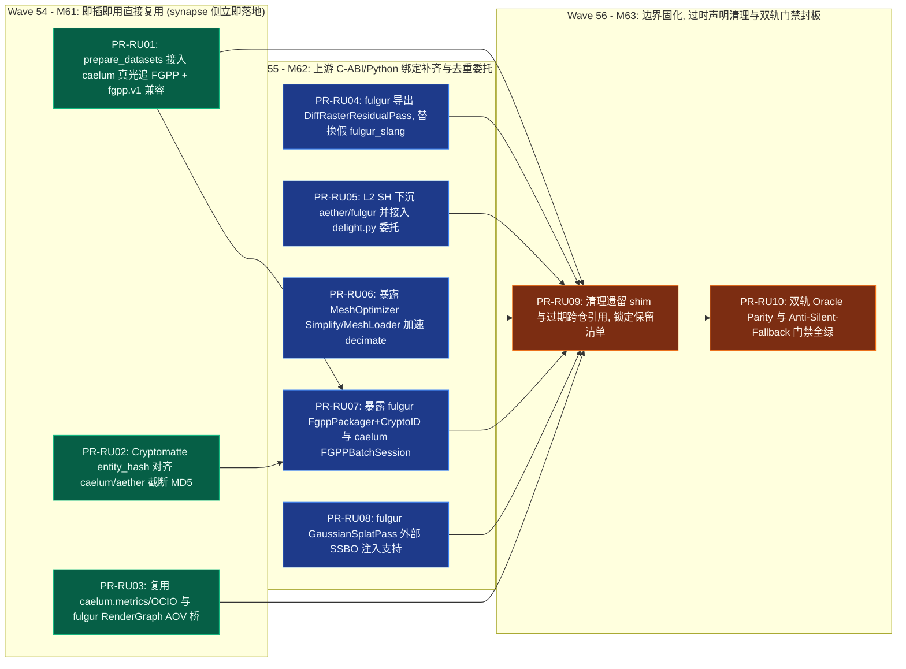

# M61–M63 跨仓能力复用、上游下沉与去重落地计划 (Horizon 15 Blueprint)

> - **计划版本**: `v1.0`（对应主总纲 [`IMPLEMENTATION_PLAN.md`](../IMPLEMENTATION_PLAN.md) §4.17）
> - **审计基线**: `synapse` `main` @ `8e1ab4d`（post `v6.0.0`，含 Horizon 14 全量集成与 `PR-TD08`）
> - **编写日期**: `2026-11-29`
> - **操作模型标识**: `[gemini4]`
> - **涉及仓库**: `sautille-stroke/synapse` · `dervgen/fulgur` · `dervgen/caelum-core` · `dervgen/aether`
> - **当前状态**: 📋 **规划就绪（`Horizon 15` · `M61–M63` · `10 PRs`: `PR-RU01 ~ PR-RU10`）**

> [!IMPORTANT]
> **执行铁律（与 [`AGENTS.md`](../../AGENTS.md) 对齐）**：
> 1. 所有仓变动严格走独立 Git Worktree（`/tmp/<repo>-wt-<branch>`）→ PR → Squash Merge → 清理 Worktree，严禁直接 push `main`。
> 2. **轻量核心依赖铁律**：`synapse` [`pyproject.toml`](../../pyproject.toml) 基础依赖必须继续锁定为 `[numpy, pydantic]`，严禁将 `fulgur` 或 `caelum` 变成强制导入依赖；所有上游复用必须走懒加载可选桥接 + 纯 NumPy / Python Oracle 双轨架构，保证零 GPU CI 日常秒级回归。
> 3. **防虚假降级（Fail-Closed）铁律**：严格区分「显式 Fallback Oracle」与「生产级真路径」——启用 `--strict-backend` / `--require-real-*` 时上游不可用或未暴露接口必须明确失败（退出码 `30` / `50`），严禁将 `fulgur` 无光栅 `Backend.NULL` 或合成球体误标为真实渲染产物。
> 4. **跨仓路径与未创建目标规范**：跨仓路径（如 `` `../fulgur/...` ``、`` `../caelum-core/...` ``、`` `../aether/...` ``）及尚未创建的测试/模块文件统一使用反引号标注，禁止引入 [`check_doc_links.py`](../../scripts/check_doc_links.py) 断链。

---

## 1. 跨仓实盘审计矩阵（`8e1ab4d` 基线）

经过对 `synapse`、`` `../fulgur` ``、`` `../caelum-core` `` 与 `` `../aether` `` 四仓源码、C-ABI / pybind11 导出表与测试套件的逐行核查，各能力域分为四类处置策略：

### 1.1 四类分类总表

| 类别 | 领域 / `synapse` 当前实现 | 上游真实实现与位置 | 存在差距 / 阻塞原因 | 处置策略 |
| :--- | :--- | :--- | :--- | :--- |
| **已共用 `@aether`** | [image_quality.py](../../python/synapse/metrics/image_quality.py), [aces_color.py](../../python/synapse/style/aces_color.py) (`sRGB↔Linear`), [camera_math.py](../../python/synapse/render_core/camera_math.py), [procedural.py](../../python/synapse/render_core/procedural.py), [kinematics.py](../../python/synapse/recon/kinematics.py), [gs_quantizer.py](../../python/synapse/recon/gs_quantizer.py) | `` `../aether` `` (`aether_geo`, `aether_metrics`, `aether_animation`, `aether_compress`, `@aether//color`, `@aether//fgpp`) | `fulgur` 与 `caelum` 底层亦调 `@aether`；`synapse` 已有 [aether_bridge.py](../../python/synapse/bridge/aether_bridge.py) 直连 | **保持直连 `@aether`，不经 `fulgur`/`caelum` 二次绕转** |
| **立即可直接复用** | [prepare_datasets.py](../../scripts/prepare_datasets.py) (`_export_caelum_track_a_17f` 为 NumPy 合成双球) | `` `../caelum-core` ``：`caelum.Engine.render()` + `film.save_fgpp_exr()`（`film_exr.cc`, `engine_cpu.cc`） | `caelum` docstring 中的 `caelum.camera.fgpp_exporter` 已下线；`caelum` 导出 `schema_version="fgpp.v1"` + row-major `world_to_camera`，而 [frame.py](../../python/synapse/fgpp/frame.py) 校验 `"fgpp.v1.0"` | **M61 (`PR-RU01`)**：Python 接通 `caelum.Engine` + EXR 导出并做 metadata Schema 兼容 |
| **立即可直接复用** | [rasterizer.py](../../python/synapse/render_core/rasterizer.py) `entity_hash`（`_murmurhash3_32`） | `` `../caelum-core/csrc/bindings/py_secondary_integrators.cc` `` `cryptomatte_name_hash`（基于 `aether::core::cryptomatteNameHash` 截断 MD5） | 哈希算法不同导致软光栅与 `caelum` Track-A 的 `Cryptomatte.ID` 同名异值 | **M61 (`PR-RU02`)**：优先调 `cryptomatte_name_hash`（若有 `@aether` 绑定更好），Python 兜底同步改为标准截断 MD5 |
| **立即可直接复用** | [aces_color.py](../../python/synapse/style/aces_color.py) 与基础画质/HDR 对比 | `` `../caelum-core/caelum/metrics.py` `` (`compute_flip_hdr`, `compute_ciede2000_hdr`, `generate_diff_heatmap`), `` `caelum/color/ocio_processor.py` ``, `Film.tone_map` | 当前仅在 `synapse` 局部使用基础指标 | **M61 (`PR-RU03`)**：可选懒加载接入 `caelum` HDR-FLIP/OCIO/Heatmap；同步封装 `fulgur.RenderGraph.readback_aov_ex` 可选桥（需真实 GPU/Lavapipe，禁 `Backend.NULL`） |
| **已有 C++，缺绑定** | [mitsuba_optimizer.py](../../python/synapse/recon/loop/mitsuba_optimizer.py) `FulgurSlangADRendererAdapter`（尝试 `import fulgur_slang`） | `` `../fulgur/engine/renderer/include/fulgur/renderer/passes/diff_raster_residual_pass.h` `` (`DifferentiableRasterResidualPass`) | **`fulgur_slang` 模块在 `fulgur` 全仓不存在**；`DifferentiableRasterResidualPass` 仅在 C++ 层且未导出至 `c_api.h` | **M62 (`PR-RU04`)**：`fulgur` C-ABI/Python 暴露可微残差求解接口；`synapse` 废弃幻觉模块名并接入真绑定 |
| **已有 C++，缺绑定** | [delight.py](../../python/synapse/recon/delight.py)（docstring 注释等待 `fulgur` SH 工具） | `` `../fulgur/engine/renderer/include/fulgur/renderer/spherical_harmonics.h` `` (`projectDirectionToSH`, `evaluateSH`, `rotateSH`, `convolveSH`, `evaluateIrradianceSH`) | `fulgur` 已实现全套 L2 SH 运算，但未下沉 `@aether` 亦未进 `c_api.h` | **M62 (`PR-RU05`)**：SH 工具下沉 `@aether`（或 `fulgur` 暴露），`delight.py` 委托原生核 |
| **已有 C++，缺绑定** | `decimate.py` (`_qem_decimate`), [mesh.py](../../python/synapse/render_core/mesh.py), [model_loader.py](../../python/synapse/bench/model_loader.py) | `` `../fulgur/engine/asset/include/fulgur/asset/mesh_optimizer.h` `` (`zeux/meshoptimizer`) 与 `mesh_loader.h` | C++ 资产层已封装网格简化与 glTF/OBJ/FBX 加载，未在 `c_api.h` 暴露 | **M62 (`PR-RU06`)**：暴露 QEM `simplify` 与 `MeshLoader`（优先 `@aether//geo` 或 `fulgur` C-ABI），`synapse` 保留 `_qem_decimate` 为 Oracle |
| **已有 C++，缺绑定** | Track-B CLI (`102-pbr-direct --export-fgpp`) & Track-A 逐帧渲染 | `` `../fulgur` `` `FgppPackager` + `PickingPass` & `` `../caelum-core` `` `FGPPBatchSession` | `fulgur` `FulgurAovKind` 缺全帧 `Cryptomatte.ID`（`R32_UINT`）及 `FgppPackager` 导出；`caelum::FGPPBatchSession` 未进 pybind11 | **M62 (`PR-RU07`)**：双上游暴露批量 FGPP 序列导出 API，取消 CLI 子进程/逐帧重构 BVH 开销 |
| **已有 C++，缺注入Pin** | [gs_quantizer.py](../../python/synapse/recon/gs_quantizer.py) 纯 NumPy `render_3dgs_preview` | `` `../fulgur/engine/renderer/include/fulgur/renderer/passes/gaussian_splat_pass.h` `` & `` `graph_assembler_vfx.cc` `` | `GaussianSplatPass` 目前在 `GraphAssembler` 中仅支持内部分配/生成测试点云，无法从 Python 上传外部点云 SSBO | **M62 (`PR-RU08`)**：为 `GaussianSplatPass` 补齐外部点云缓冲区绑定，供 `gs_quantizer` 可选 GPU 预览 |
| **上游无替代 / 定位不同** | [rasterizer.py](../../python/synapse/render_core/rasterizer.py) CPU fallback, [tracking.py](../../python/synapse/recon/tracking.py), [multiview.py](../../python/synapse/recon/multiview.py), [texture_extractor.py](../../python/synapse/recon/loop/texture_extractor.py), [gltf_splat.py](../../python/synapse/recon/gltf_splat.py), [usd_packager.py](../../python/synapse/recon/usd_packager.py), [pyramid.py](../../python/synapse/render_core/pyramid.py), [morphology.py](../../python/synapse/render_core/morphology.py), 业务层 (`adapters/`, `composite/`, `refine/`, `rsi/`, `training/`, `inspect/`, `bench/`) | `fulgur` `Backend.NULL` 为 no-op stub；`UsdSubsetComposer` 仅管 LIVRPS override 层（无 `UsdSkel` 导出）；`asset-viewer` 无 `.ply`；两引擎均无光流/PnP/TSDF/SPZ/生成适配器 | **结构性职责边界，非重复造轮子** | **M63 (`PR-RU09 ~ RU10`)**：锁定 `SYNAPSE-ONLY` 保留清单、清除过期跨仓幻觉注释，并固化双轨互验 + 防假绿门禁 |

---

## 2. M61–M63 分阶段架构与 Wave 并发调度

本计划划分为 **3 个里程碑（`M61–M63`）**、**3 个 Execution Waves（`Wave 54–56`）**、共 **10 个原子 PR**（`PR-RU01 ~ PR-RU10`）：

### Wave 并发与跨仓协同矩阵

| Wave | 里程碑 | 并发 PR 组与目标仓库 | 覆盖领域 |
| :---: | :---: | :--- | :--- |
| **Wave 54** | **M61** | `PR-RU01` (`synapse`: `scripts/prepare_datasets.py`, `fgpp/`) ∥ `PR-RU02` (`synapse`: `render_core/rasterizer.py`) ∥ `PR-RU03` (`synapse`: `metrics/`, `style/`, `bench/`) | Track-A 真光追接入、Cryptomatte 哈希统一、HDR/OCIO & RenderGraph 桥 |
| **Wave 55** | **M62** | `PR-RU04` (`fulgur` + `synapse`) ∥ `PR-RU05` (`aether`/`fulgur` + `synapse`) ∥ `PR-RU06` (`fulgur` + `synapse`) ∥ `PR-RU07` (`fulgur` + `caelum-core` + `synapse`) ∥ `PR-RU08` (`fulgur` + `synapse`) | 可微光栅 AD、L2 SH、QEM 简化/网格 IO、批量 FGPP 导出、3DGS GPU 预览 |
| **Wave 56** | **M63** | `PR-RU09` (`synapse`: `docs/`, `bridge/`, `bench/`, `generators/`) → `PR-RU10` (`synapse`: `tests/`, `.github/workflows/`) | 清理过期引用与边界锁定、双轨数值互验与严苛 CI 门禁 |

---

## 3. M61 (Wave 54)：立即可用上游能力接入（纯 Python 协同，无 C++ 改动阻塞）

### `PR-RU01`: 接入 `caelum.Engine` 真实离线光追 Track-A 导出与 `fgpp.v1` Schema 兼容
- **目标仓库**: `synapse` · **Worktree 分支**: `feat/ru01-caelum-track-a-fgpp` · **预估规模**: ~320 LOC
- **解决痛点**: [`prepare_datasets.py`](../../scripts/prepare_datasets.py#L469-L666) 中的 `_export_caelum_track_a_17f` docstring 宣称使用早已不存在的 `caelum.camera.fgpp_exporter`，实际直接用 NumPy 合成两个球体作为 `"synthetic_track_a_reference"`；而 `caelum-core` 侧已经具备 `caelum.Engine(cfg).render(...)` + `film.save_fgpp_exr()` + `film.save_exr()` 全套能力。
- **精确改动清单**:
  1. 在 [`prepare_datasets.py`](../../scripts/prepare_datasets.py#L1-L34) 与 `_export_caelum_track_a_17f` 中实现双路径探测：
     - 当 `_caelum_core` / `caelum` 可导入（支持 CPU / GPU 配置）时，构建 17 帧 Cornell Spheres 场景并逐帧调用 `caelum.Engine(cfg).render(scene, cfg)`，调用 `film.save_fgpp_exr()` 输出 15 通道 EXR 并写出 `beauty_XXXXXX.exr`（将 `provenance` 标为 `"caelum_path_tracer"`，写入真实 `spp` 与 `max_depth`）；
     - 新增 CLI 参数 `--require-real-caelum`：开启时若缺失 `caelum` 直接以非零退出码（`30`）失败；未开启严格模式时优雅降级为当前 NumPy 合成参照并诚实维持 `provenance = "synthetic_track_a_reference"`；移除 docstring 中不存在的 `caelum.camera.fgpp_exporter` 字样。
  2. 在 [`python/synapse/fgpp/frame.py`](../../python/synapse/fgpp/frame.py#L432-L579)（或专用适配函数 `normalize_caelum_metadata`）打通相机矩阵兼容：`` `../caelum-core/csrc/include/caelum/camera/fgpp_contract.h` `` 输出 `"schema_version": "fgpp.v1"` 与 row-major `"world_to_camera"` / `"projection_matrix"`，需无损转换为 `FGPPSequence`（保持 `det(R)=+1` 校验与主点检查全开启），并在序列写入目录时规范化为 `fgpp.v1.0` 结构供下游消费。
  3. 新增无跳过单测 `` `tests/test_caelum_track_a_compat.py` ``：用伪造与实测矩阵样本验证 `fgpp.v1` ↔ `fgpp.v1.0` 转换旋转正交性与 Depth/Beauty EXR 通道完整性；若环境安装了 `caelum`，额外执行 `Engine` 烟测验证 15 通道 `34 B/px` 往返无损。
- **防静默失败三问**: `--require-real-caelum` 缺失引擎时立即 fail-closed 报错；真实导出产物 EXR 必须通过 `import_fgpp(..., strict=True)` 且禁止标错 `provenance`。

### `PR-RU02`: Cryptomatte 名称哈希统一对齐 `@aether//core` & `caelum`（截断 MD5）
- **目标仓库**: `synapse` · **Worktree 分支**: `fix/ru02-cryptomatte-hash-parity` · **预估规模**: ~160 LOC
- **解决痛点**: [`render_core/rasterizer.py`](../../python/synapse/render_core/rasterizer.py) 当前使用私有 `_murmurhash3_32` 生成 `entity_hash`，与 `` `../aether/core/src/hash.cc` `` (`aether::core::cryptomatteNameHash`) 及 `` `../caelum-core/csrc/bindings/py_secondary_integrators.cc` `` 导出的 `cryptomatte_name_hash`（Psyop 标准 MD5 前 32 位截断整数解释，附带 IEEE-754 float32 位映射规则）不匹配，导致 Track-A 真值与软光栅/Synth 数据同一实体名 ID 不一致。
- **精确改动清单**:
  1. 在 `entity_hash(name: str)` 中优先检测并委托 `caelum._native.cryptomatte_name_hash`（或将来 `@aether` Python 绑定提供时优先调 `@aether`），同时将纯 Python fallback 由 MurmurHash3 替换为等价于 `aether::core::cryptomatteNameHash` 的零依赖 `hashlib.md5` 实现（注：核实 `` `../aether/core/src/hash.cc` `` 中位模式转 `uint32` 与 NaN 避让规则后 1:1 复刻）。
  2. 全仓搜索确认是否存在旧测试断言固定 MurmurHash3 魔数，同步更新测试断言为截断 MD5 黄金值并核验与 `caelum` 输出 bit-exact 一致。
- **防静默失败三问**: 与 `caelum` 实测同一批实体名列表（含中文、特殊字符、`hero_character` 等）100% 比特一致。

### `PR-RU03`: 可选复用 `caelum.metrics`/`caelum.color` 扩展诊断与 `fulgur` RenderGraph AOV 桥接
- **目标仓库**: `synapse` · **Worktree 分支**: `feat/ru03-caelum-hdr-metrics-and-fulgur-aov-bridge` · **预估规模**: ~340 LOC
- **解决痛点**: `caelum.metrics` 已内置 HDR-FLIP、HDR-CIEDE2000、tiled PSNR 与差异热力图；`caelum.color.OcioProcessor` 提供完整 PyOpenColorIO ACES v1.3 变换；同时 `fulgur` 的 Python `RenderGraph.readback_aov_ex` 已可用但未在 `synapse` 封装。
- **精确改动清单**:
  1. 在 `synapse/metrics/` 与 `synapse/style/` 中增加懒加载扩展入口：当 `caelum` 安装时，允许 `synapse.inspect` / `Synapse-Bench` 选配输出 `hdr_flip`、`hdr_ciede2000`、`tiled_psnr` 及差异热力图，或通过 `OcioProcessor` / `Film.tone_map` 进行严格参考级 HDR 色调映射对照（缺包时保持清晰结构化提示，核心路径维持零重依赖）。
  2. 在 `synapse/render_core/`（或 `synapse/bridge/`）提供可选的 `FulgurHeadlessAovProvider` 封装，对接 `fulgur.Device(backend=...)` + `RenderGraph.readback_aov_ex(...)` 读取深度/法线/BaseColor+ORM/DirectRadiance/MotionVector/HDR；显式拒绝 `Backend.NULL`（在构造阶段直接抛出 `BackendUnavailableError(exit 30)` 并指明需要 Vulkan/Lavapipe/Metal/D3D12）。
  3. 新增单元测试（在无 `fulgur`/`caelum` 环境走 Mock 与拒绝 `Backend.NULL` 断言，有环境时跑真实校验）。
- **防静默失败三问**: 传入 `Backend.NULL` 绝不能静默返回全零数组；缺失可选上游库且未显式允许 fallback 时准确返回退出码 `30`。

---

## 4. M62 (Wave 55)：跨仓 C++ 绑定补齐与去重收口（消除幻觉接口与纯 Python 重算子）

### `PR-RU04`: 落地 `fulgur` 可微光栅残差 Pass 绑定并消灭虚假 `import fulgur_slang`
- **目标仓库**: `dervgen/fulgur` + `sautille-stroke/synapse` · **Worktree 分支**: `feat/ru04-fulgur-diff-raster-binding` · **预估规模**: `fulgur` ~280 LOC + `synapse` ~180 LOC
- **解决痛点**: [`mitsuba_optimizer.py`](../../python/synapse/recon/loop/mitsuba_optimizer.py#L587-L680) 中的 `FulgurSlangADRendererAdapter` 试图 `import fulgur_slang`，但 `fulgur` 全仓根本没有该模块；真正的实现 `DifferentiableRasterResidualPass` 位于 `` `../fulgur/engine/renderer/include/fulgur/renderer/passes/diff_raster_residual_pass.h` ``，当前仅存在于 C++ 层。
- **精确改动清单**:
  1. **上游 `fulgur` PR**：在 `` `bindings/c/include/fulgur/c_api.h` ``（参考 `` `../fulgur/bindings/c/BUILD.bazel` `` 已链接 `//engine/renderer` 与 `//engine/shader`）新增 `fulgur_diff_raster_evaluate_albedo_grad` 与 `fulgur_diff_raster_optimize_albedo` C-ABI 函数；在 `bindings/python/fulgur/` 新增对应 Python 封装模块（例如 `fulgur.diff_raster`）；并在 C++ 测试中明确标注/校准 CPU `f64` 路径与 Slang GPU `CSDiffResidualGrad` 编译执行状态。
  2. **下游 `synapse` PR**：更新 `FulgurSlangADRendererAdapter`（废弃 `_probe_fulgur_slang_module()` 对不存在 `fulgur_slang` 包的探测，改为探测 `fulgur.diff_raster` 等真实暴露符号）；保留 `AnalyticUVInverseOptimizer` 仅作为无 `fulgur`/无 `mitsuba` 时的受控 `numpy_oracle`。
  3. 在双端验证 `DifferentiableRasterResidualPass::optimizeAlbedo` 与 `AnalyticUVInverseOptimizer` 反照率收敛 PSNR 一致性。
- **防静默失败三问**: 移除全仓对不存在模块名 `fulgur_slang` 的引用；`strict_backend=True` + `renderer_backend="fulgur_slang_ad"` 在原生库缺失时报 `30`，原生库就绪时真实返回 `usedSlangKernel` / 收敛日志与非退化 `albedoRgb`。

### `PR-RU05`: L2 球谐函数 (SH) 跨仓收敛至 `@aether` / `fulgur` 并接入 `delight.py` 委托
- **目标仓库**: `dervgen/aether`（推荐）或 `dervgen/fulgur` + `sautille-stroke/synapse` · **Worktree 分支**: `refactor/ru05-spherical-harmonics-reuse` · **预估规模**: 上游 ~260 LOC + `synapse` ~140 LOC
- **解决痛点**: [`recon/delight.py`](../../python/synapse/recon/delight.py#L7-L16) docstring 明确记录当前纯 NumPy SH 基函数是因上游缺失而临时自研，一旦 `fulgur` 提供 SH 工具即应迁移；实际 `` `../fulgur/engine/renderer/include/fulgur/renderer/spherical_harmonics.h` `` 早已实现了完整 L2 SH 运算，但尚未跨语言暴露。
- **精确改动清单**:
  1. **架构收敛决策（优先 `aether` SSOT）**：鉴于 SH 基函数与 Ramamoorthi/Hanrahan 卷积属无 GPU 依赖的纯渲染数学，优先遵循生态分层规约将 `SH_L2` / `SH_L2_RGB`（`projectDirectionToSH`, `evaluateSH`, `rotateSH`, `convolveSH`, `evaluateIrradianceSH`）从 `fulgur` 迁至 `` `@aether//render_math` ``，并由 `aether_geo` 或 `aether_metrics` 露出 pybind11 Python 函数；`fulgur/renderer/spherical_harmonics.h` 改为薄类型转发，保证零重 GPU 依赖。（若因上游节奏暂缓迁移，则先在 `fulgur/bindings/c` 暴露标量/批量 SH 接口作过渡。）
  2. **下游 `synapse`**：在 [aether_bridge.py](../../python/synapse/bridge/aether_bridge.py) 注册 `sh_basis` / `sh_irradiance` 探测包装器，更新 [`recon/delight.py`](../../python/synapse/recon/delight.py) 的 `evaluate_spherical_harmonics_basis` 等函数优先委托原生扩展，纯 NumPy 代码收编为无扩展时的一致性对照 Oracle。
  3. 补充 SH 正交性、能量守恒 (`shNorm`) 与 `rotateSH` 双轨误差 `<= 1e-5` 校验测试。
- **防静默失败三问**: 删除过时 TODO；原生与 NumPy SH 结果通过数值一致性门禁。

### `PR-RU06`: 暴露 `MeshOptimizer` (`zeux/meshoptimizer`) 与 `MeshLoader` 加速网格简化与读取
- **目标仓库**: `dervgen/fulgur`（或 `dervgen/aether` 承载 QEM） + `sautille-stroke/synapse` · **Worktree 分支**: `feat/ru06-mesh-optimizer-and-loader` · **预估规模**: 上游 ~320 LOC + `synapse` ~200 LOC
- **解决痛点**: `synapse/recon/geometry/decimate.py` 靠纯 Python/NumPy 做 Garland-Heckbert QEM 简化，大网格耗时偏高；[mesh.py](../../python/synapse/render_core/mesh.py) 和 [model_loader.py](../../python/synapse/bench/model_loader.py) 仅自带简易 `.obj` 解析，其他格式依赖重型可选库 `trimesh`；而 `` `../fulgur/engine/asset/include/fulgur/asset/mesh_optimizer.h` `` 与 `mesh_loader.h` 已完整封装 `zeux/meshoptimizer` 简化和 glTF/OBJ/FBX/fmesh 加载。
- **精确改动清单**:
  1. **上游绑定暴露**：在 `fulgur` C-ABI (`bindings/c` + `bindings/python/fulgur/`) 暴露无窗口、无 GPU 上下文的离线资产调用：`fulgur_mesh_simplify(verts, indices, target_count, target_error)` 与 `fulgur_load_mesh(path)`（返回归一化/原始顶点数、面索引、法线、UV）；同步评审是否将无渲染耦合的 `meshoptimizer` 包装器归口至 `@aether//geo` 供无 `fulgur` 运行环境直接复用。
  2. **下游 `synapse`**：在 [`recon/geometry/decimate.py`](../../python/synapse/recon/geometry/decimate.py) 与 [`render_core/mesh.py`](../../python/synapse/render_core/mesh.py) 增加原生 fast-path（检测可用原生接口优先使用，保留纯 Python QEM 与 `load_obj` 为零依赖 fallback 与参考 Oracle）。
  3. 在大网格基准测试中校验简化后流形拓扑保持与 Hausdorff / Chamfer 误差在容差内。
- **防静默失败三问**: 原生输出必须通过 `synapse.recon.geometry` 水密/流形校验断言，不得引入退化零面积三角片。

### `PR-RU07`: 补齐 `fulgur` 全帧 `Cryptomatte.ID` + `FgppPackager` 与 `caelum::FGPPBatchSession` 绑定
- **目标仓库**: `dervgen/fulgur` + `dervgen/caelum-core` + `sautille-stroke/synapse` · **Worktree 分支**: `feat/ru07-fgpp-batch-python-bindings` · **预估规模**: `fulgur` ~240 LOC + `caelum-core` ~180 LOC + `synapse` ~160 LOC
- **解决痛点**: 当前 `synapse` 从 `fulgur` 导出完整 FGPP 必须通过外部二进制 subprocess 调 `102-pbr-direct --export-fgpp`（仅覆盖固定示例场景），而调用 `caelum` Track-A 需要 Python 逐帧重构建 `Scene`/BVH 且 `metadata.json` 字段格式与 `fgpp.v1.0` 存在差异。
- **精确改动清单**:
  1. **`fulgur` PR**：在 `c_api.h` `FulgurAovKind` 补全 `FULGUR_AOV_CRYPTOMATTE_ID`（绑定 `PickingPass` 全帧 `R32_UINT` 纹理回读，而非仅单点/矩形 ID 列表），并导出 `FgppPackager::writeFrame` / `writeMetadata` C-ABI，使 Python 能直接从 `RenderGraph` / `GpuScene` 写出合规 `fgpp.v1.0` EXR 序列。
  2. **`caelum-core` PR**：将 `` `csrc/include/caelum/engine/fgpp_batch_session.h` `` (`FGPPBatchSession`) 绑定到 `_caelum_core` / `caelum`（实现一次 BVH 构建批量渲染整条相机轨迹并写 `frame_XXXX.exr` + `metadata.json`），并在 `` `fgpp_contract.h` `` 同步对齐 `@aether//fgpp` `fgpp.v1.0` 所需字段（至少兼容保留 `schema_version` 与 `view_matrix_col_major` / `proj_matrix_col_major` 或供转换工具直接读取）。
  3. **`synapse` PR**：更新 [prepare_datasets.py](../../scripts/prepare_datasets.py) 与 `synapse/cli/_fgpp.py`，当对应原生绑定存在时优先走进程内无子进程调用路径，保留 CLI 子进程与合成路径为 fallback。
- **防静默失败三问**: Python 直出序列经 `import_fgpp(..., strict=True)` 与 `wire_guard.py --check` 零告警校验通过。

### `PR-RU08`: `fulgur` `GaussianSplatPass` 支持外部点云上传与 `gs_quantizer` 可选 GPU 预览
- **目标仓库**: `dervgen/fulgur` + `sautille-stroke/synapse` · **Worktree 分支**: `feat/ru08-gaussian-splat-external-buffer` · **预估规模**: `fulgur` ~260 LOC + `synapse` ~140 LOC
- **解决痛点**: [`gs_quantizer.py`](../../python/synapse/recon/gs_quantizer.py) 目前用纯 NumPy 实现 `render_3dgs_preview`；而 `fulgur` 虽然拥有完整的 GPU 排序光栅 `GaussianSplatPass`（已在 `render_graph.py` `KNOWN_PASS_TYPES` 注册），但 `` `../fulgur/engine/renderer/src/graph_assembler_vfx.cc` `` 仅允许用 `point_count` 内部生成测试数据，Python 侧无法把 `synapse` 重建/反量化后的 `GaussianSplatCloud` 送入 GPU 渲染。
- **精确改动清单**:
  1. **上游 `fulgur` PR**：在 `GaussianSplatPass` / `GraphAssembler` 与 `c_api.h` 新增外部 `GaussianSplatPoint` 缓冲区绑定与更新接口（与 `gs_quantizer.py` 对齐 256 B/splat 结构或标准化 SOA 上传接口）。
  2. **下游 `synapse` PR**：为 `gs_quantizer.py` 预览函数增加 `backend="auto" | "fulgur" | "numpy"` 参数（GPU 可用且传入 `"fulgur"` 时交由 `fulgur.RenderGraph` 渲染）；保持 [`gltf_splat.py`](../../python/synapse/recon/gltf_splat.py)（`.glb` / SPZ v2 / `.ply` 编解码）完全留在 `synapse`。
- **防静默失败三问**: GPU 预览与 NumPy Oracle 预览同相机外参下渲染质心/IoU 对齐。

---

## 5. M63 (Wave 56)：边界锁定、清理过时声明与双轨门禁封板

### `PR-RU09`: 清理过时跨仓引用、残余 shim 清理与 `SYNAPSE-ONLY` 白名单固化
- **目标仓库**: `synapse` · **Worktree 分支**: `chore/ru09-cleanup-stale-refs-and-boundaries` · **预估规模**: ~220 LOC 文档与注解整理
- **精确改动清单**:
  1. 更新 [`AUDIT_AND_ARCHITECTURE.md`](../AUDIT_AND_ARCHITECTURE.md)、[`render_core/rasterizer.py`](../../python/synapse/render_core/rasterizer.py)、[`bridge/vg_bridge.py`](../../python/synapse/bridge/vg_bridge.py) 与相关模块 docstring 中失效的上游符号引用（如移除 `caelum.camera.fgpp_exporter`、`computeDelightPrior`、`SubFrustumMaskBaker`、`fulgur_slang` 等不存在或已退役模块的误导性注释）。
  2. 清理已完成兼容过渡期的薄垫片引用（评估并推进 `v6.0.0+` 时期 [`bench/rasterizer.py`](../../python/synapse/bench/rasterizer.py) 与 [`generators/rasterizer.py`](../../python/synapse/generators/rasterizer.py) 的测试迁移收敛）。
  3. 在 [`ARCHITECTURE.md`](../ARCHITECTURE.md) / [`AUDIT_AND_ARCHITECTURE.md`](../AUDIT_AND_ARCHITECTURE.md) 显式登记 **禁止迁移到 `fulgur`/`caelum` 的 `SYNAPSE-ONLY` 保留模块清单**：
     - 纯 CPU 软光栅测试替身 [`render_core/rasterizer.py`](../../python/synapse/render_core/rasterizer.py)（因 `fulgur` `Backend.NULL` 不产生真实像素且 CI 需零重依赖兜底）；
     - 视觉/体素重建前端：[`recon/tracking.py`](../../python/synapse/recon/tracking.py)（Harris + LK 光流 + PnP）、[`recon/multiview.py`](../../python/synapse/recon/multiview.py)（TSDF/Visual Hull 策略）、[`recon/loop/texture_extractor.py`](../../python/synapse/recon/loop/texture_extractor.py)（UV 纹理烘焙与 TV 梯度）；
     - 资产封装编解码：[`recon/gltf_splat.py`](../../python/synapse/recon/gltf_splat.py)（3DGS `.glb`/SPZ/`.ply` 编解码）、[`recon/usd_packager.py`](../../python/synapse/recon/usd_packager.py)（`UsdGeom.Mesh` + `OpenPBR` + `UsdSkel` 资产导出，与 `` `fulgur::asset::UsdSubsetComposer` `` 的 LIVRPS 覆盖层职责正交）；
     - 全部业务编排与模型适配层：`adapters/`、`composite/`、`refine/`、`rsi/`、`training/`、`inspect/`、`bench/`、[`pyramid.py`](../../python/synapse/render_core/pyramid.py)、[`morphology.py`](../../python/synapse/render_core/morphology.py)。
- **防静默失败三问**: 全库 `grep` 不再残留 `caelum.camera.fgpp_exporter` 与不存在的 `fulgur_slang` 字符串引用；[`check_doc_links.py`](../../scripts/check_doc_links.py) 0 断链。

### `PR-RU10`: 跨仓复用双轨 Parity 测试矩阵与严苛防假绿门禁收口
- **目标仓库**: `synapse` · **Worktree 分支**: `test/ru10-upstream-reuse-parity-gates` · **预估规模**: ~320 LOC 测试与 CI 配置
- **精确改动清单**:
  1. 新增跨仓原生 vs Python Oracle 互验套件 `` `tests/test_upstream_reuse_parity.py` ``（按是否安装 `caelum` / `fulgur` 划分清晰标记，CI 无重型渲染二进制时用 `importorskip` 或显式 `SYNAPSE_REQUIRE_UPSTREAM_BACKENDS=1` 分层开关，不破坏快测 `<= 20s` SLA）：
     - `entity_hash` vs `caelum.cryptomatte_name_hash` 比特级一致；
     - `sh_basis` / `sh_irradiance` 原生 vs `delight.py` NumPy Oracle `atol=1e-5`；
     - `decimate` 原生 QEM vs Python `_qem_decimate` 拓扑/Chamfer 一致性；
     - `DiffRaster` 原生梯度 vs `AnalyticUVInverseOptimizer` 收敛对比；
     - `caelum` Track-A 导出与 `fulgur` Track-B 导出通过 `import_fgpp(..., strict=True)`。
  2. 新增静态防回退检查（AST/字符串断言）：禁止源码重新引入虚假 `import fulgur_slang`、`caelum.camera.fgpp_exporter` 或允许 `Backend.NULL` 冒充真实光栅渲染结果。
  3. 同步回填 [`IMPLEMENTATION_PLAN.md`](../IMPLEMENTATION_PLAN.md) §4.17 验收状态矩阵。
- **防静默失败三问**: 原生环境全双轨互验零报错，零重依赖纯 CPU CI 环境快/慢测与 `ruff` / `mypy --strict` 全绿。

---

## 6. M61–M63 全局验收门禁（封板标准）

| 门禁 | 验收范围与执行命令 | 门槛条件 |
| :---: |---|---|---|
| **G-RU1** | 零 GPU 日常回归（`ubuntu24` & CI）：`pytest tests/ -m 'not slow' -q`、`mypy --strict`、`ruff check` | 0 fail / 0 skip（在对应依赖下）、`import synapse` 零隐式导入 `fulgur`/`caelum` |
| **G-RU2** | Track-A 真值生成：`python scripts/prepare_datasets.py --require-real-caelum`（有 `caelum` 环境） | 真实输出 15ch EXR (`34 B/px`) + Beauty EXR，`provenance == "caelum_path_tracer"` |
| **G-RU3** | 跨仓能力去重完成度：检查 `FulgurSlangADRendererAdapter`、SH 评估、QEM `simplify`、Cryptomatte 哈希 | 虚假模块名清零，原生绑定可用时性能与数值双轨一致性测试通过 |
| **G-RU4** | 文档与契约健康：`python scripts/check_doc_links.py` & `python tools/wire_guard.py --check` & `python tools/import_dag_guard.py --check` | 0 断链、0 契约漂移、0 循环依赖 |
