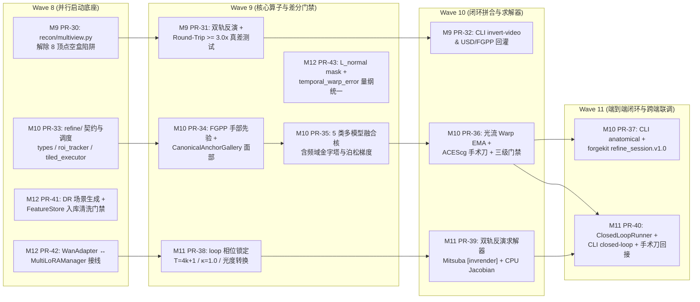

# 细分实施计划：Horizon-3 闭环反演、局部解剖精修与全域契约收口 (M9–M12: PR-30 ~ PR-43)

- **所属总计划**: [docs/IMPLEMENTATION_PLAN.md](../IMPLEMENTATION_PLAN.md) (`v3.1` Master Plan, Horizon 3 / Waves 8–11: M9–M12)
- **关联重构后审计与硬化计划**: [docs/audits/AUDIT-POST-REFACTOR-2026-11.md](../audits/AUDIT-POST-REFACTOR-2026-11.md) · [docs/plans/PLAN-M13-M16-POST-REFACTOR-REMEDIATION.md](PLAN-M13-M16-POST-REFACTOR-REMEDIATION.md)
- **全局契约 SSOT**: [docs/DESIGN_REVIEW_AND_ALIGNMENT.md](../DESIGN_REVIEW_AND_ALIGNMENT.md)
- **关联 RFC 与设计文档**:
  - **M9 (PR-30 ~ PR-32)**: [RFC 0060](../RFC-0060-REAL-VIDEO-TO-3D-DIGITAL-TWIN.md) · [DESIGN_REAL_VIDEO_TO_3D_INVERSE_RENDERING.md](../DESIGN_REAL_VIDEO_TO_3D_INVERSE_RENDERING.md) · [PLAN-3D-ROUNDTRIP-RECONSTRUCTION-VERIFICATION.md](PLAN-3D-ROUNDTRIP-RECONSTRUCTION-VERIFICATION.md)
  - **M10 (PR-33 ~ PR-37)**: [RFC 0061](../RFC-0061-LOCAL-REFINEMENT-AND-MULTI-MODEL-FUSION.md) · [DESIGN_LOCAL_REFINEMENT_AND_MULTI_MODEL_FUSION.md](../DESIGN_LOCAL_REFINEMENT_AND_MULTI_MODEL_FUSION.md) · [DESIGN_FORGEKIT_ANATOMICAL_REFINE_TOOLING.md](../DESIGN_FORGEKIT_ANATOMICAL_REFINE_TOOLING.md)
  - **M11 (PR-38 ~ PR-40)**: [RFC 0062](../RFC-0062-INVERSE-RENDERING-AND-3D-NEURAL-CLOSED-LOOP.md) · [DESIGN_INVERSE_RENDERING_CLOSED_LOOP.md](../DESIGN_INVERSE_RENDERING_CLOSED_LOOP.md)
  - **M12 (PR-41 ~ PR-43)**: [PLAN-ALGO-TRAINING-DATA-PIPELINE.md](../PLAN-ALGO-TRAINING-DATA-PIPELINE.md)
- **文档状态**: `Active Execution Blueprint (v1.0)`
- **修订日期**: 2026-11-13

---

## 1. Horizon-3 总体编排与执行依赖拓扑 (Wave 8 – Wave 11)

Horizon-3 共划分为 **4 个 Milestone（M9–M12）**、**14 个独立 PR（`PR-30` ~ `PR-43`）**，按 4 个并行波次（Wave 8–11）推进，严守单 PR 职责单一、防静默失败三问（存在 / 接线 / 执行）及 `ubuntu24` 无卡 CI 优先原则：



### 全局工程硬约束（适用 PR-30 ~ PR-43）
1. **契约零篡改**：不得修改 `@aether//fgpp` 15 通道 `34 B/px` 线格式；`--json` 输出严格包含 `"status": "ok"`, `"exit_code": 0`, `"trace_id"`。
2. **重依赖延迟加载**：`import synapse`、`import synapse.refine`、`import synapse.recon.loop` 不得加载 `torch`/`mitsuba`/`drjit`/`cv2`。
3. **测试同步规则**：凡修改 `metrics/profiles.py` 中由 `DESIGN_REVIEW_AND_ALIGNMENT.md §3.4` 纳管的阈值（如 `PR-43` 对 `temporal_warp_error` 量纲收口），**必须在同一 PR 内同步更新 `REVIEW §3.4` 并通过 `tests/test_profiles_doc_sync.py`**。

---

## 2. M9: 真实视频逆向 3D 数字孪生与真差往返验证 (`PR-30 ~ PR-32`)

<a id="pr-30"></a>
### `[PR-30]` 多视角几何初始化器与 `ReconPipeline` 空盒陷阱消除 (Wave 8)
- **建议标题**: `feat(recon): add MultiViewInitializer and remove empty-box fallback [model-tag]`
- **目标**：彻底消除 `python/synapse/recon/pipeline.py` 在 `initial_mesh=None` 时直接返回硬编码 8 顶点盒的假阳性行为。
- **涉及文件**：
  - `[NEW] python/synapse/recon/multiview.py`：`MultiViewInitializer.reconstruct(frames, cameras, masks=None, depths=None) -> MeshGeometry`（基于多视角深度图 TSDF / 轮廓 Space Carving 生成初始三角/四边拓扑网格，支持最小视差检验）
  - `[MODIFY] python/synapse/recon/pipeline.py`：`ReconPipeline.run(...)` 在 `initial_mesh is None` 时默认调用 `MultiViewInitializer.reconstruct(...)`；若视角退化或不足抛出 `ContractValidationError`（退出码 `10`）
  - `[MODIFY] python/synapse/recon/__init__.py`
  - `[NEW] tests/test_recon_multiview.py`
- **关键校验**：
  - 单视点/全同机位输入（视图跨度 $< 15^\circ$）不得静默回退至默认盒，须显式报错或产出低覆盖诊断标识；
  - 12 视角环绕圆环/雪人/头盔合成深度输入能恢复明显非盒体特征（顶点数 $> 100$，对称几何 `CD <= 0.015`）。
- **验证命令**：`ssh ubuntu24 "cd ~/work/dervgen/synapse && /root/venv-synapse/bin/pytest tests/test_recon_multiview.py -q"`

<a id="pr-31"></a>
### `[PR-31]` 双轨反演、PBR 去光照与 Round-Trip `>= 3.0x` 差分门禁 (Wave 9)
- **建议标题**: `test(recon): add differential round-trip sensitivity verification [model-tag]`
- **目标**：落地 `PLAN-3D-ROUNDTRIP-RECONSTRUCTION-VERIFICATION.md` Phase 2–3 的自动化差分集成测试，确保好数据高分通过、缺陷 A/B/C 稳定红灯拦截。
- **涉及文件**：
  - `[MODIFY] python/synapse/recon/pipeline.py` & `python/synapse/recon/delight.py`（补全线性空间去光照纹理反投影 `delight_multiview_albedo(...)` 与流形度校验）
  - `[NEW] scripts/run_roundtrip_verification.py`（`run_roundtrip_comparison(...)` 一键产出 Clean/Corrupted 双组 `report.html` 与 `metrics.json`）
  - `[NEW] tests/test_roundtrip_reconstruction.py`
- **关键校验**：
  - `test_roundtrip_golden_pipeline_passes_gate`：`CD <= 0.008`, `PSNR >= 26.0 dB`, `SSIM >= 0.88`；
  - `test_roundtrip_corrupted_input_fails_gate`：缺陷 A（$\le 2$ 共线视角）、缺陷 B（法线反转 `-N` + $\sigma=0.08\text{m}$ 深度噪声）、缺陷 C（上半球截断）均触发 FAIL；
  - `test_differential_sensitivity_ratio`：断言 `CD_corrupted / max(CD_clean, 1e-6) >= 3.0`。
- **验证命令**：`ssh ubuntu24 "cd ~/work/dervgen/synapse && /root/venv-synapse/bin/pytest tests/test_roundtrip_reconstruction.py -q"`

<a id="pr-32"></a>
### `[PR-32]` `synapse recon invert-video` CLI、Worker Stage 与 OpenUSD 回灌 (Wave 10)
- **建议标题**: `feat(cli): wire synapse recon invert-video and video_to_3d_invert stage [model-tag]`
- **目标**：建立端到端视频反演 CLI、RFC 0039 无状态 Stage 与 `.usda` + `FGPP v1.0` 回灌验证，并严格遵循 `RV-12` 保持 `synapse.recon` 零反向依赖 `pipeline`。
- **涉及文件**：
  - `[MODIFY] python/synapse/cli/__init__.py`（注册 `_cmd_recon_invert_video(...)` 对应 `recon invert-video`，对齐 `DESIGN_REAL_VIDEO_TO_3D_INVERSE_RENDERING.md §6` 全部 JSON 字段）
  - `[NEW] python/synapse/pipeline/stages/recon.py` & `[MODIFY] python/synapse/pipeline/bundle_worker.py`（在独立 `stages/recon.py` 中注册 `stage == "video_to_3d_invert"`，领域包 `synapse.recon` 不导入 `pipeline`）
  - `[NEW] tests/test_recon_invert_cli.py`
- **关键校验**：`--json` 输出含 `"status": "ok"`, `"exit_code": 0`, `"trace_id"`, `"asset_manifest"`, `"quality_gate_audit"`；违反 RFC 0044 顶点数 `< 1500` 时返回退出码 `10`；HITL 超时返回 `40`。
- **验证命令**：`ssh ubuntu24 "cd ~/work/dervgen/synapse && /root/venv-synapse/bin/pytest tests/test_recon_invert_cli.py tests/test_cli.py -q"`

---

## 3. M10: 局部解剖智能修正、多模型融合与手术刀缝合 (`PR-33 ~ PR-37`)

<a id="pr-33"></a>
### `[PR-33]` `synapse.refine` 基础契约、Kalman ROI 追踪与 Tile Bypass 调度 (Wave 8)
- **建议标题**: `feat(refine): add types, KalmanBBoxTracker and TiledBypassExecutor [model-tag]`
- **目标**：创建自包含局部修正基建，禁止直接使用 `uint8` 截断图像作为主干流水线张量。
- **涉及文件**：
  - `[NEW] python/synapse/refine/__init__.py`
  - `[NEW] python/synapse/refine/types.py`（`AnatomicalRegion`, 5 枚举 `FusionMethod`, `RefinementROI` 含 `crop_acescg: np.ndarray` 与 `to_display_srgb_u8()`, `RefinementResult`）
  - `[NEW] python/synapse/refine/roi_tracker.py`（`KalmanBBoxTracker.update(bbox_xyxy)` + `compute_affine_align(bbox, target_size=512) -> tuple[np.ndarray, np.ndarray]`）
  - `[NEW] python/synapse/refine/tiled_executor.py`（`TiledBypassExecutor.extract_and_filter(...)`，`512x512` 切片批量调度并跳过健康帧）
  - `[NEW] tests/test_refine_roi.py`
- **关键校验**：阶跃噪声轨迹经卡尔曼平滑后抖动方差下降 $\ge 70\%$；正逆仿射往返像素坐标重投影误差 $< 10^{-4}\text{px}$；无缺陷帧绕过计数准确。
- **验证命令**：`ssh ubuntu24 "cd ~/work/dervgen/synapse && /root/venv-synapse/bin/pytest tests/test_refine_roi.py -q"`

<a id="pr-34"></a>
### `[PR-34]` FGPP 手部硬先验与面部正交锚定画廊 (`hand.py` / `face.py`) (Wave 9)
- **建议标题**: `feat(refine): add FGPP hand refiner and CanonicalAnchorGallery face refiner [model-tag]`
- **目标**：实现双轨手部硬引导与多角度面部身份保持，严格复用已有 `fgpp.schema` 与 `adapters.wan` 归一化原语。
- **涉及文件**：
  - `[NEW] python/synapse/refine/hand.py`（`HandRefiner.prepare_hard_priors(...)` 复用 `linear_to_log_normalized_depth` 与 `_world_normal_to_camera` $[0,1]$ 编码 + `HandRefiner.refine(roi)` 支持 MANO 5 指关键点断言 `finger_count == 5`）
  - `[NEW] python/synapse/refine/face.py`（`CanonicalAnchorGallery.interpolate_identity(yaw_deg, pitch_deg)` + `FaceRefiner.refine(roi, gallery)` 凝视向量夹角 $\Delta\theta_{\text{gaze}}$ 检查）
  - `[NEW] tests/test_refine_hand_face.py`
- **关键校验**：正视锚点检索余弦相似度 $\ge 0.82$、$45^\circ$ 偏转 $\ge 0.78$；斜视模拟输入下 $\Delta\theta_{\text{gaze}} \le 4.5^\circ$；`hand.py` 拦截 `6` 指异常拓扑并回退 FGPP 深度通道。
- **验证命令**：`ssh ubuntu24 "cd ~/work/dervgen/synapse && /root/venv-synapse/bin/pytest tests/test_refine_hand_face.py -q"`

<a id="pr-35"></a>
### `[PR-35]` 五类异构多模型融合核心 (`fusion.py`) (Wave 9)
- **建议标题**: `feat(refine): implement MultiModelRefineFusion 5 fusion kernels [model-tag]`
- **目标**：实现 `FusionMethod` 全部 5 类融合核，与 `blend.py` 的空域 `laplacian_pyramid_blend` 清晰正交分工。
- **涉及文件**：
  - `[NEW] python/synapse/refine/fusion.py`（`MultiModelRefineFusion.fuse(...)` 调度 `_fuse_laplacian_frequency(...)`、`_fuse_cascade(...)`、`LATENT_TIMESTEP_SWITCH`、`_fuse_uncertainty(...)`、`_fuse_poisson_gradient(...)`）
  - `[NEW] tests/test_refine_fusion.py`
- **关键校验**：5 种 `FusionMethod` 均无未实现分支且返回与输入同尺度 `float32` ACEScg 张量；频域融合组在边界色温不变下（CIE $\Delta E_{00} \le 1.5$）高频梯度保留率 $\ge 92\%$。
- **验证命令**：`ssh ubuntu24 "cd ~/work/dervgen/synapse && /root/venv-synapse/bin/pytest tests/test_refine_fusion.py -q"`

<a id="pr-36"></a>
### `[PR-36]` 光流 Warp 激活、ACEScg 手术刀缝合、三级门禁与 RSI 导出 (Wave 10)
- **建议标题**: `feat(refine): activate motion_vectors warp in blend and add stitcher/gates [model-tag]`
- **目标**：修复 `blend.py` 中 `motion_vectors` 被静默忽略的历史缺陷，串联 RFC 0061 缝合器、三级门禁与 RFC 0044 熔断。
- **涉及文件**：
  - `[MODIFY] python/synapse/composite/blend.py`（在 `composite_surgical_sequence(...)` 中激活 `motion_vectors` 非空时的前向双线性 Warp，支持光流模长 $> 15\text{px}$ 时 EMA $\alpha$ 从 $0.85$ 自适应降至 $0.30$）
  - `[NEW] python/synapse/refine/stitcher.py`（`ScalpelStitcher.stitch_sequence(...)` 串联 $M^{-1}$ 逆变换 + `generate_surgical_mask` + `border_ring_lab_match` + `composite_optical_increments`）
  - `[NEW] python/synapse/refine/gates.py`（`evaluate_refinement_gates(...)` 复用 `synapse.bridge.hitl.evaluate_hitl_circuit_breaker` 实现 900s 熔断 + `export_hard_negatives(...)` 输出 `hard_negatives.jsonl`）
  - `[NEW] tests/test_refine_stitcher_gates.py`
- **关键校验**：
  - 启用 `motion_vectors` 后，移动边沿的时序 `temporal_warp_error` 相比无 Warp 组下降 $\ge 30\%$ 且满足 Hero $\le 0.015$ / Wide $\le 0.020$；
  - 缝合 $16\text{px}$ 边界 PSNR $\ge 38.0\text{ dB}$ 且 `border_ring_ciede2000 <= 2.0`；
  - `elapsed_seconds > 900.0` 准确抛出 `CircuitBreakerError` (exit `40`) 并写入 `hard_negatives.jsonl`。
- **验证命令**：`ssh ubuntu24 "cd ~/work/dervgen/synapse && /root/venv-synapse/bin/pytest tests/test_refine_stitcher_gates.py tests/test_composite_blend.py -q"`

<a id="pr-37"></a>
### `[PR-37]` `LocalRefinementPipeline`、CLI 与 `forgekit` 会话联调 (Wave 11)
- **建议标题**: `feat(refine): add LocalRefinementPipeline CLI and refine_session.v1.0 wire [model-tag]`
- **目标**：组装完整流水线，接线 CLI、Worker 与前端 `forgekit-anatomical-refine` Wire 契约（通过 `stages/refine.py` 保持领域解耦）。
- **涉及文件**：
  - `[NEW] python/synapse/refine/pipeline.py`（`LocalRefinementPipeline.run(...)` + `build_refine_session_payload(...)`）
  - `[MODIFY] python/synapse/cli/__init__.py`（注册 `_cmd_refine_anatomical(...)` 对应 `synapse refine anatomical --json`）
  - `[NEW] python/synapse/pipeline/stages/refine.py` & `[MODIFY] python/synapse/pipeline/bundle_worker.py`（在 `stages/refine.py` 注册 `stage == "anatomical_refine"`）
  - `[NEW] tests/test_refine_cli_wire.py`（验证 `synapse.refine_session.v1.0` 结构与 5 类 `CommandIR` 往返解析）
- **验证命令**：`ssh ubuntu24 "cd ~/work/dervgen/synapse && /root/venv-synapse/bin/pytest tests/test_refine_cli_wire.py tests/test_cli.py -q"`

---

## 4. M11: 3D 引导生成与可微逆向渲染双向闭环 (`PR-38 ~ PR-40`)

<a id="pr-38"></a>
### `[PR-38]` `synapse.recon.loop` 光度学算子与因果 VAE 相位锁定引导 (Wave 9)
- **建议标题**: `feat(recon): add radiometric transforms and T=4k+1 LookDev forward_guide [model-tag]`
- **目标**：严格遵守 `Wan 2.1` 3D Causal VAE `T = 4k + 1` 与 $\kappa = 1.0$ 强切镜防漏光契约。
- **涉及文件**：
  - `[NEW] python/synapse/recon/loop/__init__.py`
  - `[NEW] python/synapse/recon/loop/types.py`（`LookDevPrerollSpec`, `InverseRenderConfig`, `OptimizedMaterialResult`, `ClosedLoopReport`）
  - `[NEW] python/synapse/recon/loop/radiometric.py`（`srgb_to_linear_rgb`, `soft_knee_inverse_tonemap`, `linear_to_srgb_rgb`）
  - `[NEW] python/synapse/recon/loop/forward_guide.py`（`build_active_generation_plan(n_shot, preroll_spec)` 在 `t = n_preroll + n_light_sweep` 强制插入 `cut_score = 1.0` 并检验 $4k+1$）
  - `[NEW] tests/test_recon_loop_guide.py`
- **关键校验**：传入非法 `n_preroll=3` 或非 $4k+1$ 帧长抛出 `ContractValidationError` (exit `10`)；验证预卷边界帧触发 `ConditionScheduler` 切镜锚定且高/低动态往返误差 $< 10^{-4}$。
- **验证命令**：`ssh ubuntu24 "cd ~/work/dervgen/synapse && /root/venv-synapse/bin/pytest tests/test_recon_loop_guide.py -q"`

<a id="pr-39"></a>
### `[PR-39]` 双轨可微反演核心 (`Mitsuba` + CPU 解析 Jacobian) 与 UV 贴图抽取 (Wave 10)
- **建议标题**: `feat(recon): add dual-track Mitsuba and AnalyticUV inverse optimizer [model-tag]`
- **目标**：落地零 GPU CI 可跑的 CPU 解析反演器与可选 `[invrender]` Mitsuba 3 优化器。
- **涉及文件**：
  - `[MODIFY] pyproject.toml`（新增 `[invrender]` extra：`mitsuba>=3.5.0`, `drjit>=0.4.5`）
  - `[NEW] python/synapse/recon/loop/mitsuba_optimizer.py`（`AnalyticUVInverseOptimizer.optimize_material_from_video(...)` + `MitsubaInverseOptimizer` 延迟导入）
  - `[NEW] python/synapse/recon/loop/texture_extractor.py`（`extract_and_pack_pbr_textures(...)` 完成 UV 反投影、TV 正则、接缝修补与 OpenPBR 落盘）
  - `[NEW] tests/test_recon_loop_optimizer.py`
- **关键校验**：
  - 未安装 `mitsuba` 时调用 `MitsubaInverseOptimizer` 稳定抛出 `BackendUnavailableError` (exit `30`) 且 `import synapse.recon.loop` 零异常；
  - `AnalyticUVInverseOptimizer` 从白模初始化收敛至彩绘合成目标：`psnr_after_db - psnr_before_db >= 10.0`、`psnr_after_db >= 28.5 dB`、`ciede2000_after <= 2.5`。
- **验证命令**：`ssh ubuntu24 "cd ~/work/dervgen/synapse && /root/venv-synapse/bin/pytest tests/test_recon_loop_optimizer.py -q"`

<a id="pr-40"></a>
### `[PR-40]` `ClosedLoopRunner`、CLI 与 RFC 0061 手术刀联动闭环 (Wave 11)
- **建议标题**: `feat(recon): add ClosedLoopRunner CLI and scalpel patch loop [model-tag]`
- **目标**：串联 `Forward Guide -> Target Video -> Inverse Optimization -> Aligned 3D Render -> Scalpel Patching` 五步闭环。
- **涉及文件**：
  - `[NEW] python/synapse/recon/loop/closed_loop_runner.py`（`ClosedLoopRunner.run(...)`）
  - `[MODIFY] python/synapse/cli/__init__.py`（注册 `_cmd_recon_closed_loop(...)` 对应 `synapse recon closed-loop --json`）
  - `[MODIFY] python/synapse/pipeline/stages/recon.py` & `bundle_worker.py`（在 `stages/recon.py` 注册 `stage == "inverse_render_loop"`）
  - `[NEW] tests/test_recon_closed_loop_e2e.py`
- **关键校验**：端到端 5 步闭环在无卡 `ubuntu24` 耗时 $< 15\text{s}$；输出 3D 渲染与注入局部瑕疵的模拟 AI 视频经 `LocalRefinementPipeline` 缝合后边界 `border_ring_ciede2000 <= 2.0`。
- **验证命令**：`ssh ubuntu24 "cd ~/work/dervgen/synapse && /root/venv-synapse/bin/pytest tests/test_recon_closed_loop_e2e.py tests/test_cli.py -q"`

---

## 5. M12: Horizon-2 算法遗留闭环与全域契约收口 (`PR-41 ~ PR-43`)

<a id="pr-41"></a>
### `[PR-41]` 域随机化引擎 (`domain_randomizer.py`) 与 FeatureStore 准入清洗门禁 (Wave 8)
- **建议标题**: `feat(bench): add 11-factor DomainRandomizer and FeatureStore ingestion gate [model-tag]`
- **目标**：落实 `PLAN-ALGO-TRAINING-DATA-PIPELINE.md` 行动 `D1` 与 `D4`，对齐 `bench/conditions.py` 规范因子键名。
- **涉及文件**：
  - `[NEW] python/synapse/bench/domain_randomizer.py`（`DomainRandomizer.generate_variants(...)` 严格使用 `F01_viewpoint`, `F03_lighting`, `F04_material`, `F05_geometry`, `F06_animation`, `F08_scale` 规范键名，派生 $\ge 300$ 个 $T=4k+1$ 场景 JSON）
  - `[MODIFY] python/synapse/training/feature_store.py`（在 `FeatureStoreBuilder.add_sample(...)` 落实前景占比 $\ge 5\%$、深度跨度 $\ge 0.1\text{m}$、DirectRadiance 95th $\le 65504$、法线单位长 $\ge 95\%$、$|\det(R)-1| < 10^{-5}$ 五项准入过滤）
  - `[NEW] tests/test_domain_randomizer_and_gate.py`
- **验证命令**：`ssh ubuntu24 "cd ~/work/dervgen/synapse && /root/venv-synapse/bin/pytest tests/test_domain_randomizer_and_gate.py tests/test_lora_feature_store.py -q"`

<a id="pr-42"></a>
### `[PR-42]` `WanAdapter` ↔ `MultiLoRAManager` 完整接线（消除 M5 Stub） (Wave 8)
- **建议标题**: `feat(adapters): wire MultiLoRAManager into WanAdapter generation [model-tag]`
- **目标**：落实行动 `A1`，激活 `wan.py` 中的 `_lora_manager` 槽位。
- **涉及文件**：
  - `[MODIFY] python/synapse/adapters/wan.py`（`WanAdapter.__init__(..., lora_manifests=None)` 构造 `MultiLoRAManager`；在 `generate(...)` 中结合 `Cryptomatte.ID` 调用 `build_spatial_lora_masks()`、`apply_merged_weights()` 及退出时 `restore_base_weights()`）
  - `[NEW] tests/test_wan_lora_wiring.py`
- **验证命令**：`ssh ubuntu24 "cd ~/work/dervgen/synapse && /root/venv-synapse/bin/pytest tests/test_wan_lora_wiring.py tests/test_wan_adapter.py -q"`

<a id="pr-43"></a>
### `[PR-43]` `normal_reconstruction_loss` 前景掩码扩展 & `temporal_warp_error` 量纲全域统一 (Wave 9)
- **建议标题**: `fix(metrics,training): add mask to normal loss and unify temporal_warp_error units [model-tag]`
- **目标**：完成行动 `T1` 增强，并一次性彻底解决 `profiles.py`（`8.0/4.0/2.0`）与 `temporal.py` / RFC 0061 之间的 `temporal_warp_error` 量纲分裂。
- **涉及文件**：
  - `[MODIFY] python/synapse/training/losses.py`（扩展 `normal_reconstruction_loss(n_pred, n_gt, mask=None)` 支持可选前景掩码与 `[C, H, W]` 自动转置）
  - `[MODIFY] python/synapse/metrics/profiles.py`（将 `temporal_warp_error` 收口为 `[0, 1]` 归一化光流 RMSE：`wide_landscape=0.020`, `hero_character=0.015`, `rsi_promotion=0.015`）
  - `[MODIFY] docs/DESIGN_REVIEW_AND_ALIGNMENT.md`（同步更新 `§3.4` 表格中 `temporal_warp_error` 行的 `0.020 / 0.015 / 0.015`，确保同一 PR 内 `test_profiles_doc_sync.py` 通过）
  - `[MODIFY] tests/test_lora_trainer.py` & 对应 `metrics` 测试
- **验证命令**：`ssh ubuntu24 "cd ~/work/dervgen/synapse && /root/venv-synapse/bin/pytest tests/test_profiles_doc_sync.py tests/test_lora_trainer.py tests/ -q"`

---

## 6. 全量合入验收清单 (Final Acceptance Gate)

当 `PR-30` ~ `PR-43` 全部合入后，必须在云端主力机 `ubuntu24` 执行终审全量门禁：
```bash
ssh ubuntu24 "cd ~/work/dervgen/synapse && \
  /root/venv-synapse/bin/pytest tests/ -q && \
  /root/venv-synapse/bin/ruff check python/ tests/ scripts/ && \
  /root/venv-synapse/bin/mypy python/synapse"
```
所有 `pytest` 用例全绿（0 退化、`test_profiles_doc_sync.py` 与 `test_roundtrip_reconstruction.py` 全过），`ruff` 与 `mypy` 零告警方可视为 Horizon-3 圆满交付。
