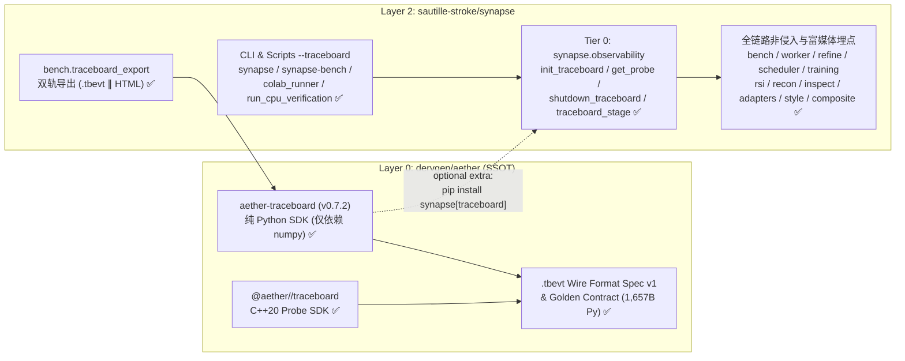
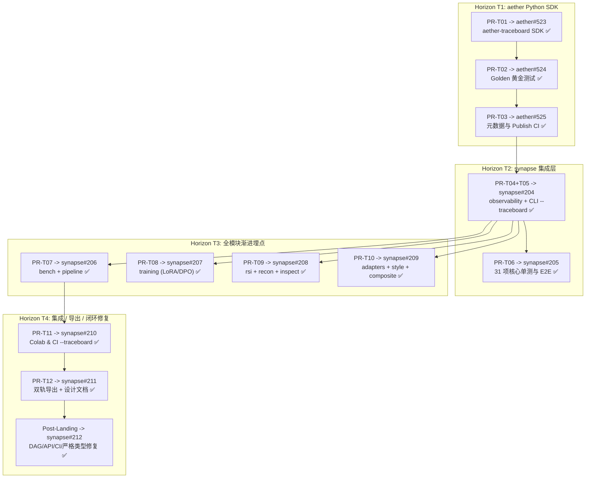

# Traceboard Python SDK 与 Synapse 可观测性集成：完整 Plan 与落地总结

> **文档用途**: 作为 **Plan + Implementation Landing Record (Review Baseline)**，供团队成员对 Traceboard Python 化与 Synapse 全链路接入进行 Code Review、架构复核与上线验收。  
> **涉及仓库**: `dervgen/aether` (Layer 0) + `sautille-stroke/synapse` (Layer 2)  
> **合入范围**: `aether#523`–`#525`, `#557`–`#560`, `#569`, `#575`（8 PRs） + `synapse#204`–`#212`, `#215`–`#220` + 版本对齐 follow-up  
> **设计参考**: [DESIGN_TRACEBOARD_INTEGRATION.md](../DESIGN_TRACEBOARD_INTEGRATION.md)  
> **总体状态**: ✅ **已完成深度整改、Post-Review 硬化与统一版本对齐（`Wave TR-1 ~ TR-3` 全绿封板，`aether v0.7.2` Release 已发布）**

> [!NOTE]
> **Remediation & Post-Review Hardening (`2026-11-26`)**:
> 此前于 [REVIEW-PR213-TRACEBOARD-INTEGRATION-2026-11.md](../archive/audits/REVIEW-PR213-TRACEBOARD-INTEGRATION-2026-11.md) 检出的 20 项缺陷（`6×P0` · `9×P1` · `5×P2`）已按 [PLAN-TRACEBOARD-REMEDIATION-AND-HARDENING.md](../archive/plans/PLAN-TRACEBOARD-REMEDIATION-AND-HARDENING.md) 全部整改完成并通过 `Gate TB-1 ~ TB-10` 封板验收：
> - **Layer 0 (`dervgen/aether`)**: `aether#557` (`PR-TR01`) · `aether#558` (`PR-TR02`) · `aether#560` (`PR-TR03`) · `aether#569`（安全硬化）· `aether#575`（统一锁步版本并发布 `v0.7.2` Release）
> - **Layer 2 (`sautille-stroke/synapse`)**: `synapse#215`–`#219` (`PR-TR04`–`PR-TR08`) · `synapse#220`（Post-Review 硬化）+ 统一 `aether-traceboard>=0.7.2` 版本对齐
> - **跨仓协同**: `dervgen/caelum-core#557` · `dervgen/all-overview#770` (`DUP-17` 双向黄金测试门禁)

---

## 0. 执行摘要 (Executive Summary)

为使 `synapse`（Python 算法 SDK / 无状态 Worker / Synapse-Bench）能够复用 `aether` 生态现有的结构化实验追踪能力（`.tbevt` 线格式），而不反向依赖重型 C++ 构建环境，本次改造分初始落地（`aether#523`–`#525` + `synapse#204`–`#212`）、三波深度整改硬化（`Wave TR-1 ~ TR-3` + `aether#569` / `synapse#220`）与 `aether v0.7.2` 统一版本发布完成跨仓闭环：

| 维度 | 统计指标（已合入 `main` 验证） | 说明 |
|---|---|---|
| **`aether` 侧交付** | `8 PRs` (`#523`–`#525`, `#557`, `#558`, `#560`, `#569`, `#575`) | 纯 Python SDK `aether-traceboard`（与 `MODULE.bazel` / `aether_py` 统一锁步至 `v0.7.2`）、双向 C++↔Py 黄金测试、洁净 Wheel 与统一 `v0.7.2` Release |
| **`synapse` 侧交付** | `15+ PRs` (`#204`–`#212`, `#215`–`#220` + 版本对齐) | `synapse.observability` 原子封装与协议、全位置 CLI `--traceboard`、`bundle_worker` 沙箱/全子系统富媒体埋点、`5/5` CI 全绿 |
| **跨仓协同交付** | `caelum-core#557` · `all-overview#770` | `caelum-core` 对齐 `aether-traceboard>=0.7.2`；`all-overview` `DUP-17` 锁死双向黄金门禁 |
| **新增/验证测试** | `aether`: **178 passed, 1 skipped** + **5/5 Bazel** · `synapse`: **92+ 项 Traceboard 专项测试** | 覆盖 7 个测试模块，含真实 `.tbevt` 读写、`CRC-32` 校验、`IMAGE`/`HISTOGRAM`/`COMPARISON`/`TABLE`/`ARTIFACT` 与 Worker 沙箱校验 |
| **零侵入与安全门禁** | `ruff` 0 错 · `mypy --strict` 0 错 · `import_dag_guard` clean | `observability` 归属 Tier 0；`import synapse` 保持 PEP 562 零副作用懒加载 |

---

## 1. 架构设计与核心约束 (Architecture & Invariants)

### 1.1 分层拓扑图



### 1.2 六大架构铁律 (Design Invariants)

| # | 约束条目 | 落地保障方式 |
|---|---|---|
| **1** | **SDK 归属 Layer 0 (`aether`)** | 包名 `aether-traceboard` 位于 `aether/traceboard/python/`，禁止在 `synapse` 重复造轮子；遵循 Layer 0 → Layer 2 单向依赖。 |
| **2** | **零基础依赖膨胀** | 在 [pyproject.toml](../../pyproject.toml) 作为 `[traceboard]` optional extra（含入 `[full]`），未安装时不阻塞安装与运行。 |
| **3** | **PEP 562 零导入副作用** | `observability` 登记在 [\_\_init\_\_.py](../../python/synapse/__init__.py) `_SUBMODULES` 延迟表；`import synapse` 或 `from synapse import observability` 均不触发初始化或 I/O（已由 `TestLazyImportIsolation` 断言锁死）。 |
| **4** | **缺失时 Graceful Degradation** | `init_traceboard()` 在缺包或初始化异常时捕获处理并置 `get_probe() -> None`；业务埋点统一走 `probe = get_probe(); if probe is not None and probe.active:`，无 Probe 时退化为单次空检查。 |
| **5** | **零重型依赖** | `aether-traceboard` 唯一运行时依赖为 `numpy>=1.24.0`（`pyproject.toml` 声明 `requires-python >= 3.10` + `py.typed`），不引入 `torch` / C++ 扩展；`synapse` 保持 `requires-python >= 3.12`。 |
| **6** | **`.tbevt` 线格式字节兼容** | 严格实现 `.tbevt` v1 文件头（`TBEV` magic、`uint16` version=1、`uint16` flags=0、`uint64` SHA-256 `runIdHash`）、记录头、payload 与 IEEE `CRC-32`（`zlib.crc32`），配合 `python_reference.tbevt` 与双向 C++ 黄金测试防止跨语言漂移。 |

---

## 2. 原始分期规划与落地 PR 台账 (Plan vs Merged PR Ledger)



| Plan 编号 | Horizon | 实际 PR | 合并 Commit | 核心内容摘要 | 规模 | 状态 |
|---|---|---|---|---|---:|---|
| **PR-T01** | T1 | `aether#523` | `de09b1d4` | `aether-traceboard` 纯 Python SDK（10 源码文件 + 6 单测模块） | `18 files, +2,569` | ✅ |
| **PR-T02** | T1 | `aether#524` | `d02b5af4` | Python 黄金生成器、5 阶段校验器、`python_reference.tbevt`（1,567B）、50 项 Golden 测试 | `6 files, +1,077` | ✅ |
| **PR-T03** | T1 | `aether#525` | `b3f179b4` | `aether-traceboard` 包文档、`LICENSE` (MIT)、CI 与 Publish workflow | `4 files, +305 / -1` | ✅ |
| **PR-T04 + T05** | T2 | `synapse#204` | `d36666a` | `synapse.observability` 薄封装、`[traceboard]` extra、`cli/common.py` & `cli/_app.py` `--traceboard` | `6 files, +376 / -45` | ✅ |
| **PR-T06** | T2 | `synapse#205` | `e296a0e` | `tests/test_observability.py` 扩充至 31 项单测（生命周期 / stage / 懒加载 / E2E CRC32） | `1 file, +467 / -57` | ✅ |
| **PR-T07** | T3 | `synapse#206` | `8248647` | `BenchPipelineRunner`、`compare_runs`、`generate_html_report` 埋点 | `3 files, +120 / -48` | ✅ |
| **PR-T08** | T3 | `synapse#207` | `d496a35` | `StatelessLoRATrainer`、`DiffusionDPOLoss`、`packager` 埋点与 6 项训练测试 | `4 files, +348 / -2` | ✅ |
| **PR-T09** | T3 | `synapse#208` | `dcf2ccf` | `promotion_gate`、`curriculum`、`dual_verifier`、`recon/pipeline`、`jev_critic` 埋点与 12 项测试 | `6 files, +511 / -4` | ✅ |
| **PR-T10** | T3 | `synapse#209` | `b1de94f` | `WanAdapter`、`extract_style_{optical,fgpp_intrinsic}`、`composite_surgical_sequence` 埋点与 7 项测试 | `4 files, +292 / -1` | ✅ |
| **PR-T11** | T4 | `synapse#210` | `0cf7b6c` | `colab_runner.py` / `run_cpu_verification.py` `--traceboard` 标志、`setup_colab.sh` 与 CI 安装 | `4 files, +97 / -1` | ✅ |
| **PR-T12** | T4 | `synapse#211` | `a7920b6` | [traceboard_export.py](../../python/synapse/bench/traceboard_export.py) 双轨导出（10 测试）与 [DESIGN_TRACEBOARD_INTEGRATION.md](../DESIGN_TRACEBOARD_INTEGRATION.md) | `3 files, +641` | ✅ |
| **Post-Landing Fix** | Remediation | `synapse#212` | `c57f135` | `import_dag_guard` 注册 `observability`、对齐真实 `Probe` API（`activate` 先于 `begin_run`、`log_table`/`log_artifact` 签名）、`ruff`/`mypy --strict`/CI/Colab 修复 | `16 files, +208 / -77` | ✅ |
| **PR-TR01** | Wave TR-1 | `aether#557` | `cb0c8e43` | `.tbevt` `payloadLength` 线格式修复、5 类 Schema 对齐、`emit_cpp_golden.cc` + `test_golden_interop.cc` | C++↔Py 双向 Golden ✅ | ✅ |
| **PR-TR02** | Wave TR-1 | `aether#558` | `ef7d2e83` | `FileCollector` 清洗/防重入、`Probe`/`StageContext` 并发锁、`reader` (`FileHeader`/`ReadStats`/`read_file`) | 173 passed + 4/4 Bazel | ✅ |
| **PR-TR03** | Wave TR-1 | `aether#560` | `f409175a` | 消除运行时 `typing_extensions`、wheel 排除 `tests*`、`mypy --strict` 清零、Publish CI + `traceboard-python-v0.1.0` | clean venv + twine ✅ | ✅ |
| **PR-TR04** | Wave TR-2 | `synapse#215` | `769e9c6` | `observability` `RLock`+协议原子化、CLI `get_json_parent_parser` `--traceboard`、`BenchPipelineRunner` `set_fail` 修复 | Traceboard/CLI 全绿 | ✅ |
| **PR-TR05** | Wave TR-2 | `synapse#216` | `289be5c` | `trainer`/`curriculum` 单调 `step`、`dual_verifier`/`jev_critic` 低基数收口、`compute_pillar_scores` SSOT | 243 文件 mypy 0 错 | ✅ |
| **PR-TR06** | Wave TR-2 | `synapse#217` | `e5a03d0` | Colab NVMe staging 原子同步、`cpu_verification` `finally:` 刷盘、typed `ProbeProtocol` mocks & CI `.tbevt` smoke | 5/5 CI 全绿 | ✅ |
| **PR-TR07** | Wave TR-3 | `synapse#218` | `255d187` | `bundle_worker`、`ConditionScheduler`、`LocalRefinementPipeline` (`COMPARISON`)、`bench_runner --tb-media` & `ARTIFACT` | 5/5 CI 全绿 | ✅ |
| **PR-TR08** | Wave TR-3 | `synapse#219` | `cb4589d` | `Gate TB-1..TB-10` 全绿验收、设计/计划文档对齐、`caelum-core#557` & `all-overview#770` 跨仓闭环 | 文档/门禁全绿 | ✅ |

---

## 3. 详细落地内容清单 (Detailed Landing Inventory)

### 3.1 `dervgen/aether` 侧：`aether-traceboard` Python SDK (`#523`–`#525`, `#557`–`#560`, `#569`, `#575`)

#### 核心包 (`aether/traceboard/python/aether_traceboard/`)

| 文件路径 | 核心职责与实现细节 |
|---|---|
| `aether_traceboard/__init__.py` | 导出公开契约：`Probe`, `get_probe`, `StageContext`, `ProbeCollector`, `FileCollector`, `EventType`, `ImageFormat`, `StageStatus`, `Record`, `FileHeader`, `read_file`, `read_events`, `__version__="0.7.2"`。 |
| `aether_traceboard/_types.py` | 定义 `EventType`（`SCALAR=0`, `IMAGE=1`, `HISTOGRAM=2`, `TEXT=3`, `COMPARISON=4`, `TABLE=5`, `ARTIFACT=6`, `SERIES_GROUP=7`, `RUN_START=240`, `RUN_END=241`, `STAGE_BEGIN=242`, `STAGE_END=243`, `CONFIG=244`）、`ImageFormat` 与 `StageStatus`。 |
| `aether_traceboard/_crc32.py` / `_hash.py` | 复用标准库 `zlib.crc32` 计算 IEEE CRC-32 与 SHA-256 截断生成小端 `uint64` `runIdHash`。 |
| `aether_traceboard/event.py` | 完整的 `.tbevt` v1 二进制封包/解包（`FileHeader` 16B、`RecordHeader` 32B、`pack_*/unpack_*` 全 13 类事件），严格小端对齐与 CRC 校验。 |
| `aether_traceboard/collector.py` / `file_collector.py` | `ProbeCollector` 抽象基类与 append-only `FileCollector`（按 run 生成 `.tbevt` 文件，包含实时 flush 与异常恢复边界处理）。 |
| `aether_traceboard/probe.py` | 进程级 `Probe` 单例与 RAII `StageContext`：支持 `log_scalar`, `log_image`, `log_histogram`, `log_text`, `log_comparison`, `log_table`, `log_artifact`, `log_series_group`, `log_config`, `begin_stage`（自动异常捕获标 FAIL）及多 Collector fan-out。 |
| `aether_traceboard/reader.py` | `.tbevt` 读取器与崩溃恢复（`read_events` / `read_file` 遇尾部截断记录时安全停止而不整文件失效）。 |
| `aether_traceboard/py.typed` | PEP 561 类型声明标记（`pyproject.toml` 启用 `mypy strict = true` + `ruff`）。 |

#### 跨语言黄金契约与打包 (`aether/traceboard/tests/golden/` & CI)

- **黄金测试套件** (`traceboard/tests/golden/`):
  - `generate_python_golden.py`: 在固定时间戳生成涵盖全部 13 类事件共 17 条记录的 `python_reference.tbevt`（`1,657 bytes`，已入库追踪）。
  - `verify_golden.py`: 独立 5 阶段校验脚本（文件头、记录内容、CRC-32 扫描、manifest 对齐、字节级确定性重生成对比 Python 黄金参考文件；C++ 双向黄金验证由 `test_golden.py` 与 `//traceboard:test_golden_interop` 承担）。
  - `test_golden.py`: 跨语言双向黄金契约测试（C++↔Python 双向互读、4 组 SHA-256 `run_id_hash` 参考向量与 5 类富媒体/控制流对齐）。
- **发布元数据与 CI**: `aether/traceboard/python/{pyproject.toml, README.md, LICENSE}` 与 `.github/workflows/traceboard-python-publish.yml`（Python `3.10`/`3.11`/`3.12` × `ubuntu`/`macos` 测试矩阵）。

---

### 3.2 `sautille-stroke/synapse` 侧：集成层、全模块埋点与双轨导出 (`#204`–`#212`, `#215`–`#219`)

#### A. 核心集成层、CLI 与工程护栏

| 模块/文件 | 落地内容 | 关键接口/标志 |
|---|---|---|
| [observability.py](../../python/synapse/observability.py) | Thin wrapper 单例管理与异常隔离；`RLock` + 原子化 `init_traceboard()` 回滚、显式签名的 `_accepts_kwarg`、`ProbeProtocol`/`StageProtocol` 与 `bound_image_u8()` / `safe_log_{image,histogram,comparison}`。 | `init_traceboard()`, `get_probe()`, `shutdown_traceboard()`, `traceboard_stage()` |
| [\_\_init\_\_.py](../../python/synapse/__init__.py) | 在 `_SUBMODULES` / `TYPE_CHECKING` / `__all__` 注册 `"observability"`。 | PEP 562 延迟加载 |
| [pyproject.toml](../../pyproject.toml) | 新增 optional extra `traceboard = ["aether-traceboard>=0.7.2"]`、`[full]` 纳管，及 `mypy` override。 | `pip install -e ".[traceboard]"` |
| [cli/common.py](../../python/synapse/cli/common.py) & [cli/_app.py](../../python/synapse/cli/_app.py) | 为 `synapse` 与 `synapse-bench` 双入口通过 `get_json_parent_parser()` 注册 `--traceboard LOG_DIR`，并在 `finally:` 确保 `shutdown_traceboard()` 刷盘。 | `synapse [--traceboard LOG_DIR] ...` |
| [tools/import_dag_guard.py](../../tools/import_dag_guard.py) & [ARCHITECTURE.md](../ARCHITECTURE.md) | `observability` 注册为 **Tier 0**，同步更新权威架构目录树以通过 `test_profiles_doc_sync.py`。 | `python tools/import_dag_guard.py --check` |

#### B. 全子系统非侵入埋点与富媒体观测全览

所有埋点均采用延迟局部或安全门卫模式：`probe = get_probe(); if probe is not None and probe.active:`，无 Probe 时开销仅单次 `None` 判断：

| 子系统 | 源码文件 | 埋点函数 / 方法 | 记录的 Traceboard 事件与 Tag 命名空间 |
|---|---|---|---|
| **pipeline** | [bench_runner.py](../../python/synapse/pipeline/bench_runner.py) | `run_scenario()`, `run_all()`, `tb_media` 媒体开关 | `traceboard_stage("bench/run_all")`, `traceboard_stage("bench/{scenario}")`, `log_scalar("bench/scenario/{scenario}/{passed\|metrics/*\|timing/*\|num_frames}")`, `IMAGE`/`HISTOGRAM` (`--tb-media`), `stage.set_pass()` / `stage.set_fail()` |
| **pipeline** | [bundle_worker.py](../../python/synapse/pipeline/bundle_worker.py) | `JobBundleWorker.execute()`, `run_worker_cli()` | `traceboard_stage("worker/{stage}")`, `worker/{exit_code\|elapsed_s\|output_file_count\|succeeded}`, `TEXT` (`worker/trace_id`, `worker/fallback_level`), `workspace_root` 沙箱校验 `traceboard_dir` |
| **bench** | [compare.py](../../python/synapse/bench/compare.py) | `compare_runs()`, `render_comparison_html()` | `traceboard_stage("bench/compare")`, `log_table("bench/compare/leaderboard", columns, rows)`, `ARTIFACT` (`bench/compare_report`) |
| **bench** | [report.py](../../python/synapse/bench/report.py) | `generate_html_report()` | `log_artifact("bench/report", {"filename": ..., "mime_type": "text/html", "size_bytes": ...}, html_bytes)` |
| **bench** | [traceboard_export.py](../../python/synapse/bench/traceboard_export.py) | `export_reports_to_traceboard()` | 独立离线转换（复用 `compute_pillar_scores()` SSOT）：`bench/scenario/{name}/passed`, `bench/scenario/{name}/metrics/*`, `bench/scenario/{name}/timing/*`, `bench/summary/*`, `bench/pillar/*` |
| **training** | [trainer.py](../../python/synapse/training/trainer.py) | `inject_lora()`, `save_state_dict()`, `train_step()`, `_dpo_step()` | `log_scalar`: `train/lora_injected_layers`, `train/total_params`, `train/trainable_params`, `train/checkpoint_step`, `train/loss`, `train/step`, `train/lr_multiplier`, `train/dpo_beta`（并传递 `step=step` 至 DPO 损失） |
| **training** | [losses.py](../../python/synapse/training/losses.py) | `DiffusionDPOLoss.__call__()` | `log_scalar(..., step=step)`: `train/dpo_preferred_err`, `train/dpo_rejected_err` |
| **training** | [packager.py](../../python/synapse/training/packager.py) | `package_and_gate_lora_bundle()` | `log_scalar`: `train/package_passed`, `train/package/{metric}` |
| **rsi** | [promotion_gate.py](../../python/synapse/rsi/promotion_gate.py) | `evaluate_monotonic_promotion()` | `log_scalar("rsi/promotion/*")`, `log_table("rsi/promotion/quarantine", columns, q_rows)` |
| **rsi** | [curriculum.py](../../python/synapse/rsi/curriculum.py) | `analyse_weaknesses()`, `sample_scenarios()`, `plan_round()` | `log_scalar("rsi/curriculum/{weight/*\|round_idx\|num_scenarios}")`, `log_text("rsi/curriculum/{weak_factors\|factor_distribution}")` |
| **rsi** | [dual_verifier.py](../../python/synapse/rsi/dual_verifier.py) | `verify_physics()`, `_log_verdict()` | 低基数固定 Tag：`log_scalar("rsi/verifier/{physics_passed\|prm_score\|<check>}", step=_traceboard_step)`、`log_table("rsi/verifier/verdicts", columns, rows)` |
| **recon** | [pipeline.py](../../python/synapse/recon/pipeline.py) | `ReconPipeline.run()` | `log_scalar`: `recon/pipeline/{elapsed_s\|num_frames\|mesh_vertex_count\|mesh_face_count\|is_manifold\|albedo_delta_e\|foot_slip_cm_s\|jev_quality_score}` |
| **inspect** | [jev_critic.py](../../python/synapse/inspect/jev_critic.py) | `VisualJevCritic.evaluate()` | 低基数固定 Tag：`log_scalar("inspect/jev/{overall_quality\|defect_count\|requires_hitl}")`、`log_table("inspect/jev/defects", columns, rows)` |
| **adapters** | [wan.py](../../python/synapse/adapters/wan.py), [scheduler.py](../../python/synapse/adapters/scheduler.py) | `WanAdapter.generate()`, `ConditionScheduler` | `adapter/wan/*`、`adapter/scheduler/{window_idx\|overlap_frames\|shot_cut_reanchor\|window_elapsed_s}`（按 `step=window_index`） |
| **refine** | [pipeline.py](../../python/synapse/refine/pipeline.py) | `LocalRefinementPipeline.run()` | `refine/{border_psnr_db\|border_ciede2000\|temporal_warp_error\|num_patches_fused\|passed}` 与 `COMPARISON` (`refine/anatomical_patch`，含 `strict=True` 门禁失败前上报) |
| **style** | [extractor.py](../../python/synapse/style/extractor.py) | `extract_style_optical()`, `extract_style_fgpp_intrinsic()` | `log_scalar("style/optical/*")`, `log_scalar("style/fgpp/num_light_samples")`, `log_scalar("style/fgpp/ambient_ratio")`, `log_text("style/fgpp/key_light_dir")` |
| **composite** | [blend.py](../../python/synapse/composite/blend.py) | `composite_surgical_sequence()` | `log_scalar`: `composite/surgical/{num_frames\|height\|width\|ema_alpha\|mean_mask_coverage\|has_motion_vectors}` |

#### C. Colab / CPU 验证 / CI 与测试资产

- **脚本集成**:
  - [scripts/colab_runner.py](../../scripts/colab_runner.py): 支持 `--traceboard [LOG_DIR]`；目标位于 Google Drive FUSE 挂载路径时启用 NVMe-first 暂存（本地 `/tmp` 写入，`finally` 关停刷盘后 `shutil.copy2` + `os.replace` 原子同步至 `{job_dir}/traceboard/`，并早于 `--auto-release` 执行）。
  - [scripts/run_cpu_verification.py](../../scripts/run_cpu_verification.py): 支持 `--traceboard [LOG_DIR]`，并在 `try...finally` 块中确保早退 `20` 时亦完整刷盘输出 `cpu_verify/*`。
  - [workenv/google-colab/setup_colab.sh](../../workenv/google-colab/setup_colab.sh) & [.github/workflows/ci.yml](../../.github/workflows/ci.yml): 优先使用同级 `../aether/traceboard/python` editable 安装，通过 `has_tb` 输出状态明确驱动或显式提示跳过 `.tbevt` 实机冒烟校验。
- **测试套件（共 86+ 项 Traceboard 专项用例，覆盖 7 个测试模块）**:
  - [tests/test_observability.py](../../tests/test_observability.py): 生命周期、单次/重init、stage RAII、`_accepts_kwarg` 显式签名匹配、懒加载隔离、CLI flag、`bound_image_u8`、真实 SDK `.tbevt` + CRC-32 E2E。
  - [tests/test_bench_runner_traceboard.py](../../tests/test_bench_runner_traceboard.py): `BenchPipelineRunner` 通过/失败 verdict 与 `set_fail`、关键帧 `IMAGE` / 深度残差 `HISTOGRAM` 校验。
  - [tests/test_pr07_rich_media_and_worker.py](../../tests/test_pr07_rich_media_and_worker.py): `bundle_worker` Traceboard 注入与 `workspace_root` 沙箱边界、`ConditionScheduler` 滑窗指标、`LocalRefinementPipeline`（含 `strict=True` 失败）`COMPARISON` 卡与 `render_comparison_html` `ARTIFACT`。
  - [tests/test_rsi_recon_traceboard.py](../../tests/test_rsi_recon_traceboard.py): RSI 门禁/课程/双验证、`ReconPipeline`、`VisualJevCritic` 及真 SDK `TABLE` 低基数 E2E。
  - [tests/test_traceboard_export.py](../../tests/test_traceboard_export.py): 双轨 `.tbevt` 导出、`compute_pillar_scores()` 4 支柱得分 SSOT 与 `bench/report.py` + `bench/compare.py` 真 SDK `ARTIFACT`/`TABLE` E2E。
  - [tests/test_adapters_style_traceboard.py](../../tests/test_adapters_style_traceboard.py): `WanAdapter`、`extract_style_*`、`composite_surgical_sequence`。
  - [tests/test_training_traceboard.py](../../tests/test_training_traceboard.py): `StatelessLoRATrainer`（含 DPO `step` 传递）、`packager`、`DiffusionDPOLoss`。

---

## 4. 落地后审计与修复闭环 (`synapse#212` 核心发现)

在 `#204`–`#211` 合入后、准备交付 Review 前的全面核验（`ubuntu24` 实测 + GitHub Actions CI 日志审查）中，发现并已在 **PR `#212`** (`c57f135`) 彻底修复以下 **6 类真实阻断问题**：

1. **5-Tier Import DAG 漏注册导致 CI `python-slow` 全红**：`observability` 加入 `_SUBMODULES` 后未在 `tools/import_dag_guard.py` `TIER_MAP` 注册，引发 3 个致命报错；已注册为 `TIER 0` 并同步更新 [ARCHITECTURE.md](../ARCHITECTURE.md)。
2. **`Probe.begin_run()` 在 `activate()` 前调用导致 `RUN_START` 静默丢失**：`aether_traceboard.Probe.begin_run()` 检查 `if not self._active: return`。`observability.py` 与 `traceboard_export.py` 原先先 `begin_run()` 后 `activate()`，导致真实 SDK E2E `test_full_lifecycle` 失败；已调换顺序确保 `RUN_START` 写入首条记录。
3. **`log_table()` 与 `log_artifact()` 参数签名与真实 SDK 失配**：`bench/compare.py`、`inspect/jev_critic.py`、`rsi/promotion_gate.py` 原以 2 参数传 `list[dict]` 调用 `log_table`；`bench/report.py` 原用 `filename=/data=/mime_type=` 关键字调用 `log_artifact`。因原测试全部采用无约束 `MagicMock()` 而未在单测阶段暴露，接入真实 `aether_traceboard.Probe` 时会抛 `TypeError`。PR `#212` 已全部对齐为 `log_table(tag, columns, rows)` 与 `log_artifact(tag, metadata, blob)`，并补充真 SDK E2E 用例（`test_real_probe_report_and_compare_end_to_end`、`test_jev_critic_real_probe_e2e`）。
4. **`TestPackagerLogging.test_package_logs_gate_result` 阈值越界**：原先因无 `torch` 长期跳过，CI 带 `torch` 实跑暴露 `chamfer_mm=5.00 > RSI_PROMOTION["chamfer_mm"]=4.00`；已修正测试夹具为合法值 `2.5`。
5. **`ruff` / `mypy --strict` 与 `SYNAPSE_CI_STRICT_DEPS=1` 失败**：清理未使用导入 `F401`、移除会触发 `[unused-ignore]` 的冗余 `# type: ignore` 并消除 `[no-any-return]`、补全测试类型标注，并在真 SDK 跨仓测试类显式标注 `@pytest.mark.external_data`。
6. **CI/Colab 拉取尚未公开的 `aether-traceboard` 崩溃**：改为检出同级 `../aether/traceboard/python` 时走 `-e` 安装，否则警告优雅降级，防止 `pip` / `set -euo pipefail` 直接中断。

---

## 5. 计划 vs 实态差异与已整改关闭项 (Known Gaps & Remediation Resolution)

为保证信息 100% 透明，以下记录原始计划差异与 `Wave TR-1 ~ TR-3` 闭环情况：

1. **Report 模板形态差异 (`PR-T12`, 跨仓职责边界)**：`aether/traceboard/` 仅包含 C++ SDK 与 Python SDK，Go Server 源码位于独立服务端仓库。故 `synapse` 侧保留双轨导出模块 [traceboard_export.py](../../python/synapse/bench/traceboard_export.py) 与 `bench/report.py` HTML Artifact 导出，Go Server 端专用模板留待服务端仓后续对接。
2. **跨语言 C++ ↔ Python Golden 验证（✅ 已于 `PR-TR01` / `aether#557` 闭环）**：新增 `emit_cpp_golden.cc` 与 `test_golden_interop.cc`，完成 C++ ↔ Python 双向二进制黄金互验（`bazel test //traceboard:all --config=opt` 与 `pytest traceboard/tests/golden/`）；Go Server `TestGoldenPython` 对拍留待 Go 服务端独立仓联调。
3. **`aether-traceboard v0.1.0` 发布与洁净打包（✅ 已于 `PR-TR03` / `aether#560` + `traceboard-python-v0.1.0` 闭环）**：已清除运行时 `typing_extensions`、排除 `tests*` 包、修复 `traceboard-python-publish.yml` 并清零 `mypy --strict`，已在 `dervgen/aether` 推送 Tag 并创建附带 `.whl`/`.tar.gz` 产物的 GitHub Release `traceboard-python-v0.1.0`。
4. **脚本 `--traceboard [LOG_DIR]` 统一与 CI `.tbevt` 校验（✅ 已于 `PR-TR06` / `synapse#217` 闭环）**：`scripts/colab_runner.py`（NVMe-first 原子同步 Drive）与 `scripts/run_cpu_verification.py`（`try...finally` 早退 `20` 刷盘）已升级为 `--traceboard [LOG_DIR]`；`.github/workflows/ci.yml` 已接入 `.tbevt` CLI 端到端产出校验与 artifact 上传。
5. **公网 Runner 上 `python-fast` 全绿（✅ 已于 `PR-TR06` / `synapse#217` & `PR-TR07` / `synapse#218` 闭环）**：清理 `test_observability.py` 对 `aether_traceboard` 的硬依赖断言与 `tests/test_wave4_rfc0060_rfc0061_parity.py` 缺失 `@pytest.mark.external_data` 后，GitHub Actions **5/5 Jobs 全部通过**。

---

## 6. 实测验证矩阵与复现指令 (Verification Ledger)

> 完整 10 项反作弊封板门禁 (`Gate TB-1` ~ `Gate TB-10`) 与跨仓整改台账见 [PLAN-TRACEBOARD-REMEDIATION-AND-HARDENING.md](../archive/plans/PLAN-TRACEBOARD-REMEDIATION-AND-HARDENING.md#gate-tb-closure)。以下保留常用复现命令：

| 仓库 / 检查项 | 执行环境 | 命令摘要 | 状态 |
|---|---|---|---|
| **`aether` C++ Bazel (`Gate TB-1`)** | `ubuntu24` | `bazel test //traceboard:all --config=opt` | ✅ Passed |
| **`aether` Python SDK + Golden (`Gate TB-2/4/5`)** | `ubuntu24` | `pytest tests/ ../tests/golden/ -v` + `mypy --strict` + `ruff check` | ✅ Passed |
| **`aether` Wheel & 洁净 Venv (`Gate TB-3`)** | `ubuntu24` | `python -m build` + `twine check dist/*` + 洁净 venv (`numpy` + `.whl`) | ✅ Passed |
| **`synapse` 全仓 Lint / Mypy / Guards (`Gate TB-10`)** | `ubuntu24` / CI | `ruff` + `mypy --strict` + `import_dag_guard` + `wire_guard --require-aether` + `check_doc_links.py` | ✅ Passed |
| **`synapse` CLI / Bench / Rich Media (`Gate TB-6/7/8/9`)** | `ubuntu24` | `SYNAPSE_CI_STRICT_DEPS=1 pytest tests/test_*traceboard*.py tests/test_observability.py tests/test_pr07_rich_media_and_worker.py tests/test_cli.py tests/test_profiles_doc_sync.py -v` | ✅ Passed |

### Reviewer 快速本地验证命令

```bash
# 1. 在 aether 验证纯 Python SDK 与 Golden 文件契约
cd ../aether/traceboard/python
pip install -e ".[dev]"
PYTHONPATH=.:../tests/golden pytest tests/ ../tests/golden/ -v

# 2. 在 synapse 验证集成、CLI 与静态护栏
cd ../synapse
pip install -e ".[dev]" -e ../aether/traceboard/python
ruff check python/ tests/ scripts/ tools/
python tools/import_dag_guard.py --check
python scripts/check_doc_links.py
SYNAPSE_CI_STRICT_DEPS=1 pytest \
  tests/test_observability.py \
  tests/test_training_traceboard.py \
  tests/test_rsi_recon_traceboard.py \
  tests/test_adapters_style_traceboard.py \
  tests/test_traceboard_export.py \
  tests/test_architecture_dag.py \
  tests/test_profiles_doc_sync.py -v

# 3. 端到端 CLI 与富媒体验证（支持前/中/后置 --traceboard 与可选 --tb-media）
synapse --traceboard /tmp/tblog_root bench list --json
synapse bench --traceboard /tmp/tblog_sub list --json
synapse bench run --scenario t1_rigid_cube_orbit --adapter mock --resolution 64 --tb-media --json --traceboard /tmp/tblog_run
ls -lh /tmp/tblog_run/*.tbevt
```
