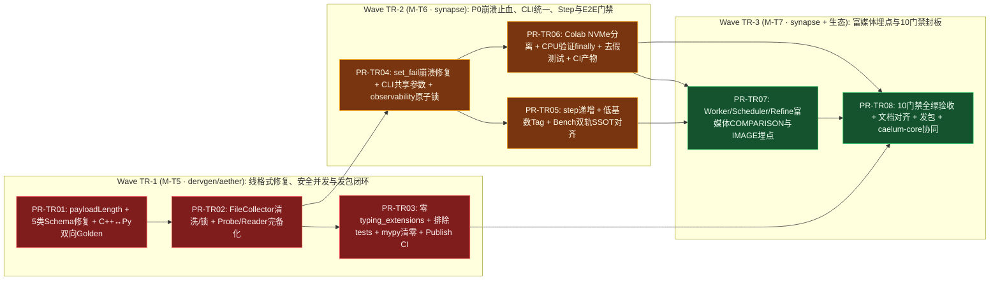

# Traceboard Python SDK 与 Synapse 可观测性深度整改与硬化落地计划 (`Actionable Remediation Blueprint`)

> - **计划版本**: `v1.0`（对应主总纲 [`IMPLEMENTATION_PLAN.md`](../IMPLEMENTATION_PLAN.md) §4.15）
> - **触发源**: [`REVIEW-PR213-TRACEBOARD-INTEGRATION-2026-11.md`](../audits/REVIEW-PR213-TRACEBOARD-INTEGRATION-2026-11.md)（检出 **20 项缺陷**：`6×P0` 阻断 · `9×P1` 高危 · `5×P2` 中优先级）
> - **前置基线**: [`PLAN-TRACEBOARD-PYTHON-AND-SYNAPSE.md`](PLAN-TRACEBOARD-PYTHON-AND-SYNAPSE.md) (`synapse#204–#213` @ `1e3ad5f`, `aether#523–#525` @ `ca2cbff4`)
> - **规划模型**: `[gemini4-neon]`
> - **当前状态**: 📋 **待启动（阻塞 `aether-traceboard` 正式发包与生产接入）**
> - **目标周期**: 3 个里程碑（`M-T5` – `M-T7`）、3 个 Execution Waves（`Wave TR-1` – `Wave TR-3`）、**8 个原子 PR**（`PR-TR01` – `PR-TR08`）

> [!IMPORTANT]
> **执行铁律（与 [`AGENTS.md`](../../AGENTS.md) 对齐）**：
> 1. 所有改动必须走 Git Worktree（`/tmp/<repo>-wt-<branch>`）→ 分支 → PR → Squash Merge → 清理 Worktree，严禁直接 push `main`。
> 2. Commit 与 PR 标题必须携带模型标识 `[<model-tag>]`，PR 正文首行必须声明 ``> **Operated by**: `<model-tag>` ``。
> 3. **双向跨语言真值铁律**：禁止继续用“Python 自写自读自验”替代跨语言校验；`.tbevt` 线格式必须经 C++ GTest 读入 Python 产物 + Python 读入 C++ `FileCollector` 产物双向字节验证。
> 4. **反门禁剧场铁律**：严禁 `continue-on-error: true`、`|| true`、裸 `MagicMock()`（必须使用 `spec=ProbeProtocol` / `spec=StageProtocol`）与永真断言；必须在洁净 venv（仅装 wheel + `numpy`）验证包导入。
> 5. **链接规范**：本计划文档中的跨仓路径（`aether/...`、`caelum-core/...`、`all-overview/...`）及尚未新建的文件一律使用反引号标注，严禁引入 Markdown 断链。

---

## 1. 整改拓扑与 Wave 并发矩阵 (Topology & Concurrency Matrix)



### Wave 并发与目录隔离矩阵

| Wave | 里程碑 | 所属仓库 | 并发 PR 组（目录隔离） | 覆盖评审缺陷编号 |
| :---: | :---: | :---: | :--- | :--- |
| **Wave TR-1** | **M-T5** | `dervgen/aether` | `PR-TR01` → `PR-TR02` → `PR-TR03`（严格串行：`traceboard/python/`, `traceboard/tests/`, `.github/workflows/`） | `TRB-P0-01`, `TRB-P0-02`, `TRB-P0-05`, `TRB-P0-06`, `TRB-P1-01`, `TRB-P1-02`, `TRB-P1-03`, `TRB-P2-01` |
| **Wave TR-2** | **M-T6** | `sautille-stroke/synapse` | `PR-TR04` (`observability.py`, `cli/`, `bench_runner.py`) → [**`PR-TR05`** (`training/`, `rsi/`, `inspect/`, `bench/`) ∥ **`PR-TR06`** (`scripts/`, `tests/`, `.github/workflows/`)] | `TRB-P0-03`, `TRB-P0-04`, `TRB-P1-04`, `TRB-P1-05`, `TRB-P1-06`, `TRB-P1-07`, `TRB-P1-08`, `TRB-P1-09`, `TRB-P2-02` |
| **Wave TR-3** | **M-T7** | `synapse` + 跨仓 | `PR-TR07` (`bundle_worker.py`, `scheduler.py`, `refine/`) → `PR-TR08` (文档对齐、10 门禁封板、`caelum-core` 协同) | `TRB-P2-01`, `TRB-P2-03`, `TRB-P2-04`, `TRB-P2-05` |

---

## 2. Wave TR-1 (`M-T5`, `dervgen/aether`)：Layer 0 线格式、安全并发与打包闭环

<a id="pr-tr01"></a>
### `PR-TR01`: 修复 `.tbevt` `payloadLength` 线格式、对齐 5 类 Payload Schema 与 C++ ↔ Python 双向黄金测试

- **对应缺陷**: `TRB-P0-01`, `TRB-P0-05`
- **前置依赖**: 无（`aether` `main`）
- **预估体量**: ~420 LOC · **Worktree 分支**: `fix/tr01-tbevt-wire-parity-and-cpp-py-golden`
- **精确改动清单 (`dervgen/aether`)**：
  1. **`aether/traceboard/python/aether_traceboard/file_collector.py`**：
     - 修正 `_write_record()`：令 `payload_len = tag_len + len(payload)`，严格遵循 `wire_format_spec.md` §3（`RecordHeader.payloadLength` = `tag + payload` 总字节数）及 C++ `file_collector.cc:167-171`；
     - 改用增量 CRC-32（`crc = update_crc32(compute_crc32(tag_bytes), payload)`）替代 `tag_bytes + payload` 整块拷贝。
  2. **`aether/traceboard/python/aether_traceboard/reader.py`**：
     - 修正 `read_events()`：`body_len = payload_len`，校验 `if payload_len < tag_len: break`，令 `body = data[body_start : body_start + payload_len]`、`tag = body[:tag_len]`、`payload = body[tag_len:]`。
  3. **`aether/traceboard/python/aether_traceboard/event.py` & `probe.py`**：
     - 新增 `_sanitize_json_obj()` 与 `_dumps_strict_json()`：在 `json.dumps(..., separators=(",", ":"), sort_keys=True, allow_nan=False)` 前递归将 `NaN`/`±Inf` 转换为 `0.0`（对齐 C++ `probe.cc:85-92` `formatJsonFloat` 语义与 RFC 8259）；
     - `StageContext.__exit__()`：将状态键从 `"_status"` 统一修正为 `"status"`（对齐 C++ `probe.cc:917`）；
     - `pack_table()`：将每个单元格强制转为 `str(cell)`，保证输出符合 Spec §6.4.2 & C++ `probe.cc:742` 的 `[][]string` 格式；
     - `Probe.log_artifact()`：自动填充/补齐 `"size_bytes": len(blob)`，并将 `"mime"` 规范化为 `"mime_type"`（对齐 Spec §6.4.3 & C++ `probe.cc:774-775`）；
     - `Probe.log_comparison()`：当 `passed is None` 且传入 `thresholds` 时，按 C++ `probe.cc:655-669`（含 `isUpperBoundMetric` 与 `_min`/`_max` 后缀语义）真实计算 `pass` 布尔值；无 `diff_image` 时省略 `"diff_image_tag"` 键；
     - `pack_run_start()` / `pack_config()`：将配置字典 value 统一转为 `str(v)`（遵循 Spec §6.9）。
  4. **Golden 资产与 C++ ↔ Python 双向互验**：
     - 更新 `aether/traceboard/tests/golden/{generate_python_golden.py, verify_golden.py, test_golden.py, golden_manifest.json}` 并重新生成 `python_reference.tbevt`：修复 `payload_length = len(body)`、`COMPARISON` 补齐 `width/height/channels/format/thresholds`、`TABLE` 单元格改字符串、`ARTIFACT` 改为 `mime_type/size_bytes`、`SERIES_GROUP` 补齐 `steps`、`STAGE_END` 改为 `"status"`；
     - 同步更新 `aether/traceboard/python/tests/{test_file_collector.py, test_reader.py, test_stage_context.py, test_probe.py}` 断言至新线格式；
     - **新增 C++ 交叉测试** `aether/traceboard/tests/test_golden_interop.cc`（在 `aether/traceboard/BUILD.bazel` 挂载 `data = ["tests/golden/python_reference.tbevt"]`）：用 C++ `FileHeader`/`RecordHeader`/`computeCrc32`/`computeRunIdHash` 解析校验 `python_reference.tbevt` 全部 17 条记录；同时构建 C++ golden emitter（写入全事件 `.tbevt` 至临时文件）并由 Python `test_golden.py` 调用 `read_events()` 反向互验。
- **验收命令**：
  ```bash
  cd /Volumes/work/dervgen/aether
  bazel test //traceboard:all --config=opt
  PYTHONPATH=traceboard/python:traceboard/tests/golden pytest traceboard/python/tests/ traceboard/tests/golden/ -v
  ```
- **防静默失败三问**：C++ GTest 真实读取并逐字节校验 `python_reference.tbevt` 全部 17 条记录的 `payloadLength`/`crc32`/JSON payload；Python `test_golden.py` 真实读取 C++ `FileCollector` 输出；`NaN` 标量/表格序列化不再写出非法 JSON。

---

<a id="pr-tr02"></a>
### `PR-TR02`: `FileCollector` 路径安全与并发锁加固、`Probe` / `Reader` 完备化与流式读取

- **对应缺陷**: `TRB-P0-06`, `TRB-P1-01`, `TRB-P1-02`
- **前置依赖**: `PR-TR01`
- **预估体量**: ~450 LOC · **Worktree 分支**: `feat/tr02-file-collector-safety-probe-reader-parity`
- **精确改动清单 (`dervgen/aether`)**：
  1. **`aether/traceboard/python/aether_traceboard/file_collector.py`**：
     - 新增 `_sanitize_run_name(run_name: str) -> str`（仅保留 `[a-zA-Z0-9_-]`，其余替换为 `_`，空串回退 `"run"`，完全对齐 C++ `file_collector.cc:72-84`）；
     - 新增同秒文件名冲突去重循环（`base.tbevt`、`base_1.tbevt`、…，对齐 C++ `file_collector.cc:96-98`）；
     - `on_run_open()` 若已存在未关闭 `_fp` 先执行 `flush()` + `close()`；新增 `__enter__`/`__exit__`/`__del__` 与 `current_file_path: Path | None` 只读属性；
     - 引入 `threading.RLock()` 串行化 `on_run_open` / `_write_record` / `flush` / `on_run_close`，避免 3 次 `.write()` 并发撕裂；
     - 增设 `tag_bytes[:65535]` 长度钳位与 `payload_len > 0xFFFFFFFF` 溢位防护。
  2. **`aether/traceboard/python/aether_traceboard/probe.py`**：
     - 引入 `threading.RLock()` 保护 `_collectors` 遍历与 `_step` / `_active` 状态转换；
     - `begin_run(..., auto_activate: bool = True)`：写完 `on_run_open` 后按 `auto_activate` 自动激活（对齐 C++ `probe.cc:382`，消除先 `begin_run` 后 `activate` 丢 `RUN_START` 的陷阱）；`end_run()` 后调用 `deactivate()`、flush、close 并清空 `_run_name`；
     - 补齐 `remove_all_collectors()`, `remove_collector()`, `increment_step()`, `step` 与 `run_name` 只读属性；
     - `StageContext`：改用 `time.monotonic()` 计算阶段耗时（防 NTP 时钟跳变负耗时）；无异常正常退出且状态仍为 `RUNNING` 时默认落为 `StageStatus.PASS`；`set_fail(reason: str | None = None)` / `set_skip(reason: str | None = None)` 支持可选 `reason`（非空时写入 `STAGE_END` JSON `"reason"`）；
     - `log_image()`：校验 `w > 0, h > 0, channels in (1, 3, 4)`，并通过 `np.ascontiguousarray(image.astype(image.dtype.newbyteorder("<"), copy=False))` 强转小端字节序；
     - `log_histogram()`：校验 `1 <= num_bins <= 65536` 且 `len(edges) == num_bins + 1`、`len(counts) == num_bins`；
     - Collector fan-out 隔离：新增可选异常记录（或隔离单 collector 失败），防止单个坏 collector 阻断其余 collectors。
  3. **`aether/traceboard/python/aether_traceboard/reader.py` & `__init__.py`**：
     - 新增 `FileHeader`（`magic`, `version`, `flags`, `run_id_hash`）与 `ReadStats`（`records_read`, `crc_errors`, `skipped_unknown_types`, `truncated_tail`）数据类；
     - 修正未知 `EventType` 处理：`event.py`/`reader.py` 遇未定义 `EventType` 整数码时不抛异常中止，而是递增 `skipped_unknown_types` 并按 `payload_len` 跳过继续读取后续记录（100% 符合 `wire_format_spec.md` §9）；
     - 校验 `FileHeader.version`（若 `version > FILE_VERSION` 抛出或发出告警）；提供流式生成器 `iter_events(path)` 与完整读取函数 `read_file(path) -> tuple[FileHeader, list[Record], ReadStats]`，保留 `read_events(path)` 向后兼容；
     - 在 `__init__.py` `__all__` 完整导出 `Record`, `FileHeader`, `ReadStats`, `InvalidMagicError`, `read_events`, `read_file`, `iter_events`。
  4. **新增高强度单测**：覆盖路径穿越 `../../evil` 清洗、同秒多次 run 产出独立文件、8 线程并发写入零 CRC 损坏、未知 `EventType=200` 前向跳过恢复、大端 NumPy 图像转换、无异常 `StageContext` 自动 `PASS` 与 `set_fail("reason")`。
- **验收命令**：
  ```bash
  PYTHONPATH=traceboard/python:traceboard/tests/golden pytest traceboard/python/tests/ traceboard/tests/golden/ -v
  ```
- **防静默失败三问**：并发写入压测产出 0 条 CRC 错误且 `read_file` 返回精确条数；`../../evil` 仅能在 `logdir` 内生成 `______evil.<ts>.tbevt`；未知事件码后的合法记录 100% 可恢复。

---

<a id="pr-tr03"></a>
### `PR-TR03`: 修复包依赖、`tests` 排除、`mypy --strict` 清零与 Publish CI 硬化

- **对应缺陷**: `TRB-P0-02`, `TRB-P1-03`, `TRB-P2-01`（`aether` 侧文档）
- **前置依赖**: `PR-TR02`
- **预估体量**: ~220 LOC · **Worktree 分支**: `build/tr03-packaging-mypy-strict-and-publish-ci`
- **精确改动清单 (`dervgen/aether`)**：
  1. **`aether/traceboard/python/aether_traceboard/probe.py`**：移除运行期 `from typing_extensions import Self`，改为使用 `StageContext` 或置于 `if TYPE_CHECKING:`，彻底保持运行期零非 `numpy` 依赖。
  2. **`aether/traceboard/python/aether_traceboard/_hash.py` & `event.py`**：修复全部 4 处 `mypy --strict` 错误（`_hash.py:17` `[no-any-return]`，`event.py:43,86` `[unused-ignore]` + `[no-any-return]`）。
  3. **`aether/traceboard/python/pyproject.toml`**：
     - `[tool.setuptools.packages.find]` 改为 `where = ["."]`、`include = ["aether_traceboard*"]`、`exclude = ["tests*"]`；
     - 修正 `Documentation` URL 为 `https://github.com/dervgen/aether/blob/main/traceboard/docs/wire_format_spec.md`；
     - 版本号定为 `0.1.0`（因先前从未成功发布）或 `0.1.1`（若需区分本地旧 editable 开发环境）。
  4. **`aether/traceboard/python/README.md` & `aether/traceboard/docs/wire_format_spec.md`**：
     - 修正 `README.md` 相对路径为 `../docs/wire_format_spec.md`，移除不存在的 `traceboard_architecture.md`、`server/` 目录描述与 `https://npm.pkg.github.com/`，补充 DervGen 3 级分发 / GitHub Release 安装说明；
     - 修正 `wire_format_spec.md` §2.1 & Appendix B 中过时的 `../python/traceboard/` 路径为 `../python/aether_traceboard/`。
  5. **`aether/.github/workflows/traceboard-python-publish.yml`**：
     - `test` job 移除 `mypy --strict` 上的 `continue-on-error: true`；
     - 新增 `wheel-smoke` 步骤：执行 `python -m build`，校验 wheel ZIP 中**不包含 `tests/`**，`twine check dist/*`，并在新建隔离 venv 中仅安装该 wheel（无 `dev` 依赖）验证 `python -c "import aether_traceboard; print(aether_traceboard.__version__)"` 退出 `0`；
     - 将 `test`（PR/push 带完整 `paths:`：`traceboard/python/**`、`traceboard/tests/golden/**`、`traceboard/src/**`）与 `publish`（仅由 `tags: ["traceboard-python-v*"]` 触发、不挂 `paths:` 过滤）职责解耦；
     - 移除 `TWINE_REPOSITORY_URL: https://npm.pkg.github.com/` 与 `--skip-existing || true`，改为上传 wheel/sdist 至 GitHub Release Assets（`softprops/action-gh-release` 或 `gh release upload`）及可选 PyPI OIDC Trusted Publishing（`pypa/gh-action-pypi-publish@release/v1`）。
- **验收命令**：
  ```bash
  cd /Volumes/work/dervgen/aether/traceboard/python
  mypy aether_traceboard/ --strict
  ruff check .
  python -m build
  python -m zipfile -l dist/*.whl | grep -v "tests/"
  python -m venv /tmp/tb-clean-venv && /tmp/tb-clean-venv/bin/pip install dist/*.whl && /tmp/tb-clean-venv/bin/python -c "import aether_traceboard"
  ```
- **防静默失败三问**：洁净 venv 仅含 `aether-traceboard` + `numpy` 可成功 `import` 并跑通 `Probe` + `read_file`；`mypy --strict` 真正零错零忽略；wheel 内零 `tests` 包。

---

## 3. Wave TR-2 (`M-T6`, `sautille-stroke/synapse`)：崩溃止血、CLI 统一与工程硬化

<a id="pr-tr04"></a>
### `PR-TR04`: 修复 `BenchPipelineRunner` `set_fail` 崩溃、CLI 共享 `--traceboard` 与 `observability` 原子化

- **对应缺陷**: `TRB-P0-03`, `TRB-P0-04`, `TRB-P1-04`
- **前置依赖**: `PR-TR02`
- **预估体量**: ~360 LOC · **Worktree 分支**: `fix/tr04-bench-runner-cli-and-observability-hardening`
- **精确改动清单 (`sautille-stroke/synapse`)**：
  1. **`python/synapse/pipeline/bench_runner.py`**：
     - 修复第 199 / 204 行 `stage.set_fail(...)` 调用：改为 `stage.set_fail(reason=...)`（或同步写 `probe.log_text(f"bench/{scenario_name}/error", ...)`，兼容无参/有参签名）；
     - 标量写入前增加 `math.isfinite(float(v))` 过滤（跳过 `NaN`/`Inf`）；
     - 在 `run_all()` 外层 `with traceboard_stage("bench/run_all", ...) as all_stage:` 显式设置 `all_stage.set_pass()` / `all_stage.set_fail()`。
  2. **`python/synapse/cli/common.py` & `python/synapse/cli/_app.py`**：
     - 在 `common.py` 将 `--traceboard LOG_DIR`（`default=argparse.SUPPRESS`）纳入共享父解析器（与 `--json` 同机制），使 `--traceboard` 在前置（`synapse --traceboard /tmp/tb bench list`）、中置（`synapse bench --traceboard /tmp/tb list`）、后置（`synapse bench list --traceboard /tmp/tb`）三种位置全部可用；
     - 在 `_app.py` 中：先判断 `if parsed.command is None: ... return 0`，确认有真实子命令后再初始化 Traceboard，并使用局部标志 `tb_started = False`；
     - 仅当 `tb_started` 为 `True` 时才在 `finally:` 调用 `shutdown_traceboard(status="finished" if rc == 0 else "failed")`，避免嵌套调用误关外层 Probe；
     - 移除 `run_name` 中的冗余 `_{int(time.time())}`（`FileCollector` 已自带时间戳），并向 `init_traceboard(..., trace_id=trace_ctx.trace_id)` 透传 W3C `trace_id`。
  3. **`python/synapse/observability.py`**：
     - 定义 `ProbeProtocol` 与 `StageProtocol`（`@runtime_checkable` `Protocol`），替换裸 `Any`，作为全库单测 `MagicMock(spec=...)` 的静态契约边界；
     - 引入 `threading.RLock()`；先构造局部 `probe` 与 `collector`，待 `begin_run(..., trace_id=...)` 成功后才原子赋值给模块 `_probe`（若中途异常，显式关闭 collector 并保持 `_probe = None`）；
     - 为 `shutdown_traceboard(status: str = "finished")` 增加运行状态透传；
     - 在 `traceboard_stage()` 内部以及新增 `safe_log_scalar` / `safe_log_text` / `safe_log_table` / `safe_log_artifact` 工具中对 I/O 异常做降级告警捕获，保证可观测性故障永不拖垮主推理/训练任务；
     - 在模块 docstring 明确说明 `synapse.observability._probe` 与 `aether_traceboard.get_probe()` 的生命周期边界（禁止混用）。
- **验收命令**：
  ```bash
  pytest tests/test_observability.py tests/test_cli.py -v
  ruff check python/ tools/ tests/ scripts/
  mypy --strict python/synapse/observability.py python/synapse/cli/ python/synapse/pipeline/bench_runner.py
  ```
- **防静默失败三问**：`synapse bench --traceboard /tmp/tb list` 实际执行退出 `0` 且产出包含 `RUN_START` + `RUN_END` 的有效 `.tbevt`；`BenchPipelineRunner` 遭遇门禁失败或运行异常时正常返回带 `error` 的报告而非抛 `TypeError`。

---

<a id="pr-tr05"></a>
### `PR-TR05`: 训练/课程 `step` 单调递增、低基数 Tag 收敛与 Bench 双轨 SSOT 对齐

- **对应缺陷**: `TRB-P1-05`, `TRB-P1-06`, `TRB-P1-07`
- **前置依赖**: `PR-TR04`（可与 `PR-TR06` 并发，目录完全隔离）
- **预估体量**: ~420 LOC · **Worktree 分支**: `feat/tr05-telemetry-step-cardinality-and-dual-track-ssot`
- **精确改动清单 (`sautille-stroke/synapse`)**：
  1. **`python/synapse/training/trainer.py` & `losses.py`**：
     - `train_step(step=step)` 显式调用 `probe.set_step(step)` 并将 `step=step` 传入 `log_scalar`（使得随后/内部调用的 `DiffusionDPOLoss.__call__` 自动继承正确 `step`）；
     - `save_state_dict()` 传入 `step=self._step_count`。
  2. **`python/synapse/rsi/curriculum.py`**：
     - `sample_scenarios(..., round_idx=...)` 与 `analyse_weaknesses()` 绑定 `step=round_idx`；
     - 删除 `plan_round()` 第 329–341 行完全重复的 `rsi/curriculum/*` 埋点块。
  3. **`python/synapse/rsi/dual_verifier.py` & `python/synapse/inspect/jev_critic.py`**：
     - 消除 `{sample_id}` / `{asset_id}` 高基数 Tag 拼接：收敛为低基数标量 Tag（`rsi/verifier/physics_passed`, `rsi/verifier/prm_score`, `rsi/verifier/check/{check_name}`；`inspect/jev/overall_quality`, `inspect/jev/defect_count`, `inspect/jev/requires_hitl`）并配合内部单调递增 `step`；
     - 样本/资产 ID 与明细通过低基数结构化 `TABLE`（`rsi/verifier/verdicts`、`inspect/jev/defects`）输出，单元格全量序列化为字符串。
  4. **`python/synapse/bench/report.py`, `traceboard_export.py`, `compare.py`, `pipeline/bench_runner.py`, `rsi/promotion_gate.py`**：
     - 将 `report.py` 的 `_compute_pillar_scores` 提升为公共 `compute_pillar_scores()` SSOT，并让 `traceboard_export.py` 直接导入复用（彻底删除 `traceboard_export.py` 第 144–219 行重复拷贝）；
     - 统一 `bench_runner.py` 与 `traceboard_export.py` 的 Tag 命名空间为规范前缀：`bench/scenario/{name}/metrics/{k}`、`bench/scenario/{name}/timing/{k}`、`bench/scenario/{name}/passed`、`bench/summary/*`、`bench/pillar/*`；
     - `traceboard_export.py` 真正按场景打开 `with probe.begin_stage(f"bench/{report.scenario_name}") as stage:` 并标 `set_pass`/`set_fail`，移除悬空泄漏句柄的 `close_on_finish=False` 参数（或改支持注入外部 `probe: ProbeProtocol | None = None` 并返回输出 `.tbevt` 路径）；
     - `bench/report.py` `log_artifact()` 补齐 `"size_bytes": len(html_bytes)`；`compare.py`、`promotion_gate.py`、`jev_critic.py` 所有 `log_table` 单元格统一显式格式转为 `str`。
- **验收命令**：
  ```bash
  pytest tests/test_training_traceboard.py tests/test_rsi_recon_traceboard.py tests/test_traceboard_export.py -v
  python tools/import_dag_guard.py --check
  ```
- **防静默失败三问**：多步 `StatelessLoRATrainer.train_step` 写入的 `.tbevt` 经 `read_events` 解析后 `Record.step` 严格等于 `[0, 1, 2, ...]`；100 个样本批量验证产生的独立标量 Tag 数保持常量 `O(1)`。

---

<a id="pr-tr06"></a>
### `PR-TR06`: Colab NVMe 存储分离、`run_cpu_verification` `finally` 刷盘与去假测试 / CI 门禁补全

- **对应缺陷**: `TRB-P1-08`, `TRB-P1-09`, `TRB-P2-02`
- **前置依赖**: `PR-TR04`（可与 `PR-TR05` 并发，目录完全隔离）
- **预估体量**: ~380 LOC · **Worktree 分支**: `fix/tr06-colab-nvme-cpu-verify-and-real-sdk-e2e-gates`
- **精确改动清单 (`sautille-stroke/synapse`)**：
  1. **`scripts/colab_runner.py`**：
     - 升级 `--traceboard` 为可选目录路径参数（`nargs="?"`, `const="__AUTO__"`, `default=None`）；
     - 若目标路径位于 Google Drive FUSE（`/drive/`），在本地 NVMe `/content/work/{job_id}/traceboard/` 初始化 Traceboard 写入，并在每个实验 checkpoint 落盘后与 `finally:` 刷盘后使用临时目录原子拷贝同步至 `{job_dir}/traceboard/`（遵守 Google Drive SSOT V2.0 存储分离铁律）；
     - 真正写入 `gpu_profile` 配置与标量、按 `exp in experiments` 包裹 `traceboard_stage(f"colab/{exp}")` 并记录各实验指标与耗时；
     - 在 `SynapseError` / `Exception` / `SIGTERM` 退出路径分别传递 `status="failed"` 与 `status="cancelled"` 至 `shutdown_traceboard(status=...)`。
  2. **`scripts/run_cpu_verification.py`**：
     - 升级 `--traceboard [LOG_DIR]`（`nargs="?"`, `const="__AUTO__"`）；
     - 将 SHA-256 校验与 E1–E5 主循环统一包裹在 `try...finally:` 中，保证无论成功、`return 20` 早退或异常均触发 `shutdown_traceboard(status=...)` 落盘 `RUN_END`；
     - 为 E1–E5 分别包裹 `traceboard_stage(f"cpu_verify/{exp}")` 并记录分实验耗时。
  3. **测试硬化与 CI `.tbevt` 端到端校验**：
     - 修复 [tests/test_traceboard_export.py](../../tests/test_traceboard_export.py) 第 215 行永真断言 `assert isinstance(result, bool)` -> `assert result is False`；
     - 修复 [tests/test_observability.py](../../tests/test_observability.py) 第 483 行裸二进制 CRC 扫描切片为 Spec 对齐的 `body_end = body_start + payload_len`；
     - 将 `test_training_traceboard.py`、`test_rsi_recon_traceboard.py`、`test_adapters_style_traceboard.py` 中的裸 `MagicMock()` 全部替换为 `MagicMock(spec=ProbeProtocol)`；
     - 新增真实 SDK E2E 测试文件 `tests/test_bench_runner_traceboard.py`：实跑 `BenchPipelineRunner` 通过 / 运行异常 / 质量门禁失败三态，并验证 `synapse bench --traceboard` / `synapse --traceboard` / `synapse bench run --traceboard` 全矩阵 CLI 产物与 `CRC-32`；
     - 在 [.github/workflows/ci.yml](../../.github/workflows/ci.yml) `python-fast` 增加执行 `synapse bench run --scenario turntable_hero --adapter mock --traceboard /tmp/ci-tblog`、用 `aether_traceboard.reader.read_file` 校验非空且 0 CRC 错误、并 `actions/upload-artifact` 归档 `.tbevt` 的步骤（同时顺带清理 `tests/test_wave4_rfc0060_rfc0061_parity.py` 3 项未标 `@pytest.mark.external_data` 的公网 CI 遗留失败）。
- **验收命令**：
  ```bash
  SYNAPSE_CI_STRICT_DEPS=1 pytest tests/test_observability.py tests/test_traceboard_export.py tests/test_bench_runner_traceboard.py tests/test_training_traceboard.py tests/test_rsi_recon_traceboard.py tests/test_adapters_style_traceboard.py -v
  python scripts/run_cpu_verification.py --traceboard
  ```
- **防静默失败三问**：永真断言清零；`BenchPipelineRunner` 失败场景真写出 `STAGE_END(status=FAIL)`；`run_cpu_verification.py` 模拟退出 `20` 时仍完整落盘 `RUN_END`。

---

## 4. Wave TR-3 (`M-T7`, `synapse` + 生态协同)：富媒体埋点与 10 门禁全绿封板

<a id="pr-tr07"></a>
### `PR-TR07`: `bundle_worker`、`ConditionScheduler` 与 RFC 0061 富媒体（`COMPARISON` / `IMAGE` / `HISTOGRAM`）接入

- **对应缺陷**: `TRB-P2-03`
- **前置依赖**: `PR-TR05` & `PR-TR06`
- **预估体量**: ~440 LOC · **Worktree 分支**: `feat/tr07-worker-scheduler-refine-and-rich-media-telemetry`
- **精确改动清单 (`sautille-stroke/synapse`)**：
  1. **`python/synapse/pipeline/bundle_worker.py` & `cli/_worker.py`**：支持从 `JobBundle` 配置或环境变量 `SYNAPSE_TRACEBOARD_DIR` / `--traceboard` 自动初始化 Traceboard，记录 RFC 0039 worker 执行 stage、W3C `trace_id` 及退出状态码（0/10/20/30/40/50）。
  2. **`python/synapse/adapters/scheduler.py`**：在 `ConditionScheduler` 记录每轮因果滑窗遥测（`adapter/scheduler/window_idx`, `overlap_frames`, `shot_cut_reanchor`, `window_elapsed_s`），严格按窗索引递增 `step`。
  3. **`python/synapse/refine/` & `bench/report.py`**：
     - 在 RFC 0061 解剖局部精修管线增加有限分辨率上限（`max_dim <= 512`）与抽帧控制的 `probe.log_comparison(...)`（修补前 vs 修补后 + PSNR/SSIM 指标与门禁阈值）；
     - 在 `bench_runner.py` 增加显式可配置的关键帧 `log_image` 与深度残差 `log_histogram` 采样开关；
     - 在 `bench/report.py:render_comparison_html()` 将 4 轨道行业对比 HTML 榜单写入 `log_artifact("bench/compare_report", ...)`。
- **验收命令**：
  ```bash
  pytest tests/ -m "not slow" -q
  ```
- **防静默失败三问**：`.tbevt` 读取器能真实解析出 `IMAGE`、`COMPARISON`、`HISTOGRAM` 三类新事件（非全 0 像素与有效统计分箱），且单次 Bench 运行开启媒体采样后 `.tbevt` 体积受分辨率上限约束可控。

---

<a id="pr-tr08"></a>
### `PR-TR08`: 跨仓 10 项反作弊门禁验收、文档对齐、正式发包与 `caelum-core` 协同收口

- **对应缺陷**: `TRB-P2-01`, `TRB-P2-04`, `TRB-P2-05`
- **前置依赖**: `PR-TR03`, `PR-TR06`, `PR-TR07`
- **预估体量**: ~200 LOC · **Worktree 分支**: `docs/tr08-traceboard-reconciliation-and-ecosystem-closure`
- **精确改动清单**：
  1. **执行并逐项验收 §5 全部 10 项反作弊门禁 (`TB-1` ~ `TB-10`)**，保存 `ubuntu24` 与 GitHub Actions 双端实测日志。
  2. **文档对齐更新 (`synapse`)**：
     - 更新 [`DESIGN_TRACEBOARD_INTEGRATION.md`](../DESIGN_TRACEBOARD_INTEGRATION.md)：补充完整 **Tag Taxonomy 规范表**、**Step 单调递增规约**、**W3C `traceparent` 关联字段**、**Fail-Safe 异常隔离边界**与 **Colab NVMe-First 同步架构**；
     - 更新 [`PLAN-TRACEBOARD-PYTHON-AND-SYNAPSE.md`](PLAN-TRACEBOARD-PYTHON-AND-SYNAPSE.md) 与 [`IMPLEMENTATION_PLAN.md`](../IMPLEMENTATION_PLAN.md)：核销整改完成状态并移除旧 `Conditional Hold` 警示，修正 Reviewer Quickstart 实跑命令。
  3. **跨仓生态协同**：
     - 在 `dervgen/aether` 推送 `traceboard-python-v0.1.0`（或 `v0.1.1`）Tag 触发已修复的发布工作流，校验 GitHub Release 产物与 DervGen 内部源（`files.dervgen.com`）可用；
     - 在 `caelum-core` 发起迁移 Issue / PR，将 `caelum-core/tests/helpers/traceboard_integration.py` 从已废弃的 `from traceboard import Probe`（`probe.scalar()` / `probe.image()` / `probe.close()`）统一迁移至 `aether-traceboard` v0.1 API；
     - 在 `all-overview` 记录 `DUP-17` 后续收口 `aether/traceboard/src/event.cc` 至 `@aether//crypto` 时必须保留并跑通 `PR-TR01` 建立的双向黄金测试。
- **验收命令**：
  ```bash
  python3 scripts/check_doc_links.py
  python tools/import_dag_guard.py --check
  python tools/wire_guard.py --check --require-aether
  ```

---

## 5. 10 项反作弊封板门禁矩阵 (Anti-Cheat Closure Gates)

在未通过以下全部 10 项客观命令门禁前，**严禁宣布 Traceboard 集成整改完成或发布正式 Python Wheel**：

| 门禁 | 检验目标 | 权威验证命令 / 判定门槛 | 覆盖缺陷 |
| :---: | :--- | :--- | :--- |
| **`Gate TB-1`** | **C++ 读取 Python 黄金文件** | `bazel test //traceboard:all --config=opt`（含 `test_golden_interop` 逐记录解析 `python_reference.tbevt` 全部 17 条记录、0 CRC 错） | `TRB-P0-01`, `TRB-P0-05` |
| **`Gate TB-2`** | **Python 读取 C++ `FileCollector` 产物** | `pytest traceboard/tests/golden/ -v`（Python `read_file()` 解析 C++ 产出的 `.tbevt`，`records` 与 `FileHeader` 100% 匹配） | `TRB-P0-01`, `TRB-P0-05` |
| **`Gate TB-3`** | **洁净 venv Wheel 导入冒烟** | `python -m build` → 检查 `.whl` 零 `tests/` 包 → 全新隔离 venv 仅装 `.whl` + `numpy` → `python -c "import aether_traceboard"` exit 0 | `TRB-P0-02` |
| **`Gate TB-4`** | **Layer 0 严格类型与规范门禁** | `mypy aether_traceboard/ --strict`（无 `continue-on-error`）0 errors + `ruff check` 0 errors | `TRB-P0-02`, `TRB-P1-03` |
| **`Gate TB-5`** | **`FileCollector` 安全与并发压测** | `pytest` 验证 `../../evil` 清洗、同秒 10 次连跑生成 10 个独立文件、8 线程并发写入 0 CRC 错、未知 `EventType` 可跳过恢复 | `TRB-P0-06`, `TRB-P1-01`, `TRB-P1-02` |
| **`Gate TB-6`** | **`synapse` CLI `--traceboard` 全矩阵** | `synapse --traceboard ... bench list`、`synapse bench --traceboard ... list`、`synapse bench run --scenario turntable_hero --traceboard ...` 全部 exit `0` 且写入合法 `RUN_START`..`RUN_END` | `TRB-P0-04` |
| **`Gate TB-7`** | **`BenchPipelineRunner` 三态 E2E** | 真实 `aether_traceboard.Probe` 下运行成功、抛异常、门禁失败 3 种场景均不抛 `TypeError`，并写出 `STAGE_END(status=FAIL)` | `TRB-P0-03`, `TRB-P1-04` |
| **`Gate TB-8`** | **Step 单调性、低基数与去假测试** | 多步训练产出 `Record.step == [0, 1, 2, ...]`；批处理验证 Tag 基数 `O(1)`；`test_traceboard_export.py` 断言 `result is False` 且所有测试 mock 带 `spec` | `TRB-P1-05`, `TRB-P1-06`, `TRB-P1-07`, `TRB-P1-09` |
| **`Gate TB-9`** | **Colab NVMe 分离 & CPU 验证刷盘** | `colab_runner.py` 仅在本地 NVMe 写热 `.tbevt` 再原子同步 Drive；`run_cpu_verification.py` 早退 `20` / 异常仍写出 `RUN_END` | `TRB-P1-08`, `TRB-P2-02` |
| **`Gate TB-10`** | **全量 CI 与文档门禁双端全绿** | `docs-and-bench-gate`、`ruff`、`mypy --strict`、`import_dag_guard`、`wire_guard --require-aether`、`python-fast` + `python-slow` (`SYNAPSE_CI_STRICT_DEPS=1`) + `.tbevt` CI artifact 校验全绿 | `TRB-P1-09`, `TRB-P2-01`..`05` |
