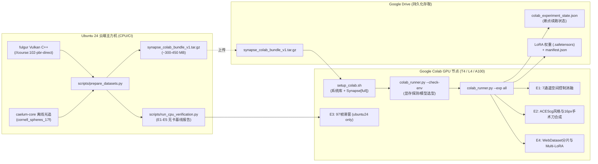

# Synapse Google Colab 实验与微调运行环境指南

> 本目录（`workenv/google-colab/`）为 **Synapse Layer 2** 算法在 Google Colab GPU 算力节点（T4 / L4 / A100）上进行视频生成适配器推理、长时序滑窗调度、ACEScg 风格合成与 LoRA 微调实验的完整环境规范与自动化部署套件。

---

## 1. 整体架构与协同拓扑

Synapse 采用 **「本地/云端编译打包 (`ubuntu24`) $\to$ Colab GPU 运算 $\to$ Google Drive 持久化回写」** 的高效协同模式：



---

## 2. 所需模型清单 (Models)

详细模型配置见 [`models.json`](models.json)。根据 Colab 实例分配的 GPU 显存，脚本自动采用分档策略：

| 角色 | 模型名称 | HuggingFace 仓库 | 权重大小 | 推荐 GPU 实例 | 精度与 Offload 策略 |
| :--- | :--- | :--- | :--- | :--- | :--- |
| **轻量视频底模** | Wan2.1-T2V-1.3B | `Wan-AI/Wan2.1-T2V-1.3B-Diffusers` | 3.2 GB | Colab T4 (16 GB) / L4 (24 GB) | `float16` / `bfloat16`，T4 默认开启 CPU Offload |
| **旗舰视频底模** | Wan2.1-T2V-14B | `Wan-AI/Wan2.1-T2V-14B-Diffusers` | 28.0 GB | Colab A100 (40 GB / 80 GB) | `bfloat16`，VRAM $\ge 35\text{ GB}$ 全显存常驻 |
| **3D 潜变量 VAE** | Wan2.1 Causal VAE | 包含于上述底模 `vae/` 子目录 | 0.8 GB | 通用 | 16 通道因果时空压缩 ($1/4$ 时间, $1/8$ 空间) |
| **文本编码器** | UMT5-XXL | `google/umt5-xxl` | 11.0 GB | L4 / A100 | 用于 5 段式结构化 Caption 向量化 |
| **2D 分割精修** | SAM 2.1 Hiera-Large | `facebook/sam2.1-hiera-large` | 0.9 GB | T4 / L4 / A100 | 用于与 Cryptomatte.ID 结合的手术刀掩码生成 |

---

## 3. 所需数据规范 (Datasets)

Colab 环境无需编译 C++ 引擎，直接加载标准化 **FGPP v1.0 黄金数据集**（打包于 `synapse_colab_bundle_v1.tar.gz`）：

1. **Track-B Fulgur 实时光栅导出**：
   - `track_b_fulgur/course_102_pbr_17f`：17 帧，分辨率 $832 \times 480$，含直接光照辐射、反照率、线性深度、世界法线、运动向量及非零 `Cryptomatte.ID`。
   - `track_b_fulgur/course_102_pbr_97f`：97 帧长时序序列，含 $0..63$ 帧平滑相机运镜、第 64 帧切镜突变点，以及 $t=0, 48, 96$ 物理锚点。
2. **Track-A Caelum 离线光追导出**：
   - `track_a_caelum/cornell_spheres_17f`：17 帧，包含 15 通道 FGPP OpenEXR 与配对的离线路径追踪 Ground Truth（`beauty_XXXXXX.exr`）。
3. **元数据与完整性清单**：
   - `metadata.json`：符合 `fgpp.v1.0` Schema，相机矩阵强制为**列主序**且行列式为 $+1.0$。
   - `golden_dataset_manifest.json`：全文件 SHA256 校验和。

---

## 4. 所需系统二进制与 Python 依赖环境 (Binaries & Environment)

Colab 容器基于 Ubuntu 22.04 LTS，需安装底层图像与多媒体 C/C++ 共享库：

### 核心系统二进制
- `libopenexr-dev` & `openexr`：C++ OpenEXR 库，支撑多通道 HALF/UINT32 图像解析；
- `libgl1-mesa-glx` & `libglib2.0-0`：Headless OpenCV 运行依赖；
- `ffmpeg`：视频编码与帧序列转换；
- `tar` & `gzip`：数据包解压。

### Python 核心依赖 Extra
安装 Synapse 官方完整支持套件 `pip install -e ".[image,metrics,gpu,train]"`：
- **核心计算**：`numpy>=1.24.0`, `pydantic>=2.0.0`
- **图像与 EXR**：`openexr>=3.2.0`, `opencv-python-headless>=4.8.0`, `pillow>=9.5.0`
- **模型与推理**：`torch>=2.0.0`, `diffusers>=0.30.0`, `accelerate>=0.33.0`, `safetensors>=0.4.0`
- **训练与分片**：`webdataset>=0.2.86`, `pyyaml>=6.0`
- **评测指标**：`scipy>=1.10.0`, `scikit-image>=0.20.0`

---

## 5. 一键部署与执行步骤

### 数据包上传方式

在执行实验前，需将 `ubuntu24` 打包的 `synapse_colab_bundle_v1.tar.gz` 传入 Colab 环境：

1. **Google Drive 上传（推荐）**：通过浏览器将数据包上传至 Google Drive 的 `/dervgen/work/{user}/synapse/{date}/input` 目录 (SSOT V2.0)，Notebook 会自动从 Drive 拷贝至本地 `/content/`。
2. **直接上传至 Colab**：在 Notebook 中使用 `from google.colab import files; files.upload()` 或左侧文件面板拖拽上传。
3. **共享链接下载**：若数据包在共享存储上，可使用 `!gdown <shared-link>` 或 `!wget <url>` 直接下载至 `/content/`。

### 方式 A：在 Google Colab Notebook 中一键运行（推荐）

直接在 Colab 中打开 [`synapse_colab_workflow.ipynb`](synapse_colab_workflow.ipynb)，依次执行单元格：
1. **挂载 Google Drive**：连接个人云端硬盘 `/content/drive/MyDrive/dervgen/` (SSOT V2.0)。
2. **初始化环境**：执行 `!bash workenv/google-colab/setup_colab.sh`。
3. **检测硬件并执行实验**：运行 `python scripts/colab_runner.py --exp all`。

### 方式 B：终端 / 脚本命令行运行

```bash
# 1. 运行一键配置脚本
chmod +x workenv/google-colab/setup_colab.sh
./workenv/google-colab/setup_colab.sh

# 2. 检查 GPU / VRAM Profile
python scripts/colab_runner.py --check-env

# 3. 指定 Google Drive 目录运行所有实验
python scripts/colab_runner.py \
  --bundle /content/synapse_colab_bundle_v1.tar.gz \
  --dataset-dir /content/datasets/synapse \
  --job-dir /content/drive/MyDrive/dervgen/work/yanglei/synapse/$(date +%F)/exp01-wan-lora \
  --exp all
```

---

## 6. 各环节主要脚本地图

| 脚本路径 | 运行环境 | 职责与主要功能 |
| :--- | :--- | :--- |
| [`scripts/prepare_datasets.py`](../../scripts/prepare_datasets.py) | `ubuntu24` | 驱动 `fulgur` 与 `caelum-core` 无头导出 15 通道 FGPP 数据集，计算 SHA256 并生成 `synapse_colab_bundle_v1.tar.gz` |
| [`scripts/run_cpu_verification.py`](../../scripts/run_cpu_verification.py) | `ubuntu24` / 本地 | 在无 GPU 环境下预先校验 E1–E5 全流程（张量形状、色差收敛、97 帧滑窗切镜检测、特征分片打通） |
| [`scripts/colab_runner.py`](../../scripts/colab_runner.py) | Google Colab | Colab 主控运行器：GPU 显存自动侦测、数据包解压、分步调用实验并向 Google Drive 实时保存 Checkpoint |
| [`workenv/google-colab/setup_colab.sh`](setup_colab.sh) | Google Colab | 自动化安装系统库、Python 扩展、验证 OpenEXR 及 CUDA 环境 |
| [`workenv/google-colab/synapse_colab_workflow.ipynb`](synapse_colab_workflow.ipynb) | Google Colab | 交互式标准 Jupyter Notebook 工作流 |

---

## 7. 输入与输出规范速查

详细格式与断言见 [`io_spec.md`](io_spec.md)。

| 环节 | 主要输入 (Inputs) | 主要输出 (Outputs) | 关键断言 / 成功准则 |
| :--- | :--- | :--- | :--- |
| **E1** | `FGPPSequence` (15 通道 OpenEXR + 相机外参) | 形状为 `[7, T, 480, 832]` 的 `control_tensor`（对数深度、法线、光流、遮挡） | 张量数值全有限 (`np.isfinite`)，深度范围 $[0, 1]$，4 档消融范数单调递增 |
| **E2** | sRGB 视频序列 + `Cryptomatte.ID` + 修复补丁 | `StyleProfile v2.0.0` 字典 + 16px 边界环 LAB 色彩对齐图像 | 边界环平均色差显著降低，拉普拉斯金字塔融合无接缝黑边 |
| **E3** ⚠️ | 97 帧时序序列 + 不连续性扰动 | 2 窗口划分切片 + 潜空间重叠 Sigmoid 融合张量 + 切镜重锚定请求 | *Colab 暂不支持，仅在 `ubuntu24` 通过 `run_cpu_verification.py` 验证* |
| **E4** | 16 通道潜变量 + 5 段式 Caption + 实体掩码 | `shard_000000.tar` (WebDataset) + `adapter_model.safetensors` | 跨实体注意力掩码非正交泄露率 $< 3.0\%$，权重通过 SHA256 安全清单检验 |
| **E5** ⚠️ | 30 个 `Synapse-Bench` 标准场景 + 白模代理 | 软光栅真值集 + `synapse_bench_results.json` + HTML 诊断报告 | *CPU 软光栅评测，仅在 `ubuntu24` 通过 `run_cpu_verification.py` 验证* |

---

## 8. 会话保护与容错机制 (Fault Tolerance)

1. **Google Drive 断点续跑 (`colab_experiment_state.json`)**：
   每次单项实验（E1/E2/E4）完成，立即原子写入 Google Drive。若 Colab 90 分钟闲置断开或 GPU 抢占，重连后再次执行命令会自动检测已完成阶段并输出 `[SKIP]`，仅执行未完成部分。
2. **显存 OOM 防御与自动降级**：
- 显存 $< 35\text{ GB}$（如 T4/L4）：强制使用 `Wan2.1-1.3B` 并启用 CPU Offload，LoRA Rank 设为 16（T4）或 32（L4，VRAM $\ge 22\text{ GB}$）；
   - 显存 $\ge 35\text{ GB}$（如 A100）：切换至 `Wan2.1-14B`，LoRA Rank 设为 32。
3. **确定性退出状态码**：
   CLI 报错时携带明确的 `"agent_fix_hint"`，便于开发 Agent 或使用者快速定位修复。
